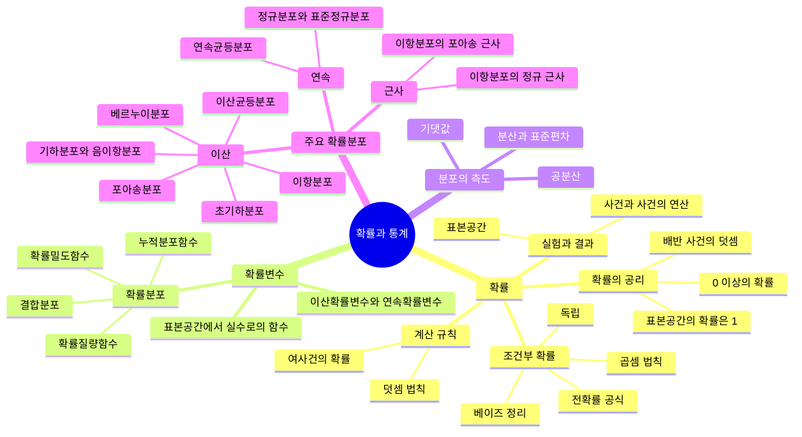

# HW1 과제 해설 — 확률과 확률변수

[레포지토리 안내](../../README.ko.md) | [English](Assignment-Explanation.md) | [한국어](Assignment-Explanation.ko.md)

> **최종 수정일:** 2026-11-04

> **학습 목표:**
> 1. 확률분포의 성질과 기댓값 조건으로 확률분포표의 미지 상수를 구할 수 있다
> 2. 조건부 확률, 사건의 독립, 베이즈 정리를 문제 상황에 적용할 수 있다
> 3. 문제 상황에서 포아송분포, 초기하분포, 이항분포를 식별하고 확률질량함수, 기댓값, 분산을 구할 수 있다
> 4. 기댓값과 분산의 선형 변환 공식과 $E[X^2] = \mathrm{Var}(X) + \mu^2$를 유도하고 활용할 수 있다
> 5. 결합확률질량함수에서 결합누적분포함수를 만들고, 무상관과 독립을 구별할 수 있다

---

## 목차

- [1. 과제 구성](#1-과제-구성)
- [2. 확률분포와 기댓값](#2-확률분포와-기댓값)
  - [2.1 Q1. 확률분포표의 미지 상수](#21-q1-확률분포표의-미지-상수)
  - [2.2 Q4. 확률변수의 함수의 기댓값](#22-q4-확률변수의-함수의-기댓값)
  - [2.3 Q6. 최댓값의 확률분포와 선형 변환](#23-q6-최댓값의-확률분포와-선형-변환)
  - [2.4 Q11. 제곱의 기댓값과 분산의 관계](#24-q11-제곱의-기댓값과-분산의-관계)
- [3. 사건의 확률](#3-사건의-확률)
  - [3.1 Q2. 조건부 확률](#31-q2-조건부-확률)
  - [3.2 Q8. 독립 사건의 교집합](#32-q8-독립-사건의-교집합)
  - [3.3 Q10. 베이즈 정리의 의미](#33-q10-베이즈-정리의-의미)
- [4. 이산확률분포](#4-이산확률분포)
  - [4.1 Q3. 포아송분포](#41-q3-포아송분포)
  - [4.2 Q5. 초기하분포](#42-q5-초기하분포)
  - [4.3 Q7. 이항분포와 정규 근사](#43-q7-이항분포와-정규-근사)
  - [4.4 Q9. 이항분포의 분산에서 시행 횟수 구하기](#44-q9-이항분포의-분산에서-시행-횟수-구하기)
- [5. 결합분포](#5-결합분포)
  - [5.1 Q12. 결합누적분포함수](#51-q12-결합누적분포함수)
  - [5.2 Q13. 기댓값의 곱과 독립성](#52-q13-기댓값의-곱과-독립성)
- [6. Q14. 확률과 확률변수의 개념 지도](#6-q14-확률과-확률변수의-개념-지도)
- [요약](#요약)
- [점검 문제](#점검-문제)

---

<br>

## 1. 과제 구성

이 과제는 R 코드 없이 손으로 푸는 14개 문항으로 이루어지며, 확률의 기본 법칙(2강), 확률변수와 기댓값, 분산(3강), 이산확률분포(4강), 정규 근사(5강)를 다룬다. 계산이 복잡한 문항(조합, 제곱근 등)은 최종 수치까지 구하지 않아도 되며 풀이 과정을 정확히 보이는 것이 중요하다. 이 문서는 문항을 주제별로 묶어 풀이한다.

```plaintext
Coursework/HW01_Probability-and-Random-Variables/
├── Assignment-Explanation.ko.md
├── Assignment-Explanation.md
├── Original/
│   └── HW1.docx                  # 과제 원본
└── Solution/
    └── Assignment-Report.pdf     # 손으로 쓴 풀이
```

*그림 1. HW1 과제의 디렉토리 구성*

| 문항 | 주제 | 관련 단원 |
|:-----|:-----|:-----|
| Q1, Q4, Q6 | 확률분포표, 기댓값, 분산, 선형 변환 | 3강 |
| Q2, Q8, Q10 | 조건부 확률, 독립, 베이즈 정리 | 2강 |
| Q3, Q5, Q7, Q9 | 포아송분포, 초기하분포, 이항분포, 정규 근사 | 4강, 5강 |
| Q11 | $E[X^2]$와 분산의 관계 증명 | 3강 |
| Q12, Q13 | 결합누적분포함수, 기댓값의 곱, 독립 | 3강 |
| Q14 | 2\~5강 내용의 개념 지도 | 2\~5강 |

*표 1. 문항별 주제와 관련 단원*

---

<br>

## 2. 확률분포와 기댓값

### 2.1 Q1. 확률분포표의 미지 상수

**문제.** 이산확률변수 $X$의 확률분포가 다음과 같고 $E(X^2) = a + 5$일 때 $b - a$의 값을 구한다($a$, $b$는 상수).

| $x$ | 1 | 2 | 3 |
|:-----:|:-----:|:-----:|:-----:|
| $P(X = x)$ | $a$ | $a + b$ | $b$ |

*표 2. Q1의 확률분포표*

**풀이.** 미지수가 두 개이므로 식이 두 개 필요하다. 첫째 식은 **확률분포의 성질**, 즉 모든 확률의 합이 1이라는 조건에서 얻는다.

```math
a + (a + b) + b = 2a + 2b = 1 \quad\Rightarrow\quad a + b = \frac{1}{2}
```

둘째 식은 주어진 기댓값 조건에서 얻는다. 확률변수의 함수 $g(X) = X^2$의 기댓값은 각 값 $x$에 대해 $g(x)$에 확률을 곱해 더한 것이다.

```math
E(X^2) = 1^2 \cdot a + 2^2 \cdot (a + b) + 3^2 \cdot b = a + 4a + 4b + 9b = 5a + 13b
```

$5a + 13b = a + 5$이므로 $4a + 13b = 5$이다. 첫째 식에서 $a = \frac{1}{2} - b$를 대입하면 다음과 같다.

```math
4\left(\frac{1}{2} - b\right) + 13b = 2 + 9b = 5 \quad\Rightarrow\quad b = \frac{1}{3}, \quad a = \frac{1}{2} - \frac{1}{3} = \frac{1}{6}
```

따라서 $b - a = \frac{1}{3} - \frac{1}{6} = \frac{1}{6}$이다. 구한 값으로 확률은 $\frac{1}{6}, \frac{1}{2}, \frac{1}{3}$이 되어 모두 0 이상이고 합이 1이므로 올바른 확률분포이다.

> **주의:** 미지 상수를 구한 뒤에는 모든 확률이 0 이상 1 이하인지 확인해야 한다. 연립방정식의 해가 음수 확률을 만들면 그 조건을 만족하는 확률분포는 존재하지 않는다.

### 2.2 Q4. 확률변수의 함수의 기댓값

**문제.** 동전 4개를 동시에 던져 앞면이 나오는 동전의 개수를 $X$라 하고, $X$가 0 또는 1이면 $Y = X$, $X$가 2 이상이면 $Y = 2$라 할 때 $E(Y)$를 구한다.

**풀이.** 각 동전이 서로 독립이고 앞면의 확률이 $\frac{1}{2}$이면 $X$는 이항분포 $B(4, \frac{1}{2})$를 따른다.

```math
P(X = k) = \binom{4}{k}\left(\frac{1}{2}\right)^k\left(\frac{1}{2}\right)^{4-k} = \frac{\binom{4}{k}}{16}, \quad k = 0, 1, 2, 3, 4
```

이 식으로 $X$의 분포를 구하고, $Y$의 각 값에 대응하는 $X$의 확률을 모은다. $Y = 2$에는 $X = 2, 3, 4$가 모두 대응한다.

| $X$ | 0 | 1 | 2 | 3 | 4 |
|:-----:|:-----:|:-----:|:-----:|:-----:|:-----:|
| $P(X = x)$ | $\frac{1}{16}$ | $\frac{4}{16}$ | $\frac{6}{16}$ | $\frac{4}{16}$ | $\frac{1}{16}$ |
| $Y$ | 0 | 1 | 2 | 2 | 2 |

*표 3. 앞면의 개수 X의 분포와 대응하는 Y의 값*

따라서 $P(Y = 0) = \frac{1}{16}$, $P(Y = 1) = \frac{4}{16}$, $P(Y = 2) = \frac{6 + 4 + 1}{16} = \frac{11}{16}$이고, 기댓값은 다음과 같다.

```math
E(Y) = 0 \cdot \frac{1}{16} + 1 \cdot \frac{4}{16} + 2 \cdot \frac{11}{16} = \frac{26}{16} = \frac{13}{8} = 1.625
```

$Y$의 분포를 따로 만들지 않고 $E[g(X)] = \sum_x g(x) P(X = x)$로 바로 계산해도 결과가 같다. $Y = \min(X, 2)$이므로 $E(Y)$는 $E(X) = 2$보다 작다.

### 2.3 Q6. 최댓값의 확률분포와 선형 변환

**문제.** 1부터 5까지의 숫자가 하나씩 적힌 공 5개에서 3개를 동시에 꺼낼 때, 꺼낸 공의 가장 큰 수를 $X$라 한다. $X$의 확률분포표를 완성하고 $E(4X + 3)$과 $\mathrm{Var}(2X + 2)$를 구한다.

**풀이.** 3개를 동시에 꺼내는 방법은 $\binom{5}{3} = 10$가지이고 모두 같은 확률이다. 최댓값이 $k$이려면 $k$가 적힌 공을 반드시 꺼내고, 나머지 2개를 $1, \dots, k-1$ 중에서 골라야 한다. 따라서 $X$가 가질 수 있는 값은 3, 4, 5이고 확률은 다음과 같다.

```math
P(X = k) = \frac{\binom{k-1}{2}}{\binom{5}{3}}, \quad k = 3, 4, 5
```

| $X$ | 3 | 4 | 5 |
|:-----:|:-----:|:-----:|:-----:|
| 경우의 수 | $\binom{2}{2} = 1$ | $\binom{3}{2} = 3$ | $\binom{4}{2} = 6$ |
| $P(X = x)$ | $\frac{1}{10}$ | $\frac{3}{10}$ | $\frac{6}{10}$ |

*표 4. 최댓값 X의 확률분포*

기댓값과 제곱의 기댓값은 다음과 같다.

```math
E(X) = 3 \cdot \frac{1}{10} + 4 \cdot \frac{3}{10} + 5 \cdot \frac{6}{10} = \frac{3 + 12 + 30}{10} = \frac{9}{2}
```

```math
E(X^2) = 9 \cdot \frac{1}{10} + 16 \cdot \frac{3}{10} + 25 \cdot \frac{6}{10} = \frac{9 + 48 + 150}{10} = \frac{207}{10}
```

```math
\mathrm{Var}(X) = E(X^2) - \lbrace E(X)\rbrace^2 = \frac{207}{10} - \frac{81}{4} = \frac{414 - 405}{20} = \frac{9}{20}
```

상수 $a$, $b$에 대해 $E(aX + b) = aE(X) + b$이고 $\mathrm{Var}(aX + b) = a^2\mathrm{Var}(X)$이다. 상수를 더하면 분포가 평행 이동할 뿐 퍼진 정도는 그대로이므로 분산에서 $b$가 사라지고, 값을 $a$배 하면 편차도 $a$배가 되므로 분산은 $a^2$배가 된다.

```math
E(4X + 3) = 4 \cdot \frac{9}{2} + 3 = 21, \qquad \mathrm{Var}(2X + 2) = 2^2 \cdot \frac{9}{20} = \frac{9}{5}
```

### 2.4 Q11. 제곱의 기댓값과 분산의 관계

**문제.** $E[X^2] = \mathrm{Sd}(X)^2 + \mu^2$가 참인지 거짓인지 보인다. 여기서 $\mu = E[X]$이고 $\mathrm{Sd}(X)$는 표준편차이다.

**풀이.** 참이다. 표준편차의 제곱은 분산이므로 $\mathrm{Sd}(X)^2 = \mathrm{Var}(X)$이고, 분산의 정의 $\mathrm{Var}(X) = E[(X - \mu)^2]$에서 출발해 전개한다.

```math
\begin{aligned}
\mathrm{Var}(X) &= E[(X - \mu)^2] = E[X^2 - 2\mu X + \mu^2] \\
&= E[X^2] - 2\mu E[X] + \mu^2 \qquad (\text{기댓값의 선형성, } \mu \text{는 상수}) \\
&= E[X^2] - 2\mu^2 + \mu^2 = E[X^2] - \mu^2
\end{aligned}
```

양변에 $\mu^2$를 더하면 $E[X^2] = \mathrm{Var}(X) + \mu^2 = \mathrm{Sd}(X)^2 + \mu^2$이다. 둘째 줄에서 **기댓값의 선형성**(linearity of expectation), 즉 $E[aX + bY + c] = aE[X] + bE[Y] + c$를 썼고, $\mu$는 확률변수가 아닌 상수이므로 $E[\mu^2] = \mu^2$이다. 이 유도는 이산형과 연속형에 모두 성립하며, $E[X^2]$가 유한하다는 것만 전제한다.

> **참고:** 분산을 구하는 공식 $\mathrm{Var}(X) = E[X^2] - \lbrace E[X]\rbrace^2$을 근거로 쓰면 증명할 명제를 가정하는 순환 논증이 된다. 증명은 분산의 정의 $E[(X - \mu)^2]$에서 시작해야 한다. 이 관계에서 $E[X^2] \ge \mu^2$이고, 등호는 분산이 0일 때, 즉 $X$가 확률 1로 상수일 때만 성립한다는 사실도 얻는다.

---

<br>

## 3. 사건의 확률

### 3.1 Q2. 조건부 확률

**문제.** 자녀가 2명인 가족에서 자녀 중 한 명이 남자아이라는 것을 알 때, 다른 아이도 남자아이일 확률을 구한다.

**풀이.** 각 아이가 서로 독립으로 남자(M)나 여자(F)일 확률이 각각 $\frac{1}{2}$이라 가정한다. 첫째와 둘째의 성별을 순서대로 적은 표본공간 $S = \lbrace MM, MF, FM, FF\rbrace$의 네 결과는 확률이 모두 $\frac{1}{4}$이다. "자녀 중 한 명이 남자아이"라는 정보는 적어도 한 명이 남자아이라는 사건 $B = \lbrace MM, MF, FM\rbrace$이고, 구하는 사건은 둘 다 남자아이인 $A = \lbrace MM\rbrace$이다. **조건부 확률**(conditional probability)의 정의 $P(A \mid B) = \frac{P(A \cap B)}{P(B)}$에 대입하면 다음과 같다.

```math
P(A \mid B) = \frac{P(\lbrace MM\rbrace)}{P(\lbrace MM, MF, FM\rbrace)} = \frac{1/4}{3/4} = \frac{1}{3}
```

조건이 주어지면 표본공간이 $B$로 줄어들고, 줄어든 표본공간의 세 결과 중 하나만 $A$에 속한다.

> **주의:** 답은 정보가 어떤 사건을 뜻하는지에 따라 달라진다. "첫째가 남자아이"처럼 특정한 아이에 대한 정보이면 조건 사건이 $\lbrace MM, MF\rbrace$가 되어 답은 $\frac{1}{2}$이다. "적어도 한 명"으로 읽는 것이 이 문제의 일반적인 해석이며, 두 해석의 차이는 조건부 확률에서 조건 사건을 정확히 정의해야 하는 이유를 보여 준다.

### 3.2 Q8. 독립 사건의 교집합

**문제.** 서로 독립인 두 사건 $A$, $B$에 대해 $P(A) = 0.3$, $P(B) = 0.4$일 때 $P(A \cap B)$를 구한다.

**풀이.** 두 사건이 **독립**(independent)이라는 것은 한 사건이 일어났다는 정보가 다른 사건의 확률을 바꾸지 않는다는 뜻이며, 정의는 $P(A \cap B) = P(A)P(B)$이다. 따라서 $P(A \cap B) = 0.3 \times 0.4 = 0.12$이다.

> **주의:** 독립과 배반을 혼동하지 않아야 한다. 배반 사건은 $P(A \cap B) = 0$이므로, 확률이 0이 아닌 두 사건은 배반이면서 동시에 독립일 수 없다.

### 3.3 Q10. 베이즈 정리의 의미

**문제.** 베이즈 정리를 "inferred [ ] based on [ ]"라는 한 문장으로 정의할 때 빈칸에 들어갈 용어를 쓴다. 한국어 문장은 "[ ]에 기초하여 [ ]를 추론한다"이다.

**풀이.** 베이즈 정리는 **사전 확률**(prior probability)에 기초하여 **사후 확률**(posterior probability)을 추론한다. 영어 문장의 빈칸 순서로는 첫째가 사후 확률, 둘째가 사전 확률이고, 한국어 문장의 순서로는 첫째가 사전 확률, 둘째가 사후 확률이다.

```math
P(A \mid B) = \frac{P(B \mid A)\,P(A)}{P(B)}
```

- $P(A)$는 사건 $B$를 관측하기 전의 믿음인 사전 확률이다.
- $P(B \mid A)$는 $A$가 참일 때 관측 $B$가 나올 확률인 **가능도**(likelihood)이다.
- $P(A \mid B)$는 $B$를 관측한 뒤 갱신된 확률인 사후 확률이다.
- 분모 $P(B)$는 전확률 공식으로 $P(B \mid A)P(A) + P(B \mid A^c)P(A^c)$와 같이 계산한다.

엄밀하게는 사후 확률을 사전 확률만으로 구하는 것이 아니라, 사전 확률과 관측 자료의 가능도를 함께 써서 구한다.

---

<br>

## 4. 이산확률분포

### 4.1 Q3. 포아송분포

**문제.** 어느 가정에 전화가 하루 평균 4통 올 때, 내일 정확히 2통이 올 확률을 구한다. 확률변수의 표기, 확률질량함수, $E(X)$, $\mathrm{Var}(X)$, $P(X = 2)$를 차례로 답한다.

**풀이.** 정해진 시간 동안 사건이 서로 독립으로, 일정한 평균 비율로 일어날 때 그 횟수는 **포아송분포**(Poisson distribution)를 따른다. 하루 동안 오는 전화의 수를 $X$라 하면 다음과 같다.

| 항목 | 답 |
|:-----|:-----|
| 확률변수의 표기 | $X \sim Poi(4)$ |
| 확률질량함수 | $`P(X = x) = \dfrac{e^{-4}\,4^x}{x!}, \quad x = 0, 1, 2, \dots`$ |
| $E(X)$ | $\lambda = 4$ |
| $\mathrm{Var}(X)$ | $\lambda = 4$ |
| $P(X = 2)$ | $`\dfrac{e^{-4}\,4^2}{2!} = 8e^{-4} \approx 0.1465`$ |

*표 5. Q3의 포아송분포 풀이*

포아송분포는 평균과 분산이 모두 $\lambda$로 같다는 특징이 있다.

### 4.2 Q5. 초기하분포

**문제.** 냉장고에 콜라 9캔이 있고 그중 펩시가 3캔, 코카콜라가 6캔이다. 4캔을 꺼낼 때 코카콜라가 3캔일 확률을 구한다. 확률변수의 표기, 확률질량함수, $E(X)$, $\mathrm{Var}(X)$, $P(X = 3)$을 차례로 답한다.

**풀이.** 꺼낸 캔을 다시 넣지 않으므로(비복원추출) 매번의 성공 확률이 달라지고, 성공의 개수는 **초기하분포**(hypergeometric distribution)를 따른다. 모집단 크기 $N = 9$, 그중 성공(코카콜라)의 개수 $r = 6$, 표본 크기 $n = 4$이고, $X$는 꺼낸 4캔 중 코카콜라의 개수이다.

| 항목 | 답 |
|:-----|:-----|
| 확률변수의 표기 | $X \sim HG(n = 4, N = 9, r = 6)$ |
| 확률질량함수 | $P(X = x) = \dfrac{\binom{6}{x}\binom{3}{4 - x}}{\binom{9}{4}}, \quad x = 1, 2, 3, 4$ |
| $E(X)$ | $n\dfrac{r}{N} = 4 \cdot \dfrac{6}{9} = \dfrac{8}{3}$ |
| $\mathrm{Var}(X)$ | $n\dfrac{r}{N}\left(1 - \dfrac{r}{N}\right)\dfrac{N - n}{N - 1} = 4 \cdot \dfrac{2}{3} \cdot \dfrac{1}{3} \cdot \dfrac{5}{8} = \dfrac{5}{9}$ |
| $P(X = 3)$ | $\dfrac{\binom{6}{3}\binom{3}{1}}{\binom{9}{4}} = \dfrac{20 \cdot 3}{126} = \dfrac{10}{21} \approx 0.4762$ |

*표 6. Q5의 초기하분포 풀이*

펩시가 3캔뿐이므로 4캔을 꺼내면 코카콜라가 적어도 1캔 나온다. 그래서 $X$의 범위는 $\max(0, n - (N - r)) = 1$부터 $\min(n, r) = 4$까지이다. 분산의 마지막 인수 $\frac{N - n}{N - 1}$은 **유한모집단 수정계수**(finite population correction factor)로, 복원추출이었다면 $X \sim B(4, \frac{2}{3})$이고 분산이 $4 \cdot \frac{2}{3} \cdot \frac{1}{3} = \frac{8}{9}$였을 것을 비복원추출에 맞게 줄인다.

### 4.3 Q7. 이항분포와 정규 근사

**문제.** Seo가 게임에서 평균적으로 5판 중 3판을 이긴다고 할 때, 100판 중 70판을 이길 확률을 구하기 위해 확률변수의 표기, 확률질량함수, $E(X)$, $\mathrm{Var}(X)$, $P(X \ge 70)$을 답한다.

**풀이.** 각 판의 승패가 서로 독립이고 이길 확률이 $p = \frac{3}{5} = 0.6$으로 일정하면, 100판 중 이긴 횟수 $X$는 **이항분포**(binomial distribution)를 따른다.

| 항목 | 답 |
|:-----|:-----|
| 확률변수의 표기 | $X \sim B(100, 0.6)$ |
| 확률질량함수 | $P(X = x) = \binom{100}{x}(0.6)^x(0.4)^{100 - x}, \quad x = 0, 1, \dots, 100$ |
| $E(X)$ | $np = 100 \cdot 0.6 = 60$ |
| $\mathrm{Var}(X)$ | $np(1 - p) = 100 \cdot 0.6 \cdot 0.4 = 24$ |
| $P(X \ge 70)$ | $\displaystyle\sum_{x=70}^{100}\binom{100}{x}(0.6)^x(0.4)^{100 - x} \approx 0.0248$ |

*표 7. Q7의 이항분포 풀이*

문제의 본문은 "70판을 이길 확률"이고 소문항은 $P(X \ge 70)$이므로 두 값을 모두 구해 둔다. 정확히 70판을 이길 확률은 $P(X = 70) = \binom{100}{70}(0.6)^{70}(0.4)^{30} \approx 0.0100$이다.

합이 31개 항이어서 손으로 계산하기 어려우므로 **정규 근사**(normal approximation)를 쓸 수 있다. $np = 60 \ge 5$이고 $n(1 - p) = 40 \ge 5$이므로 $X$는 근사적으로 $N(60, 24)$를 따르고, 표준편차는 $\sqrt{24} \approx 4.899$이다. 이산 분포를 연속 분포로 근사하므로 경계에 0.5를 더하거나 빼는 **연속성 수정**(continuity correction)을 적용한다.

```math
P(X \ge 70) \approx P\left(Z \ge \frac{69.5 - 60}{\sqrt{24}}\right) = P(Z \ge 1.939) \approx 0.0262
```

```math
P(X = 70) \approx P\left(\frac{69.5 - 60}{\sqrt{24}} \le Z \le \frac{70.5 - 60}{\sqrt{24}}\right) = P(1.939 \le Z \le 2.143) \approx 0.0102
```

근사값 0.0262와 0.0102는 정확한 값 0.0248과 0.0100에 가깝다. 연속성 수정 없이 $P(Z \ge \frac{70 - 60}{\sqrt{24}}) = P(Z \ge 2.041)$로 계산하면 약 0.0206이 되어 오차가 더 크다.

### 4.4 Q9. 이항분포의 분산에서 시행 횟수 구하기

**문제.** $X \sim B(n, \frac{1}{3})$이고 $\mathrm{Var}(2X) = 40$일 때 $n$을 구한다.

**풀이.** 이항분포의 분산은 $np(1 - p)$이므로 $\mathrm{Var}(X) = n \cdot \frac{1}{3} \cdot \frac{2}{3} = \frac{2n}{9}$이다. 2.3절의 성질 $\mathrm{Var}(aX) = a^2\mathrm{Var}(X)$에서 $\mathrm{Var}(2X) = 4 \cdot \frac{2n}{9} = \frac{8n}{9}$이고, $\frac{8n}{9} = 40$을 풀면 $n = 45$이다.

---

<br>

## 5. 결합분포

Q12와 Q13은 두 확률변수 $X$, $Y$의 **결합확률질량함수**(joint probability mass function) $p_{X,Y}(x, y) = P(X = x, Y = y)$가 다음과 같을 때의 문제이다. 행의 합과 열의 합은 각각 **주변확률질량함수**(marginal probability mass function) $p_X(x)$, $p_Y(y)$이다.

| | $y = 6$ | $y = 8$ | $y = 10$ | $p_X(x)$ |
|:-----:|:-----:|:-----:|:-----:|:-----:|
| $x = 1$ | $\frac{1}{5}$ | 0 | $\frac{1}{5}$ | $\frac{2}{5}$ |
| $x = 2$ | 0 | $\frac{1}{5}$ | 0 | $\frac{1}{5}$ |
| $x = 3$ | $\frac{1}{5}$ | 0 | $\frac{1}{5}$ | $\frac{2}{5}$ |
| $p_Y(y)$ | $\frac{2}{5}$ | $\frac{1}{5}$ | $\frac{2}{5}$ | 1 |

*표 8. X와 Y의 결합확률질량함수와 주변확률질량함수*

### 5.1 Q12. 결합누적분포함수

**문제.** **결합누적분포함수**(joint cumulative distribution function) $F_{X,Y}(x, y) = P(X \le x, Y \le y)$를 완성한다.

**풀이.** $F_{X,Y}(x_i, y_j)$는 $x \le x_i$이고 $y \le y_j$인 모든 칸의 확률을 더한 값이다. 표 8에서 왼쪽 위 모서리부터 $(x_i, y_j)$ 칸까지의 직사각형 안을 모두 더하면 된다. 예를 들어 다음과 같다.

```math
F_{X,Y}(2, 8) = p(1, 6) + p(1, 8) + p(2, 6) + p(2, 8) = \frac{1}{5} + 0 + 0 + \frac{1}{5} = \frac{2}{5}
```

| $F_{X,Y}(x, y)$ | $y = 6$ | $y = 8$ | $y = 10$ |
|:-----:|:-----:|:-----:|:-----:|
| $x = 1$ | $\frac{1}{5}$ | $\frac{1}{5}$ | $\frac{2}{5}$ |
| $x = 2$ | $\frac{1}{5}$ | $\frac{2}{5}$ | $\frac{3}{5}$ |
| $x = 3$ | $\frac{2}{5}$ | $\frac{3}{5}$ | 1 |

*표 9. 격자점에서 X와 Y의 결합누적분포함수*

마지막 행 $F_{X,Y}(3, y)$는 $Y$의 누적분포함수 $\frac{2}{5}, \frac{3}{5}, 1$과 같고, 마지막 열 $F_{X,Y}(x, 10)$은 $X$의 누적분포함수 $\frac{2}{5}, \frac{3}{5}, 1$과 같다. 이는 $x$나 $y$가 가장 큰 값 이상이면 그 변수에 대한 조건이 항상 참이 되기 때문이며, 표를 검산하는 데 쓸 수 있다.

> **참고:** 결합누적분포함수는 격자점뿐 아니라 모든 실수 쌍 $(x, y)$에서 정의되는 계단 함수이다. $x < 1$이거나 $y < 6$이면 $F_{X,Y}(x, y) = 0$이고, 그 밖의 점에서는 $x_i \le x$, $y_j \le y$를 만족하는 가장 큰 격자점 $(x_i, y_j)$의 값과 같다. 예를 들어 $F_{X,Y}(2.5, 9) = F_{X,Y}(2, 8) = \frac{2}{5}$이고, $x \ge 3$이고 $y \ge 10$이면 1이다.

### 5.2 Q13. 기댓값의 곱과 독립성

**문제.** $E[X]$, $E[Y]$, $E[XY]$를 구하고 $E[XY] = E[X]E[Y]$가 성립하는지 확인한 뒤, $X$와 $Y$가 독립인지 결론을 내린다.

**풀이.** 주변확률질량함수로 각 기댓값을 구한다.

```math
E[X] = 1 \cdot \frac{2}{5} + 2 \cdot \frac{1}{5} + 3 \cdot \frac{2}{5} = \frac{10}{5} = 2, \qquad E[Y] = 6 \cdot \frac{2}{5} + 8 \cdot \frac{1}{5} + 10 \cdot \frac{2}{5} = \frac{40}{5} = 8
```

$E[XY]$는 결합확률질량함수에서 확률이 0이 아닌 다섯 칸만 더하면 된다.

```math
E[XY] = \sum_{x}\sum_{y} xy\,p(x, y) = \frac{1 \cdot 6 + 1 \cdot 10 + 2 \cdot 8 + 3 \cdot 6 + 3 \cdot 10}{5} = \frac{6 + 10 + 16 + 18 + 30}{5} = \frac{80}{5} = 16
```

$E[X]E[Y] = 2 \cdot 8 = 16$이므로 $E[XY] = E[X]E[Y]$가 성립하고, **공분산**(covariance) $\mathrm{Cov}(X, Y) = E[XY] - E[X]E[Y] = 0$이다. 즉 $X$와 $Y$는 **무상관**(uncorrelated)이다.

그러나 $X$와 $Y$는 **독립이 아니다.** 두 이산확률변수가 독립이려면 모든 $(x, y)$에 대해 $p(x, y) = p_X(x)p_Y(y)$가 성립해야 하는데, 한 칸만 확인해도 성립하지 않는다.

```math
p(1, 6) = \frac{1}{5} \ne p_X(1)\,p_Y(6) = \frac{2}{5} \cdot \frac{2}{5} = \frac{4}{25}
```

$p(2, 6) = 0 \ne \frac{1}{5} \cdot \frac{2}{5}$도 반례이다. 실제로 $X = 2$이면 $Y = 8$로 정해지고, $X$가 1이나 3이면 $Y$는 6이나 10이므로 $X$의 값이 $Y$의 분포를 바꾼다. 이 의존 관계는 $x = 2$를 중심으로 대칭이어서 직선적인 경향이 없고, 직선적인 관계만 재는 공분산은 0이 된다.

> **핵심:** 독립이면 $E[XY] = E[X]E[Y]$, 즉 무상관이지만, 그 역은 성립하지 않는다. $E[XY] = E[X]E[Y]$는 독립을 판정하는 근거가 될 수 없고, 독립은 결합확률질량함수가 주변확률질량함수의 곱으로 분해되는지로 판정한다.

---

<br>

## 6. Q14. 확률과 확률변수의 개념 지도

**문제.** 2\~5강에서 배운 내용을 한 쪽 분량의 마인드맵으로 정리한다.

**풀이.** 개념 사이의 위계가 드러나도록 확률, 확률변수, 분포의 측도, 주요 확률분포의 네 갈래로 나눈다. 각 갈래는 앞 갈래의 개념을 바탕으로 한다. 확률변수는 표본공간 위에서 정의되고, 기댓값과 분산은 확률분포로 계산하며, 주요 확률분포는 특정한 실험 상황에 맞는 확률질량함수나 확률밀도함수의 모음이다.



*그림 2. 2~5강 내용의 개념 지도*

근사 갈래는 두 분포를 잇는 조건을 함께 기억해야 한다. 이항분포 $B(n, p)$는 $np \ge 5$이고 $n(1 - p) \ge 5$일 때 $N(np, np(1 - p))$로 근사하고(4.3절), $n$이 크고 $p$가 작을 때 $Poi(np)$로 근사한다.

---

<br>

## 요약

| 개념 | 핵심 요약 |
|:-----|:-----|
| 확률분포의 성질 | 모든 확률은 0 이상이고 합이 1이며, 이 조건이 미지 상수를 구하는 첫째 식이 된다. |
| 확률변수의 함수의 기댓값 | $E[g(X)] = \sum_x g(x)P(X = x)$로 계산하며, $g(X)$의 분포를 따로 구하지 않아도 된다. |
| 선형 변환 | $E(aX + b) = aE(X) + b$이고 $\mathrm{Var}(aX + b) = a^2\mathrm{Var}(X)$이다. |
| 분산의 계산 공식 | 분산의 정의 $E[(X - \mu)^2]$를 기댓값의 선형성으로 전개하면 $E[X^2] = \mathrm{Var}(X) + \mu^2$가 된다. |
| 조건부 확률 | $P(A \mid B) = P(A \cap B) / P(B)$이며, 조건 사건을 정확히 정의해야 답이 정해진다. |
| 독립 사건 | $P(A \cap B) = P(A)P(B)$이고, 확률이 0이 아닌 배반 사건은 독립이 아니다. |
| 베이즈 정리 | 사전 확률과 가능도로 사후 확률을 추론한다. |
| 포아송분포 | 일정한 비율로 독립적으로 일어나는 사건의 횟수를 나타내며 평균과 분산이 모두 $\lambda$이다. |
| 초기하분포 | 비복원추출에서 성공의 개수를 나타내며 분산에 유한모집단 수정계수 $\frac{N - n}{N - 1}$이 곱해진다. |
| 이항분포와 정규 근사 | $B(n, p)$의 평균은 $np$, 분산은 $np(1 - p)$이고, $np$와 $n(1 - p)$가 충분히 크면 연속성 수정과 함께 정규분포로 근사한다. |
| 결합누적분포함수 | $F_{X,Y}(x, y) = P(X \le x, Y \le y)$는 해당 영역의 결합확률을 모두 더한 계단 함수이다. |
| 무상관과 독립 | 독립이면 무상관이지만 무상관이라고 독립은 아니며, 독립은 $p(x, y) = p_X(x)p_Y(y)$로 판정한다. |

---

<br>

## 점검 문제

1. **확률분포표:** $P(X = 0) = c$, $P(X = 1) = 2c$, $P(X = 2) = 3c$일 때 $c$와 $E(X)$를 구하라.

   <details>
   <summary>정답</summary>

   확률의 합이 $6c = 1$이므로 $c = \frac{1}{6}$이다. $E(X) = 0 \cdot \frac{1}{6} + 1 \cdot \frac{2}{6} + 2 \cdot \frac{3}{6} = \frac{8}{6} = \frac{4}{3}$이다.

   </details>

2. **선형 변환:** $E(X) = 3$, $\mathrm{Var}(X) = 2$일 때 $E(-2X + 5)$와 $\mathrm{Var}(-2X + 5)$는?

   <details>
   <summary>정답</summary>

   $E(-2X + 5) = -2 \cdot 3 + 5 = -1$이고, $\mathrm{Var}(-2X + 5) = (-2)^2 \cdot 2 = 8$이다. 계수가 음수여도 분산에는 제곱이 곱해지므로 분산은 음수가 되지 않는다.

   </details>

3. **분포의 식별:** 52장의 카드에서 5장을 비복원으로 뽑을 때 하트의 개수와, 복원으로 뽑을 때 하트의 개수는 각각 어떤 분포를 따르는가?

   <details>
   <summary>정답</summary>

   비복원이면 초기하분포 $HG(n = 5, N = 52, r = 13)$, 복원이면 매번의 성공 확률이 $\frac{1}{4}$로 일정하므로 이항분포 $B(5, \frac{1}{4})$를 따른다. 두 분포의 평균은 모두 $\frac{5}{4}$이지만 초기하분포의 분산은 유한모집단 수정계수 $\frac{47}{51}$만큼 작다.

   </details>

4. **무상관과 독립:** $X$가 $-1, 0, 1$을 각각 확률 $\frac{1}{3}$로 갖고 $Y = X^2$일 때 $\mathrm{Cov}(X, Y)$를 구하고 $X$와 $Y$가 독립인지 판정하라.

   <details>
   <summary>정답</summary>

   $E[X] = 0$이고 $E[XY] = E[X^3] = \frac{-1 + 0 + 1}{3} = 0$이므로 $\mathrm{Cov}(X, Y) = 0 - 0 \cdot E[Y] = 0$이다. 그러나 $P(X = 0, Y = 1) = 0$인데 $P(X = 0)P(Y = 1) = \frac{1}{3} \cdot \frac{2}{3} = \frac{2}{9}$이므로 독립이 아니다. $Y$는 $X$에 의해 완전히 정해진다.

   </details>

5. **정규 근사:** $X \sim B(100, 0.6)$에서 $P(X \le 55)$를 연속성 수정을 적용한 정규 근사로 나타내라.

   <details>
   <summary>정답</summary>

   $P(X \le 55) \approx P\left(Z \le \frac{55.5 - 60}{\sqrt{24}}\right) = P(Z \le -0.919) \approx 0.179$이다. "55 이하"는 이산 값 55를 포함하므로 경계를 55.5로 옮긴다.

   </details>
