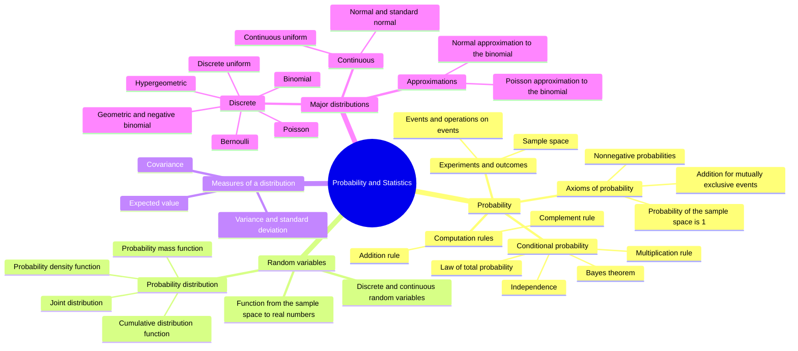

# HW1 Assignment Explanation — Probability and Random Variables

[Repository Guide](../../README.md) | [English](Assignment-Explanation.md) | [한국어](Assignment-Explanation.ko.md)

> **Last Updated:** 2026-11-04

> **Learning Objectives:**
> 1. Find the unknown constants of a probability table from the properties of a probability distribution and an expectation condition
> 2. Apply conditional probability, independence of events, and Bayes' theorem to problem situations
> 3. Identify the Poisson, hypergeometric, and binomial distributions in a problem and find their probability mass functions, expected values, and variances
> 4. Derive and use the formulas for linear transformations of expectation and variance and the identity $E[X^2] = \mathrm{Var}(X) + \mu^2$
> 5. Build a joint cumulative distribution function from a joint probability mass function and distinguish uncorrelatedness from independence

---

## Table of Contents

- [1. Assignment Structure](#1-assignment-structure)
- [2. Probability Distributions and Expectation](#2-probability-distributions-and-expectation)
  - [2.1 Q1. Unknown Constants in a Probability Table](#21-q1-unknown-constants-in-a-probability-table)
  - [2.2 Q4. Expectation of a Function of a Random Variable](#22-q4-expectation-of-a-function-of-a-random-variable)
  - [2.3 Q6. Distribution of a Maximum and Linear Transformations](#23-q6-distribution-of-a-maximum-and-linear-transformations)
  - [2.4 Q11. The Expected Square and the Variance](#24-q11-the-expected-square-and-the-variance)
- [3. Probabilities of Events](#3-probabilities-of-events)
  - [3.1 Q2. Conditional Probability](#31-q2-conditional-probability)
  - [3.2 Q8. Intersection of Independent Events](#32-q8-intersection-of-independent-events)
  - [3.3 Q10. Meaning of Bayes' Theorem](#33-q10-meaning-of-bayes-theorem)
- [4. Discrete Probability Distributions](#4-discrete-probability-distributions)
  - [4.1 Q3. The Poisson Distribution](#41-q3-the-poisson-distribution)
  - [4.2 Q5. The Hypergeometric Distribution](#42-q5-the-hypergeometric-distribution)
  - [4.3 Q7. The Binomial Distribution and the Normal Approximation](#43-q7-the-binomial-distribution-and-the-normal-approximation)
  - [4.4 Q9. Number of Trials from a Binomial Variance](#44-q9-number-of-trials-from-a-binomial-variance)
- [5. Joint Distributions](#5-joint-distributions)
  - [5.1 Q12. The Joint Cumulative Distribution Function](#51-q12-the-joint-cumulative-distribution-function)
  - [5.2 Q13. Product of Expectations and Independence](#52-q13-product-of-expectations-and-independence)
- [6. Q14. Concept Map of Probability and Random Variables](#6-q14-concept-map-of-probability-and-random-variables)
- [Summary](#summary)
- [Self-Check Questions](#self-check-questions)

---

<br>

## 1. Assignment Structure

The assignment consists of 14 problems solved by hand without R code and covers the basic laws of probability (Lecture 2), random variables, expectation, and variance (Lecture 3), discrete probability distributions (Lecture 4), and the normal approximation (Lecture 5). Problems with heavy computation (combinations, square roots, and so on) need not be carried to a final number, and showing the solution process precisely is what matters. This document groups the problems by topic and solves them.

```plaintext
Coursework/HW01_Probability-and-Random-Variables/
├── Assignment-Explanation.ko.md
├── Assignment-Explanation.md
├── Original/
│   └── HW1.docx                  # Assignment handout
└── Solution/
    └── Assignment-Report.pdf     # Handwritten solution
```

*Figure 1. Directory structure of HW1*

| Problem | Topic | Related Unit |
|:-----|:-----|:-----|
| Q1, Q4, Q6 | Probability tables, expectation, variance, linear transformations | Lecture 3 |
| Q2, Q8, Q10 | Conditional probability, independence, Bayes' theorem | Lecture 2 |
| Q3, Q5, Q7, Q9 | Poisson, hypergeometric, and binomial distributions, normal approximation | Lectures 4, 5 |
| Q11 | Proof of the relation between $E[X^2]$ and the variance | Lecture 3 |
| Q12, Q13 | Joint cumulative distribution function, product of expectations, independence | Lecture 3 |
| Q14 | Concept map of Lectures 2-5 | Lectures 2-5 |

*Table 1. Topics and related units of each problem*

---

<br>

## 2. Probability Distributions and Expectation

### 2.1 Q1. Unknown Constants in a Probability Table

**Problem.** The discrete random variable $X$ has the following probability distribution. Given $E(X^2) = a + 5$, find $b - a$ ($a$ and $b$ are constants).

| $x$ | 1 | 2 | 3 |
|:-----:|:-----:|:-----:|:-----:|
| $P(X = x)$ | $a$ | $a + b$ | $b$ |

*Table 2. Probability table of Q1*

**Solution.** There are two unknowns, so two equations are needed. The first comes from a **property of probability distributions**: all probabilities add up to 1.

```math
a + (a + b) + b = 2a + 2b = 1 \quad\Rightarrow\quad a + b = \frac{1}{2}
```

The second comes from the given expectation. The expected value of a function $g(X) = X^2$ of a random variable is the sum of $g(x)$ times the probability over every value $x$.

```math
E(X^2) = 1^2 \cdot a + 2^2 \cdot (a + b) + 3^2 \cdot b = a + 4a + 4b + 9b = 5a + 13b
```

Since $5a + 13b = a + 5$, we have $4a + 13b = 5$. Substituting $a = \frac{1}{2} - b$ from the first equation gives the following.

```math
4\left(\frac{1}{2} - b\right) + 13b = 2 + 9b = 5 \quad\Rightarrow\quad b = \frac{1}{3}, \quad a = \frac{1}{2} - \frac{1}{3} = \frac{1}{6}
```

Therefore $b - a = \frac{1}{3} - \frac{1}{6} = \frac{1}{6}$. With these values the probabilities are $\frac{1}{6}, \frac{1}{2}, \frac{1}{3}$, all nonnegative and summing to 1, so the table is a valid probability distribution.

> **Caution:** After finding unknown constants, check that every probability lies between 0 and 1. If the solution of the system produces a negative probability, no probability distribution satisfies the conditions.

### 2.2 Q4. Expectation of a Function of a Random Variable

**Problem.** Four coins are tossed at once and $X$ is the number of heads. Let $Y = X$ if $X$ is 0 or 1, and $Y = 2$ if $X$ is 2 or more. Find $E(Y)$.

**Solution.** If the coins are independent and each shows heads with probability $\frac{1}{2}$, then $X$ follows the binomial distribution $B(4, \frac{1}{2})$.

```math
P(X = k) = \binom{4}{k}\left(\frac{1}{2}\right)^k\left(\frac{1}{2}\right)^{4-k} = \frac{\binom{4}{k}}{16}, \quad k = 0, 1, 2, 3, 4
```

This formula gives the distribution of $X$, and the probabilities of the values of $X$ are collected for each value of $Y$. The value $Y = 2$ corresponds to $X = 2, 3, 4$ together.

| $X$ | 0 | 1 | 2 | 3 | 4 |
|:-----:|:-----:|:-----:|:-----:|:-----:|:-----:|
| $P(X = x)$ | $\frac{1}{16}$ | $\frac{4}{16}$ | $\frac{6}{16}$ | $\frac{4}{16}$ | $\frac{1}{16}$ |
| $Y$ | 0 | 1 | 2 | 2 | 2 |

*Table 3. Distribution of the number of heads X and the corresponding values of Y*

Hence $P(Y = 0) = \frac{1}{16}$, $P(Y = 1) = \frac{4}{16}$, and $P(Y = 2) = \frac{6 + 4 + 1}{16} = \frac{11}{16}$, and the expected value is as follows.

```math
E(Y) = 0 \cdot \frac{1}{16} + 1 \cdot \frac{4}{16} + 2 \cdot \frac{11}{16} = \frac{26}{16} = \frac{13}{8} = 1.625
```

Computing $E[g(X)] = \sum_x g(x) P(X = x)$ directly, without building the distribution of $Y$, gives the same result. Because $Y = \min(X, 2)$, $E(Y)$ is smaller than $E(X) = 2$.

### 2.3 Q6. Distribution of a Maximum and Linear Transformations

**Problem.** Three balls are drawn at once from five balls labeled 1 to 5, and $X$ is the largest number among them. Complete the probability table of $X$ and find $E(4X + 3)$ and $\mathrm{Var}(2X + 2)$.

**Solution.** There are $\binom{5}{3} = 10$ equally likely ways to draw three balls at once. For the maximum to be $k$, the ball labeled $k$ must be drawn and the other two must be chosen from $1, \dots, k-1$. Thus $X$ takes the values 3, 4, and 5 with the following probabilities.

```math
P(X = k) = \frac{\binom{k-1}{2}}{\binom{5}{3}}, \quad k = 3, 4, 5
```

| $X$ | 3 | 4 | 5 |
|:-----:|:-----:|:-----:|:-----:|
| Number of cases | $\binom{2}{2} = 1$ | $\binom{3}{2} = 3$ | $\binom{4}{2} = 6$ |
| $P(X = x)$ | $\frac{1}{10}$ | $\frac{3}{10}$ | $\frac{6}{10}$ |

*Table 4. Probability distribution of the maximum X*

The expected value and the expected square are as follows.

```math
E(X) = 3 \cdot \frac{1}{10} + 4 \cdot \frac{3}{10} + 5 \cdot \frac{6}{10} = \frac{3 + 12 + 30}{10} = \frac{9}{2}
```

```math
E(X^2) = 9 \cdot \frac{1}{10} + 16 \cdot \frac{3}{10} + 25 \cdot \frac{6}{10} = \frac{9 + 48 + 150}{10} = \frac{207}{10}
```

```math
\mathrm{Var}(X) = E(X^2) - \lbrace E(X)\rbrace^2 = \frac{207}{10} - \frac{81}{4} = \frac{414 - 405}{20} = \frac{9}{20}
```

For constants $a$ and $b$, $E(aX + b) = aE(X) + b$ and $\mathrm{Var}(aX + b) = a^2\mathrm{Var}(X)$. Adding a constant only shifts the distribution and leaves its spread unchanged, so $b$ disappears from the variance, and multiplying the values by $a$ multiplies every deviation by $a$, so the variance is multiplied by $a^2$.

```math
E(4X + 3) = 4 \cdot \frac{9}{2} + 3 = 21, \qquad \mathrm{Var}(2X + 2) = 2^2 \cdot \frac{9}{20} = \frac{9}{5}
```

### 2.4 Q11. The Expected Square and the Variance

**Problem.** Show whether $E[X^2] = \mathrm{Sd}(X)^2 + \mu^2$ is true or false, where $\mu = E[X]$ and $\mathrm{Sd}(X)$ is the standard deviation.

**Solution.** It is true. The square of the standard deviation is the variance, $\mathrm{Sd}(X)^2 = \mathrm{Var}(X)$, and the derivation starts from the definition of the variance, $\mathrm{Var}(X) = E[(X - \mu)^2]$.

```math
\begin{aligned}
\mathrm{Var}(X) &= E[(X - \mu)^2] = E[X^2 - 2\mu X + \mu^2] \\
&= E[X^2] - 2\mu E[X] + \mu^2 \qquad (\text{linearity of expectation, } \mu \text{ is a constant}) \\
&= E[X^2] - 2\mu^2 + \mu^2 = E[X^2] - \mu^2
\end{aligned}
```

Adding $\mu^2$ to both sides gives $E[X^2] = \mathrm{Var}(X) + \mu^2 = \mathrm{Sd}(X)^2 + \mu^2$. The second line uses the **linearity of expectation**, $E[aX + bY + c] = aE[X] + bE[Y] + c$, and since $\mu$ is a constant rather than a random variable, $E[\mu^2] = \mu^2$. The derivation holds for both discrete and continuous random variables and assumes only that $E[X^2]$ is finite.

> **Note:** Using the computing formula $\mathrm{Var}(X) = E[X^2] - \lbrace E[X]\rbrace^2$ as the justification would be circular, since it assumes the statement to be proved. The proof must start from the definition $E[(X - \mu)^2]$. The relation also shows that $E[X^2] \ge \mu^2$, with equality only when the variance is 0, that is, when $X$ is constant with probability 1.

---

<br>

## 3. Probabilities of Events

### 3.1 Q2. Conditional Probability

**Problem.** A family has two children. Given that one of the children is a boy, find the probability that the other child is also a boy.

**Solution.** Assume that each child is a boy (M) or a girl (F) with probability $\frac{1}{2}$ each, independently. The four outcomes of the sample space $S = \lbrace MM, MF, FM, FF\rbrace$, which lists the sexes of the first and second child in order, each have probability $\frac{1}{4}$. The information "one of the children is a boy" is the event that at least one child is a boy, $B = \lbrace MM, MF, FM\rbrace$, and the event of interest is that both are boys, $A = \lbrace MM\rbrace$. Substituting into the definition of **conditional probability**, $P(A \mid B) = \frac{P(A \cap B)}{P(B)}$, gives the following.

```math
P(A \mid B) = \frac{P(\lbrace MM\rbrace)}{P(\lbrace MM, MF, FM\rbrace)} = \frac{1/4}{3/4} = \frac{1}{3}
```

Given the condition, the sample space shrinks to $B$, and only one of the three outcomes in the reduced sample space belongs to $A$.

> **Caution:** The answer depends on which event the information describes. If the information concerns a specific child, such as "the first child is a boy", the conditioning event is $\lbrace MM, MF\rbrace$ and the answer is $\frac{1}{2}$. Reading it as "at least one" is the usual interpretation of this problem, and the difference between the two readings shows why the conditioning event must be defined precisely in conditional probability.

### 3.2 Q8. Intersection of Independent Events

**Problem.** For independent events $A$ and $B$ with $P(A) = 0.3$ and $P(B) = 0.4$, find $P(A \cap B)$.

**Solution.** Two events are **independent** when knowing that one occurred does not change the probability of the other, and the definition is $P(A \cap B) = P(A)P(B)$. Therefore $P(A \cap B) = 0.3 \times 0.4 = 0.12$.

> **Caution:** Independence must not be confused with mutual exclusivity. Mutually exclusive events have $P(A \cap B) = 0$, so two events with nonzero probabilities cannot be both mutually exclusive and independent.

### 3.3 Q10. Meaning of Bayes' Theorem

**Problem.** When Bayes' theorem is defined in one sentence, "inferred [ ] based on [ ]", write the terms for the blanks. The Korean version of the sentence reads "[ ]에 기초하여 [ ]를 추론한다" (infers [ ] based on [ ], with the blanks in the opposite order).

**Solution.** Bayes' theorem infers the **posterior probability** based on the **prior probability**. In the order of the English sentence, the first blank is the posterior probability and the second is the prior probability, and in the order of the Korean sentence, the first is the prior probability and the second is the posterior probability.

```math
P(A \mid B) = \frac{P(B \mid A)\,P(A)}{P(B)}
```

- $P(A)$ is the prior probability, the belief before observing the event $B$.
- $P(B \mid A)$ is the **likelihood**, the probability of observing $B$ when $A$ is true.
- $P(A \mid B)$ is the posterior probability, the probability updated after observing $B$.
- The denominator $P(B)$ is computed by the law of total probability as $P(B \mid A)P(A) + P(B \mid A^c)P(A^c)$.

Strictly speaking, the posterior probability is obtained not from the prior probability alone but from the prior probability together with the likelihood of the observed data.

---

<br>

## 4. Discrete Probability Distributions

### 4.1 Q3. The Poisson Distribution

**Problem.** A household receives an average of four phone calls per day. Find the probability that it receives exactly two calls tomorrow by answering, in order, the notation of the random variable, the probability mass function, $E(X)$, $\mathrm{Var}(X)$, and $P(X = 2)$.

**Solution.** When events occur independently at a constant average rate over a fixed period, the number of events follows the **Poisson distribution**. Let $X$ be the number of calls received in one day.

| Item | Answer |
|:-----|:-----|
| Notation of the random variable | $X \sim Poi(4)$ |
| Probability mass function | $`P(X = x) = \dfrac{e^{-4}\,4^x}{x!}, \quad x = 0, 1, 2, \dots`$ |
| $E(X)$ | $\lambda = 4$ |
| $\mathrm{Var}(X)$ | $\lambda = 4$ |
| $P(X = 2)$ | $`\dfrac{e^{-4}\,4^2}{2!} = 8e^{-4} \approx 0.1465`$ |

*Table 5. Solution of Q3 with the Poisson distribution*

A characteristic of the Poisson distribution is that its mean and variance are both equal to $\lambda$.

### 4.2 Q5. The Hypergeometric Distribution

**Problem.** A refrigerator holds nine cans of cola, three of them Pepsi and six Coca-Cola. When four cans are taken out, find the probability that three of them are Coca-Cola by answering, in order, the notation of the random variable, the probability mass function, $E(X)$, $\mathrm{Var}(X)$, and $P(X = 3)$.

**Solution.** Cans are not put back (sampling without replacement), so the success probability changes from draw to draw, and the number of successes follows the **hypergeometric distribution**. The population size is $N = 9$, the number of successes (Coca-Cola) in it is $r = 6$, the sample size is $n = 4$, and $X$ is the number of Coca-Cola cans among the four drawn.

| Item | Answer |
|:-----|:-----|
| Notation of the random variable | $X \sim HG(n = 4, N = 9, r = 6)$ |
| Probability mass function | $P(X = x) = \dfrac{\binom{6}{x}\binom{3}{4 - x}}{\binom{9}{4}}, \quad x = 1, 2, 3, 4$ |
| $E(X)$ | $n\dfrac{r}{N} = 4 \cdot \dfrac{6}{9} = \dfrac{8}{3}$ |
| $\mathrm{Var}(X)$ | $n\dfrac{r}{N}\left(1 - \dfrac{r}{N}\right)\dfrac{N - n}{N - 1} = 4 \cdot \dfrac{2}{3} \cdot \dfrac{1}{3} \cdot \dfrac{5}{8} = \dfrac{5}{9}$ |
| $P(X = 3)$ | $\dfrac{\binom{6}{3}\binom{3}{1}}{\binom{9}{4}} = \dfrac{20 \cdot 3}{126} = \dfrac{10}{21} \approx 0.4762$ |

*Table 6. Solution of Q5 with the hypergeometric distribution*

Since there are only three Pepsi cans, drawing four cans always yields at least one Coca-Cola can. The range of $X$ is therefore from $\max(0, n - (N - r)) = 1$ to $\min(n, r) = 4$. The last factor of the variance, $\frac{N - n}{N - 1}$, is the **finite population correction factor**: with replacement, $X \sim B(4, \frac{2}{3})$ would have variance $4 \cdot \frac{2}{3} \cdot \frac{1}{3} = \frac{8}{9}$, and the factor reduces it to fit sampling without replacement.

### 4.3 Q7. The Binomial Distribution and the Normal Approximation

**Problem.** Seo wins on average three out of five games. To find the probability that Seo wins 70 of 100 games, answer the notation of the random variable, the probability mass function, $E(X)$, $\mathrm{Var}(X)$, and $P(X \ge 70)$.

**Solution.** If the games are independent and each is won with the same probability $p = \frac{3}{5} = 0.6$, the number of wins $X$ in 100 games follows the **binomial distribution**.

| Item | Answer |
|:-----|:-----|
| Notation of the random variable | $X \sim B(100, 0.6)$ |
| Probability mass function | $P(X = x) = \binom{100}{x}(0.6)^x(0.4)^{100 - x}, \quad x = 0, 1, \dots, 100$ |
| $E(X)$ | $np = 100 \cdot 0.6 = 60$ |
| $\mathrm{Var}(X)$ | $np(1 - p) = 100 \cdot 0.6 \cdot 0.4 = 24$ |
| $P(X \ge 70)$ | $\displaystyle\sum_{x=70}^{100}\binom{100}{x}(0.6)^x(0.4)^{100 - x} \approx 0.0248$ |

*Table 7. Solution of Q7 with the binomial distribution*

The problem statement asks for the probability of "winning 70 games" while the sub-question asks for $P(X \ge 70)$, so both values are given. The probability of winning exactly 70 games is $P(X = 70) = \binom{100}{70}(0.6)^{70}(0.4)^{30} \approx 0.0100$.

The sum has 31 terms and is hard to compute by hand, so the **normal approximation** can be used. Since $np = 60 \ge 5$ and $n(1 - p) = 40 \ge 5$, $X$ approximately follows $N(60, 24)$, with standard deviation $\sqrt{24} \approx 4.899$. Because a discrete distribution is approximated by a continuous one, the **continuity correction** adds or subtracts 0.5 at the boundary.

```math
P(X \ge 70) \approx P\left(Z \ge \frac{69.5 - 60}{\sqrt{24}}\right) = P(Z \ge 1.939) \approx 0.0262
```

```math
P(X = 70) \approx P\left(\frac{69.5 - 60}{\sqrt{24}} \le Z \le \frac{70.5 - 60}{\sqrt{24}}\right) = P(1.939 \le Z \le 2.143) \approx 0.0102
```

The approximations 0.0262 and 0.0102 are close to the exact values 0.0248 and 0.0100. Without the continuity correction, $P(Z \ge \frac{70 - 60}{\sqrt{24}}) = P(Z \ge 2.041)$ gives about 0.0206, a larger error.

### 4.4 Q9. Number of Trials from a Binomial Variance

**Problem.** Given $X \sim B(n, \frac{1}{3})$ and $\mathrm{Var}(2X) = 40$, find $n$.

**Solution.** The variance of a binomial distribution is $np(1 - p)$, so $\mathrm{Var}(X) = n \cdot \frac{1}{3} \cdot \frac{2}{3} = \frac{2n}{9}$. By the property $\mathrm{Var}(aX) = a^2\mathrm{Var}(X)$ of Section 2.3, $\mathrm{Var}(2X) = 4 \cdot \frac{2n}{9} = \frac{8n}{9}$, and solving $\frac{8n}{9} = 40$ gives $n = 45$.

---

<br>

## 5. Joint Distributions

Q12 and Q13 concern two random variables $X$ and $Y$ whose **joint probability mass function** $p_{X,Y}(x, y) = P(X = x, Y = y)$ is given below. The row sums and column sums are the **marginal probability mass functions** $p_X(x)$ and $p_Y(y)$.

| | $y = 6$ | $y = 8$ | $y = 10$ | $p_X(x)$ |
|:-----:|:-----:|:-----:|:-----:|:-----:|
| $x = 1$ | $\frac{1}{5}$ | 0 | $\frac{1}{5}$ | $\frac{2}{5}$ |
| $x = 2$ | 0 | $\frac{1}{5}$ | 0 | $\frac{1}{5}$ |
| $x = 3$ | $\frac{1}{5}$ | 0 | $\frac{1}{5}$ | $\frac{2}{5}$ |
| $p_Y(y)$ | $\frac{2}{5}$ | $\frac{1}{5}$ | $\frac{2}{5}$ | 1 |

*Table 8. Joint and marginal probability mass functions of X and Y*

### 5.1 Q12. The Joint Cumulative Distribution Function

**Problem.** Complete the **joint cumulative distribution function** $F_{X,Y}(x, y) = P(X \le x, Y \le y)$.

**Solution.** $F_{X,Y}(x_i, y_j)$ is the sum of the probabilities of all cells with $x \le x_i$ and $y \le y_j$, that is, the sum over the rectangle from the top-left corner of Table 8 to the cell $(x_i, y_j)$. For example:

```math
F_{X,Y}(2, 8) = p(1, 6) + p(1, 8) + p(2, 6) + p(2, 8) = \frac{1}{5} + 0 + 0 + \frac{1}{5} = \frac{2}{5}
```

| $F_{X,Y}(x, y)$ | $y = 6$ | $y = 8$ | $y = 10$ |
|:-----:|:-----:|:-----:|:-----:|
| $x = 1$ | $\frac{1}{5}$ | $\frac{1}{5}$ | $\frac{2}{5}$ |
| $x = 2$ | $\frac{1}{5}$ | $\frac{2}{5}$ | $\frac{3}{5}$ |
| $x = 3$ | $\frac{2}{5}$ | $\frac{3}{5}$ | 1 |

*Table 9. Joint cumulative distribution function of X and Y at the grid points*

The last row, $F_{X,Y}(3, y)$, equals the cumulative distribution function of $Y$, $\frac{2}{5}, \frac{3}{5}, 1$, and the last column, $F_{X,Y}(x, 10)$, equals the cumulative distribution function of $X$, $\frac{2}{5}, \frac{3}{5}, 1$. This is because the condition on a variable is always true once $x$ or $y$ is at least its largest value, and it serves as a check on the table.

> **Note:** The joint cumulative distribution function is a step function defined at every real pair $(x, y)$, not only at the grid points. If $x < 1$ or $y < 6$, then $F_{X,Y}(x, y) = 0$, and at any other point it equals the value at the largest grid point $(x_i, y_j)$ with $x_i \le x$ and $y_j \le y$. For example, $F_{X,Y}(2.5, 9) = F_{X,Y}(2, 8) = \frac{2}{5}$, and the function equals 1 whenever $x \ge 3$ and $y \ge 10$.

### 5.2 Q13. Product of Expectations and Independence

**Problem.** Compute $E[X]$, $E[Y]$, and $E[XY]$, check whether $E[XY] = E[X]E[Y]$ holds, and then decide whether $X$ and $Y$ are independent.

**Solution.** The marginal probability mass functions give the expected values.

```math
E[X] = 1 \cdot \frac{2}{5} + 2 \cdot \frac{1}{5} + 3 \cdot \frac{2}{5} = \frac{10}{5} = 2, \qquad E[Y] = 6 \cdot \frac{2}{5} + 8 \cdot \frac{1}{5} + 10 \cdot \frac{2}{5} = \frac{40}{5} = 8
```

$E[XY]$ needs only the five cells of the joint probability mass function with nonzero probability.

```math
E[XY] = \sum_{x}\sum_{y} xy\,p(x, y) = \frac{1 \cdot 6 + 1 \cdot 10 + 2 \cdot 8 + 3 \cdot 6 + 3 \cdot 10}{5} = \frac{6 + 10 + 16 + 18 + 30}{5} = \frac{80}{5} = 16
```

Since $E[X]E[Y] = 2 \cdot 8 = 16$, $E[XY] = E[X]E[Y]$ holds, and the **covariance** is $\mathrm{Cov}(X, Y) = E[XY] - E[X]E[Y] = 0$. That is, $X$ and $Y$ are **uncorrelated**.

However, $X$ and $Y$ are **not independent.** Two discrete random variables are independent only if $p(x, y) = p_X(x)p_Y(y)$ for every $(x, y)$, and a single cell already violates it.

```math
p(1, 6) = \frac{1}{5} \ne p_X(1)\,p_Y(6) = \frac{2}{5} \cdot \frac{2}{5} = \frac{4}{25}
```

$p(2, 6) = 0 \ne \frac{1}{5} \cdot \frac{2}{5}$ is another counterexample. In fact, $X = 2$ forces $Y = 8$, while $X = 1$ or $3$ gives $Y = 6$ or $10$, so the value of $X$ changes the distribution of $Y$. This dependence is symmetric about $x = 2$ and has no linear trend, so the covariance, which measures only linear association, is 0.

> **Key Point:** Independence implies $E[XY] = E[X]E[Y]$, that is, uncorrelatedness, but the converse does not hold. $E[XY] = E[X]E[Y]$ cannot establish independence, which is decided by whether the joint probability mass function factors into the product of the marginal probability mass functions.

---

<br>

## 6. Q14. Concept Map of Probability and Random Variables

**Problem.** Organize the material of Lectures 2-5 as a one-page mind map.

**Solution.** To show the hierarchy among the concepts, the map has four branches: probability, random variables, measures of a distribution, and major probability distributions. Each branch builds on the previous ones. Random variables are defined on a sample space, expectation and variance are computed from a probability distribution, and the major distributions are collections of probability mass or density functions suited to particular experimental situations.



*Figure 2. Concept map of Lectures 2-5*

The approximation branch should be remembered together with the conditions that link the two distributions. The binomial distribution $B(n, p)$ is approximated by $N(np, np(1 - p))$ when $np \ge 5$ and $n(1 - p) \ge 5$ (Section 4.3), and by $Poi(np)$ when $n$ is large and $p$ is small.

---

<br>

## Summary

| Concept | Key Summary |
|:-----|:-----|
| Properties of a probability distribution | Every probability is nonnegative and they sum to 1, which gives the first equation for unknown constants. |
| Expectation of a function of a random variable | It is computed as $E[g(X)] = \sum_x g(x)P(X = x)$ without finding the distribution of $g(X)$ separately. |
| Linear transformations | $E(aX + b) = aE(X) + b$ and $\mathrm{Var}(aX + b) = a^2\mathrm{Var}(X)$. |
| Computing formula of the variance | Expanding the definition $E[(X - \mu)^2]$ by the linearity of expectation gives $E[X^2] = \mathrm{Var}(X) + \mu^2$. |
| Conditional probability | $P(A \mid B) = P(A \cap B) / P(B)$, and the answer is determined only after the conditioning event is defined precisely. |
| Independent events | $P(A \cap B) = P(A)P(B)$, and mutually exclusive events with nonzero probabilities are not independent. |
| Bayes' theorem | It infers the posterior probability from the prior probability and the likelihood. |
| Poisson distribution | It models the number of events occurring independently at a constant rate, and its mean and variance are both $\lambda$. |
| Hypergeometric distribution | It models the number of successes in sampling without replacement, and its variance carries the finite population correction factor $\frac{N - n}{N - 1}$. |
| Binomial distribution and normal approximation | $B(n, p)$ has mean $np$ and variance $np(1 - p)$, and when $np$ and $n(1 - p)$ are large enough it is approximated by a normal distribution with a continuity correction. |
| Joint cumulative distribution function | $F_{X,Y}(x, y) = P(X \le x, Y \le y)$ is a step function that adds all joint probabilities in the corresponding region. |
| Uncorrelatedness and independence | Independence implies uncorrelatedness but not conversely, and independence is decided by $p(x, y) = p_X(x)p_Y(y)$. |

---

<br>

## Self-Check Questions

1. **Probability table:** If $P(X = 0) = c$, $P(X = 1) = 2c$, and $P(X = 2) = 3c$, find $c$ and $E(X)$.

   <details>
   <summary>Answer</summary>

   The probabilities sum to $6c = 1$, so $c = \frac{1}{6}$. $E(X) = 0 \cdot \frac{1}{6} + 1 \cdot \frac{2}{6} + 2 \cdot \frac{3}{6} = \frac{8}{6} = \frac{4}{3}$.

   </details>

2. **Linear transformation:** If $E(X) = 3$ and $\mathrm{Var}(X) = 2$, what are $E(-2X + 5)$ and $\mathrm{Var}(-2X + 5)$?

   <details>
   <summary>Answer</summary>

   $E(-2X + 5) = -2 \cdot 3 + 5 = -1$ and $\mathrm{Var}(-2X + 5) = (-2)^2 \cdot 2 = 8$. Even with a negative coefficient, the variance is multiplied by its square and never becomes negative.

   </details>

3. **Identifying distributions:** When five cards are drawn from a 52-card deck, which distributions do the number of hearts follow without replacement and with replacement?

   <details>
   <summary>Answer</summary>

   Without replacement it follows the hypergeometric distribution $HG(n = 5, N = 52, r = 13)$, and with replacement the success probability stays at $\frac{1}{4}$, so it follows the binomial distribution $B(5, \frac{1}{4})$. Both have mean $\frac{5}{4}$, but the hypergeometric variance is smaller by the finite population correction factor $\frac{47}{51}$.

   </details>

4. **Uncorrelatedness and independence:** $X$ takes $-1$, $0$, and $1$ with probability $\frac{1}{3}$ each, and $Y = X^2$. Find $\mathrm{Cov}(X, Y)$ and decide whether $X$ and $Y$ are independent.

   <details>
   <summary>Answer</summary>

   $E[X] = 0$ and $E[XY] = E[X^3] = \frac{-1 + 0 + 1}{3} = 0$, so $\mathrm{Cov}(X, Y) = 0 - 0 \cdot E[Y] = 0$. However, $P(X = 0, Y = 1) = 0$ while $P(X = 0)P(Y = 1) = \frac{1}{3} \cdot \frac{2}{3} = \frac{2}{9}$, so they are not independent. $Y$ is completely determined by $X$.

   </details>

5. **Normal approximation:** For $X \sim B(100, 0.6)$, express $P(X \le 55)$ by the normal approximation with a continuity correction.

   <details>
   <summary>Answer</summary>

   $P(X \le 55) \approx P\left(Z \le \frac{55.5 - 60}{\sqrt{24}}\right) = P(Z \le -0.919) \approx 0.179$. "At most 55" includes the discrete value 55, so the boundary moves to 55.5.

   </details>
