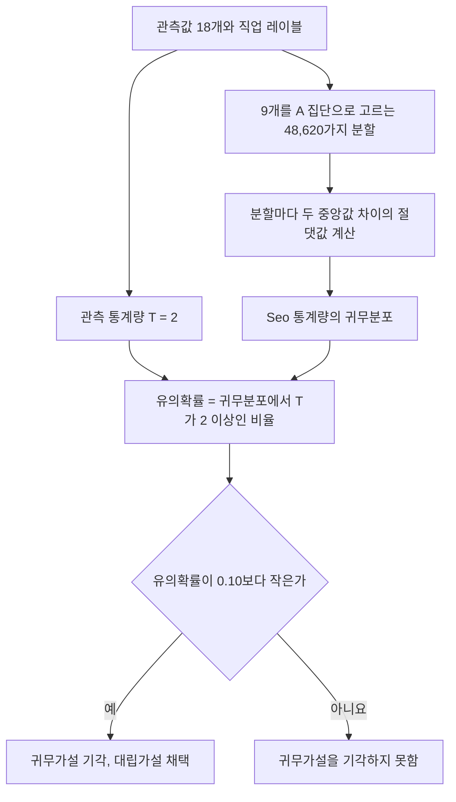

# HW3 과제 해설 — 비모수 검정과 다중 검정

[레포지토리 안내](../../README.ko.md) | [English](Assignment-Explanation.md) | [한국어](Assignment-Explanation.ko.md)

> **최종 수정일:** 2026-11-04

> **학습 목표:**
> 1. 두 독립 집단의 비교에 독립 2표본 t 검정과 Wilcoxon 순위합 검정을 적용하고 결과를 해석할 수 있다
> 2. 정규성, 표본 크기, 자료의 형태를 근거로 두 검정 중 적절한 것을 고를 수 있다
> 3. 새로 정의한 검정통계량의 귀무분포를 순열 검정으로 만들고, 그 통계량의 한계를 기존 통계량과 비교해 설명할 수 있다
> 4. 수천 개의 가설을 동시에 검정할 때 생기는 다중 검정 문제를 설명하고 Bonferroni 방법과 Benjamini-Hochberg 방법으로 보정할 수 있다
> 5. 통계적으로 유의한 유전자 목록이 무엇을 뜻하고 어떻게 활용되며 어디까지 믿을 수 있는지 서술할 수 있다

---

## 목차

- [1. 과제 구성과 데이터](#1-과제-구성과-데이터)
- [2. Q1. 두 직업 집단의 확진자 수 비교](#2-q1-두-직업-집단의-확진자-수-비교)
  - [2.1 자료 요약](#21-자료-요약)
  - [2.2 모수적 방법: 독립 2표본 t 검정](#22-모수적-방법-독립-2표본-t-검정)
  - [2.3 비모수적 방법: Wilcoxon 순위합 검정](#23-비모수적-방법-wilcoxon-순위합-검정)
- [3. Q2. 더 적절한 검정의 선택](#3-q2-더-적절한-검정의-선택)
- [4. Q3. Seo 통계량의 순열 검정](#4-q3-seo-통계량의-순열-검정)
- [5. Q4. Seo 통계량의 한계](#5-q4-seo-통계량의-한계)
- [6. Q5. 암군과 정상군 사이의 유전자별 검정](#6-q5-암군과-정상군-사이의-유전자별-검정)
- [7. Q6. 키와 관련된 유전자의 검정](#7-q6-키와-관련된-유전자의-검정)
- [8. Q7. 다중 검정 문제와 보정](#8-q7-다중-검정-문제와-보정)
  - [8.1 유의수준이 쌓이는 문제](#81-유의수준이-쌓이는-문제)
  - [8.2 Bonferroni 보정](#82-bonferroni-보정)
  - [8.3 Benjamini-Hochberg 방법](#83-benjamini-hochberg-방법)
  - [8.4 보정 결과의 비교](#84-보정-결과의-비교)
- [9. Q8. 유의한 결과의 의미와 활용](#9-q8-유의한-결과의-의미와-활용)
- [요약](#요약)
- [점검 문제](#점검-문제)

---

<br>

## 1. 과제 구성과 데이터

이 과제는 두 부분으로 이루어진다. Q1\~Q4는 작은 표본에서 두 집단을 비교하는 모수적 방법과 비모수적 방법(6강, 8강)을, Q5\~Q8은 한 자료에서 천 개가 넘는 가설을 검정할 때의 문제(7강의 통계 분석 방법 선택과 이어짐)를 다룬다. 모든 결론은 귀무가설, 대립가설, 기각, 채택, 유의수준이라는 용어를 써서 서술해야 한다. 코드의 줄 단위 설명은 [HW3 코드 총정리](Code-Walkthrough.ko.md)에 있다.

```plaintext
Coursework/HW03_Nonparametric-Tests-and-Multiple-Testing/
├── Assignment-Explanation.ko.md
├── Assignment-Explanation.md
├── Code-Walkthrough.ko.md
├── Code-Walkthrough.md
├── Original/
│   └── HW3.docx                  # 과제 원본
├── data/
│   ├── Q1_Data.tsv               # 18개 기관의 확진자 수와 직업 집단
│   └── Q5_Data.tsv               # 72명의 질병, 키, 유전자 발현값 1,274개
└── Solution/
    ├── Q1-2.R, Q3.R              # Q1~Q4의 R 코드
    ├── Q5.R, Q6.R, Q7.R          # Q5~Q8의 R 코드
    └── Assignment-Report.pdf     # 제출 보고서
```

*그림 1. HW3 과제의 디렉토리 구성*

- **`Q1_Data.tsv`:** 서로 독립인 18개 기관의 COVID-19 확진자 수(`numCOVID`)와 기관이 통계학자 집단인지 전산학자 집단인지(`Job`: `Statistician`, `ComputerScientist`)를 담는다. 두 집단은 9개 기관씩이다.
- **`Q5_Data.tsv`:** 72명의 질병 여부(`Disease`: `Cancer` 25명, `Healthy` 47명), 키(`Height`, cm), 유전자 발현값(`Gene_1`\~`Gene_1274`)을 담는다. 과제 문서는 유전자를 1,724개라고 적었지만 파일의 유전자 열은 1,274개이며, 이 문서의 계산은 모두 1,274개를 기준으로 한다.

---

<br>

## 2. Q1. 두 직업 집단의 확진자 수 비교

**문제.** 직업 집단에 따라 COVID-19 확진자 수가 다른지를 유의수준 5%에서 모수적 방법 하나와 비모수적 방법 하나로 검정한다.

### 2.1 자료 요약

| 집단 | 정렬한 관측값 | 표본평균 | 중앙값 | 표본분산 |
|:-----|:-----|-----:|-----:|-----:|
| ComputerScientist | 3, 3, 3, 4, 6, 6, 7, 7, 7 | 5.111 | 6 | 3.361 |
| Statistician | 1, 2, 2, 3, 4, 4, 4, 4, 5 | 3.222 | 4 | 1.694 |

*표 1. 두 직업 집단의 확진자 수*

전산학자 집단의 평균과 중앙값이 모두 크다. 관측값은 1\~7의 작은 정수이고, 18개 중 서로 다른 값은 7개뿐이어서 같은 값(동점)이 많다.

### 2.2 모수적 방법: 독립 2표본 t 검정

두 집단의 모평균을 $\mu_{CS}$, $\mu_{ST}$라 하면 귀무가설은 $H_0: \mu_{CS} = \mu_{ST}$(두 집단의 평균 확진자 수는 같다), 대립가설은 $H_1: \mu_{CS} \ne \mu_{ST}$(다르다)이다. 두 모집단이 정규분포이고 분산이 같다고 가정하는 **독립 2표본 t 검정**(independent two-sample t-test)은 두 표본분산을 합친 **합동 분산**(pooled variance)을 쓴다.

```math
s_p^2 = \frac{(n_1 - 1)s_1^2 + (n_2 - 1)s_2^2}{n_1 + n_2 - 2} = \frac{8 \times 3.3611 + 8 \times 1.6944}{16} = 2.5278
```

```math
t = \frac{\bar{x}_1 - \bar{x}_2}{s_p\sqrt{\frac{1}{n_1} + \frac{1}{n_2}}} = \frac{5.1111 - 3.2222}{\sqrt{2.5278}\sqrt{\frac{2}{9}}} = \frac{1.8889}{0.74949} = 2.520
```

귀무가설 아래에서 $t$는 자유도 $n_1 + n_2 - 2 = 16$인 t 분포를 따르고, 양측 유의확률은 $2P(T_{16} \ge 2.520) = 0.0227$이다. 유의확률 0.0227이 유의수준 0.05보다 작으므로 귀무가설을 기각하고, 두 직업 집단의 평균 확진자 수가 다르다는 대립가설을 채택한다. 평균 차이의 95% 신뢰구간은 (0.300, 3.478)이다. 등분산을 가정하지 않는 Welch t 검정도 $t = 2.520$, 자유도 14.43, 유의확률 0.0241로 결론이 같다.

### 2.3 비모수적 방법: Wilcoxon 순위합 검정

**Wilcoxon 순위합 검정**(Wilcoxon rank-sum test, Mann-Whitney U 검정과 같음)은 값 대신 두 집단을 합친 자료에서의 순위를 쓰므로 정규성을 가정하지 않는다. 귀무가설은 $H_0$: 두 집단의 분포가 같다(위치가 같다), 대립가설은 $H_1$: 한 집단의 분포가 다른 집단보다 위나 아래로 이동해 있다(위치가 다르다)이다.

18개 값을 작은 것부터 순위를 매기고, 같은 값에는 해당 순위들의 평균인 **중간 순위**(midrank)를 준다.

| 값 | 1 | 2 | 3 | 4 | 5 | 6 | 7 |
|:-----|:-----:|:-----:|:-----:|:-----:|:-----:|:-----:|:-----:|
| 개수 (CS, ST) | 1 (0, 1) | 2 (0, 2) | 4 (3, 1) | 5 (1, 4) | 1 (0, 1) | 2 (2, 0) | 3 (3, 0) |
| 차지하는 순위 | 1 | 2\~3 | 4\~7 | 8\~12 | 13 | 14\~15 | 16\~18 |
| 중간 순위 | 1 | 2.5 | 5.5 | 10 | 13 | 14.5 | 17 |

*표 2. 확진자 수의 중간 순위 (CS: ComputerScientist, ST: Statistician)*

전산학자 집단의 순위합은 $R_{CS} = 3 \times 5.5 + 10 + 2 \times 14.5 + 3 \times 17 = 106.5$이고, 통계학자 집단은 $R_{ST} = 171 - 106.5 = 64.5$이다(전체 순위합은 $`18 \times 19 / 2 = 171`$). R이 보고하는 통계량은 $W = R_{CS} - \frac{n_1(n_1 + 1)}{2} = 106.5 - 45 = 61.5$이다. 귀무가설 아래에서 $E[W] = \frac{n_1 n_2}{2} = 40.5$이고, 동점을 보정한 분산은 다음과 같다. $t_j$는 같은 값을 가진 묶음의 크기이며, 이 자료에서는 $\sum(t_j^3 - t_j) = 6 + 60 + 120 + 6 + 24 = 216$이다.

```math
\mathrm{Var}(W) = \frac{n_1 n_2}{12}\left[(N + 1) - \frac{\sum_j (t_j^3 - t_j)}{N(N - 1)}\right] = \frac{81}{12}\left[19 - \frac{216}{306}\right] = 123.49
```

```math
z = \frac{W - E[W]}{\sqrt{\mathrm{Var}(W)}} = \frac{61.5 - 40.5}{11.112} = 1.890, \qquad p = 2\lbrace1 - \Phi(1.890)\rbrace = 0.0588
```

유의확률 0.0588이 유의수준 0.05보다 크므로 귀무가설을 기각하지 못하고, 두 직업 집단의 확진자 수 분포가 다르다는 대립가설을 채택할 근거가 부족하다.

> **참고:** 정규 근사에 **연속성 수정**(continuity correction)을 적용하면($`z = 20.5/11.112 = 1.845`$) 유의확률은 0.0651이고, 동점을 고려한 정확한 순열 분포로 계산한 유의확률은 0.0712이다. 계산 방식에 따라 0.06\~0.07 사이의 값이 나오지만, 유의수준 5%에서 기각하지 못한다는 결론은 같다. 동점이 있으면 R의 `wilcox.test()`는 정확한 유의확률을 계산하지 못하고 정규 근사를 쓴다.

---

<br>

## 3. Q2. 더 적절한 검정의 선택

**문제.** Q1의 두 검정 중 어느 것이 바람직하며 그 이유는 무엇인가.

두 검정의 결론은 갈렸다. t 검정은 유의확률 0.0227로 기각하고, Wilcoxon 순위합 검정은 0.0588로 기각하지 못한다. 어느 결론을 따를지는 각 검정의 가정이 이 자료에서 성립하는지로 정한다.

| 가정 | 점검 결과 |
|:-----|:-----|
| 관측값의 독립성 | 18개 기관이 서로 독립이라고 주어졌으므로 두 검정 모두 만족한다. |
| 각 집단의 정규성 (t 검정) | Shapiro-Wilk 검정의 유의확률이 ComputerScientist 0.0198, Statistician 0.2574이다. 전산학자 집단은 유의수준 5%에서 정규성이 기각된다. |
| 등분산성 (합동 분산 t 검정) | 분산비 $3.361 / 1.694 = 1.98$이고 F 검정의 유의확률은 0.352이다. 이 가정은 크게 어긋나지 않는다. |
| 표본 크기 | 집단마다 9개로 작아, 정규성이 깨져도 중심극한정리로 표본평균의 정규성을 기대하기 어렵다. |
| 자료의 형태 | 1\~7의 정수 개수 자료이고 동점이 많아 연속형 정규분포와 거리가 멀다. |

*표 3. Q1 자료에서 두 검정의 가정 점검*

t 검정의 핵심 가정인 정규성이 한 집단에서 기각되고, 표본이 작아 중심극한정리에 기댈 수도 없다. 따라서 이 자료에서는 분포를 가정하지 않고 순위만 쓰는 **Wilcoxon 순위합 검정이 더 바람직하다.** 가정이 깨진 t 검정의 유의확률 0.0227은 명목상의 제1종 오류 확률을 보장하지 못하므로, 그 기각을 그대로 믿기 어렵다. 순위 기반 검정은 이상값 하나가 결과를 좌우하지 못한다는 점에서도 작은 표본에 안전하다.

결론적으로 유의수준 5%에서 Wilcoxon 순위합 검정에 따라 귀무가설을 기각하지 못하며, 직업 집단에 따라 확진자 수가 다르다는 대립가설을 채택할 근거가 부족하다. 다만 유의확률이 0.06\~0.07로 경계에 가깝고 표본평균의 차이도 1.9명이므로, "차이가 없다"고 단정하기보다는 표본이 작아 차이를 확인하지 못했다고 서술하는 것이 정확하다.

> **주의:** 비모수 검정이 항상 더 나은 것은 아니다. 정규성이 성립하는 자료에서는 t 검정의 검정력이 조금 더 높고, 꼬리가 두껍거나 치우친 분포에서는 Wilcoxon 순위합 검정의 검정력이 더 높을 수 있다(8강). 선택의 근거는 결론이 원하는 대로 나오는지가 아니라 가정의 점검이어야 하며, 두 검정을 모두 해 본 뒤 유의하게 나온 쪽을 고르면 다중 검정과 같은 문제가 생긴다.

---

<br>

## 4. Q3. Seo 통계량의 순열 검정

**문제.** 두 집단을 비교하는 새 통계량 $\text{Seo-Stat} = \lvert \mathrm{Median}(A) - \mathrm{Median}(B) \rvert$를 검정통계량으로 써서 Q1과 같은 가설을 유의수준 10%에서 검정한다.

**관측 통계량.** A를 ComputerScientist, B를 Statistician으로 두면 두 중앙값은 6과 4이므로 관측된 Seo 통계량은 $T_{obs} = \lvert 6 - 4 \rvert = 2$이다.

**귀무분포.** 새 통계량은 귀무가설 아래에서 어떤 분포를 따르는지 알려져 있지 않으므로 **순열 검정**(permutation test)으로 귀무분포를 만든다. 귀무가설 $H_0$: 두 집단의 분포가 같다가 참이면 집단 레이블은 관측값과 무관하므로, 18개 값을 9개와 9개로 나누는 모든 방법이 같은 확률로 일어날 수 있다. 그런 분할은 $\binom{18}{9} = 48{,}620$가지이고, 분할마다 Seo 통계량을 계산하면 정확한 귀무분포를 얻는다.



*그림 2. Seo 통계량의 순열 검정 절차*

| Seo 통계량 | 0 | 1 | 2 | 3 | 합계 |
|:-----|-----:|-----:|-----:|-----:|-----:|
| 분할의 수 | 29,750 | 14,590 | 3,340 | 940 | 48,620 |
| 확률 | 0.6119 | 0.3001 | 0.0687 | 0.0193 | 1 |

*표 4. 48,620가지 분할에서 Seo 통계량의 귀무분포*

**유의확률과 결론.** 유의확률은 귀무분포에서 관측값 이상의 통계량이 나올 확률이다.

```math
p = P(T \ge 2) = \frac{3{,}340 + 940}{48{,}620} = \frac{4{,}280}{48{,}620} = 0.0880
```

유의확률 0.0880이 유의수준 0.10보다 작으므로 귀무가설을 기각하고, 두 직업 집단의 확진자 수 분포가 다르다는 대립가설을 채택한다. 관측된 중앙값은 전산학자 집단이 더 크므로, 유의수준 10%에서 전산학자 집단의 확진자 수가 더 많은 쪽으로 위치가 이동해 있다고 판단한다.

> **참고:** 통계량에 절댓값이 있으므로 이 검정은 양측 검정이다. 순열 검정의 귀무가설은 엄밀하게는 "두 집단의 중앙값이 같다"가 아니라 "두 집단의 분포가 같다(레이블을 바꿔도 분포가 변하지 않는다)"이며, Seo 통계량은 그중 중앙값의 차이에 반응하는 통계량이다.

---

<br>

## 5. Q4. Seo 통계량의 한계

**문제.** 두 집단의 차이를 검정하는 데 Seo 통계량이 갖는 한계를 이미 알고 있는 통계량의 형식과 비교해 서술한다.

비교할 기존 통계량은 다음 두 가지이다.

```math
t = \frac{\bar{x}_1 - \bar{x}_2}{s_p\sqrt{\frac{1}{n_1} + \frac{1}{n_2}}}, \qquad W = \sum_{i \in \text{집단 1}} \mathrm{rank}(x_i) - \frac{n_1(n_1 + 1)}{2}
```

| 기준 | t 통계량 | Wilcoxon $W$ | Seo 통계량 |
|:-----|:-----|:-----|:-----|
| 쓰는 정보 | 모든 관측값의 크기 | 모든 관측값의 순위 | 각 집단의 가운데 값 하나 |
| 산포에 의한 표준화 | 표준오차로 나눔 | 순위로 바꾸어 척도와 무관 | 없음 |
| 귀무분포 | 자유도 $n_1 + n_2 - 2$의 t 분포 | 정확한 분포표나 정규 근사 | 알려져 있지 않아 순열로 계산 |
| 방향 | 부호가 방향을 나타냄 | $E[W]$보다 크고 작음이 방향을 나타냄 | 절댓값이어서 방향이 사라짐 |
| 이 자료의 가능한 값 | 연속에 가까움 | 수십 가지 | 0, 1, 2, 3의 네 가지 |

*표 5. t 통계량, Wilcoxon 통계량, Seo 통계량의 비교*

- **정보의 손실:** 크기 9인 집단의 중앙값은 다섯째 값 하나로 정해진다. 나머지 여덟 값은 중앙값의 위인지 아래인지만 영향을 주므로, 같은 표본 크기에서 평균이나 순위합을 쓰는 통계량보다 검정력이 낮다.
- **표준화의 부재:** t 통계량은 차이를 표준오차로 나누어 "차이가 우연한 변동의 몇 배인가"를 재지만, Seo 통계량은 원래 단위의 차이 그대로이다. 같은 차이 2라도 자료의 산포가 크면 흔한 값이고 작으면 드문 값이므로, 통계량의 크기만으로는 증거의 강도를 판단할 수 없고 자료마다 귀무분포를 새로 만들어야 한다.
- **알려진 귀무분포의 부재와 계산 비용:** 귀무분포를 순열로 구해야 하며, 분할의 수 $\binom{n}{n/2}$는 표본이 커지면 급격히 늘어난다. 예를 들어 집단마다 20개이면 $\binom{40}{20} \approx 1.4 \times 10^{11}$가지여서 모든 분할을 나열할 수 없고, 무작위로 뽑은 일부 분할로 근사해야 한다.
- **이산성:** 이 자료에서 Seo 통계량은 0, 1, 2, 3의 네 값만 가지므로 가능한 유의확률도 1, 0.388, 0.088, 0.019의 네 가지뿐이다. 유의수준 5%에서는 $T = 3$일 때만 기각하므로 실제 제1종 오류 확률은 0.019에 그쳐 지나치게 보수적이고, 유의수준을 2%에서 8.8% 사이의 어느 값으로 정해도 똑같은 검정이 된다.
- **방향의 손실:** 절댓값 때문에 단측 대립가설(예: 전산학자 집단이 더 많다)을 직접 검정할 수 없다.
- **위치 외의 차이:** 중앙값만 비교하므로 두 집단의 산포나 모양이 달라도 중앙값이 같으면 차이를 찾지 못한다.

> **참고:** 순열 검정의 틀은 그대로 두고 통계량만 바꾸면 차이가 분명해진다. 같은 48,620가지 분할에서 평균 차이의 절댓값을 쓰면 유의확률은 0.0353, 순위합을 쓰는 정확한 Wilcoxon 검정은 0.0712, Seo 통계량은 0.0880이다. 정규성을 가정하지 않는 순열 검정에서도 평균 차이는 유의수준 5%에서 유의하게 나오므로, 2.2절의 t 검정과 2.3절의 Wilcoxon 검정의 결론이 갈린 것은 정규성 가정만의 문제가 아니라, 경계에 가까운 증거를 어떤 통계량으로 요약하느냐의 차이이기도 하다. 정보를 가장 적게 쓰는 Seo 통계량의 유의확률이 가장 크다.

---

<br>

## 6. Q5. 암군과 정상군 사이의 유전자별 검정

**문제.** 유의수준 1%에서 가설검정으로 암군과 정상군 사이에 차이가 나는 유전자를 찾고, 몇 개가 발견되었는지 서술한다.

**방법.** 유전자마다 귀무가설 $H_0$: 암군과 정상군의 평균 발현값이 같다, 대립가설 $H_1$: 두 집단의 평균 발현값이 다르다를 세우고 **Welch t 검정**(Welch's t-test)을 한다. 두 집단의 크기가 25명과 47명으로 다르고 유전자마다 분산이 같다고 보장할 수 없으므로, 합동 분산 대신 두 분산을 따로 쓰는 Welch 검정이 적절하다.

```math
t = \frac{\bar{x}_1 - \bar{x}_2}{\sqrt{\frac{s_1^2}{n_1} + \frac{s_2^2}{n_2}}}, \qquad \nu = \frac{\left(\frac{s_1^2}{n_1} + \frac{s_2^2}{n_2}\right)^2}{\frac{(s_1^2/n_1)^2}{n_1 - 1} + \frac{(s_2^2/n_2)^2}{n_2 - 1}}
```

귀무가설 아래에서 $t$는 근사적으로 자유도 $\nu$의 t 분포를 따른다.

**결과.** 1,274개 유전자 중 **315개**의 유의확률이 0.01보다 작다. 이 315개 유전자에서는 귀무가설을 기각하고 두 집단의 평균 발현값이 다르다는 대립가설을 채택하며, 나머지 959개에서는 귀무가설을 기각하지 못한다. 315개 중 128개는 암군에서, 187개는 정상군에서 평균이 더 높다. 유의확률이 가장 작은 여섯 유전자는 다음과 같다.

| 유전자 | $t$ | 자유도 | 유의확률 | 암군 평균 | 정상군 평균 |
|:-----|-----:|-----:|-----:|-----:|-----:|
| Gene_231 | -8.829 | 51.96 | $6.43 \times 10^{-12}$ | 975.4 | 4255.1 |
| Gene_13 | -8.734 | 50.32 | $1.18 \times 10^{-11}$ | 313.4 | 1402.1 |
| Gene_768 | -8.119 | 56.33 | $4.73 \times 10^{-11}$ | 556.4 | 1727.1 |
| Gene_9 | -7.993 | 47.59 | $2.39 \times 10^{-10}$ | 182.4 | 3936.2 |
| Gene_436 | -7.725 | 54.23 | $2.67 \times 10^{-10}$ | -401.1 | 1463.3 |
| Gene_837 | -7.267 | 67.51 | $4.86 \times 10^{-10}$ | -21.4 | 204.5 |

*표 6. Q5에서 유의확률이 가장 작은 여섯 유전자*

발현값에는 음수도 있으나 두 집단의 평균을 비교하는 데는 문제가 되지 않는다. 이 315개는 각 검정을 따로 보았을 때의 결과이고, 1,274개를 함께 검정한 데 따른 보정은 8절에서 한다.

---

<br>

## 7. Q6. 키와 관련된 유전자의 검정

**문제.** 유의수준 1%에서 가설검정으로 키와 관련된 유전자를 찾고, 몇 개가 발견되었는지 서술한다.

**방법.** 키와 유전자 발현값은 모두 연속형이므로 유전자마다 **Pearson 상관계수**(Pearson correlation coefficient) $r$을 구하고 상관 검정을 한다. 귀무가설은 $H_0: \rho = 0$(해당 유전자와 키 사이에 선형 상관이 없다), 대립가설은 $H_1: \rho \ne 0$(상관이 있다)이다. 귀무가설 아래에서 다음 통계량은 자유도 $n - 2 = 70$인 t 분포를 따른다.

```math
t = \frac{r\sqrt{n - 2}}{\sqrt{1 - r^2}}
```

유의수준 1%의 양측 검정에서 이 기준은 $\lvert r \rvert > 0.302$와 같다.

**결과.** 1,274개 유전자 중 **12개**의 유의확률이 0.01보다 작아, 이 12개에서는 귀무가설을 기각하고 키와 상관이 있다는 대립가설을 채택한다. 나머지 1,262개에서는 귀무가설을 기각하지 못한다. 유의확률이 가장 작은 여섯 유전자는 다음과 같다.

| 유전자 | $r$ | $t$ | 유의확률 |
|:-----|-----:|-----:|-----:|
| Gene_267 | -0.445 | -4.160 | $8.89 \times 10^{-5}$ |
| Gene_1199 | 0.405 | 3.702 | $4.23 \times 10^{-4}$ |
| Gene_793 | 0.388 | 3.521 | $7.61 \times 10^{-4}$ |
| Gene_77 | 0.362 | 3.246 | $1.80 \times 10^{-3}$ |
| Gene_145 | -0.351 | -3.140 | $2.47 \times 10^{-3}$ |
| Gene_1222 | 0.349 | 3.114 | $2.67 \times 10^{-3}$ |

*표 7. Q6에서 유의확률이 가장 작은 여섯 유전자*

나머지 여섯 개는 Gene_382, Gene_1019, Gene_1130, Gene_1265, Gene_321, Gene_812이고, 상관계수는 모두 0.30\~0.34이다. 이 12개가 실제로 키와 관련이 있는지는 8절의 다중 검정 보정에서 다시 판단한다.

> **참고:** Pearson 상관 검정은 선형 관계를 재며, 두 변수가 이변량 정규분포를 따르면 정확하고, 표본이 충분히 크면 근사적으로 타당하다. 순위로 계산하는 Spearman 상관계수로 같은 검정을 하면 19개 유전자의 유의확률이 0.01보다 작다.

---

<br>

## 8. Q7. 다중 검정 문제와 보정

**문제.** 같은 자료에서 여러 가설을 검정하면 유의수준의 개념 때문에 통계적 문제가 생긴다. Q5에서 무엇이 이 문제를 일으키는지 서술하고, 보정 방법을 찾아 Q5의 유의확률을 수정한 결과를 서술한다.

### 8.1 유의수준이 쌓이는 문제

유의수준 1%는 하나의 검정에서 귀무가설이 참일 때 잘못 기각할 확률이 1%라는 뜻이다. Q5는 이런 검정을 $m = 1{,}274$번 했다. 모든 유전자에서 귀무가설이 참이라 해도 평균적으로 $1{,}274 \times 0.01 = 12.74$개는 우연히 유의하게 나온다. 검정들이 서로 독립이라면, 적어도 하나를 잘못 기각할 확률인 **가족별 오류율**(family-wise error rate, FWER)은 다음과 같다.

```math
\text{FWER} = 1 - (1 - 0.01)^{1274} \approx 0.999997
```

즉 보정하지 않으면 거짓 양성이 하나 이상 섞일 것이 거의 확실하다. Q5의 315개에는 실제 차이가 있는 유전자와 우연히 유의하게 나온 **거짓 양성**(false positive)이 함께 들어 있고, 각 검정만 보아서는 둘을 구별할 수 없다. 이것이 **다중 검정 문제**(multiple testing problem)이다.

### 8.2 Bonferroni 보정

**Bonferroni 보정**은 각 검정의 유의수준을 검정의 수로 나누어 FWER을 $\alpha$ 이하로 묶는다. 유의확률이 $\alpha/m$보다 작을 때만 기각하며, 같은 말로 보정한 유의확률 $\min(m p_i, 1)$을 $\alpha$와 비교한다.

```math
p_i < \frac{\alpha}{m} = \frac{0.01}{1274} = 7.85 \times 10^{-6}
```

FWER $\le \sum_i P(\text{검정 } i \text{를 잘못 기각}) \le m \cdot \frac{\alpha}{m} = \alpha$이므로, 검정 사이의 상관과 관계없이 성립한다. Q5에 적용하면 **56개** 유전자가 남는다. 매우 엄격해서 거짓 양성은 거의 없지만, 실제 차이가 있는 유전자도 많이 놓친다.

### 8.3 Benjamini-Hochberg 방법

**거짓 발견율**(false discovery rate, FDR)은 기각한 가설 중 실제로는 귀무가설이 참인 것의 비율의 기댓값이다. 수천 개의 후보에서 추가 연구할 목록을 고를 때는 거짓 양성을 하나도 허용하지 않는 FWER보다 목록 안의 거짓 양성 비율을 제어하는 FDR이 목적에 맞는 경우가 많다. **Benjamini-Hochberg(BH) 방법**은 다음 절차로 FDR을 $q$ 이하로 제어한다(검정들이 독립이거나 양의 상관을 가질 때).

1. 유의확률을 작은 것부터 $p_{(1)} \le p_{(2)} \le \dots \le p_{(m)}$으로 정렬한다.
2. $p_{(k)} \le \frac{k}{m} q$를 만족하는 가장 큰 순위 $k$를 찾는다.
3. 순위 1부터 $k$까지의 가설을 모두 기각한다.

$q = 0.01$로 Q5에 적용하면 $k = 185$이다. 185번째 유의확률 $p_{(185)} = 0.0014489$는 기준 $\frac{185}{1274} \times 0.01 = 0.0014521$ 이하이고, 186번째 $p_{(186)} = 0.0014706$은 기준 $0.0014600$을 넘는다. 따라서 **185개** 유전자에서 귀무가설을 기각한다. R의 `p.adjust(p, method = "BH")`는 각 유전자의 보정 유의확률을 돌려주며, 이를 0.01과 비교한 결과도 같다.

### 8.4 보정 결과의 비교

| 방법 | 제어하는 오류 | Q5 유전자 수 | Q6 유전자 수 |
|:-----|:-----|-----:|-----:|
| 보정 없음 | 검정마다의 제1종 오류 | 315 | 12 |
| Bonferroni | FWER | 56 | 0 |
| Holm | FWER | 56 | 0 |
| Šidák | FWER (독립일 때) | 56 | 0 |
| Benjamini-Hochberg | FDR | 185 | 0 |
| Benjamini-Yekutieli | FDR (임의의 상관) | 92 | 0 |

*표 8. 유의수준 1%에서 보정 방법별로 유의한 유전자 수*

Holm 방법은 정렬한 유의확률을 $\frac{\alpha}{m}, \frac{\alpha}{m - 1}, \dots$와 차례로 비교하는 Bonferroni의 개선판이고, Šidák 방법은 독립을 가정해 경계를 $1 - (1 - \alpha)^{1/m} = 7.89 \times 10^{-6}$으로 쓴다. 이 자료에서는 세 방법 모두 56개로 같다. 과제 문서가 예로 든 Scheffé 방법은 분산분석의 대비(contrast)를 동시에 검정하는 방법이어서 유전자별 검정의 보정에는 맞지 않는다.

Q6의 결과는 보정 뒤 완전히 달라진다. 보정 전의 12개는 모든 귀무가설이 참일 때 우연히 기대되는 12.74개보다도 적고, 가장 작은 유의확률 $8.89 \times 10^{-5}$도 Bonferroni 경계 $7.85 \times 10^{-6}$보다 크며, BH 보정 유의확률의 최솟값은 0.113이다. 유의확률의 분포를 보면 차이가 더 분명하다.

| 유의확률 구간 | 0\~0.1 | 0.1\~0.2 | 0.2\~0.3 | 0.3\~0.4 | 0.4\~0.5 | 0.5\~0.6 | 0.6\~0.7 | 0.7\~0.8 | 0.8\~0.9 | 0.9\~1 |
|:-----|-----:|-----:|-----:|-----:|-----:|-----:|-----:|-----:|-----:|-----:|
| Q5 유전자 수 | 606 | 144 | 83 | 78 | 70 | 57 | 59 | 61 | 61 | 55 |
| Q6 유전자 수 | 152 | 173 | 137 | 119 | 113 | 113 | 107 | 131 | 107 | 122 |

*표 9. 1,274개 유전자의 유의확률 분포*

모든 귀무가설이 참이면 유의확률은 0과 1 사이의 균등분포를 따르므로 구간마다 약 127개씩 들어간다. Q6의 분포는 이와 비슷해 키와 관련된 유전자가 있다는 신호가 거의 없고, Q5는 0\~0.1 구간에 606개가 몰려 있어 실제로 차이가 나는 유전자가 많다는 것을 보여 준다.

> **핵심:** 여러 가설을 검정하면 개별 유의수준이 아니라 전체 결과에 대한 오류율(FWER이나 FDR)을 정하고 그에 맞게 보정해야 한다. 보정한 결론은 Q5에서 "56개(FWER 1%) 또는 185개(FDR 1%)의 유전자가 암군과 정상군 사이에서 다르다", Q6에서 "키와 관련된 유전자의 증거는 없다"이다.

---

<br>

## 9. Q8. 유의한 결과의 의미와 활용

**문제.** Q5와 Q6에서 얻은 통계적으로 유의한 결과가 실제 산업과 학술 현장에서 어떻게 활용될 수 있는지 논리적으로 서술한다.

**결과의 의미.** Q5에서 보정 뒤에도 유의한 유전자는 암군과 정상군 사이에서 평균 발현값이 다른 **차등 발현 유전자**(differentially expressed gene)이다. 이는 그 유전자의 발현이 질병 상태와 체계적으로 연관되어 있다는 통계적 증거이지만, 원인과 결과의 방향이나 생물학적 기전을 말해 주지는 않는다. Q6에서는 보정 뒤 유의한 유전자가 없으므로, 이 자료로는 키와 관련된 유전자가 있다고 말할 수 없다.

**활용.**

- **바이오마커 후보 발굴:** Q5의 유전자, 특히 Bonferroni 기준의 56개처럼 엄격한 기준을 통과하고 두 집단의 평균 차이가 큰 유전자는 암 진단용 바이오마커의 후보가 된다. 소수의 유전자로 이루어진 검사 패널은 전체 유전체를 측정하는 것보다 싸고 빠르다.
- **기계학습의 특성 선택:** 수천 개의 변수 중 분류에 쓸 특성을 미리 고르는 **필터 방식의 특성 선택**(filter feature selection)으로 쓰여, 암과 정상을 분류하는 로지스틱 회귀, 랜덤 포레스트, 신경망의 차원을 줄이고 과적합의 위험을 낮춘다.
- **기전 연구와 약물 표적:** 유의한 유전자 목록을 알려진 생물학적 경로와 대조하는 경로 분석으로 질병 기전에 대한 가설을 세우고, 실험으로 검증할 약물 표적 후보를 고른다.
- **연구 설계:** Q6처럼 보정 뒤 신호가 없으면 그 자체가 결과이다. 더 큰 표본이 필요한지 판단하는 근거가 되고, 우연히 유의했던 12개를 특성으로 쓰면 잡음만 더해 모델을 해친다는 것을 알려 준다.

**활용할 때의 주의점.**

1. **검증:** 같은 자료에서 고른 유전자의 효과는 실제보다 크게 보이는 경향이 있으므로, 독립된 다른 표본(검증 코호트)에서 재현되는지 확인해야 한다.
2. **정보 누수:** 분류 모델을 평가할 때 특성 선택을 전체 자료로 먼저 하면 시험 자료의 정보가 학습에 새어 들어가 성능이 부풀려진다. 특성 선택은 교차 검증의 각 학습 부분 안에서 해야 한다.
3. **효과 크기:** 표본이 크면 작은 차이도 유의하므로, 유의확률과 함께 평균 차이나 배수 변화(fold change) 같은 효과 크기를 보고 우선순위를 정한다.
4. **교란 요인:** 측정 시점과 장비의 차이(배치 효과)나 나이, 성별 같은 변수가 집단과 얽혀 있으면 유전자와 질병의 연관이 거짓으로 나타날 수 있다.

---

<br>

## 요약

| 개념 | 핵심 요약 |
|:-----|:-----|
| 독립 2표본 t 검정 | 두 모집단의 정규성과 등분산을 가정하고 평균 차이를 합동 표준오차로 나눈 $t$를 자유도 $n_1 + n_2 - 2$의 t 분포와 비교하며, Q1에서는 $t = 2.520$, 유의확률 0.0227이다. |
| Wilcoxon 순위합 검정 | 합친 자료의 순위로 두 분포의 위치를 비교하고 동점에는 중간 순위를 쓰며, Q1에서는 $W = 61.5$, 유의확률 0.0588이다. |
| 검정의 선택 | 결론이 아니라 가정의 점검으로 고르며, 표본이 작고 정규성이 깨진 Q1에서는 Wilcoxon 순위합 검정이 바람직하다. |
| 순열 검정 | 귀무가설 아래에서 레이블을 바꿀 수 있다는 점을 이용해 모든 분할의 통계량으로 정확한 귀무분포를 만들며, Seo 통계량의 유의확률은 $4{,}280/48{,}620 = 0.0880$이다. |
| Seo 통계량의 한계 | 가운데 값 하나만 쓰고, 산포로 표준화하지 않으며, 알려진 귀무분포가 없고, 값이 이산적이며, 절댓값으로 방향을 잃는다. |
| 유전자별 검정 | Q5는 Welch t 검정으로 315개, Q6는 Pearson 상관 검정으로 12개 유전자의 유의확률이 0.01보다 작다. |
| 다중 검정 문제 | 유의수준 $\alpha$로 $m$번 검정하면 우연한 기각이 평균 $m\alpha$개 생기며, 1,274번이면 12.74개이다. |
| Bonferroni 보정 | 경계를 $\alpha/m$으로 낮춰 FWER을 $\alpha$ 이하로 제어하며, Q5에서 56개가 남는다. |
| Benjamini-Hochberg 방법 | $p_{(k)} \le \frac{k}{m}q$인 가장 큰 $k$까지 기각해 FDR을 $q$ 이하로 제어하며, Q5에서 185개가 남는다. |
| 결과의 활용 | 보정을 통과한 유전자는 바이오마커와 특성 선택의 후보가 되지만, 독립 표본의 검증, 정보 누수 방지, 효과 크기와 교란 요인의 점검이 필요하다. |

---

<br>

## 점검 문제

1. **중간 순위:** 값 3, 5, 5, 8의 순위를 중간 순위로 매기라.

   <details>
   <summary>정답</summary>

   1, 2.5, 2.5, 4이다. 두 개의 5가 순위 2와 3을 차지하므로 둘 다 평균 2.5를 받는다.

   </details>

2. **분할의 수:** 집단마다 6개씩인 두 집단에서 정확한 순열 검정을 하려면 몇 가지 분할을 계산해야 하는가?

   <details>
   <summary>정답</summary>

   12개 중 6개를 첫째 집단으로 고르는 $\binom{12}{6} = 924$가지이다.

   </details>

3. **이산성:** 어떤 순열 검정의 통계량이 가질 수 있는 유의확률이 1, 0.30, 0.08, 0.02뿐이다. 명목 유의수준 5%에서 이 검정의 실제 제1종 오류 확률은?

   <details>
   <summary>정답</summary>

   유의확률이 0.05보다 작은 경우는 0.02뿐이므로 실제 제1종 오류 확률은 0.02이다. 명목 유의수준보다 작은 보수적인 검정이다.

   </details>

4. **Bonferroni 경계:** 20,000개 유전자를 FWER 5%로 검정할 때 Bonferroni 경계는? 모든 귀무가설이 참일 때 보정하지 않으면 우연히 유의한 유전자는 평균 몇 개인가?

   <details>
   <summary>정답</summary>

   경계는 $0.05 / 20{,}000 = 2.5 \times 10^{-6}$이다. 보정하지 않으면 평균 $20{,}000 \times 0.05 = 1{,}000$개가 우연히 유의하게 나온다.

   </details>

5. **BH 절차:** $m = 5$, $q = 0.05$이고 정렬한 유의확률이 0.001, 0.012, 0.025, 0.041, 0.300일 때 BH 방법으로 기각하는 가설의 수는?

   <details>
   <summary>정답</summary>

   기준은 $\frac{k}{5} \times 0.05 = 0.01, 0.02, 0.03, 0.04, 0.05$이다. $p_{(3)} = 0.025 \le 0.03$이고 $p_{(4)} = 0.041 > 0.04$, $p_{(5)} = 0.300 > 0.05$이므로 가장 큰 $k$는 3이고 세 가설을 기각한다. 같은 자료에서 Bonferroni 경계 0.01로는 하나만 기각한다.

   </details>
