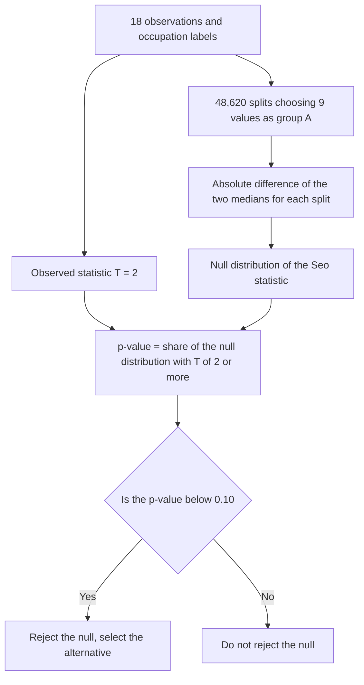

# HW3 Assignment Explanation — Nonparametric Tests and Multiple Testing

[Repository Guide](../../README.md) | [English](Assignment-Explanation.md) | [한국어](Assignment-Explanation.ko.md)

> **Last Updated:** 2026-11-04

> **Learning Objectives:**
> 1. Apply the independent two-sample t-test and the Wilcoxon rank-sum test to compare two independent groups and interpret the results
> 2. Choose the more appropriate of the two tests based on normality, sample size, and the form of the data
> 3. Build the null distribution of a newly defined test statistic by a permutation test and explain its limitations in comparison with established statistics
> 4. Explain the multiple testing problem that arises when thousands of hypotheses are tested at once and correct for it with the Bonferroni and Benjamini-Hochberg methods
> 5. Describe what a list of statistically significant genes means, how it is used, and how far it can be trusted

---

## Table of Contents

- [1. Assignment Structure and Data](#1-assignment-structure-and-data)
- [2. Q1. Comparing Case Counts of Two Occupation Groups](#2-q1-comparing-case-counts-of-two-occupation-groups)
  - [2.1 Data Summary](#21-data-summary)
  - [2.2 Parametric Method: Independent Two-Sample t-Test](#22-parametric-method-independent-two-sample-t-test)
  - [2.3 Nonparametric Method: Wilcoxon Rank-Sum Test](#23-nonparametric-method-wilcoxon-rank-sum-test)
- [3. Q2. Choosing the More Appropriate Test](#3-q2-choosing-the-more-appropriate-test)
- [4. Q3. Permutation Test with the Seo Statistic](#4-q3-permutation-test-with-the-seo-statistic)
- [5. Q4. Limitations of the Seo Statistic](#5-q4-limitations-of-the-seo-statistic)
- [6. Q5. Gene-Wise Tests between the Cancer and Healthy Groups](#6-q5-gene-wise-tests-between-the-cancer-and-healthy-groups)
- [7. Q6. Tests of Genes Related to Height](#7-q6-tests-of-genes-related-to-height)
- [8. Q7. The Multiple Testing Problem and Its Correction](#8-q7-the-multiple-testing-problem-and-its-correction)
  - [8.1 Accumulating Significance Levels](#81-accumulating-significance-levels)
  - [8.2 Bonferroni Correction](#82-bonferroni-correction)
  - [8.3 The Benjamini-Hochberg Method](#83-the-benjamini-hochberg-method)
  - [8.4 Comparing the Corrections](#84-comparing-the-corrections)
- [9. Q8. Meaning and Use of the Significant Results](#9-q8-meaning-and-use-of-the-significant-results)
- [Summary](#summary)
- [Self-Check Questions](#self-check-questions)

---

<br>

## 1. Assignment Structure and Data

The assignment has two parts. Q1-Q4 cover parametric and nonparametric methods for comparing two groups in small samples (Lectures 6 and 8), and Q5-Q8 cover the problems of testing thousands of hypotheses on one data set (connected to choosing statistical methods in Lecture 7). Every conclusion must be stated with the terms null hypothesis, alternative hypothesis, reject, select, and significance level. A line-by-line explanation of the code is in the [HW3 Code Walkthrough](Code-Walkthrough.md).

```plaintext
Coursework/HW03_Nonparametric-Tests-and-Multiple-Testing/
├── Assignment-Explanation.ko.md
├── Assignment-Explanation.md
├── Code-Walkthrough.ko.md
├── Code-Walkthrough.md
├── Original/
│   └── HW3.docx                  # Assignment handout
├── data/
│   ├── Q1_Data.tsv               # Case counts and occupation groups of 18 institutions
│   └── Q5_Data.tsv               # Disease, height, and 1,274 gene expression values of 72 people
└── Solution/
    ├── Q1-2.R, Q3.R              # R code for Q1-Q4
    ├── Q5.R, Q6.R, Q7.R          # R code for Q5-Q8
    └── Assignment-Report.pdf     # Submitted report
```

*Figure 1. Directory structure of HW3*

- **`Q1_Data.tsv`:** Holds the number of confirmed COVID-19 cases (`numCOVID`) at 18 independent institutions and whether each institution is a group of statisticians or of computer scientists (`Job`: `Statistician`, `ComputerScientist`). Each group has nine institutions.
- **`Q5_Data.tsv`:** Holds the disease status (`Disease`: `Cancer` 25, `Healthy` 47), the height (`Height`, cm), and gene expression values (`Gene_1`-`Gene_1274`) of 72 people. The handout states 1,724 genes, but the file has 1,274 gene columns, and every computation in this document uses 1,274.

---

<br>

## 2. Q1. Comparing Case Counts of Two Occupation Groups

**Problem.** Test whether the number of COVID-19 cases differs by occupation group at the 5% significance level with one parametric and one nonparametric method.

### 2.1 Data Summary

| Group | Sorted Observations | Sample Mean | Median | Sample Variance |
|:-----|:-----|-----:|-----:|-----:|
| ComputerScientist | 3, 3, 3, 4, 6, 6, 7, 7, 7 | 5.111 | 6 | 3.361 |
| Statistician | 1, 2, 2, 3, 4, 4, 4, 4, 5 | 3.222 | 4 | 1.694 |

*Table 1. Case counts of the two occupation groups*

The computer scientist group has both the larger mean and the larger median. The observations are small integers from 1 to 7, and only 7 of the 18 values are distinct, so there are many tied values.

### 2.2 Parametric Method: Independent Two-Sample t-Test

With $\mu_{CS}$ and $\mu_{ST}$ the population means of the two groups, the null hypothesis is $H_0: \mu_{CS} = \mu_{ST}$ (the two groups have the same mean number of cases) and the alternative is $H_1: \mu_{CS} \ne \mu_{ST}$ (they differ). The **independent two-sample t-test**, which assumes normal populations with equal variances, uses the **pooled variance** that combines the two sample variances.

$$s_p^2 = \frac{(n_1 - 1)s_1^2 + (n_2 - 1)s_2^2}{n_1 + n_2 - 2} = \frac{8 \times 3.3611 + 8 \times 1.6944}{16} = 2.5278$$

$$t = \frac{\bar{x}_1 - \bar{x}_2}{s_p\sqrt{\frac{1}{n_1} + \frac{1}{n_2}}} = \frac{5.1111 - 3.2222}{\sqrt{2.5278}\sqrt{\frac{2}{9}}} = \frac{1.8889}{0.74949} = 2.520$$

Under the null hypothesis, $t$ follows the t distribution with $n_1 + n_2 - 2 = 16$ degrees of freedom, and the two-sided p-value is $2P(T_{16} \ge 2.520) = 0.0227$. The p-value 0.0227 is smaller than the significance level 0.05, so the null hypothesis is rejected and the alternative that the mean numbers of cases of the two occupation groups differ is selected. The 95% confidence interval for the difference in means is (0.300, 3.478). The Welch t-test, which does not assume equal variances, gives the same conclusion with $t = 2.520$, 14.43 degrees of freedom, and a p-value of 0.0241.

### 2.3 Nonparametric Method: Wilcoxon Rank-Sum Test

The **Wilcoxon rank-sum test** (equivalent to the Mann-Whitney U test) uses the ranks in the combined sample instead of the values, so it does not assume normality. The null hypothesis is $H_0$: the two groups have the same distribution (the same location), and the alternative is $H_1$: one distribution is shifted up or down relative to the other (the locations differ).

The 18 values are ranked from the smallest, and tied values receive the **midrank**, the average of the ranks they occupy.

| Value | 1 | 2 | 3 | 4 | 5 | 6 | 7 |
|:-----|:-----:|:-----:|:-----:|:-----:|:-----:|:-----:|:-----:|
| Count (CS, ST) | 1 (0, 1) | 2 (0, 2) | 4 (3, 1) | 5 (1, 4) | 1 (0, 1) | 2 (2, 0) | 3 (3, 0) |
| Ranks occupied | 1 | 2-3 | 4-7 | 8-12 | 13 | 14-15 | 16-18 |
| Midrank | 1 | 2.5 | 5.5 | 10 | 13 | 14.5 | 17 |

*Table 2. Midranks of the case counts (CS: ComputerScientist, ST: Statistician)*

The rank sum of the computer scientist group is $R_{CS} = 3 \times 5.5 + 10 + 2 \times 14.5 + 3 \times 17 = 106.5$, and that of the statistician group is $R_{ST} = 171 - 106.5 = 64.5$ (the total rank sum is $18 \times 19 / 2 = 171$). The statistic reported by R is $W = R_{CS} - \frac{n_1(n_1 + 1)}{2} = 106.5 - 45 = 61.5$. Under the null hypothesis $E[W] = \frac{n_1 n_2}{2} = 40.5$, and the variance corrected for ties is as follows. $t_j$ is the size of each group of tied values, and in these data $\sum(t_j^3 - t_j) = 6 + 60 + 120 + 6 + 24 = 216$.

$$\mathrm{Var}(W) = \frac{n_1 n_2}{12}\left[(N + 1) - \frac{\sum_j (t_j^3 - t_j)}{N(N - 1)}\right] = \frac{81}{12}\left[19 - \frac{216}{306}\right] = 123.49$$

$$z = \frac{W - E[W]}{\sqrt{\mathrm{Var}(W)}} = \frac{61.5 - 40.5}{11.112} = 1.890, \qquad p = 2\{1 - \Phi(1.890)\} = 0.0588$$

The p-value 0.0588 is larger than the significance level 0.05, so the null hypothesis is not rejected, and there is insufficient ground to select the alternative that the distributions of case counts of the two occupation groups differ.

> **Note:** With a **continuity correction** in the normal approximation ($z = 20.5/11.112 = 1.845$) the p-value is 0.0651, and the p-value from the exact permutation distribution that accounts for ties is 0.0712. Depending on the computation the value lies between 0.06 and 0.07, but the conclusion of not rejecting at the 5% significance level is the same. When there are ties, R's `wilcox.test()` cannot compute the exact p-value and uses the normal approximation.

---

<br>

## 3. Q2. Choosing the More Appropriate Test

**Problem.** Which of the two tests in Q1 is preferable, and why?

The two tests disagree. The t-test rejects with a p-value of 0.0227, and the Wilcoxon rank-sum test does not reject with 0.0588. Which conclusion to follow is decided by whether the assumptions of each test hold for these data.

| Assumption | Check |
|:-----|:-----|
| Independence of observations | The 18 institutions are given as independent, so both tests satisfy it. |
| Normality of each group (t-test) | The Shapiro-Wilk p-values are 0.0198 for ComputerScientist and 0.2574 for Statistician. Normality is rejected for the computer scientist group at the 5% significance level. |
| Equal variances (pooled t-test) | The variance ratio is $3.361 / 1.694 = 1.98$ and the F test p-value is 0.352. This assumption is not badly violated. |
| Sample size | Each group has only nine observations, so the central limit theorem cannot be relied on for the normality of the sample mean when normality fails. |
| Form of the data | The data are integer counts from 1 to 7 with many ties, far from a continuous normal distribution. |

*Table 3. Checking the assumptions of the two tests on the Q1 data*

Normality, the key assumption of the t-test, is rejected in one group, and the samples are too small to rely on the central limit theorem. Therefore the **Wilcoxon rank-sum test, which uses only ranks without a distributional assumption, is preferable** for these data. With its assumption violated, the t-test's p-value of 0.0227 does not guarantee the nominal probability of a type I error, so its rejection is hard to trust as it stands. Rank-based tests are also safe for small samples in that a single outlier cannot dominate the result.

In conclusion, at the 5% significance level the Wilcoxon rank-sum test does not reject the null hypothesis, and there is insufficient ground to select the alternative that the number of cases differs by occupation group. The p-value of 0.06-0.07 is close to the boundary, however, and the difference in sample means is 1.9 cases, so it is more accurate to say that the small sample could not confirm a difference than to assert that "there is no difference".

> **Caution:** Nonparametric tests are not always better. For normal data the t-test has slightly higher power, while for heavy-tailed or skewed distributions the Wilcoxon rank-sum test can have higher power (Lecture 8). The choice must rest on checking the assumptions, not on whether it yields the desired conclusion, and running both tests and picking the significant one causes the same problem as multiple testing.

---

<br>

## 4. Q3. Permutation Test with the Seo Statistic

**Problem.** Using the new two-group statistic $\text{Seo-Stat} = \lvert \mathrm{Median}(A) - \mathrm{Median}(B) \rvert$ as the test statistic, test the same hypotheses as Q1 at the 10% significance level.

**Observed statistic.** With A = ComputerScientist and B = Statistician, the two medians are 6 and 4, so the observed Seo statistic is $T_{obs} = \lvert 6 - 4 \rvert = 2$.

**Null distribution.** The distribution of the new statistic under the null hypothesis is not known, so a **permutation test** builds it. If the null hypothesis $H_0$: the two groups have the same distribution is true, the group labels are unrelated to the observations, so every way of splitting the 18 values into two groups of nine is equally likely. There are $\binom{18}{9} = 48{,}620$ such splits, and computing the Seo statistic for each gives the exact null distribution.



*Figure 2. Procedure of the permutation test with the Seo statistic*

| Seo Statistic | 0 | 1 | 2 | 3 | Total |
|:-----|-----:|-----:|-----:|-----:|-----:|
| Number of splits | 29,750 | 14,590 | 3,340 | 940 | 48,620 |
| Probability | 0.6119 | 0.3001 | 0.0687 | 0.0193 | 1 |

*Table 4. Null distribution of the Seo statistic over the 48,620 splits*

**p-value and conclusion.** The p-value is the probability in the null distribution of a statistic at least as large as the observed one.

$$p = P(T \ge 2) = \frac{3{,}340 + 940}{48{,}620} = \frac{4{,}280}{48{,}620} = 0.0880$$

The p-value 0.0880 is smaller than the significance level 0.10, so the null hypothesis is rejected and the alternative that the distributions of case counts of the two occupation groups differ is selected. The observed median is larger for the computer scientist group, so at the 10% significance level its location is judged to be shifted toward more cases.

> **Note:** Because the statistic has an absolute value, this test is two-sided. Strictly, the null hypothesis of a permutation test is not "the two groups have equal medians" but "the two groups have the same distribution (the distribution is unchanged when labels are swapped)", and the Seo statistic is a statistic that responds to the difference in medians within it.

---

<br>

## 5. Q4. Limitations of the Seo Statistic

**Problem.** Describe the limitations of the Seo statistic for testing a difference between two groups by comparing it with the forms of statistics already known.

The two established statistics for comparison are the following.

$$t = \frac{\bar{x}_1 - \bar{x}_2}{s_p\sqrt{\frac{1}{n_1} + \frac{1}{n_2}}}, \qquad W = \sum_{i \in \text{group 1}} \mathrm{rank}(x_i) - \frac{n_1(n_1 + 1)}{2}$$

| Criterion | t Statistic | Wilcoxon $W$ | Seo Statistic |
|:-----|:-----|:-----|:-----|
| Information used | Magnitudes of all observations | Ranks of all observations | One middle value per group |
| Standardization by spread | Divided by the standard error | Scale-free through ranks | None |
| Null distribution | t distribution with $n_1 + n_2 - 2$ degrees of freedom | Exact tables or normal approximation | Unknown, computed by permutation |
| Direction | The sign shows the direction | Above or below $E[W]$ shows the direction | Lost through the absolute value |
| Possible values in these data | Nearly continuous | Dozens | Four: 0, 1, 2, 3 |

*Table 5. Comparison of the t statistic, the Wilcoxon statistic, and the Seo statistic*

- **Loss of information:** The median of a group of nine is determined by its fifth value alone. The other eight values matter only through being above or below the median, so for the same sample size the power is lower than that of statistics based on means or rank sums.
- **No standardization:** The t statistic divides the difference by the standard error and measures "how many times the chance variation the difference is", whereas the Seo statistic is the raw difference in the original units. The same difference of 2 is common when the data are widely spread and rare when they are not, so the size of the statistic alone does not reveal the strength of evidence, and the null distribution must be rebuilt for every data set.
- **No known null distribution and computational cost:** The null distribution must be obtained by permutation, and the number of splits $\binom{n}{n/2}$ grows rapidly with the sample. With 20 per group, for example, there are $\binom{40}{20} \approx 1.4 \times 10^{11}$ splits, too many to enumerate, so a random subset of splits must be used as an approximation.
- **Discreteness:** In these data the Seo statistic takes only the four values 0, 1, 2, and 3, so the only possible p-values are 1, 0.388, 0.088, and 0.019. At the 5% significance level the test rejects only when $T = 3$, so its actual probability of a type I error is only 0.019, which is overly conservative, and any significance level between 2% and 8.8% gives exactly the same test.
- **Loss of direction:** Because of the absolute value, a one-sided alternative (for example, that the computer scientist group has more cases) cannot be tested directly.
- **Differences other than location:** Only medians are compared, so if the groups differ in spread or shape but share a median, the difference goes undetected.

> **Note:** Keeping the permutation framework and changing only the statistic makes the differences clear. Over the same 48,620 splits, the absolute difference in means gives a p-value of 0.0353, the exact Wilcoxon test based on rank sums gives 0.0712, and the Seo statistic gives 0.0880. Even in a permutation test that does not assume normality, the difference in means is significant at the 5% level, so the disagreement between the t-test of Section 2.2 and the Wilcoxon test of Section 2.3 is not only about the normality assumption but also about which statistic summarizes evidence that lies near the boundary. The Seo statistic, which uses the least information, has the largest p-value.

---

<br>

## 6. Q5. Gene-Wise Tests between the Cancer and Healthy Groups

**Problem.** Identify the genes that differ between the cancer group and the normal group by hypothesis tests at the 1% significance level, and describe how many genes are found.

**Method.** For each gene, set the null hypothesis $H_0$: the cancer and healthy groups have the same mean expression, and the alternative $H_1$: the mean expressions differ, and apply **Welch's t-test**. The two groups have different sizes, 25 and 47, and equal variances cannot be guaranteed for every gene, so Welch's test, which uses the two variances separately instead of a pooled variance, is appropriate.

$$t = \frac{\bar{x}_1 - \bar{x}_2}{\sqrt{\frac{s_1^2}{n_1} + \frac{s_2^2}{n_2}}}, \qquad \nu = \frac{\left(\frac{s_1^2}{n_1} + \frac{s_2^2}{n_2}\right)^2}{\frac{(s_1^2/n_1)^2}{n_1 - 1} + \frac{(s_2^2/n_2)^2}{n_2 - 1}}$$

Under the null hypothesis, $t$ approximately follows the t distribution with $\nu$ degrees of freedom.

**Result.** Of the 1,274 genes, **315** have p-values below 0.01. For these 315 genes the null hypothesis is rejected and the alternative that the mean expressions of the two groups differ is selected, and for the other 959 the null hypothesis is not rejected. Of the 315, 128 have a higher mean in the cancer group and 187 in the healthy group. The six genes with the smallest p-values are as follows.

| Gene | $t$ | Degrees of Freedom | p-value | Cancer Mean | Healthy Mean |
|:-----|-----:|-----:|-----:|-----:|-----:|
| Gene_231 | -8.829 | 51.96 | $6.43 \times 10^{-12}$ | 975.4 | 4255.1 |
| Gene_13 | -8.734 | 50.32 | $1.18 \times 10^{-11}$ | 313.4 | 1402.1 |
| Gene_768 | -8.119 | 56.33 | $4.73 \times 10^{-11}$ | 556.4 | 1727.1 |
| Gene_9 | -7.993 | 47.59 | $2.39 \times 10^{-10}$ | 182.4 | 3936.2 |
| Gene_436 | -7.725 | 54.23 | $2.67 \times 10^{-10}$ | -401.1 | 1463.3 |
| Gene_837 | -7.267 | 67.51 | $4.86 \times 10^{-10}$ | -21.4 | 204.5 |

*Table 6. The six genes with the smallest p-values in Q5*

Some expression values are negative, but that does not affect the comparison of the two group means. The 315 genes are the result of looking at each test separately, and the correction for testing all 1,274 together is in Section 8.

---

<br>

## 7. Q6. Tests of Genes Related to Height

**Problem.** Identify genes related to height by hypothesis tests at the 1% significance level, and describe how many genes are found.

**Method.** Height and gene expression are both continuous, so for each gene the **Pearson correlation coefficient** $r$ is computed and a correlation test is applied. The null hypothesis is $H_0: \rho = 0$ (no linear correlation between the gene and height), and the alternative is $H_1: \rho \ne 0$ (correlated). Under the null hypothesis, the following statistic follows the t distribution with $n - 2 = 70$ degrees of freedom.

$$t = \frac{r\sqrt{n - 2}}{\sqrt{1 - r^2}}$$

For a two-sided test at the 1% significance level this criterion is equivalent to $\lvert r \rvert > 0.302$.

**Result.** Of the 1,274 genes, **12** have p-values below 0.01, so for these 12 the null hypothesis is rejected and the alternative that they are correlated with height is selected. For the other 1,262 the null hypothesis is not rejected. The six genes with the smallest p-values are as follows.

| Gene | $r$ | $t$ | p-value |
|:-----|-----:|-----:|-----:|
| Gene_267 | -0.445 | -4.160 | $8.89 \times 10^{-5}$ |
| Gene_1199 | 0.405 | 3.702 | $4.23 \times 10^{-4}$ |
| Gene_793 | 0.388 | 3.521 | $7.61 \times 10^{-4}$ |
| Gene_77 | 0.362 | 3.246 | $1.80 \times 10^{-3}$ |
| Gene_145 | -0.351 | -3.140 | $2.47 \times 10^{-3}$ |
| Gene_1222 | 0.349 | 3.114 | $2.67 \times 10^{-3}$ |

*Table 7. The six genes with the smallest p-values in Q6*

The other six are Gene_382, Gene_1019, Gene_1130, Gene_1265, Gene_321, and Gene_812, all with correlation coefficients of 0.30-0.34. Whether these 12 are actually related to height is judged again with the multiple testing correction of Section 8.

> **Note:** The Pearson correlation test measures linear association and is exact when the two variables follow a bivariate normal distribution or the sample is large enough. The same test with the rank-based Spearman correlation coefficient gives 19 genes with p-values below 0.01.

---

<br>

## 8. Q7. The Multiple Testing Problem and Its Correction

**Problem.** Testing many hypotheses on the same data causes a statistical problem because of the concept of the significance level. Describe what causes the problem in Q5, find a correction method, and describe the result after modifying the p-values of Q5.

### 8.1 Accumulating Significance Levels

A significance level of 1% means that a single test wrongly rejects a true null hypothesis with probability 1%. Q5 performed $m = 1{,}274$ such tests. Even if the null hypothesis were true for every gene, on average $1{,}274 \times 0.01 = 12.74$ genes would come out significant by chance. If the tests are independent, the probability of at least one wrong rejection, the **family-wise error rate (FWER)**, is as follows.

$$\text{FWER} = 1 - (1 - 0.01)^{1274} \approx 0.999997$$

That is, without correction it is almost certain that at least one false positive is included. The 315 genes of Q5 mix genes with real differences and **false positives** that came out significant by chance, and the individual tests alone cannot tell them apart. This is the **multiple testing problem**.

### 8.2 Bonferroni Correction

The **Bonferroni correction** divides the significance level of each test by the number of tests and bounds the FWER by $\alpha$. It rejects only when a p-value is below $\alpha/m$, or equivalently it compares the adjusted p-value $\min(m p_i, 1)$ with $\alpha$.

$$p_i < \frac{\alpha}{m} = \frac{0.01}{1274} = 7.85 \times 10^{-6}$$

Since FWER $\le \sum_i P(\text{test } i \text{ wrongly rejects}) \le m \cdot \frac{\alpha}{m} = \alpha$, the bound holds regardless of the correlation between tests. Applied to Q5, **56** genes remain. It is very strict, so false positives are almost absent, but many genes with real differences are missed.

### 8.3 The Benjamini-Hochberg Method

The **false discovery rate (FDR)** is the expected proportion, among the rejected hypotheses, of those whose null hypothesis is actually true. When choosing a list of candidates for further study from thousands, controlling the share of false positives in the list (FDR) often fits the goal better than the FWER, which allows no false positive at all. The **Benjamini-Hochberg (BH) method** controls the FDR at or below $q$ by the following procedure (when the tests are independent or positively correlated).

1. Sort the p-values in increasing order, $p_{(1)} \le p_{(2)} \le \dots \le p_{(m)}$.
2. Find the largest rank $k$ with $p_{(k)} \le \frac{k}{m} q$.
3. Reject all hypotheses with ranks 1 to $k$.

Applied to Q5 with $q = 0.01$, $k = 185$. The 185th p-value $p_{(185)} = 0.0014489$ is at most its threshold $\frac{185}{1274} \times 0.01 = 0.0014521$, and the 186th, $p_{(186)} = 0.0014706$, exceeds its threshold $0.0014600$. Therefore the null hypothesis is rejected for **185** genes. R's `p.adjust(p, method = "BH")` returns the adjusted p-value of each gene, and comparing those with 0.01 gives the same result.

### 8.4 Comparing the Corrections

| Method | Error Controlled | Q5 Genes | Q6 Genes |
|:-----|:-----|-----:|-----:|
| No correction | Type I error of each test | 315 | 12 |
| Bonferroni | FWER | 56 | 0 |
| Holm | FWER | 56 | 0 |
| Šidák | FWER (under independence) | 56 | 0 |
| Benjamini-Hochberg | FDR | 185 | 0 |
| Benjamini-Yekutieli | FDR (any correlation) | 92 | 0 |

*Table 8. Number of significant genes by correction method at the 1% level*

The Holm method improves on Bonferroni by comparing the sorted p-values with $\frac{\alpha}{m}, \frac{\alpha}{m - 1}, \dots$ in turn, and the Šidák method assumes independence and uses the boundary $1 - (1 - \alpha)^{1/m} = 7.89 \times 10^{-6}$. In these data all three give 56. The Scheffé method mentioned as an example in the handout tests contrasts in an analysis of variance simultaneously, so it does not fit the correction of gene-wise tests.

The result of Q6 changes completely after correction. The 12 genes before correction are fewer than the 12.74 expected by chance when every null hypothesis is true, the smallest p-value $8.89 \times 10^{-5}$ is above the Bonferroni boundary $7.85 \times 10^{-6}$, and the smallest BH-adjusted p-value is 0.113. The distribution of the p-values makes the contrast clearer.

| p-value Interval | 0-0.1 | 0.1-0.2 | 0.2-0.3 | 0.3-0.4 | 0.4-0.5 | 0.5-0.6 | 0.6-0.7 | 0.7-0.8 | 0.8-0.9 | 0.9-1 |
|:-----|-----:|-----:|-----:|-----:|-----:|-----:|-----:|-----:|-----:|-----:|
| Q5 genes | 606 | 144 | 83 | 78 | 70 | 57 | 59 | 61 | 61 | 55 |
| Q6 genes | 152 | 173 | 137 | 119 | 113 | 113 | 107 | 131 | 107 | 122 |

*Table 9. Distribution of the p-values of the 1,274 genes*

When every null hypothesis is true, p-values follow the uniform distribution on 0 to 1, so each interval receives about 127 genes. The Q6 distribution resembles this and carries almost no signal of genes related to height, while in Q5, 606 genes crowd into the interval 0-0.1, showing that many genes truly differ.

> **Key Point:** When many hypotheses are tested, an error rate for the whole set of results (FWER or FDR) must be chosen instead of the individual significance level, and the results corrected accordingly. The corrected conclusions are "56 genes (FWER 1%) or 185 genes (FDR 1%) differ between the cancer and healthy groups" for Q5 and "there is no evidence of genes related to height" for Q6.

---

<br>

## 9. Q8. Meaning and Use of the Significant Results

**Problem.** Describe logically how the statistically significant results of Q5 and Q6 could be applied in real industrial and academic fields.

**Meaning of the results.** The genes of Q5 that stay significant after correction are **differentially expressed genes** whose mean expression differs between the cancer and healthy groups. This is statistical evidence that the expression of those genes is systematically associated with disease status, but it says nothing about the direction of cause and effect or the biological mechanism. In Q6 no gene stays significant after correction, so these data cannot support the claim that some genes are related to height.

**Applications.**

- **Discovering biomarker candidates:** Genes of Q5 that pass a strict criterion, such as the 56 under Bonferroni, and show a large difference in group means become candidates for cancer diagnostic biomarkers. A test panel of a few genes is cheaper and faster than measuring the whole genome.
- **Feature selection in machine learning:** As **filter feature selection**, which picks features for classification from thousands of variables in advance, it reduces the dimension of logistic regression, random forest, and neural network classifiers of cancer versus healthy and prevents overfitting.
- **Mechanism research and drug targets:** Pathway analysis, which matches the list of significant genes against known biological pathways, builds hypotheses about disease mechanisms and selects drug target candidates for experimental validation.
- **Study design:** When no signal remains after correction, as in Q6, that is itself a result. It is grounds for judging whether a larger sample is needed, and it shows that using the 12 chance-significant genes as features would only add noise and harm a model.

**Cautions in application.**

1. **Validation:** The effects of genes selected from a data set tend to look larger than they are, so they must be reproduced in a separate independent sample (a validation cohort).
2. **Information leakage:** If feature selection is done on the whole data set before evaluating a classifier, information from the test data leaks into training and inflates the performance. Feature selection must be done inside each training part of the cross-validation.
3. **Effect size:** In large samples even small differences are significant, so priorities are set with effect sizes such as the mean difference or the fold change along with the p-values.
4. **Confounders:** If differences in measurement time and equipment (batch effects) or variables such as age and sex are entangled with the groups, a spurious association between genes and disease can appear.

---

<br>

## Summary

| Concept | Key Summary |
|:-----|:-----|
| Independent two-sample t-test | It assumes normal populations with equal variances and compares $t$, the difference in means divided by the pooled standard error, with the t distribution with $n_1 + n_2 - 2$ degrees of freedom, giving $t = 2.520$ and a p-value of 0.0227 in Q1. |
| Wilcoxon rank-sum test | It compares the locations of two distributions by ranks in the combined sample, with midranks for ties, giving $W = 61.5$ and a p-value of 0.0588 in Q1. |
| Choosing a test | The choice rests on checking assumptions rather than on the conclusion, and in Q1, with small samples and violated normality, the Wilcoxon rank-sum test is preferable. |
| Permutation test | It uses the exchangeability of labels under the null hypothesis to build the exact null distribution from the statistic of every split, and the p-value of the Seo statistic is $4{,}280/48{,}620 = 0.0880$. |
| Limitations of the Seo statistic | It uses only one middle value, is not standardized by spread, has no known null distribution, takes discrete values, and loses direction through the absolute value. |
| Gene-wise tests | 315 genes in Q5 by Welch's t-test and 12 genes in Q6 by the Pearson correlation test have p-values below 0.01. |
| Multiple testing problem | Testing $m$ times at level $\alpha$ produces $m\alpha$ chance rejections on average, 12.74 for 1,274 tests. |
| Bonferroni correction | It lowers the boundary to $\alpha/m$ to control the FWER at $\alpha$, and 56 genes remain in Q5. |
| Benjamini-Hochberg method | It rejects up to the largest $k$ with $p_{(k)} \le \frac{k}{m}q$ to control the FDR at $q$, and 185 genes remain in Q5. |
| Use of the results | Genes that pass correction become candidates for biomarkers and feature selection, but they need validation on independent samples, prevention of information leakage, and checks of effect sizes and confounders. |

---

<br>

## Self-Check Questions

1. **Midranks:** Assign midranks to the values 3, 5, 5, 8.

   <details>
   <summary>Answer</summary>

   1, 2.5, 2.5, 4. The two 5s occupy ranks 2 and 3, so both receive the average 2.5.

   </details>

2. **Number of splits:** How many splits must be computed for an exact permutation test of two groups of six each?

   <details>
   <summary>Answer</summary>

   $\binom{12}{6} = 924$, the number of ways to choose six of the twelve values as the first group.

   </details>

3. **Discreteness:** The only possible p-values of a permutation test statistic are 1, 0.30, 0.08, and 0.02. What is the actual probability of a type I error of this test at a nominal significance level of 5%?

   <details>
   <summary>Answer</summary>

   The only p-value below 0.05 is 0.02, so the actual probability of a type I error is 0.02. The test is conservative, below its nominal significance level.

   </details>

4. **Bonferroni boundary:** What is the Bonferroni boundary when 20,000 genes are tested with FWER 5%? Without correction, how many genes are significant by chance on average when every null hypothesis is true?

   <details>
   <summary>Answer</summary>

   The boundary is $0.05 / 20{,}000 = 2.5 \times 10^{-6}$. Without correction, on average $20{,}000 \times 0.05 = 1{,}000$ genes come out significant by chance.

   </details>

5. **BH procedure:** With $m = 5$, $q = 0.05$, and sorted p-values 0.001, 0.012, 0.025, 0.041, 0.300, how many hypotheses does the BH method reject?

   <details>
   <summary>Answer</summary>

   The thresholds are $\frac{k}{5} \times 0.05 = 0.01, 0.02, 0.03, 0.04, 0.05$. $p_{(3)} = 0.025 \le 0.03$, while $p_{(4)} = 0.041 > 0.04$ and $p_{(5)} = 0.300 > 0.05$, so the largest $k$ is 3 and three hypotheses are rejected. On the same data the Bonferroni boundary 0.01 rejects only one.

   </details>
