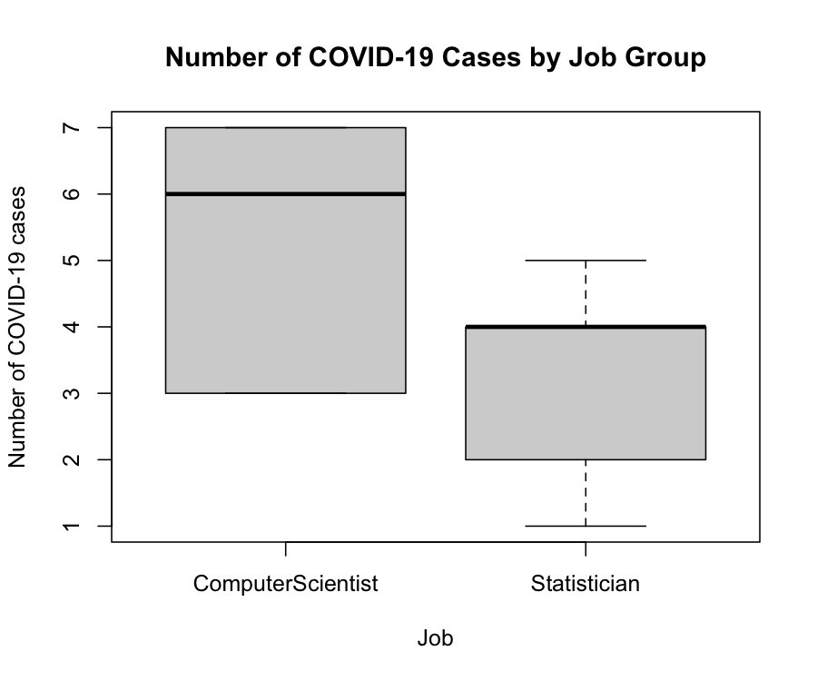
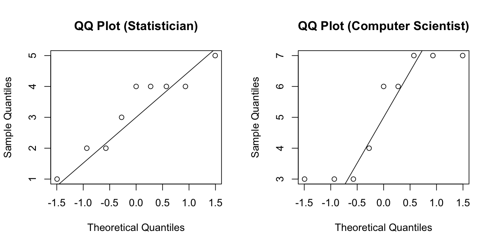

# HW3 코드 총정리 — 비모수 검정과 다중 검정

[레포지토리 안내](../../README.ko.md) | [English](Code-Walkthrough.md) | [한국어](Code-Walkthrough.ko.md)

> **최종 수정일:** 2026-11-04

> **학습 목표:**
> 1. `read.table()`로 탭 구분 데이터를 불러오고 `by()`, `boxplot()`, `qqnorm()`으로 집단별 분포를 살펴볼 수 있다
> 2. `t.test()`, `wilcox.test()`, `shapiro.test()`, `cor.test()`의 인자와 출력을 읽을 수 있다
> 3. `combn()`과 `apply()`로 모든 분할을 나열하는 정확한 순열 검정을 구현할 수 있다
> 4. 반복문으로 수천 개의 가설을 검정해 결과를 표로 모으고, `p.adjust()`로 다중 검정을 보정할 수 있다

---

## 목차

- [1. 파일 구성과 실행 방법](#1-파일-구성과-실행-방법)
- [2. 다섯 스크립트의 공통 부분](#2-다섯-스크립트의-공통-부분)
- [3. Q1-2.R: 두 집단의 비교](#3-q1-2r-두-집단의-비교)
  - [3.1 요약 통계와 상자 그림](#31-요약-통계와-상자-그림)
  - [3.2 정규성 점검](#32-정규성-점검)
  - [3.3 독립 2표본 t 검정](#33-독립-2표본-t-검정)
  - [3.4 Wilcoxon 순위합 검정](#34-wilcoxon-순위합-검정)
- [4. Q3.R: Seo 통계량의 정확한 순열 검정](#4-q3r-seo-통계량의-정확한-순열-검정)
- [5. Q5.R: 유전자별 Welch t 검정](#5-q5r-유전자별-welch-t-검정)
- [6. Q6.R: 유전자별 상관 검정](#6-q6r-유전자별-상관-검정)
- [7. Q7.R: 다중 검정 보정](#7-q7r-다중-검정-보정)
- [8. 반복문을 sapply로 바꾸기](#8-반복문을-sapply로-바꾸기)
- [요약](#요약)
- [점검 문제](#점검-문제)

---

<br>

## 1. 파일 구성과 실행 방법

`Solution/`의 R 스크립트 다섯 개는 Q1\~Q7의 계산을 맡고, Q2, Q4, Q8은 이 결과를 해석하는 서술 문항이다. 문항의 통계적 해설은 [HW3 과제 해설](Assignment-Explanation.ko.md)에 있고, 이 문서는 코드를 처음부터 끝까지 읽는다.

| 파일 | 데이터 | 하는 일 |
|:-----|:-----|:-----|
| `Q1-2.R` | `Q1_Data.tsv` | 요약 통계, 상자 그림, 정규성 점검, 합동 분산 t 검정, Wilcoxon 순위합 검정 |
| `Q3.R` | `Q1_Data.tsv` | Seo 통계량과 48,620가지 분할의 정확한 순열 검정 |
| `Q5.R` | `Q5_Data.tsv` | 1,274개 유전자의 Welch t 검정과 유의한 유전자 수 |
| `Q6.R` | `Q5_Data.tsv` | 1,274개 유전자와 키의 Pearson 상관 검정 |
| `Q7.R` | `Q5_Data.tsv` | Q5의 검정을 다시 하고 Bonferroni, BH 보정 |

*표 1. HW3 스크립트의 구성*

스크립트는 자신이 있는 폴더를 기준으로 데이터 폴더를 찾으므로 RStudio의 Source 버튼이나 다음과 같은 `source()`로 실행한다. 이 방식은 [HW2 코드 총정리](../HW02_One-Sample-Z-Test/Code-Walkthrough.ko.md)의 2.2절에서 설명했다.

```r
source("Coursework/HW03_Nonparametric-Tests-and-Multiple-Testing/Solution/Q1-2.R")
```

---

<br>

## 2. 다섯 스크립트의 공통 부분

```r
## 1. 기본 설정 및 데이터 불러오기
setRepositories(ind = 1:7)

################################################################
# 작업 경로 설정
WORK_DIR <- file.path(dirname(sys.frame(1)$ofile %||% "."), "../data")
if (WORK_DIR != "") setwd(WORK_DIR)
################################################################

# 데이터 로드
Q1_data <- read.table("Q1_Data.tsv",
                      header = TRUE,
                      sep = "\t",
                      stringsAsFactors = TRUE)

str(Q1_data)
table(Q1_data$Job)
```

- 이 과제는 기본 R 함수만 쓰므로 패키지를 불러오지 않는다. 작업 경로 설정은 HW2와 같다.
- `read.table()`은 기본 R의 표 읽기 함수이다. `header = TRUE`는 첫 줄을 열 이름으로, `sep = "\t"`는 탭을 구분자로 쓰라는 뜻이고, `stringsAsFactors = TRUE`는 문자열 열(`Job`, `Disease`)을 **팩터**(factor)로 만든다. 팩터의 수준(level)은 알파벳순이므로 `Job`은 `ComputerScientist`, `Statistician` 순서가 되며, 이 순서가 뒤의 검정에서 어느 집단을 첫째로 볼지 정한다.
- `str()`은 객체의 구조를, `table()`은 범주별 개수를 보여 준다.

```text
'data.frame':	18 obs. of  2 variables:
 $ numCOVID: int  1 4 4 2 4 5 4 3 2 3 ...
 $ Job     : Factor w/ 2 levels "ComputerScientist",..: 2 2 2 2 2 2 2 2 2 1 ...

ComputerScientist      Statistician 
                9                 9 
```

Q5\~Q7은 같은 방식으로 `Q5_Data.tsv`를 `Q5_data`에 불러온다. 이 자료는 72행, 1,276열(`Disease`, `Height`, 유전자 1,274개)이고, `table(Q5_data$Disease)`는 `Cancer` 25, `Healthy` 47이다.

---

<br>

## 3. Q1-2.R: 두 집단의 비교

### 3.1 요약 통계와 상자 그림

```r
by(Q1_data$numCOVID, Q1_data$Job, summary)

boxplot(numCOVID ~ Job,
        data = Q1_data,
        main = "Number of COVID-19 Cases by Job Group",
        xlab = "Job",
        ylab = "Number of COVID-19 cases")
```

`by(x, 집단, 함수)`는 `x`를 집단별로 나누어 각각에 함수를 적용한다. `summary()`는 최솟값, 제1사분위수, 중앙값, 평균, 제3사분위수, 최댓값을 준다.

```text
Q1_data$Job: ComputerScientist
   Min. 1st Qu.  Median    Mean 3rd Qu.    Max. 
  3.000   3.000   6.000   5.111   7.000   7.000 
------------------------------------------------------------ 
Q1_data$Job: Statistician
   Min. 1st Qu.  Median    Mean 3rd Qu.    Max. 
  1.000   2.000   4.000   3.222   4.000   5.000 
```

`boxplot(numCOVID ~ Job, data = Q1_data)`의 `~`는 **수식**(formula) 표기로, 왼쪽 변수를 오른쪽 변수의 범주별로 나누라는 뜻이다. 상자는 제1사분위수에서 제3사분위수까지, 굵은 선은 중앙값, 수염은 상자에서 사분위범위의 1.5배 안에 있는 가장 먼 관측값까지를 나타낸다.



*그림 1. 직업 집단별 COVID-19 확진자 수의 상자 그림*

전산학자 집단은 중앙값 6, 상자 3\~7로 넓게 퍼져 있고, 통계학자 집단은 중앙값 4, 상자 2\~4로 좁다. 전산학자 집단은 최솟값과 최댓값이 상자의 양 끝과 같아 수염이 없고, 통계학자 집단은 중앙값과 제3사분위수가 모두 4여서 굵은 선이 상자의 위쪽 끝에 붙어 있다.

### 3.2 정규성 점검

```r
by(Q1_data$numCOVID, Q1_data$Job, shapiro.test)

par(mfrow = c(1, 2))

# Statistician
with(subset(Q1_data, Job == "Statistician"),
     qqnorm(numCOVID, main = "QQ Plot (Statistician)"))
with(subset(Q1_data, Job == "Statistician"),
     qqline(numCOVID))
```

- `shapiro.test()`는 **Shapiro-Wilk 검정**으로, 귀무가설은 "자료가 정규분포에서 왔다"이다. 유의확률이 작으면 정규성을 기각한다.
- `par(mfrow = c(1, 2))`는 그림 영역을 1행 2열로 나누어 두 그림을 나란히 그리고, 마지막의 `par(mfrow = c(1, 1))`이 원래대로 돌린다.
- `with(데이터, 식)`은 데이터의 열 이름을 변수처럼 쓰게 한다. `qqnorm()`은 **정규 Q-Q 그림**(normal quantile-quantile plot)으로, 정렬한 관측값(세로축)을 표준정규분포의 이론 분위수(가로축)에 대응시켜 찍는다. `qqline()`은 제1사분위수와 제3사분위수를 잇는 기준선을 긋는다. 자료가 정규분포에 가까우면 점들이 이 직선 위에 놓인다.
- ComputerScientist에 대한 네 줄도 같은 구조이다.

```text
Q1_data$Job: ComputerScientist

	Shapiro-Wilk normality test

data:  dd[x, ]
W = 0.79884, p-value = 0.01981

------------------------------------------------------------ 
Q1_data$Job: Statistician

	Shapiro-Wilk normality test

data:  dd[x, ]
W = 0.90093, p-value = 0.2574
```



*그림 2. 두 직업 집단의 정규 Q-Q 그림*

전산학자 집단의 점들은 3과 6, 7에 몰려 계단 모양을 이루고 직선에서 크게 벗어난다. 이는 유의확률 0.0198로 정규성이 기각된 결과와 맞는다. 통계학자 집단은 4에 같은 값이 많지만 대체로 직선을 따른다. `data:  dd[x, ]`는 `by()`가 내부에서 나눈 자료의 이름이 그대로 출력된 것이다.

### 3.3 독립 2표본 t 검정

```r
t_res <- t.test(numCOVID ~ Job,
                data = Q1_data,
                alternative = "two.sided",   # 양측 검정
                var.equal = TRUE)            # 등분산 가정

t_res
```

`t.test()`에 수식을 주면 팩터의 첫째 수준(`ComputerScientist`)에서 둘째 수준(`Statistician`)을 뺀 평균 차이를 검정한다. `var.equal = TRUE`는 합동 분산을 쓰는 고전적 t 검정이고, 기본값 `FALSE`이면 Welch t 검정이 된다.

```text
	Two Sample t-test

data:  numCOVID by Job
t = 2.5202, df = 16, p-value = 0.02273
alternative hypothesis: true difference in means between group ComputerScientist and group Statistician is not equal to 0
95 percent confidence interval:
 0.3000508 3.4777270
sample estimates:
mean in group ComputerScientist      mean in group Statistician 
                       5.111111                        3.222222 
```

출력은 차례로 검정 이름, 검정통계량 $t$, 자유도 $n_1 + n_2 - 2 = 16$, 유의확률, 대립가설, 평균 차이의 95% 신뢰구간, 집단별 표본평균이다. 결과 객체 `t_res`에서 `t_res$statistic`, `t_res$p.value`, `t_res$conf.int`로 각 값을 꺼낼 수 있다.

### 3.4 Wilcoxon 순위합 검정

```r
wil_res <- wilcox.test(numCOVID ~ Job,
                       data = Q1_data,
                       alternative = "two.sided",
                       exact = FALSE,    # 표본수가 작을 때도 근사 사용
                       correct = FALSE)  # continuity correction 끔(선택)

wil_res
```

- `exact = FALSE`는 정확한 분포 대신 정규 근사로 유의확률을 계산하게 한다. 이 자료에는 동점이 있어 `exact = TRUE`를 주어도 R은 정확한 유의확률을 계산하지 못하고 경고와 함께 정규 근사를 쓰므로, 명시적으로 근사를 지정한 것이다.
- `correct = FALSE`는 연속성 수정을 끈다. 기본값 `TRUE`이면 유의확률은 0.06507이다.

```text
	Wilcoxon rank sum test

data:  numCOVID by Job
W = 61.5, p-value = 0.05879
alternative hypothesis: true location shift is not equal to 0
```

`W`는 첫째 집단(`ComputerScientist`)의 순위합 106.5에서 최솟값 $9 \times 10 / 2 = 45$를 뺀 값이다. 동점을 고려한 정확한 순열 분포의 유의확률이 필요하면 coin 패키지의 `wilcox_test(numCOVID ~ Job, data = Q1_data, distribution = "exact")`를 쓸 수 있으며, 그 값은 0.0712이다.

---

<br>

## 4. Q3.R: Seo 통계량의 정확한 순열 검정

```r
group_A <- "ComputerScientist"
group_B <- "Statistician"

x_A <- Q1_data$numCOVID[Q1_data$Job == group_A]
x_B <- Q1_data$numCOVID[Q1_data$Job == group_B]

median_A <- median(x_A)
median_B <- median(x_B)

Seo_obs <- abs(median_A - median_B)
```

논리 벡터 `Q1_data$Job == group_A`로 인덱싱해 집단별 관측값을 꺼내고, `median()`과 `abs()`로 관측된 Seo 통계량 $\lvert 6 - 4 \rvert = 2$를 계산한다.

```r
values <- Q1_data$numCOVID
n <- length(values)   # 18개

# 18개 중 9개를 고르는 모든 조합 생성 (각 열이 A그룹의 인덱스 집합)
combs <- combn(n, n / 2)

Seo_perm <- apply(combs, 2, function(idx_A) {
  med_A <- median(values[idx_A])
  med_B <- median(values[-idx_A])
  abs(med_A - med_B)
})

# p-value 계산 (양측: 관측 Seo-Stat 이상인 경우의 비율)
p_value <- mean(Seo_perm >= Seo_obs - 1e-12)
```

- `combn(n, k)`는 `1:n`에서 `k`개를 고르는 모든 조합을 열마다 하나씩 담은 행렬을 돌려준다. `combn(18, 9)`는 9행 48,620열이며, 각 열이 A 집단에 넣을 관측값의 위치이다. 예를 들어 `combn(4, 2)`는 (1, 2), (1, 3), (1, 4), (2, 3), (2, 4), (3, 4)의 여섯 열이다.
- `apply(행렬, 2, 함수)`는 함수를 열마다 적용한다. 함수 안에서 `values[idx_A]`는 A 집단, `values[-idx_A]`는 음수 인덱스로 그 위치를 뺀 나머지인 B 집단이다. 결과 `Seo_perm`은 48,620개 분할의 Seo 통계량 벡터, 즉 귀무분포이다.
- `Seo_perm >= Seo_obs`는 논리 벡터이고, `mean()`은 `TRUE`를 1, `FALSE`를 0으로 세어 평균을 내므로 그 비율이 곧 유의확률이다. `- 1e-12`는 부동소수점 계산의 미세한 오차로 같은 값이 작게 계산되는 경우를 대비한 여유이다. 이 자료의 중앙값은 정수여서 오차가 생기지 않지만, 짝수 크기 집단의 중앙값처럼 평균을 내는 경우에 쓸모 있다.

```text
Median ( ComputerScientist ) = 6 
Median ( Statistician ) = 4 
Observed Seo-Stat = 2 

Seo-Stat permutation test p-value = 0.08802962 

Significance level (alpha) = 0.1 
At the 10% significance level, we Reject the Null hypothesis
and Select the Alternative hypothesis.
=> Seo-Stat 기준으로 두 직업 집단의 중앙값(분포 위치)은 다르다고 볼 통계적 근거가 있습니다.
```

`table(Seo_perm)`을 출력하면 귀무분포가 0이 29,750, 1이 14,590, 2가 3,340, 3이 940개로 나타나며, $(3{,}340 + 940)/48{,}620 = 0.0880$이 위의 유의확률이다. 마지막 줄은 같은 결론을 한국어 문장으로 출력한 것이다.

> **참고:** 분할의 수가 너무 많아 `combn()`으로 모두 나열할 수 없으면 `sample(n, n / 2)`로 무작위 분할을 수만 번 뽑아 같은 계산을 하는 **몬테카를로 순열 검정**을 쓴다. 이때 유의확률은 정확한 값의 추정치가 된다.

---

<br>

## 5. Q5.R: 유전자별 Welch t 검정

```r
gene_cols <- grep("^Gene_", names(Q5_data), value = TRUE)
length(gene_cols)        # 유전자 개수 확인용

gene_result <- data.frame(
  Gene         = gene_cols,
  p_value      = NA_real_,
  mean_Cancer  = NA_real_,
  mean_Healthy = NA_real_,
  stringsAsFactors = FALSE
)
```

- `grep("^Gene_", names(Q5_data), value = TRUE)`는 열 이름 중 정규표현식 `^Gene_`(맨 앞이 `Gene_`)에 맞는 것을 이름 그대로 돌려준다. 결과는 1,274개이다.
- 결과를 담을 데이터 프레임을 미리 만들어 둔다. `NA_real_`은 실수형 결측값이며, 길이 1인 값이 유전자 수만큼 반복되어 채워진다. 반복문 안에서 행을 하나씩 덧붙이는 것보다 미리 크기를 정해 두는 편이 빠르다.

```r
alpha <- 0.01   # Significance level = 1%

idx_cancer  <- Q5_data$Disease == "Cancer"
idx_healthy <- Q5_data$Disease == "Healthy"   # normal-group에 해당

for (i in seq_along(gene_cols)) {
  gname <- gene_cols[i]
  
  x_cancer  <- Q5_data[idx_cancer,  gname]
  x_healthy <- Q5_data[idx_healthy, gname]
  
  # Welch's two-sample t-test (var.equal = FALSE가 기본)
  t_res <- t.test(x_cancer, x_healthy,
                  alternative = "two.sided")
  
  gene_result$p_value[i]      <- t_res$p.value
  gene_result$mean_Cancer[i]  <- mean(x_cancer)
  gene_result$mean_Healthy[i] <- mean(x_healthy)
}
```

- `idx_cancer`와 `idx_healthy`는 72개 행이 각 집단에 속하는지를 나타내는 논리 벡터로, 반복문 밖에서 한 번만 만든다.
- `seq_along(gene_cols)`는 1부터 1,274까지의 정수열이다. `1:length(gene_cols)`와 달리 벡터가 비어 있어도 안전하다.
- `Q5_data[idx_cancer, gname]`은 행을 논리 벡터로, 열을 이름으로 골라 해당 유전자의 암군 발현값 25개를 꺼낸다.
- `t.test(x, y)`는 `var.equal`을 지정하지 않으면 Welch t 검정이다. 유의확률과 두 평균을 결과 표의 `i`번째 행에 저장한다.

```r
sig_genes <- subset(gene_result, p_value < alpha)

n_sig <- nrow(sig_genes)
cat("Number of significant genes at 1% significance level:", n_sig, "\n")

head(sig_genes[order(sig_genes$p_value), ])
```

`subset()`으로 유의확률이 0.01보다 작은 행만 남기고, `nrow()`로 그 수를 센다. `order()`는 유의확률이 작은 순서의 행 번호를 돌려주며, `head()`는 처음 여섯 행을 보여 준다.

```text
 Cancer Healthy 
     25      47 
[1] 1274
Number of significant genes at 1% significance level: 315 
        Gene      p_value mean_Cancer mean_Healthy
231 Gene_231 6.432666e-12      975.44    4255.1277
13   Gene_13 1.179739e-11      313.36    1402.0851
768 Gene_768 4.726906e-11      556.44    1727.0851
9     Gene_9 2.394581e-10      182.40    3936.2340
436 Gene_436 2.673149e-10     -401.12    1463.3191
837 Gene_837 4.856049e-10      -21.40     204.4894
```

---

<br>

## 6. Q6.R: 유전자별 상관 검정

```r
for (i in seq_along(gene_cols)) {
  gname <- gene_cols[i]
  
  x_gene   <- Q5_data[, gname]
  x_height <- Q5_data$Height
  
  # Pearson correlation test (양측)
  c_res <- cor.test(x_height, x_gene,
                    alternative = "two.sided",
                    method = "pearson")
  
  gene_height_result$p_value[i] <- c_res$p.value
  gene_height_result$cor[i]     <- c_res$estimate
}
```

구조는 Q5와 같고 검정만 다르다. 결과 표 `gene_height_result`는 `Gene`, `p_value`, `cor` 열로 미리 만든다. 키와의 관계는 72명 전체에서 보므로 집단을 나누지 않고 열 전체 `Q5_data[, gname]`을 쓴다. `cor.test()`는 Pearson 상관계수를 `estimate`에, $t = r\sqrt{n - 2}/\sqrt{1 - r^2}$로 계산한 유의확률을 `p.value`에 담는다. `method = "spearman"`으로 바꾸면 순위 상관을 검정한다.

```text
[1] 1274
Number of genes significantly associated with Height at 1% significance level: 12 
          Gene      p_value        cor
267   Gene_267 8.892967e-05 -0.4452431
1199 Gene_1199 4.225670e-04  0.4046528
793   Gene_793 7.610758e-04  0.3878877
77     Gene_77 1.796054e-03  0.3617213
145   Gene_145 2.474383e-03 -0.3513734
1222 Gene_1222 2.674028e-03  0.3488151
```

---

<br>

## 7. Q7.R: 다중 검정 보정

`Q7.R`은 Q5와 같은 반복문으로 1,274개의 유의확률을 다시 계산한 뒤(보정 전 315개), 다음과 같이 보정한다.

```r
m <- nrow(gene_result)  # 총 가설 수 (1274개)

gene_result$p_bonf <- p.adjust(gene_result$p_value, method = "bonferroni")
gene_result$p_bh   <- p.adjust(gene_result$p_value, method = "BH")

n_sig_bonf <- sum(gene_result$p_bonf < alpha)
n_sig_bh   <- sum(gene_result$p_bh < alpha)
```

`p.adjust(p, method)`는 유의확률 벡터를 받아 **보정 유의확률**(adjusted p-value)을 돌려주며, 보정 유의확률을 원래의 유의수준과 비교하면 된다.

- `"bonferroni"`는 $\min(m p_i, 1)$이다. $m p_i < \alpha$는 $p_i < \alpha/m$과 같다.
- `"BH"`는 정렬한 순위 $k$의 유의확률에 $m/k$를 곱한 뒤, 큰 순위부터 누적 최솟값을 취해 순서가 뒤집히지 않게 한 값이다. 이 값이 $q$보다 작은 가설이 BH 절차에서 기각되는 가설과 정확히 같다.
- 그 밖에 `"holm"`, `"hochberg"`, `"BY"`, `"fdr"`(`"BH"`와 같음)을 쓸 수 있다.

`sum(논리 벡터)`는 `TRUE`의 개수를 센다. 출력은 다음과 같다.

```text
Q5 - Number of significant genes at 1% level (raw p): 315 
Q7 - Number of significant genes at 1% level (Bonferroni): 56 
Q7 - Number of significant genes at 1% level (BH / FDR): 185 
        Gene      p_value mean_Cancer mean_Healthy       p_bonf         p_bh
231 Gene_231 6.432666e-12      975.44    4255.1277 8.195216e-09 7.514938e-09
13   Gene_13 1.179739e-11      313.36    1402.0851 1.502988e-08 7.514938e-09
768 Gene_768 4.726906e-11      556.44    1727.0851 6.022078e-08 2.007359e-08
9     Gene_9 2.394581e-10      182.40    3936.2340 3.050696e-07 6.811184e-08
436 Gene_436 2.673149e-10     -401.12    1463.3191 3.405592e-07 6.811184e-08
837 Gene_837 4.856049e-10      -21.40     204.4894 6.186606e-07 1.031101e-07
```

Gene_231과 Gene_13의 BH 보정 유의확률이 같은 것은 누적 최솟값 단계 때문이다. 순위 2의 값 $1.18 \times 10^{-11} \times 1274/2 = 7.51 \times 10^{-9}$가 순위 1의 값 $6.43 \times 10^{-12} \times 1274 = 8.20 \times 10^{-9}$보다 작으므로 순위 1도 $7.51 \times 10^{-9}$로 낮아진다. 스크립트의 마지막 `head()` 두 줄은 각각 Bonferroni와 BH 보정 유의확률 순으로 정렬한 상위 여섯 유전자를 보여 준다.

---

<br>

## 8. 반복문을 sapply로 바꾸기

유의확률만 필요하면 결과 표를 미리 만들고 채우는 반복문 대신 `sapply()`로 짧게 쓸 수 있다. `sapply(벡터, 함수)`는 각 원소에 함수를 적용해 결과를 벡터로 모으며, 이름이 있는 벡터를 돌려주므로 유전자 이름이 그대로 붙는다.

```r
Q5_data <- read.table("Q5_Data.tsv", header = TRUE, sep = "\t", stringsAsFactors = TRUE)
gene_cols   <- grep("^Gene_", names(Q5_data), value = TRUE)
idx_cancer  <- Q5_data$Disease == "Cancer"
idx_healthy <- Q5_data$Disease == "Healthy"

p_q5 <- sapply(gene_cols, function(g)
  t.test(Q5_data[idx_cancer, g], Q5_data[idx_healthy, g])$p.value)
p_q6 <- sapply(gene_cols, function(g)
  cor.test(Q5_data$Height, Q5_data[, g])$p.value)

sapply(list(Q5 = p_q5, Q6 = p_q6), function(p)
  c(raw        = sum(p < 0.01),
    bonferroni = sum(p.adjust(p, "bonferroni") < 0.01),
    BH         = sum(p.adjust(p, "BH") < 0.01)))
```

```text
            Q5 Q6
raw        315 12
bonferroni  56  0
BH         185  0
```

마지막 `sapply()`는 두 유의확률 벡터 각각에 세 가지 개수를 세는 함수를 적용해 3행 2열의 표로 모은다. Q5의 결과는 `Q5.R`, `Q7.R`의 출력과 같고, Q6는 보정하면 남는 유전자가 없다는 것을 한눈에 보여 준다.

---

<br>

## 요약

| 개념 | 핵심 요약 |
|:-----|:-----|
| 데이터 읽기 | `read.table(파일, header = TRUE, sep = "\t", stringsAsFactors = TRUE)`로 탭 구분 파일을 읽고, 문자열 열은 알파벳순 수준의 팩터가 된다. |
| 집단별 탐색 | `by()`로 집단별 요약과 검정을 하고, `boxplot(y ~ group)`과 `qqnorm()`, `qqline()`으로 분포와 정규성을 눈으로 확인한다. |
| t 검정 | `t.test(y ~ group, var.equal = TRUE)`는 합동 분산 t 검정, 기본값은 Welch t 검정이며, 수식에서는 팩터의 첫째 수준에서 둘째 수준을 뺀다. |
| Wilcoxon 검정 | `wilcox.test()`는 동점이 있으면 정규 근사를 쓰고, `correct`로 연속성 수정 여부를 정한다. |
| 정확한 순열 검정 | `combn(n, n / 2)`로 모든 분할을 만들고 `apply()`로 분할마다 통계량을 계산한 뒤, `mean(통계량 >= 관측값)`으로 유의확률을 구한다. |
| 유전자별 반복 검정 | 결과 표를 미리 만들고 `for (i in seq_along(...))`로 채우거나 `sapply()`로 유의확률 벡터를 만든다. |
| 다중 검정 보정 | `p.adjust(p, "bonferroni")`와 `p.adjust(p, "BH")`의 보정 유의확률을 원래 유의수준과 비교한다. |

---

<br>

## 점검 문제

1. **팩터의 수준:** `Job` 열의 수준 순서가 `Statistician`, `ComputerScientist`였다면 `t.test(numCOVID ~ Job, var.equal = TRUE)`의 출력에서 무엇이 바뀌는가?

   <details>
   <summary>정답</summary>

   평균 차이가 Statistician에서 ComputerScientist를 뺀 값이 되므로 $t = -2.520$, 신뢰구간은 (-3.478, -0.300)으로 부호가 바뀐다. 양측 유의확률 0.0227은 그대로이다.

   </details>

2. **음수 인덱스:** `v <- c(10, 20, 30, 40)`일 때 `v[-c(1, 3)]`의 결과는?

   <details>
   <summary>정답</summary>

   1번과 3번 원소를 뺀 `c(20, 40)`이다. `Q3.R`은 이 방식으로 A 집단을 뺀 나머지를 B 집단으로 만든다.

   </details>

3. **비율로서의 평균:** `mean(c(TRUE, FALSE, TRUE, TRUE))`의 값은 무엇이며, 순열 검정에서 이 성질을 어떻게 쓰는가?

   <details>
   <summary>정답</summary>

   `TRUE`가 1, `FALSE`가 0으로 계산되어 0.75이다. 순열 통계량이 관측값 이상인지를 나타내는 논리 벡터의 평균이 곧 그런 분할의 비율, 즉 유의확률이 된다.

   </details>

4. **Bonferroni 보정 유의확률:** 유전자 1,274개 중 원래 유의확률이 $5 \times 10^{-6}$인 유전자의 Bonferroni 보정 유의확률은? 유의수준 1%에서 유의한가?

   <details>
   <summary>정답</summary>

   $1274 \times 5 \times 10^{-6} = 0.00637$로 0.01보다 작으므로 유의하다. 같은 판단을 원래 유의확률과 경계 $0.01/1274 = 7.85 \times 10^{-6}$의 비교로도 할 수 있다.

   </details>

5. **반복문의 범위:** 유전자 열이 하나도 없어 `gene_cols`가 빈 벡터일 때 `for (i in 1:length(gene_cols))`는 어떻게 동작하는가?

   <details>
   <summary>정답</summary>

   `1:0`은 `c(1, 0)`이므로 반복문이 두 번 실행되고 `gene_cols[1]`이 `NA`가 되어 오류가 난다. `seq_along(gene_cols)`는 빈 벡터를 돌려주므로 반복문을 한 번도 실행하지 않는다.

   </details>
