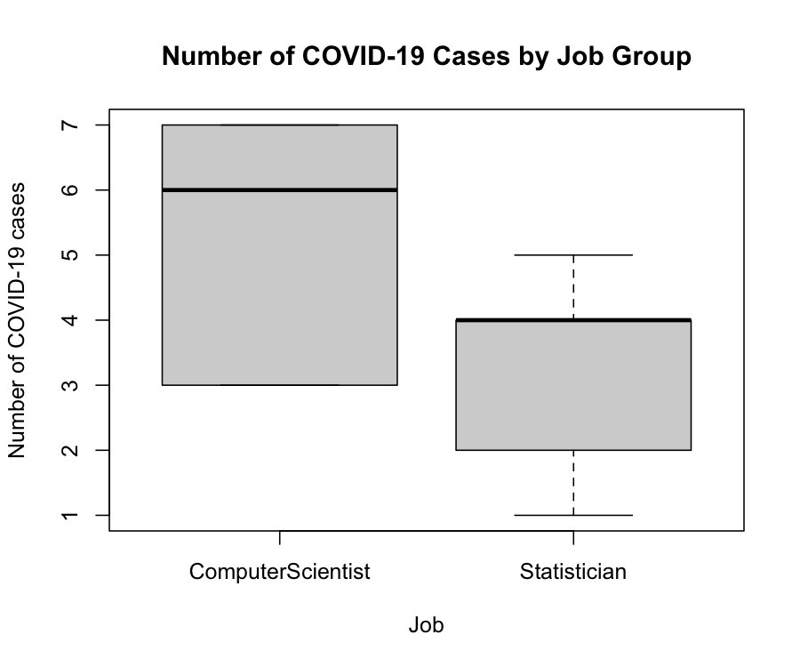
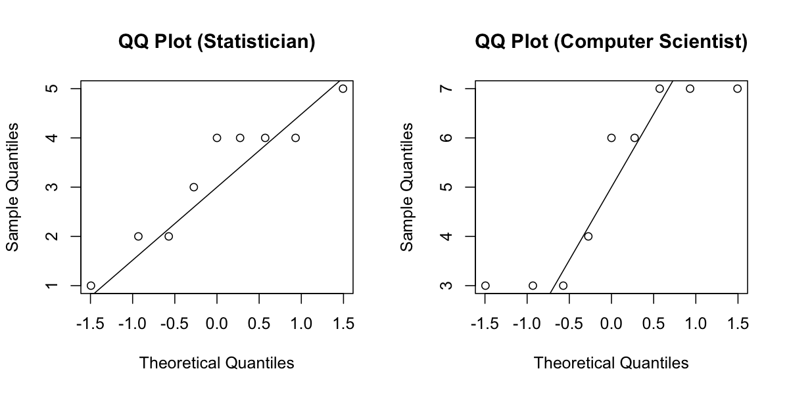

# HW3 Code Walkthrough — Nonparametric Tests and Multiple Testing

[Repository Guide](../../README.md) | [English](Code-Walkthrough.md) | [한국어](Code-Walkthrough.ko.md)

> **Last Updated:** 2026-11-04

> **Learning Objectives:**
> 1. Load tab-separated data with `read.table()` and explore distributions by group with `by()`, `boxplot()`, and `qqnorm()`
> 2. Read the arguments and outputs of `t.test()`, `wilcox.test()`, `shapiro.test()`, and `cor.test()`
> 3. Implement an exact permutation test that enumerates every split with `combn()` and `apply()`
> 4. Test thousands of hypotheses in a loop, collect the results in a table, and correct for multiple testing with `p.adjust()`

---

## Table of Contents

- [1. Files and How to Run](#1-files-and-how-to-run)
- [2. The Common Part of the Five Scripts](#2-the-common-part-of-the-five-scripts)
- [3. Q1-2.R: Comparing Two Groups](#3-q1-2r-comparing-two-groups)
  - [3.1 Summary Statistics and Box Plot](#31-summary-statistics-and-box-plot)
  - [3.2 Checking Normality](#32-checking-normality)
  - [3.3 Independent Two-Sample t-Test](#33-independent-two-sample-t-test)
  - [3.4 Wilcoxon Rank-Sum Test](#34-wilcoxon-rank-sum-test)
- [4. Q3.R: Exact Permutation Test with the Seo Statistic](#4-q3r-exact-permutation-test-with-the-seo-statistic)
- [5. Q5.R: Gene-Wise Welch t-Tests](#5-q5r-gene-wise-welch-t-tests)
- [6. Q6.R: Gene-Wise Correlation Tests](#6-q6r-gene-wise-correlation-tests)
- [7. Q7.R: Multiple Testing Correction](#7-q7r-multiple-testing-correction)
- [8. Replacing the Loops with sapply](#8-replacing-the-loops-with-sapply)
- [Summary](#summary)
- [Self-Check Questions](#self-check-questions)

---

<br>

## 1. Files and How to Run

The five R scripts in `Solution/` carry out the computations of Q1-Q7, and Q2, Q4, and Q8 are written questions that interpret these results. The statistical explanation of the problems is in the [HW3 Assignment Explanation](Assignment-Explanation.md), and this document reads the code from beginning to end.

| File | Data | Task |
|:-----|:-----|:-----|
| `Q1-2.R` | `Q1_Data.tsv` | Summary statistics, box plot, normality checks, pooled t-test, Wilcoxon rank-sum test |
| `Q3.R` | `Q1_Data.tsv` | Seo statistic and the exact permutation test over 48,620 splits |
| `Q5.R` | `Q5_Data.tsv` | Welch t-tests of 1,274 genes and the number of significant genes |
| `Q6.R` | `Q5_Data.tsv` | Pearson correlation tests between 1,274 genes and height |
| `Q7.R` | `Q5_Data.tsv` | Repeats the Q5 tests and applies the Bonferroni and BH corrections |

*Table 1. Structure of the HW3 scripts*

The scripts locate the data folder relative to their own folder, so they are run with `source()`. Section 2.2 of the [HW2 Code Walkthrough](../HW02_One-Sample-Z-Test/Code-Walkthrough.md) explains this approach. These scripts show results through lines that contain only a value, such as `t_res`, `table(...)`, and `head(...)`, but `source()` does not print such values by default and shows only the output of `str()` and `cat()`. To see all the output in this document, pass `print.eval = TRUE` as below, or run the script in RStudio with Source with Echo (which prints the code together with the results).

```r
source("Coursework/HW03_Nonparametric-Tests-and-Multiple-Testing/Solution/Q1-2.R", print.eval = TRUE)
```

---

<br>

## 2. The Common Part of the Five Scripts

```r
## 1. 기본 설정 및 데이터 불러오기
setRepositories(ind = 1:7)

################################################################
# 작업 경로 설정
WORK_DIR <- file.path(dirname(sys.frame(1)$ofile %||% "."), "../data")
if (WORK_DIR != "") setwd(WORK_DIR)
################################################################

# 데이터 로드
Q1_data <- read.table("Q1_Data.tsv",
                      header = TRUE,
                      sep = "\t",
                      stringsAsFactors = TRUE)

str(Q1_data)
table(Q1_data$Job)
```

- This assignment uses only base R functions, so no package is loaded. The working directory is set as in HW2.
- `read.table()` is the base R function for reading tables. `header = TRUE` takes the first line as column names, `sep = "\t"` uses tabs as separators, and `stringsAsFactors = TRUE` turns the string columns (`Job`, `Disease`) into **factors**. The levels of a factor are in alphabetical order, so `Job` has the order `ComputerScientist`, `Statistician`, and this order decides which group is treated as the first in the later tests.
- `str()` shows the structure of an object, and `table()` shows the count of each category.

```text
'data.frame':	18 obs. of  2 variables:
 $ numCOVID: int  1 4 4 2 4 5 4 3 2 3 ...
 $ Job     : Factor w/ 2 levels "ComputerScientist",..: 2 2 2 2 2 2 2 2 2 1 ...

ComputerScientist      Statistician 
                9                 9 
```

Q5-Q7 load `Q5_Data.tsv` into `Q5_data` in the same way. These data have 72 rows and 1,276 columns (`Disease`, `Height`, and 1,274 genes), and `table(Q5_data$Disease)` gives `Cancer` 25 and `Healthy` 47.

---

<br>

## 3. Q1-2.R: Comparing Two Groups

### 3.1 Summary Statistics and Box Plot

```r
by(Q1_data$numCOVID, Q1_data$Job, summary)

boxplot(numCOVID ~ Job,
        data = Q1_data,
        main = "Number of COVID-19 Cases by Job Group",
        xlab = "Job",
        ylab = "Number of COVID-19 cases")
```

`by(x, group, function)` splits `x` by group and applies the function to each part. `summary()` gives the minimum, first quartile, median, mean, third quartile, and maximum.

```text
Q1_data$Job: ComputerScientist
   Min. 1st Qu.  Median    Mean 3rd Qu.    Max. 
  3.000   3.000   6.000   5.111   7.000   7.000 
------------------------------------------------------------ 
Q1_data$Job: Statistician
   Min. 1st Qu.  Median    Mean 3rd Qu.    Max. 
  1.000   2.000   4.000   3.222   4.000   5.000 
```

The `~` in `boxplot(numCOVID ~ Job, data = Q1_data)` is **formula** notation and means splitting the variable on the left by the categories of the variable on the right. The box spans the first to the third quartile, the thick line is the median, and the whiskers reach the farthest observations within 1.5 times the interquartile range from the box.



*Figure 1. Box plot of COVID-19 case counts by occupation group*

The computer scientist group is widely spread with median 6 and a box from 3 to 7, and the statistician group is narrow with median 4 and a box from 2 to 4. In the computer scientist group the minimum and maximum coincide with the ends of the box, so there are no whiskers, and in the statistician group the median and the third quartile are both 4, so the thick line sits on the upper edge of the box.

### 3.2 Checking Normality

```r
by(Q1_data$numCOVID, Q1_data$Job, shapiro.test)

par(mfrow = c(1, 2))

# Statistician
with(subset(Q1_data, Job == "Statistician"),
     qqnorm(numCOVID, main = "QQ Plot (Statistician)"))
with(subset(Q1_data, Job == "Statistician"),
     qqline(numCOVID))
```

- `shapiro.test()` is the **Shapiro-Wilk test**, whose null hypothesis is "the data come from a normal distribution". A small p-value rejects normality.
- `par(mfrow = c(1, 2))` divides the plotting area into one row and two columns to draw two plots side by side, and the final `par(mfrow = c(1, 1))` restores it.
- `with(data, expression)` lets the column names of the data be used like variables. `qqnorm()` draws a **normal quantile-quantile plot**, which plots the sorted observations (vertical axis) against the theoretical quantiles of the standard normal distribution (horizontal axis). `qqline()` draws a reference line through the first and third quartiles. When the data are close to normal, the points lie on this line.
- The four lines for ComputerScientist have the same structure.

```text
Q1_data$Job: ComputerScientist

	Shapiro-Wilk normality test

data:  dd[x, ]
W = 0.79884, p-value = 0.01981

------------------------------------------------------------ 
Q1_data$Job: Statistician

	Shapiro-Wilk normality test

data:  dd[x, ]
W = 0.90093, p-value = 0.2574
```



*Figure 2. Normal Q-Q plots of the two occupation groups*

The points of the computer scientist group cluster at 3 and at 6 and 7, forming steps that depart far from the line. This agrees with the rejection of normality at a p-value of 0.0198. The statistician group has many tied values at 4 but mostly follows the line. `data:  dd[x, ]` is the internal name of the data split by `by()`, printed as it is.

### 3.3 Independent Two-Sample t-Test

```r
t_res <- t.test(numCOVID ~ Job,
                data = Q1_data,
                alternative = "two.sided",   # 양측 검정
                var.equal = TRUE)            # 등분산 가정

t_res
```

Given a formula, `t.test()` tests the difference in means of the first factor level (`ComputerScientist`) minus the second (`Statistician`). `var.equal = TRUE` gives the classical t-test with a pooled variance, and the default `FALSE` gives Welch's t-test.

```text
	Two Sample t-test

data:  numCOVID by Job
t = 2.5202, df = 16, p-value = 0.02273
alternative hypothesis: true difference in means between group ComputerScientist and group Statistician is not equal to 0
95 percent confidence interval:
 0.3000508 3.4777270
sample estimates:
mean in group ComputerScientist      mean in group Statistician 
                       5.111111                        3.222222 
```

The output shows, in order, the name of the test, the test statistic $t$, the degrees of freedom $n_1 + n_2 - 2 = 16$, the p-value, the alternative hypothesis, the 95% confidence interval for the difference in means, and the sample mean of each group. Each value can be taken from the result object as `t_res$statistic`, `t_res$p.value`, and `t_res$conf.int`.

### 3.4 Wilcoxon Rank-Sum Test

```r
wil_res <- wilcox.test(numCOVID ~ Job,
                       data = Q1_data,
                       alternative = "two.sided",
                       exact = FALSE,    # 표본수가 작을 때도 근사 사용
                       correct = FALSE)  # continuity correction 끔(선택)

wil_res
```

- `exact = FALSE` makes the p-value come from the normal approximation instead of the exact distribution. These data have ties, so even with `exact = TRUE` R cannot compute the exact p-value and falls back to the normal approximation with a warning, and the code specifies the approximation explicitly.
- `correct = FALSE` turns off the continuity correction. With the default `TRUE`, the p-value is 0.06507.

```text
	Wilcoxon rank sum test

data:  numCOVID by Job
W = 61.5, p-value = 0.05879
alternative hypothesis: true location shift is not equal to 0
```

`W` is the rank sum 106.5 of the first group (`ComputerScientist`) minus its minimum possible value $9 \times 10 / 2 = 45$. If the p-value from the exact permutation distribution that accounts for ties is needed, `wilcox_test(numCOVID ~ Job, data = Q1_data, distribution = "exact")` from the coin package gives it, 0.0712.

---

<br>

## 4. Q3.R: Exact Permutation Test with the Seo Statistic

```r
group_A <- "ComputerScientist"
group_B <- "Statistician"

x_A <- Q1_data$numCOVID[Q1_data$Job == group_A]
x_B <- Q1_data$numCOVID[Q1_data$Job == group_B]

median_A <- median(x_A)
median_B <- median(x_B)

Seo_obs <- abs(median_A - median_B)
```

Indexing with the logical vector `Q1_data$Job == group_A` extracts the observations of each group, and `median()` and `abs()` compute the observed Seo statistic $\lvert 6 - 4 \rvert = 2$.

```r
values <- Q1_data$numCOVID
n <- length(values)   # 18개

# 18개 중 9개를 고르는 모든 조합 생성 (각 열이 A그룹의 인덱스 집합)
combs <- combn(n, n / 2)

Seo_perm <- apply(combs, 2, function(idx_A) {
  med_A <- median(values[idx_A])
  med_B <- median(values[-idx_A])
  abs(med_A - med_B)
})

# p-value 계산 (양측: 관측 Seo-Stat 이상인 경우의 비율)
p_value <- mean(Seo_perm >= Seo_obs - 1e-12)
```

- `combn(n, k)` returns a matrix whose columns are all combinations of `k` elements chosen from `1:n`. `combn(18, 9)` has 9 rows and 48,620 columns, and each column holds the positions of the observations put into group A. For example, `combn(4, 2)` has the six columns (1, 2), (1, 3), (1, 4), (2, 3), (2, 4), and (3, 4).
- `apply(matrix, 2, function)` applies the function to each column. Inside the function, `values[idx_A]` is group A, and `values[-idx_A]`, a negative index that drops those positions, is the remainder, group B. The result `Seo_perm` is the vector of Seo statistics of the 48,620 splits, that is, the null distribution.
- `Seo_perm >= Seo_obs` is a logical vector, and `mean()` counts `TRUE` as 1 and `FALSE` as 0, so the resulting proportion is the p-value itself. The `- 1e-12` is a margin for cases where floating-point error computes an equal value as slightly smaller. The medians of these data are integers, so no error arises, but it is useful when medians are averages, as for groups of even size.

```text
Median ( ComputerScientist ) = 6 
Median ( Statistician ) = 4 
Observed Seo-Stat = 2 

Seo-Stat permutation test p-value = 0.08802962 

Significance level (alpha) = 0.1 
At the 10% significance level, we Reject the Null hypothesis
and Select the Alternative hypothesis.
=> Seo-Stat 기준으로 두 직업 집단의 중앙값(분포 위치)은 다르다고 볼 통계적 근거가 있습니다.
```

Printing `table(Seo_perm)` shows the null distribution as 29,750 zeros, 14,590 ones, 3,340 twos, and 940 threes, and $(3{,}340 + 940)/48{,}620 = 0.0880$ is the p-value above. The last output line prints the same conclusion as a Korean sentence: by the Seo statistic, there is statistical ground to regard the medians (locations) of the two groups as different.

> **Note:** When there are too many splits to enumerate with `combn()`, a **Monte Carlo permutation test** draws tens of thousands of random splits with `sample(n, n / 2)` and performs the same computation. The p-value is then an estimate of the exact value.

---

<br>

## 5. Q5.R: Gene-Wise Welch t-Tests

```r
gene_cols <- grep("^Gene_", names(Q5_data), value = TRUE)
length(gene_cols)        # 유전자 개수 확인용

gene_result <- data.frame(
  Gene         = gene_cols,
  p_value      = NA_real_,
  mean_Cancer  = NA_real_,
  mean_Healthy = NA_real_,
  stringsAsFactors = FALSE
)
```

- `grep("^Gene_", names(Q5_data), value = TRUE)` returns the column names that match the regular expression `^Gene_` (starting with `Gene_`) as they are. There are 1,274.
- The data frame for the results is created in advance. `NA_real_` is a missing value of numeric type, and the length-1 value is recycled to fill one entry per gene. Fixing the size in advance is faster than appending rows one at a time inside the loop.

```r
alpha <- 0.01   # Significance level = 1%

idx_cancer  <- Q5_data$Disease == "Cancer"
idx_healthy <- Q5_data$Disease == "Healthy"   # normal-group에 해당

for (i in seq_along(gene_cols)) {
  gname <- gene_cols[i]
  
  x_cancer  <- Q5_data[idx_cancer,  gname]
  x_healthy <- Q5_data[idx_healthy, gname]
  
  # Welch's two-sample t-test (var.equal = FALSE가 기본)
  t_res <- t.test(x_cancer, x_healthy,
                  alternative = "two.sided")
  
  gene_result$p_value[i]      <- t_res$p.value
  gene_result$mean_Cancer[i]  <- mean(x_cancer)
  gene_result$mean_Healthy[i] <- mean(x_healthy)
}
```

- `idx_cancer` and `idx_healthy` are logical vectors indicating whether each of the 72 rows belongs to each group, built only once outside the loop.
- `seq_along(gene_cols)` is the integer sequence from 1 to 1,274. Unlike `1:length(gene_cols)`, it is safe even when the vector is empty.
- `Q5_data[idx_cancer, gname]` selects rows by the logical vector and the column by name, extracting the 25 cancer-group expression values of the gene.
- `t.test(x, y)` is Welch's t-test when `var.equal` is not specified. The p-value and the two means are stored in row `i` of the result table.

```r
sig_genes <- subset(gene_result, p_value < alpha)

n_sig <- nrow(sig_genes)
cat("Number of significant genes at 1% significance level:", n_sig, "\n")

head(sig_genes[order(sig_genes$p_value), ])
```

`subset()` keeps only the rows with p-values below 0.01, and `nrow()` counts them. `order()` returns the row numbers in increasing order of p-value, and `head()` shows the first six rows.

```text
 Cancer Healthy 
     25      47 
[1] 1274
Number of significant genes at 1% significance level: 315 
        Gene      p_value mean_Cancer mean_Healthy
231 Gene_231 6.432666e-12      975.44    4255.1277
13   Gene_13 1.179739e-11      313.36    1402.0851
768 Gene_768 4.726906e-11      556.44    1727.0851
9     Gene_9 2.394581e-10      182.40    3936.2340
436 Gene_436 2.673149e-10     -401.12    1463.3191
837 Gene_837 4.856049e-10      -21.40     204.4894
```

---

<br>

## 6. Q6.R: Gene-Wise Correlation Tests

```r
for (i in seq_along(gene_cols)) {
  gname <- gene_cols[i]
  
  x_gene   <- Q5_data[, gname]
  x_height <- Q5_data$Height
  
  # Pearson correlation test (양측)
  c_res <- cor.test(x_height, x_gene,
                    alternative = "two.sided",
                    method = "pearson")
  
  gene_height_result$p_value[i] <- c_res$p.value
  gene_height_result$cor[i]     <- c_res$estimate
}
```

The structure is the same as Q5, and only the test differs. The result table `gene_height_result` is created in advance with the columns `Gene`, `p_value`, and `cor`. The relation with height is examined over all 72 people, so the groups are not split and the whole column `Q5_data[, gname]` is used. `cor.test()` stores the Pearson correlation coefficient in `estimate` and the p-value computed from $t = r\sqrt{n - 2}/\sqrt{1 - r^2}$ in `p.value`. Changing to `method = "spearman"` tests the rank correlation.

```text
[1] 1274
Number of genes significantly associated with Height at 1% significance level: 12 
          Gene      p_value        cor
267   Gene_267 8.892967e-05 -0.4452431
1199 Gene_1199 4.225670e-04  0.4046528
793   Gene_793 7.610758e-04  0.3878877
77     Gene_77 1.796054e-03  0.3617213
145   Gene_145 2.474383e-03 -0.3513734
1222 Gene_1222 2.674028e-03  0.3488151
```

---

<br>

## 7. Q7.R: Multiple Testing Correction

`Q7.R` recomputes the 1,274 p-values with the same loop as Q5 (315 genes before correction) and then corrects them as follows.

```r
m <- nrow(gene_result)  # 총 가설 수 (1274개)

gene_result$p_bonf <- p.adjust(gene_result$p_value, method = "bonferroni")
gene_result$p_bh   <- p.adjust(gene_result$p_value, method = "BH")

n_sig_bonf <- sum(gene_result$p_bonf < alpha)
n_sig_bh   <- sum(gene_result$p_bh < alpha)
```

`p.adjust(p, method)` takes a vector of p-values and returns **adjusted p-values**, which are compared with the original significance level.

- `"bonferroni"` gives $\min(m p_i, 1)$. $m p_i < \alpha$ is the same as $p_i < \alpha/m$.
- `"BH"` multiplies the p-value of sorted rank $k$ by $m/k$ and then takes the cumulative minimum from the largest rank down so that the order is not reversed. The hypotheses whose value is below $q$ are exactly those rejected by the BH procedure.
- `"holm"`, `"hochberg"`, `"BY"`, and `"fdr"` (the same as `"BH"`) are also available.

`sum(logical vector)` counts the `TRUE` values. The output is as follows.

```text
Q5 - Number of significant genes at 1% level (raw p): 315 
Q7 - Number of significant genes at 1% level (Bonferroni): 56 
Q7 - Number of significant genes at 1% level (BH / FDR): 185 
        Gene      p_value mean_Cancer mean_Healthy       p_bonf         p_bh
231 Gene_231 6.432666e-12      975.44    4255.1277 8.195216e-09 7.514938e-09
13   Gene_13 1.179739e-11      313.36    1402.0851 1.502988e-08 7.514938e-09
768 Gene_768 4.726906e-11      556.44    1727.0851 6.022078e-08 2.007359e-08
9     Gene_9 2.394581e-10      182.40    3936.2340 3.050696e-07 6.811184e-08
436 Gene_436 2.673149e-10     -401.12    1463.3191 3.405592e-07 6.811184e-08
837 Gene_837 4.856049e-10      -21.40     204.4894 6.186606e-07 1.031101e-07
```

Gene_231 and Gene_13 have the same BH-adjusted p-value because of the cumulative minimum step. The rank-2 value $1.18 \times 10^{-11} \times 1274/2 = 7.51 \times 10^{-9}$ is smaller than the rank-1 value $6.43 \times 10^{-12} \times 1274 = 8.20 \times 10^{-9}$, so rank 1 is lowered to $7.51 \times 10^{-9}$ as well. The last two `head()` lines of the script show the top six genes sorted by the Bonferroni and the BH adjusted p-values, respectively.

---

<br>

## 8. Replacing the Loops with sapply

When only the p-values are needed, `sapply()` can replace the loop that fills a result table created in advance. `sapply(vector, function)` applies the function to each element and collects the results in a vector, and since it returns a named vector, the gene names stay attached.

```r
Q5_data <- read.table("Q5_Data.tsv", header = TRUE, sep = "\t", stringsAsFactors = TRUE)
gene_cols   <- grep("^Gene_", names(Q5_data), value = TRUE)
idx_cancer  <- Q5_data$Disease == "Cancer"
idx_healthy <- Q5_data$Disease == "Healthy"

p_q5 <- sapply(gene_cols, function(g)
  t.test(Q5_data[idx_cancer, g], Q5_data[idx_healthy, g])$p.value)
p_q6 <- sapply(gene_cols, function(g)
  cor.test(Q5_data$Height, Q5_data[, g])$p.value)

sapply(list(Q5 = p_q5, Q6 = p_q6), function(p)
  c(raw        = sum(p < 0.01),
    bonferroni = sum(p.adjust(p, "bonferroni") < 0.01),
    BH         = sum(p.adjust(p, "BH") < 0.01)))
```

```text
            Q5 Q6
raw        315 12
bonferroni  56  0
BH         185  0
```

The last `sapply()` applies a function that computes three counts to each of the two p-value vectors and collects them in a table of three rows and two columns. The Q5 results match the outputs of `Q5.R` and `Q7.R`, and the Q6 column shows at a glance that no gene remains after correction.

---

<br>

## Summary

| Concept | Key Summary |
|:-----|:-----|
| Reading data | `read.table(file, header = TRUE, sep = "\t", stringsAsFactors = TRUE)` reads a tab-separated file, and string columns become factors with alphabetically ordered levels. |
| Exploring by group | `by()` runs summaries and tests by group, and `boxplot(y ~ group)`, `qqnorm()`, and `qqline()` show distributions and normality visually. |
| t-test | `t.test(y ~ group, var.equal = TRUE)` is the pooled t-test and the default is Welch's t-test, and with a formula the second factor level is subtracted from the first. |
| Wilcoxon test | `wilcox.test()` uses the normal approximation when there are ties, and `correct` decides whether the continuity correction is applied. |
| Exact permutation test | `combn(n, n / 2)` builds every split, `apply()` computes the statistic for each split, and `mean(statistic >= observed)` gives the p-value. |
| Repeated gene-wise tests | A result table created in advance is filled by `for (i in seq_along(...))`, or `sapply()` builds a vector of p-values. |
| Multiple testing correction | The adjusted p-values of `p.adjust(p, "bonferroni")` and `p.adjust(p, "BH")` are compared with the original significance level. |

---

<br>

## Self-Check Questions

1. **Factor levels:** If the levels of the `Job` column were in the order `Statistician`, `ComputerScientist`, what would change in the output of `t.test(numCOVID ~ Job, var.equal = TRUE)`?

   <details>
   <summary>Answer</summary>

   The difference in means would become Statistician minus ComputerScientist, so the signs would flip to $t = -2.520$ and the confidence interval (-3.478, -0.300). The two-sided p-value 0.0227 stays the same.

   </details>

2. **Negative indices:** For `v <- c(10, 20, 30, 40)`, what is `v[-c(1, 3)]`?

   <details>
   <summary>Answer</summary>

   `c(20, 40)`, without the first and third elements. `Q3.R` uses this to form group B as the remainder after removing group A.

   </details>

3. **The mean as a proportion:** What is `mean(c(TRUE, FALSE, TRUE, TRUE))`, and how does a permutation test use this property?

   <details>
   <summary>Answer</summary>

   `TRUE` counts as 1 and `FALSE` as 0, so it is 0.75. The mean of the logical vector indicating whether each permutation statistic is at least the observed value is the proportion of such splits, that is, the p-value.

   </details>

4. **Bonferroni adjusted p-value:** Among 1,274 genes, what is the Bonferroni adjusted p-value of a gene whose original p-value is $5 \times 10^{-6}$? Is it significant at the 1% level?

   <details>
   <summary>Answer</summary>

   $1274 \times 5 \times 10^{-6} = 0.00637$, smaller than 0.01, so it is significant. The same decision follows from comparing the original p-value with the boundary $0.01/1274 = 7.85 \times 10^{-6}$.

   </details>

5. **Loop range:** If there were no gene columns and `gene_cols` were an empty vector, how would `for (i in 1:length(gene_cols))` behave?

   <details>
   <summary>Answer</summary>

   `1:0` is `c(1, 0)`, so the loop would run twice, `gene_cols[1]` would be `NA`, and an error would follow. `seq_along(gene_cols)` returns an empty vector, so the loop would not run at all.

   </details>
