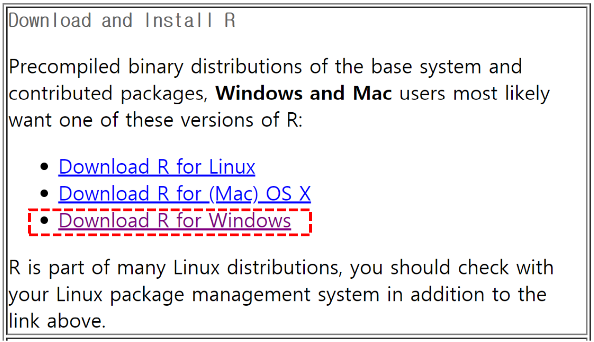
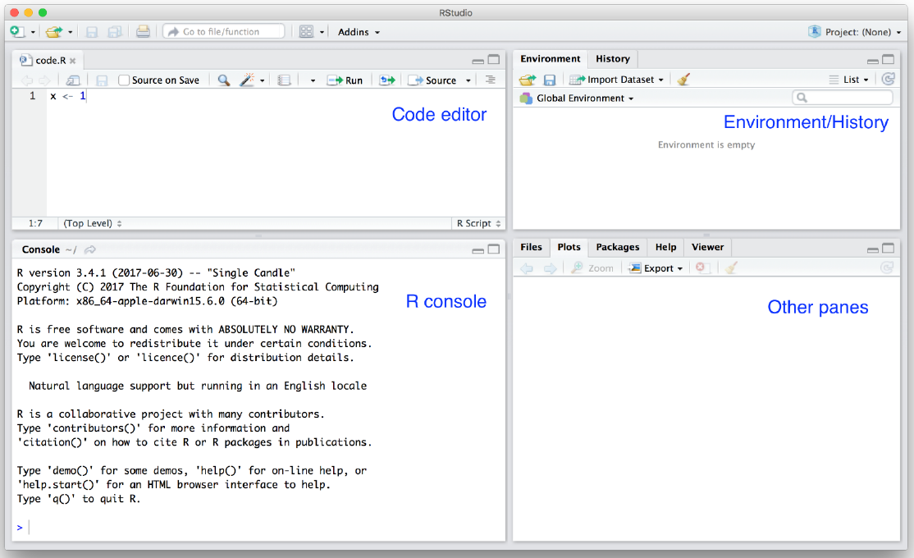
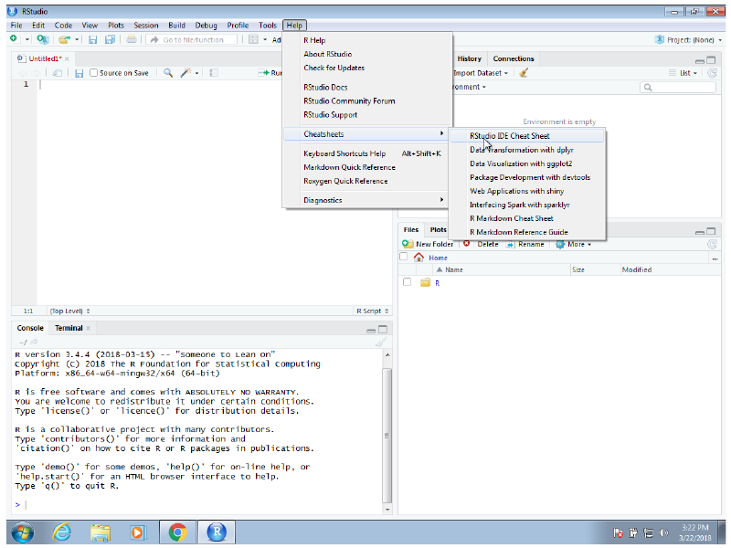
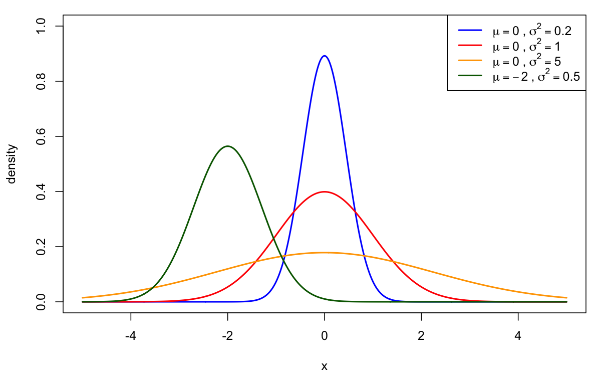
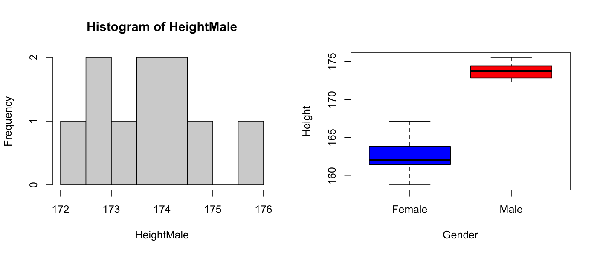
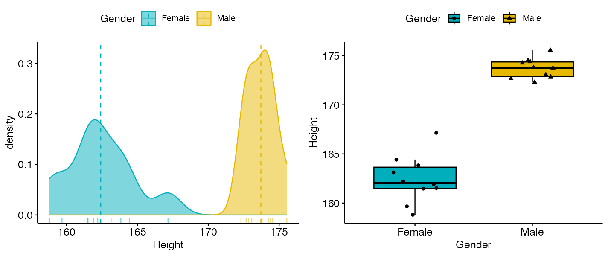

# 1강 — R 프로그래밍 입문

[레포지토리 안내](../../README.ko.md) | [English](Concepts_Lecture.md) | [한국어](Concepts_Lecture.ko.md)

> **최종 수정일:** 2026-11-04

> **학습 목표:**
> 1. R과 RStudio를 설치하고, RStudio의 창 구성과 작업 디렉토리, 작업 공간을 다룰 수 있다
> 2. 함수의 도움말을 찾고 CRAN의 패키지를 설치하여 불러올 수 있다
> 3. 벡터, 팩터, 행렬, 데이터 프레임의 차이를 설명하고, 각각을 만들어 크기와 구조를 확인할 수 있다
> 4. `rep()`, `seq()`, `rnorm()`으로 규칙적인 값과 정규분포 난수를 생성할 수 있다
> 5. 평균, 표준편차, 중앙값 같은 기술 통계량을 계산하고 기본 그래픽과 ggplot2 계열 패키지로 분포를 시각화할 수 있다

---

## 목차

- [1. 확률과 통계, 그리고 R](#1-확률과-통계-그리고-r)
  - [1.1 데이터 분석 언어로서의 R](#11-데이터-분석-언어로서의-r)
  - [1.2 과목의 흐름](#12-과목의-흐름)
- [2. R과 RStudio 설치](#2-r과-rstudio-설치)
  - [2.1 R 설치](#21-r-설치)
  - [2.2 RStudio 설치](#22-rstudio-설치)
  - [2.3 설치 확인](#23-설치-확인)
- [3. RStudio 통합 개발 환경](#3-rstudio-통합-개발-환경)
  - [3.1 통합 개발 환경](#31-통합-개발-환경)
  - [3.2 RStudio의 창 구성](#32-rstudio의-창-구성)
  - [3.3 단축키와 치트시트](#33-단축키와-치트시트)
- [4. R 작업 공간](#4-r-작업-공간)
  - [4.1 콘솔과 스크립트](#41-콘솔과-스크립트)
  - [4.2 작업 디렉토리](#42-작업-디렉토리)
  - [4.3 작업 저장: 스크립트와 작업 공간](#43-작업-저장-스크립트와-작업-공간)
  - [4.4 대소문자 구분](#44-대소문자-구분)
  - [4.5 저장과 파일 이름의 습관](#45-저장과-파일-이름의-습관)
- [5. 도움말과 패키지](#5-도움말과-패키지)
  - [5.1 도움말 함수](#51-도움말-함수)
  - [5.2 R 패키지와 CRAN](#52-r-패키지와-cran)
  - [5.3 패키지 설치와 불러오기](#53-패키지-설치와-불러오기)
  - [5.4 필요한 패키지 찾기](#54-필요한-패키지-찾기)
- [6. 데이터 유형](#6-데이터-유형)
  - [6.1 벡터와 할당](#61-벡터와-할당)
  - [6.2 기본 자료형과 형 변환](#62-기본-자료형과-형-변환)
  - [6.3 데이터 프레임](#63-데이터-프레임)
  - [6.4 데이터 불러오기와 객체 확인](#64-데이터-불러오기와-객체-확인)
  - [6.5 길이, 행과 열의 수, 일부 보기](#65-길이-행과-열의-수-일부-보기)
  - [6.6 데이터 프레임과 행렬의 차이](#66-데이터-프레임과-행렬의-차이)
- [7. 값 생성](#7-값-생성)
  - [7.1 객체 삭제와 반복: `rep()`](#71-객체-삭제와-반복-rep)
  - [7.2 수열: `seq()`와 콜론 연산자](#72-수열-seq와-콜론-연산자)
  - [7.3 정규분포 난수: `rnorm()`](#73-정규분포-난수-rnorm)
  - [7.4 팩터](#74-팩터)
  - [7.5 행렬 만들기](#75-행렬-만들기)
- [8. 기술 통계와 시각화](#8-기술-통계와-시각화)
  - [8.1 예제 데이터](#81-예제-데이터)
  - [8.2 기술 통계량](#82-기술-통계량)
  - [8.3 기본 그래픽: 히스토그램과 상자 그림](#83-기본-그래픽-히스토그램과-상자-그림)
  - [8.4 ggplot2와 ggpubr를 이용한 시각화](#84-ggplot2와-ggpubr를-이용한-시각화)
- [요약](#요약)
- [점검 문제](#점검-문제)
- [참고 문헌](#참고-문헌)

---

<br>

## 1. 확률과 통계, 그리고 R

### 1.1 데이터 분석 언어로서의 R

데이터 분석에 가장 널리 쓰이는 두 프로그래밍 언어는 **R**과 **Python**이다. R은 통계 계산과 그래픽을 위해 만들어진 언어이자 실행 환경으로, 무료로 배포되는 오픈 소스 소프트웨어이다. 통계 분석에 필요한 함수(평균, 분산, 확률 분포, 가설검정, 회귀 분석 등)가 기본으로 들어 있고, 문법이 비교적 단순하여 처음 배우는 사람도 직접 데이터를 다루며 개념을 익히기 좋다.

확률과 통계는 수식으로 정의되는 이론이지만, 그 이론이 실제 데이터에서 어떻게 나타나는지는 계산과 그림으로 확인할 때 잘 이해된다. 예를 들어 동전을 던지는 실험을 R로 수천 번 반복하면 앞면의 비율이 1/2에 가까워지는 모습을 직접 볼 수 있다(2강의 큰 수의 법칙). 이 과목의 모든 단원은 이론을 배운 뒤 R로 계산하고 시뮬레이션하여 확인하는 방식으로 구성된다.

### 1.2 과목의 흐름

1강에서는 R을 설치하고 자료 구조와 기본 함수, 기술 통계, 시각화를 익힌다. 각 단원의 주제는 다음과 같다.

| 강 | 주제 |
|:---|:-----|
| 1강 | R과 RStudio 설치, R의 자료 구조, 값 생성, 기술 통계와 시각화 |
| 2강 | 표본공간과 사건, 확률의 공리와 성질, 조건부 확률, 독립, 전확률 공식, 베이즈 정리 |
| 3강 | 확률변수, 확률질량함수와 확률밀도함수, 누적분포함수, 결합분포, 기댓값, 분산, 공분산 |
| 4강 | 이산확률분포(이항분포, 초기하분포, 포아송분포, 기하분포, 음이항분포 등) |
| 5강 | 연속확률분포, 정규분포, 이항분포의 정규 근사, 카이제곱 분포, t 분포, F 분포, 중심극한정리 |
| 6강 | 통계량과 추정량, 표본평균의 분포, 가설검정, 제1종 오류와 제2종 오류, Z 검정과 t 검정 |
| 7강 | 자료의 형태에 따른 통계 분석 방법의 선택(두 집단 비교, 분산분석, 상관과 회귀, 범주형 자료 분석) |
| 8강 | 정규성 검토, 비모수 검정(Wilcoxon 순위합 검정)과 그 한계 |

*표 1. 단원별로 다루는 주제*

---

<br>

## 2. R과 RStudio 설치

R을 쓰려면 두 프로그램을 차례로 설치한다. 먼저 언어 자체인 **R**을 설치하고, 그다음 R을 편하게 쓰게 해 주는 편집 환경인 **RStudio**를 설치한다. RStudio는 컴퓨터에 설치된 R을 찾아 실행하는 프로그램이므로 R이 없으면 동작하지 않는다. 따라서 설치 순서는 반드시 R이 먼저이다.

### 2.1 R 설치

R은 **CRAN(Comprehensive R Archive Network)** 에서 내려받는다. CRAN은 R 본체와 패키지를 배포하는 전 세계 서버들의 네트워크이며, 주소는 [https://cran.r-project.org/](https://cran.r-project.org/)이다 [1]. 첫 화면의 "Download and Install R" 상자는 R 기본 시스템과 기여 패키지를 미리 컴파일한 바이너리 배포판의 링크를 모아 두었으며, Windows와 Mac 사용자는 대부분 이 배포판을 받는다. 이 상자에서 자신의 운영체제에 맞는 링크를 고른다.



*그림 1. CRAN 첫 화면의 운영체제별 R 내려받기 링크*

운영체제별 설치 절차는 다음과 같다.

1. **Windows:** "Download R for Windows"를 누르고 "base"를 선택한 뒤 "Download R-x.y.z for Windows"(x.y.z는 버전 번호)를 눌러 설치 파일(`.exe`)을 내려받는다. 설치 파일을 실행하고 기본 선택을 그대로 둔 채 진행하면 된다.
2. **macOS:** "Download R for macOS"를 누른 뒤, Apple silicon(M1 이후의 칩) 컴퓨터이면 `arm64`가 붙은 `.pkg` 파일을, Intel 칩 컴퓨터이면 `x86_64`가 붙은 `.pkg` 파일을 내려받아 실행한다. 칩의 종류는 Apple 메뉴의 "이 Mac에 관하여"에서 확인할 수 있다.
3. **Linux:** R은 대부분의 Linux 배포판에 패키지로 들어 있으므로 배포판의 패키지 관리자로 설치한다. 예를 들어 Ubuntu에서는 `sudo apt install r-base`를 실행한다. 배포판이 제공하는 버전이 오래되었으면 CRAN의 "Download R for Linux" 페이지가 안내하는 대로 CRAN 저장소를 추가한 뒤 설치한다.

```bash
# Ubuntu: install R from the distribution's package manager
sudo apt update
sudo apt install r-base
```

> **참고:** CRAN 화면의 문구와 링크 이름은 시기에 따라 조금씩 바뀐다. 예전의 "Download R for (Mac) OS X"는 지금 "Download R for macOS"로 표시된다. 운영체제를 고르고 최신 버전의 설치 파일을 받는다는 절차는 같다.

### 2.2 RStudio 설치

**RStudio**는 R을 위한 통합 개발 환경(3절)이다. RStudio를 만든 회사 RStudio, PBC는 2022년에 이름을 Posit(Posit Software, PBC)으로 바꾸었다 [2]. 지금 RStudio Desktop은 Posit의 RStudio 사용자 설명서에 있는 내려받기 페이지 [https://docs.posit.co/ide/user/download.html](https://docs.posit.co/ide/user/download.html)에서 받는다 [3]. 예전 주소인 `https://www.rstudio.com/products/rstudio/download/`와 `https://posit.co/download/rstudio-desktop/` 두 곳은 모두 이 사용자 설명서로 연결된다.

RStudio에는 개인 컴퓨터에 설치하여 쓰는 **RStudio Desktop**과, 서버에 설치하고 웹 브라우저로 접속하여 쓰는 **RStudio Server**가 있다. 예전 내려받기 페이지는 이 둘을 각각 무료인 오픈 소스 라이선스판과 유료인 상용 라이선스판으로 나누어 RStudio Desktop(오픈 소스), RStudio Desktop(상용), RStudio Server(오픈 소스), RStudio Server Pro(상용)의 네 제품을 보여 주었으며, 지금은 상용판이 RStudio Desktop Pro와 Posit Workbench라는 이름으로 제공된다 [2], [3]. 개인 학습과 이 과목의 실습에는 무료인 RStudio Desktop 오픈 소스판이면 충분하다. 내려받기 페이지는 접속한 컴퓨터의 운영체제를 알아보고 맞는 설치 파일(Windows는 `.exe`, macOS는 `.dmg`, Linux는 `.deb`나 `.rpm`)을 안내한다. Windows에서는 설치 파일을 실행하고, macOS에서는 `.dmg` 파일을 열어 RStudio 아이콘을 Applications 폴더로 끌어 넣는다.

### 2.3 설치 확인

RStudio를 실행하면 왼쪽(또는 왼쪽 아래)의 콘솔에 R의 시작 메시지가 나타난다. 시작 메시지의 첫 줄에 R의 버전이 나오고, 이어서 R이 아무런 보증 없이(ABSOLUTELY NO WARRANTY) 배포되는 자유 소프트웨어라는 안내와 `demo()`, `help()`, `help.start()`, `q()`(종료) 같은 기본 명령의 안내가 나온다. 콘솔에 다음을 입력하면 설치된 R의 버전을 다시 확인할 수 있다.

```r
R.version.string
```

```text
[1] "R version 4.5.1 (2025-06-13)"
```

출력되는 버전 번호와 날짜는 설치한 시점에 따라 다르다. 이 메시지가 나오면 R과 RStudio가 함께 동작하는 것이다.

---

<br>

## 3. RStudio 통합 개발 환경

### 3.1 통합 개발 환경

**통합 개발 환경(integrated development environment, IDE)** 은 프로그래머가 소프트웨어를 개발하는 데 필요한 기능을 한 프로그램 안에 모아 제공하는 응용 프로그램이다. IDE는 보통 적어도 **소스 코드 편집기**, **빌드 자동화 도구**, **디버거**로 이루어진다. RStudio는 R 프로그래밍을 위한 IDE로, 코드 편집, 실행, 변수 확인, 그래프 보기, 도움말 열람을 한 창에서 할 수 있게 하여 R 프로그래밍을 쉽게 해 준다.

### 3.2 RStudio의 창 구성

RStudio를 처음 실행하면 세 개의 창(pane)이 보인다. 왼쪽 창은 R 콘솔이다. 오른쪽 위 창에는 Environment, History 같은 탭이 있고, 오른쪽 아래 창에는 Files, Plots, Packages, Help, Viewer의 다섯 탭이 있다(탭의 구성은 버전에 따라 달라질 수 있다). 각 탭을 누르면 해당 기능으로 이동한다. 메뉴의 File > New File > R Script로 스크립트를 새로 열면 왼쪽 위에 코드 편집기가 생겨 다음 그림과 같은 네 창 배치가 된다.



*그림 2. 코드 편집기, R 콘솔, Environment와 History, 그 밖의 창으로 이루어진 RStudio 화면*

| 창 | 위치 | 용도 |
|:---|:-----|:-----|
| 코드 편집기 (Source) | 왼쪽 위 | R 스크립트(`.R` 파일)를 작성하고 저장하며, 선택한 줄을 콘솔로 보내 실행한다 |
| R 콘솔 (Console) | 왼쪽 아래 | 명령을 입력하면 R이 바로 실행하고 결과를 출력한다 |
| Environment와 History | 오른쪽 위 | 현재 메모리에 있는 변수와 데이터, 지금까지 실행한 명령의 기록을 보여 준다 |
| Files, Plots, Packages, Help, Viewer | 오른쪽 아래 | 파일 탐색, 그래프 보기, 패키지 관리, 도움말 열람, HTML 결과 보기를 한다 |

*표 2. RStudio의 네 창과 용도*

그림 2의 콘솔에는 R이 시작될 때 출력하는 메시지가 보이고, 코드 편집기에는 `x <- 1`이라는 한 줄짜리 스크립트가 열려 있다. 아직 아무 코드도 실행하지 않았으므로 Environment 탭에는 "Environment is empty"라고 표시된다.

### 3.3 단축키와 치트시트

자주 쓰는 동작의 단축키(key binding)를 외워 두면 작업 속도가 크게 빨라진다. RStudio는 가장 많이 쓰는 명령과 단축키를 한두 쪽에 정리한 **치트시트(cheat sheet)** 를 제공하며, 메뉴의 Help > Cheatsheets에서 RStudio IDE Cheat Sheet를 고르면 열린다. 그림 3의 메뉴에는 그 밖에 dplyr를 이용한 데이터 변환(Data Transformation with dplyr), ggplot2를 이용한 시각화(Data Visualization with ggplot2), devtools를 이용한 패키지 개발, shiny를 이용한 웹 응용 프로그램, sparklyr를 이용한 Spark 연동, R Markdown 치트시트와 R Markdown 참조 안내서(Reference Guide)가 있다. 메뉴에 실린 치트시트의 목록은 RStudio의 버전에 따라 다르다.



*그림 3. RStudio의 Help > Cheatsheets 메뉴와 치트시트 목록*

다음은 RStudio에서 자주 쓰는 단축키이다 [4]. 전체 목록은 Help > Keyboard Shortcuts Help(Alt+Shift+K)에서 볼 수 있다.

| 동작 | Windows, Linux | macOS |
|:-----|:---------------|:------|
| 새 R 스크립트 열기 | Ctrl+Shift+N | Cmd+Shift+N |
| 현재 줄이나 선택 영역 실행 | Ctrl+Enter | Cmd+Return |
| 스크립트의 처음부터 현재 줄까지 실행 | Ctrl+Alt+B | Cmd+Option+B |
| 선택한 줄을 주석 처리하거나 해제 | Ctrl+Shift+C | Cmd+Shift+C |
| 할당 연산자 `<-` 입력 | Alt+- | Option+- |
| 스크립트 저장 | Ctrl+S | Cmd+S |
| 단축키 목록 보기 | Alt+Shift+K | Option+Shift+K |

*표 3. RStudio의 주요 단축키*

---

<br>

## 4. R 작업 공간

### 4.1 콘솔과 스크립트

명령은 R 콘솔의 **사용자 프롬프트(user prompt)** `>` 뒤에 입력하며, R은 입력된 명령을 대화식으로 하나씩 실행한다. 명령이 끝나지 않은 채 Enter를 누르면(예: 괄호를 닫지 않음) 프롬프트가 `+`로 바뀌어 나머지 입력을 기다리고, Esc를 누르면 입력을 취소한다. 키보드의 위쪽, 아래쪽 화살표 키로 이전에 입력한 명령의 기록을 차례로 불러올 수 있다.

그러나 긴 프로그램을 프롬프트 창에 직접 입력하는 방식은 권하지 않는다. 콘솔에 입력한 명령은 파일로 저장되지 않으므로, 십만 줄을 프롬프트에서 작성하던 중에 갑자기 정전이 일어나면 모든 작업을 잃는다. 코드는 코드 편집기에서 스크립트 파일로 작성하고 저장한 뒤, 필요한 줄을 선택해 실행(Ctrl+Enter)하는 것이 원칙이다. 콘솔은 결과를 잠깐 확인하는 용도로 쓴다.

### 4.2 작업 디렉토리

**작업 디렉토리(working directory)** 는 R이 파일을 읽고 쓸 때 기준으로 삼는 폴더이다. `read.csv("data.csv")`처럼 경로 없이 파일 이름만 쓰면 R은 작업 디렉토리에서 그 파일을 찾고, 그래프나 데이터를 저장할 때도 작업 디렉토리에 만든다.

| 함수 | 하는 일 |
|:-----|:--------|
| `getwd()` | 현재 작업 디렉토리의 경로를 돌려준다 |
| `setwd(A)` | 작업 디렉토리를 경로 `A`로 바꾼다 |

*표 4. 작업 디렉토리를 다루는 함수*

```r
getwd()                                             # print the current working directory
setwd("C:/Users/student/Documents/prob-stat")       # forward slashes
setwd("C:\\Users\\student\\Documents\\prob-stat")   # or doubled backslashes
```

`setwd()`의 경로를 쓸 때는 주의할 점이 있다. R의 문자열에서 역슬래시 `\`는 **이스케이프 문자(escape character)** 이다. `"\n"`이 줄바꿈 문자를 뜻하듯, 역슬래시는 바로 뒤의 문자와 묶여 특별한 문자를 나타낸다. 그래서 Windows 탐색기에서 복사한 경로 `C:\Users`를 그대로 쓰면 R은 `\U`를 유니코드 문자 표기의 시작으로 해석하고 오류를 낸다.

```r
setwd("C:\Users")
```

```text
Error: '\U' used without hex digits in character string (<input>:1:11)
```

Windows 경로는 위의 예처럼 슬래시 `/`로 구분하거나 역슬래시를 두 번(`\\`) 써야 한다. macOS와 Linux의 경로는 원래 `/`로 구분하므로 이 문제가 없다(예: `setwd("~/Documents/prob-stat")`). RStudio에서는 메뉴의 Session > Set Working Directory로도 작업 디렉토리를 바꿀 수 있다.

### 4.3 작업 저장: 스크립트와 작업 공간

R에서 **작업 공간(workspace)** 은 현재 R 세션의 메모리(RAM)에 올라 있는 모든 객체(변수, 데이터, 함수)의 모음이다. 작업을 저장하는 방법은 두 가지이다.

| 방법 | 저장되는 것 | 파일 | 다시 불러오기 |
|:-----|:------------|:-----|:--------------|
| (1) R 스크립트 저장 | 작성한 코드만 텍스트 형식으로 저장한다 | `.R` | 스크립트를 다시 실행하여 객체를 새로 만든다 |
| (2) 작업 공간 저장 `save.image()` | 코드를 실행하여 메모리에 만들어진 객체를 그대로 저장한다 | `.RData` | `load(".RData")` |

*표 5. 스크립트 저장과 작업 공간 저장의 비교*

```r
save.image()                       # save every object to ".RData" in the working directory
save.image(file = "lecture1.RData")
load("lecture1.RData")             # restore the saved objects
```

스크립트는 결과를 만드는 과정을 남기므로, 나중에 같은 분석을 처음부터 재현할 수 있다. 작업 공간은 계산에 오래 걸린 결과를 다시 계산하지 않고 불러올 때 유용하지만, 그 결과가 어떤 코드로 만들어졌는지는 남기지 않는다. 따라서 스크립트를 기본 저장 수단으로 삼고, 작업 공간 저장은 보조 수단으로 쓰는 것이 좋다.

### 4.4 대소문자 구분

> **핵심:** R은 **대소문자를 구분하는(case-sensitive)** 언어이다. 이름의 철자가 같아도 대문자와 소문자가 다르면 서로 다른 객체이다.

```r
variableName <- "test"
variablename <- "test2"

variableName
variablename
```

```text
[1] "test"
[1] "test2"
```

`variableName`과 `variablename`은 `N`의 대소문자만 다르지만 서로 다른 변수이므로 각각의 값을 따로 유지한다. 출력 앞의 `[1]`은 그 줄의 첫 값이 결과 벡터의 1번째 원소라는 뜻이다. 같은 이유로 `Mean(x)`나 `Length(x)`라고 쓰면 그런 함수가 없다는 오류가 나며, 올바른 이름은 `mean(x)`, `length(x)`이다.

### 4.5 저장과 파일 이름의 습관

- 프로그래머는 항상 저장하고 백업을 만드는 습관을 가져야 한다. 가장 좋은 방법의 하나는 스크립트를 고칠 때마다 저장하는 것이다(Ctrl+S).
- 파일 이름은 내용을 알 수 있게 짓는다. `final`, `Realfinal`, `Realfinal2`, `Realfinal222`, `RRRRRRealfinal222`처럼 같은 작업 공간 파일이 이름만 조금씩 바뀌며 쌓이면, 어느 파일이 최신이고 각 파일이 무엇을 담는지 알 수 없다.
- 내용과 날짜를 이름에 넣는 방식(예: `2025-09-08_r-basics.R`)이 좋고, 여러 판을 관리해야 하면 Git 같은 버전 관리 도구를 쓰는 것이 바람직하다.

---

<br>

## 5. 도움말과 패키지

### 5.1 도움말 함수

R의 모든 함수에는 사용법, 인수의 뜻, 반환값, 예제를 담은 도움말 문서가 있다. 특정 함수가 하는 일을 확인하고 싶으면 다음 함수로 사용 설명서를 쉽게 찾을 수 있다.

| 함수 | 하는 일 |
|:-----|:--------|
| `help.start()` | 웹 브라우저에서 R의 HTML 도움말 첫 화면을 연다 |
| `help(A)` 또는 `?A` | 함수(또는 데이터셋) `A`의 도움말 문서를 연다 |
| `help(package = "P")` | 패키지 `P`에 들어 있는 함수와 데이터의 목록과 설명을 연다 |
| `??A` 또는 `help.search("A")` | 설치된 모든 패키지의 도움말에서 낱말 `A`를 검색한다 |

*표 6. 도움말을 여는 함수*

`help.start()`가 여는 첫 화면은 세 부분으로 이루어진다. **Manuals**에는 An Introduction to R, The R Language Definition, Writing R Extensions, R Installation and Administration, R Data Import/Export, R Internals 같은 공식 설명서가 있고, **Reference**에는 설치된 패키지의 도움말 목록(Packages)과 검색 기능(Search Engine & Keywords)이 있으며, **Miscellaneous Material**에는 R 소개(About R), 저자(Authors), 참고 자료(Resources), 라이선스(License), 자주 묻는 질문(Frequently Asked Questions), 감사의 말(Thanks), 변경 내역(NEWS), 사용자 설명서(User Manuals), 기술 문서(Technical papers)가 있다. Windows용 R에서는 그 아래에 Windows판에만 해당하는 변경 내역과 Windows FAQ를 모은 부분(Material specific to the Windows port)이 더 있다.

```r
help(head)               # help page of the function head()
?head                    # the same
help(package = "ggplot2")
??boxplot                # search every help page for "boxplot"
```

> **참고:** `help(A)`의 `A`는 패키지 이름이 아니라 함수나 데이터셋 같은 **주제(topic)의 이름**이다. 패키지 하나의 설명서 전체를 보려면 `help(package = "ggplot2")`처럼 `package` 인수를 쓴다. 다만 패키지 이름과 같은 이름의 개요 문서를 둔 패키지도 있어서 `?ggplot2`처럼 쓰면 그 패키지의 개요가 열리기도 한다.

### 5.2 R 패키지와 CRAN

R의 강점의 하나는 시스템을 쉽게 확장할 수 있다는 점이다. 사용자는 새 함수를 작성하고 그 함수들을 **R 패키지(R package)** 로 묶어 다른 사람과 공유할 수 있다. 패키지는 함수, 데이터, 도움말 문서를 정해진 형식으로 묶은 단위이며, 검증을 거친 패키지는 CRAN에 등록되어 누구나 설치할 수 있다. 이 과목에서 쓰는 그래프 패키지 ggplot2와 ggpubr도 CRAN의 패키지이다.

패키지를 흔히 "R 라이브러리"라고도 부르지만, R에서 **라이브러리(library)** 는 엄밀히 말하면 패키지가 설치되는 디렉토리를 뜻한다. 패키지를 불러오는 함수의 이름이 `library()`인 것은 라이브러리 디렉토리에서 패키지를 찾아 불러오기 때문이다.

### 5.3 패키지 설치와 불러오기

패키지를 찾아 설치하는 첫 단계는 패키지를 내려받을 **저장소(repository)** 를 정하는 것이다. 대화식 세션에서 `setRepositories()`를 실행하면 CRAN, BioC software, BioC annotation, BioC experiment, CRAN (extras), R-Forge, rforge.net 같은 저장소 목록이 메뉴로 나타나며, 기본으로는 CRAN만 선택되어 있다. BioC는 생물정보학 패키지 저장소인 Bioconductor이다. 대부분의 경우 CRAN만으로 충분하다. 메뉴를 거치지 않고 `setRepositories(ind = 1:7)`처럼 번호로 지정하면 목록의 1번부터 7번까지의 저장소를 한꺼번에 선택한다.

```r
## Set repository for downloading R packages
setRepositories()

## Install "ggplot2" package
install.packages("ggplot2")

## Loading "ggplot2" package
library(ggplot2)
```

| 함수 | 하는 일 | 실행 시기 |
|:-----|:--------|:----------|
| `install.packages("P")` | 저장소에서 패키지 `P`와 그 패키지가 의존하는 패키지들을 내려받아 라이브러리에 설치한다 | 컴퓨터마다 한 번(인터넷 연결 필요) |
| `library(P)` | 설치된 패키지 `P`를 현재 세션에 불러와 그 함수를 쓸 수 있게 한다 | R을 새로 시작할 때마다 |

*표 7. 패키지의 설치와 불러오기*

`install.packages()`의 인수는 따옴표로 감싼 문자열이지만 `library()`는 따옴표 없이 쓸 수 있다. 설치만 하고 `library()`로 불러오지 않으면 `could not find function "ggplot"` 같은 오류가 난다.

### 5.4 필요한 패키지 찾기

- CRAN은 등록된 모든 패키지의 이름순 목록을 [https://cran.r-project.org/web/packages/available_packages_by_name.html](https://cran.r-project.org/web/packages/available_packages_by_name.html)에서 제공한다.
- 하고 싶은 일을 검색 엔진에 영어로 검색하는 것도 빠른 방법이다. 예를 들어 "R package for boxplot"으로 검색하면 상자 그림을 그리는 패키지와 사용 예를 찾을 수 있다.
- 이미지 검색을 쓰면 여러 패키지로 그린 그래프의 모양을 한눈에 비교하여 원하는 스타일의 패키지를 고를 수 있다. 상자 그림을 검색하면 R의 기본 `boxplot()`, ggplot2의 `geom_boxplot()` 등으로 그린 다양한 그림이 나온다.

---

<br>

## 6. 데이터 유형

### 6.1 벡터와 할당

**벡터(vector)** 는 같은 자료형의 값을 순서대로 늘어놓은 R의 가장 기본적인 자료 구조이다. 숫자 하나도 길이가 1인 벡터이다. 함수 `c()`(combine)는 값을 이어 붙여 벡터를 만든다.

```r
## Vectors
numericVector <- c(1, 2, 3, 4, 5)
numericVector

characterVector <- c("One", "Two", "Three", "Four", "Five")
characterVector

logicalVector <- c("TRUE", "TRUE", "FALSE", "FALSE", "FALSE")
logicalVector
```

```text
[1] 1 2 3 4 5
[1] "One"   "Two"   "Three" "Four"  "Five" 
[1] "TRUE"  "TRUE"  "FALSE" "FALSE" "FALSE"
```

`numericVector`는 수치형, `characterVector`는 문자형 벡터이다. 변수 이름만 입력하면 그 값이 출력된다.

> **참고:** 위 코드의 `logicalVector`는 이름과 달리 논리형이 아니라 **문자형** 벡터이다. `"TRUE"`처럼 따옴표로 감싸면 논리값이 아니라 네 글자의 문자열이 되기 때문이다. 출력에서 값이 따옴표로 둘러싸인 것과 `class(logicalVector)`가 `"character"`를 돌려주는 것으로 확인할 수 있다. 논리형 벡터를 만들려면 따옴표 없이 `TRUE`, `FALSE`를 쓴다.
>
> ```r
> logicalVector <- c(TRUE, TRUE, FALSE, FALSE, FALSE)   # corrected: no quotes
> class(logicalVector)
> ```
>
> ```text
> [1] "logical"
> ```

값을 변수에 할당할 때는 `=`를 써도 되지만, 같은지를 비교하는 연산자 `==`와 혼동하지 않도록 **`<-`를 쓰는 것을 강하게 권장한다.** `x <- 5`는 x에 5를 넣는 할당이고, `x == 5`는 x가 5와 같은지를 묻는 비교로 `TRUE`나 `FALSE`를 돌려준다. `=`는 주로 `rnorm(n = 100, mean = 0)`처럼 함수의 인수 이름에 값을 지정할 때 쓴다.

R의 인덱스는 1부터 시작한다. `x[i]`는 벡터 `x`의 `i`번째 원소이고, 음수 인덱스 `x[-i]`는 `i`번째 원소를 **뺀** 나머지이며, 논리값 벡터를 넣으면 `TRUE`인 위치의 원소만 고른다.

```r
x <- c(10, 20, 30, 40, 50)
x[1]
x[c(1, 3)]
x[-2]
x[x > 25]
```

```text
[1] 10
[1] 10 30
[1] 10 30 40 50
[1] 30 40 50
```

> **[컴퓨터프로그래밍]** C와 Python의 배열과 리스트는 인덱스가 0부터 시작하고, Python의 음수 인덱스 `-1`은 마지막 원소를 가리킨다. R은 인덱스가 1부터 시작하고 음수 인덱스가 원소를 제외하므로, 같은 `x[-1]`이 Python에서는 마지막 원소를, R에서는 첫 원소를 뺀 나머지 원소들을 돌려준다.

### 6.2 기본 자료형과 형 변환

벡터의 원소가 가질 수 있는 기본 자료형 가운데 자주 쓰는 네 가지는 다음과 같다. 이 밖에 복소수형 `complex`와 바이트 값을 담는 `raw`가 있다 [5].

| 자료형 (`typeof()`) | `class()` | 뜻 | 예 |
|:--------------------|:----------|:---|:---|
| `logical` | `"logical"` | 논리값 | `TRUE`, `FALSE` |
| `integer` | `"integer"` | 정수 (숫자 뒤에 `L`을 붙인다) | `5L`, `100L` |
| `double` | `"numeric"` | 실수 (숫자의 기본 자료형) | `3.14`, `42` |
| `character` | `"character"` | 문자열 (큰따옴표나 작은따옴표로 감싼다) | `"Hello"`, `'a'` |

*표 8. R 벡터의 기본 자료형*

`class()`는 객체가 어떤 종류로 취급되는지를, `typeof()`는 메모리에 어떤 자료형으로 저장되는지를 알려 준다. `42`처럼 `L`을 붙이지 않은 숫자는 정수처럼 보여도 실수형(`double`)으로 저장된다.

벡터는 한 가지 자료형만 담을 수 있으므로, `c()`에 서로 다른 자료형을 넣으면 R은 정보를 잃지 않는 쪽으로 모든 값을 한 자료형으로 바꾼다. 이를 **형 변환(coercion)** 이라 하며, 바뀌는 방향은 `logical` → `integer` → `double` → `character`이다(`complex`는 `double`과 `character` 사이에 온다).

```r
c(1, "a", TRUE)
c(1, TRUE, FALSE)
sum(c(TRUE, TRUE, FALSE, FALSE, FALSE))
```

```text
[1] "1"    "a"    "TRUE"
[1] 1 1 0
[1] 2
```

첫 줄은 문자열 `"a"`가 있으므로 모든 값이 문자형이 된다. 둘째 줄은 수치형과 논리형이 섞였으므로 `TRUE`는 1, `FALSE`는 0으로 바뀐다. 이 성질 때문에 논리값 벡터에 `sum()`을 적용하면 `TRUE`의 개수가 된다. 2강에서 조건을 만족하는 경우의 수를 셀 때 이 방법을 쓴다.

### 6.3 데이터 프레임

지금까지 정의한 변수는 숫자 하나이거나 한 가지 자료형의 나열이었다. 이것만으로는 실제 데이터를 저장하기에 충분하지 않다. R에서 데이터셋을 저장하는 가장 일반적인 방법은 **데이터 프레임(data frame)** 이다.

> **용어 정의:** **데이터 프레임**은 행(row)이 **관측치(observation)**, 즉 개별 사례를 나타내고, 열(column)이 각 관측치에서 측정한 **변수(variable)** 를 나타내는 표 형태의 자료 구조이다. 한 열 안의 값은 같은 자료형이지만, 열마다 자료형이 다를 수 있다.

데이터 프레임이 데이터셋에 특히 유용한 이유는 수치형, 문자형, 논리형, 팩터(7.4절) 같은 서로 다른 자료형을 하나의 객체에 담을 수 있기 때문이다. 예를 들어 학생의 키(수치)와 성별(범주)을 한 표에 함께 저장할 수 있다.

```r
df <- data.frame(Height = c(170.5, 160.2, 175.1),
                 Gender = factor(c("Male", "Female", "Male")))
df
str(df)
```

```text
  Height Gender
1  170.5   Male
2  160.2 Female
3  175.1   Male
'data.frame':	3 obs. of  2 variables:
 $ Height: num  170 160 175
 $ Gender: Factor w/ 2 levels "Female","Male": 2 1 2
```

`data.frame()`은 `열이름 = 벡터` 형태의 인수로 열을 만든다. 출력의 왼쪽 1, 2, 3은 행 이름이다. `str()`의 출력은 이 객체가 관측치 3개(3 obs.)와 변수 2개(2 variables)로 이루어진 데이터 프레임이고, `Height`는 수치형(`num`), `Gender`는 수준이 두 개인 팩터임을 보여 준다.

### 6.4 데이터 불러오기와 객체 확인

| 함수 | 하는 일 |
|:-----|:--------|
| `data(name)` | R에 내장된 데이터셋 `name`을 작업 공간에 불러온다. 인수 없이 `data()`를 실행하면 쓸 수 있는 데이터셋의 목록을 보여 준다 |
| `ls()` | 작업 공간에 있는 객체의 이름을 나열한다 |
| `class(x)` | 객체 `x`의 종류(자료형이나 자료 구조)를 알려 준다 |
| `str(x)` | 객체 `x`의 내부 구조를 요약하여 보여 준다 |

*표 9. 데이터를 불러오고 객체를 확인하는 함수*

R에 내장된 **iris** 데이터셋은 붓꽃 150송이의 꽃받침(sepal)과 꽃잎(petal)의 길이와 너비, 품종을 기록한 데이터이며, 예제로 널리 쓰인다.

```r
data(iris)
ls()
class(iris)
str(iris)
```

```text
[1] "iris"
[1] "data.frame"
'data.frame':	150 obs. of  5 variables:
 $ Sepal.Length: num  5.1 4.9 4.7 4.6 5 5.4 4.6 5 4.4 4.9 ...
 $ Sepal.Width : num  3.5 3 3.2 3.1 3.6 3.9 3.4 3.4 2.9 3.1 ...
 $ Petal.Length: num  1.4 1.4 1.3 1.5 1.4 1.7 1.4 1.5 1.4 1.5 ...
 $ Petal.Width : num  0.2 0.2 0.2 0.2 0.2 0.4 0.3 0.2 0.2 0.1 ...
 $ Species     : Factor w/ 3 levels "setosa","versicolor",..: 1 1 1 1 1 1 1 1 1 1 ...
```

위의 `ls()` 출력은 새로 시작한 R 세션에서 나오는 결과이며, 앞에서 만든 객체가 남아 있으면 그 이름도 함께 나열된다. `str(iris)`는 iris가 관측치 150개와 변수 5개로 이루어진 데이터 프레임이며, 처음 네 열은 수치형이고 `Species`는 setosa, versicolor, virginica의 세 수준을 갖는 팩터임을 보여 준다. `$` 뒤의 이름이 열 이름이고, `iris$Species`처럼 `데이터$열이름`으로 열 하나를 꺼낼 수 있다.

### 6.5 길이, 행과 열의 수, 일부 보기

데이터 프레임의 원소는 `데이터[행, 열]`로 가리킨다. 행이나 열 자리를 비워 두면 그 방향의 전체를 뜻하므로, `iris[1, ]`는 첫 번째 행 전체, `iris[, 1]`은 첫 번째 열 전체이다. `length(x)`는 1차원 객체의 원소 개수를 돌려준다.

```r
length(iris[1, ])
length(iris[, 1])

# If we try outbounds of data...
length(iris[, 6])
```

```text
[1] 5
[1] 150
Error in `[.data.frame`(iris, , 6) : undefined columns selected
```

`iris[, 1]`은 첫 열 `Sepal.Length`의 값 150개로 이루어진 수치형 벡터이므로 길이가 150이다. 반면 `iris[1, ]`은 벡터가 아니라 열 5개를 가진 한 행짜리 데이터 프레임이다. 데이터 프레임의 길이는 열의 개수로 정의되므로 `length(iris[1, ])`는 5이다. iris에는 열이 5개뿐이므로 6번째 열을 요청하면 정의되지 않은 열을 골랐다는 오류(`undefined columns selected`)가 난다.

행과 열의 수, 데이터의 처음과 끝은 다음 함수로 확인한다.

```r
nrow(iris)
ncol(iris)
dim(iris)
head(iris)
tail(iris)
```

```text
[1] 150
[1] 5
[1] 150   5
  Sepal.Length Sepal.Width Petal.Length Petal.Width Species
1          5.1         3.5          1.4         0.2  setosa
2          4.9         3.0          1.4         0.2  setosa
3          4.7         3.2          1.3         0.2  setosa
4          4.6         3.1          1.5         0.2  setosa
5          5.0         3.6          1.4         0.2  setosa
6          5.4         3.9          1.7         0.4  setosa
    Sepal.Length Sepal.Width Petal.Length Petal.Width   Species
145          6.7         3.3          5.7         2.5 virginica
146          6.7         3.0          5.2         2.3 virginica
147          6.3         2.5          5.0         1.9 virginica
148          6.5         3.0          5.2         2.0 virginica
149          6.2         3.4          5.4         2.3 virginica
150          5.9         3.0          5.1         1.8 virginica
```

`dim()`은 (행의 수, 열의 수)를 돌려준다. `head()`와 `tail()`은 기본으로 처음 6행과 마지막 6행을 보여 주며, `head(iris, n = 10)`, `tail(iris, n = 10)`처럼 `n` 인수로 행의 수를 바꿀 수 있다. 인수의 뜻은 `?head`로 확인한다. 변수 이름 `iris`만 입력하면 150행 전체가 출력되어 콘솔이 길어지므로, 큰 데이터는 `head()`로 일부만 보는 것이 좋다. `fix(iris)`는 데이터를 스프레드시트 모양의 편집 창에서 열고, RStudio에서는 `View(iris)`가 데이터를 읽기 전용 표로 보여 준다.

### 6.6 데이터 프레임과 행렬의 차이

**행렬(matrix)** 도 행과 열로 이루어진 2차원 자료 구조이지만, 모든 원소가 같은 자료형이어야 한다는 점에서 데이터 프레임과 다르다.

| 항목 | 데이터 프레임 | 행렬 |
|:-----|:--------------|:-----|
| 원소의 자료형 | 열마다 다를 수 있다 | 모든 원소가 같아야 한다 |
| 행과 열의 이름 | 항상 열 이름과 행 이름을 가진다 | 이름을 붙일 수 있지만 없어도 된다 |
| 팩터 | 열을 팩터로 둘 수 있다 | 팩터를 담지 못하고 정수 코드나 문자로 바뀐다(7.4절) |
| 주된 용도 | 통계 모형식 적합(`lm(y ~ x, data = df)` 등), 데이터 처리 | 행렬 연산(곱, 역행렬 등) |

*표 10. 데이터 프레임과 행렬의 비교*

통계 모형을 적합하거나 데이터를 처리하는 많은 함수가 데이터 프레임을 입력으로 받으므로, 행렬로 가진 데이터는 `as.data.frame()`으로 데이터 프레임으로 바꾸어 작업을 시작하는 경우가 많다. 데이터 프레임을 전치(transpose)하면 행 이름이 열 이름이 되도록 행과 열을 뒤바꿀 수 있으며, 이는 데이터를 다른 방향으로 정리해야 할 때 유용하다.

```r
t(df)
class(t(df))
```

```text
       [,1]    [,2]     [,3]   
Height "170.5" "160.2"  "175.1"
Gender "Male"  "Female" "Male" 
[1] "matrix" "array" 
```

> **주의:** `t()`의 결과는 데이터 프레임이 아니라 **행렬**이다. 행렬은 한 가지 자료형만 담으므로, 수치형 열과 팩터 열이 섞인 `df`를 전치하면 위와 같이 모든 값이 문자열로 바뀐다. 전치한 결과로 계산을 이어 가려면 수치형 열만 골라 전치하거나 `as.data.frame()`으로 다시 바꾼 뒤 각 열의 자료형을 확인해야 한다.

---

<br>

## 7. 값 생성

### 7.1 객체 삭제와 반복: `rep()`

`rm(x)`는 작업 공간에서 객체 `x`를 지우고, `rm(list = ls())`는 모든 객체를 지운다. 새 예제를 시작하기 전에 이전에 쓰던 이름을 지워 두면, 남아 있던 값이 섞여 생기는 실수를 막을 수 있다.

`rep(x, times)`는 `x`의 값을 반복한 벡터를 만든다. 같은 값이 여러 번 나오는 벡터를 하나하나 입력하지 않고 만들 때 쓴다.

```r
## Value generation (Sequentially)
rm(A)
rm(B)
rm(C)

A <- c(1, 1, 1, 2, 2, 2, 3, 3, 3)
A

rep(1, 3)
rep(2, 3)
rep(3, 3)

B <- c(rep(1, 3), rep(2, 3), rep(3, 3))
B
```

```text
[1] 1 1 1 2 2 2 3 3 3
[1] 1 1 1
[1] 2 2 2
[1] 3 3 3
[1] 1 1 1 2 2 2 3 3 3
```

`rm(A)`는 `A`가 없으면 경고를 내므로, 처음 실행할 때는 이 세 줄을 건너뛰어도 된다. `A`처럼 값을 직접 나열한 벡터와, `rep(1, 3)`, `rep(2, 3)`, `rep(3, 3)`을 `c()`로 이어 붙인 `B`는 같은 벡터이다. `rep()`은 `times`와 `each` 두 방식으로 반복한다.

```r
rep("a", times = 10)
rep(1:3, each = 10)
rep(c("a", "b"), 5)
```

```text
 [1] "a" "a" "a" "a" "a" "a" "a" "a" "a" "a"
 [1] 1 1 1 1 1 1 1 1 1 1 2 2 2 2 2 2 2 2 2 2 3 3 3 3 3 3 3 3 3 3
 [1] "a" "b" "a" "b" "a" "b" "a" "b" "a" "b"
```

| 호출 | 반복 방식 | 결과 |
|:-----|:----------|:-----|
| `rep(x, times = k)` | 벡터 `x` 전체를 `k`번 이어 붙인다 | `rep(c("a", "b"), 5)`는 a, b, a, b, ... (길이 10) |
| `rep(x, each = k)` | 각 원소를 `k`번씩 반복한 뒤 다음 원소로 넘어간다 | `rep(1:3, each = 10)`은 1이 10개, 2가 10개, 3이 10개 |

*표 11. `rep()`의 두 가지 반복 방식*

두 번째 인수에 이름을 쓰지 않으면 `times`로 해석된다. 출력이 한 줄을 넘으면 각 줄의 앞에 그 줄 첫 값의 위치가 `[1]`, `[18]`처럼 표시된다.

### 7.2 수열: `seq()`와 콜론 연산자

`seq(from, to, by, length.out)`는 규칙적인 수열을 만든다. `from`은 시작값, `to`는 끝값, `by`는 간격, `length.out`은 만들 값의 개수이며, 이 가운데 필요한 것만 지정한다. 콜론 연산자 `a:b`는 `a`부터 `b`까지 1씩 증가하는 수열을 만든다.

```r
c(1:10)
seq(from = 1, to = 10)
seq(1, 10)
seq(from = 1, to = 10, by = 2)
seq(1, 10, length = 5)
seq(from = 1, by = 2, length.out = 10)
```

```text
 [1]  1  2  3  4  5  6  7  8  9 10
 [1]  1  2  3  4  5  6  7  8  9 10
 [1]  1  2  3  4  5  6  7  8  9 10
[1] 1 3 5 7 9
[1]  1.00  3.25  5.50  7.75 10.00
 [1]  1  3  5  7  9 11 13 15 17 19
```

처음 세 줄은 모두 1부터 10까지의 정수이다. `1:10`은 그 자체로 벡터이므로 `c()`로 감쌀 필요가 없다. `by = 2`를 주면 1에서 시작해 2씩 더하되 10을 넘지 않는 값까지 만든다. `length = 5`는 1과 10을 양 끝으로 하는 값 5개를 같은 간격으로 만들라는 뜻이며, 간격은 $(10 - 1)/(5 - 1) = 2.25$이다. 인수 이름 `length`는 `length.out`의 앞부분만 쓴 것으로, R은 인수 이름의 앞부분이 하나의 인수와만 일치하면 그 인수로 받아들인다. 마지막 줄은 끝값 대신 개수를 정하여 1부터 2씩 증가하는 값 10개를 만든다.

### 7.3 정규분포 난수: `rnorm()`

`rnorm(n, mean, sd)`는 평균이 `mean`, 표준편차가 `sd`인 정규분포에서 난수 `n`개를 생성한다.

```r
## Generating random values
rnorm(n = 100, mean = 180, sd = 1)
```

이 명령은 평균 180, 표준편차 1인 정규분포를 따르는 값 100개를 만든다. 예를 들어 평균 키가 180cm이고 표준편차가 1cm인 집단에서 100명의 키를 무작위로 뽑은 것처럼 가상의 데이터를 만들 때 쓴다.

확률론에서 **정규분포(normal distribution)** 는 가우스 분포(Gaussian distribution) 또는 Laplace-Gauss 분포라고도 부르는, 매우 흔히 쓰이는 연속확률분포이다. 평균이 $\mu$, 분산이 $\sigma^2$인 정규분포의 확률밀도함수는 다음과 같다.

$$
f(x) = \frac{1}{\sqrt{2\pi\sigma^2}} \exp\left( -\frac{(x - \mu)^2}{2\sigma^2} \right), \qquad -\infty < x < \infty
$$

곡선은 $x = \mu$에서 가장 높고 $\mu$를 중심으로 좌우 대칭인 종 모양이며, $\sigma^2$이 클수록 낮고 넓게 퍼진다. 정규분포는 분포를 정확히 알지 못하는 실수 값 확률변수를 나타내는 데 통계학에서 중요하게 쓰인다. 측정 오차나 키처럼 작은 요인이 많이 더해져 정해지는 양은 대체로 정규분포에 가깝기 때문이다. 정규분포를 따르는 확률변수는 정규분포한다(normally distributed)고 하며, 그러한 확률변수를 **정규 편차(normal deviate)** 라고도 부른다. 정규분포의 성질은 5강에서 자세히 다룬다.



*그림 4. 평균과 분산이 다른 네 정규분포의 확률밀도함수*

그림 4의 세 곡선은 평균이 0으로 같고 분산이 0.2, 1, 5로 다르며, 분산이 작을수록 0 근처에 높고 좁게 모인다. 녹색 곡선은 평균이 -2, 분산이 0.5이므로 -2를 중심으로 대칭이며, 분산이 1인 빨간 곡선보다는 높고 좁으며, 분산이 0.2인 파란 곡선보다는 낮고 넓다.

> **주의:** `rnorm()`의 세 번째 인수는 분산 $\sigma^2$이 아니라 **표준편차** $\sigma$이다. 분산이 5인 정규분포에서 값을 뽑으려면 `rnorm(n, mean = 0, sd = sqrt(5))`로 써야 한다.

난수는 실행할 때마다 다른 값이 나온다. 같은 결과를 다시 얻어야 하면(예: 보고서의 수치를 재현해야 할 때) 난수를 만들기 전에 `set.seed(2025)`처럼 **시드(seed)** 를 고정한다. 같은 시드에서 같은 순서로 난수를 만들면 항상 같은 값이 나온다.

### 7.4 팩터

**팩터(factor)** 는 범주형(categorical) 자료를 나타내는 R의 자료 구조이다. 가능한 범주의 목록을 **수준(level)** 으로 저장하고, 각 원소는 몇 번째 수준인지를 나타내는 정수 코드로 저장한다. 범주(category), 열거형(enumerated type)이라고도 부른다. `factor()`는 수치형이나 문자형 벡터를 팩터로 바꾼다.

```r
## What is Factor variable?
rm(A)
rm(B)
rep(c("a", "b"), 5)
A <- rep(c("a", "b"), 5)
B <- factor(A)
A
B
class(A)
class(B)

cbind(A, B)
```

```text
 [1] "a" "b" "a" "b" "a" "b" "a" "b" "a" "b"
 [1] "a" "b" "a" "b" "a" "b" "a" "b" "a" "b"
 [1] a b a b a b a b a b
Levels: a b
[1] "character"
[1] "factor"
      A   B  
 [1,] "a" "1"
 [2,] "b" "2"
 [3,] "a" "1"
 [4,] "b" "2"
 [5,] "a" "1"
 [6,] "b" "2"
 [7,] "a" "1"
 [8,] "b" "2"
 [9,] "a" "1"
[10,] "b" "2"
```

같은 값을 담은 `A`와 `B`는 출력 모양이 다르다. 문자형 벡터 `A`의 값은 따옴표로 둘러싸여 출력되고, 팩터 `B`의 값은 따옴표 없이 출력되며 아래에 수준 목록 `Levels: a b`가 붙는다. 수준은 기본으로 알파벳순(숫자이면 크기순)으로 정해진다.

`cbind(A, B)`의 결과는 팩터가 행렬에 들어가지 못한다는 것을 보여 준다. `cbind()`는 행렬을 만들고, 팩터 `B`는 행렬에 들어가면서 정수 코드(`a`는 1, `b`는 2)로 바뀐 뒤 문자형 `A`에 맞추어 문자열 `"1"`, `"2"`가 된다. 팩터의 범주 정보를 유지하려면 행렬이 아니라 데이터 프레임을 써야 한다.

```r
C <- factor(rep(c("a", "b", "c", "d"), 5))
C
levels(C)
summary(C)
```

```text
 [1] a b c d a b c d a b c d a b c d a b c d
Levels: a b c d
[1] "a" "b" "c" "d"
a b c d 
5 5 5 5 
```

`levels()`는 수준의 목록을 돌려준다. `summary()`는 다양한 모형 적합 함수의 결과나 변수의 요약을 만드는 **범용 함수(generic function)** 로, 입력의 종류에 따라 동작이 달라진다.

- **수치형 변수에 쓰면** 최솟값(Min.), 제1사분위수(1st Qu.), 중앙값(Median), 평균(Mean), 제3사분위수(3rd Qu.), 최댓값(Max.)의 여섯 값을 돌려준다(8.2절).
- **팩터에 쓰면** 수준별 빈도, 즉 각 범주에 속한 원소의 개수를 돌려준다. 위의 `C`는 네 수준이 5개씩이다.

> **핵심:** 데이터 프레임은 팩터 변수를 그대로 담을 수 있지만, 행렬은 팩터를 담지 못한다. `cbind()`나 `data.matrix()`로 만든 행렬에서는 팩터가 정수 코드로, `as.matrix()`나 `matrix()`로 만든 행렬에서는 문자열로 바뀌어 팩터의 수준 정보가 사라진다. 범주형 변수가 있는 데이터는 데이터 프레임으로 다룬다.

### 7.5 행렬 만들기

`matrix(value, nrow, ncol, byrow)`는 주어진 값으로 행렬을 만든다. `nrow`는 행의 수, `ncol`은 열의 수이고, `byrow`는 값을 채우는 순서를 정한다.

```r
## Generate matrix variable
rm(A)
rm(B)
rm(C)

matrix(0, nrow = 10, ncol = 5)
matrix(NA, nrow = 10, ncol = 5)

A <- matrix(NA, nrow = 10, ncol = 5)
dim(A)
nrow(A)
ncol(A)
class(A)
```

```text
[1] 10  5
[1] 10
[1] 5
[1] "matrix" "array" 
```

`matrix(0, nrow = 10, ncol = 5)`는 모든 원소가 0인 10행 5열 행렬이고, `matrix(NA, ...)`는 모든 원소가 `NA`인 행렬이다. `NA`(not available)는 R에서 **결측값**, 즉 아직 값이 없거나 알 수 없는 자리를 뜻한다. 값을 나중에 채울 빈 표를 미리 만들 때 이렇게 쓴다. 두 행렬은 10행 5열 전체가 출력되어 길므로, 위 출력은 `dim(A)`부터의 결과만 보인다. R 4.0부터 행렬의 `class()`는 행렬이 2차원 배열(array)이기도 하다는 뜻으로 `"matrix" "array"` 두 값을 돌려준다.

값을 여러 개 주면 기본으로 **열 방향**으로 채우고, `byrow = TRUE`이면 **행 방향**으로 채운다.

```r
matrix(1:6, nrow = 2)
matrix(1:6, nrow = 2, byrow = TRUE)
```

```text
     [,1] [,2] [,3]
[1,]    1    3    5
[2,]    2    4    6
     [,1] [,2] [,3]
[1,]    1    2    3
[2,]    4    5    6
```

---

<br>

## 8. 기술 통계와 시각화

### 8.1 예제 데이터

이 절의 예는 남성 10명과 여성 10명의 키를 담은 데이터 프레임 `ourData`를 쓴다. 남성의 키는 평균 173, 표준편차 2인 정규분포에서, 여성의 키는 평균 162.3, 표준편차 2인 정규분포에서 생성했고, 두 집단의 키를 각각 벡터 `HeightMale`, `HeightFemale`에도 저장했다. 데이터를 만드는 방법은 [연습 문제 2](Exercises.ko.md#연습-문제-2-성별과-키-데이터-만들기)와 그 [풀이](Solutions.ko.md#연습-문제-2-성별과-키-데이터-만들기)에 있다.

```r
str(ourData)
```

```text
'data.frame':	20 obs. of  2 variables:
 $ Gender: Factor w/ 2 levels "Female","Male": 2 2 2 2 2 2 2 2 2 2 ...
 $ Height: num  174 173 175 176 174 ...
```

`Gender`는 Female과 Male 두 수준을 갖는 팩터이고, `Height`는 수치형이다. 처음 10행이 남성이므로 `Gender`의 정수 코드가 2(Male)로 시작한다.

### 8.2 기술 통계량

**기술 통계(descriptive statistics)** 는 데이터의 중심 위치와 퍼진 정도 같은 특징을 몇 개의 수로 요약하는 방법이다. 관측값을 $x_1, x_2, \ldots, x_n$이라 할 때 주요 통계량은 다음과 같다.

| 통계량 | R 함수 | 정의 |
|:-------|:-------|:-----|
| 평균 (mean) | `mean(x)` | $\bar{x} = \frac{1}{n}\sum_{i=1}^{n} x_i$ |
| 표본 분산 (sample variance) | `var(x)` | $s^2 = \frac{1}{n-1}\sum_{i=1}^{n} (x_i - \bar{x})^2$ |
| 표본 표준편차 (sample standard deviation) | `sd(x)` | $s = \sqrt{s^2}$ |
| 중앙값 (median) | `median(x)` | 크기순으로 늘어놓았을 때 가운데 값. $n$이 짝수이면 가운데 두 값의 평균 |
| 사분위수 (quartiles) | `quantile(x)` | 크기순으로 늘어놓은 자료를 4등분하는 값. 제1사분위수 $Q_1$, 중앙값 $Q_2$, 제3사분위수 $Q_3$ |

*표 12. 주요 기술 통계량과 R 함수*

표본 분산의 분모가 $n$이 아니라 $n - 1$인 이유는 6강의 불편추정량에서 다룬다. 작은 예로 $x = (2, 4, 4, 5, 7, 9)$를 계산하면 다음과 같다.

- **평균:** $\bar{x} = (2 + 4 + 4 + 5 + 7 + 9)/6 = 31/6 \approx 5.167$이다.
- **분산과 표준편차:** 편차 $x_i - \bar{x}$는 $-3.167, -1.167, -1.167, -0.167, 1.833, 3.833$이고, 그 제곱의 합은 약 $30.833$이다. 따라서 $s^2 = 30.833/5 \approx 6.167$, $s \approx 2.483$이다.
- **중앙값:** 자료가 6개이므로 가운데 두 값 4와 5의 평균인 4.5이다.
- **사분위수:** R의 기본 방식은 $p$ 분위수를 크기순 자료의 $1 + (n - 1)p$번째 위치에서 앞뒤 값을 선형 보간하여 구한다. $Q_1$의 위치는 $1 + 5 \times 0.25 = 2.25$이므로 2번째 값 4와 3번째 값 4 사이에서 4.0이고, $Q_3$의 위치는 $4.75$이므로 $5 + 0.75 \times (7 - 5) = 6.5$이다.

```r
x <- c(2, 4, 4, 5, 7, 9)
summary(x)
sd(x)
```

```text
   Min. 1st Qu.  Median    Mean 3rd Qu.    Max. 
  2.000   4.000   4.500   5.167   6.500   9.000 
[1] 2.483277
```

> **참고:** 사분위수를 구하는 방식은 교재와 소프트웨어마다 조금씩 다르며, R의 `quantile()`은 `type` 인수로 아홉 가지 방식을 제공하고 기본값은 위의 방식(`type = 7`)이다 [6]. 자료가 많으면 방식에 따른 차이는 작다.

이제 `ourData`에 적용한다.

```r
## Get fundamental statistic
summary(ourData)

ourData[, 2]
mean(ourData[, 2])
sd(ourData[, 2])
median(ourData[, 2])
```

```text
    Gender       Height     
 Female:10   Min.   :158.8  
 Male  :10   1st Qu.:162.1  
             Median :169.7  
             Mean   :168.1  
             3rd Qu.:173.8  
             Max.   :175.5  
 [1] 174.2415 173.0713 174.5463 175.5450 173.7420 172.6743 173.7942 172.8400
 [9] 172.3101 174.4043 161.5086 158.7899 161.4581 163.8298 164.4323 161.9126
[17] 162.1957 163.1353 159.6746 167.1580
[1] 168.0632
[1] 6.07019
[1] 169.7341
```

데이터 프레임에 `summary()`를 쓰면 열마다 요약한다. 팩터 `Gender`는 수준별 빈도(여성 10, 남성 10)로, 수치형 `Height`는 여섯 값으로 요약된다. `ourData[, 2]`는 두 번째 열 `Height`의 값 20개이다. 전체 평균은 168.06이지만, 이 값은 성질이 다른 두 집단을 섞은 평균이어서 어느 집단의 전형적인 키도 나타내지 않는다. 그래서 집단별로 나누어 계산한다.

```r
mean(HeightMale)
mean(HeightFemale)
sd(HeightMale)
sd(HeightFemale)
```

```text
[1] 173.7169
[1] 162.4095
[1] 1.002002
[1] 2.398499
```

남성의 평균 173.72와 여성의 평균 162.41은 생성에 쓴 모평균 173, 162.3과 가깝다. 표본 표준편차는 1.00과 2.40으로 생성에 쓴 값 2와 꽤 다르다. 관측치가 10개뿐이면 표본에서 계산한 통계량이 모수에서 크게 벗어날 수 있으며, 이처럼 표본마다 통계량이 달라지는 현상을 6강의 표본 분포에서 다룬다.

### 8.3 기본 그래픽: 히스토그램과 상자 그림

R의 기본 그래픽 함수만으로도 분포를 그릴 수 있다.

```r
## Visualization (Really Really Basic)
hist(HeightMale)
hist(HeightFemale)
hist(ourData[, 2])

boxplot(Height ~ Gender, data = ourData)
boxplot(Height ~ Gender, data = ourData, col = c("blue", "red"))
```

- **히스토그램(histogram):** `hist(x)`는 값의 범위를 같은 너비의 구간으로 나누고, 각 구간에 속한 관측치의 개수(Frequency)를 막대의 높이로 그린다. 분포의 모양(중심, 퍼짐, 치우침, 봉우리의 수)을 보여 준다.
- **상자 그림(box plot):** 상자의 아래쪽과 위쪽 경계가 대략 $Q_1$과 $Q_3$이고, 상자 안의 굵은 선이 중앙값이다. 상자에서 위아래로 뻗은 선(수염, whisker)은 상자 경계에서 사분위 범위 $Q_3 - Q_1$의 1.5배 이내에 있는 가장 먼 관측치까지 이어지며, 그보다 먼 관측치는 이상값 후보로 점으로 따로 표시된다 [7].
- **모형식 `Height ~ Gender`:** `~` 왼쪽의 변수를 오른쪽 변수의 범주별로 나누라는 뜻이다. `data = ourData`는 두 변수를 `ourData`의 열에서 찾게 한다. `col`은 상자의 색을 수준 순서(Female, Male)대로 정한다.



*그림 5. 남성 키의 히스토그램(왼쪽)과 성별에 따른 키의 상자 그림(오른쪽)*

그림 5의 히스토그램은 남성 10명의 키가 172cm에서 176cm 사이에 흩어져 있음을 보여 준다. 상자 그림은 두 집단의 상자가 전혀 겹치지 않아 남성의 키가 여성보다 뚜렷하게 크고, 여성의 키가 더 넓게 퍼져 있음(상자와 수염이 더 김)을 한눈에 보여 준다.

### 8.4 ggplot2와 ggpubr를 이용한 시각화

시각화는 통계 분석에서 중요하다. 평균이나 표준편차 같은 요약값은 분포의 모양을 알려 주지 않기 때문이다. Anscombe은 평균, 분산, 상관계수, 회귀직선이 거의 같은데도 산점도는 전혀 다른 네 데이터셋을 제시하여, 분석 전에 데이터를 그려 보아야 하는 이유를 보였다 [8].

R의 기본 그래픽보다 정교한 그림은 **ggplot2**와 **ggpubr** 같은 서드파티 패키지로 그린다. **ggplot2**는 그래픽 문법(grammar of graphics)에 따라 데이터(`data`), 변수와 시각 요소의 대응(`aes()`, aesthetic mapping), 그리는 도형(`geom_*()`)을 `+`로 층층이 쌓아 그림을 만든다 [9]. **ggpubr**는 ggplot2 위에 만들어진 패키지로, 논문에 바로 쓸 만한 그림을 함수 하나로 그리게 해 준다 [10].

```r
library(ggpubr)   # also loads ggplot2

ggdensity(ourData, x = "Height", add = "mean", rug = TRUE,
          color = "Gender", fill = "Gender",
          palette = c("#00AFBB", "#E7B800"))

ggboxplot(ourData, x = "Gender", y = "Height",
          fill = "Gender", palette = c("#00AFBB", "#E7B800"),
          add = "jitter", shape = "Gender")
```

| 함수와 인수 | 하는 일 |
|:------------|:--------|
| `ggdensity(ourData, x = "Height")` | `Height`의 분포를 매끄러운 곡선인 **밀도 그림(density plot)** 으로 그린다 |
| `color = "Gender"`, `fill = "Gender"` | 성별에 따라 선과 채우기 색을 달리하여 두 집단을 겹쳐 그린다 |
| `add = "mean"` | 집단별 평균의 위치에 세로 점선을 긋는다 |
| `rug = TRUE` | x축 위에 개별 관측치의 위치를 짧은 눈금으로 표시한다 |
| `palette` | 수준 순서(Female, Male)대로 쓸 색을 16진수 색상 코드로 지정한다 |
| `ggboxplot(..., add = "jitter")` | 상자 그림 위에 개별 관측치를 겹치지 않게 좌우로 조금씩 흩뜨린(jitter) 점으로 더한다 |
| `shape = "Gender"` | 성별에 따라 점의 모양(원, 삼각형)을 달리한다 |

*표 13. ggpubr 그림 함수의 주요 인수*



*그림 6. ggpubr로 그린 성별 키의 밀도 그림(왼쪽)과 관측치를 더한 상자 그림(오른쪽)*

밀도 그림은 두 집단의 분포가 서로 떨어진 두 개의 봉우리를 이룬다는 것을 보여 주고, 점선으로 표시한 평균(약 162.4와 173.7)이 각 봉우리의 중심 근처에 있다. 개별 관측치를 함께 그린 상자 그림에서는 여성 한 명의 키(167.2cm)가 다른 여성들보다 높은 쪽에 떨어져 있음이 보인다. 요약값만으로는 알 수 없던 이런 특징이 그림에서 드러난다.

> **참고:** 167.2cm는 그림 5의 기본 `boxplot()`에서는 위쪽 수염의 끝이지만, 그림 6에서는 수염 밖에 있다. 기본 `boxplot()`은 Tukey의 힌지(hinge)로 상자 경계를 정하여 위쪽 기준선이 $163.83 + 1.5 \times (163.83 - 161.46) \approx 167.39$이고, ggplot2는 `quantile()`의 기본 방식으로 정하여 기준선이 $163.66 + 1.5 \times (163.66 - 161.47) \approx 166.93$이기 때문이다. 사분위수의 정의가 다르면 이상값 판정도 달라질 수 있다.

같은 상자 그림은 ggplot2의 문법으로 직접 쓸 수도 있다.

```r
library(ggplot2)
ggplot(ourData, aes(x = Gender, y = Height, color = Gender, fill = Gender)) +
  geom_boxplot(alpha = 0.3)
```

`ggplot()`에 데이터와 대응 관계(x축은 `Gender`, y축은 `Height`, 색은 `Gender`)를 정하고, `+ geom_boxplot()`으로 상자 그림 층을 더한다. `alpha`는 채우기 색의 불투명도(0은 투명, 1은 불투명)이다.

---

<br>

## 요약

| 개념 | 핵심 요약 |
|:-----|:----------|
| R과 RStudio | R은 통계 계산과 그래픽을 위한 무료 언어이고, RStudio는 코드 편집기, 콘솔, 환경, 그래프와 도움말 창을 한 화면에 모은 R의 통합 개발 환경이다. R을 먼저 설치한 뒤 RStudio를 설치한다. |
| 작업 디렉토리 | R이 파일을 읽고 쓰는 기준 폴더이다. `getwd()`로 확인하고 `setwd()`로 바꾸며, Windows 경로는 `/`나 `\\`로 구분한다. |
| 작업 저장 | 스크립트(`.R`)는 코드를, `save.image()`의 `.RData`는 메모리의 객체를 저장한다. 재현을 위해 스크립트를 기본으로 한다. |
| 대소문자 | R은 대소문자를 구분하므로 `variableName`과 `variablename`은 다른 변수이다. |
| 도움말과 패키지 | `?함수`로 도움말을 연다. 패키지는 `install.packages()`로 한 번 설치하고 `library()`로 세션마다 불러온다. |
| 벡터와 형 변환 | 벡터는 한 자료형의 값을 담는다. 자료형이 섞이면 logical, integer, double, character 순서로 형 변환되며, 따옴표로 감싼 `"TRUE"`는 문자열이다. |
| 데이터 프레임 | 행은 관측치, 열은 변수인 표이다. 열마다 자료형이 다를 수 있어 데이터셋 저장의 기본 구조이다. |
| 행렬 | 모든 원소가 같은 자료형인 2차원 구조이다. 팩터를 담지 못하며, 섞인 자료형은 문자열로 바뀐다. |
| 값 생성 | `rep()`는 반복(`times`, `each`), `seq()`와 `:`는 수열, `rnorm(n, mean, sd)`는 정규분포 난수를 만든다. `sd`는 표준편차이다. |
| 팩터 | 범주형 자료를 수준과 정수 코드로 저장한다. `summary()`는 팩터에는 빈도를, 수치형에는 여섯 값 요약을 돌려준다. |
| 기술 통계 | `mean()`, `sd()`(분모 $n-1$), `median()`, `summary()`로 중심과 퍼짐을 요약한다. 성질이 다른 집단은 나누어 요약한다. |
| 시각화 | `hist()`와 `boxplot()`이 기본 그래픽이고, ggplot2와 ggpubr로 밀도 그림과 관측치를 더한 상자 그림을 그린다. 요약값이 같아도 분포는 다를 수 있으므로 데이터를 그려 확인한다. |

---

<br>

## 점검 문제

1. **설치 순서:** R과 RStudio 가운데 무엇을 먼저 설치해야 하는지와 그 이유를 쓰라.

   <details>
   <summary>정답</summary>

   R을 먼저 설치한다. RStudio는 언어 자체가 아니라 컴퓨터에 설치된 R을 찾아 실행하는 통합 개발 환경이므로, R이 없으면 코드를 실행할 수 없다.

   </details>

2. **작업 디렉토리:** Windows에서 `setwd("D:\data\stat")`를 실행하면 오류가 난다. 원인과 올바른 두 가지 표기를 쓰라.

   <details>
   <summary>정답</summary>

   R 문자열에서 역슬래시는 이스케이프 문자이므로 `\d`, `\s`를 특수 문자로 해석하려다 오류가 난다. `setwd("D:/data/stat")`처럼 슬래시를 쓰거나 `setwd("D:\\data\\stat")`처럼 역슬래시를 두 번 쓴다.

   </details>

3. **형 변환:** `v <- c(10, "20", TRUE)`일 때 `class(v)`와 `v`의 출력을 쓰고, 이유를 설명하라.

   <details>
   <summary>정답</summary>

   `class(v)`는 `"character"`이고 `v`는 `"10" "20" "TRUE"`로 출력된다. 벡터는 한 자료형만 담으므로 문자열 `"20"`이 섞이면 정보를 잃지 않는 가장 일반적인 자료형인 문자형으로 모든 값이 바뀐다.

   </details>

4. **길이와 차원:** `length(iris[, 2])`, `length(iris[2, ])`, `dim(iris)`의 결과를 쓰고 앞의 두 값이 다른 이유를 설명하라.

   <details>
   <summary>정답</summary>

   차례로 150, 5, `150 5`이다. `iris[, 2]`는 두 번째 열의 값 150개로 이루어진 벡터이고, `iris[2, ]`는 열 5개를 가진 한 행짜리 데이터 프레임이며 데이터 프레임의 길이는 열의 개수이다.

   </details>

5. **값 생성:** `rep(c(1, 2), times = 3)`, `rep(c(1, 2), each = 3)`, `seq(0, 1, length.out = 5)`의 결과를 쓰라.

   <details>
   <summary>정답</summary>

   `rep(c(1, 2), times = 3)`은 벡터 전체를 세 번 이어 붙인 1, 2, 1, 2, 1, 2이다. `rep(c(1, 2), each = 3)`은 각 원소를 세 번씩 반복한 1, 1, 1, 2, 2, 2이다. `seq(0, 1, length.out = 5)`는 0과 1 사이를 간격 $(1 - 0)/4 = 0.25$로 나눈 0.00, 0.25, 0.50, 0.75, 1.00이다.

   </details>

6. **팩터와 행렬:** 성별(범주)과 키(수치)를 한 객체에 담으려 한다. `cbind()`로 만든 행렬과 `data.frame()`으로 만든 데이터 프레임 가운데 무엇이 적합한지 이유와 함께 쓰라.

   <details>
   <summary>정답</summary>

   데이터 프레임이 적합하다. 행렬은 모든 원소가 같은 자료형이어야 하므로 성별이 문자열이면 키까지 문자열이 되어 `mean()`으로 계산할 수 없고, 성별이 팩터이면 정수 코드로 바뀌어 범주 정보가 사라진다. 데이터 프레임은 열마다 자료형이 달라도 되므로 키는 수치형, 성별은 팩터로 저장할 수 있다.

   </details>

7. **표준편차 인수:** 평균 50, 분산 16인 정규분포에서 난수 200개를 만드는 R 명령을 쓰라.

   <details>
   <summary>정답</summary>

   `rnorm(n = 200, mean = 50, sd = 4)`이다. `rnorm()`의 세 번째 인수는 표준편차이므로 분산 16의 제곱근인 4를 넣는다. `sd = 16`으로 쓰면 분산이 256인 분포에서 뽑게 된다.

   </details>

8. **요약과 시각화:** `summary(x)`의 출력이 같은 두 데이터가 서로 다른 분포를 가질 수 있는가? 이를 확인하는 방법과 함께 설명하라.

   <details>
   <summary>정답</summary>

   그렇다. 여섯 개의 요약값은 분포의 몇 지점만 알려 주므로, 봉우리의 수나 값이 몰린 위치, 이상값 같은 특징은 서로 다를 수 있다. Anscombe의 네 데이터셋은 평균, 분산, 상관계수까지 거의 같아도 그림이 전혀 다르다. 히스토그램, 밀도 그림, 관측치를 함께 그린 상자 그림으로 분포의 모양을 직접 확인해야 한다.

   </details>

---

<br>

## 참고 문헌

1. The R Foundation, "The Comprehensive R Archive Network," https://cran.r-project.org/
2. J. J. Allaire and H. Wickham, "RStudio is becoming Posit," *Posit Blog*, Jul. 27, 2022, https://posit.co/blog/rstudio-is-becoming-posit/
3. Posit Software, PBC, "Download RStudio," *RStudio IDE User Guide*, https://docs.posit.co/ide/user/download.html
4. Posit Software, PBC, "Keyboard shortcuts," *RStudio IDE User Guide*, https://docs.posit.co/ide/user/ide/reference/shortcuts.html
5. W. N. Venables, D. M. Smith, and the R Core Team, "An Introduction to R," https://cran.r-project.org/doc/manuals/r-release/R-intro.html
6. R. J. Hyndman and Y. Fan, "Sample quantiles in statistical packages," *The American Statistician*, vol. 50, no. 4, pp. 361-365, 1996.
7. J. W. Tukey, *Exploratory Data Analysis*. Reading, MA, USA: Addison-Wesley, 1977.
8. F. J. Anscombe, "Graphs in statistical analysis," *The American Statistician*, vol. 27, no. 1, pp. 17-21, 1973.
9. H. Wickham, *ggplot2: Elegant Graphics for Data Analysis*, 2nd ed. Cham, Switzerland: Springer, 2016.
10. A. Kassambara, "ggpubr: ggplot2 Based Publication Ready Plots," R package, https://rpkgs.datanovia.com/ggpubr/
