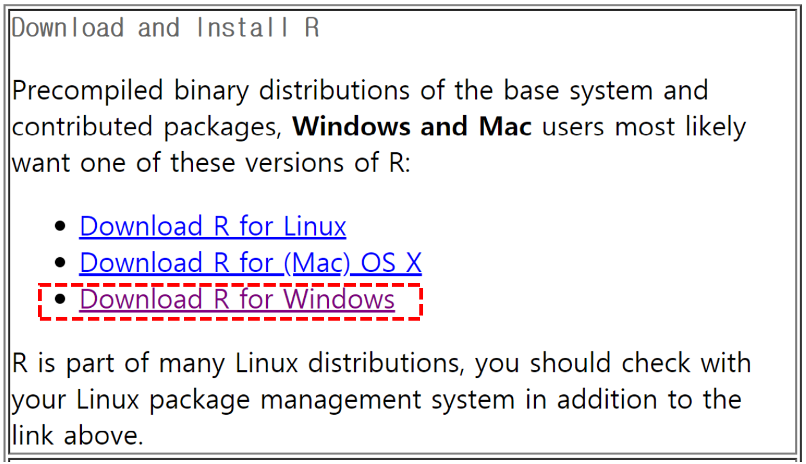
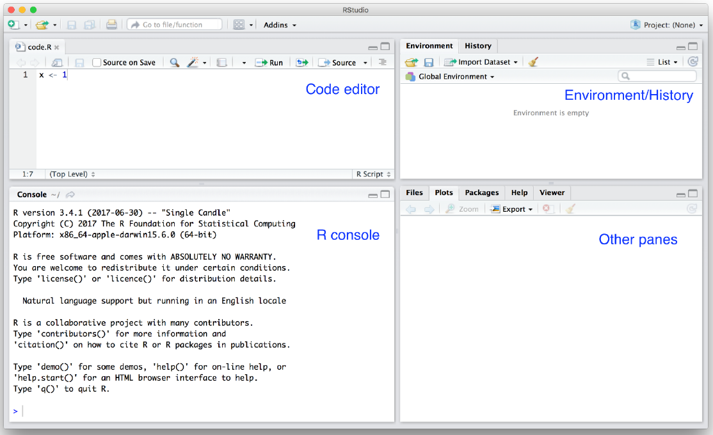
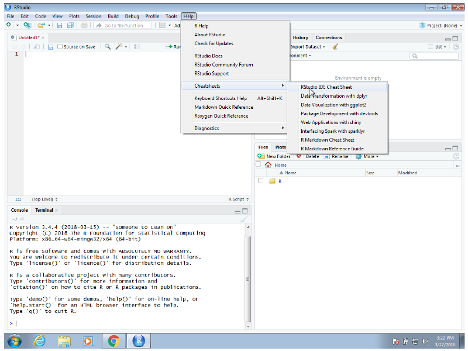
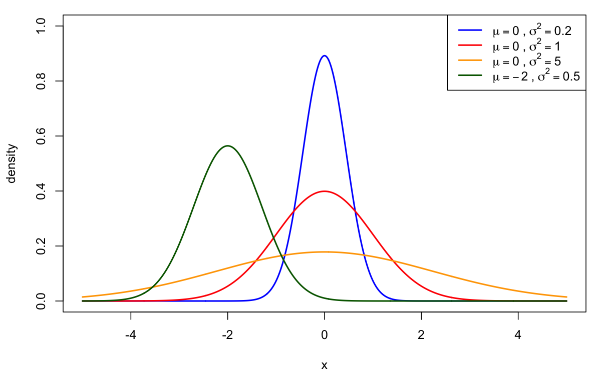
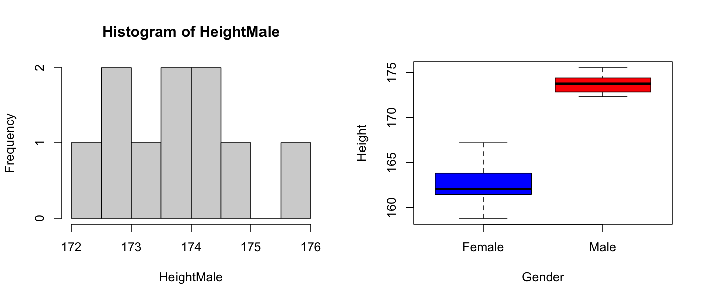
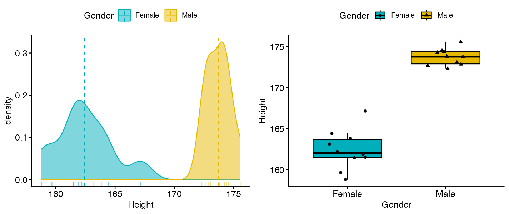

# Lecture 1 — Introduction to R Programming

[Repository Guide](../../README.md) | [English](Concepts_Lecture.md) | [한국어](Concepts_Lecture.ko.md)

> **Last Updated:** 2026-11-04

> **Learning Objectives:**
> 1. Install R and RStudio, and work with the RStudio panes, the working directory, and the workspace
> 2. Find the help page of a function, and install and load packages from CRAN
> 3. Explain the differences among vectors, factors, matrices, and data frames, and create each of them and inspect its size and structure
> 4. Generate regular values and normally distributed random numbers with `rep()`, `seq()`, and `rnorm()`
> 5. Compute descriptive statistics such as the mean, standard deviation, and median, and visualize distributions with base graphics and the ggplot2 family of packages

---

## Table of Contents

- [1. Probability, Statistics, and R](#1-probability-statistics-and-r)
  - [1.1 R as a Language for Data Analysis](#11-r-as-a-language-for-data-analysis)
  - [1.2 Course Roadmap](#12-course-roadmap)
- [2. Installing R and RStudio](#2-installing-r-and-rstudio)
  - [2.1 Installing R](#21-installing-r)
  - [2.2 Installing RStudio](#22-installing-rstudio)
  - [2.3 Checking the Installation](#23-checking-the-installation)
- [3. The RStudio Integrated Development Environment](#3-the-rstudio-integrated-development-environment)
  - [3.1 Integrated Development Environments](#31-integrated-development-environments)
  - [3.2 RStudio Panes](#32-rstudio-panes)
  - [3.3 Shortcuts and Cheat Sheets](#33-shortcuts-and-cheat-sheets)
- [4. The R Workspace](#4-the-r-workspace)
  - [4.1 Console and Scripts](#41-console-and-scripts)
  - [4.2 The Working Directory](#42-the-working-directory)
  - [4.3 Saving Your Work: Scripts and Workspaces](#43-saving-your-work-scripts-and-workspaces)
  - [4.4 Case Sensitivity](#44-case-sensitivity)
  - [4.5 Habits for Saving and Naming Files](#45-habits-for-saving-and-naming-files)
- [5. Help and Packages](#5-help-and-packages)
  - [5.1 Help Functions](#51-help-functions)
  - [5.2 R Packages and CRAN](#52-r-packages-and-cran)
  - [5.3 Installing and Loading Packages](#53-installing-and-loading-packages)
  - [5.4 Finding the Package You Need](#54-finding-the-package-you-need)
- [6. Data Types](#6-data-types)
  - [6.1 Vectors and Assignment](#61-vectors-and-assignment)
  - [6.2 Basic Types and Coercion](#62-basic-types-and-coercion)
  - [6.3 Data Frames](#63-data-frames)
  - [6.4 Loading Data and Inspecting Objects](#64-loading-data-and-inspecting-objects)
  - [6.5 Length, Rows and Columns, and Partial Views](#65-length-rows-and-columns-and-partial-views)
  - [6.6 Data Frames Versus Matrices](#66-data-frames-versus-matrices)
- [7. Generating Values](#7-generating-values)
  - [7.1 Removing Objects and Repetition: `rep()`](#71-removing-objects-and-repetition-rep)
  - [7.2 Sequences: `seq()` and the Colon Operator](#72-sequences-seq-and-the-colon-operator)
  - [7.3 Normal Random Numbers: `rnorm()`](#73-normal-random-numbers-rnorm)
  - [7.4 Factors](#74-factors)
  - [7.5 Creating Matrices](#75-creating-matrices)
- [8. Descriptive Statistics and Visualization](#8-descriptive-statistics-and-visualization)
  - [8.1 Example Data](#81-example-data)
  - [8.2 Descriptive Statistics](#82-descriptive-statistics)
  - [8.3 Base Graphics: Histograms and Box Plots](#83-base-graphics-histograms-and-box-plots)
  - [8.4 Visualization with ggplot2 and ggpubr](#84-visualization-with-ggplot2-and-ggpubr)
- [Summary](#summary)
- [Self-Check Questions](#self-check-questions)
- [References](#references)

---

<br>

## 1. Probability, Statistics, and R

### 1.1 R as a Language for Data Analysis

The two programming languages most widely used for data analysis are **R** and **Python**. R is a language and an environment designed for statistical computing and graphics, and it is distributed free of charge as open-source software. It comes with the functions that statistical analysis needs (means, variances, probability distributions, hypothesis tests, regression, and so on), and its syntax is relatively simple, so even a newcomer can learn the concepts by working with data directly.

Probability and statistics are theories defined by formulas, but how the theory shows up in real data is best understood through computation and plots. For example, repeating a coin-tossing experiment thousands of times in R lets you watch the proportion of heads approach 1/2 (the law of large numbers in Lecture 2). Every unit of this course presents the theory first and then confirms it by computation and simulation in R.

### 1.2 Course Roadmap

Lecture 1 installs R and introduces its data structures, basic functions, descriptive statistics, and visualization. The topics of the units are as follows.

| Lecture | Topics |
|:---|:-----|
| Lecture 1 | Installing R and RStudio, R data structures, generating values, descriptive statistics and visualization |
| Lecture 2 | Sample spaces and events, axioms and properties of probability, conditional probability, independence, the law of total probability, Bayes' theorem |
| Lecture 3 | Random variables, probability mass and density functions, cumulative distribution functions, joint distributions, expectation, variance, covariance |
| Lecture 4 | Discrete probability distributions (binomial, hypergeometric, Poisson, geometric, negative binomial, and others) |
| Lecture 5 | Continuous probability distributions, the normal distribution, the normal approximation to the binomial, the chi-square, t, and F distributions, the central limit theorem |
| Lecture 6 | Statistics and estimators, the sampling distribution of the mean, hypothesis testing, type I and type II errors, Z-tests and t-tests |
| Lecture 7 | Choosing a statistical method by the type of data (comparing two groups, analysis of variance, correlation and regression, categorical data analysis) |
| Lecture 8 | Checking normality, nonparametric tests (the Wilcoxon rank-sum test) and their limitations |

*Table 1. Topics covered in each unit*

---

<br>

## 2. Installing R and RStudio

Using R requires installing two programs in turn. First install **R**, the language itself, and then install **RStudio**, an editing environment that makes R convenient to use. RStudio is a program that finds and runs the R installed on your computer, so it does not work without R. The installation order is therefore always R first.

### 2.1 Installing R

R is downloaded from **CRAN (the Comprehensive R Archive Network)**. CRAN is a worldwide network of servers that distributes R itself and its packages, and its address is [https://cran.r-project.org/](https://cran.r-project.org/) [1]. The "Download and Install R" box on the front page collects the links to precompiled binary distributions of the base system and contributed packages, which most Windows and Mac users download. In this box, choose the link for your operating system.



*Figure 1. Download links for R by operating system on the CRAN front page*

The installation steps for each operating system are as follows.

1. **Windows:** Click "Download R for Windows", choose "base", and click "Download R-x.y.z for Windows" (x.y.z is the version number) to download the installer (`.exe`). Run the installer and proceed with the default choices.
2. **macOS:** Click "Download R for macOS". On an Apple silicon computer (M1 or a later chip), download and run the `.pkg` file labeled `arm64`; on an Intel computer, download and run the `.pkg` file labeled `x86_64`. The chip type is shown under "About This Mac" in the Apple menu.
3. **Linux:** R is packaged for most Linux distributions, so install it with the distribution's package manager. On Ubuntu, for example, run `sudo apt install r-base`. If the version provided by the distribution is old, add the CRAN repository as the "Download R for Linux" page on CRAN explains, and then install.

```bash
# Ubuntu: install R from the distribution's package manager
sudo apt update
sudo apt install r-base
```

> **Note:** The wording and link names on the CRAN page change slightly over time. The former "Download R for (Mac) OS X" now reads "Download R for macOS". The procedure of choosing your operating system and downloading the latest installer stays the same.

### 2.2 Installing RStudio

**RStudio** is an integrated development environment for R (Section 3). The company that develops it, RStudio, PBC, renamed itself Posit (Posit Software, PBC) in 2022 [2]. RStudio Desktop is now downloaded from the download page in Posit's RStudio User Guide, [https://docs.posit.co/ide/user/download.html](https://docs.posit.co/ide/user/download.html) [3]. The former addresses `https://www.rstudio.com/products/rstudio/download/` and `https://posit.co/download/rstudio-desktop/` both lead to this user guide.

RStudio comes as **RStudio Desktop**, which is installed and used on a personal computer, and **RStudio Server**, which is installed on a server and used through a web browser. The former download page split each of them into a free open-source license edition and a paid commercial license edition and showed four products: RStudio Desktop (open source), RStudio Desktop (commercial), RStudio Server (open source), and RStudio Server Pro (commercial); the commercial editions are now offered as RStudio Desktop Pro and Posit Workbench [2], [3]. The free open-source edition of RStudio Desktop is enough for self-study and for the exercises of this course. The download page detects the operating system of your computer and offers the matching installer (`.exe` for Windows, `.dmg` for macOS, `.deb` or `.rpm` for Linux). On Windows, run the installer; on macOS, open the `.dmg` file and drag the RStudio icon into the Applications folder.

### 2.3 Checking the Installation

When RStudio starts, R's startup message appears in the console on the left (or lower left). The first line of the message gives the R version, followed by a notice that R is free software that comes with ABSOLUTELY NO WARRANTY and pointers to basic commands such as `demo()`, `help()`, `help.start()`, and `q()` (quit). Typing the following in the console shows the installed version of R again.

```r
R.version.string
```

```text
[1] "R version 4.5.1 (2025-06-13)"
```

The version number and date depend on when you install R. If this message appears, R and RStudio are working together.

---

<br>

## 3. The RStudio Integrated Development Environment

### 3.1 Integrated Development Environments

An **integrated development environment (IDE)** is a software application that provides programmers with comprehensive facilities for software development in a single program. An IDE normally consists of at least a **source code editor**, **build automation tools**, and a **debugger**. RStudio is an IDE for R that makes R programming easier by letting you edit code, run it, inspect variables, view plots, and read help pages in one window.

### 3.2 RStudio Panes

When you start RStudio for the first time, you see three panes. The left pane shows the R console. On the right, the top pane holds tabs such as Environment and History, while the bottom pane shows five tabs: Files, Plots, Packages, Help, and Viewer (the tabs may change in newer versions). Clicking a tab moves to that feature. Opening a new script with File > New File > R Script adds a code editor at the upper left, which gives the four-pane layout in the following figure.



*Figure 2. RStudio window with the code editor, the R console, Environment and History, and the other panes*

| Pane | Position | Purpose |
|:---|:-----|:-----|
| Code editor (Source) | Upper left | Write and save R scripts (`.R` files) and send selected lines to the console to run them |
| R console (Console) | Lower left | R runs each command as soon as it is entered and prints the result |
| Environment and History | Upper right | Show the variables and data currently in memory and the record of the commands run so far |
| Files, Plots, Packages, Help, Viewer | Lower right | Browse files, view plots, manage packages, read help pages, and view HTML output |

*Table 2. The four RStudio panes and their purposes*

The console in Figure 2 shows the message R prints at startup, and the code editor holds a one-line script `x <- 1`. No code has been run yet, so the Environment tab reads "Environment is empty".

### 3.3 Shortcuts and Cheat Sheets

Memorizing the key bindings for the operations you use most speeds up your work considerably. RStudio provides a **cheat sheet** that summarizes the most widely used commands and shortcuts on one or two pages; choose Help > Cheatsheets > RStudio IDE Cheat Sheet to open it. The menu in Figure 3 also lists Data Transformation with dplyr, Data Visualization with ggplot2, package development with devtools, web applications with shiny, interfacing Spark with sparklyr, the R Markdown cheat sheet, and the R Markdown Reference Guide. The list of cheat sheets in the menu differs between RStudio versions.



*Figure 3. The Help > Cheatsheets menu of RStudio and its list of cheat sheets*

The following shortcuts are used frequently in RStudio [4]. The full list is under Help > Keyboard Shortcuts Help (Alt+Shift+K).

| Action | Windows, Linux | macOS |
|:-----|:---------------|:------|
| Open a new R script | Ctrl+Shift+N | Cmd+Shift+N |
| Run the current line or selection | Ctrl+Enter | Cmd+Return |
| Run from the start of the script to the current line | Ctrl+Alt+B | Cmd+Option+B |
| Comment or uncomment the selected lines | Ctrl+Shift+C | Cmd+Shift+C |
| Insert the assignment operator `<-` | Alt+- | Option+- |
| Save the script | Ctrl+S | Cmd+S |
| Show the list of shortcuts | Alt+Shift+K | Option+Shift+K |

*Table 3. Frequently used RStudio shortcuts*

---

<br>

## 4. The R Workspace

### 4.1 Console and Scripts

Commands are entered after the **user prompt** `>` in the R console, and R runs the commands interactively, one at a time. If you press Enter before a command is complete (for example, with an unclosed parenthesis), the prompt changes to `+` and waits for the rest; pressing Esc cancels the input. The up and down arrow keys scroll through the history of the commands you have entered.

Programming directly in the prompt window, however, is not recommended. Commands typed into the console are not saved to a file, so if a sudden blackout strikes while you are writing 100,000 lines at the prompt, all of the work is lost. The rule is to write code as a script file in the code editor, save it, and run the lines you need by selecting them (Ctrl+Enter). Use the console only to check results briefly.

### 4.2 The Working Directory

The **working directory** is the folder R uses as its reference point for reading and writing files. When you give only a file name without a path, as in `read.csv("data.csv")`, R looks for the file in the working directory, and plots or data you save are also created there.

| Function | What it does |
|:-----|:--------|
| `getwd()` | Returns the path of the current working directory |
| `setwd(A)` | Changes the working directory to path `A` |

*Table 4. Functions for the working directory*

```r
getwd()                                             # print the current working directory
setwd("C:/Users/student/Documents/prob-stat")       # forward slashes
setwd("C:\\Users\\student\\Documents\\prob-stat")   # or doubled backslashes
```

Writing the path for `setwd()` requires care. In an R string, the backslash `\` is an **escape character**. Just as `"\n"` denotes the newline character, a backslash combines with the character right after it to denote a special character. So if you paste the path `C:\Users` copied from Windows Explorer as it is, R reads `\U` as the start of a Unicode character escape and raises an error.

```r
setwd("C:\Users")
```

```text
Error: '\U' used without hex digits in character string (<input>:1:11)
```

Windows paths must be separated with forward slashes `/`, as in the example above, or with doubled backslashes (`\\`). Paths on macOS and Linux are separated with `/` in the first place, so they do not have this problem (for example, `setwd("~/Documents/prob-stat")`). In RStudio, the menu Session > Set Working Directory also changes the working directory.

### 4.3 Saving Your Work: Scripts and Workspaces

In R, the **workspace** is the collection of all objects (variables, data, functions) held in the memory (RAM) of the current R session. There are two ways to save your work.

| Method | What is saved | File | Restoring |
|:-----|:------------|:-----|:--------------|
| (1) Save the R script | Only the code you wrote, in text format | `.R` | Run the script again to recreate the objects |
| (2) Save the workspace with `save.image()` | The objects your code created in memory, as they are | `.RData` | `load(".RData")` |

*Table 5. Saving a script versus saving the workspace*

```r
save.image()                       # save every object to ".RData" in the working directory
save.image(file = "lecture1.RData")
load("lecture1.RData")             # restore the saved objects
```

A script records how the results were produced, so the same analysis can later be reproduced from the beginning. A saved workspace is useful for loading results that took a long time to compute without recomputing them, but it does not record which code produced them. It is therefore advisable to make scripts the primary means of saving and to use workspace files only as a supplement.

### 4.4 Case Sensitivity

> **Key Point:** R is a **case-sensitive** language. Two names with the same spelling are different objects if their uppercase and lowercase letters differ.

```r
variableName <- "test"
variablename <- "test2"

variableName
variablename
```

```text
[1] "test"
[1] "test2"
```

`variableName` and `variablename` differ only in the case of `N`, yet they are different variables and keep their own values. The `[1]` in front of the output means that the first value on that line is element 1 of the result vector. For the same reason, writing `Mean(x)` or `Length(x)` raises an error saying that no such function exists; the correct names are `mean(x)` and `length(x)`.

### 4.5 Habits for Saving and Naming Files

- A programmer should have the habit of always saving and making backups. One of the best ways is to save the script every time you change it (Ctrl+S).
- Name files so that their content is clear. When the same workspace file piles up under names that change only slightly, such as `final`, `Realfinal`, `Realfinal2`, `Realfinal222`, and `RRRRRRealfinal222`, no one can tell which file is the latest or what each one contains.
- Putting the content and the date in the name (for example, `2025-09-08_r-basics.R`) works well, and when several versions must be managed, a version control tool such as Git is preferable.

---

<br>

## 5. Help and Packages

### 5.1 Help Functions

Every R function has a help page describing its usage, the meaning of its arguments, its return value, and examples. To check what a particular function does, the following functions find its user manual easily.

| Function | What it does |
|:-----|:--------|
| `help.start()` | Opens the front page of R's HTML help in a web browser |
| `help(A)` or `?A` | Opens the help page of the function (or dataset) `A` |
| `help(package = "P")` | Opens the list and descriptions of the functions and data in package `P` |
| `??A` or `help.search("A")` | Searches the help pages of all installed packages for the word `A` |

*Table 6. Functions that open help pages*

The front page opened by `help.start()` has three parts. **Manuals** holds the official manuals such as An Introduction to R, The R Language Definition, Writing R Extensions, R Installation and Administration, R Data Import/Export, and R Internals; **Reference** holds the list of help pages of the installed packages (Packages) and a search facility (Search Engine & Keywords); and **Miscellaneous Material** holds About R, Authors, Resources, License, Frequently Asked Questions, Thanks, the change log (NEWS), User Manuals, and Technical papers. R for Windows adds below them a part with the change log and FAQ specific to the Windows version (Material specific to the Windows port).

```r
help(head)               # help page of the function head()
?head                    # the same
help(package = "ggplot2")
??boxplot                # search every help page for "boxplot"
```

> **Note:** The `A` in `help(A)` is not a package name but the **name of a topic** such as a function or dataset. To see the documentation of a whole package, use the `package` argument as in `help(package = "ggplot2")`. Some packages, however, include an overview page with the same name as the package, so `?ggplot2` may open that package's overview.

### 5.2 R Packages and CRAN

One of the strengths of R is that the system can easily be extended. Users can write new functions and bundle them into an **R package** to share with others. A package is a unit that bundles functions, data, and help pages in a prescribed format, and packages that pass CRAN's checks are registered on CRAN so that anyone can install them. The plotting packages ggplot2 and ggpubr used in this course are also CRAN packages.

Packages are often called "R libraries", but strictly speaking a **library** in R is the directory where packages are installed. The function that loads a package is named `library()` because it finds the package in a library directory and loads it.

### 5.3 Installing and Loading Packages

The first step in finding and installing packages is to set the **repositories** from which packages are downloaded. Running `setRepositories()` in an interactive session shows a menu of repositories such as CRAN, BioC software, BioC annotation, BioC experiment, CRAN (extras), R-Forge, and rforge.net, and by default only CRAN is selected. BioC is Bioconductor, a repository of bioinformatics packages. In most cases CRAN alone is enough. Giving the numbers directly without the menu, as in `setRepositories(ind = 1:7)`, selects repositories 1 through 7 of the list at once.

```r
## Set repository for downloading R packages
setRepositories()

## Install "ggplot2" package
install.packages("ggplot2")

## Loading "ggplot2" package
library(ggplot2)
```

| Function | What it does | When to run |
|:-----|:--------|:----------|
| `install.packages("P")` | Downloads package `P` and the packages it depends on from the repository and installs them in the library | Once per computer (requires an internet connection) |
| `library(P)` | Loads the installed package `P` into the current session so that its functions can be used | Every time R starts |

*Table 7. Installing and loading packages*

The argument of `install.packages()` is a quoted string, whereas `library()` accepts the name without quotes. If a package is installed but not loaded with `library()`, an error such as `could not find function "ggplot"` occurs.

### 5.4 Finding the Package You Need

- CRAN lists all registered packages by name at [https://cran.r-project.org/web/packages/available_packages_by_name.html](https://cran.r-project.org/web/packages/available_packages_by_name.html).
- Searching a search engine in English for what you want to do is also fast. For example, searching for "R package for boxplot" finds packages that draw box plots, together with usage examples.
- An image search lets you compare at a glance the look of plots drawn with various packages and choose a package with the style you want. Searching for box plots shows a variety of plots drawn with R's base `boxplot()`, ggplot2's `geom_boxplot()`, and others.

---

<br>

## 6. Data Types

### 6.1 Vectors and Assignment

A **vector** is R's most basic data structure: an ordered collection of values of the same type. Even a single number is a vector of length 1. The function `c()` (combine) joins values into a vector.

```r
## Vectors
numericVector <- c(1, 2, 3, 4, 5)
numericVector

characterVector <- c("One", "Two", "Three", "Four", "Five")
characterVector

logicalVector <- c("TRUE", "TRUE", "FALSE", "FALSE", "FALSE")
logicalVector
```

```text
[1] 1 2 3 4 5
[1] "One"   "Two"   "Three" "Four"  "Five" 
[1] "TRUE"  "TRUE"  "FALSE" "FALSE" "FALSE"
```

`numericVector` is a numeric vector and `characterVector` is a character vector. Typing a variable's name alone prints its value.

> **Note:** Despite its name, `logicalVector` in the code above is a **character** vector, not a logical one. Wrapping `"TRUE"` in quotes makes it a four-letter string rather than a logical value. This can be seen from the quotes around the printed values and from `class(logicalVector)` returning `"character"`. To create a logical vector, write `TRUE` and `FALSE` without quotes.
>
> ```r
> logicalVector <- c(TRUE, TRUE, FALSE, FALSE, FALSE)   # corrected: no quotes
> class(logicalVector)
> ```
>
> ```text
> [1] "logical"
> ```

You can use `=` when assigning a value to a variable, but **`<-` is highly recommended** to avoid confusion with the equality operator `==`. `x <- 5` is an assignment that puts 5 into x, while `x == 5` is a comparison asking whether x equals 5 and returns `TRUE` or `FALSE`. `=` is mainly used to give values to named function arguments, as in `rnorm(n = 100, mean = 0)`.

R indices start at 1. `x[i]` is the `i`th element of vector `x`, the negative index `x[-i]` gives the remaining elements **without** the `i`th one, and a logical vector as the index selects the elements at the positions that are `TRUE`.

```r
x <- c(10, 20, 30, 40, 50)
x[1]
x[c(1, 3)]
x[-2]
x[x > 25]
```

```text
[1] 10
[1] 10 30
[1] 10 30 40 50
[1] 30 40 50
```

> **[Computer Programming]** Arrays and lists in C and Python are indexed from 0, and the negative index `-1` in Python refers to the last element. R indexes from 1 and uses negative indices to exclude elements, so the same `x[-1]` returns the last element in Python but all elements except the first in R.

### 6.2 Basic Types and Coercion

The four most frequently used basic types that the elements of a vector can have are as follows. There are also the complex type `complex` and the type `raw`, which holds bytes [5].

| Type (`typeof()`) | `class()` | Meaning | Examples |
|:--------------------|:----------|:---|:---|
| `logical` | `"logical"` | Logical values | `TRUE`, `FALSE` |
| `integer` | `"integer"` | Integers (written with an `L` suffix) | `5L`, `100L` |
| `double` | `"numeric"` | Real numbers (the default type for numbers) | `3.14`, `42` |
| `character` | `"character"` | Strings (wrapped in double or single quotes) | `"Hello"`, `'a'` |

*Table 8. Basic types of R vectors*

`class()` tells how an object is treated, and `typeof()` tells which type it is stored as in memory. A number written without `L`, such as `42`, is stored as a double even though it looks like an integer.

A vector can hold only one type, so when `c()` receives values of different types, R converts all of them to a single type in the direction that loses no information. This is called **coercion**, and the direction is `logical` → `integer` → `double` → `character` (`complex` comes between `double` and `character`).

```r
c(1, "a", TRUE)
c(1, TRUE, FALSE)
sum(c(TRUE, TRUE, FALSE, FALSE, FALSE))
```

```text
[1] "1"    "a"    "TRUE"
[1] 1 1 0
[1] 2
```

The first line contains the string `"a"`, so all values become characters. The second line mixes numeric and logical values, so `TRUE` becomes 1 and `FALSE` becomes 0. Because of this property, applying `sum()` to a logical vector counts the `TRUE` values. Lecture 2 uses this method to count the outcomes that satisfy a condition.

### 6.3 Data Frames

The variables defined so far have been a single number or a sequence of values of one type. This is not enough for storing real data. The most common way of storing a dataset in R is a **data frame**.

> **Definition:** A **data frame** is a tabular data structure whose rows represent **observations**, that is, individual cases, and whose columns represent the **variables** measured on each observation. The values within a column share one type, but different columns may have different types.

Data frames are particularly useful for datasets because they combine different types, such as numeric, character, logical, and factor (Section 7.4), into one object. For example, students' heights (numbers) and genders (categories) can be stored together in one table.

```r
df <- data.frame(Height = c(170.5, 160.2, 175.1),
                 Gender = factor(c("Male", "Female", "Male")))
df
str(df)
```

```text
  Height Gender
1  170.5   Male
2  160.2 Female
3  175.1   Male
'data.frame':	3 obs. of  2 variables:
 $ Height: num  170 160 175
 $ Gender: Factor w/ 2 levels "Female","Male": 2 1 2
```

`data.frame()` builds columns from arguments of the form `column_name = vector`. The 1, 2, 3 on the left of the output are row names. The output of `str()` shows that the object is a data frame with 3 observations (3 obs.) and 2 variables (2 variables), that `Height` is numeric (`num`), and that `Gender` is a factor with two levels.

### 6.4 Loading Data and Inspecting Objects

| Function | What it does |
|:-----|:--------|
| `data(name)` | Loads the built-in dataset `name` into the workspace. Running `data()` with no argument lists the available datasets |
| `ls()` | Lists the names of the objects in the workspace |
| `class(x)` | Tells the kind (type or data structure) of object `x` |
| `str(x)` | Shows a compact summary of the internal structure of object `x` |

*Table 9. Functions for loading data and inspecting objects*

The built-in **iris** dataset records the length and width of the sepals and petals and the species of 150 iris flowers, and it is widely used in examples.

```r
data(iris)
ls()
class(iris)
str(iris)
```

```text
[1] "iris"
[1] "data.frame"
'data.frame':	150 obs. of  5 variables:
 $ Sepal.Length: num  5.1 4.9 4.7 4.6 5 5.4 4.6 5 4.4 4.9 ...
 $ Sepal.Width : num  3.5 3 3.2 3.1 3.6 3.9 3.4 3.4 2.9 3.1 ...
 $ Petal.Length: num  1.4 1.4 1.3 1.5 1.4 1.7 1.4 1.5 1.4 1.5 ...
 $ Petal.Width : num  0.2 0.2 0.2 0.2 0.2 0.4 0.3 0.2 0.2 0.1 ...
 $ Species     : Factor w/ 3 levels "setosa","versicolor",..: 1 1 1 1 1 1 1 1 1 1 ...
```

The `ls()` output above is that of a freshly started R session; if objects created earlier remain, their names are listed as well. `str(iris)` shows that iris is a data frame with 150 observations and 5 variables, that the first four columns are numeric, and that `Species` is a factor with the three levels setosa, versicolor, and virginica. The names after `$` are the column names, and a single column can be extracted as `data$column_name`, as in `iris$Species`.

### 6.5 Length, Rows and Columns, and Partial Views

An element of a data frame is referred to as `data[row, column]`. Leaving the row or column position empty means the whole of that dimension, so `iris[1, ]` is the entire first row and `iris[, 1]` is the entire first column. `length(x)` returns the number of elements of a one-dimensional object.

```r
length(iris[1, ])
length(iris[, 1])

# If we try outbounds of data...
length(iris[, 6])
```

```text
[1] 5
[1] 150
Error in `[.data.frame`(iris, , 6) : undefined columns selected
```

`iris[, 1]` is a numeric vector of the 150 values in the first column `Sepal.Length`, so its length is 150. By contrast, `iris[1, ]` is not a vector but a one-row data frame with 5 columns. The length of a data frame is defined as its number of columns, so `length(iris[1, ])` is 5. iris has only 5 columns, so asking for the 6th column raises an error saying that an undefined column was selected (`undefined columns selected`).

The numbers of rows and columns and the beginning and end of the data are checked with the following functions.

```r
nrow(iris)
ncol(iris)
dim(iris)
head(iris)
tail(iris)
```

```text
[1] 150
[1] 5
[1] 150   5
  Sepal.Length Sepal.Width Petal.Length Petal.Width Species
1          5.1         3.5          1.4         0.2  setosa
2          4.9         3.0          1.4         0.2  setosa
3          4.7         3.2          1.3         0.2  setosa
4          4.6         3.1          1.5         0.2  setosa
5          5.0         3.6          1.4         0.2  setosa
6          5.4         3.9          1.7         0.4  setosa
    Sepal.Length Sepal.Width Petal.Length Petal.Width   Species
145          6.7         3.3          5.7         2.5 virginica
146          6.7         3.0          5.2         2.3 virginica
147          6.3         2.5          5.0         1.9 virginica
148          6.5         3.0          5.2         2.0 virginica
149          6.2         3.4          5.4         2.3 virginica
150          5.9         3.0          5.1         1.8 virginica
```

`dim()` returns (number of rows, number of columns). `head()` and `tail()` show the first 6 and last 6 rows by default, and the argument `n` changes the number of rows, as in `head(iris, n = 10)` and `tail(iris, n = 10)`. The meaning of the arguments can be checked with `?head`. Typing the name `iris` alone prints all 150 rows and floods the console, so for large data it is better to look at a part with `head()`. `fix(iris)` opens the data in a spreadsheet-like editor window, and in RStudio `View(iris)` shows the data as a read-only table.

### 6.6 Data Frames Versus Matrices

A **matrix** is also a two-dimensional structure of rows and columns, but it differs from a data frame in that all of its elements must have the same type.

| Aspect | Data frame | Matrix |
|:-----|:--------------|:-----|
| Element types | May differ by column | All elements must share one type |
| Row and column names | Always has column names and row names | Names can be attached but are optional |
| Factors | Columns can be factors | Cannot hold factors; they become integer codes or characters (Section 7.4) |
| Main use | Fitting statistical model formulas (`lm(y ~ x, data = df)` and so on), data processing | Matrix operations (products, inverses, and so on) |

*Table 10. Data frames compared with matrices*

Many functions that fit statistical models or process data take a data frame as input, so data held as a matrix is often converted to a data frame with `as.data.frame()` before the work begins. Transposing a data frame swaps its rows and columns so that the row names become column names, which is useful when data must be arranged in the other direction.

```r
t(df)
class(t(df))
```

```text
       [,1]    [,2]     [,3]   
Height "170.5" "160.2"  "175.1"
Gender "Male"  "Female" "Male" 
[1] "matrix" "array" 
```

> **Caution:** The result of `t()` is a **matrix**, not a data frame. A matrix holds only one type, so transposing `df`, which mixes a numeric column and a factor column, turns every value into a string, as shown above. To continue computing with the transposed result, transpose only the numeric columns, or convert the result back with `as.data.frame()` and check the type of each column.

---

<br>

## 7. Generating Values

### 7.1 Removing Objects and Repetition: `rep()`

`rm(x)` removes object `x` from the workspace, and `rm(list = ls())` removes all objects. Removing names used earlier before starting a new example prevents mistakes caused by leftover values.

`rep(x, times)` creates a vector that repeats the values of `x`. It is used to create a vector in which the same value appears many times without typing every value.

```r
## Value generation (Sequentially)
rm(A)
rm(B)
rm(C)

A <- c(1, 1, 1, 2, 2, 2, 3, 3, 3)
A

rep(1, 3)
rep(2, 3)
rep(3, 3)

B <- c(rep(1, 3), rep(2, 3), rep(3, 3))
B
```

```text
[1] 1 1 1 2 2 2 3 3 3
[1] 1 1 1
[1] 2 2 2
[1] 3 3 3
[1] 1 1 1 2 2 2 3 3 3
```

`rm(A)` gives a warning if `A` does not exist, so these three lines can be skipped on the first run. The vector `A`, whose values are typed out, and `B`, which joins `rep(1, 3)`, `rep(2, 3)`, and `rep(3, 3)` with `c()`, are the same vector. `rep()` repeats values in two ways, `times` and `each`.

```r
rep("a", times = 10)
rep(1:3, each = 10)
rep(c("a", "b"), 5)
```

```text
 [1] "a" "a" "a" "a" "a" "a" "a" "a" "a" "a"
 [1] 1 1 1 1 1 1 1 1 1 1 2 2 2 2 2 2 2 2 2 2 3 3 3 3 3 3 3 3 3 3
 [1] "a" "b" "a" "b" "a" "b" "a" "b" "a" "b"
```

| Call | How it repeats | Result |
|:-----|:----------|:-----|
| `rep(x, times = k)` | Concatenates the whole vector `x` `k` times | `rep(c("a", "b"), 5)` gives a, b, a, b, ... (length 10) |
| `rep(x, each = k)` | Repeats each element `k` times before moving to the next element | `rep(1:3, each = 10)` gives ten 1s, ten 2s, and ten 3s |

*Table 11. The two ways `rep()` repeats values*

An unnamed second argument is interpreted as `times`. When the output spans more than one line, each line begins with the position of its first value, such as `[1]` or `[18]`.

### 7.2 Sequences: `seq()` and the Colon Operator

`seq(from, to, by, length.out)` generates regular sequences. `from` is the start, `to` is the end, `by` is the increment, and `length.out` is the number of values to generate; only the ones needed are specified. The colon operator `a:b` generates the sequence from `a` to `b` in steps of 1.

```r
c(1:10)
seq(from = 1, to = 10)
seq(1, 10)
seq(from = 1, to = 10, by = 2)
seq(1, 10, length = 5)
seq(from = 1, by = 2, length.out = 10)
```

```text
 [1]  1  2  3  4  5  6  7  8  9 10
 [1]  1  2  3  4  5  6  7  8  9 10
 [1]  1  2  3  4  5  6  7  8  9 10
[1] 1 3 5 7 9
[1]  1.00  3.25  5.50  7.75 10.00
 [1]  1  3  5  7  9 11 13 15 17 19
```

The first three lines are all the integers from 1 to 10. `1:10` is already a vector, so wrapping it in `c()` is unnecessary. With `by = 2`, the sequence starts at 1 and adds 2 each time as long as the value does not exceed 10. `length = 5` asks for 5 equally spaced values with 1 and 10 as the endpoints, and the spacing is $(10 - 1)/(5 - 1) = 2.25$. The argument name `length` is an abbreviation of `length.out`; R accepts an abbreviated argument name as long as it matches only one argument. The last line fixes the number of values instead of the end and generates 10 values starting at 1 and increasing by 2.

### 7.3 Normal Random Numbers: `rnorm()`

`rnorm(n, mean, sd)` generates `n` random numbers from the normal distribution with mean `mean` and standard deviation `sd`.

```r
## Generating random values
rnorm(n = 100, mean = 180, sd = 1)
```

This command creates 100 values that follow the normal distribution with mean 180 and standard deviation 1. It is used to create artificial data, for example, as if the heights of 100 people were drawn at random from a population whose mean height is 180cm with a standard deviation of 1cm.

In probability theory, the **normal distribution**, also called the Gaussian, Gauss, or Laplace-Gauss distribution, is a very commonly used continuous probability distribution. The probability density function of the normal distribution with mean $\mu$ and variance $\sigma^2$ is as follows.

$$
f(x) = \frac{1}{\sqrt{2\pi\sigma^2}} \exp\left( -\frac{(x - \mu)^2}{2\sigma^2} \right), \qquad -\infty < x < \infty
$$

The curve is bell-shaped, peaks at $x = \mu$, and is symmetric about $\mu$; the larger $\sigma^2$ is, the lower and wider it spreads. Normal distributions are important in statistics for representing real-valued random variables whose distributions are not known exactly, because quantities determined by the sum of many small factors, such as measurement errors or heights, are often approximately normal. A random variable with a normal distribution is said to be normally distributed, and such a random variable is also called a **normal deviate**. Lecture 5 covers the properties of the normal distribution in detail.



*Figure 4. Probability density functions of four normal distributions with different means and variances*

Three curves in Figure 4 share the mean 0 and have variances 0.2, 1, and 5; the smaller the variance, the higher and narrower the curve gathers around 0. The green curve has mean -2 and variance 0.5, so it is symmetric about -2, higher and narrower than the red curve with variance 1 but lower and wider than the blue curve with variance 0.2.

> **Caution:** The third argument of `rnorm()` is the **standard deviation** $\sigma$, not the variance $\sigma^2$. To draw values from the normal distribution with variance 5, write `rnorm(n, mean = 0, sd = sqrt(5))`.

Random numbers differ from run to run. When the same result must be obtained again (for example, to reproduce the numbers in a report), fix the **seed** before generating random numbers, as in `set.seed(2025)`. Generating random numbers in the same order from the same seed always gives the same values.

### 7.4 Factors

A **factor** is R's data structure for categorical data. It stores the list of possible categories as **levels** and stores each element as an integer code indicating which level it is. The terms category and enumerated type are also used for factors. `factor()` encodes a numeric or character vector as a factor.

```r
## What is Factor variable?
rm(A)
rm(B)
rep(c("a", "b"), 5)
A <- rep(c("a", "b"), 5)
B <- factor(A)
A
B
class(A)
class(B)

cbind(A, B)
```

```text
 [1] "a" "b" "a" "b" "a" "b" "a" "b" "a" "b"
 [1] "a" "b" "a" "b" "a" "b" "a" "b" "a" "b"
 [1] a b a b a b a b a b
Levels: a b
[1] "character"
[1] "factor"
      A   B  
 [1,] "a" "1"
 [2,] "b" "2"
 [3,] "a" "1"
 [4,] "b" "2"
 [5,] "a" "1"
 [6,] "b" "2"
 [7,] "a" "1"
 [8,] "b" "2"
 [9,] "a" "1"
[10,] "b" "2"
```

`A` and `B` hold the same values but print differently. The values of the character vector `A` are printed in quotes, while the values of the factor `B` are printed without quotes and followed by the list of levels `Levels: a b`. By default, levels are ordered alphabetically (or by size for numbers).

The result of `cbind(A, B)` shows that a factor cannot be put into a matrix. `cbind()` creates a matrix, and on entering it the factor `B` turns into its integer codes (1 for `a`, 2 for `b`), which then become the strings `"1"` and `"2"` to match the character vector `A`. To keep the category information of a factor, use a data frame instead of a matrix.

```r
C <- factor(rep(c("a", "b", "c", "d"), 5))
C
levels(C)
summary(C)
```

```text
 [1] a b c d a b c d a b c d a b c d a b c d
Levels: a b c d
[1] "a" "b" "c" "d"
a b c d 
5 5 5 5 
```

`levels()` returns the list of levels. `summary()` is a **generic function** that produces summaries of the results of various model-fitting functions or of variables, and its behavior depends on the kind of input.

- **For a numeric variable,** it returns six values: the minimum (Min.), first quartile (1st Qu.), median (Median), mean (Mean), third quartile (3rd Qu.), and maximum (Max.) (Section 8.2).
- **For a factor,** it returns the frequency of each level, that is, the number of elements in each category. The `C` above has 5 elements in each of its four levels.

> **Key Point:** A data frame can hold factor variables as they are, but a matrix cannot hold factors. In a matrix made with `cbind()` or `data.matrix()` a factor turns into integer codes, and in one made with `as.matrix()` or `matrix()` it turns into strings, so the level information of the factor is lost. Data with categorical variables should be handled as a data frame.

### 7.5 Creating Matrices

`matrix(value, nrow, ncol, byrow)` creates a matrix from the given values. `nrow` is the number of rows, `ncol` is the number of columns, and `byrow` sets the order in which the values are filled in.

```r
## Generate matrix variable
rm(A)
rm(B)
rm(C)

matrix(0, nrow = 10, ncol = 5)
matrix(NA, nrow = 10, ncol = 5)

A <- matrix(NA, nrow = 10, ncol = 5)
dim(A)
nrow(A)
ncol(A)
class(A)
```

```text
[1] 10  5
[1] 10
[1] 5
[1] "matrix" "array" 
```

`matrix(0, nrow = 10, ncol = 5)` is a 10-by-5 matrix whose elements are all 0, and `matrix(NA, ...)` is a matrix whose elements are all `NA`. `NA` (not available) denotes a **missing value** in R, that is, a position whose value is not yet known or unknown. This is how an empty table to be filled in later is prepared. The two matrices print all 10 rows and 5 columns and are long, so the output above shows only the results from `dim(A)` on. Since R 4.0, `class()` of a matrix returns the two values `"matrix" "array"`, meaning that a matrix is also a two-dimensional array.

When several values are given, they are filled in **by column** by default, and **by row** with `byrow = TRUE`.

```r
matrix(1:6, nrow = 2)
matrix(1:6, nrow = 2, byrow = TRUE)
```

```text
     [,1] [,2] [,3]
[1,]    1    3    5
[2,]    2    4    6
     [,1] [,2] [,3]
[1,]    1    2    3
[2,]    4    5    6
```

---

<br>

## 8. Descriptive Statistics and Visualization

### 8.1 Example Data

The examples in this section use `ourData`, a data frame holding the heights of 10 men and 10 women. The men's heights were generated from the normal distribution with mean 173 and standard deviation 2, and the women's heights from the normal distribution with mean 162.3 and standard deviation 2; the heights of the two groups are also stored in the vectors `HeightMale` and `HeightFemale`. How to create the data is shown in [Exercise 2](Exercises.md#exercise-2-creating-gender-and-height-data) and its [solution](Solutions.md#exercise-2-creating-gender-and-height-data).

```r
str(ourData)
```

```text
'data.frame':	20 obs. of  2 variables:
 $ Gender: Factor w/ 2 levels "Female","Male": 2 2 2 2 2 2 2 2 2 2 ...
 $ Height: num  174 173 175 176 174 ...
```

`Gender` is a factor with the two levels Female and Male, and `Height` is numeric. The first 10 rows are men, so the integer codes of `Gender` start with 2 (Male).

### 8.2 Descriptive Statistics

**Descriptive statistics** summarize features of data, such as their central location and spread, with a few numbers. With observations $x_1, x_2, \ldots, x_n$, the main statistics are as follows.

| Statistic | R function | Definition |
|:-------|:-------|:-----|
| Mean | `mean(x)` | $\bar{x} = \frac{1}{n}\sum_{i=1}^{n} x_i$ |
| Sample variance | `var(x)` | $s^2 = \frac{1}{n-1}\sum_{i=1}^{n} (x_i - \bar{x})^2$ |
| Sample standard deviation | `sd(x)` | $s = \sqrt{s^2}$ |
| Median | `median(x)` | The middle value when the data are sorted. If $n$ is even, the mean of the two middle values |
| Quartiles | `quantile(x)` | The values that divide the sorted data into four equal parts: the first quartile $Q_1$, the median $Q_2$, and the third quartile $Q_3$ |

*Table 12. Main descriptive statistics and their R functions*

The reason the sample variance divides by $n - 1$ instead of $n$ is covered with unbiased estimators in Lecture 6. As a small example, the computations for $x = (2, 4, 4, 5, 7, 9)$ are as follows.

- **Mean:** $\bar{x} = (2 + 4 + 4 + 5 + 7 + 9)/6 = 31/6 \approx 5.167$.
- **Variance and standard deviation:** The deviations $x_i - \bar{x}$ are $-3.167, -1.167, -1.167, -0.167, 1.833, 3.833$, and the sum of their squares is about $30.833$. Hence $s^2 = 30.833/5 \approx 6.167$ and $s \approx 2.483$.
- **Median:** There are 6 values, so the median is 4.5, the mean of the two middle values 4 and 5.
- **Quartiles:** R's default method finds the $p$ quantile by linear interpolation between neighboring values at position $1 + (n - 1)p$ of the sorted data. The position of $Q_1$ is $1 + 5 \times 0.25 = 2.25$, which lies between the 2nd value 4 and the 3rd value 4, giving 4.0; the position of $Q_3$ is $4.75$, giving $5 + 0.75 \times (7 - 5) = 6.5$.

```r
x <- c(2, 4, 4, 5, 7, 9)
summary(x)
sd(x)
```

```text
   Min. 1st Qu.  Median    Mean 3rd Qu.    Max. 
  2.000   4.000   4.500   5.167   6.500   9.000 
[1] 2.483277
```

> **Note:** Textbooks and software compute quartiles in slightly different ways; R's `quantile()` offers nine methods through its `type` argument, and the default is the method above (`type = 7`) [6]. With large data, the differences between methods are small.

Now apply these functions to `ourData`.

```r
## Get fundamental statistic
summary(ourData)

ourData[, 2]
mean(ourData[, 2])
sd(ourData[, 2])
median(ourData[, 2])
```

```text
    Gender       Height     
 Female:10   Min.   :158.8  
 Male  :10   1st Qu.:162.1  
             Median :169.7  
             Mean   :168.1  
             3rd Qu.:173.8  
             Max.   :175.5  
 [1] 174.2415 173.0713 174.5463 175.5450 173.7420 172.6743 173.7942 172.8400
 [9] 172.3101 174.4043 161.5086 158.7899 161.4581 163.8298 164.4323 161.9126
[17] 162.1957 163.1353 159.6746 167.1580
[1] 168.0632
[1] 6.07019
[1] 169.7341
```

Applied to a data frame, `summary()` summarizes each column. The factor `Gender` is summarized by the frequency of each level (10 women, 10 men), and the numeric `Height` by six values. `ourData[, 2]` is the 20 values of the second column `Height`. The overall mean is 168.06, but this mean mixes two groups of different nature and represents the typical height of neither group. The statistics are therefore computed for each group separately.

```r
mean(HeightMale)
mean(HeightFemale)
sd(HeightMale)
sd(HeightFemale)
```

```text
[1] 173.7169
[1] 162.4095
[1] 1.002002
[1] 2.398499
```

The men's mean 173.72 and the women's mean 162.41 are close to the population means 173 and 162.3 used for generation. The sample standard deviations 1.00 and 2.40 differ considerably from the value 2 used for generation. With only 10 observations, a statistic computed from a sample can deviate substantially from the parameter, and this variation of a statistic from sample to sample is the subject of sampling distributions in Lecture 6.

### 8.3 Base Graphics: Histograms and Box Plots

R's base graphics functions alone can draw distributions.

```r
## Visualization (Really Really Basic)
hist(HeightMale)
hist(HeightFemale)
hist(ourData[, 2])

boxplot(Height ~ Gender, data = ourData)
boxplot(Height ~ Gender, data = ourData, col = c("blue", "red"))
```

- **Histogram:** `hist(x)` divides the range of the values into intervals of equal width and draws the number of observations in each interval (Frequency) as the height of a bar. It shows the shape of a distribution (center, spread, skewness, number of peaks).
- **Box plot:** The lower and upper edges of the box are approximately $Q_1$ and $Q_3$, and the thick line inside the box is the median. The lines extending up and down from the box (whiskers) reach the most extreme observations within 1.5 times the interquartile range $Q_3 - Q_1$ from the box edges, and observations farther out are drawn separately as points, as candidate outliers [7].
- **Model formula `Height ~ Gender`:** It means to split the variable on the left of `~` by the categories of the variable on the right. `data = ourData` makes R look for both variables among the columns of `ourData`. `col` sets the box colors in the order of the levels (Female, Male).



*Figure 5. Histogram of the men's heights (left) and box plot of height by gender (right)*

The histogram in Figure 5 shows that the heights of the 10 men are scattered between 172cm and 176cm. The box plot shows at a glance that the boxes of the two groups do not overlap at all, so the men are clearly taller than the women, and that the women's heights are more spread out (longer box and whiskers).

### 8.4 Visualization with ggplot2 and ggpubr

Visualization matters in statistical analysis, because summary values such as the mean and standard deviation do not reveal the shape of a distribution. Anscombe presented four datasets with nearly identical means, variances, correlation coefficients, and regression lines but entirely different scatter plots, showing why data should be plotted before analysis [8].

More refined plots than base graphics are drawn with third-party packages such as **ggplot2** and **ggpubr**. **ggplot2** builds a plot by stacking layers with `+` according to the grammar of graphics: the data (`data`), the mapping of variables to visual properties (`aes()`, aesthetic mapping), and the shapes to draw (`geom_*()`) [9]. **ggpubr** is built on ggplot2 and draws publication-ready plots with a single function call [10].

```r
library(ggpubr)   # also loads ggplot2

ggdensity(ourData, x = "Height", add = "mean", rug = TRUE,
          color = "Gender", fill = "Gender",
          palette = c("#00AFBB", "#E7B800"))

ggboxplot(ourData, x = "Gender", y = "Height",
          fill = "Gender", palette = c("#00AFBB", "#E7B800"),
          add = "jitter", shape = "Gender")
```

| Function and argument | What it does |
|:------------|:--------|
| `ggdensity(ourData, x = "Height")` | Draws the distribution of `Height` as a smooth curve, a **density plot** |
| `color = "Gender"`, `fill = "Gender"` | Overlays the two groups with line and fill colors that differ by gender |
| `add = "mean"` | Draws a vertical dashed line at the mean of each group |
| `rug = TRUE` | Marks the position of each observation with a short tick on the x-axis |
| `palette` | Specifies the colors, as hexadecimal color codes, in the order of the levels (Female, Male) |
| `ggboxplot(..., add = "jitter")` | Adds the individual observations to the box plot as points jittered slightly sideways so that they do not overlap |
| `shape = "Gender"` | Uses a different point shape (circle, triangle) for each gender |

*Table 13. Main arguments of the ggpubr plotting functions*



*Figure 6. Density plot of height by gender (left) and box plot with the observations added (right), drawn with ggpubr*

The density plot shows that the two groups form two separate peaks, and the means marked with dashed lines (about 162.4 and 173.7) lie near the center of each peak. The box plot with the individual observations shows that one woman's height (167.2cm) stands apart above those of the other women. Such features, invisible in the summary values alone, emerge in the plots.

> **Note:** The value 167.2cm is the end of the upper whisker in the base `boxplot()` of Figure 5 but lies outside the whisker in Figure 6. The base `boxplot()` sets the box edges by Tukey's hinges, giving the upper limit $163.83 + 1.5 \times (163.83 - 161.46) \approx 167.39$, whereas ggplot2 uses the default method of `quantile()`, giving the limit $163.66 + 1.5 \times (163.66 - 161.47) \approx 166.93$. Different definitions of quartiles can lead to different outlier decisions.

The same box plot can also be written directly in the ggplot2 grammar.

```r
library(ggplot2)
ggplot(ourData, aes(x = Gender, y = Height, color = Gender, fill = Gender)) +
  geom_boxplot(alpha = 0.3)
```

`ggplot()` receives the data and the mappings (x-axis `Gender`, y-axis `Height`, color `Gender`), and `+ geom_boxplot()` adds a box plot layer. `alpha` is the opacity of the fill color (0 is transparent, 1 is opaque).

---

<br>

## Summary

| Concept | Key Summary |
|:-----|:----------|
| R and RStudio | R is a free language for statistical computing and graphics, and RStudio is R's integrated development environment that gathers the code editor, console, environment, plot, and help panes in one window. Install R first and then RStudio. |
| Working directory | The folder R uses for reading and writing files. Check it with `getwd()` and change it with `setwd()`; separate Windows paths with `/` or `\\`. |
| Saving work | A script (`.R`) saves the code, and the `.RData` file of `save.image()` saves the objects in memory. For reproducibility, scripts come first. |
| Case | R is case-sensitive, so `variableName` and `variablename` are different variables. |
| Help and packages | `?function` opens a help page. A package is installed once with `install.packages()` and loaded in every session with `library()`. |
| Vectors and coercion | A vector holds values of one type. Mixed types are coerced in the order logical, integer, double, character, and the quoted `"TRUE"` is a string. |
| Data frame | A table whose rows are observations and columns are variables. Its columns may differ in type, which makes it the basic structure for storing datasets. |
| Matrix | A two-dimensional structure whose elements all share one type. It cannot hold factors, and mixed types become strings. |
| Generating values | `rep()` repeats (`times`, `each`), `seq()` and `:` create sequences, and `rnorm(n, mean, sd)` draws normal random numbers. `sd` is the standard deviation. |
| Factor | Stores categorical data as levels and integer codes. `summary()` returns frequencies for factors and a six-value summary for numeric data. |
| Descriptive statistics | `mean()`, `sd()` (denominator $n-1$), `median()`, and `summary()` summarize center and spread. Groups of different nature are summarized separately. |
| Visualization | `hist()` and `boxplot()` are base graphics, and ggplot2 and ggpubr draw density plots and box plots with the observations added. Data with the same summary values can have different distributions, so plot the data to check. |

---

<br>

## Self-Check Questions

1. **Installation order:** State which of R and RStudio must be installed first, and why.

   <details>
   <summary>Answer</summary>

   R must be installed first. RStudio is not the language itself but an integrated development environment that finds and runs the R installed on the computer, so without R it cannot run code.

   </details>

2. **Working directory:** On Windows, `setwd("D:\data\stat")` raises an error. Give the cause and two correct ways to write the path.

   <details>
   <summary>Answer</summary>

   In an R string the backslash is an escape character, so R tries to read `\d` and `\s` as special characters and fails. Use forward slashes as in `setwd("D:/data/stat")` or doubled backslashes as in `setwd("D:\\data\\stat")`.

   </details>

3. **Coercion:** For `v <- c(10, "20", TRUE)`, give `class(v)` and the printed `v`, and explain why.

   <details>
   <summary>Answer</summary>

   `class(v)` is `"character"`, and `v` prints as `"10" "20" "TRUE"`. A vector holds only one type, so once the string `"20"` is mixed in, all values are converted to character, the most general type, which loses no information.

   </details>

4. **Length and dimensions:** Give the results of `length(iris[, 2])`, `length(iris[2, ])`, and `dim(iris)`, and explain why the first two differ.

   <details>
   <summary>Answer</summary>

   They are 150, 5, and `150 5`. `iris[, 2]` is a vector of the 150 values in the second column, while `iris[2, ]` is a one-row data frame with 5 columns, and the length of a data frame is its number of columns.

   </details>

5. **Generating values:** Give the results of `rep(c(1, 2), times = 3)`, `rep(c(1, 2), each = 3)`, and `seq(0, 1, length.out = 5)`.

   <details>
   <summary>Answer</summary>

   `rep(c(1, 2), times = 3)` concatenates the whole vector three times: 1, 2, 1, 2, 1, 2. `rep(c(1, 2), each = 3)` repeats each element three times: 1, 1, 1, 2, 2, 2. `seq(0, 1, length.out = 5)` divides the interval from 0 to 1 with spacing $(1 - 0)/4 = 0.25$: 0.00, 0.25, 0.50, 0.75, 1.00.

   </details>

6. **Factors and matrices:** You want to store gender (a category) and height (a number) in one object. Which is suitable, a matrix created with `cbind()` or a data frame created with `data.frame()`? Explain why.

   <details>
   <summary>Answer</summary>

   A data frame is suitable. All elements of a matrix must have the same type, so if gender is a string, height also becomes a string and cannot be used in `mean()`, and if gender is a factor, it turns into integer codes and the category information is lost. A data frame allows different types in different columns, so height can be stored as numeric and gender as a factor.

   </details>

7. **Standard deviation argument:** Write the R command that generates 200 random numbers from the normal distribution with mean 50 and variance 16.

   <details>
   <summary>Answer</summary>

   `rnorm(n = 200, mean = 50, sd = 4)`. The third argument of `rnorm()` is the standard deviation, so it takes 4, the square root of the variance 16. Writing `sd = 16` would draw from a distribution with variance 256.

   </details>

8. **Summaries and visualization:** Can two datasets with the same `summary(x)` output have different distributions? Explain, together with a way to check.

   <details>
   <summary>Answer</summary>

   Yes. The six summary values describe only a few points of a distribution, so features such as the number of peaks, where values cluster, and outliers can still differ. Anscombe's four datasets have nearly the same means, variances, and even correlation coefficients, yet their plots are entirely different. The shape of a distribution should be checked directly with a histogram, a density plot, or a box plot drawn together with the observations.

   </details>

---

<br>

## References

1. The R Foundation, "The Comprehensive R Archive Network," https://cran.r-project.org/
2. J. J. Allaire and H. Wickham, "RStudio is becoming Posit," *Posit Blog*, Jul. 27, 2022, https://posit.co/blog/rstudio-is-becoming-posit/
3. Posit Software, PBC, "Download RStudio," *RStudio IDE User Guide*, https://docs.posit.co/ide/user/download.html
4. Posit Software, PBC, "Keyboard shortcuts," *RStudio IDE User Guide*, https://docs.posit.co/ide/user/ide/reference/shortcuts.html
5. W. N. Venables, D. M. Smith, and the R Core Team, "An Introduction to R," https://cran.r-project.org/doc/manuals/r-release/R-intro.html
6. R. J. Hyndman and Y. Fan, "Sample quantiles in statistical packages," *The American Statistician*, vol. 50, no. 4, pp. 361-365, 1996.
7. J. W. Tukey, *Exploratory Data Analysis*. Reading, MA, USA: Addison-Wesley, 1977.
8. F. J. Anscombe, "Graphs in statistical analysis," *The American Statistician*, vol. 27, no. 1, pp. 17-21, 1973.
9. H. Wickham, *ggplot2: Elegant Graphics for Data Analysis*, 2nd ed. Cham, Switzerland: Springer, 2016.
10. A. Kassambara, "ggpubr: ggplot2 Based Publication Ready Plots," R package, https://rpkgs.datanovia.com/ggpubr/
