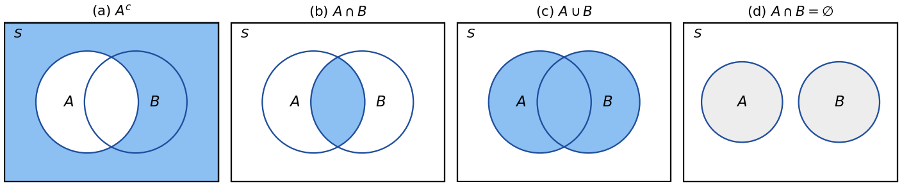
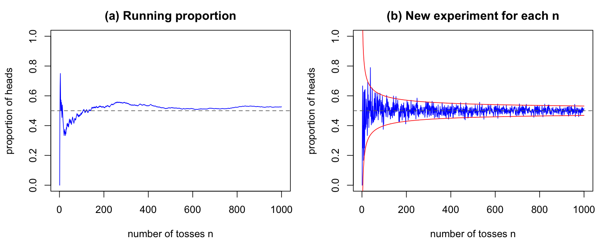
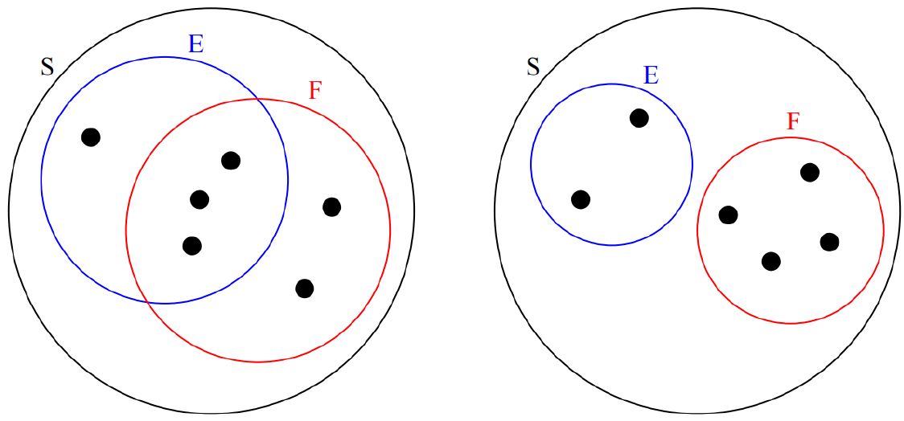
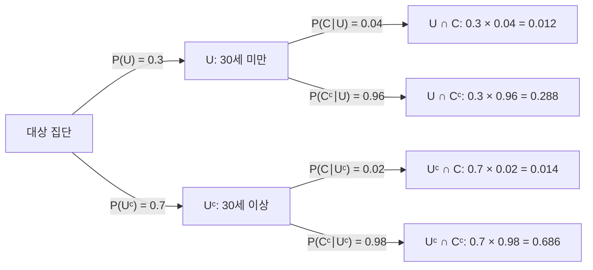
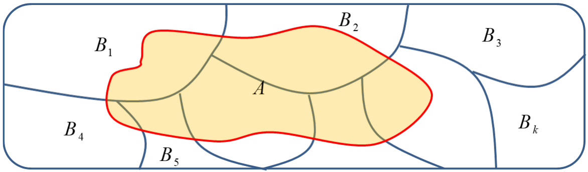

# 2강 — 확률론

[레포지토리 안내](../../README.ko.md) | [English](Concepts_Lecture.md) | [한국어](Concepts_Lecture.ko.md)

> **최종 수정일:** 2026-11-10

> **학습 목표:**
> 1. 표본공간과 사건을 정의하고, 여사건, 합사건, 곱사건을 집합 연산으로 나타낼 수 있다
> 2. 고전적 확률, 상대도수, 큰 수의 법칙의 관계를 설명할 수 있다
> 3. 확률의 공리로부터 여사건의 확률, 단조성, 덧셈 법칙 같은 기본 성질을 증명할 수 있다
> 4. 조건부 확률과 곱셈 법칙으로 확률을 계산하고, 두 사건과 여러 사건의 독립성을 판정할 수 있다
> 5. 전확률 공식과 베이즈 정리로 사후 확률을 계산하고, 사전 확률이 결과에 미치는 영향을 설명할 수 있다

---

## 목차

- [1. 표본공간과 사건](#1-표본공간과-사건)
  - [1.1 확률 실험과 표본공간](#11-확률-실험과-표본공간)
  - [1.2 사건](#12-사건)
  - [1.3 사건의 연산](#13-사건의-연산)
- [2. 확률의 정의](#2-확률의-정의)
  - [2.1 고전적 확률](#21-고전적-확률)
  - [2.2 상대도수와 큰 수의 법칙](#22-상대도수와-큰-수의-법칙)
  - [2.3 확률의 공리](#23-확률의-공리)
- [3. 확률의 기본 성질](#3-확률의-기본-성질)
  - [3.1 공사건과 여사건의 확률](#31-공사건과-여사건의-확률)
  - [3.2 단조성과 확률의 상한](#32-단조성과-확률의-상한)
  - [3.3 덧셈 법칙](#33-덧셈-법칙)
  - [3.4 세 사건의 덧셈 법칙과 Boole 부등식](#34-세-사건의-덧셈-법칙과-boole-부등식)
- [4. 조건부 확률](#4-조건부-확률)
  - [4.1 조건부 확률의 정의](#41-조건부-확률의-정의)
  - [4.2 곱셈 법칙](#42-곱셈-법칙)
- [5. 독립 사건](#5-독립-사건)
  - [5.1 두 사건의 독립](#51-두-사건의-독립)
  - [5.2 독립과 배반의 차이](#52-독립과-배반의-차이)
  - [5.3 여러 사건의 독립](#53-여러-사건의-독립)
  - [5.4 분할표에서의 독립성 판정](#54-분할표에서의-독립성-판정)
- [6. 전확률 공식](#6-전확률-공식)
  - [6.1 두 경우로 나누어 계산하기](#61-두-경우로-나누어-계산하기)
  - [6.2 분할과 일반형](#62-분할과-일반형)
- [7. 베이즈 정리](#7-베이즈-정리)
  - [7.1 조건의 방향 바꾸기](#71-조건의-방향-바꾸기)
  - [7.2 사전 확률, 가능도, 사후 확률](#72-사전-확률-가능도-사후-확률)
  - [7.3 예: 희귀 질환의 검사](#73-예-희귀-질환의-검사)
- [개념 적용](#개념-적용)
- [요약](#요약)
- [점검 문제](#점검-문제)
- [참고 문헌](#참고-문헌)

---

<br>

## 1. 표본공간과 사건

### 1.1 확률 실험과 표본공간

동전 던지기나 주사위 굴리기처럼, 같은 조건에서 반복할 수 있고 가능한 결과의 목록은 알지만 어떤 결과가 나올지는 미리 알 수 없는 실험을 **확률 실험(random experiment)** 이라 한다. 확률론은 확률 실험의 결과를 집합으로 나타내는 데서 시작한다.

> **용어 정의:** **표본공간(sample space)** 은 실험에서 나올 수 있는 모든 결과(outcome)의 집합이며, $S$로 나타낸다. $S$의 원소 하나하나를 결과 또는 **표본점(sample point)** 이라 한다.

**예 1 (동전 한 번).** 동전을 한 번 던지면 표본공간은 다음과 같다.

```math
S = \lbrace H, T\rbrace
```

여기서 $H$는 동전의 앞면이 위로 나온 결과(heads up), $T$는 뒷면이 위로 나온 결과(tails up)이다. **공정한 동전(fair coin)** 이면 $H$와 $T$가 나올 가능성이 같다. 즉 동전을 여러 번 던지면 결과의 약 50%가 $H$이다. 이때 $H$가 나올 **확률(probability)** 이 0.5(50%)라고 하며, $T$가 나올 확률도 0.5이다.

**예 2 (동전 세 번).** 동전을 세 번 던지고 결과를 나온 순서대로 기록하면 표본공간은 다음과 같다.

```math
S = \lbrace HHH, HHT, HTH, HTT, THH, THT, TTH, TTT\rbrace
```

$S$의 원소는 길이가 3인 벡터, 수열, 또는 **순서 있는 결과(ordered outcome)** 이다. 던질 때마다 결과가 2가지이므로 결과의 수는 $2 \times 2 \times 2 = 8$이다. 공정한 동전이면 8개의 결과가 모두 같은 가능성으로 나온다고 기대할 수 있으므로, 수열 $HTT$의 확률은 $1/8$이다. 앞면이 정확히 두 번 나오는 수열은 $HHT$, $HTH$, $THH$의 세 개이므로 그 확률은 다음과 같다.

```math
\frac{1}{8} + \frac{1}{8} + \frac{1}{8} = \frac{3}{8}
```

**예 3 (주사위 한 번).** 공정한 주사위를 한 번 굴리면 표본공간은 $S = \lbrace1, 2, 3, 4, 5, 6\rbrace$이고, 눈 $k$가 나올 확률은 $k = 1, 2, \ldots, 6$ 각각에 대해 $1/6$이다. 주사위를 1200번 굴리면 5가 약 $1200 \times \frac{1}{6} = 200$번 나올 것으로 기대한다. 짝수 눈이 나올 확률은 짝수 눈 2, 4, 6의 확률을 더한 값이다.

```math
\frac{1}{6} + \frac{1}{6} + \frac{1}{6} = \frac{1}{2}
```

> **주의:** 결과를 어떻게 기록하느냐에 따라 표본공간과 확률 계산이 달라진다. 동전 세 번의 결과를 순서 없이 앞면의 개수로만 기록하면 표본공간은 $\lbrace0, 1, 2, 3\rbrace$이지만, 이 네 결과는 같은 가능성이 아니다. 앞면 0개와 3개는 각각 $1/8$, 1개와 2개는 각각 $3/8$이다. 결과가 같은 가능성이라는 가정은 순서 있는 결과에서 성립한다.

### 1.2 사건

> **용어 정의:** 표본공간의 부분집합을 **사건(event)** 이라 한다.

주사위를 한 번 굴릴 때 표본공간은 $S = \lbrace1, 2, 3, 4, 5, 6\rbrace$이고, 부분집합 $E = \lbrace2, 4, 6\rbrace$(짝수 눈)은 사건의 한 예이다. 주사위를 한 번 굴려 2나 4나 6이 나오면 사건 $E$가 **일어났다(occurred)** 고 한다. 일반적으로 실험의 결과가 $E$의 원소이면 $E$가 일어난 것이다. 1.1절에서 계산했듯이 $E$가 일어날 확률은 다음과 같다.

```math
P(E) = \frac{1}{6} + \frac{1}{6} + \frac{1}{6} = \frac{1}{2}
```

결과 하나로 이루어진 사건 $\lbrace k\rbrace$를 **근원사건(elementary event)** 이라 한다. 표본공간 $S$ 자체도 사건이며 항상 일어나므로 **전사건(certain event)**, 공집합 $\emptyset$은 결코 일어나지 않으므로 **공사건(impossible event)** 이라 한다.

### 1.3 사건의 연산

사건은 표본공간 $S$의 부분집합, 즉 집합이므로 일반적인 집합 연산을 할 수 있다. 두 사건 $E$와 $F$로부터 다음 사건을 만든다.

| 기호 | 이름 | 뜻 (이 사건이 일어나는 경우) |
|:-----|:-----|:-----------------------------|
| $E^c$ | $E$의 여사건 (complement) | $E$가 일어나지 않을 때 |
| $E \cup F$ | $E$와 $F$의 합사건 (union) | $E$와 $F$ 가운데 적어도 하나가 일어날 때 |
| $E \cap F$ 또는 $EF$ | $E$와 $F$의 곱사건 (intersection) | $E$와 $F$가 함께 일어날 때 |
| $E \subset F$ | $E$가 $F$의 부분집합 (subset) | $E$가 일어나면 $F$도 반드시 일어날 때 |
| $E \cap F = \emptyset$ | $E$와 $F$는 서로 배반 (mutually exclusive, disjoint) | $E$와 $F$가 동시에 일어날 수 없을 때 |

*표 1. 사건의 연산과 관계*

확률론에서는 흔히 $\bar{E}$ 대신 $E^c$를, $E \cap F$ 대신 $EF$를, $E \subseteq F$ 대신 $E \subset F$를 쓴다. 따라서 $E \subset F$는 $E = F$인 경우도 포함한다. 다만 $EF$는 곱셈과 혼동하기 쉬우므로, 이하에서는 곱사건을 $E \cap F$로 쓴다.



*그림 1. 여사건, 곱사건, 합사건, 서로 배반인 두 사건의 벤 다이어그램*

그림 1의 사각형은 표본공간 $S$, 원은 사건을 나타내며, 색칠한 부분이 각 연산의 결과이다. (a)는 $A$ 밖의 모든 부분인 $A^c$, (b)는 두 원이 겹친 부분인 $A \cap B$, (c)는 두 원 전체인 $A \cup B$이고, (d)는 겹치는 부분이 없어 $A \cap B = \emptyset$인 경우이다.

주사위 한 번의 예에서 $E = \lbrace2, 4, 6\rbrace$(짝수), $F = \lbrace4, 5, 6\rbrace$(4 이상)이라 하면 다음과 같다.

```math
E^c = \lbrace1, 3, 5\rbrace, \qquad E \cup F = \lbrace2, 4, 5, 6\rbrace, \qquad E \cap F = \lbrace4, 6\rbrace
```

사건의 연산은 집합의 법칙을 따른다. 뒤의 증명에서 쓰는 두 법칙은 다음과 같다.

- **분배 법칙:** $E \cap (F \cup G) = (E \cap F) \cup (E \cap G)$, $`\ E \cup (F \cap G) = (E \cup F) \cap (E \cup G)`$
- **드모르간 법칙:** $(E \cup F)^c = E^c \cap F^c$, $`\ (E \cap F)^c = E^c \cup F^c`$

위의 예에서 $(E \cup F)^c = \lbrace1, 3\rbrace$이고 $E^c \cap F^c = \lbrace1, 3, 5\rbrace \cap \lbrace1, 2, 3\rbrace = \lbrace1, 3\rbrace$이므로 드모르간 법칙이 성립한다. 말로 하면, "$`E`$와 $F$ 가운데 적어도 하나가 일어난다"의 부정은 "$`E`$도 일어나지 않고 $F$도 일어나지 않는다"이다.

> **[이산수학]** 집합의 포함 관계, 합집합, 교집합, 여집합, 분배 법칙, 드모르간 법칙은 이산수학에서 다루는 집합론의 기본 내용이다. 확률론은 이 집합 연산 위에 각 집합의 크기를 재는 함수 $P$를 더한 것이라고 볼 수 있다.

---

<br>

## 2. 확률의 정의

### 2.1 고전적 확률

> **용어 정의:** 표본공간 $S$가 유한하고 모든 결과가 같은 가능성(equally likely)으로 나온다면, 사건 $E$의 **고전적 확률(classical probability)** 은 다음과 같다. 여기서 $\lvert E \rvert$는 $E$에 속한 결과의 개수이다.

```math
P(E) = \frac{\lvert E \rvert}{\lvert S \rvert}
```

예를 들어 동전을 던져 앞면이 나올 확률은 $\lvert \lbrace H\rbrace \rvert / \lvert \lbrace H, T\rbrace \rvert = 1/2$로 기대한다. 고전적 확률은 경우의 수를 세어 계산하므로 직관적이지만, 모든 결과가 같은 가능성이라는 조건이 필요하다. 1.1절의 주의 상자처럼 같은 가능성이 아닌 결과에 이 공식을 쓰면 틀린 답을 얻는다.

### 2.2 상대도수와 큰 수의 법칙

동전이 실제로 공정한지는 던져 보아야 알 수 있다. 실험을 $n$번 반복하여 사건 $E$가 $n_E$번 일어났을 때, 비율 $n_E / n$을 $E$의 **상대도수(relative frequency)** 라 하며, 상대도수로 확률을 정하는 것을 상대도수 확률이라 한다.

```math
f_n(E) = \frac{n_E}{n}
```

> **핵심:** **큰 수의 법칙(law of large numbers)** 에 따르면, 같은 조건에서 서로 독립으로(5절) 실험을 수없이 반복할수록 상대도수 $f_n(E)$는 사건의 확률 $P(E)$에 점점 가까워진다. 모든 결과가 같은 가능성인 실험이면 $P(E)$는 고전적 확률이므로, 공정한 동전의 앞면 비율은 1/2에 가까워진다.

엄밀하게는, 임의의 $\varepsilon > 0$에 대해 상대도수가 $P(E)$에서 $\varepsilon$보다 많이 벗어날 확률이 $n \to \infty$일 때 0으로 간다(약한 큰 수의 법칙) [1].

```math
\lim_{n \to \infty} P\left( \left\lvert f_n(E) - P(E) \right\rvert > \varepsilon \right) = 0
```



*그림 2. 공정한 동전을 던진 횟수에 따른 앞면의 누적 비율(a)과 횟수마다 새로 던진 실험의 앞면 비율(b)*

그림 2는 R로 공정한 동전을 던지는 시뮬레이션의 결과이다(연습 문제 2). (a)는 동전을 1000번 이어 던지면서 그때까지의 앞면 비율을 그린 것으로, 처음에는 0에서 0.75 사이를 크게 오가지만 던질수록 0.5 근처(점선)에 머문다. (b)는 $n = 1, 2, \ldots, 1000$마다 동전 $n$개를 새로 던져 앞면의 비율을 그린 것이다. 각 점은 독립된 실험이므로 들쭉날쭉하지만, 흩어진 폭이 $n$이 커질수록 좁아진다. 빨간 곡선은 $0.5 \pm 2 \times 0.5/\sqrt{n}$으로, 앞면 비율의 표준편차가 $0.5/\sqrt{n}$로 줄어들기 때문에 대부분의 점이 이 안에 들어온다(표준편차와 표본 비율의 분포는 3강과 6강에서 다룬다).

> **주의:** 큰 수의 법칙은 앞면이 여러 번 연속으로 나온 뒤에는 뒷면이 나올 확률이 커진다는 뜻이 아니다. 각 시행은 독립이므로 다음 시행의 확률은 언제나 1/2이다. 비율이 1/2에 가까워지는 것은 이미 나온 치우침이 뒷면으로 보상되기 때문이 아니라, 시행 횟수 $n$이 커질수록 같은 크기의 치우침이 비율에 미치는 영향이 작아지기 때문이다. 앞의 잘못된 믿음을 도박사의 오류(gambler's fallacy)라 한다.

### 2.3 확률의 공리

고전적 확률과 상대도수는 확률을 구하는 방법이지만, 모든 경우에 쓸 수 있는 정의는 아니다. 현대 확률론은 확률이 만족해야 할 성질을 **공리(axiom)** 로 정하고, 모든 성질을 공리에서 증명한다 [2].

> **용어 정의:** 표본공간 $S$의 각 사건 $E$에 실수 $P(E)$(사건 $E$의 확률)를 대응시키는 함수 $P$가 다음 세 공리를 만족하면, $P$를 **확률 함수(probability function)** 라 한다.
>
> - **공리 1:** 모든 사건 $E$에 대해 $P(E) \ge 0$이다.
> - **공리 2:** $P(S) = 1$이다.
> - **공리 3:** 서로 배반인 사건들 $E_1, E_2, \ldots$(즉 $i \ne j$이면 $`E_i \cap E_j = \emptyset`$)에 대해 다음이 성립한다.

```math
P\left( \bigcup_{i=1}^{\infty} E_i \right) = \sum_{i=1}^{\infty} P(E_i)
```

공리 3은 무한히 많은 사건에 대한 것이지만, 유한 개의 서로 배반인 사건 $E_1, \ldots, E_n$에 대해서도 같은 덧셈이 성립한다. 3.1절에서 보이는 $P(\emptyset) = 0$을 이용하여 $E_{n+1} = E_{n+2} = \cdots = \emptyset$으로 두면 다음을 얻는다.

```math
P(E_1 \cup E_2 \cup \cdots \cup E_n) = P(E_1) + P(E_2) + \cdots + P(E_n)
```

> **참고:** 확률의 공리를 $0 \le P(E) \le 1$, $P(S) = 1$, 유한 개의 서로 배반인 사건에 대한 덧셈의 세 가지로 소개하기도 한다. 표본공간이 유한하면 이 형태로 충분하다. 다만 $P(E) \le 1$은 공리로 둘 필요 없이 나머지 공리에서 증명되며(3.2절), 표본공간이 무한하면 유한 개에 대한 덧셈만으로는 부족하여 공리 3처럼 셀 수 있는 무한 개의 사건에 대한 덧셈이 필요하다. 또 실수 구간처럼 셀 수 없이 무한한 표본공간에서는 연속균등분포(5강)처럼 자연스러운 확률조차 모든 부분집합에 모순 없이 줄 수 없는 경우가 있으므로, 사건을 확률을 줄 수 있는 부분집합들의 모임(시그마 대수, $\sigma$-algebra)으로 제한한다. 이 과목에서 다루는 사건은 모두 이 조건을 만족한다고 보아도 된다.

2.1절의 고전적 확률은 세 공리를 만족한다. $\lvert E \rvert / \lvert S \rvert \ge 0$이고, $\lvert S \rvert / \lvert S \rvert = 1$이며, 서로 배반인 사건들의 합사건에 속한 결과의 개수는 각 사건의 결과의 개수의 합이기 때문이다.

---

<br>

## 3. 확률의 기본 성질

이 절의 성질은 모두 2.3절의 세 공리만으로 증명된다. $E$, $F$는 같은 표본공간 $S$의 사건이다.

### 3.1 공사건과 여사건의 확률

**성질 0.** $P(\emptyset) = 0$이다.

*증명.* $E_1 = S$, $E_2 = E_3 = \cdots = \emptyset$으로 두면 이 사건들은 서로 배반이고 합사건은 $S$이다. 공리 3에 따라 $P(S) = P(S) + \sum_{i=2}^{\infty} P(\emptyset)$이다. $P(S) = 1$은 유한한 값이므로 $\sum_{i=2}^{\infty} P(\emptyset) = 0$이어야 하고, 공리 1에 따라 각 항이 0 이상이므로 $P(\emptyset) = 0$이다. $\square$

**성질 1 (여사건의 확률).** 모든 사건 $E$에 대해 다음이 성립한다.

```math
P(E \cup E^c) = P(E) + P(E^c) = 1, \qquad \text{따라서} \qquad P(E^c) = 1 - P(E)
```

*증명.* $E$와 $E^c$는 공통 원소가 없으므로 서로 배반이고($`E \cap E^c = \emptyset`$), 둘을 합하면 표본공간 전체이다($`E \cup E^c = S`$). 공리 3(유한 형태)에 따라 $P(E \cup E^c) = P(E) + P(E^c)$이고, 공리 2에 따라 $P(E \cup E^c) = P(S) = 1$이다. 두 식에서 $P(E^c) = 1 - P(E)$를 얻는다. $\square$

여사건의 확률은 "적어도 하나"를 묻는 문제에서 특히 유용하다.

**예.** 동전을 네 번 던질 때 앞면이 적어도 한 번 나올 확률을 구한다. 순서 있는 결과로 기록하면 표본공간은 $HHHH, HHHT, HHTH, \ldots, TTTH, TTTT$의 $2^4 = 16$개 결과로 이루어지고, 공정한 동전이면 모두 같은 가능성이다. "앞면이 적어도 한 번"인 결과는 15개나 되어 하나하나 세기 번거롭지만, 그 여사건 "앞면이 한 번도 없음"은 $TTTT$ 하나뿐이다. 따라서 다음과 같다.

```math
P(\text{앞면이 적어도 한 번}) = 1 - P(\text{앞면이 한 번도 없음}) = 1 - \frac{1}{16} = \frac{15}{16}
```

### 3.2 단조성과 확률의 상한

**성질 (단조성).** $E \subset F$이면 $P(E) \le P(F)$이고, $P(F \cap E^c) = P(F) - P(E)$이다.

*증명.* $F$를 $E$에 속하는 부분과 속하지 않는 부분으로 나누면 $F = E \cup (F \cap E^c)$이다($E \subset F$이므로 $`F \cap E = E`$). 두 부분은 서로 배반이므로 공리 3에 따라 $P(F) = P(E) + P(F \cap E^c)$이다. 공리 1에 따라 $P(F \cap E^c) \ge 0$이므로 $P(F) \ge P(E)$이고, 식을 옮기면 $P(F \cap E^c) = P(F) - P(E)$이다. $\square$

모든 사건은 $E \subset S$이므로 단조성과 공리 2에서 $P(E) \le P(S) = 1$을 얻는다. 공리 1과 합치면 모든 사건에 대해 $0 \le P(E) \le 1$이다.

### 3.3 덧셈 법칙

**성질 2 (덧셈 법칙).** 모든 사건 $E$, $F$에 대해 다음이 성립한다.

```math
P(E \cup F) = P(E) + P(F) - P(E \cap F)
```

*증명 (공리 3 이용).* 합사건 $E \cup F$를 서로 배반인 세 부분으로 나눈다. $E$에만 속하는 부분 $E \cap F^c$, 둘 다에 속하는 부분 $E \cap F$, $F$에만 속하는 부분 $E^c \cap F$이다(그림 1의 (c)에서 왼쪽 초승달, 가운데, 오른쪽 초승달). 공리 3에 따라 다음이 성립한다.

```math
P(E \cup F) = P(E \cap F) + P(E \cap F^c) + P(E^c \cap F)
```

같은 방법으로 $E = (E \cap F) \cup (E \cap F^c)$, $F = (E \cap F) \cup (E^c \cap F)$이고 각각 서로 배반인 두 부분의 합이므로 다음이 성립한다.

```math
P(E) = P(E \cap F) + P(E \cap F^c), \qquad P(F) = P(E \cap F) + P(E^c \cap F)
```

첫 식의 우변에 $P(E \cap F)$를 더하고 빼서 묶은 뒤, 각 괄호를 위의 두 식으로 바꾼다.

```math
\begin{aligned}
P(E \cup F) &= \left[ P(E \cap F) + P(E \cap F^c) \right] + \left[ P(E \cap F) + P(E^c \cap F) \right] - P(E \cap F) \\
&= P(E) + P(F) - P(E \cap F) \qquad \square
\end{aligned}
```

$P(E) + P(F)$에는 두 사건이 겹치는 부분 $E \cap F$의 확률이 두 번 들어 있으므로 한 번 빼 주어야 한다는 것이 이 법칙의 뜻이다. 벤 다이어그램에 $E$와 $F$를 그려 보면 이를 확인할 수 있다. 이 식은 유한 집합의 원소 개수에 대한 다음 공식과 같은 꼴이며, 결과가 같은 가능성이면 양변을 $\lvert S \rvert$로 나누어 서로 옮겨 갈 수 있다.

```math
n(E \cup F) = n(E) + n(F) - n(E \cap F)
```

**예.** 주사위 한 번에서 $E = \lbrace2, 4, 6\rbrace$, $F = \lbrace4, 5, 6\rbrace$이면 $E \cap F = \lbrace4, 6\rbrace$이므로 다음과 같고, 이는 $E \cup F = \lbrace2, 4, 5, 6\rbrace$의 확률 $4/6$과 일치한다.

```math
P(E \cup F) = \frac{3}{6} + \frac{3}{6} - \frac{2}{6} = \frac{4}{6} = \frac{2}{3}
```

$E$와 $F$가 서로 배반이면 $P(E \cap F) = P(\emptyset) = 0$이므로 덧셈 법칙은 공리 3의 $P(E \cup F) = P(E) + P(F)$가 된다.

### 3.4 세 사건의 덧셈 법칙과 Boole 부등식

**성질 (세 사건의 덧셈 법칙).** 사건 $A$, $B$, $C$에 대해 다음이 성립한다.

```math
\begin{aligned}
P(A \cup B \cup C) = {} & P(A) + P(B) + P(C) \\
& - P(A \cap B) - P(A \cap C) - P(B \cap C) + P(A \cap B \cap C)
\end{aligned}
```

*증명.* $A \cup B$를 한 사건으로 보고 두 사건의 덧셈 법칙을 적용한다.

```math
P\big( (A \cup B) \cup C \big) = P(A \cup B) + P(C) - P\big( (A \cup B) \cap C \big)
```

분배 법칙에 따라 $(A \cup B) \cap C = (A \cap C) \cup (B \cap C)$이고, $(A \cap C) \cap (B \cap C) = A \cap B \cap C$이므로 덧셈 법칙을 한 번 더 적용하면 다음과 같다.

```math
P\big( (A \cup B) \cap C \big) = P(A \cap C) + P(B \cap C) - P(A \cap B \cap C)
```

$P(A \cup B) = P(A) + P(B) - P(A \cap B)$와 함께 첫 식에 대입하면 위의 공식을 얻는다. $\square$

한 번씩 더하고(사건 하나), 두 번 겹친 부분을 빼고(사건 둘), 세 번 겹친 부분을 다시 더하는 이 방법을 **포함 배제의 원리(inclusion-exclusion principle)** 라 하며, 사건이 $n$개일 때도 같은 방식으로 일반화된다.

**예.** 주사위 한 번에서 $A = \lbrace2, 4, 6\rbrace$, $B = \lbrace4, 5, 6\rbrace$, $C = \lbrace1, 2\rbrace$라 하자. $A \cap B = \lbrace4, 6\rbrace$, $A \cap C = \lbrace2\rbrace$, $B \cap C = \emptyset$, $A \cap B \cap C = \emptyset$이므로 다음과 같다.

```math
P(A \cup B \cup C) = \frac{3 + 3 + 2 - 2 - 1 - 0 + 0}{6} = \frac{5}{6}
```

실제로 $A \cup B \cup C = \lbrace1, 2, 4, 5, 6\rbrace$이므로 확률은 $5/6$으로 일치한다.

**성질 (Boole 부등식).** 사건 $E_1, \ldots, E_n$에 대해 다음이 성립한다.

```math
P(E_1 \cup E_2 \cup \cdots \cup E_n) \le P(E_1) + P(E_2) + \cdots + P(E_n)
```

*증명.* 두 사건이면 덧셈 법칙과 $P(E_1 \cap E_2) \ge 0$에서 $P(E_1 \cup E_2) \le P(E_1) + P(E_2)$이다. $E_1 \cup \cdots \cup E_{n-1}$을 한 사건으로 보고 이 부등식을 반복하여 적용하면(수학적 귀납법) $n$개에 대해서도 성립한다. $\square$

Boole 부등식은 여러 사건 가운데 적어도 하나가 일어날 확률의 상한을, 사건들이 어떻게 겹치는지 몰라도 각 사건의 확률만으로 준다.

---

<br>

## 4. 조건부 확률

### 4.1 조건부 확률의 정의

추가 정보가 주어지면 사건의 확률이 달라질 수 있다.

- 동전을 두 번 던질 때 두 번 모두 앞면이 나올 확률은 $1/4$이다.
- 동전을 두 번 던질 때, **첫 번째에 앞면이 나왔다는 것을 알고 있다면** 두 번 모두 앞면이 나올 확률은 $1/2$이다.

이처럼 어떤 사건이 일어났다는 정보 아래의 확률을 조건부 확률이라 한다. 조건부 확률은 중요하고 유용한 개념이다.

> **용어 정의:** $E$와 $F$가 표본공간 $S$의 사건이고 $P(F) > 0$일 때, **$F$가 주어졌을 때 $E$의 조건부 확률(conditional probability of $E$ given $`F`$)** 은 다음과 같이 정의한다. 같은 식을 곱의 꼴로 쓰면 $`P(E \cap F) = P(E \mid F)\, P(F)`$이다. $P(F) = 0$이면 $P(E \mid F)$는 이 식으로 정의되지 않는다.

```math
P(E \mid F) = \frac{P(E \cap F)}{P(F)}
```

$F$가 일어났다는 것을 알면, 가능한 결과는 $F$에 속한 결과로 좁혀진다. 조건부 확률은 이렇게 줄어든 표본공간 $F$ 안에서 $E$도 함께 일어나는 부분 $E \cap F$가 차지하는 비율이다. 결과가 같은 가능성이면 분자와 분모의 $\lvert S \rvert$가 약분되어 $P(E \mid F) = \lvert E \cap F \rvert / \lvert F \rvert$가 된다.



*그림 3. 같은 가능성인 결과 6개로 이루어진 표본공간에서 두 사건이 겹치는 경우(왼쪽)와 겹치지 않는 경우(오른쪽)*

그림 3에서 점 하나는 결과 하나이고, 표본공간 $S$의 6개 결과는 같은 가능성이다. 두 경우의 $P(E \mid F)$는 다음과 같다.

- **왼쪽:** $E$에는 점 4개, $F$에는 점 5개가 있고, 둘이 겹치는 $E \cap F$에는 점 3개가 있다. 따라서 $P(E \mid F) = \frac{3/6}{5/6} = \frac{3}{5}$이다. 아무 정보가 없을 때의 $P(E) = 4/6$과 다르다.
- **오른쪽:** $E$(점 2개)와 $F$(점 4개)가 겹치지 않으므로 $E \cap F = \emptyset$이고 $P(E \mid F) = \frac{0}{4/6} = 0$이다. $F$가 일어났다면 $E$는 일어날 수 없다.

**예.** 동전을 두 번 던지면 표본공간은 $S = \lbrace HH, HT, TH, TT\rbrace$이다. $E$를 두 번 모두 앞면인 사건, 즉 $E = \lbrace HH\rbrace$라 하고, $F$를 첫 번째에 앞면이 나오는 사건, 즉 $F = \lbrace HH, HT\rbrace$라 하자. $E \subset F$이므로 $E \cap F = \lbrace HH\rbrace = E$이고, 따라서 다음과 같다.

```math
P(E \mid F) = \frac{P(E \cap F)}{P(F)} = \frac{P(E)}{P(F)} = \frac{1/4}{2/4} = \frac{1}{2}
```

이것이 앞에서 직관으로 얻은 $1/2$이다.

> **참고:** $P(F) > 0$인 사건 $F$를 고정하면, $`P(\,\cdot \mid F)`$도 2.3절의 세 공리를 만족하는 확률 함수이다($P(E \mid F) \ge 0$, $P(S \mid F) = P(F)/P(F) = 1$, 서로 배반인 사건에 대한 덧셈). 따라서 3절의 성질이 조건부 확률에도 그대로 성립한다. 예를 들어 $P(E^c \mid F) = 1 - P(E \mid F)$이다.

> **주의:** 일반적으로 $P(E \mid F) \ne P(F \mid E)$이다. 위의 예에서 $P(E \mid F) = 1/2$이지만, 두 번 모두 앞면이 나왔다면 첫 번째도 반드시 앞면이므로 $P(F \mid E) = P(E \cap F)/P(E) = (1/4)/(1/4) = 1$이다. 조건의 방향을 바꾸어 계산하는 방법이 7절의 베이즈 정리이다.

### 4.2 곱셈 법칙

조건부 확률의 정의를 곱의 꼴로 쓰면, 두 사건이 함께 일어날 확률을 구하는 **곱셈 법칙(multiplication rule)** 이 된다. $P(A) > 0$이면 $P(B \mid A) = P(A \cap B)/P(A)$이므로 다음이 성립한다.

```math
P(A \cap B) = P(A)\, P(B \mid A)
```

$P(B) > 0$이면 같은 방법으로 $`P(A \cap B) = P(B)\, P(A \mid B)`$이다. 사건이 $n$개이면 곱셈 법칙을 거듭 적용한다. $P(A_1 \cap A_2 \cap \cdots \cap A_{n-1}) > 0$이면 다음이 성립한다.

```math
\begin{aligned}
P(A_1 \cap A_2 \cap \cdots \cap A_n) &= P(A_1)\, P(A_2 \cap A_3 \cap \cdots \cap A_n \mid A_1) \\
&= P(A_1)\, P(A_2 \mid A_1)\, P(A_3 \cap \cdots \cap A_n \mid A_1 \cap A_2) \\
&= P(A_1)\, P(A_2 \mid A_1)\, P(A_3 \mid A_1 \cap A_2)\, P(A_4 \cap \cdots \cap A_n \mid A_1 \cap A_2 \cap A_3) \\
&= \cdots \\
&= P(A_1)\, P(A_2 \mid A_1)\, P(A_3 \mid A_1 \cap A_2) \times \cdots \times P(A_n \mid A_1 \cap A_2 \cap \cdots \cap A_{n-1})
\end{aligned}
```

각 단계에서는 맨 앞의 사건 하나를 조건으로 옮긴다. 예를 들어 첫 줄은 두 사건 $A_1$과 $A_2 \cap \cdots \cap A_n$에 두 사건의 곱셈 법칙을 적용한 것이다. 조건 $P(A_1 \cap \cdots \cap A_{n-1}) > 0$이 필요한 이유는, $A_1 \supset A_1 \cap A_2 \supset \cdots \supset A_1 \cap \cdots \cap A_{n-1}$이므로 단조성(3.2절)에 따라 이 조건이 있으면 식에 나오는 모든 조건 사건의 확률이 양수가 되어 각 조건부 확률이 정의되기 때문이다.

**예.** 잘 섞은 카드 52장에서 한 장씩 3장을 뽑을 때(뽑은 카드는 되돌려 놓지 않는다) 세 장 모두 에이스일 확률을 구한다. $A_i$를 $i$번째 카드가 에이스인 사건이라 하면, 첫 장이 에이스일 확률은 $4/52$이고, 첫 장이 에이스였다면 남은 51장 가운데 에이스는 3장, 두 장이 에이스였다면 남은 50장 가운데 에이스는 2장이다.

```math
P(A_1 \cap A_2 \cap A_3) = \frac{4}{52} \times \frac{3}{51} \times \frac{2}{50} = \frac{24}{132600} = \frac{1}{5525} \approx 0.000181
```

---

<br>

## 5. 독립 사건

### 5.1 두 사건의 독립

> **용어 정의:** 두 사건 $E$와 $F$가 다음을 만족하면 $E$와 $F$는 **독립(independent)** 이라 한다. 독립이 아닌 두 사건은 **종속(dependent)** 이라 한다.

```math
P(E \cap F) = P(E)\, P(F)
```

$P(F) > 0$이면 이 조건은 $P(E \mid F) = P(E)$와 같다. 독립이면 다음이 성립하고, 거꾸로 $P(E \mid F) = P(E)$이면 양변에 $P(F)$를 곱하여 정의의 식을 얻기 때문이다.

```math
P(E \mid F) = \frac{P(E \cap F)}{P(F)} = \frac{P(E)\, P(F)}{P(F)} = P(E)
```

즉 독립이면 **$F$가 일어났다는 것을 알아도 $E$의 확률이 바뀌지 않는다.** 곱의 꼴로 쓴 정의는 $E$와 $F$에 대해 대칭이고 확률이 0인 사건에도 쓸 수 있다는 장점이 있다.

**예.** 동전을 두 번 던질 때 $E$를 첫 번째가 앞면인 사건 $\lbrace HH, HT\rbrace$, $F$를 두 번째가 앞면인 사건 $\lbrace HH, TH\rbrace$라 하면 $`P(E \cap F) = P(\lbrace HH\rbrace) = 1/4 = (1/2)(1/2) = P(E)\, P(F)`$이므로 $E$와 $F$는 독립이다.

**성질.** $E$와 $F$가 독립이면 $E$와 $F^c$도 독립이다. 같은 이유로 $E^c$와 $F$, $E^c$와 $F^c$도 독립이다.

*증명.* $E = (E \cap F) \cup (E \cap F^c)$이고 두 부분은 서로 배반이므로 $P(E \cap F^c) = P(E) - P(E \cap F)$이다. 독립성을 대입하면 $`P(E \cap F^c) = P(E) - P(E)\, P(F) = P(E)\,(1 - P(F)) = P(E)\, P(F^c)`$이다. $\square$

### 5.2 독립과 배반의 차이

독립과 배반은 다른 개념이며, 흔히 혼동된다. $P(E) > 0$이고 $P(F) > 0$인 두 사건이 서로 배반이면 $P(E \cap F) = 0$이지만 $`P(E)\, P(F) > 0`$이므로, 두 사건은 **독립이 아니다.** 서로 배반이면 $F$가 일어났다는 정보가 곧 $E$가 일어나지 않았다는 정보이므로, $F$에 대한 정보가 $E$의 확률을 $P(E)$에서 0으로 바꾼다. 그림 3의 오른쪽이 그 예로, $P(E) = 2/6 = 1/3$이지만 $P(E \mid F) = 0$이다.

### 5.3 여러 사건의 독립

> **용어 정의:** 사건 $A_1, A_2, \ldots, A_n$에서 서로 다른 사건을 2개 이상 고른 모든 모임 $A_{i_1}, \ldots, A_{i_k}$($`2 \le k \le n`$)에 대해 다음이 성립하면 $A_1, \ldots, A_n$은 **서로 독립(mutually independent)** 이라 한다.

```math
P(A_{i_1} \cap A_{i_2} \cap \cdots \cap A_{i_k}) = P(A_{i_1})\, P(A_{i_2}) \cdots P(A_{i_k})
```

사건이 서로 독립이면 특히 $k = n$인 경우로 다음 식이 성립한다.

```math
P(A_1 \cap A_2 \cap \cdots \cap A_n) = P(A_1)\, P(A_2)\, P(A_3) \cdots P(A_n)
```

세 사건 $A$, $B$, $C$이면 $P(A \cap B) = P(A)P(B)$, $P(A \cap C) = P(A)P(C)$, $P(B \cap C) = P(B)P(C)$, $P(A \cap B \cap C) = P(A)P(B)P(C)$의 네 식이 모두 성립해야 한다. 두 사건씩만 독립인 것(쌍마다 독립, pairwise independent)으로는 부족하다.

**예.** 공정한 동전을 두 번 던질 때 $A$를 첫 번째가 앞면인 사건 $\lbrace HH, HT\rbrace$, $B$를 두 번째가 앞면인 사건 $\lbrace HH, TH\rbrace$, $C$를 두 결과가 같은 사건 $\lbrace HH, TT\rbrace$라 하자. 세 사건의 확률은 모두 $1/2$이고, 어느 두 사건의 곱사건도 $\lbrace HH\rbrace$이므로 확률이 $1/4 = (1/2)(1/2)$이다. 따라서 세 사건은 쌍마다 독립이다. 그러나 $A \cap B \cap C = \lbrace HH\rbrace$이므로 다음과 같아서 서로 독립은 아니다 [1].

```math
P(A \cap B \cap C) = \frac{1}{4} \ne \frac{1}{8} = P(A)\, P(B)\, P(C)
```

$A$와 $B$가 함께 일어나면 $C$도 반드시 일어나므로, 두 사건에 대한 정보가 합쳐지면 세 번째 사건의 확률이 바뀐다.

> **주의:** 반대로 $k = n$인 식 하나만 성립해도 서로 독립이라고 할 수 없다. 서로 독립을 보이려면 2개 이상을 고른 모든 모임에 대해 곱의 식이 성립함을 확인해야 한다.

### 5.4 분할표에서의 독립성 판정

어느 확률과 통계 수업의 수강생 100명을 소속(컴퓨터 관련 학과 $A$, 그 밖의 학과 $`B`$)과 성별(남성 $M$, 여성 $`F`$)로 나누어 세면 다음과 같다. 이처럼 두 기준으로 나누어 센 표를 **분할표(contingency table)** 라 한다.

| 구분 | 남성 ($`M`$) | 여성 ($`F`$) | 합계 |
|:-----|:----------:|:----------:|:----:|
| 컴퓨터 관련 학과 ($`A`$) | 15 | 25 | 40 |
| 그 밖의 학과 ($`B`$) | 40 | 20 | 60 |
| 합계 | 55 | 45 | 100 |

*표 2. 수강생의 소속과 성별의 분할표*

수강생 한 명을 무작위로 뽑을 때 사건 $A$와 $F$가 독립인지 확인한다. 표에서 각 확률은 다음과 같다.

```math
P(A) = \frac{40}{100} = 0.40, \qquad P(F) = \frac{45}{100} = 0.45, \qquad P(A \cap F) = \frac{25}{100} = 0.25
```

```math
P(A)\, P(F) = 0.40 \times 0.45 = 0.18 \ne 0.25 = P(A \cap F)
```

따라서 $A$와 $F$는 독립이 아니다. 조건부 확률로 보면 그 뜻이 분명하다. 전체에서 컴퓨터 관련 학과의 비율은 $P(A) = 0.40$이지만, 여성 가운데서는 $P(A \mid F) = 25/45 \approx 0.556$, 남성 가운데서는 $P(A \mid M) = 15/55 \approx 0.273$이다. 성별을 알면 소속의 확률이 바뀐다.

> **참고:** 이 예는 이 100명을 모집단 전체로 보고 계산한 것이다. 더 큰 집단에서 뽑은 표본이면, 두 특성이 독립이라도 표본의 상대도수가 정확히 곱의 관계를 만족하는 일은 드물다. 관찰된 차이가 우연으로 설명되는 정도인지를 판단하는 방법은 7강의 범주형 자료 분석(카이제곱 검정)에서 다룬다.

---

<br>

## 6. 전확률 공식

### 6.1 두 경우로 나누어 계산하기

사건 $E$의 확률은 직접 구하기보다 **다른 사건 $F$를 조건으로 나누어** 구하는 편이 쉬울 때가 있다. 다음 두 단계를 거친다.

1. **$E$를 두 부분으로 나눈다.** $F \cup F^c = S$이므로 $E = E \cap S = E \cap (F \cup F^c)$이고, 분배 법칙에 따라 $E = (E \cap F) \cup (E \cap F^c)$이다. $F$와 $F^c$가 서로 배반이므로 두 부분 $E \cap F$와 $E \cap F^c$도 서로 배반이고, 공리 3에 따라 다음이 성립한다.

```math
P(E) = P\big( E \cap (F \cup F^c) \big) = P\big( (E \cap F) \cup (E \cap F^c) \big) = P(E \cap F) + P(E \cap F^c)
```

2. **각 부분에 곱셈 법칙을 쓴다.** $0 < P(F) < 1$이면 $`P(E \cap F) = P(E \mid F)\, P(F)`$이고 $`P(E \cap F^c) = P(E \mid F^c)\, P(F^c)`$이다.

두 결과를 합치면 다음 기본 공식을 얻는다.

```math
P(E) = P(E \mid F)\, P(F) + P(E \mid F^c)\, P(F^c)
```

이 식은 $P(E)$가 두 조건부 확률 $P(E \mid F)$와 $P(E \mid F^c)$를 각 경우의 확률 $P(F)$, $P(F^c)$로 가중 평균한 값임을 보여 준다.

**예 (보험 청구).** 한 보험회사의 자료에 따르면 1년 동안 보험금을 청구할 확률은 30세 미만인 사람이 4%, 30세 이상인 사람이 2%이고, 대상 집단의 30%가 30세 미만이다. 대상 집단에서 무작위로 고른 한 사람이 1년 동안 보험금을 청구할 확률을 구한다.

표본공간 $S$를 대상 집단의 모든 사람으로 두고, $C$를 보험금을 청구하는 사람의 사건, $U$를 30세 미만인 사람의 사건이라 하자. 그러면 $U^c$는 30세 이상인 사람의 사건이다. 주어진 값은 $P(C \mid U) = 0.04$, $P(C \mid U^c) = 0.02$, $P(U) = 0.3$이고, 여사건의 확률로 $P(U^c) = 1 - 0.3 = 0.7$이다.

```math
P(C) = P(C \mid U)\, P(U) + P(C \mid U^c)\, P(U^c) = \frac{4}{100} \cdot \frac{3}{10} + \frac{2}{100} \cdot \frac{7}{10} = \frac{12 + 14}{1000} = \frac{26}{1000} = 2.6\%
```

계산 과정은 다음 나무 그림(tree diagram)으로 나타낼 수 있다. 첫 갈래는 나이, 둘째 갈래는 청구 여부이며, 경로를 따라 확률을 곱하면 각 끝 사건의 확률이 되고, $C$로 끝나는 경로의 확률을 더하면 $P(C)$이다.



*그림 4. 나이와 보험금 청구 여부의 나무 그림*

$P(C) = 0.012 + 0.014 = 0.026$이고, 네 끝 사건의 확률을 모두 더하면 $0.012 + 0.288 + 0.014 + 0.686 = 1$이다.

### 6.2 분할과 일반형

조건을 두 경우($F$와 $`F^c`$)가 아니라 여러 경우로 나눌 수도 있다.

> **용어 정의:** 사건 $B_1, B_2, \ldots, B_k$가 서로 배반이고($i \ne j$이면 $`B_i \cap B_j = \emptyset`$) 합사건이 표본공간 전체이면($`B_1 \cup B_2 \cup \cdots \cup B_k = S`$), 이 사건들을 표본공간의 **분할(partition)** 이라 한다. 즉 실험의 결과는 반드시 $B_i$ 가운데 정확히 하나에 속한다.



*그림 5. 표본공간을 분할하는 사건 B1, ..., Bk와 그 위에 놓인 사건 A*

그림 5에서 둥근 사각형은 표본공간이고, 파란 경계선이 표본공간을 $B_1, B_2, \ldots, B_k$로 나눈다. 색칠한 영역이 사건 $A$이며, $A$는 경계선을 따라 조각 $B_1 \cap A$, $B_2 \cap A$, $\ldots$, $B_k \cap A$로 나뉜다.

> **핵심:** **전확률 공식(law of total probability).** $B_1, \ldots, B_k$가 표본공간의 분할이고 모든 $i$에 대해 $P(B_i) > 0$이면, 임의의 사건 $A$에 대해 다음이 성립한다.

```math
P(A) = \sum_{i=1}^{k} P(B_i \cap A) = \sum_{i=1}^{k} P(B_i)\, P(A \mid B_i)
```

*증명.* $B_i$들의 합사건이 $S$이므로 분배 법칙에 따라 다음이 성립한다.

```math
A = A \cap S = (B_1 \cap A) \cup (B_2 \cap A) \cup \cdots \cup (B_k \cap A)
```

$B_i$들이 서로 배반이므로 조각 $B_i \cap A$들도 서로 배반이고, 공리 3에 따라 $P(A) = P(B_1 \cap A) + P(B_2 \cap A) + \cdots + P(B_k \cap A)$이다. 각 항에 곱셈 법칙 $`P(B_i \cap A) = P(B_i)\, P(A \mid B_i)`$를 쓰면 두 번째 등식을 얻는다. $\square$

6.1절의 공식은 $k = 2$, $B_1 = F$, $B_2 = F^c$인 경우이다. 생산 라인이 네 개인 공장에서 불량률을 구하는 문제가 연습 문제 8에 있다. 전확률 공식은 다음 절의 베이즈 정리에서 분모를 계산하는 데 쓰인다.

---

<br>

## 7. 베이즈 정리

### 7.1 조건의 방향 바꾸기

곱셈 법칙에 따라 $E \cap F$의 확률은 두 가지로 쓸 수 있다.

```math
P(E \cap F) = P(E \mid F)\, P(F), \qquad P(E \cap F) = P(F \mid E)\, P(E)
```

$P(E) \ne 0$이면 둘째 식을 $P(F \mid E)$에 대해 풀고 첫째 식을 대입하여 다음을 얻는다.

```math
P(F \mid E) = \frac{P(E \cap F)}{P(E)} = \frac{P(E \mid F)\, P(F)}{P(E)}
```

분모 $P(E)$를 6.1절의 전확률 공식으로 바꾸면 다음 **베이즈 공식(Bayes' formula)** 이 된다. 이 공식은 $P(E \mid F)$로부터 반대 방향의 조건부 확률 $P(F \mid E)$를 구하는, 즉 **조건을 뒤집는(inverts conditioning)** 공식이다.

```math
P(F \mid E) = \frac{P(E \mid F)\, P(F)}{P(E \mid F)\, P(F) + P(E \mid F^c)\, P(F^c)}
```

> **핵심:** **베이즈 정리(Bayes' theorem).** $B_1, \ldots, B_k$가 표본공간의 분할이고 모든 $i$에 대해 $P(B_i) > 0$이며 $P(A) > 0$이면, 각 $j = 1, \ldots, k$에 대해 다음이 성립한다.

```math
P(B_j \mid A) = \frac{P(A \mid B_j)\, P(B_j)}{\sum_{i=1}^{k} P(A \mid B_i)\, P(B_i)}
```

분자는 $A$가 $B_j$를 거쳐 일어날 확률 $P(B_j \cap A)$이고, 분모는 모든 경로를 합한 $P(A)$이다. 따라서 $P(B_j \mid A)$는 $A$가 일어났을 때 그것이 $B_j$를 거쳐 일어났을 확률이며, $j$에 대해 모두 더하면 1이다.

**예 (보험 청구, 계속).** 보험금을 청구한 사람이 30세 미만일 확률을 구한다. 6.1절의 나무 그림에서 $P(U \cap C) = 0.012$, $P(C) = 0.026$이므로 다음과 같다.

```math
P(U \mid C) = \frac{P(C \mid U)\, P(U)}{P(C)} = \frac{0.04 \times 0.3}{0.026} = \frac{0.012}{0.026} = \frac{6}{13} \approx 0.4615
```

대상 집단에서 30세 미만은 30%이지만, 청구한 사람 가운데서는 약 46%이다. 30세 미만의 청구 확률(4%)이 30세 이상(2%)보다 높기 때문에, 청구라는 정보를 얻으면 30세 미만일 확률이 올라간다.

### 7.2 사전 확률, 가능도, 사후 확률

베이즈 정리는 어떤 사건에 대한 **사전 확률을 바탕으로, 새로운 데이터를 관찰한 뒤 사후 확률을 추론**하는 방법이다. 사건 $A$(가설)와 관찰한 데이터 $B$에 대해 베이즈 정리를 쓰면 다음과 같다.

```math
P(A \mid B) = \frac{P(B \mid A)\, P(A)}{P(B)}
```

| 항 | 이름 | 뜻 |
|:---|:-----|:---|
| $P(A)$ | 사전 확률 (prior) | $B$를 관찰하기 전에 $A$가 참일 확률. 이미 가진 지식이다 |
| $P(B \mid A)$ | 가능도 (likelihood) | $A$가 참일 때 $B$가 관찰될 확률 |
| $P(B)$ | 주변 확률 (marginal probability) | $B$가 관찰될 전체 확률. 전확률 공식으로 계산하며, 모든 가설에 대한 가능도를 사전 확률로 가중 평균한 값이다(marginalization) |
| $P(A \mid B)$ | 사후 확률 (posterior) | $B$를 관찰한 뒤 $A$가 참일 확률 |

*표 3. 베이즈 정리를 이루는 네 확률*

분모 $P(B)$는 가설 $A$와 무관한 상수이므로, 사후 확률은 가능도와 사전 확률의 곱에 비례한다. 같은 데이터를 보더라도 사전 확률이 다르면 사후 확률이 달라지며, 다음 예가 이 점을 보여 준다.

### 7.3 예: 희귀 질환의 검사

어떤 질병에 1000명 가운데 1명이 걸려 있다. 검사는 병에 걸린 사람의 99%에서 병을 찾아내지만(양성 판정), 건강한 사람의 5%에서도 병이 있다고 잘못 판정한다. 검사에서 양성이 나온 사람이 실제로 병에 걸렸을 확률은 얼마인가?

**1단계: 사건과 주어진 값.** $D$를 병에 걸린 사건, $H = D^c$를 건강한 사건, $+$를 검사 결과가 양성인 사건이라 하자. 주어진 값은 다음과 같다.

```math
P(D) = 0.001, \qquad P(+ \mid D) = 0.99, \qquad P(+ \mid H) = 0.05
```

$P(+ \mid D)$는 병에 걸린 상태에서 양성이 나올 확률로, 검사의 **민감도(sensitivity)** 라 한다. $P(+ \mid H)$는 건강한 상태에서 양성이 나올 확률로 **위양성률(false positive rate)** 이라 하며, $1 - P(+ \mid H) = 0.95$를 **특이도(specificity)** 라 한다. 여사건의 확률로 $P(H) = 1 - 0.001 = 0.999$이다.

**2단계: 전확률 공식으로 $P(+)$ 계산.**

```math
P(+) = P(+ \mid D)\, P(D) + P(+ \mid H)\, P(H) = 0.99 \times 0.001 + 0.05 \times 0.999 = 0.00099 + 0.04995 = 0.05094
```

**3단계: 베이즈 정리로 $P(D \mid +)$ 계산.** 양성일 때 병에 걸렸을 확률은 다음과 같다.

```math
P(D \mid +) = \frac{P(+ \mid D)\, P(D)}{P(+ \mid D)\, P(D) + P(+ \mid H)\, P(H)} = \frac{0.99 \times 0.001}{0.99 \times 0.001 + 0.05 \times 0.999} = \frac{0.00099}{0.05094} \approx 0.0194
```

양성 판정을 받았는데도 실제로 병에 걸렸을 확률은 약 1.94%에 불과하다. 이 결과가 직관과 다른 이유는 같은 계산을 사람 수로 바꾸어 보면 분명해진다. 10만 명을 검사한다고 하면 다음과 같다.

| 상태 | 양성 | 음성 | 합계 |
|:-----|-----:|-----:|-----:|
| 병에 걸림 ($`D`$) | 99 | 1 | 100 |
| 건강함 ($`H`$) | 4,995 | 94,905 | 99,900 |
| 합계 | 5,094 | 94,906 | 100,000 |

*표 4. 10만 명을 검사했을 때 기대되는 상태별 검사 결과의 인원수*

10만 명 가운데 병에 걸린 사람은 $100{,}000 \times 0.001 = 100$명이고 그중 $99$명이 양성이다. 건강한 사람은 $99{,}900$명이고 그중 5%인 $4{,}995$명이 양성이다. 양성 판정을 받은 $5{,}094$명 가운데 실제 환자는 $99$명뿐이므로 $`99/5{,}094 \approx 1.94\%`$이다.

검사의 민감도가 99%로 높아 보이지만, 애초에 이 병에 걸릴 확률(사전 확률)이 0.1%로 매우 낮다. 그래서 양성 판정을 받은 사람들 가운데에는 실제로 병에 걸린 소수의 사람보다, 병에 걸리지 않았지만 검사 오류로 양성 판정을 받은 다수의 건강한 사람이 훨씬 많다. 이 예는 직관과 실제 확률이 얼마나 다를 수 있는지, 그리고 사전 확률(기저율, base rate)을 고려하는 것이 얼마나 중요한지를 보여 준다. 사전 확률을 무시하고 $P(+ \mid D) = 0.99$를 $P(D \mid +)$로 착각하는 잘못을 기저율 무시(base-rate neglect)라 하며, 위의 표처럼 확률을 사람 수(자연 빈도)로 바꾸어 생각하면 이런 착각이 줄어든다고 알려져 있다 [3].

사후 확률은 새 데이터가 들어올 때마다 다음 계산의 사전 확률이 된다. 양성 판정을 받은 사람이 같은 검사를 다시 받아 또 양성이 나왔다고 하자. 두 검사의 결과가 병의 상태가 주어졌을 때 서로 독립이라고 가정하면, 사전 확률을 $0.0194$로 바꾸어 같은 계산을 한다.

```math
P(D \mid +, +) = \frac{0.99 \times 0.01943}{0.99 \times 0.01943 + 0.05 \times 0.98057} = \frac{0.01924}{0.01924 + 0.04903} \approx 0.2818
```

두 번 연속 양성이면 확률은 약 28%로 올라가고, 세 번 연속 양성이면 같은 계산으로 약 89%가 된다. 검사의 민감도, 특이도와 판정 오류의 종류는 6강의 혼동 행렬과 제1종 오류, 제2종 오류로 이어진다.

---

<br>

## 개념 적용

**T/F 점검:**

| 문장 | 판단과 근거 |
|:-----|:------------|
| 확률이 양수인 두 사건이 서로 배반이면 두 사건은 독립이다. | **F.** 배반이면 $P(E \cap F) = 0$이지만 $P(E)P(F) > 0$이므로 종속이다. |
| $P(E) \le 1$은 공리로 따로 두지 않아도 공리 1, 2, 3에서 증명된다. | **T.** $E \subset S$와 단조성에서 $P(E) \le P(S) = 1$이다. |
| $P(E \mid F)$와 $P(F \mid E)$는 항상 같다. | **F.** 분자는 같지만 분모가 $P(F)$와 $P(E)$로 다르다. 두 값은 베이즈 정리로 연결된다. |
| $E$와 $F$가 독립이면 $E$와 $F^c$도 독립이다. | **T.** $P(E \cap F^c) = P(E) - P(E)P(F) = P(E)P(F^c)$이다. |
| 세 사건이 쌍마다 독립이면 세 사건은 서로 독립이다. | **F.** 동전 두 번의 $A$, $B$, $C$처럼 쌍마다 독립이지만 $P(A \cap B \cap C) \ne P(A)P(B)P(C)$인 예가 있다. |
| 동전의 앞면이 10번 연속 나왔다면 큰 수의 법칙에 따라 다음에는 뒷면이 나올 확률이 1/2보다 크다. | **F.** 시행은 독립이므로 다음 확률은 1/2이다. 큰 수의 법칙은 비율의 수렴에 관한 것이다. |
| 민감도가 99%인 검사에서 양성이 나오면 병에 걸렸을 확률도 99%이다. | **F.** $P(D \mid +)$는 사전 확률과 위양성률에 따라 달라지며, 7.3절의 예에서는 약 1.94%이다. |

---

<br>

## 요약

| 개념 | 핵심 요약 |
|:-----|:----------|
| 표본공간과 사건 | 표본공간 $S$는 실험의 모든 가능한 결과의 집합이고, 사건은 $S$의 부분집합이다. 결과가 사건에 속하면 그 사건이 일어난 것이다. |
| 사건의 연산 | 여사건 $E^c$, 합사건 $E \cup F$, 곱사건 $E \cap F$($`EF`$)는 집합 연산이다. $E \cap F = \emptyset$이면 서로 배반이다. |
| 고전적 확률 | $S$가 유한하고 결과가 같은 가능성이면 $P(E) = \lvert E \rvert / \lvert S \rvert$이다. 같은 가능성이 아니면 쓸 수 없다. |
| 큰 수의 법칙 | 독립으로 반복할수록 상대도수 $n_E / n$이 $P(E)$에 가까워진다. 앞선 치우침이 보상된다는 뜻은 아니다. |
| 확률의 공리 | $P(E) \ge 0$, $P(S) = 1$, 서로 배반인 사건에 대해 $P(\bigcup E_i) = \sum P(E_i)$이다. 모든 성질은 이 공리에서 증명된다. |
| 기본 성질 | $P(\emptyset) = 0$, $P(E^c) = 1 - P(E)$, $E \subset F$이면 $P(E) \le P(F)$, $0 \le P(E) \le 1$이다. |
| 덧셈 법칙 | $P(E \cup F) = P(E) + P(F) - P(E \cap F)$이다. 세 사건은 포함 배제의 원리를 따르고, Boole 부등식은 합사건 확률의 상한을 준다. |
| 조건부 확률 | $P(F) > 0$일 때 $P(E \mid F) = P(E \cap F)/P(F)$이다. 표본공간을 $F$로 줄여 계산한 확률이며, 일반적으로 $P(F \mid E)$와 다르다. |
| 곱셈 법칙 | $P(A \cap B) = P(A)P(B \mid A)$이고, $n$개의 사건은 $P(A_1)P(A_2 \mid A_1) \cdots P(A_n \mid A_1 \cap \cdots \cap A_{n-1})$로 계산한다. |
| 독립 | $P(E \cap F) = P(E)P(F)$이면 독립이고, $P(F) > 0$이면 $P(E \mid F) = P(E)$와 같다. 확률이 양수인 두 배반 사건은 독립이 아니며, 여러 사건의 독립은 모든 부분 모임에 대해 곱의 식이 성립해야 한다. |
| 전확률 공식 | 분할 $B_1, \ldots, B_k$에 대해 $P(A) = \sum P(B_i)P(A \mid B_i)$이다. 조건부 확률의 가중 평균이다. |
| 베이즈 정리 | $P(B_j \mid A) = P(A \mid B_j)P(B_j) / \sum P(A \mid B_i)P(B_i)$이다. 사전 확률과 가능도로 사후 확률을 구하며, 사전 확률이 낮으면 정확한 검사의 양성 결과도 사후 확률이 낮을 수 있다. |

---

<br>

## 점검 문제

1. **표본공간:** 서로 구별되는 공정한 주사위 두 개를 던질 때 표본공간의 결과는 몇 개이며, 두 눈의 합이 7일 확률은 얼마인가?

   <details>
   <summary>정답</summary>

   결과는 순서쌍 $(i, j)$이고 각 주사위가 6가지이므로 $6 \times 6 = 36$개이며 모두 같은 가능성이다. 합이 7인 결과는 $(1,6), (2,5), (3,4), (4,3), (5,2), (6,1)$의 6개이므로 확률은 $6/36 = 1/6$이다.

   </details>

2. **여사건:** 공정한 주사위를 네 번 굴릴 때 6이 적어도 한 번 나올 확률을 구하라.

   <details>
   <summary>정답</summary>

   여사건은 네 번 모두 6이 아닌 경우이며, 그 결과의 수는 $5^4 = 625$이고 전체 결과의 수는 $6^4 = 1296$이다. 따라서 $1 - 625/1296 = 671/1296 \approx 0.5177$이다.

   </details>

3. **덧셈 법칙과 독립:** $P(A) = 0.5$, $P(B) = 0.4$, $P(A \cup B) = 0.7$일 때 $P(A \cap B)$를 구하고, $A$와 $B$가 독립인지 판정하라.

   <details>
   <summary>정답</summary>

   덧셈 법칙에서 $P(A \cap B) = P(A) + P(B) - P(A \cup B) = 0.5 + 0.4 - 0.7 = 0.2$이다. $P(A)P(B) = 0.5 \times 0.4 = 0.2$와 같으므로 $A$와 $B$는 독립이다.

   </details>

4. **조건부 확률:** 공정한 주사위를 한 번 굴려 짝수가 나왔다는 것을 알 때, 눈이 4 이상일 확률을 구하라.

   <details>
   <summary>정답</summary>

   $F = \lbrace2, 4, 6\rbrace$, $E = \lbrace4, 5, 6\rbrace$이면 $E \cap F = \lbrace4, 6\rbrace$이다. 결과가 같은 가능성이므로 $P(E \mid F) = \lvert E \cap F \rvert / \lvert F \rvert = 2/3$이다. 조건이 없을 때의 $P(E) = 1/2$보다 크다.

   </details>

5. **곱셈 법칙:** 빨간 공 3개와 파란 공 2개가 든 주머니에서 공을 되돌려 놓지 않고 2개를 차례로 꺼낼 때, 두 공이 모두 빨간색일 확률을 구하라.

   <details>
   <summary>정답</summary>

   $R_i$를 $i$번째 공이 빨간색인 사건이라 하면 $P(R_1) = 3/5$이고, 첫 공이 빨간색이면 남은 4개 가운데 빨간 공이 2개이므로 $P(R_2 \mid R_1) = 2/4$이다. 곱셈 법칙에 따라 $P(R_1 \cap R_2) = (3/5)(2/4) = 6/20 = 3/10$이다.

   </details>

6. **독립과 배반:** $P(A) = 0.3$, $P(B) = 0.4$이고 $A$와 $B$가 서로 배반일 때, $A$와 $B$는 독립인가?

   <details>
   <summary>정답</summary>

   독립이 아니다. 배반이므로 $P(A \cap B) = 0$이지만 $P(A)P(B) = 0.12 \ne 0$이다. $B$가 일어나면 $A$는 일어날 수 없으므로 $P(A \mid B) = 0 \ne 0.3 = P(A)$이다.

   </details>

7. **전확률 공식:** 상자 1에는 빨간 공 2개와 흰 공 3개, 상자 2에는 빨간 공 4개와 흰 공 1개가 있다. 동전을 던져 앞면이면 상자 1, 뒷면이면 상자 2를 고른 뒤 공 하나를 꺼낼 때, 빨간 공일 확률을 구하라.

   <details>
   <summary>정답</summary>

   상자 1을 고르는 사건 $B_1$과 상자 2를 고르는 사건 $B_2$는 분할이고 각각 확률이 $1/2$이다. $P(R \mid B_1) = 2/5$, $P(R \mid B_2) = 4/5$이므로 $P(R) = (1/2)(2/5) + (1/2)(4/5) = 1/5 + 2/5 = 3/5$이다.

   </details>

8. **베이즈 정리:** 7번 문제에서 꺼낸 공이 빨간색이었을 때, 그 공이 상자 1에서 나왔을 확률을 구하라.

   <details>
   <summary>정답</summary>

   $P(B_1 \mid R) = P(R \mid B_1)P(B_1)/P(R) = (2/5)(1/2)/(3/5) = (1/5)/(3/5) = 1/3$이다. 사전 확률 $1/2$보다 작아진 것은 상자 1의 빨간 공 비율이 상자 2보다 낮기 때문이다.

   </details>

9. **사전 확률의 영향:** 7.3절의 검사(민감도 0.99, 위양성률 0.05)를 유병률이 1%인 집단에 쓰면 양성일 때 병에 걸렸을 확률은 얼마인가?

   <details>
   <summary>정답</summary>

   $P(+) = 0.99 \times 0.01 + 0.05 \times 0.99 = 0.0099 + 0.0495 = 0.0594$이고, $P(D \mid +) = 0.0099/0.0594 = 1/6 \approx 0.167$이다. 유병률이 0.1%일 때의 약 1.94%보다 훨씬 크며, 같은 검사라도 사전 확률에 따라 사후 확률이 크게 달라진다.

   </details>

10. **여러 사건의 독립:** 세 사건 $A$, $B$, $C$가 서로 독립임을 보이려면 어떤 식들을 확인해야 하는가? $P(A \cap B \cap C) = P(A)P(B)P(C)$ 하나만으로 충분하지 않은 이유도 쓰라.

    <details>
    <summary>정답</summary>

    $P(A \cap B) = P(A)P(B)$, $P(A \cap C) = P(A)P(C)$, $P(B \cap C) = P(B)P(C)$, $P(A \cap B \cap C) = P(A)P(B)P(C)$의 네 식을 모두 확인해야 한다. 서로 독립은 2개 이상을 고른 모든 모임에 대한 곱의 식으로 정의되며, 세 사건에 대한 식 하나가 성립해도 두 사건에 대한 식이 성립하지 않는 경우가 있고, 반대로 쌍마다 독립이어도 세 사건에 대한 식이 성립하지 않는 경우(5.3절의 예)가 있다.

    </details>

---

<br>

## 참고 문헌

1. S. M. Ross, *A First Course in Probability*, 10th ed. Pearson, 2019.
2. A. N. Kolmogorov, *Grundbegriffe der Wahrscheinlichkeitsrechnung*. Berlin, Germany: Springer, 1933.
3. G. Gigerenzer and U. Hoffrage, "How to improve Bayesian reasoning without instruction: Frequency formats," *Psychological Review*, vol. 102, no. 4, pp. 684-704, 1995.
