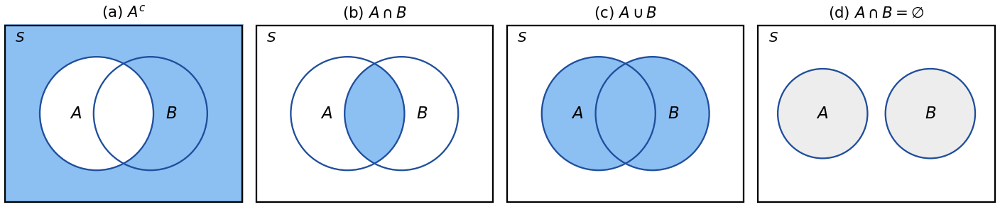
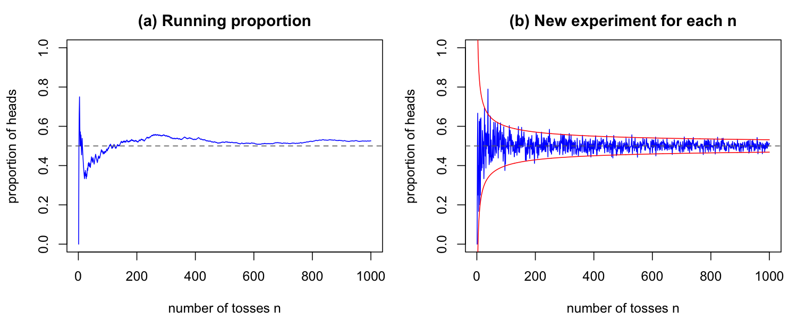
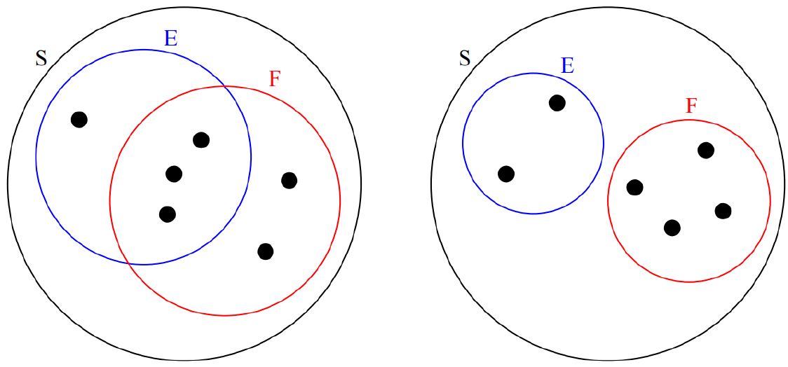
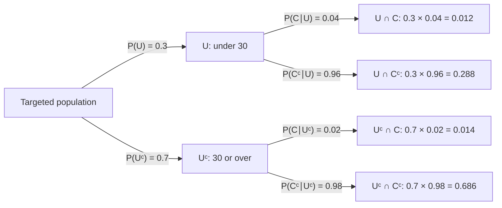
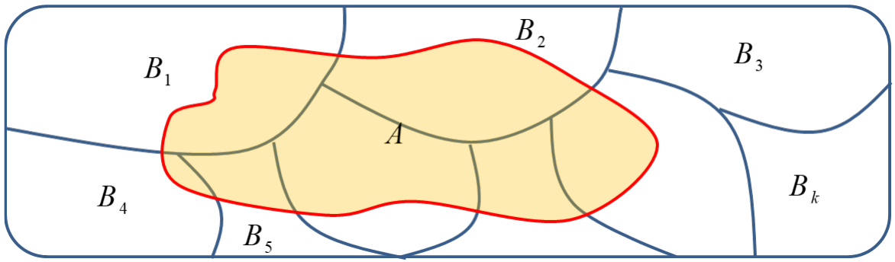

# Lecture 2 — Probability Theory

[Repository Guide](../../README.md) | [English](Concepts_Lecture.md) | [한국어](Concepts_Lecture.ko.md)

> **Last Updated:** 2026-11-04

> **Learning Objectives:**
> 1. Define sample spaces and events, and express complements, unions, and intersections of events as set operations
> 2. Explain the relationship among classical probability, relative frequency, and the law of large numbers
> 3. Prove basic properties such as the complement rule, monotonicity, and the addition rule from the axioms of probability
> 4. Compute probabilities with conditional probability and the multiplication rule, and decide whether two or more events are independent
> 5. Compute posterior probabilities with the law of total probability and Bayes' theorem, and explain how the prior probability affects the result

---

## Table of Contents

- [1. Sample Spaces and Events](#1-sample-spaces-and-events)
  - [1.1 Random Experiments and Sample Spaces](#11-random-experiments-and-sample-spaces)
  - [1.2 Events](#12-events)
  - [1.3 Operations on Events](#13-operations-on-events)
- [2. Defining Probability](#2-defining-probability)
  - [2.1 Classical Probability](#21-classical-probability)
  - [2.2 Relative Frequency and the Law of Large Numbers](#22-relative-frequency-and-the-law-of-large-numbers)
  - [2.3 Axioms of Probability](#23-axioms-of-probability)
- [3. Basic Properties of Probability](#3-basic-properties-of-probability)
  - [3.1 Probabilities of the Empty Event and the Complement](#31-probabilities-of-the-empty-event-and-the-complement)
  - [3.2 Monotonicity and the Upper Bound of Probability](#32-monotonicity-and-the-upper-bound-of-probability)
  - [3.3 The Addition Rule](#33-the-addition-rule)
  - [3.4 The Addition Rule for Three Events and Boole's Inequality](#34-the-addition-rule-for-three-events-and-booles-inequality)
- [4. Conditional Probability](#4-conditional-probability)
  - [4.1 Definition of Conditional Probability](#41-definition-of-conditional-probability)
  - [4.2 The Multiplication Rule](#42-the-multiplication-rule)
- [5. Independent Events](#5-independent-events)
  - [5.1 Independence of Two Events](#51-independence-of-two-events)
  - [5.2 Independence Versus Mutual Exclusivity](#52-independence-versus-mutual-exclusivity)
  - [5.3 Independence of Several Events](#53-independence-of-several-events)
  - [5.4 Checking Independence in a Contingency Table](#54-checking-independence-in-a-contingency-table)
- [6. The Law of Total Probability](#6-the-law-of-total-probability)
  - [6.1 Splitting into Two Cases](#61-splitting-into-two-cases)
  - [6.2 Partitions and the General Form](#62-partitions-and-the-general-form)
- [7. Bayes' Theorem](#7-bayes-theorem)
  - [7.1 Reversing the Direction of Conditioning](#71-reversing-the-direction-of-conditioning)
  - [7.2 Prior, Likelihood, and Posterior](#72-prior-likelihood-and-posterior)
  - [7.3 Example: Testing for a Rare Disease](#73-example-testing-for-a-rare-disease)
- [Concept Applications](#concept-applications)
- [Summary](#summary)
- [Self-Check Questions](#self-check-questions)
- [References](#references)

---

 

## 1. Sample Spaces and Events

### 1.1 Random Experiments and Sample Spaces

An experiment such as tossing a coin or rolling a die, which can be repeated under the same conditions and whose list of possible outcomes is known although the actual outcome cannot be predicted, is called a **random experiment**. Probability theory begins by representing the outcomes of a random experiment as a set.

> **Definition:** The **sample space** is the set of all possible outcomes of an experiment and is denoted by $S$. Each element of $S$ is called an outcome or a **sample point**.

**Example 1 (one coin toss).** When we flip a coin once, the sample space is as follows.

$$
S = \lbrace H, T\rbrace
$$

Here $H$ denotes that the coin lands heads up and $T$ that it lands tails up. For a **fair coin**, $H$ and $T$ have the same chance of occurring; that is, if we flip the coin many times, about 50% of the outcomes will be $H$. We then say that the **probability** of $H$ is 0.5 (50%), and the probability of $T$ is also 0.5.

**Example 2 (three coin tosses).** When we toss a coin three times and record the results in the order in which they occur, the sample space is as follows.

$$
S = \lbrace HHH, HHT, HTH, HTT, THH, THT, TTH, TTT\rbrace
$$

The elements of $S$ are vectors of length 3, sequences, or **ordered outcomes**. Each toss has 2 results, so the number of outcomes is $2 \times 2 \times 2 = 8$. For a fair coin we may expect each of the 8 outcomes to be equally likely, so the probability of the sequence $HTT$ is $1/8$. The sequences with exactly two heads are $HHT$, $HTH$, and $THH$, so their probability is as follows.

$$
\frac{1}{8} + \frac{1}{8} + \frac{1}{8} = \frac{3}{8}
$$

**Example 3 (one roll of a die).** When we roll a fair die once, the sample space is $S = \lbrace1, 2, 3, 4, 5, 6\rbrace$, and the probability that the die lands with $k$ up is $1/6$ for each $k = 1, 2, \ldots, 6$. When we roll it 1200 times, we expect a 5 about $1200 \times \frac{1}{6} = 200$ times. The probability that the die lands with an even number up is the sum of the probabilities of the even faces 2, 4, and 6.

$$
\frac{1}{6} + \frac{1}{6} + \frac{1}{6} = \frac{1}{2}
$$

> **Caution:** How the results are recorded determines the sample space and the probability calculation. If the results of three coin tosses are recorded without order, only as the number of heads, the sample space is $\lbrace0, 1, 2, 3\rbrace$, but these four outcomes are not equally likely. Zero and three heads each have probability $1/8$, while one and two heads each have probability $3/8$. The assumption of equally likely outcomes holds for the ordered outcomes.

### 1.2 Events

> **Definition:** In probability theory, subsets of the sample space are called **events**.

When a die is rolled once, the sample space is $S = \lbrace1, 2, 3, 4, 5, 6\rbrace$, and the subset $E = \lbrace2, 4, 6\rbrace$ (an even number) is an example of an event. If the die is rolled once and lands with a 2 or a 4 or a 6 up, we say that the event $E$ has **occurred**. In general, $E$ occurs when the outcome of the experiment is an element of $E$. As computed in Section 1.1, the probability that $E$ occurs is as follows.

$$
P(E) = \frac{1}{6} + \frac{1}{6} + \frac{1}{6} = \frac{1}{2}
$$

An event $\lbrace k\rbrace$ consisting of a single outcome is called an **elementary event**. The sample space $S$ itself is also an event and always occurs, so it is called the **certain event**, and the empty set $\emptyset$ never occurs, so it is called the **impossible event**.

### 1.3 Operations on Events

Since events are subsets of the sample space $S$, that is, sets, we can apply the usual set operations to them. From two events $E$ and $F$ we form the following events.

| Notation | Name | Meaning (when this event occurs) |
|:-----|:-----|:-----------------------------|
| $E^c$ | Complement of $E$ | When $E$ does not occur |
| $E \cup F$ | Union of $E$ and $F$ | When at least one of $E$ and $F$ occurs |
| $E \cap F$ or $EF$ | Intersection of $E$ and $F$ | When $E$ and $F$ occur together |
| $E \subset F$ | $E$ is a subset of $F$ | When the occurrence of $E$ implies the occurrence of $F$ |
| $E \cap F = \emptyset$ | $E$ and $F$ are mutually exclusive (disjoint) | When $E$ and $F$ cannot occur at the same time |

*Table 1. Operations on and relations between events*

Probability theory often uses $E^c$ instead of $\bar{E}$, $EF$ instead of $E \cap F$, and $E \subset F$ instead of $E \subseteq F$. So $E \subset F$ includes the case $E = F$. Since $EF$ is easily confused with multiplication, intersections are written as $E \cap F$ from here on.

*Figure 1. Venn diagrams of a complement, an intersection, a union, and two mutually exclusive events*

In Figure 1 the rectangle represents the sample space $S$, the circles represent events, and the shaded part is the result of each operation. Panel (a) is $A^c$, everything outside $A$; (b) is $A \cap B$, the overlap of the two circles; (c) is $A \cup B$, both circles in full; and (d) shows the case $A \cap B = \emptyset$, where the circles do not overlap.

In the example of one roll of a die, let $E = \lbrace2, 4, 6\rbrace$ (even) and $F = \lbrace4, 5, 6\rbrace$ (4 or more). Then:

$$
E^c = \lbrace1, 3, 5\rbrace, \qquad E \cup F = \lbrace2, 4, 5, 6\rbrace, \qquad E \cap F = \lbrace4, 6\rbrace
$$

Operations on events obey the laws of sets. The following two laws are used in the proofs later.

- **Distributive laws:** $E \cap (F \cup G) = (E \cap F) \cup (E \cap G)$, $\ E \cup (F \cap G) = (E \cup F) \cap (E \cup G)$
- **De Morgan's laws:** $(E \cup F)^c = E^c \cap F^c$, $\ (E \cap F)^c = E^c \cup F^c$

In the example above, $(E \cup F)^c = \lbrace1, 3\rbrace$ and $E^c \cap F^c = \lbrace1, 3, 5\rbrace \cap \lbrace1, 2, 3\rbrace = \lbrace1, 3\rbrace$, so De Morgan's law holds. In words, the negation of "at least one of $E$ and $F$ occurs" is "neither $E$ nor $F$ occurs".

> **[Discrete Mathematics]** Set inclusion, union, intersection, complement, the distributive laws, and De Morgan's laws are the basics of set theory covered in discrete mathematics. Probability theory can be viewed as these set operations plus a function $P$ that measures the size of each set.

---

 

## 2. Defining Probability

### 2.1 Classical Probability

> **Definition:** If the sample space $S$ is finite and all outcomes are equally likely, the **classical probability** of an event $E$ is as follows, where $\lvert E \rvert$ is the number of outcomes in $E$.

$$
P(E) = \frac{\lvert E \rvert}{\lvert S \rvert}
$$

For example, the probability of throwing a coin to get a head is expected to be $\lvert \lbrace H\rbrace \rvert / \lvert \lbrace H, T\rbrace \rvert = 1/2$. Classical probability is intuitive because it is computed by counting, but it requires that all outcomes be equally likely. Applying the formula to outcomes that are not equally likely, as in the caution box of Section 1.1, gives wrong answers.

### 2.2 Relative Frequency and the Law of Large Numbers

Whether a coin is actually fair can be known only by throwing it. If the experiment is repeated $n$ times and the event $E$ occurs $n_E$ times, the ratio $n_E / n$ is called the **relative frequency** of $E$, and determining a probability by this ratio is called the relative frequency approach to probability.

$$
f_n(E) = \frac{n_E}{n}
$$

> **Key Point:** By the **law of large numbers**, if the experiment is repeated countless times, independently (Section 5) and under the same conditions, the relative frequency $f_n(E)$ gradually approaches the probability $P(E)$ of the event. When all outcomes of the experiment are equally likely, $P(E)$ is the classical probability, so the proportion of heads of a fair coin approaches 1/2.

Precisely, for every $\varepsilon > 0$, the probability that the relative frequency deviates from $P(E)$ by more than $\varepsilon$ goes to 0 as $n \to \infty$ (the weak law of large numbers) [1].

$$
\lim_{n \to \infty} P\left( \left\lvert f_n(E) - P(E) \right\rvert > \varepsilon \right) = 0
$$

*Figure 2. Running proportion of heads (a) and proportion of heads in a new experiment for each number of tosses (b) for a fair coin*

Figure 2 shows the result of simulating a fair coin in R (Exercise 2). Panel (a) plots the proportion of heads so far while the coin is tossed 1000 times in a row; at first it swings widely between 0 and 0.75, but as the tosses accumulate it stays near 0.5 (the dashed line). Panel (b) plots, for each $n = 1, 2, \ldots, 1000$, the proportion of heads when $n$ coins are newly tossed. Each point is a separate experiment, so the plot is jagged, but the spread narrows as $n$ grows. The red curves are $0.5 \pm 2 \times 0.5/\sqrt{n}$; the standard deviation of the proportion of heads shrinks as $0.5/\sqrt{n}$, so most points fall inside them (standard deviations and the distribution of a sample proportion are covered in Lectures 3 and 6).

> **Caution:** The law of large numbers does not mean that tails becomes more likely after several heads in a row. The trials are independent, so the probability of the next trial is always 1/2. The proportion approaches 1/2 not because an earlier imbalance is compensated by tails, but because an imbalance of the same size affects the proportion less and less as the number of trials $n$ grows. The mistaken belief above is called the gambler's fallacy.

### 2.3 Axioms of Probability

Classical probability and relative frequency are ways of finding probabilities, but they are not definitions that work in every case. Modern probability theory states the properties a probability must satisfy as **axioms** and proves every other property from them [2].

> **Definition:** A function $P$ that assigns a real number $P(E)$ (the probability of $E$) to every event $E$ in a sample space $S$ is called a **probability function** if it satisfies the following three axioms.
>
> - **Axiom 1:** $P(E) \ge 0$ for every event $E$.
> - **Axiom 2:** $P(S) = 1$.
> - **Axiom 3:** For any mutually exclusive events $E_1, E_2, \ldots$ (that is, $E_i \cap E_j = \emptyset$ whenever $i \ne j$), the following holds.

$$
P\left( \bigcup_{i=1}^{\infty} E_i \right) = \sum_{i=1}^{\infty} P(E_i)
$$

Axiom 3 concerns infinitely many events, but the same addition holds for finitely many mutually exclusive events $E_1, \ldots, E_n$. Using $P(\emptyset) = 0$, shown in Section 3.1, and setting $E_{n+1} = E_{n+2} = \cdots = \emptyset$ gives the following.

$$
P(E_1 \cup E_2 \cup \cdots \cup E_n) = P(E_1) + P(E_2) + \cdots + P(E_n)
$$

> **Note:** The axioms of probability are sometimes introduced as the three statements $0 \le P(E) \le 1$, $P(S) = 1$, and addition for finitely many mutually exclusive events. This form suffices when the sample space is finite. However, $P(E) \le 1$ need not be an axiom because it can be proved from the others (Section 3.2), and when the sample space is infinite, addition for finitely many events is not enough; addition for countably infinitely many events, as in Axiom 3, is needed. Moreover, on an uncountably infinite sample space such as an interval of real numbers, even a natural probability such as the continuous uniform distribution (Lecture 5) cannot always be assigned consistently to every subset, so events are restricted to a collection of subsets that can be given probabilities (a sigma-algebra, $\sigma$-algebra). All events treated in this course can be taken to satisfy this condition.

The classical probability of Section 2.1 satisfies all three axioms, because $\lvert E \rvert / \lvert S \rvert \ge 0$, $\lvert S \rvert / \lvert S \rvert = 1$, and the number of outcomes in a union of mutually exclusive events is the sum of the numbers of outcomes in the events.

---

 

## 3. Basic Properties of Probability

All properties in this section are proved from the three axioms of Section 2.3 alone. $E$ and $F$ are events in the same sample space $S$.

### 3.1 Probabilities of the Empty Event and the Complement

**Property 0.** $P(\emptyset) = 0$.

*Proof.* Let $E_1 = S$ and $E_2 = E_3 = \cdots = \emptyset$. These events are mutually exclusive, and their union is $S$. By Axiom 3, $P(S) = P(S) + \sum_{i=2}^{\infty} P(\emptyset)$. Since $P(S) = 1$ is finite, $\sum_{i=2}^{\infty} P(\emptyset) = 0$, and since each term is nonnegative by Axiom 1, $P(\emptyset) = 0$. $\square$

**Property 1 (complement rule).** For every event $E$, the following holds.

$$
P(E \cup E^c) = P(E) + P(E^c) = 1, \qquad \text{thus} \qquad P(E^c) = 1 - P(E)
$$

*Proof.* $E$ and $E^c$ share no element, so they are mutually exclusive ($E \cap E^c = \emptyset$), and together they make up the whole sample space ($E \cup E^c = S$). By Axiom 3 (finite form), $P(E \cup E^c) = P(E) + P(E^c)$, and by Axiom 2, $P(E \cup E^c) = P(S) = 1$. The two equations give $P(E^c) = 1 - P(E)$. $\square$

The complement rule is especially useful for questions that ask about "at least one".

**Example.** Find the probability of at least one head in four tosses of a coin. Recorded as ordered outcomes, the sample space consists of the $2^4 = 16$ outcomes $HHHH, HHHT, HHTH, \ldots, TTTH, TTTT$, all equally likely for a fair coin. As many as 15 outcomes have at least one head, which is tedious to count one by one, but the complement, no head at all, is the single outcome $TTTT$. Therefore:

$$
P(\text{at least one H}) = 1 - P(\text{no H}) = 1 - \frac{1}{16} = \frac{15}{16}
$$

### 3.2 Monotonicity and the Upper Bound of Probability

**Property (monotonicity).** If $E \subset F$, then $P(E) \le P(F)$ and $P(F \cap E^c) = P(F) - P(E)$.

*Proof.* Splitting $F$ into the part inside $E$ and the part outside gives $F = E \cup (F \cap E^c)$ (since $E \subset F$, $F \cap E = E$). The two parts are mutually exclusive, so by Axiom 3, $P(F) = P(E) + P(F \cap E^c)$. By Axiom 1, $P(F \cap E^c) \ge 0$, so $P(F) \ge P(E)$, and rearranging gives $P(F \cap E^c) = P(F) - P(E)$. $\square$

Every event satisfies $E \subset S$, so monotonicity and Axiom 2 give $P(E) \le P(S) = 1$. Together with Axiom 1, $0 \le P(E) \le 1$ for every event.

### 3.3 The Addition Rule

**Property 2 (addition rule).** For all events $E$ and $F$, the following holds.

$$
P(E \cup F) = P(E) + P(F) - P(E \cap F)
$$

*Proof (using the third axiom).* Split the union $E \cup F$ into three mutually exclusive parts: the part only in $E$, $E \cap F^c$; the part in both, $E \cap F$; and the part only in $F$, $E^c \cap F$ (the left crescent, the middle, and the right crescent in panel (c) of Figure 1). By Axiom 3:

$$
P(E \cup F) = P(E \cap F) + P(E \cap F^c) + P(E^c \cap F)
$$

In the same way, $E = (E \cap F) \cup (E \cap F^c)$ and $F = (E \cap F) \cup (E^c \cap F)$, each a union of two mutually exclusive parts, so:

$$
P(E) = P(E \cap F) + P(E \cap F^c), \qquad P(F) = P(E \cap F) + P(E^c \cap F)
$$

Add and subtract $P(E \cap F)$ on the right-hand side of the first equation, group the terms, and replace each bracket using the two equations above.

$$
\begin{aligned}
P(E \cup F) &= \left[ P(E \cap F) + P(E \cap F^c) \right] + \left[ P(E \cap F) + P(E^c \cap F) \right] - P(E \cap F) \\
&= P(E) + P(F) - P(E \cap F) \qquad \square
\end{aligned}
$$

The rule says that $P(E) + P(F)$ contains the probability of the overlap $E \cap F$ twice, so it must be subtracted once. Drawing a Venn diagram with $E$ and $F$ makes this visible. The formula has the same form as the following formula for the number of elements of finite sets, and when outcomes are equally likely, dividing both sides by $\lvert S \rvert$ turns one into the other.

$$
n(E \cup F) = n(E) + n(F) - n(E \cap F)
$$

**Example.** For one roll of a die with $E = \lbrace2, 4, 6\rbrace$ and $F = \lbrace4, 5, 6\rbrace$, $E \cap F = \lbrace4, 6\rbrace$, so the following holds, which agrees with the probability $4/6$ of $E \cup F = \lbrace2, 4, 5, 6\rbrace$.

$$
P(E \cup F) = \frac{3}{6} + \frac{3}{6} - \frac{2}{6} = \frac{4}{6} = \frac{2}{3}
$$

If $E$ and $F$ are mutually exclusive, then $P(E \cap F) = P(\emptyset) = 0$, and the addition rule reduces to $P(E \cup F) = P(E) + P(F)$ of Axiom 3.

### 3.4 The Addition Rule for Three Events and Boole's Inequality

**Property (addition rule for three events).** For events $A$, $B$, and $C$, the following holds.

$$
\begin{aligned}
P(A \cup B \cup C) = {} & P(A) + P(B) + P(C) \\
& - P(A \cap B) - P(A \cap C) - P(B \cap C) + P(A \cap B \cap C)
\end{aligned}
$$

*Proof.* Treat $A \cup B$ as one event and apply the addition rule for two events.

$$
P\big( (A \cup B) \cup C \big) = P(A \cup B) + P(C) - P\big( (A \cup B) \cap C \big)
$$

By the distributive law, $(A \cup B) \cap C = (A \cap C) \cup (B \cap C)$, and $(A \cap C) \cap (B \cap C) = A \cap B \cap C$, so applying the addition rule once more gives the following.

$$
P\big( (A \cup B) \cap C \big) = P(A \cap C) + P(B \cap C) - P(A \cap B \cap C)
$$

Substituting this and $P(A \cup B) = P(A) + P(B) - P(A \cap B)$ into the first equation yields the formula above. $\square$

Adding each event once, subtracting the parts covered twice (pairs of events), and adding back the part covered three times is called the **inclusion-exclusion principle**, and it generalizes in the same way to $n$ events.

**Example.** For one roll of a die, let $A = \lbrace2, 4, 6\rbrace$, $B = \lbrace4, 5, 6\rbrace$, and $C = \lbrace1, 2\rbrace$. Since $A \cap B = \lbrace4, 6\rbrace$, $A \cap C = \lbrace2\rbrace$, $B \cap C = \emptyset$, and $A \cap B \cap C = \emptyset$:

$$
P(A \cup B \cup C) = \frac{3 + 3 + 2 - 2 - 1 - 0 + 0}{6} = \frac{5}{6}
$$

Indeed $A \cup B \cup C = \lbrace1, 2, 4, 5, 6\rbrace$, whose probability is $5/6$.

**Property (Boole's inequality).** For events $E_1, \ldots, E_n$, the following holds.

$$
P(E_1 \cup E_2 \cup \cdots \cup E_n) \le P(E_1) + P(E_2) + \cdots + P(E_n)
$$

*Proof.* For two events, the addition rule and $P(E_1 \cap E_2) \ge 0$ give $P(E_1 \cup E_2) \le P(E_1) + P(E_2)$. Treating $E_1 \cup \cdots \cup E_{n-1}$ as one event and applying this inequality repeatedly (mathematical induction) proves it for $n$ events. $\square$

Boole's inequality bounds the probability that at least one of several events occurs, using only the probability of each event and without knowing how the events overlap.

---

 

## 4. Conditional Probability

### 4.1 Definition of Conditional Probability

Giving more information can change the probability of an event.

- If a coin is tossed two times, the probability of two heads is $1/4$.
- If a coin is tossed two times, the probability of two heads, **given that the first toss gave heads**, is $1/2$.

A probability under the information that some event has occurred is called a conditional probability. Conditional probability is an important and useful concept.

> **Definition:** If $E$ and $F$ are events in a sample space $S$ and $P(F) > 0$, the **conditional probability of $E$ given $F$** is defined as follows. Written as a product, the same formula is $P(E \cap F) = P(E \mid F)\, P(F)$. If $P(F) = 0$, $P(E \mid F)$ is not defined by this formula.

$$
P(E \mid F) = \frac{P(E \cap F)}{P(F)}
$$

Once we know that $F$ has occurred, the possible outcomes narrow down to those in $F$. The conditional probability is the share of this reduced sample space $F$ taken up by $E \cap F$, the part where $E$ also occurs. When outcomes are equally likely, the factors $\lvert S \rvert$ in the numerator and denominator cancel, so $P(E \mid F) = \lvert E \cap F \rvert / \lvert F \rvert$.

*Figure 3. Two events that overlap (left) and do not overlap (right) in a sample space of six equally likely outcomes*

In Figure 3 each dot is one outcome, and the 6 outcomes in the sample space $S$ are equally likely. $P(E \mid F)$ in the two cases is as follows.

- **Left:** $E$ contains 4 dots, $F$ contains 5 dots, and their overlap $E \cap F$ contains 3 dots. Hence $P(E \mid F) = \frac{3/6}{5/6} = \frac{3}{5}$, which differs from $P(E) = 4/6$ without any information.
- **Right:** $E$ (2 dots) and $F$ (4 dots) do not overlap, so $E \cap F = \emptyset$ and $P(E \mid F) = \frac{0}{4/6} = 0$. If $F$ has occurred, $E$ cannot occur.

**Example.** If a coin is tossed two times, the sample space is $S = \lbrace HH, HT, TH, TT\rbrace$. Let $E$ be the event of two heads, $E = \lbrace HH\rbrace$, and let $F$ be the event that the first toss gives heads, $F = \lbrace HH, HT\rbrace$. Since $E \subset F$, $E \cap F = \lbrace HH\rbrace = E$, and therefore:

$$
P(E \mid F) = \frac{P(E \cap F)}{P(F)} = \frac{P(E)}{P(F)} = \frac{1/4}{2/4} = \frac{1}{2}
$$

This is the $1/2$ obtained intuitively above.

> **Note:** For a fixed event $F$ with $P(F) > 0$, $P(\,\cdot \mid F)$ is also a probability function that satisfies the three axioms of Section 2.3 ($P(E \mid F) \ge 0$, $P(S \mid F) = P(F)/P(F) = 1$, and addition for mutually exclusive events). Hence the properties of Section 3 hold for conditional probabilities as well; for example, $P(E^c \mid F) = 1 - P(E \mid F)$.

> **Caution:** In general, $P(E \mid F) \ne P(F \mid E)$. In the example above, $P(E \mid F) = 1/2$, but if both tosses gave heads, the first one certainly did, so $P(F \mid E) = P(E \cap F)/P(E) = (1/4)/(1/4) = 1$. The method for computing a conditional probability in the reverse direction is Bayes' theorem in Section 7.

### 4.2 The Multiplication Rule

Writing the definition of conditional probability as a product gives the **multiplication rule**, which computes the probability that two events occur at the same time. If $P(A) > 0$, then $P(B \mid A) = P(A \cap B)/P(A)$, so:

$$
P(A \cap B) = P(A)\, P(B \mid A)
$$

If $P(B) > 0$, likewise $P(A \cap B) = P(B)\, P(A \mid B)$. For $n$ events, the multiplication rule is applied repeatedly. If $P(A_1 \cap A_2 \cap \cdots \cap A_{n-1}) > 0$, the following holds.

$$
\begin{aligned}
P(A_1 \cap A_2 \cap \cdots \cap A_n) &= P(A_1)\, P(A_2 \cap A_3 \cap \cdots \cap A_n \mid A_1) \\
&= P(A_1)\, P(A_2 \mid A_1)\, P(A_3 \cap \cdots \cap A_n \mid A_1 \cap A_2) \\
&= P(A_1)\, P(A_2 \mid A_1)\, P(A_3 \mid A_1 \cap A_2)\, P(A_4 \cap \cdots \cap A_n \mid A_1 \cap A_2 \cap A_3) \\
&= \cdots \\
&= P(A_1)\, P(A_2 \mid A_1)\, P(A_3 \mid A_1 \cap A_2) \times \cdots \times P(A_n \mid A_1 \cap A_2 \cap \cdots \cap A_{n-1})
\end{aligned}
$$

Each step moves the leading event into the condition. For example, the first line applies the two-event multiplication rule to the events $A_1$ and $A_2 \cap \cdots \cap A_n$. The condition $P(A_1 \cap \cdots \cap A_{n-1}) > 0$ is needed because $A_1 \supset A_1 \cap A_2 \supset \cdots \supset A_1 \cap \cdots \cap A_{n-1}$; by monotonicity (Section 3.2), the condition makes every conditioning event in the formula have positive probability, so each conditional probability is defined.

**Example.** Find the probability that all three cards are aces when 3 cards are drawn one at a time from a well-shuffled deck of 52 (drawn cards are not returned). Let $A_i$ be the event that the $i$th card is an ace. The first card is an ace with probability $4/52$; if the first card was an ace, 3 aces remain among 51 cards; and if the first two were aces, 2 aces remain among 50 cards.

$$
P(A_1 \cap A_2 \cap A_3) = \frac{4}{52} \times \frac{3}{51} \times \frac{2}{50} = \frac{24}{132600} = \frac{1}{5525} \approx 0.000181
$$

---

 

## 5. Independent Events

### 5.1 Independence of Two Events

> **Definition:** Two events $E$ and $F$ are **independent** if they satisfy the following. Two events that are not independent are called **dependent**.

$$
P(E \cap F) = P(E)\, P(F)
$$

If $P(F) > 0$, this condition is equivalent to $P(E \mid F) = P(E)$: independence gives the following, and conversely, multiplying both sides of $P(E \mid F) = P(E)$ by $P(F)$ gives the defining equation.

$$
P(E \mid F) = \frac{P(E \cap F)}{P(F)} = \frac{P(E)\, P(F)}{P(F)} = P(E)
$$

In other words, under independence, **knowing that $F$ occurred does not change the probability of $E$.** The product form of the definition has the advantages of being symmetric in $E$ and $F$ and of applying to events with probability 0.

**Example.** For two coin tosses, let $E$ be the event that the first toss is heads, $\lbrace HH, HT\rbrace$, and $F$ the event that the second toss is heads, $\lbrace HH, TH\rbrace$. Then $P(E \cap F) = P(\lbrace HH\rbrace) = 1/4 = (1/2)(1/2) = P(E)\, P(F)$, so $E$ and $F$ are independent.

**Property.** If $E$ and $F$ are independent, then $E$ and $F^c$ are also independent. For the same reason, $E^c$ and $F$, and $E^c$ and $F^c$, are independent.

*Proof.* $E = (E \cap F) \cup (E \cap F^c)$ with the two parts mutually exclusive, so $P(E \cap F^c) = P(E) - P(E \cap F)$. Substituting independence gives $P(E \cap F^c) = P(E) - P(E)\, P(F) = P(E)\,(1 - P(F)) = P(E)\, P(F^c)$. $\square$

### 5.2 Independence Versus Mutual Exclusivity

Independence and mutual exclusivity are different concepts and are often confused. If two events with $P(E) > 0$ and $P(F) > 0$ are mutually exclusive, then $P(E \cap F) = 0$ while $P(E)\, P(F) > 0$, so the two events are **not independent.** When they are mutually exclusive, learning that $F$ occurred means learning that $E$ did not occur, so the information about $F$ changes the probability of $E$ from $P(E)$ to 0. The right panel of Figure 3 is an example: $P(E) = 2/6 = 1/3$, but $P(E \mid F) = 0$.

### 5.3 Independence of Several Events

> **Definition:** Events $A_1, A_2, \ldots, A_n$ are **mutually independent** if, for every subcollection $A_{i_1}, \ldots, A_{i_k}$ of two or more distinct events ($2 \le k \le n$), the following holds.

$$
P(A_{i_1} \cap A_{i_2} \cap \cdots \cap A_{i_k}) = P(A_{i_1})\, P(A_{i_2}) \cdots P(A_{i_k})
$$

If the events are mutually independent, in particular the case $k = n$ gives the following equation.

$$
P(A_1 \cap A_2 \cap \cdots \cap A_n) = P(A_1)\, P(A_2)\, P(A_3) \cdots P(A_n)
$$

For three events $A$, $B$, and $C$, all four equations $P(A \cap B) = P(A)P(B)$, $P(A \cap C) = P(A)P(C)$, $P(B \cap C) = P(B)P(C)$, and $P(A \cap B \cap C) = P(A)P(B)P(C)$ must hold. Independence of each pair (pairwise independence) is not enough.

**Example.** For two tosses of a fair coin, let $A$ be the event that the first toss is heads, $\lbrace HH, HT\rbrace$, $B$ the event that the second toss is heads, $\lbrace HH, TH\rbrace$, and $C$ the event that the two results agree, $\lbrace HH, TT\rbrace$. All three events have probability $1/2$, and the intersection of any two of them is $\lbrace HH\rbrace$, with probability $1/4 = (1/2)(1/2)$. The three events are therefore pairwise independent. But $A \cap B \cap C = \lbrace HH\rbrace$, so the following shows that they are not mutually independent [1].

$$
P(A \cap B \cap C) = \frac{1}{4} \ne \frac{1}{8} = P(A)\, P(B)\, P(C)
$$

If $A$ and $B$ both occur, $C$ certainly occurs, so information about two of the events combined changes the probability of the third.

> **Caution:** Conversely, the single equation for $k = n$ does not establish mutual independence either. To show mutual independence, the product equation must be checked for every subcollection of two or more events.

### 5.4 Checking Independence in a Contingency Table

The 100 students of a probability and statistics class, counted by department (a computer-related department $A$, other departments $B$) and gender (male $M$, female $F$), are as follows. A table of counts classified by two criteria like this is called a **contingency table**.

| Category | Male ($M$) | Female ($F$) | Total |
|:-----|:----------:|:----------:|:----:|
| Computer-related department ($A$) | 15 | 25 | 40 |
| Other departments ($B$) | 40 | 20 | 60 |
| Total | 55 | 45 | 100 |

*Table 2. Contingency table of the students' departments and genders*

Check whether the events $A$ and $F$ are independent when one student is chosen at random. From the table, the probabilities are as follows.

$$
P(A) = \frac{40}{100} = 0.40, \qquad P(F) = \frac{45}{100} = 0.45, \qquad P(A \cap F) = \frac{25}{100} = 0.25
$$

$$
P(A)\, P(F) = 0.40 \times 0.45 = 0.18 \ne 0.25 = P(A \cap F)
$$

Hence $A$ and $F$ are not independent. Conditional probabilities make the meaning clear. The share of computer-related departments is $P(A) = 0.40$ overall, but $P(A \mid F) = 25/45 \approx 0.556$ among the women and $P(A \mid M) = 15/55 \approx 0.273$ among the men. Knowing the gender changes the probability of the department.

> **Note:** This example treats these 100 students as the entire population. For a sample drawn from a larger population, the relative frequencies rarely satisfy the product relation exactly even when the two characteristics are independent. How to judge whether an observed difference is within what chance can explain is covered in the categorical data analysis (chi-square test) of Lecture 7.

---

 

## 6. The Law of Total Probability

### 6.1 Splitting into Two Cases

The probability of an event $E$ is sometimes computed more easily **if we condition $E$ on another event $F$** than directly. Two steps are involved.

1. **Split $E$ into two parts.** Since $F \cup F^c = S$, we have $E = E \cap S = E \cap (F \cup F^c)$, and by the distributive law $E = (E \cap F) \cup (E \cap F^c)$. $F$ and $F^c$ are mutually exclusive, so the two parts $E \cap F$ and $E \cap F^c$ are mutually exclusive too, and by Axiom 3:

$$
P(E) = P\big( E \cap (F \cup F^c) \big) = P\big( (E \cap F) \cup (E \cap F^c) \big) = P(E \cap F) + P(E \cap F^c)
$$

2. **Apply the multiplication rule to each part.** If $0 < P(F) < 1$, then $P(E \cap F) = P(E \mid F)\, P(F)$ and $P(E \cap F^c) = P(E \mid F^c)\, P(F^c)$.

Combining the two results gives the following basic formula.

$$
P(E) = P(E \mid F)\, P(F) + P(E \mid F^c)\, P(F^c)
$$

This formula shows that $P(E)$ is the average of the two conditional probabilities $P(E \mid F)$ and $P(E \mid F^c)$ weighted by the probabilities $P(F)$ and $P(F^c)$ of the cases.

**Example (insurance claims).** An insurance company has these data: the probability of an insurance claim in a period of one year is 4 percent for persons under age 30 and 2 percent for persons aged 30 or over, and 30 percent of the targeted population is under age 30. Find the probability of an insurance claim in a period of one year for a randomly chosen person from the targeted population.

Let the sample space $S$ be all persons under consideration, let $C$ be the event of persons filing a claim, and let $U$ be the event of persons under age 30. Then $U^c$ is the event of persons aged 30 or over. The given values are $P(C \mid U) = 0.04$, $P(C \mid U^c) = 0.02$, and $P(U) = 0.3$, and by the complement rule $P(U^c) = 1 - 0.3 = 0.7$.

$$
P(C) = P(C \mid U)\, P(U) + P(C \mid U^c)\, P(U^c) = \frac{4}{100} \cdot \frac{3}{10} + \frac{2}{100} \cdot \frac{7}{10} = \frac{12 + 14}{1000} = \frac{26}{1000} = 2.6\%
$$

The computation can be shown as the following tree diagram. The first branching is by age and the second by whether a claim is filed; multiplying the probabilities along a path gives the probability of the event at its end, and adding the probabilities of the paths that end in $C$ gives $P(C)$.

*Figure 4. Tree diagram of age and insurance claims*

$P(C) = 0.012 + 0.014 = 0.026$, and the probabilities of the four end events add up to $0.012 + 0.288 + 0.014 + 0.686 = 1$.

### 6.2 Partitions and the General Form

The condition can also be split into several cases instead of two ($F$ and $F^c$).

> **Definition:** Events $B_1, B_2, \ldots, B_k$ form a **partition** of the sample space if they are mutually exclusive ($B_i \cap B_j = \emptyset$ whenever $i \ne j$) and their union is the whole sample space ($B_1 \cup B_2 \cup \cdots \cup B_k = S$). That is, the outcome of the experiment always belongs to exactly one of the $B_i$.

*Figure 5. Events B1, ..., Bk partitioning the sample space and an event A lying across them*

In Figure 5 the rounded rectangle is the sample space, and the blue boundaries divide it into $B_1, B_2, \ldots, B_k$. The shaded region is the event $A$, which the boundaries cut into the pieces $B_1 \cap A$, $B_2 \cap A$, $\ldots$, $B_k \cap A$.

> **Key Point:** **Law of total probability.** If $B_1, \ldots, B_k$ form a partition of the sample space and $P(B_i) > 0$ for every $i$, then for any event $A$ the following holds.

$$
P(A) = \sum_{i=1}^{k} P(B_i \cap A) = \sum_{i=1}^{k} P(B_i)\, P(A \mid B_i)
$$

*Proof.* The union of the $B_i$ is $S$, so by the distributive law:

$$
A = A \cap S = (B_1 \cap A) \cup (B_2 \cap A) \cup \cdots \cup (B_k \cap A)
$$

The $B_i$ are mutually exclusive, so the pieces $B_i \cap A$ are mutually exclusive too, and by Axiom 3, $P(A) = P(B_1 \cap A) + P(B_2 \cap A) + \cdots + P(B_k \cap A)$. Applying the multiplication rule $P(B_i \cap A) = P(B_i)\, P(A \mid B_i)$ to each term gives the second equality. $\square$

The formula of Section 6.1 is the case $k = 2$, $B_1 = F$, $B_2 = F^c$. Exercise 8 finds the defect rate of a factory with four production lines. The law of total probability computes the denominator of Bayes' theorem in the next section.

---

 

## 7. Bayes' Theorem

### 7.1 Reversing the Direction of Conditioning

By the multiplication rule, the probability of $E \cap F$ can be written in two ways.

$$
P(E \cap F) = P(E \mid F)\, P(F), \qquad P(E \cap F) = P(F \mid E)\, P(E)
$$

If $P(E) \ne 0$, solving the second equation for $P(F \mid E)$ and substituting the first gives the following.

$$
P(F \mid E) = \frac{P(E \cap F)}{P(E)} = \frac{P(E \mid F)\, P(F)}{P(E)}
$$

Replacing the denominator $P(E)$ by the law of total probability of Section 6.1 gives the following **Bayes' formula**. This formula obtains the conditional probability in the opposite direction, $P(F \mid E)$, from $P(E \mid F)$; that is, it **inverts conditioning**.

$$
P(F \mid E) = \frac{P(E \mid F)\, P(F)}{P(E \mid F)\, P(F) + P(E \mid F^c)\, P(F^c)}
$$

> **Key Point:** **Bayes' theorem.** If $B_1, \ldots, B_k$ form a partition of the sample space, $P(B_i) > 0$ for every $i$, and $P(A) > 0$, then for each $j = 1, \ldots, k$ the following holds.

$$
P(B_j \mid A) = \frac{P(A \mid B_j)\, P(B_j)}{\sum_{i=1}^{k} P(A \mid B_i)\, P(B_i)}
$$

The numerator is the probability $P(B_j \cap A)$ that $A$ occurs by way of $B_j$, and the denominator is $P(A)$, the sum over all paths. Hence $P(B_j \mid A)$ is the probability that, given that $A$ occurred, it occurred by way of $B_j$, and these probabilities add up to 1 over $j$.

**Example (insurance claims, continued).** Find the probability that a person who filed a claim is under 30. From the tree diagram of Section 6.1, $P(U \cap C) = 0.012$ and $P(C) = 0.026$, so:

$$
P(U \mid C) = \frac{P(C \mid U)\, P(U)}{P(C)} = \frac{0.04 \times 0.3}{0.026} = \frac{0.012}{0.026} = \frac{6}{13} \approx 0.4615
$$

Persons under 30 make up 30% of the targeted population but about 46% of the claimants. Because the claim probability under 30 (4%) is higher than that at 30 or over (2%), learning that a claim was filed raises the probability of being under 30.

### 7.2 Prior, Likelihood, and Posterior

Bayes' theorem is a way to **infer the posterior probability after observing new data, based on the prior probability of an event**. For an event $A$ (a hypothesis) and observed data $B$, Bayes' theorem reads as follows.

$$
P(A \mid B) = \frac{P(B \mid A)\, P(A)}{P(B)}
$$

| Term | Name | Meaning |
|:---|:-----|:---|
| $P(A)$ | Prior | The probability that $A$ is true before $B$ is observed; the knowledge already held |
| $P(B \mid A)$ | Likelihood | The probability that $B$ is observed when $A$ is true |
| $P(B)$ | Marginal probability | The overall probability that $B$ is observed; computed by the law of total probability as the average of the likelihoods of all hypotheses weighted by their priors (marginalization) |
| $P(A \mid B)$ | Posterior | The probability that $A$ is true after $B$ is observed |

*Table 3. The four probabilities that make up Bayes' theorem*

The denominator $P(B)$ is a constant that does not depend on the hypothesis $A$, so the posterior is proportional to the product of the likelihood and the prior. Even with the same data, a different prior gives a different posterior, as the next example shows.

### 7.3 Example: Testing for a Rare Disease

Suppose 1 in 1000 persons has a certain disease. A test detects the disease (a positive result) in 99% of diseased persons, but it also wrongly reports the disease in 5% of healthy persons. With what probability does a positive test diagnose the disease?

**Step 1: events and given values.** Let $D$ be the event of being diseased, $H = D^c$ the event of being healthy, and $+$ the event that the test is positive. We are given the following.

$$
P(D) = 0.001, \qquad P(+ \mid D) = 0.99, \qquad P(+ \mid H) = 0.05
$$

$P(+ \mid D)$, the probability of a positive result in the diseased state, is called the **sensitivity** of the test. $P(+ \mid H)$, the probability of a positive result in the healthy state, is called the **false positive rate**, and $1 - P(+ \mid H) = 0.95$ is called the **specificity**. By the complement rule, $P(H) = 1 - 0.001 = 0.999$.

**Step 2: compute $P(+)$ by the law of total probability.**

$$
P(+) = P(+ \mid D)\, P(D) + P(+ \mid H)\, P(H) = 0.99 \times 0.001 + 0.05 \times 0.999 = 0.00099 + 0.04995 = 0.05094
$$

**Step 3: compute $P(D \mid +)$ by Bayes' theorem.** The probability of the disease given a positive result is as follows.

$$
P(D \mid +) = \frac{P(+ \mid D)\, P(D)}{P(+ \mid D)\, P(D) + P(+ \mid H)\, P(H)} = \frac{0.99 \times 0.001}{0.99 \times 0.001 + 0.05 \times 0.999} = \frac{0.00099}{0.05094} \approx 0.0194
$$

Despite a positive result, the probability of actually having the disease is only about 1.94%. Why this result defies intuition becomes clear when the same computation is redone in numbers of people. Suppose 100,000 people are tested.

| State | Positive | Negative | Total |
|:-----|-----:|-----:|-----:|
| Diseased ($D$) | 99 | 1 | 100 |
| Healthy ($H$) | 4,995 | 94,905 | 99,900 |
| Total | 5,094 | 94,906 | 100,000 |

*Table 4. Expected numbers of test results by state when 100,000 people are tested*

Of 100,000 people, $100{,}000 \times 0.001 = 100$ are diseased, and $99$ of them test positive. There are $99{,}900$ healthy people, and 5% of them, $4{,}995$, test positive. Of the $5{,}094$ people with a positive result, only $99$ actually have the disease, so the probability is $99/5{,}094 \approx 1.94\%$.

The sensitivity of 99% looks high, but the probability of having the disease in the first place (the prior) is very low, at 0.1%. As a result, the people with a positive result include far more healthy people who were misclassified by test errors than the few who actually have the disease. This example shows how far intuition can be from the actual probability and how important it is to take the prior probability (the base rate) into account. Ignoring the prior and mistaking $P(+ \mid D) = 0.99$ for $P(D \mid +)$ is called base-rate neglect, and thinking of probabilities as numbers of people (natural frequencies), as in the table above, is known to reduce this error [3].

A posterior becomes the prior of the next computation each time new data arrive. Suppose a person with a positive result takes the same test again and is positive again. Assuming that the two test results are independent given the disease state, the same computation is repeated with the prior replaced by $0.0194$.

$$
P(D \mid +, +) = \frac{0.99 \times 0.01943}{0.99 \times 0.01943 + 0.05 \times 0.98057} = \frac{0.01924}{0.01924 + 0.04903} \approx 0.2818
$$

After two positive results in a row the probability rises to about 28%, and after three in a row the same computation gives about 89%. The sensitivity and specificity of a test and the kinds of decision errors lead to the confusion matrix and type I and type II errors of Lecture 6.

---

 

## Concept Applications

**True/False Check:**

| Statement | Judgment and Reason |
|:-----|:------------|
| Two mutually exclusive events with positive probabilities are independent. | **F.** Mutual exclusivity gives $P(E \cap F) = 0$, but $P(E)P(F) > 0$, so they are dependent. |
| $P(E) \le 1$ can be proved from Axioms 1, 2, and 3 without being an axiom itself. | **T.** $E \subset S$ and monotonicity give $P(E) \le P(S) = 1$. |
| $P(E \mid F)$ and $P(F \mid E)$ are always equal. | **F.** The numerators are the same, but the denominators $P(F)$ and $P(E)$ differ. The two are related by Bayes' theorem. |
| If $E$ and $F$ are independent, then $E$ and $F^c$ are also independent. | **T.** $P(E \cap F^c) = P(E) - P(E)P(F) = P(E)P(F^c)$. |
| If three events are pairwise independent, they are mutually independent. | **F.** As with $A$, $B$, $C$ for two coin tosses, there are pairwise independent events with $P(A \cap B \cap C) \ne P(A)P(B)P(C)$. |
| After 10 heads in a row, the law of large numbers makes tails more likely than 1/2 on the next toss. | **F.** The trials are independent, so the next probability is 1/2. The law of large numbers concerns the convergence of the proportion. |
| If a test with 99% sensitivity is positive, the probability of the disease is also 99%. | **F.** $P(D \mid +)$ depends on the prior and the false positive rate; in the example of Section 7.3 it is about 1.94%. |

---

 

## Summary

| Concept | Key Summary |
|:-----|:----------|
| Sample space and events | The sample space $S$ is the set of all possible outcomes of an experiment, and an event is a subset of $S$. An event occurs when the outcome belongs to it. |
| Operations on events | The complement $E^c$, union $E \cup F$, and intersection $E \cap F$ ($EF$) are set operations. If $E \cap F = \emptyset$, the events are mutually exclusive. |
| Classical probability | If $S$ is finite and its outcomes are equally likely, $P(E) = \lvert E \rvert / \lvert S \rvert$. It cannot be used when the outcomes are not equally likely. |
| Law of large numbers | Under independent repetition, the relative frequency $n_E / n$ approaches $P(E)$. It does not mean that earlier imbalances are compensated. |
| Axioms of probability | $P(E) \ge 0$, $P(S) = 1$, and $P(\bigcup E_i) = \sum P(E_i)$ for mutually exclusive events. Every property is proved from these axioms. |
| Basic properties | $P(\emptyset) = 0$, $P(E^c) = 1 - P(E)$, $P(E) \le P(F)$ if $E \subset F$, and $0 \le P(E) \le 1$. |
| Addition rule | $P(E \cup F) = P(E) + P(F) - P(E \cap F)$. Three events follow the inclusion-exclusion principle, and Boole's inequality bounds the probability of a union. |
| Conditional probability | For $P(F) > 0$, $P(E \mid F) = P(E \cap F)/P(F)$. It is the probability computed in the sample space reduced to $F$ and in general differs from $P(F \mid E)$. |
| Multiplication rule | $P(A \cap B) = P(A)P(B \mid A)$, and $n$ events are computed as $P(A_1)P(A_2 \mid A_1) \cdots P(A_n \mid A_1 \cap \cdots \cap A_{n-1})$. |
| Independence | Events are independent if $P(E \cap F) = P(E)P(F)$, which for $P(F) > 0$ is equivalent to $P(E \mid F) = P(E)$. Mutually exclusive events with positive probabilities are not independent, and mutual independence of several events requires the product equation for every subcollection. |
| Law of total probability | For a partition $B_1, \ldots, B_k$, $P(A) = \sum P(B_i)P(A \mid B_i)$, a weighted average of conditional probabilities. |
| Bayes' theorem | $P(B_j \mid A) = P(A \mid B_j)P(B_j) / \sum P(A \mid B_i)P(B_i)$. It finds the posterior from the prior and the likelihood; with a low prior, even a positive result of an accurate test can have a low posterior. |

---

 

## Self-Check Questions

1. **Sample space:** When two distinguishable fair dice are thrown, how many outcomes does the sample space have, and what is the probability that the sum of the two faces is 7?

   

   
Answer

   The outcomes are ordered pairs $(i, j)$, and each die has 6 faces, so there are $6 \times 6 = 36$ equally likely outcomes. The outcomes with sum 7 are the 6 pairs $(1,6), (2,5), (3,4), (4,3), (5,2), (6,1)$, so the probability is $6/36 = 1/6$.

   

2. **Complement:** Find the probability that a 6 appears at least once in four rolls of a fair die.

   

   
Answer

   The complement is that none of the four rolls is a 6; it has $5^4 = 625$ outcomes out of $6^4 = 1296$. Hence the probability is $1 - 625/1296 = 671/1296 \approx 0.5177$.

   

3. **Addition rule and independence:** Given $P(A) = 0.5$, $P(B) = 0.4$, and $P(A \cup B) = 0.7$, find $P(A \cap B)$ and decide whether $A$ and $B$ are independent.

   

   
Answer

   By the addition rule, $P(A \cap B) = P(A) + P(B) - P(A \cup B) = 0.5 + 0.4 - 0.7 = 0.2$. This equals $P(A)P(B) = 0.5 \times 0.4 = 0.2$, so $A$ and $B$ are independent.

   

4. **Conditional probability:** A fair die is rolled once, and it is known that the result is even. Find the probability that the result is 4 or more.

   

   
Answer

   With $F = \lbrace2, 4, 6\rbrace$ and $E = \lbrace4, 5, 6\rbrace$, $E \cap F = \lbrace4, 6\rbrace$. The outcomes are equally likely, so $P(E \mid F) = \lvert E \cap F \rvert / \lvert F \rvert = 2/3$. This is larger than the unconditional $P(E) = 1/2$.

   

5. **Multiplication rule:** Two balls are drawn one after another without replacement from a bag with 3 red balls and 2 blue balls. Find the probability that both are red.

   

   
Answer

   Let $R_i$ be the event that the $i$th ball is red. $P(R_1) = 3/5$, and if the first ball is red, 2 of the remaining 4 balls are red, so $P(R_2 \mid R_1) = 2/4$. By the multiplication rule, $P(R_1 \cap R_2) = (3/5)(2/4) = 6/20 = 3/10$.

   

6. **Independence and mutual exclusivity:** If $P(A) = 0.3$, $P(B) = 0.4$, and $A$ and $B$ are mutually exclusive, are $A$ and $B$ independent?

   

   
Answer

   No. Mutual exclusivity gives $P(A \cap B) = 0$, but $P(A)P(B) = 0.12 \ne 0$. If $B$ occurs, $A$ cannot occur, so $P(A \mid B) = 0 \ne 0.3 = P(A)$.

   

7. **Law of total probability:** Box 1 contains 2 red and 3 white balls, and box 2 contains 4 red and 1 white ball. A coin is tossed; box 1 is chosen on heads and box 2 on tails, and one ball is drawn. Find the probability that it is red.

   

   
Answer

   The events $B_1$ (box 1 chosen) and $B_2$ (box 2 chosen) form a partition, each with probability $1/2$. Since $P(R \mid B_1) = 2/5$ and $P(R \mid B_2) = 4/5$, $P(R) = (1/2)(2/5) + (1/2)(4/5) = 1/5 + 2/5 = 3/5$.

   

8. **Bayes' theorem:** In Question 7, given that the ball drawn is red, find the probability that it came from box 1.

   

   
Answer

   $P(B_1 \mid R) = P(R \mid B_1)P(B_1)/P(R) = (2/5)(1/2)/(3/5) = (1/5)/(3/5) = 1/3$. It is smaller than the prior $1/2$ because box 1 has a lower proportion of red balls than box 2.

   

9. **Effect of the prior:** If the test of Section 7.3 (sensitivity 0.99, false positive rate 0.05) is used in a population with a prevalence of 1%, what is the probability of the disease given a positive result?

   

   
Answer

   $P(+) = 0.99 \times 0.01 + 0.05 \times 0.99 = 0.0099 + 0.0495 = 0.0594$, and $P(D \mid +) = 0.0099/0.0594 = 1/6 \approx 0.167$. This is much larger than about 1.94% at a prevalence of 0.1%; the same test gives very different posteriors depending on the prior.

   

10. **Independence of several events:** Which equations must be checked to show that three events $A$, $B$, and $C$ are mutually independent? Also explain why $P(A \cap B \cap C) = P(A)P(B)P(C)$ alone is not enough.

    

    
Answer

    All four equations $P(A \cap B) = P(A)P(B)$, $P(A \cap C) = P(A)P(C)$, $P(B \cap C) = P(B)P(C)$, and $P(A \cap B \cap C) = P(A)P(B)P(C)$ must be checked. Mutual independence is defined by the product equations for every subcollection of two or more events; the equation for all three can hold while an equation for a pair fails, and conversely, events can be pairwise independent while the equation for all three fails (the example of Section 5.3).

    

---

 

## References

1. S. M. Ross, *A First Course in Probability*, 10th ed. Pearson, 2019.
2. A. N. Kolmogorov, *Grundbegriffe der Wahrscheinlichkeitsrechnung*. Berlin, Germany: Springer, 1933.
3. G. Gigerenzer and U. Hoffrage, "How to improve Bayesian reasoning without instruction: Frequency formats," *Psychological Review*, vol. 102, no. 4, pp. 684-704, 1995.
