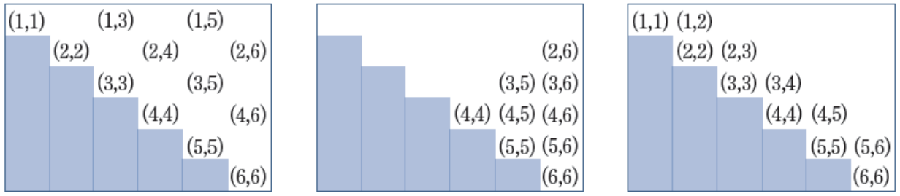
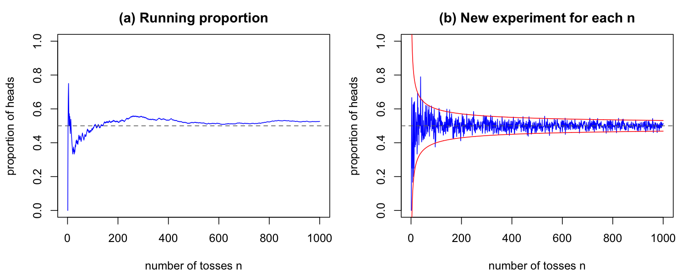
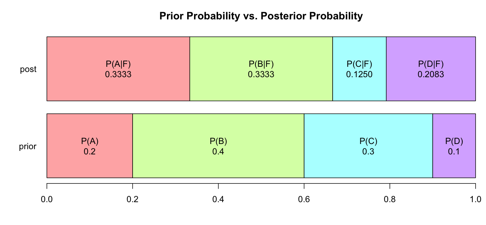

# 2강 연습 문제 풀이 — 확률론

[레포지토리 안내](../../README.ko.md) | [English](Solutions.md) | [한국어](Solutions.ko.md)

> **최종 수정일:** 2026-11-04

---

<br>

## 목차

- [연습 문제 1: 두 주사위의 세 사건](#연습-문제-1-두-주사위의-세-사건)
- [연습 문제 2: 큰 수의 법칙 시뮬레이션](#연습-문제-2-큰-수의-법칙-시뮬레이션)
- [연습 문제 3: 동전 네 번 던지기](#연습-문제-3-동전-네-번-던지기)
- [연습 문제 4: 네 주사위의 세 사건](#연습-문제-4-네-주사위의-세-사건)
- [연습 문제 5: 합사건의 확률](#연습-문제-5-합사건의-확률)
- [연습 문제 6: 조건부 확률](#연습-문제-6-조건부-확률)
- [연습 문제 7: 다섯 주사위와 독립성](#연습-문제-7-다섯-주사위와-독립성)
- [연습 문제 8: 생산 라인의 불량률](#연습-문제-8-생산-라인의-불량률)
- [연습 문제 9: 불량품이 나온 생산 라인](#연습-문제-9-불량품이-나온-생산-라인)

---

<br>

## 연습 문제 1: 두 주사위의 세 사건

**문제:** 두 주사위를 동시에 던지고 결과를 $(i, j)$($i \le j$)로 기록할 때, 합이 짝수인 사건 $A$, 합이 8 이상인 사건 $B$, 차이가 1 이하인 사건 $C$와 그 곱사건, 여사건의 원소를 R로 구하라. 문제 전체는 [연습 문제 1](Exercises.ko.md#연습-문제-1-두-주사위의-세-사건)에 있다.

### 풀이

**접근 방법:** `expand.grid()`는 주어진 벡터들의 모든 조합을 행으로 갖는 데이터 프레임을 만든다. 두 주사위의 눈 1\~6을 조합하면 순서쌍 36개가 나오고, 그중 $i \le j$인 행만 남기면 두 주사위를 구별하지 않는 결과 21개가 된다. 각 사건은 행마다 조건을 검사한 **논리값 벡터**로 나타내고, 곱사건은 `&`, 여사건은 `!`로 만든다([2강 1.3절](Concepts_Lecture.ko.md#13-사건의-연산)).

**코드:**

```r
# All ordered outcomes, then keep i <= j (dice thrown together)
S <- expand.grid(d1 = 1:6, d2 = 1:6)
S <- S[S$d1 <= S$d2, ]
S <- S[order(S$d1, S$d2), ]
rownames(S) <- NULL
nrow(S)

show <- function(ev) paste0("(", S$d1[ev], ",", S$d2[ev], ")", collapse = " ")

A <- (S$d1 + S$d2) %% 2 == 0
B <- (S$d1 + S$d2) >= 8
C <- abs(S$d1 - S$d2) <= 1

show(A)
show(B)
show(C)
show(A & B)
show(A & C)
show(B & C)
show(A & B & C)
show(!B)
show(A & !B)
sum(A); sum(B); sum(C)
```

**실행 결과:**

```text
[1] 21
[1] "(1,1) (1,3) (1,5) (2,2) (2,4) (2,6) (3,3) (3,5) (4,4) (4,6) (5,5) (6,6)"
[1] "(2,6) (3,5) (3,6) (4,4) (4,5) (4,6) (5,5) (5,6) (6,6)"
[1] "(1,1) (1,2) (2,2) (2,3) (3,3) (3,4) (4,4) (4,5) (5,5) (5,6) (6,6)"
[1] "(2,6) (3,5) (4,4) (4,6) (5,5) (6,6)"
[1] "(1,1) (2,2) (3,3) (4,4) (5,5) (6,6)"
[1] "(4,4) (4,5) (5,5) (5,6) (6,6)"
[1] "(4,4) (5,5) (6,6)"
[1] "(1,1) (1,2) (1,3) (1,4) (1,5) (1,6) (2,2) (2,3) (2,4) (2,5) (3,3) (3,4)"
[1] "(1,1) (1,3) (1,5) (2,2) (2,4) (3,3)"
[1] 12
[1] 9
[1] 11
```

- **표본공간:** `S[S$d1 <= S$d2, ]`는 조건이 `TRUE`인 행만 고른다. `order()`로 첫 눈, 둘째 눈 순으로 정렬하고 행 이름을 1부터 다시 매기면 결과 21개가 $(1,1), (1,2), \ldots, (6,6)$ 순으로 놓인다. 21은 같은 눈의 쌍 6개와 다른 눈의 쌍 $\binom{6}{2} = 15$개의 합이다.
- **사건:** `%%`는 나머지 연산자이므로 `(S$d1 + S$d2) %% 2 == 0`은 합이 짝수인지를 검사한다. `abs()`는 절댓값이다. 각 사건은 길이 21의 논리값 벡터이고, `show()`는 `TRUE`인 행의 쌍만 골라 문자열로 이어 붙인다. `sum()`은 `TRUE`의 개수이므로 $\lvert A \rvert = 12$, $\lvert B \rvert = 9$, $\lvert C \rvert = 11$이다.
- **$A \cap B$:** 합이 짝수이면서 8 이상인 쌍으로, 합이 8인 $(2,6), (3,5), (4,4)$, 10인 $(4,6), (5,5)$, 12인 $(6,6)$이다.
- **$A \cap C$:** $i + j = 2i + (j - i)$이므로 합의 홀짝은 차이 $j - i$의 홀짝과 같다. 차이가 0 또는 1인 쌍 가운데 합이 짝수인 것은 차이가 0인 쌍, 즉 같은 눈의 쌍 6개뿐이다.
- **$B \cap C$와 $A \cap B \cap C$:** 차이가 1 이하이면서 합이 8 이상인 쌍은 $(4,4), (4,5), (5,5), (5,6), (6,6)$이고, 그중 합이 짝수인 것은 같은 눈의 쌍 $(4,4), (5,5), (6,6)$이다.
- **$B^c$와 $A \cap B^c$:** $B^c$는 합이 7 이하인 쌍 12개이고($21 - 9 = 12$), 그중 합이 짝수(2, 4, 6)인 쌍이 $A \cap B^c$의 6개이다.

다음 그림은 21개 결과를 행이 첫 눈, 열이 둘째 눈인 표에 늘어놓고, 왼쪽부터 사건 $A$, $B$, $C$에 속한 결과만 적은 것이다. 색칠한 계단 모양의 칸은 $i > j$인 자리로, 순서를 무시하면 다른 칸과 같은 결과이므로 표본공간에서 뺀 자리이다.



*그림 1. 두 주사위의 결과 21개 가운데 사건 A, B, C에 속한 결과(왼쪽부터)*

> **참고:** 사건 $C$를 "두 눈의 차이가 1보다 작다(less than 1)"로 읽으면 차이가 0인 같은 눈의 쌍 6개만 남는다. 이 풀이는 위와 같이 $(1,2)$, $(2,3)$처럼 차이가 1인 쌍까지 포함하는 "차이가 1 이하"로 사건을 정의하였다. 원래대로 읽으면 같은 눈의 쌍은 합이 모두 짝수이므로 $A \cap C = C$이고, $B \cap C = \{(4,4), (5,5), (6,6)\}$이 된다.

> **주의:** 위의 21개 결과는 사건의 원소를 나열하는 데는 편하지만 **같은 가능성이 아니다.** 실제로 주사위를 던지면 $(1,2)$는 첫 주사위가 1이고 둘째가 2인 경우와 그 반대의 두 경우로 나오므로 확률이 $2/36$이고, $(1,1)$은 $1/36$이다. 따라서 확률은 같은 가능성인 순서쌍 36개로 계산해야 한다. 예를 들어 $P(A)$를 $12/21 \approx 0.571$로 계산하면 틀린다.
>
> ```r
> S36 <- expand.grid(d1 = 1:6, d2 = 1:6)   # 36 ordered, equally likely outcomes
> nrow(S36)
> A36 <- (S36$d1 + S36$d2) %% 2 == 0
> B36 <- (S36$d1 + S36$d2) >= 8
> C36 <- abs(S36$d1 - S36$d2) <= 1
> c(sum(A36), sum(B36), sum(C36))
> c(mean(A36), mean(B36), mean(C36))
> ```
>
> ```text
> [1] 36
> [1] 18 15 16
> [1] 0.5000000 0.4166667 0.4444444
> ```
>
> 같은 가능성인 결과에서는 논리값 벡터의 평균 `mean()`이 곧 고전적 확률 $\lvert E \rvert / \lvert S \rvert$이다. $P(A) = 18/36 = 1/2$, $P(B) = 15/36 \approx 0.417$, $P(C) = 16/36 \approx 0.444$이다.

---

<br>

## 연습 문제 2: 큰 수의 법칙 시뮬레이션

**문제:** 공정한 동전을 많이 던질수록 앞면의 비율이 1/2에 수렴함을 R 시뮬레이션으로 보이고, 던진 횟수에 따른 앞면의 비율을 그래프로 그려라. 문제는 [연습 문제 2](Exercises.ko.md#연습-문제-2-큰-수의-법칙-시뮬레이션)에 있다.

### 풀이

**접근 방법:** 앞면을 1, 뒷면을 0으로 두면 `sample(c(0, 1), size = n, replace = TRUE)`가 공정한 동전을 $n$번 던진 결과가 된다(`replace = TRUE`는 복원 추출로, 매번 0과 1이 같은 확률로 뽑힌다). 앞면의 비율은 0과 1의 평균과 같다. 비율이 1/2에 가까워지는 모습은 두 가지 방법으로 볼 수 있다([2강 2.2절](Concepts_Lecture.ko.md#22-상대도수와-큰-수의-법칙)).

- **(a) 누적 비율:** 동전을 한 번 이어서 1000번 던지며, 각 시점까지의 앞면 비율 $\frac{1}{k}\sum_{i=1}^{k} x_i$($k = 1, \ldots, 1000$)를 그린다. `cumsum()`은 누적합이다.
- **(b) 횟수마다 새 실험:** $k = 1, \ldots, 1000$마다 동전 $k$개를 새로 던져 앞면 비율을 구한다. `sapply()`는 벡터 `1:n`의 각 원소에 함수를 적용한 결과를 모은다.

**코드:**

```r
set.seed(2025)
n <- 1000

# (a) one long sequence of tosses: running proportion of heads
toss <- sample(c(0, 1), size = n, replace = TRUE)   # 1 = head, 0 = tail
running <- cumsum(toss) / (1:n)
running[c(1, 10, 100, 1000)]

# (b) a new experiment of size k for every k = 1, ..., n
prop <- sapply(1:n, function(k) mean(sample(c(0, 1), size = k, replace = TRUE)))
prop[c(1, 10, 100, 1000)]
max(abs(prop[1:100] - 0.5))      # largest deviation for k = 1, ..., 100
max(abs(prop[901:1000] - 0.5))   # largest deviation for k = 901, ..., 1000

par(mfrow = c(1, 2))
plot(1:n, running, type = "l", col = "blue", ylim = c(0, 1),
     xlab = "number of tosses n", ylab = "proportion of heads",
     main = "(a) Running proportion")
abline(h = 0.5, col = "gray40", lty = 2)
plot(1:n, prop, type = "l", col = "blue", ylim = c(0, 1),
     xlab = "number of tosses n", ylab = "proportion of heads",
     main = "(b) New experiment for each n")
abline(h = 0.5, col = "gray40", lty = 2)
lines(1:n, 0.5 + 2 * 0.5 / sqrt(1:n), col = "red")
lines(1:n, 0.5 - 2 * 0.5 / sqrt(1:n), col = "red")
```

**실행 결과:**

```text
[1] 0.000 0.500 0.480 0.526
[1] 0.000 0.200 0.490 0.514
[1] 0.5
[1] 0.04279749
```



*그림 2. 공정한 동전을 던진 횟수에 따른 앞면의 누적 비율(a)과 횟수마다 새로 던진 실험의 앞면 비율(b)*

- **(a)의 결과:** 첫 번째 던지기가 뒷면이어서 비율은 0에서 시작하고, 10번째에 0.5, 100번째에 0.48, 1000번째에 0.526이다. 그림에서 처음 수십 번 동안은 비율이 크게 오르내리지만, 던질수록 0.5(점선) 근처에서 움직이는 폭이 작아진다.
- **(b)의 결과:** $k$마다 독립된 실험이므로 그래프가 들쭉날쭉하다. 그러나 $k = 1, \ldots, 100$에서는 0.5에서 가장 크게 벗어난 정도가 0.5(동전 하나를 던지면 비율은 0 아니면 1)인 반면, $k = 901, \ldots, 1000$에서는 0.043에 그친다. 빨간 곡선 $0.5 \pm 2 \times 0.5/\sqrt{k}$는 앞면 비율의 표준편차 $0.5/\sqrt{k}$의 두 배 폭으로, 흩어진 폭이 $1/\sqrt{k}$의 비율로 줄어든다는 것을 보여 준다.
- **결론:** 두 방법 모두에서 앞면의 상대도수가 던진 횟수가 늘수록 고전적 확률 1/2에 가까워지며, 이것이 큰 수의 법칙이다.

더 오래 던지면 수렴이 더 분명해진다. 다음은 동전을 백만 번 던진 누적 비율이다.

```r
set.seed(7)
big <- sample(c(0, 1), size = 1e6, replace = TRUE)
r <- cumsum(big) / seq_along(big)
r[c(10, 100, 1000, 1e4, 1e5, 1e6)]
sum(big[1:1e4]) - 1e4 / 2      # heads minus expected heads after 10^4 tosses
sum(big) - 1e6 / 2             # heads minus expected heads after 10^6 tosses
```

```text
[1] 0.600000 0.610000 0.516000 0.510000 0.499120 0.500562
[1] 100
[1] 562
```

비율은 $10, 10^2, \ldots, 10^6$번에서 0.6, 0.61, 0.516, 0.51, 0.49912, 0.500562로 0.5에 다가간다. 그런데 앞면의 개수에서 기대 개수($n/2$)를 뺀 차이는 $10^4$번에서 100, $10^6$번에서 562로 오히려 커졌다. 비율이 수렴하는 것은 차이가 사라지기 때문이 아니라, 차이가 $n$보다 훨씬 느리게 자라서 $562/10^6$처럼 비율에 미치는 영향이 작아지기 때문이다. 앞선 치우침이 뒷면으로 보상된다는 생각(도박사의 오류)이 틀린 이유가 여기에 있다.

---

<br>

## 연습 문제 3: 동전 네 번 던지기

**문제:** 공정한 동전을 네 번 던지는 실험의 표본공간을 R로 나열하고, 앞면이 두 번 이상 나올 확률과 세 번 이상 나올 확률을 구하라. 문제는 [연습 문제 3](Exercises.ko.md#연습-문제-3-동전-네-번-던지기)에 있다.

### 풀이

**접근 방법:** 결과를 던진 순서대로 기록하면 표본공간은 $\{HHHH, HHHT, HHTH, \ldots, TTTH, TTTT\}$이고, $\lvert S \rvert = 2^4 = 16$개의 결과가 같은 가능성이다. 각 결과의 앞면 개수를 세어 조건을 만족하는 결과의 수를 16으로 나눈다(고전적 확률). 앞면이 정확히 $k$번인 결과의 수는 네 자리 가운데 앞면이 놓일 $k$자리를 고르는 경우의 수 $\binom{4}{k}$이다.

**코드:**

```r
S <- expand.grid(t1 = c("H", "T"), t2 = c("H", "T"),
                 t3 = c("H", "T"), t4 = c("H", "T"))   # 2^4 ordered outcomes
nrow(S)
apply(S, 1, paste, collapse = "")                      # list the 16 outcomes
heads <- rowSums(S == "H")                             # number of heads in each outcome
table(heads)
c(count = sum(heads >= 2), prob = mean(heads >= 2))    # two or more heads
c(count = sum(heads >= 3), prob = mean(heads >= 3))    # more than two heads
sum(choose(4, 2:4)) / 2^4                              # formula check
```

**실행 결과:**

```text
[1] 16
 [1] "HHHH" "THHH" "HTHH" "TTHH" "HHTH" "THTH" "HTTH" "TTTH" "HHHT" "THHT"
[11] "HTHT" "TTHT" "HHTT" "THTT" "HTTT" "TTTT"
heads
0 1 2 3 4 
1 4 6 4 1 
  count    prob 
11.0000  0.6875 
 count   prob 
5.0000 0.3125 
[1] 0.6875
```

- **표본공간:** `expand.grid()`가 네 번의 결과를 조합한 16행을 만들고, `apply(S, 1, paste, collapse = "")`가 각 행(`1`은 행 방향)의 네 글자를 이어 붙여 `"HHHH"` 같은 문자열로 보여 준다. 첫 열이 가장 빨리 바뀌므로 목록의 순서는 사전순과 다르지만, 16개 결과가 빠짐없이 한 번씩 있다.
- **앞면의 개수:** `S == "H"`는 같은 크기의 논리값 표이고, `rowSums()`는 행마다 `TRUE`의 개수, 즉 앞면의 개수를 센다. `table(heads)`의 1, 4, 6, 4, 1은 $\binom{4}{0}, \ldots, \binom{4}{4}$와 같다.
- **(1) 두 번 이상:** $\lvert A \rvert = \binom{4}{4} + \binom{4}{3} + \binom{4}{2} = 1 + 4 + 6 = 11$이므로 $P(A) = 11/16 = 0.6875$이다. 여사건으로 검산하면 앞면이 0번 또는 1번인 결과가 $1 + 4 = 5$개이므로 $1 - 5/16 = 11/16$이다.
- **(2) 세 번 이상:** $\binom{4}{4} + \binom{4}{3} = 1 + 4 = 5$이므로 확률은 $5/16 = 0.3125$이다.

> **참고:** "앞면이 두 번보다 많이(more than two times)" 나오는 사건은 엄밀히 앞면이 세 번 이상인 사건으로 확률이 $5/16$이지만, 같은 문제의 계산 $\binom{4}{4} + \binom{4}{3} + \binom{4}{2} = 11$은 앞면이 두 번 이상인 사건을 센 것이다. 두 해석을 구별하기 위해 연습 문제를 두 물음으로 나누었다. "보다 많이"는 그 수를 포함하지 않고 "이상"은 포함한다.

---

<br>

## 연습 문제 4: 네 주사위의 세 사건

**문제:** 주사위 네 개를 던질 때, 합이 15 이상인 사건 $A$, 6이 적어도 하나 있는 사건 $B$, 1이 적어도 하나 있는 사건 $C$와 그 곱사건에 속한 결과의 수를 R로 세라. 문제는 [연습 문제 4](Exercises.ko.md#연습-문제-4-네-주사위의-세-사건)에 있다.

### 풀이

**접근 방법:** 주사위 네 개를 구별하여 순서 있는 결과로 기록하면 $6^4 = 1296$개의 결과가 같은 가능성이다. `expand.grid()`로 1296행의 표본공간을 만들고, `rowSums()`로 행마다 눈의 합과 특정 눈의 개수를 구해 사건을 논리값 벡터로 나타낸다.

**코드:**

```r
S <- expand.grid(d1 = 1:6, d2 = 1:6, d3 = 1:6, d4 = 1:6)   # 6^4 ordered outcomes
N <- nrow(S)
N
head(S, 3)
table(rowSums(S))               # number of outcomes for each sum 4, ..., 24
A <- rowSums(S) >= 15           # sum of the four faces is 15 or more
B <- rowSums(S == 6) >= 1       # at least one die shows 6
C <- rowSums(S == 1) >= 1       # at least one die shows 1
c(A = sum(A), B = sum(B), C = sum(C))
c(AB = sum(A & B), AC = sum(A & C), BC = sum(B & C), ABC = sum(A & B & C))
table(A, B, C)                  # counts of the eight regions of the Venn diagram
```

**실행 결과:**

```text
[1] 1296
  d1 d2 d3 d4
1  1  1  1  1
2  2  1  1  1
3  3  1  1  1

  4   5   6   7   8   9  10  11  12  13  14  15  16  17  18  19  20  21  22  23 
  1   4  10  20  35  56  80 104 125 140 146 140 125 104  80  56  35  20  10   4 
 24 
  1 
  A   B   C 
575 671 671 
 AB  AC  BC ABC 
453 140 302 124 
, , C = FALSE

       B
A       FALSE TRUE
  FALSE   150   40
  TRUE    106  329

, , C = TRUE

       B
A       FALSE TRUE
  FALSE   353  178
  TRUE     16  124
```

- **$\lvert A \rvert = 575$:** `rowSums(S)`는 행마다 네 눈의 합이고, `table()`은 합 4\~24 각각의 결과 수이다. 합이 15 이상인 결과는 $140 + 125 + 104 + 80 + 56 + 35 + 20 + 10 + 4 + 1 = 575$개이다.
- **$\lvert B \rvert = \lvert C \rvert = 671$:** `S == 6`은 각 칸이 6인지의 논리값 표이고, 그 행 합이 1 이상이면 6이 적어도 하나 있다. 여사건(6이 하나도 없음)은 각 주사위가 1\~5의 다섯 가지이므로 $5^4 = 625$개이고, $\lvert B \rvert = 1296 - 625 = 671$이다. 1에 대해서도 같다.
- **$\lvert B \cap C \rvert = 302$:** 드모르간 법칙으로 $(B \cap C)^c = B^c \cup C^c$이다. $\lvert B^c \rvert = \lvert C^c \rvert = 625$이고, $B^c \cap C^c$(6도 1도 없음)는 각 주사위가 2\~5의 네 가지이므로 $4^4 = 256$개이다. 따라서 $\lvert B^c \cup C^c \rvert = 625 + 625 - 256 = 994$이고, $\lvert B \cap C \rvert = 1296 - 994 = 302$이다.
- **영역별 수:** `table(A, B, C)`는 세 사건의 참과 거짓 조합 8가지, 즉 벤 다이어그램의 8개 영역에 속한 결과의 수를 보여 준다.

| 영역 | 뜻 | 결과의 수 |
|:-----|:---|----------:|
| $A \cap B^c \cap C^c$ | $A$에만 속함 | 106 |
| $A^c \cap B \cap C^c$ | $B$에만 속함 | 40 |
| $A^c \cap B^c \cap C$ | $C$에만 속함 | 353 |
| $A \cap B \cap C^c$ | $A$와 $B$에만 속함 | 329 |
| $A \cap B^c \cap C$ | $A$와 $C$에만 속함 | 16 |
| $A^c \cap B \cap C$ | $B$와 $C$에만 속함 | 178 |
| $A \cap B \cap C$ | 세 사건 모두에 속함 | 124 |
| $A^c \cap B^c \cap C^c$ | 어느 사건에도 속하지 않음 | 150 |
| 합계 | | 1296 |

*표 1. 세 사건 A, B, C가 나누는 영역별 결과의 수*

각 사건의 크기는 해당 영역을 더한 값이다. 예를 들어 $\lvert A \rvert = 106 + 329 + 16 + 124 = 575$, $\lvert A \cap B \rvert = 329 + 124 = 453$, $\lvert A \cap C \rvert = 16 + 124 = 140$이다.

> **참고:** 사건 $A$를 "합이 15이다", 사건 $B$를 "6이 나온 주사위가 하나보다 많다(more than one)"로 엄밀히 읽으면 결과의 수는 각각 140과 171이다. 연습 문제 5와 6의 계산에 쓰이는 크기 575와 671은 "합이 15 이상", "6이 적어도 하나"에 해당하므로, 이 연습 문제는 사건을 그렇게 정의하였다.

---

<br>

## 연습 문제 5: 합사건의 확률

**문제:** 연습 문제 4의 사건으로 $P(A \cup B)$, $P(A \cup C)$, $P(B \cup C)$, $P(A \cup B \cup C)$를 R로 구하고 덧셈 법칙으로 검산하라. 문제는 [연습 문제 5](Exercises.ko.md#연습-문제-5-합사건의-확률)에 있다.

### 풀이

**접근 방법:** 합사건은 논리값 벡터의 `|`(또는)로 만들고, 결과가 같은 가능성이므로 확률은 결과의 수를 $N = 1296$으로 나눈 값이다. 덧셈 법칙([2강 3.3절](Concepts_Lecture.ko.md#33-덧셈-법칙), [3.4절](Concepts_Lecture.ko.md#34-세-사건의-덧셈-법칙과-boole-부등식))으로 같은 값이 나오는지 확인한다.

**코드:**

```r
S <- expand.grid(d1 = 1:6, d2 = 1:6, d3 = 1:6, d4 = 1:6)
N <- nrow(S)
A <- rowSums(S) >= 15
B <- rowSums(S == 6) >= 1
C <- rowSums(S == 1) >= 1
P <- function(e) sum(e) / N                     # classical probability
# direct counting of the unions
c(AorB = sum(A | B), AorC = sum(A | C), BorC = sum(B | C), AorBorC = sum(A | B | C))
round(c(P(A | B), P(A | C), P(B | C), P(A | B | C)), 4)
# check with the addition rule
P(A) + P(B) - P(A & B)
P(A) + P(B) + P(C) - P(A & B) - P(A & C) - P(B & C) + P(A & B & C)
```

**실행 결과:**

```text
   AorB    AorC    BorC AorBorC 
    793    1106    1040    1146 
[1] 0.6119 0.8534 0.8025 0.8843
[1] 0.6118827
[1] 0.8842593
```

연습 문제 4의 결과의 수($\lvert A \rvert = 575$, $\lvert B \rvert = \lvert C \rvert = 671$, $\lvert A \cap B \rvert = 453$, $\lvert A \cap C \rvert = 140$, $\lvert B \cap C \rvert = 302$, $\lvert A \cap B \cap C \rvert = 124$)로 덧셈 법칙을 계산하면 다음과 같다.

1. $P(A \cup B) = P(A) + P(B) - P(A \cap B) = \dfrac{575 + 671 - 453}{1296} = \dfrac{793}{1296} \approx 0.6119$
2. $P(A \cup C) = P(A) + P(C) - P(A \cap C) = \dfrac{575 + 671 - 140}{1296} = \dfrac{1106}{1296} \approx 0.8534$
3. $P(B \cup C) = P(B) + P(C) - P(B \cap C) = \dfrac{671 + 671 - 302}{1296} = \dfrac{1040}{1296} \approx 0.8025$
4. $P(A \cup B \cup C) = \dfrac{575 + 671 + 671 - 453 - 140 - 302 + 124}{1296} = \dfrac{1146}{1296} \approx 0.8843$

네 값 모두 R로 직접 센 결과와 같다. 여사건으로도 검산할 수 있다. $B \cup C$의 여사건은 6도 1도 없는 결과 $4^4 = 256$개이므로 $\lvert B \cup C \rvert = 1296 - 256 = 1040$이고, $A \cup B \cup C$의 여사건은 표 1의 마지막 영역 150개이므로 $\lvert A \cup B \cup C \rvert = 1296 - 150 = 1146$이다.

---

<br>

## 연습 문제 6: 조건부 확률

**문제:** 연습 문제 4의 사건으로 $P(A \mid B)$, $P(A \mid C)$, $P(A \mid B \cap C)$, $P(A \mid B \cup C)$를 R로 구하라. 문제는 [연습 문제 6](Exercises.ko.md#연습-문제-6-조건부-확률)에 있다.

### 풀이

**접근 방법:** 결과가 같은 가능성이므로 조건부 확률의 정의([2강 4.1절](Concepts_Lecture.ko.md#41-조건부-확률의-정의))에서 $\lvert S \rvert$가 약분되어 $P(E \mid F) = \lvert E \cap F \rvert / \lvert F \rvert$이다. 함수 `cond(e, f)`는 이 식을 그대로 계산한다.

**코드:**

```r
S <- expand.grid(d1 = 1:6, d2 = 1:6, d3 = 1:6, d4 = 1:6)
A <- rowSums(S) >= 15
B <- rowSums(S == 6) >= 1
C <- rowSums(S == 1) >= 1
cond <- function(e, f) sum(e & f) / sum(f)       # P(e | f) = |e and f| / |f|
c(AB = sum(A & B), B = sum(B), AC = sum(A & C), C = sum(C))
c(ABC = sum(A & B & C), BC = sum(B & C), A_BorC = sum(A & (B | C)), BorC = sum(B | C))
round(c(cond(A, B), cond(A, C), cond(A, B & C), cond(A, B | C)), 4)
round(mean(A), 4)
```

**실행 결과:**

```text
 AB   B  AC   C 
453 671 140 671 
   ABC     BC A_BorC   BorC 
   124    302    469   1040 
[1] 0.6751 0.2086 0.4106 0.4510
[1] 0.4437
```

1. $P(A \mid B) = \dfrac{P(A \cap B)}{P(B)} = \dfrac{453/1296}{671/1296} = \dfrac{453}{671} \approx 0.6751$
2. $P(A \mid C) = \dfrac{P(A \cap C)}{P(C)} = \dfrac{140/1296}{671/1296} = \dfrac{140}{671} \approx 0.2086$
3. $P(A \mid B \cap C) = \dfrac{P(A \cap B \cap C)}{P(B \cap C)} = \dfrac{124/1296}{302/1296} = \dfrac{124}{302} \approx 0.4106$
4. 분배 법칙으로 $A \cap (B \cup C) = (A \cap B) \cup (A \cap C)$이고, 두 부분의 곱사건이 $A \cap B \cap C$이므로 덧셈 법칙에서 $P(A \cap (B \cup C)) = \dfrac{453 + 140 - 124}{1296} = \dfrac{469}{1296}$이다. 따라서 $P(A \mid B \cup C) = \dfrac{469/1296}{1040/1296} = \dfrac{469}{1040} \approx 0.4510$이다.

조건이 없을 때 합이 15 이상일 확률은 $P(A) = 575/1296 \approx 0.4437$이다. 6이 적어도 하나 나왔다는 정보는 합이 클 가능성을 0.675로 높이고, 1이 적어도 하나 나왔다는 정보는 0.209로 낮춘다. 두 정보가 함께 있으면 0.411로 그 사이에 있다. 조건부 확률이 $P(A)$와 다르므로 $A$는 $B$와도, $C$와도 독립이 아니다.

---

<br>

## 연습 문제 7: 다섯 주사위와 독립성

**문제:** 주사위 다섯 개를 던질 때 합이 짝수인 사건 $A$와 1과 6이 모두 나오는 사건 $B$가 독립인지 R로 판정하라. 보조 함수 `pprt2()`, `cprt2()`는 [연습 문제 7](Exercises.ko.md#연습-문제-7-다섯-주사위와-독립성)에 있다.

### 풀이

**접근 방법:** 순서 있는 결과 $6^5 = 7776$개를 나열하고, 독립의 정의 $P(A \cap B) = P(A)\, P(B)$가 성립하는지 확인한다([2강 5.1절](Concepts_Lecture.ko.md#51-두-사건의-독립)). 소수로 비교하면 반올림 오차가 생길 수 있으므로, 양변에 $N^2$을 곱한 정수 등식 $\lvert A \cap B \rvert \cdot N = \lvert A \rvert \cdot \lvert B \rvert$로도 확인한다. 보조 함수가 쓰는 `intersect2()`는 기본 R에 없으므로 직접 정의한다.

**코드:**

```r
S <- expand.grid(d1 = 1:6, d2 = 1:6, d3 = 1:6, d4 = 1:6, d5 = 1:6)   # 6^5 outcomes
N <- nrow(S)
A <- rowSums(S) %% 2 == 0                          # the sum is even
B <- rowSums(S == 1) >= 1 & rowSums(S == 6) >= 1   # both a 1 and a 6 appear
c(N = N, A = sum(A), B = sum(B), AB = sum(A & B))
pA <- mean(A); pB <- mean(B); pAB <- mean(A & B)
c(pA = pA, pB = pB, pAB = pAB, pA_pB = pA * pB)
sum(A & B) * N == sum(A) * sum(B)                  # exact check of P(AB) = P(A)P(B)

# helper functions given with the problem
intersect2 <- function(a, b) merge(a, b)   # rows that appear in both data frames
cprt2 <- function(a, an, b, bn) {
  ab = intersect2(a, b)
  cat(paste0("P(", an, "|", bn, ") ="), nrow(ab), "/", nrow(b),
      "=", nrow(ab) / nrow(b))
}
pprt2 <- function(x, xn, n, prt = TRUE) {
  if (prt == TRUE) cat(paste0("P(", xn, ") ="), nrow(x), "/", n,
                       "=", nrow(x) / n, "\n")
  invisible(nrow(x) / n)
}
SA <- S[A, ]
SB <- S[B, ]
pprt2(SA, "A", N)
pprt2(SB, "B", N)
cprt2(SA, "A", SB, "B")
```

**실행 결과:**

```text
   N    A    B   AB 
7776 3888 2550 1275 
       pA        pB       pAB     pA_pB 
0.5000000 0.3279321 0.1639660 0.1639660 
[1] TRUE
P(A) = 3888 / 7776 = 0.5 
P(B) = 2550 / 7776 = 0.3279321 
P(A|B) = 1275 / 2550 = 0.5
```

- **$P(A) = 1/2$:** 합이 짝수인 결과는 $3888 = 7776/2$개이다. 마지막 주사위의 눈을 정하기 전 네 눈의 합이 무엇이든, 마지막 눈 1\~6 가운데 정확히 세 개가 합을 짝수로 만들기 때문이다.
- **$P(B) = 2550/7776$:** 포함 배제의 원리로 $\lvert B \rvert = N - \lvert 1 \text{이 없음} \rvert - \lvert 6 \text{이 없음} \rvert + \lvert 1\text{도 } 6\text{도 없음} \rvert = 7776 - 5^5 - 5^5 + 4^5 = 7776 - 3125 - 3125 + 1024 = 2550$이다.
- **독립성:** $P(A \cap B) = 1275/7776 \approx 0.16397$이고 $P(A)\, P(B) = 0.5 \times 0.32793 \approx 0.16397$로 같다. 정수 등식도 $1275 \times 7776 = 9{,}914{,}400 = 3888 \times 2550$으로 성립한다(`TRUE`). 조건부 확률로 보면 $P(A \mid B) = 1275/2550 = 0.5 = P(A)$이다. 따라서 **$A$와 $B$는 독립이다.**
- **보조 함수:** `merge(a, b)`는 `by` 인수가 없으면 두 데이터 프레임의 공통 열(`d1`\~`d5`) 전체가 같은 행끼리 결합하므로, 두 사건에 함께 속한 결과의 행을 돌려준다. `pprt2()`는 행의 수를 `n`으로 나눈 확률을, `cprt2()`는 $\lvert A \cap B \rvert / \lvert B \rvert$를 출력한다. `cat()`은 따옴표 없이 값을 이어 출력하고, `invisible()`은 값을 돌려주되 화면에는 출력하지 않는다.

이 독립성은 대칭으로 설명할 수 있다. 모든 주사위의 눈 $x$를 $7 - x$로 바꾸는 대응을 생각하면, 1과 6이 서로 바뀌므로 $B$에 속한 결과는 다시 $B$에 속한다. 한편 다섯 눈의 합 $s$는 $35 - s$로 바뀌고 35가 홀수이므로 합의 홀짝이 뒤바뀐다. 따라서 이 대응은 $A \cap B$와 $A^c \cap B$를 일대일로 잇고, 두 집합의 크기가 같아 $\lvert A \cap B \rvert = \lvert B \rvert / 2$이다. 즉 $B$가 일어났다는 정보는 합의 홀짝에 관해 아무것도 알려 주지 않는다.

---

<br>

## 연습 문제 8: 생산 라인의 불량률

**문제:** 생산 비율이 20%, 40%, 30%, 10%이고 불량률이 0.04, 0.02, 0.01, 0.05인 생산 라인 A, B, C, D에서 무작위로 뽑은 제품이 불량품일 확률 $P(F)$를 R로 구하라. 문제는 [연습 문제 8](Exercises.ko.md#연습-문제-8-생산-라인의-불량률)에 있다.

### 풀이

**접근 방법:** 제품은 네 라인 가운데 정확히 한 라인에서 생산되므로, 라인 A, B, C, D에서 생산된 사건은 표본공간의 분할이다(여기서 A, B, C, D는 연습 문제 4의 사건이 아니라 생산 라인이다). 생산 비율이 사건의 확률 $P(A) = 0.2$ 등이고, 불량률이 조건부 확률 $P(F \mid A) = 0.04$ 등이다. 전확률 공식([2강 6.2절](Concepts_Lecture.ko.md#62-분할과-일반형))으로 $P(F)$를 구한다.

$$
\begin{aligned}
P(F) &= P(F \cap A) + P(F \cap B) + P(F \cap C) + P(F \cap D) \\
&= P(A)P(F \mid A) + P(B)P(F \mid B) + P(C)P(F \mid C) + P(D)P(F \mid D) \\
&= 0.2 \times 0.04 + 0.4 \times 0.02 + 0.3 \times 0.01 + 0.1 \times 0.05 \\
&= 0.008 + 0.008 + 0.003 + 0.005 = 0.024
\end{aligned}
$$

R에서는 이름이 붙은 벡터 두 개를 원소별로 곱한 뒤 더한다. 이론값을 확인하기 위해 제품 백만 개를 무작위로 생산하는 모의실험도 한다.

**코드:**

```r
prior  <- c(A = 0.2,  B = 0.4,  C = 0.3,  D = 0.1)   # P(line): production ratio
defect <- c(A = 0.04, B = 0.02, C = 0.01, D = 0.05)  # P(F | line): defective rate
joint <- prior * defect                               # P(line and F)
joint
pF <- sum(joint)                                      # law of total probability
pF

# Monte Carlo check: one million randomly sampled products
set.seed(2025)
n <- 1e6
line <- sample(names(prior), size = n, replace = TRUE, prob = prior)
isDefect <- runif(n) < defect[line]
mean(isDefect)
```

**실행 결과:**

```text
    A     B     C     D 
0.008 0.008 0.003 0.005 
[1] 0.024
[1] 0.023912
```

- **`prior * defect`:** R의 산술 연산은 원소별이므로 각 라인의 $P(\text{라인}) \times P(F \mid \text{라인}) = P(\text{라인} \cap F)$가 계산되고, 이름 A\~D가 유지된다. `sum()`으로 더한 $P(F) = 0.024$가 전확률 공식의 결과이다. 무작위로 뽑은 제품 1000개 가운데 약 24개가 불량품이다.
- **모의실험:** `sample(names(prior), ..., prob = prior)`는 제품마다 생산 라인을 생산 비율에 따라 뽑는다. `defect[line]`은 각 제품의 라인에 해당하는 불량률이고, 0과 1 사이의 균등 난수 `runif(n)`이 그보다 작으면 불량품으로 본다. 균등 난수가 $p$보다 작을 확률이 $p$이기 때문이다. 백만 개 가운데 불량품의 비율 0.023912는 이론값 0.024와 가깝다(큰 수의 법칙).

---

<br>

## 연습 문제 9: 불량품이 나온 생산 라인

**문제:** 연습 문제 8의 공장에서 뽑은 제품이 불량품일 때, 그 제품이 라인 A, B, C, D에서 생산되었을 확률을 R로 구하고, 사전 확률과 사후 확률을 비교하는 그래프를 그려라. 문제는 [연습 문제 9](Exercises.ko.md#연습-문제-9-불량품이-나온-생산-라인)에 있다.

### 풀이

**접근 방법:** 구하는 값은 불량이라는 정보 $F$가 주어졌을 때 각 라인의 사후 확률 $P(A \mid F)$ 등이다. 베이즈 정리([2강 7.1절](Concepts_Lecture.ko.md#71-조건의-방향-바꾸기))에 따라 각 라인의 결합 확률 $P(\text{라인} \cap F)$를 $P(F) = 0.024$로 나눈다.

$$
\begin{aligned}
P(A \mid F) &= \frac{P(A \cap F)}{P(F)} = \frac{0.2 \times 0.04}{0.024} = \frac{0.008}{0.024} = \frac{1}{3}, &
P(B \mid F) &= \frac{0.4 \times 0.02}{0.024} = \frac{0.008}{0.024} = \frac{1}{3} \\
P(C \mid F) &= \frac{0.3 \times 0.01}{0.024} = \frac{0.003}{0.024} = \frac{1}{8}, &
P(D \mid F) &= \frac{0.1 \times 0.05}{0.024} = \frac{0.005}{0.024} = \frac{5}{24}
\end{aligned}
$$

**코드:**

```r
prior  <- c(A = 0.2,  B = 0.4,  C = 0.3,  D = 0.1)
defect <- c(A = 0.04, B = 0.02, C = 0.01, D = 0.05)
joint <- prior * defect
posterior <- joint / sum(joint)                       # Bayes' theorem
round(posterior, 4)
sum(posterior)
round(posterior / prior, 4)                           # how much each line's share changed

# prior versus posterior as stacked horizontal bars
M <- cbind(prior = prior, post = posterior)
cols <- c("#FFB3B3", "#D9FFB3", "#B3FFFF", "#D9B3FF")
bp <- barplot(M, horiz = TRUE, col = cols, xlim = c(0, 1), las = 1,
              main = "Prior Probability vs. Posterior Probability")
text(cumsum(prior) - prior / 2, bp[1],
     paste0("P(", names(prior), ")\n", prior))
text(cumsum(posterior) - posterior / 2, bp[2],
     paste0("P(", names(prior), "|F)\n", sprintf("%.4f", posterior)))
```

**실행 결과:**

```text
     A      B      C      D 
0.3333 0.3333 0.1250 0.2083 
[1] 1
     A      B      C      D 
1.6667 0.8333 0.4167 2.0833 
```



*그림 3. 생산 라인별 사전 확률(아래)과 불량품이 관찰된 뒤의 사후 확률(위)*

- **사후 확률:** $P(A \mid F) = P(B \mid F) = 1/3 \approx 0.3333$, $P(C \mid F) = 1/8 = 0.125$, $P(D \mid F) = 5/24 \approx 0.2083$이고, 합은 1이다. 불량품은 네 라인 가운데 반드시 한 라인에서 나왔기 때문이다.
- **사전 확률과의 비교:** 사후 확률을 사전 확률로 나눈 비 `posterior / prior`는 $P(F \mid \text{라인}) / P(F)$, 즉 각 라인의 불량률을 전체 불량률 0.024로 나눈 값과 같다. 불량률이 전체 평균보다 높은 라인 A(0.04)와 D(0.05)는 몫이 각각 1.67배, 2.08배로 커지고, 낮은 라인 B(0.02)와 C(0.01)는 0.83배, 0.42배로 줄어든다. 라인 D는 생산량이 10%에 불과하지만 불량품의 약 21%가 D에서 나온다.
- **그래프:** `cbind()`로 사전 확률과 사후 확률을 두 열로 묶고, `barplot(..., horiz = TRUE)`로 각 열을 가로 막대 하나로 쌓아 그린다. `bp`는 두 막대의 세로 위치이고, `cumsum(prior) - prior / 2`는 쌓인 각 칸의 가운데 위치이므로 그 자리에 `text()`로 이름과 값을 쓴다. 그림 3에서 같은 색의 칸이 아래 막대(사전)에서 위 막대(사후)로 넓어지거나 좁아지는 모습이 불량이라는 정보가 각 라인의 확률을 어떻게 바꾸는지를 보여 준다.
