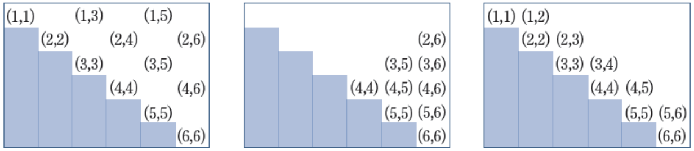
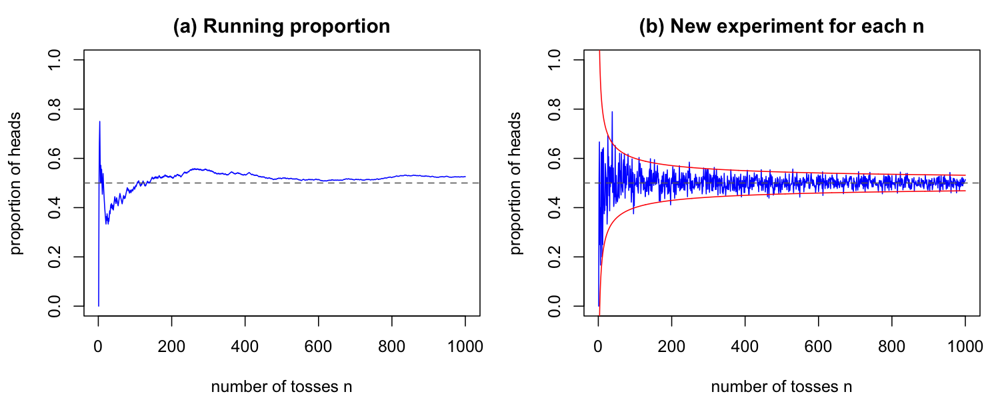
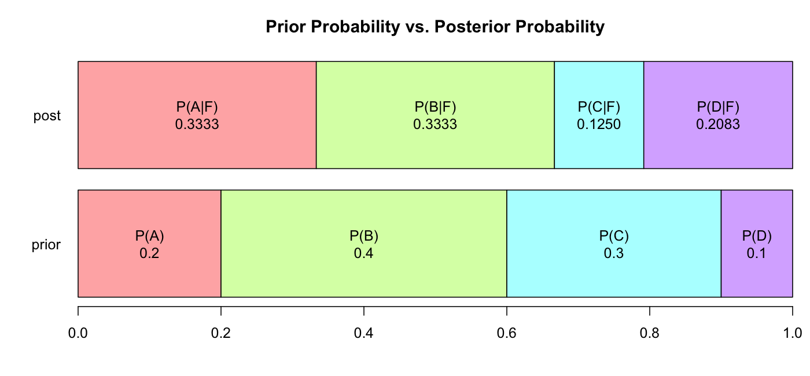

# Lecture 2 Solutions — Probability Theory

[Repository Guide](../../README.md) | [English](Solutions.md) | [한국어](Solutions.ko.md)

> **Last Updated:** 2026-11-04

---

<br>

## Table of Contents

- [Exercise 1: Three Events for Two Dice](#exercise-1-three-events-for-two-dice)
- [Exercise 2: Simulating the Law of Large Numbers](#exercise-2-simulating-the-law-of-large-numbers)
- [Exercise 3: Four Coin Tosses](#exercise-3-four-coin-tosses)
- [Exercise 4: Three Events for Four Dice](#exercise-4-three-events-for-four-dice)
- [Exercise 5: Probabilities of Unions](#exercise-5-probabilities-of-unions)
- [Exercise 6: Conditional Probabilities](#exercise-6-conditional-probabilities)
- [Exercise 7: Five Dice and Independence](#exercise-7-five-dice-and-independence)
- [Exercise 8: Defect Rate of Production Lines](#exercise-8-defect-rate-of-production-lines)
- [Exercise 9: The Production Line of a Defective Product](#exercise-9-the-production-line-of-a-defective-product)

---

<br>

## Exercise 1: Three Events for Two Dice

**Problem:** Two dice are thrown at the same time and an outcome is recorded as $(i, j)$ with $i \le j$. Find in R the elements of event $A$ (even sum), event $B$ (sum 8 or more), event $C$ (difference at most 1), and of their intersections and complements. The full problem is in [Exercise 1](Exercises.md#exercise-1-three-events-for-two-dice).

### Solution

**Approach:** `expand.grid()` creates a data frame whose rows are all combinations of the given vectors. Combining the faces 1-6 of two dice gives 36 ordered pairs, and keeping only the rows with $i \le j$ gives the 21 outcomes for indistinguishable dice. Each event is represented as a **logical vector** that tests the condition on every row; intersections are formed with `&` and complements with `!` ([Lecture 2, Section 1.3](Concepts_Lecture.md#13-operations-on-events)).

**Code:**

```r
# All ordered outcomes, then keep i <= j (dice thrown together)
S <- expand.grid(d1 = 1:6, d2 = 1:6)
S <- S[S$d1 <= S$d2, ]
S <- S[order(S$d1, S$d2), ]
rownames(S) <- NULL
nrow(S)

show <- function(ev) paste0("(", S$d1[ev], ",", S$d2[ev], ")", collapse = " ")

A <- (S$d1 + S$d2) %% 2 == 0
B <- (S$d1 + S$d2) >= 8
C <- abs(S$d1 - S$d2) <= 1

show(A)
show(B)
show(C)
show(A & B)
show(A & C)
show(B & C)
show(A & B & C)
show(!B)
show(A & !B)
sum(A); sum(B); sum(C)
```

**Output:**

```text
[1] 21
[1] "(1,1) (1,3) (1,5) (2,2) (2,4) (2,6) (3,3) (3,5) (4,4) (4,6) (5,5) (6,6)"
[1] "(2,6) (3,5) (3,6) (4,4) (4,5) (4,6) (5,5) (5,6) (6,6)"
[1] "(1,1) (1,2) (2,2) (2,3) (3,3) (3,4) (4,4) (4,5) (5,5) (5,6) (6,6)"
[1] "(2,6) (3,5) (4,4) (4,6) (5,5) (6,6)"
[1] "(1,1) (2,2) (3,3) (4,4) (5,5) (6,6)"
[1] "(4,4) (4,5) (5,5) (5,6) (6,6)"
[1] "(4,4) (5,5) (6,6)"
[1] "(1,1) (1,2) (1,3) (1,4) (1,5) (1,6) (2,2) (2,3) (2,4) (2,5) (3,3) (3,4)"
[1] "(1,1) (1,3) (1,5) (2,2) (2,4) (3,3)"
[1] 12
[1] 9
[1] 11
```

- **Sample space:** `S[S$d1 <= S$d2, ]` keeps only the rows where the condition is `TRUE`. Sorting with `order()` by the first and then the second face and renumbering the row names from 1 places the 21 outcomes in the order $(1,1), (1,2), \ldots, (6,6)$. The number 21 is the sum of the 6 pairs with equal faces and the $\binom{6}{2} = 15$ pairs with different faces.
- **Events:** `%%` is the remainder operator, so `(S$d1 + S$d2) %% 2 == 0` tests whether the sum is even. `abs()` is the absolute value. Each event is a logical vector of length 21, and `show()` picks the pairs in the `TRUE` rows and joins them into a string. `sum()` counts the `TRUE` values, so $\lvert A \rvert = 12$, $\lvert B \rvert = 9$, and $\lvert C \rvert = 11$.
- **$A \cap B$:** The pairs whose sum is even and at least 8: $(2,6), (3,5), (4,4)$ with sum 8, $(4,6), (5,5)$ with sum 10, and $(6,6)$ with sum 12.
- **$A \cap C$:** Since $i + j = 2i + (j - i)$, the sum has the same parity as the difference $j - i$. Among the pairs with difference 0 or 1, those with an even sum are exactly those with difference 0, the 6 pairs of equal faces.
- **$B \cap C$ and $A \cap B \cap C$:** The pairs with difference at most 1 and sum at least 8 are $(4,4), (4,5), (5,5), (5,6), (6,6)$, and those among them with an even sum are the equal pairs $(4,4), (5,5), (6,6)$.
- **$B^c$ and $A \cap B^c$:** $B^c$ is the 12 pairs with sum at most 7 ($21 - 9 = 12$), and the 6 of them with an even sum (2, 4, 6) form $A \cap B^c$.

The following figure arranges the 21 outcomes in a table whose rows are the first face and columns the second face, and writes only the outcomes in events $A$, $B$, and $C$, from left to right. The shaded staircase cells are the positions with $i > j$; ignoring order, they duplicate other cells, so they are excluded from the sample space.



*Figure 1. Outcomes in events A, B, and C among the 21 outcomes of two dice (from left to right)*

> **Note:** If event $C$ is read as "the difference between the two dice is less than 1", only the 6 pairs of equal faces, with difference 0, remain. This solution defines the event as "the difference is at most 1", which includes pairs with difference 1 such as $(1,2)$ and $(2,3)$, as above. Under the original reading, the pairs of equal faces all have even sums, so $A \cap C = C$ and $B \cap C = \{(4,4), (5,5), (6,6)\}$.

> **Caution:** The 21 outcomes above are convenient for listing the elements of events but are **not equally likely.** When dice are actually thrown, $(1,2)$ arises in two ways, the first die 1 and the second 2 or the reverse, so its probability is $2/36$, while $(1,1)$ has probability $1/36$. Probabilities must therefore be computed with the 36 equally likely ordered pairs. For example, computing $P(A)$ as $12/21 \approx 0.571$ is wrong.
>
> ```r
> S36 <- expand.grid(d1 = 1:6, d2 = 1:6)   # 36 ordered, equally likely outcomes
> nrow(S36)
> A36 <- (S36$d1 + S36$d2) %% 2 == 0
> B36 <- (S36$d1 + S36$d2) >= 8
> C36 <- abs(S36$d1 - S36$d2) <= 1
> c(sum(A36), sum(B36), sum(C36))
> c(mean(A36), mean(B36), mean(C36))
> ```
>
> ```text
> [1] 36
> [1] 18 15 16
> [1] 0.5000000 0.4166667 0.4444444
> ```
>
> With equally likely outcomes, the mean `mean()` of a logical vector is exactly the classical probability $\lvert E \rvert / \lvert S \rvert$. $P(A) = 18/36 = 1/2$, $P(B) = 15/36 \approx 0.417$, and $P(C) = 16/36 \approx 0.444$.

---

<br>

## Exercise 2: Simulating the Law of Large Numbers

**Problem:** Show by simulation in R that the proportion of heads converges to 1/2 as more fair coins are thrown, and plot the proportion of heads against the number of tosses. The problem is in [Exercise 2](Exercises.md#exercise-2-simulating-the-law-of-large-numbers).

### Solution

**Approach:** With heads as 1 and tails as 0, `sample(c(0, 1), size = n, replace = TRUE)` gives the results of $n$ tosses of a fair coin (`replace = TRUE` means sampling with replacement, so 0 and 1 are drawn with equal probability every time). The proportion of heads equals the mean of the 0s and 1s. The approach of the proportion to 1/2 can be seen in two ways ([Lecture 2, Section 2.2](Concepts_Lecture.md#22-relative-frequency-and-the-law-of-large-numbers)).

- **(a) Running proportion:** Toss a coin 1000 times in one sequence and plot the proportion of heads up to each point, $\frac{1}{k}\sum_{i=1}^{k} x_i$ ($k = 1, \ldots, 1000$). `cumsum()` is the cumulative sum.
- **(b) A new experiment for each number:** For each $k = 1, \ldots, 1000$, newly toss $k$ coins and compute the proportion of heads. `sapply()` collects the results of applying a function to each element of the vector `1:n`.

**Code:**

```r
set.seed(2025)
n <- 1000

# (a) one long sequence of tosses: running proportion of heads
toss <- sample(c(0, 1), size = n, replace = TRUE)   # 1 = head, 0 = tail
running <- cumsum(toss) / (1:n)
running[c(1, 10, 100, 1000)]

# (b) a new experiment of size k for every k = 1, ..., n
prop <- sapply(1:n, function(k) mean(sample(c(0, 1), size = k, replace = TRUE)))
prop[c(1, 10, 100, 1000)]
max(abs(prop[1:100] - 0.5))      # largest deviation for k = 1, ..., 100
max(abs(prop[901:1000] - 0.5))   # largest deviation for k = 901, ..., 1000

par(mfrow = c(1, 2))
plot(1:n, running, type = "l", col = "blue", ylim = c(0, 1),
     xlab = "number of tosses n", ylab = "proportion of heads",
     main = "(a) Running proportion")
abline(h = 0.5, col = "gray40", lty = 2)
plot(1:n, prop, type = "l", col = "blue", ylim = c(0, 1),
     xlab = "number of tosses n", ylab = "proportion of heads",
     main = "(b) New experiment for each n")
abline(h = 0.5, col = "gray40", lty = 2)
lines(1:n, 0.5 + 2 * 0.5 / sqrt(1:n), col = "red")
lines(1:n, 0.5 - 2 * 0.5 / sqrt(1:n), col = "red")
```

**Output:**

```text
[1] 0.000 0.500 0.480 0.526
[1] 0.000 0.200 0.490 0.514
[1] 0.5
[1] 0.04279749
```



*Figure 2. Running proportion of heads (a) and proportion of heads in a new experiment for each number of tosses (b) for a fair coin*

- **Result of (a):** The first toss is tails, so the proportion starts at 0; it is 0.5 at the 10th toss, 0.48 at the 100th, and 0.526 at the 1000th. In the plot the proportion swings widely during the first few dozen tosses, but the more tosses, the smaller its movement around 0.5 (the dashed line).
- **Result of (b):** Each $k$ is a separate experiment, so the plot is jagged. Still, the largest deviation from 0.5 is 0.5 for $k = 1, \ldots, 100$ (one coin gives a proportion of either 0 or 1), but only 0.043 for $k = 901, \ldots, 1000$. The red curves $0.5 \pm 2 \times 0.5/\sqrt{k}$ span twice the standard deviation $0.5/\sqrt{k}$ of the proportion of heads, showing that the spread shrinks at the rate $1/\sqrt{k}$.
- **Conclusion:** In both approaches the relative frequency of heads approaches the classical probability 1/2 as the number of tosses grows, which is the law of large numbers.

Tossing longer makes the convergence clearer. The following is the running proportion over one million tosses.

```r
set.seed(7)
big <- sample(c(0, 1), size = 1e6, replace = TRUE)
r <- cumsum(big) / seq_along(big)
r[c(10, 100, 1000, 1e4, 1e5, 1e6)]
sum(big[1:1e4]) - 1e4 / 2      # heads minus expected heads after 10^4 tosses
sum(big) - 1e6 / 2             # heads minus expected heads after 10^6 tosses
```

```text
[1] 0.600000 0.610000 0.516000 0.510000 0.499120 0.500562
[1] 100
[1] 562
```

At $10, 10^2, \ldots, 10^6$ tosses the proportion is 0.6, 0.61, 0.516, 0.51, 0.49912, and 0.500562, approaching 0.5. Yet the number of heads minus its expected value ($n/2$) actually grew, from 100 at $10^4$ tosses to 562 at $10^6$. The proportion converges not because the difference disappears, but because the difference grows much more slowly than $n$, so its effect on the proportion, such as $562/10^6$, becomes small. This is why the idea that an earlier imbalance is compensated by tails (the gambler's fallacy) is wrong.

---

<br>

## Exercise 3: Four Coin Tosses

**Problem:** List in R the sample space of four tosses of a fair coin, and find the probabilities of two or more heads and of three or more heads. The problem is in [Exercise 3](Exercises.md#exercise-3-four-coin-tosses).

### Solution

**Approach:** Recording the results in the order of the tosses, the sample space is $\{HHHH, HHHT, HHTH, \ldots, TTTH, TTTT\}$, whose $\lvert S \rvert = 2^4 = 16$ outcomes are equally likely. Count the heads in each outcome and divide the number of outcomes meeting the condition by 16 (classical probability). The number of outcomes with exactly $k$ heads is $\binom{4}{k}$, the number of ways to choose the $k$ positions of the heads among the four.

**Code:**

```r
S <- expand.grid(t1 = c("H", "T"), t2 = c("H", "T"),
                 t3 = c("H", "T"), t4 = c("H", "T"))   # 2^4 ordered outcomes
nrow(S)
apply(S, 1, paste, collapse = "")                      # list the 16 outcomes
heads <- rowSums(S == "H")                             # number of heads in each outcome
table(heads)
c(count = sum(heads >= 2), prob = mean(heads >= 2))    # two or more heads
c(count = sum(heads >= 3), prob = mean(heads >= 3))    # more than two heads
sum(choose(4, 2:4)) / 2^4                              # formula check
```

**Output:**

```text
[1] 16
 [1] "HHHH" "THHH" "HTHH" "TTHH" "HHTH" "THTH" "HTTH" "TTTH" "HHHT" "THHT"
[11] "HTHT" "TTHT" "HHTT" "THTT" "HTTT" "TTTT"
heads
0 1 2 3 4 
1 4 6 4 1 
  count    prob 
11.0000  0.6875 
 count   prob 
5.0000 0.3125 
[1] 0.6875
```

- **Sample space:** `expand.grid()` creates 16 rows combining the four tosses, and `apply(S, 1, paste, collapse = "")` joins the four letters of each row (`1` means by row) into a string such as `"HHHH"`. The first column changes fastest, so the list is not in dictionary order, but each of the 16 outcomes appears exactly once.
- **Number of heads:** `S == "H"` is a logical table of the same size, and `rowSums()` counts the `TRUE` values in each row, that is, the number of heads. The counts 1, 4, 6, 4, 1 from `table(heads)` equal $\binom{4}{0}, \ldots, \binom{4}{4}$.
- **(1) Two or more:** $\lvert A \rvert = \binom{4}{4} + \binom{4}{3} + \binom{4}{2} = 1 + 4 + 6 = 11$, so $P(A) = 11/16 = 0.6875$. Checking with the complement, $1 + 4 = 5$ outcomes have 0 or 1 head, so $1 - 5/16 = 11/16$.
- **(2) Three or more:** $\binom{4}{4} + \binom{4}{3} = 1 + 4 = 5$, so the probability is $5/16 = 0.3125$.

> **Note:** Strictly, the event that heads appears "more than two times" is the event of three or more heads, with probability $5/16$, but the computation $\binom{4}{4} + \binom{4}{3} + \binom{4}{2} = 11$ given with the same problem counts the event of two or more heads. The exercise is split into two questions to distinguish the two readings. "More than" excludes the number itself, while "or more" includes it.

---

<br>

## Exercise 4: Three Events for Four Dice

**Problem:** When four dice are thrown, count in R the outcomes in event $A$ (sum 15 or more), event $B$ (at least one 6), event $C$ (at least one 1), and their intersections. The problem is in [Exercise 4](Exercises.md#exercise-4-three-events-for-four-dice).

### Solution

**Approach:** Distinguishing the four dice and recording ordered outcomes gives $6^4 = 1296$ equally likely outcomes. Create the 1296-row sample space with `expand.grid()`, compute the sum of the faces and the number of a given face in each row with `rowSums()`, and represent each event as a logical vector.

**Code:**

```r
S <- expand.grid(d1 = 1:6, d2 = 1:6, d3 = 1:6, d4 = 1:6)   # 6^4 ordered outcomes
N <- nrow(S)
N
head(S, 3)
table(rowSums(S))               # number of outcomes for each sum 4, ..., 24
A <- rowSums(S) >= 15           # sum of the four faces is 15 or more
B <- rowSums(S == 6) >= 1       # at least one die shows 6
C <- rowSums(S == 1) >= 1       # at least one die shows 1
c(A = sum(A), B = sum(B), C = sum(C))
c(AB = sum(A & B), AC = sum(A & C), BC = sum(B & C), ABC = sum(A & B & C))
table(A, B, C)                  # counts of the eight regions of the Venn diagram
```

**Output:**

```text
[1] 1296
  d1 d2 d3 d4
1  1  1  1  1
2  2  1  1  1
3  3  1  1  1

  4   5   6   7   8   9  10  11  12  13  14  15  16  17  18  19  20  21  22  23 
  1   4  10  20  35  56  80 104 125 140 146 140 125 104  80  56  35  20  10   4 
 24 
  1 
  A   B   C 
575 671 671 
 AB  AC  BC ABC 
453 140 302 124 
, , C = FALSE

       B
A       FALSE TRUE
  FALSE   150   40
  TRUE    106  329

, , C = TRUE

       B
A       FALSE TRUE
  FALSE   353  178
  TRUE     16  124
```

- **$\lvert A \rvert = 575$:** `rowSums(S)` is the sum of the four faces in each row, and `table()` gives the number of outcomes for each sum 4-24. The outcomes with sum 15 or more number $140 + 125 + 104 + 80 + 56 + 35 + 20 + 10 + 4 + 1 = 575$.
- **$\lvert B \rvert = \lvert C \rvert = 671$:** `S == 6` is a logical table telling whether each cell is 6, and a row sum of at least 1 means at least one 6. The complement (no 6 at all) has $5^4 = 625$ outcomes, since each die shows one of the five faces 1-5, so $\lvert B \rvert = 1296 - 625 = 671$. The same holds for 1.
- **$\lvert B \cap C \rvert = 302$:** By De Morgan's law, $(B \cap C)^c = B^c \cup C^c$. $\lvert B^c \rvert = \lvert C^c \rvert = 625$, and $B^c \cap C^c$ (neither 6 nor 1) has $4^4 = 256$ outcomes, since each die shows one of the four faces 2-5. Hence $\lvert B^c \cup C^c \rvert = 625 + 625 - 256 = 994$ and $\lvert B \cap C \rvert = 1296 - 994 = 302$.
- **Regions:** `table(A, B, C)` gives the number of outcomes in each of the 8 true-false combinations of the three events, that is, in each of the 8 regions of the Venn diagram.

| Region | Meaning | Number of outcomes |
|:-----|:---|----------:|
| $A \cap B^c \cap C^c$ | Only in $A$ | 106 |
| $A^c \cap B \cap C^c$ | Only in $B$ | 40 |
| $A^c \cap B^c \cap C$ | Only in $C$ | 353 |
| $A \cap B \cap C^c$ | Only in $A$ and $B$ | 329 |
| $A \cap B^c \cap C$ | Only in $A$ and $C$ | 16 |
| $A^c \cap B \cap C$ | Only in $B$ and $C$ | 178 |
| $A \cap B \cap C$ | In all three events | 124 |
| $A^c \cap B^c \cap C^c$ | In none of the events | 150 |
| Total | | 1296 |

*Table 1. Number of outcomes in each region formed by the three events A, B, and C*

The size of each event is the sum of its regions. For example, $\lvert A \rvert = 106 + 329 + 16 + 124 = 575$, $\lvert A \cap B \rvert = 329 + 124 = 453$, and $\lvert A \cap C \rvert = 16 + 124 = 140$.

> **Note:** If event $A$ is read strictly as "the sum of the numbers is 15" and event $B$ as "more than one die is 6", the numbers of outcomes are 140 and 171, respectively. The sizes 575 and 671 used in the computations of Exercises 5 and 6 correspond to "the sum is 15 or more" and "at least one die is 6", so this exercise defines the events that way.

---

<br>

## Exercise 5: Probabilities of Unions

**Problem:** With the events of Exercise 4, find $P(A \cup B)$, $P(A \cup C)$, $P(B \cup C)$, and $P(A \cup B \cup C)$ in R and check them with the addition rule. The problem is in [Exercise 5](Exercises.md#exercise-5-probabilities-of-unions).

### Solution

**Approach:** A union is formed with `|` (or) on logical vectors, and since the outcomes are equally likely, a probability is the number of outcomes divided by $N = 1296$. Check that the addition rule ([Lecture 2, Section 3.3](Concepts_Lecture.md#33-the-addition-rule), [Section 3.4](Concepts_Lecture.md#34-the-addition-rule-for-three-events-and-booles-inequality)) gives the same values.

**Code:**

```r
S <- expand.grid(d1 = 1:6, d2 = 1:6, d3 = 1:6, d4 = 1:6)
N <- nrow(S)
A <- rowSums(S) >= 15
B <- rowSums(S == 6) >= 1
C <- rowSums(S == 1) >= 1
P <- function(e) sum(e) / N                     # classical probability
# direct counting of the unions
c(AorB = sum(A | B), AorC = sum(A | C), BorC = sum(B | C), AorBorC = sum(A | B | C))
round(c(P(A | B), P(A | C), P(B | C), P(A | B | C)), 4)
# check with the addition rule
P(A) + P(B) - P(A & B)
P(A) + P(B) + P(C) - P(A & B) - P(A & C) - P(B & C) + P(A & B & C)
```

**Output:**

```text
   AorB    AorC    BorC AorBorC 
    793    1106    1040    1146 
[1] 0.6119 0.8534 0.8025 0.8843
[1] 0.6118827
[1] 0.8842593
```

With the counts from Exercise 4 ($\lvert A \rvert = 575$, $\lvert B \rvert = \lvert C \rvert = 671$, $\lvert A \cap B \rvert = 453$, $\lvert A \cap C \rvert = 140$, $\lvert B \cap C \rvert = 302$, $\lvert A \cap B \cap C \rvert = 124$), the addition rule gives the following.

1. $P(A \cup B) = P(A) + P(B) - P(A \cap B) = \dfrac{575 + 671 - 453}{1296} = \dfrac{793}{1296} \approx 0.6119$
2. $P(A \cup C) = P(A) + P(C) - P(A \cap C) = \dfrac{575 + 671 - 140}{1296} = \dfrac{1106}{1296} \approx 0.8534$
3. $P(B \cup C) = P(B) + P(C) - P(B \cap C) = \dfrac{671 + 671 - 302}{1296} = \dfrac{1040}{1296} \approx 0.8025$
4. $P(A \cup B \cup C) = \dfrac{575 + 671 + 671 - 453 - 140 - 302 + 124}{1296} = \dfrac{1146}{1296} \approx 0.8843$

All four values agree with the counts from R. The complement gives another check. The complement of $B \cup C$ is the $4^4 = 256$ outcomes with neither a 6 nor a 1, so $\lvert B \cup C \rvert = 1296 - 256 = 1040$, and the complement of $A \cup B \cup C$ is the last region of Table 1, with 150 outcomes, so $\lvert A \cup B \cup C \rvert = 1296 - 150 = 1146$.

---

<br>

## Exercise 6: Conditional Probabilities

**Problem:** With the events of Exercise 4, find $P(A \mid B)$, $P(A \mid C)$, $P(A \mid B \cap C)$, and $P(A \mid B \cup C)$ in R. The problem is in [Exercise 6](Exercises.md#exercise-6-conditional-probabilities).

### Solution

**Approach:** Since the outcomes are equally likely, $\lvert S \rvert$ cancels in the definition of conditional probability ([Lecture 2, Section 4.1](Concepts_Lecture.md#41-definition-of-conditional-probability)), giving $P(E \mid F) = \lvert E \cap F \rvert / \lvert F \rvert$. The function `cond(e, f)` computes this formula directly.

**Code:**

```r
S <- expand.grid(d1 = 1:6, d2 = 1:6, d3 = 1:6, d4 = 1:6)
A <- rowSums(S) >= 15
B <- rowSums(S == 6) >= 1
C <- rowSums(S == 1) >= 1
cond <- function(e, f) sum(e & f) / sum(f)       # P(e | f) = |e and f| / |f|
c(AB = sum(A & B), B = sum(B), AC = sum(A & C), C = sum(C))
c(ABC = sum(A & B & C), BC = sum(B & C), A_BorC = sum(A & (B | C)), BorC = sum(B | C))
round(c(cond(A, B), cond(A, C), cond(A, B & C), cond(A, B | C)), 4)
round(mean(A), 4)
```

**Output:**

```text
 AB   B  AC   C 
453 671 140 671 
   ABC     BC A_BorC   BorC 
   124    302    469   1040 
[1] 0.6751 0.2086 0.4106 0.4510
[1] 0.4437
```

1. $P(A \mid B) = \dfrac{P(A \cap B)}{P(B)} = \dfrac{453/1296}{671/1296} = \dfrac{453}{671} \approx 0.6751$
2. $P(A \mid C) = \dfrac{P(A \cap C)}{P(C)} = \dfrac{140/1296}{671/1296} = \dfrac{140}{671} \approx 0.2086$
3. $P(A \mid B \cap C) = \dfrac{P(A \cap B \cap C)}{P(B \cap C)} = \dfrac{124/1296}{302/1296} = \dfrac{124}{302} \approx 0.4106$
4. By the distributive law, $A \cap (B \cup C) = (A \cap B) \cup (A \cap C)$, and the intersection of the two parts is $A \cap B \cap C$, so the addition rule gives $P(A \cap (B \cup C)) = \dfrac{453 + 140 - 124}{1296} = \dfrac{469}{1296}$. Hence $P(A \mid B \cup C) = \dfrac{469/1296}{1040/1296} = \dfrac{469}{1040} \approx 0.4510$.

Without any condition, the probability of a sum of 15 or more is $P(A) = 575/1296 \approx 0.4437$. The information that at least one 6 appeared raises the chance of a large sum to 0.675, and the information that at least one 1 appeared lowers it to 0.209. With both pieces of information, it is 0.411, in between. Since the conditional probabilities differ from $P(A)$, $A$ is independent of neither $B$ nor $C$.

---

<br>

## Exercise 7: Five Dice and Independence

**Problem:** When five dice are rolled, decide in R whether event $A$ (even sum) and event $B$ (both a 1 and a 6 appear) are independent. The helper functions `pprt2()` and `cprt2()` are in [Exercise 7](Exercises.md#exercise-7-five-dice-and-independence).

### Solution

**Approach:** List the $6^5 = 7776$ ordered outcomes and check whether the definition of independence $P(A \cap B) = P(A)\, P(B)$ holds ([Lecture 2, Section 5.1](Concepts_Lecture.md#51-independence-of-two-events)). Comparing decimals can suffer from rounding error, so also check the integer equation $\lvert A \cap B \rvert \cdot N = \lvert A \rvert \cdot \lvert B \rvert$, obtained by multiplying both sides by $N^2$. The `intersect2()` used by the helper functions is not in base R, so define it.

**Code:**

```r
S <- expand.grid(d1 = 1:6, d2 = 1:6, d3 = 1:6, d4 = 1:6, d5 = 1:6)   # 6^5 outcomes
N <- nrow(S)
A <- rowSums(S) %% 2 == 0                          # the sum is even
B <- rowSums(S == 1) >= 1 & rowSums(S == 6) >= 1   # both a 1 and a 6 appear
c(N = N, A = sum(A), B = sum(B), AB = sum(A & B))
pA <- mean(A); pB <- mean(B); pAB <- mean(A & B)
c(pA = pA, pB = pB, pAB = pAB, pA_pB = pA * pB)
sum(A & B) * N == sum(A) * sum(B)                  # exact check of P(AB) = P(A)P(B)

# helper functions given with the problem
intersect2 <- function(a, b) merge(a, b)   # rows that appear in both data frames
cprt2 <- function(a, an, b, bn) {
  ab = intersect2(a, b)
  cat(paste0("P(", an, "|", bn, ") ="), nrow(ab), "/", nrow(b),
      "=", nrow(ab) / nrow(b))
}
pprt2 <- function(x, xn, n, prt = TRUE) {
  if (prt == TRUE) cat(paste0("P(", xn, ") ="), nrow(x), "/", n,
                       "=", nrow(x) / n, "\n")
  invisible(nrow(x) / n)
}
SA <- S[A, ]
SB <- S[B, ]
pprt2(SA, "A", N)
pprt2(SB, "B", N)
cprt2(SA, "A", SB, "B")
```

**Output:**

```text
   N    A    B   AB 
7776 3888 2550 1275 
       pA        pB       pAB     pA_pB 
0.5000000 0.3279321 0.1639660 0.1639660 
[1] TRUE
P(A) = 3888 / 7776 = 0.5 
P(B) = 2550 / 7776 = 0.3279321 
P(A|B) = 1275 / 2550 = 0.5
```

- **$P(A) = 1/2$:** $3888 = 7776/2$ outcomes have an even sum. Whatever the sum of the first four faces, exactly three of the faces 1-6 of the last die make the total even.
- **$P(B) = 2550/7776$:** By the inclusion-exclusion principle, $\lvert B \rvert = N - \lvert \text{no } 1 \rvert - \lvert \text{no } 6 \rvert + \lvert \text{neither } 1 \text{ nor } 6 \rvert = 7776 - 5^5 - 5^5 + 4^5 = 7776 - 3125 - 3125 + 1024 = 2550$.
- **Independence:** $P(A \cap B) = 1275/7776 \approx 0.16397$ and $P(A)\, P(B) = 0.5 \times 0.32793 \approx 0.16397$ are equal. The integer equation also holds, $1275 \times 7776 = 9{,}914{,}400 = 3888 \times 2550$ (`TRUE`). In terms of conditional probability, $P(A \mid B) = 1275/2550 = 0.5 = P(A)$. Therefore **$A$ and $B$ are independent.**
- **Helper functions:** Without a `by` argument, `merge(a, b)` joins rows that agree on all common columns (`d1`-`d5`) of the two data frames, so it returns the rows of the outcomes that belong to both events. `pprt2()` prints the number of rows divided by `n` as the probability, and `cprt2()` prints $\lvert A \cap B \rvert / \lvert B \rvert$. `cat()` prints values one after another without quotes, and `invisible()` returns a value without printing it.

This independence can be explained by symmetry. Consider the map that changes every face $x$ to $7 - x$. It swaps 1 and 6, so an outcome in $B$ stays in $B$. Meanwhile the sum $s$ of the five faces becomes $35 - s$, and since 35 is odd, the parity of the sum flips. The map is therefore a one-to-one correspondence between $A \cap B$ and $A^c \cap B$, so the two sets have the same size and $\lvert A \cap B \rvert = \lvert B \rvert / 2$. In other words, learning that $B$ occurred tells nothing about the parity of the sum.

---

<br>

## Exercise 8: Defect Rate of Production Lines

**Problem:** Find in R the probability $P(F)$ that a product randomly sampled from production lines A, B, C, and D, with production ratios 20%, 40%, 30%, and 10% and defective rates 0.04, 0.02, 0.01, and 0.05, is defective. The problem is in [Exercise 8](Exercises.md#exercise-8-defect-rate-of-production-lines).

### Solution

**Approach:** Each product is produced on exactly one of the four lines, so the events of being produced on lines A, B, C, and D form a partition of the sample space (here A, B, C, and D are production lines, not the events of Exercise 4). The production ratios are the probabilities $P(A) = 0.2$ and so on, and the defective rates are the conditional probabilities $P(F \mid A) = 0.04$ and so on. Find $P(F)$ with the law of total probability ([Lecture 2, Section 6.2](Concepts_Lecture.md#62-partitions-and-the-general-form)).

$$
\begin{aligned}
P(F) &= P(F \cap A) + P(F \cap B) + P(F \cap C) + P(F \cap D) \\
&= P(A)P(F \mid A) + P(B)P(F \mid B) + P(C)P(F \mid C) + P(D)P(F \mid D) \\
&= 0.2 \times 0.04 + 0.4 \times 0.02 + 0.3 \times 0.01 + 0.1 \times 0.05 \\
&= 0.008 + 0.008 + 0.003 + 0.005 = 0.024
\end{aligned}
$$

In R, multiply two named vectors element by element and add the products. To confirm the theoretical value, also simulate the random production of one million products.

**Code:**

```r
prior  <- c(A = 0.2,  B = 0.4,  C = 0.3,  D = 0.1)   # P(line): production ratio
defect <- c(A = 0.04, B = 0.02, C = 0.01, D = 0.05)  # P(F | line): defective rate
joint <- prior * defect                               # P(line and F)
joint
pF <- sum(joint)                                      # law of total probability
pF

# Monte Carlo check: one million randomly sampled products
set.seed(2025)
n <- 1e6
line <- sample(names(prior), size = n, replace = TRUE, prob = prior)
isDefect <- runif(n) < defect[line]
mean(isDefect)
```

**Output:**

```text
    A     B     C     D 
0.008 0.008 0.003 0.005 
[1] 0.024
[1] 0.023912
```

- **`prior * defect`:** R's arithmetic is element-wise, so $P(\text{line}) \times P(F \mid \text{line}) = P(\text{line} \cap F)$ is computed for each line, keeping the names A-D. The sum from `sum()`, $P(F) = 0.024$, is the result of the law of total probability. About 24 of every 1000 randomly sampled products are defective.
- **Simulation:** `sample(names(prior), ..., prob = prior)` draws the production line of each product according to the production ratios. `defect[line]` is the defective rate of each product's line, and the product is counted as defective if the uniform random number `runif(n)` between 0 and 1 is smaller than that rate, because a uniform random number is smaller than $p$ with probability $p$. The proportion of defective products among one million, 0.023912, is close to the theoretical value 0.024 (the law of large numbers).

---

<br>

## Exercise 9: The Production Line of a Defective Product

**Problem:** Given that a product sampled from the factory of Exercise 8 is defective, find in R the probability that it was produced on each of the lines A, B, C, and D, and plot the prior probabilities against the posterior probabilities. The problem is in [Exercise 9](Exercises.md#exercise-9-the-production-line-of-a-defective-product).

### Solution

**Approach:** The required values are the posterior probabilities $P(A \mid F)$ and so on of each line, given the information $F$ that the product is defective. By Bayes' theorem ([Lecture 2, Section 7.1](Concepts_Lecture.md#71-reversing-the-direction-of-conditioning)), divide the joint probability $P(\text{line} \cap F)$ of each line by $P(F) = 0.024$.

$$
\begin{aligned}
P(A \mid F) &= \frac{P(A \cap F)}{P(F)} = \frac{0.2 \times 0.04}{0.024} = \frac{0.008}{0.024} = \frac{1}{3}, &
P(B \mid F) &= \frac{0.4 \times 0.02}{0.024} = \frac{0.008}{0.024} = \frac{1}{3} \\
P(C \mid F) &= \frac{0.3 \times 0.01}{0.024} = \frac{0.003}{0.024} = \frac{1}{8}, &
P(D \mid F) &= \frac{0.1 \times 0.05}{0.024} = \frac{0.005}{0.024} = \frac{5}{24}
\end{aligned}
$$

**Code:**

```r
prior  <- c(A = 0.2,  B = 0.4,  C = 0.3,  D = 0.1)
defect <- c(A = 0.04, B = 0.02, C = 0.01, D = 0.05)
joint <- prior * defect
posterior <- joint / sum(joint)                       # Bayes' theorem
round(posterior, 4)
sum(posterior)
round(posterior / prior, 4)                           # how much each line's share changed

# prior versus posterior as stacked horizontal bars
M <- cbind(prior = prior, post = posterior)
cols <- c("#FFB3B3", "#D9FFB3", "#B3FFFF", "#D9B3FF")
bp <- barplot(M, horiz = TRUE, col = cols, xlim = c(0, 1), las = 1,
              main = "Prior Probability vs. Posterior Probability")
text(cumsum(prior) - prior / 2, bp[1],
     paste0("P(", names(prior), ")\n", prior))
text(cumsum(posterior) - posterior / 2, bp[2],
     paste0("P(", names(prior), "|F)\n", sprintf("%.4f", posterior)))
```

**Output:**

```text
     A      B      C      D 
0.3333 0.3333 0.1250 0.2083 
[1] 1
     A      B      C      D 
1.6667 0.8333 0.4167 2.0833 
```



*Figure 3. Prior probabilities of the production lines (bottom) and posterior probabilities after a defective product is observed (top)*

- **Posterior probabilities:** $P(A \mid F) = P(B \mid F) = 1/3 \approx 0.3333$, $P(C \mid F) = 1/8 = 0.125$, and $P(D \mid F) = 5/24 \approx 0.2083$, which add up to 1 because the defective product certainly came from one of the four lines.
- **Comparison with the priors:** The ratio `posterior / prior` equals $P(F \mid \text{line}) / P(F)$, the defective rate of each line divided by the overall defect rate 0.024. Lines A (0.04) and D (0.05), whose defective rates are above the overall average, gain shares by factors of 1.67 and 2.08, while lines B (0.02) and C (0.01), with lower rates, shrink by factors of 0.83 and 0.42. Line D produces only 10% of the products, yet about 21% of the defective products come from D.
- **Plot:** `cbind()` binds the priors and posteriors into two columns, and `barplot(..., horiz = TRUE)` draws each column as one stacked horizontal bar. `bp` holds the vertical positions of the two bars, and `cumsum(prior) - prior / 2` is the middle of each stacked segment, where `text()` writes the name and the value. In Figure 3, the way each colored segment widens or narrows from the bottom bar (prior) to the top bar (posterior) shows how the information of a defect changes the probability of each line.
