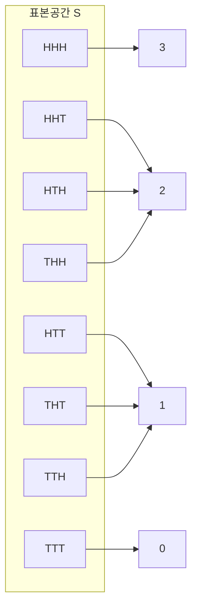
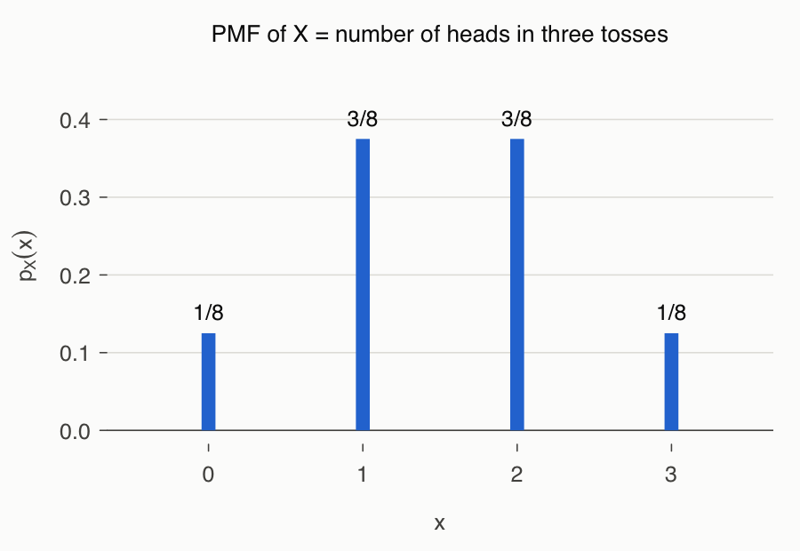
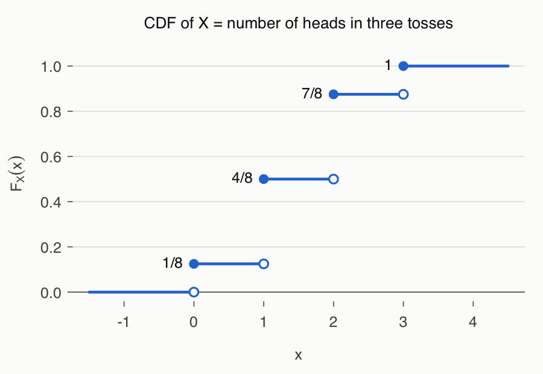

# 3강 — 확률변수와 확률분포

[레포지토리 안내](../../README.ko.md) | [English](Concepts_Lecture.md) | [한국어](Concepts_Lecture.ko.md)

> **최종 수정일:** 2026-11-04

> **학습 목표:**
> 1. 확률변수를 표본공간에서 실수로 가는 함수로 정의하고, 이산확률변수와 연속확률변수를 구분할 수 있다
> 2. 확률변수의 값의 범위가 표본공간의 사건에 대응함을 이용해 확률질량함수와 누적분포함수를 구하고 그 성질을 설명할 수 있다
> 3. 결합확률질량함수에서 주변확률질량함수를 구하고, 두 확률변수가 독립인지 판정할 수 있다
> 4. 기댓값, 분산, 표준편차를 정의에 따라 계산하고, 선형변환 aX + b의 기댓값과 분산을 유도할 수 있다
> 5. 공분산을 계산하고, 독립이면 공분산이 0이지만 그 역은 성립하지 않음을 예로 설명할 수 있다
> 6. R로 표본공간을 나열하여 확률분포와 누적분포함수를 계산할 수 있다

---

## 목차

- [1. 확률변수](#1-확률변수)
  - [1.1 표본공간에서 실수로 가는 함수](#11-표본공간에서-실수로-가는-함수)
  - [1.2 이산확률변수와 연속확률변수](#12-이산확률변수와-연속확률변수)
  - [1.3 값의 범위와 사건](#13-값의-범위와-사건)
- [2. 이산확률분포](#2-이산확률분포)
  - [2.1 확률질량함수](#21-확률질량함수)
  - [2.2 누적분포함수](#22-누적분포함수)
  - [2.3 R로 확률분포 구하기](#23-r로-확률분포-구하기)
- [3. 결합분포](#3-결합분포)
  - [3.1 결합확률질량함수와 주변확률질량함수](#31-결합확률질량함수와-주변확률질량함수)
  - [3.2 결합누적분포함수](#32-결합누적분포함수)
- [4. 확률변수의 독립](#4-확률변수의-독립)
  - [4.1 독립의 정의](#41-독립의-정의)
  - [4.2 독립이 아닌 예](#42-독립이-아닌-예)
  - [4.3 독립인 예와 누적분포함수](#43-독립인-예와-누적분포함수)
- [5. 기댓값](#5-기댓값)
  - [5.1 기댓값의 정의](#51-기댓값의-정의)
  - [5.2 기댓값의 선형성](#52-기댓값의-선형성)
  - [5.3 두 확률변수의 함수의 기댓값](#53-두-확률변수의-함수의-기댓값)
  - [5.4 합의 기댓값과 곱의 기댓값](#54-합의-기댓값과-곱의-기댓값)
- [6. 분산과 표준편차](#6-분산과-표준편차)
  - [6.1 분산](#61-분산)
  - [6.2 표준편차](#62-표준편차)
  - [6.3 선형변환의 기댓값과 분산](#63-선형변환의-기댓값과-분산)
- [7. 공분산](#7-공분산)
  - [7.1 공분산의 정의와 의미](#71-공분산의-정의와-의미)
  - [7.2 독립과 공분산](#72-독립과-공분산)
  - [7.3 합의 분산](#73-합의-분산)
- [개념 적용](#개념-적용)
- [요약](#요약)
- [점검 문제](#점검-문제)
- [참고 문헌](#참고-문헌)

---

<br>

## 1. 확률변수

2강에서는 표본공간의 사건에 확률을 부여하는 방법을 다루었다. 실제 분석에서는 실험의 결과 자체보다 결과에서 얻은 수치, 예를 들어 앞면의 개수, 주사위 눈의 합, 불량품의 수에 관심이 있는 경우가 많다. 확률변수는 실험의 결과를 수로 바꾸어, 확률을 수에 관한 함수로 다룰 수 있게 한다. 아래에서는 확률변수와 그 분포를 정의하고, 분포를 요약하는 기댓값, 분산, 공분산을 차례로 유도한다.

### 1.1 표본공간에서 실수로 가는 함수

> **용어 정의:** **확률변수(random variable)** 는 표본공간 $\mathcal{S}$의 각 원소(결과) $s$에 실수 $X(s)$를 하나씩 대응시키는 함수 $X : \mathcal{S} \to \mathbb{R}$이다. 확률변수가 각 값이나 값의 범위를 취할 확률을 정한 것을 그 확률변수의 **확률분포(probability distribution)** 라고 한다.

이름에 "변수"가 들어 있지만 확률변수는 함수이다. 값을 임의로 넣는 것이 아니라, 실험의 결과 $s$가 정해지면 값 $X(s)$가 자동으로 정해진다. 관례상 확률변수는 대문자 $X$, $Y$로 쓰고, 확률변수가 취하는 특정한 값은 소문자 $x$, $y$로 쓴다.

**예: 동전을 세 번 던지는 실험.** 동전을 차례로 세 번 던지면 표본공간은 다음과 같다. H는 앞면(head), T는 뒷면(tail)이다.

$$
\mathcal{S} = \lbrace HHH,\ HHT,\ HTH,\ HTT,\ THH,\ THT,\ TTH,\ TTT\rbrace
$$

이 하나의 표본공간 위에 여러 확률변수를 정의할 수 있다.

- $X(s)$는 결과 $s$에 들어 있는 앞면의 개수이다. 예를 들어 $X(HTH) = 2$이다.
- $Y(s)$는 처음으로 앞면이 나온 시행의 번호이다. 예를 들어 $Y(TTH) = 3$이고, 앞면이 한 번도 나오지 않은 $TTT$에서는 $Y(TTT) = 0$으로 정한다.

이 예에서 $X(s)$와 $Y(s)$의 값은 모두 정수이다. 그림 1은 $X$가 여덟 개의 결과를 네 개의 실수 0, 1, 2, 3에 대응시키는 모습이다.



*그림 1. 앞면의 개수 X가 표본공간의 여덟 결과를 실수 0, 1, 2, 3에 대응시키는 함수*

표본공간이 무엇인지 분명하면 $X(s)$ 대신 간단히 $X$로 쓴다.

**구조화된 데이터와 확률변수.** 행과 열로 이루어진 표 형태의 데이터(구조화된 데이터)는 확률변수의 모음으로 볼 수 있다. 각 행은 관측된 하나의 결과 $s$이고, 각 열(키, 몸무게, 나이 등)은 그 결과에 실수를 대응시키는 확률변수이다. 실제 현상을 실수로 옮기는 함수라는 관점에서 보면, 데이터 분석은 여러 확률변수의 분포와 관계를 다루는 일이다. 여러 열을 함께 다루는 방법은 3절의 결합분포에서 다룬다.

### 1.2 이산확률변수와 연속확률변수

확률변수는 취할 수 있는 값의 모양에 따라 두 종류로 나눈다.

> **용어 정의:** **이산확률변수(discrete random variable)** 는 취할 수 있는 값이 유한개이거나 셀 수 있는 무한개(countably infinite)인 확률변수이다. **연속확률변수(continuous random variable)** 는 실수 구간 위의 셀 수 없이 많은(uncountably infinite) 값을 취하며, 한 점에서의 확률은 0이고 구간의 확률을 확률밀도함수의 적분으로 구하는 확률변수이다.

**셀 수 있는 무한**은 원소에 1번, 2번, 3번처럼 빠짐없이 번호를 붙일 수 있는 무한을 뜻한다. 자연수 전체 $\lbrace1, 2, 3, \dots\rbrace$나 정수 전체가 그 예이다. 반면 구간 $[0, 1]$의 실수처럼 어떤 방법으로도 번호를 다 붙일 수 없는 무한은 **셀 수 없는 무한**이다.

확률변수는 표본공간에서 정의되므로, 표본공간의 크기로 종류를 가늠할 수 있다. 표본공간이 유한하면 확률변수가 취하는 값도 유한개이므로 그 확률변수는 항상 이산확률변수이다. 표본공간이 무한하면 셀 수 있는 무한일 때는 이산확률변수가 되고, 셀 수 없는 무한일 때는 연속확률변수가 될 수 있다. 정리하면 이산확률변수는 $X : \mathcal{S} \to \mathbb{R}$에서 $\mathcal{S}$가 유한하거나 셀 수 있는 무한인 경우이고, 연속확률변수는 $\mathcal{S}$가 셀 수 없는 무한인 경우의 대표적인 형태이다.

> **주의:** 엄밀한 구분 기준은 표본공간이 아니라 **확률변수가 취하는 값의 집합**이다 [1]. 셀 수 없는 표본공간 위에도 이산확률변수를 정의할 수 있다. 예를 들어 버스를 기다린 시간 $T$는 연속확률변수이지만, $T$가 5분을 넘으면 1, 아니면 0을 주는 확률변수 $X$는 값이 0과 1뿐인 이산확률변수이다.

| 확률변수 | 취하는 값 | 종류 |
|:-----|:-----|:-----|
| 동전 세 번에서 앞면의 개수 | 0, 1, 2, 3 | 이산 (유한개) |
| 6이 나올 때까지 주사위를 던진 횟수 | 1, 2, 3, ... | 이산 (셀 수 있는 무한개) |
| 하루 동안 걸려 온 전화의 수 | 0, 1, 2, ... | 이산 (셀 수 있는 무한개) |
| 버스를 기다린 시간(분) | 구간 $[0, \infty)$의 실수 | 연속 |
| 무작위로 고른 사람의 키(cm) | 실수 구간의 값 | 연속 |

*표 1. 확률변수의 예와 이산, 연속의 구분*

3~4강은 이산확률변수를 다루고, 연속확률변수는 5강에서 다룬다.

### 1.3 값의 범위와 사건

확률변수의 **값의 범위(value range)** 는 표본공간의 사건에 대응한다. 동전을 세 번 던지는 실험에서 $X$를 앞면의 개수라 하면 다음과 같다.

- 값 $X(s) = 2$는 사건 $\lbrace HHT, HTH, THH\rbrace$에 대응한다. 실수 하나를 정하면 그 값을 주는 결과들의 집합, 즉 사건이 정해진다.
- 범위 $1 < X(s) \le 3$은 사건 $\lbrace HHH, HHT, HTH, THH\rbrace$에 대응한다.

일반적으로 실수의 집합 $A$에 대해 $\lbrace X \in A\rbrace$는 다음 사건을 줄여 쓴 것이다.

$$
\lbrace X \in A\rbrace = X^{-1}(A) = \lbrace\, s \in \mathcal{S} : X(s) \in A \,\rbrace
$$

여기서 $X^{-1}(A)$는 역함수가 아니라 **역상(inverse image)**, 즉 함숫값이 $A$에 들어가는 결과 전체의 집합이다. $X$가 일대일 함수가 아니어도 역상은 항상 정의된다. 사건에는 확률이 있으므로 값의 범위에도 확률이 있다.

$$
P(X \in A) = P(\lbrace\, s \in \mathcal{S} : X(s) \in A \,\rbrace)
$$

공정한 동전을 독립적으로 세 번 던지면 여덟 결과의 확률은 각각 $1/8$이다(2강). 따라서 범위 $0 < X \le 2$의 확률은 그 범위에 대응하는 여섯 결과 $\lbrace HHT, HTH, HTT, THH, THT, TTH\rbrace$의 확률을 더한 값이다.

$$
P(0 < X \le 2) = \frac{6}{8}
$$

같은 방법으로 $P(X \le -1)$, $P(X \le 0)$, $P(X \le 1)$, $P(X \le 2)$, $P(X \le 3)$, $P(X \le 4)$를 구할 수 있으며, 그 값은 2.2절의 표 2에 정리한다.

그림 1에서 같은 값으로 가는 결과를 묶으면 네 사건이 생긴다.

$$
E_0 = \lbrace TTT\rbrace, \quad E_1 = \lbrace HTT, THT, TTH\rbrace, \quad E_2 = \lbrace HHT, HTH, THH\rbrace, \quad E_3 = \lbrace HHH\rbrace
$$

> **핵심:** $X$가 **함수**이므로 사건 $E_0, E_1, E_2, E_3$은 서로 배반이고 합집합은 $\mathcal{S}$이다. 함수는 모든 $s \in \mathcal{S}$에서 정의되어야 하므로 어떤 결과도 빠지지 않고, 하나의 $s$에 값을 하나만 주므로(single-valued) 한 결과가 두 사건에 동시에 들어가지 않는다. 즉 $\lbrace X = x\rbrace$ 꼴의 사건들은 표본공간의 **분할(partition)** 을 이룬다.

---

<br>

## 2. 이산확률분포

### 2.1 확률질량함수

> **용어 정의:** 이산확률변수 $X$에 대해 $p_X(x) \equiv P(X = x)$를 $X$의 **확률질량함수(probability mass function, PMF)** 라고 한다. 확률변수가 무엇인지 분명하면 $p_X(x)$ 대신 $p(x)$나 $f(x)$로도 쓴다.

"질량"이라는 이름은 전체 확률 1이 확률변수가 취하는 점들에 덩어리처럼 나뉘어 놓여 있다는 비유에서 왔다. 동전을 세 번 던져 앞면의 개수를 $X$라 하면 다음과 같다.

$$
\begin{aligned}
p_X(0) &\equiv P(\lbrace TTT\rbrace) = \tfrac{1}{8} \\
p_X(1) &\equiv P(\lbrace HTT, THT, TTH\rbrace) = \tfrac{3}{8} \\
p_X(2) &\equiv P(\lbrace HHT, HTH, THH\rbrace) = \tfrac{3}{8} \\
p_X(3) &\equiv P(\lbrace HHH\rbrace) = \tfrac{1}{8}
\end{aligned}
$$

이 값들을 모두 더하면 $p_X(0) + p_X(1) + p_X(2) + p_X(3) = 1$이다. 그 이유는 1.3절의 핵심에 있다. 네 사건 $\lbrace X = 0\rbrace, \dots, \lbrace X = 3\rbrace$이 표본공간의 분할이므로, 확률의 공리에 따라 확률의 합은 $P(\mathcal{S}) = 1$이다.

확률질량함수는 일반적으로 다음 성질을 가진다.

1. 모든 $x$에서 $0 \le p_X(x) \le 1$이다.
2. $X$가 취하는 모든 값에 대해 더하면 $\sum_x p_X(x) = 1$이다.
3. 실수의 집합 $A$에 대해 $P(X \in A) = \sum_{x \in A} p_X(x)$이다.



*그림 2. 동전을 세 번 던질 때 앞면의 개수 X의 확률질량함수*

그림 2처럼 확률질량함수는 각 값의 위치에 확률만큼의 높이를 가진 막대로 그린다. 이 분포는 $x = 1.5$를 중심으로 좌우 대칭이다.

### 2.2 누적분포함수

> **용어 정의:** 확률변수 $X$에 대해 $F_X(x) \equiv P(X \le x)$를 $X$의 **누적분포함수(cumulative distribution function, CDF)** 라고 한다. 확률분포함수(probability distribution function)라고도 하며, 확률변수가 분명하면 $F(x)$로 쓴다.

누적분포함수는 $X$가 취하는 값에서만이 아니라 **모든 실수** $x$에서 정의된다. 동전을 세 번 던질 때 앞면의 개수 $X$의 누적분포함수는 다음과 같다.

| $x$ | 사건 $\lbrace X \le x\rbrace$ | $F(x) = P(X \le x)$ |
|:-----|:-----|:-----|
| $-1$ | 공사건 $\emptyset$ | $0$ |
| $0$ | $\lbrace TTT\rbrace$ | $1/8$ |
| $1$ | $\lbrace TTT, HTT, THT, TTH\rbrace$ | $4/8$ |
| $2$ | $HHH$를 뺀 일곱 결과 | $7/8$ |
| $3$ | 여덟 결과 모두 ($\mathcal{S}$) | $1$ |
| $4$ | 여덟 결과 모두 ($\mathcal{S}$) | $1$ |

*표 2. 앞면의 개수 X에 대한 사건 {X ≤ x}와 누적분포함수의 값*

예를 들어 1.3절의 확률은 누적분포함수의 차로 구할 수 있다.

$$
P(0 < X \le 2) = P(X = 1) + P(X = 2) = F(2) - F(0) = \frac{7}{8} - \frac{1}{8} = \frac{6}{8}
$$

누적분포함수는 다음 성질을 가진다.

1. **비감소 함수이다.** $a < b$이면 사건 $\lbrace X \le a\rbrace$는 사건 $\lbrace X \le b\rbrace$에 포함되므로 $F(a) \le F(b)$이다. 확률은 0 이상이므로, 누적할수록 값은 늘거나 그대로일 뿐 줄어들지 않는다.
2. **$F(-\infty) = 0$이고 $F(\infty) = 1$이다.** 정확히는 $\lim_{x \to -\infty} F(x) = 0$, $\lim_{x \to \infty} F(x) = 1$이다. $x$가 한없이 작아지면 사건 $\lbrace X \le x\rbrace$는 공사건으로 줄어들고, 한없이 커지면 표본공간 전체로 늘어난다. 누적이므로 처음에는 0에서 시작하여 끝에서는 1에 도달한다.
3. **$P(a < X \le b) = F(b) - F(a)$이다.** 사건 $\lbrace X \le b\rbrace$는 서로 배반인 두 사건 $\lbrace X \le a\rbrace$와 $\lbrace a < X \le b\rbrace$의 합집합이므로 $F(b) = F(a) + P(a < X \le b)$이다. 여기서 왼쪽 끝 $a$는 포함되지 않고 오른쪽 끝 $b$는 포함된다는 점에 유의한다.
4. **오른쪽 연속이다.** 모든 $x$에서 $\lim_{h \to 0^{+}} F(x + h) = F(x)$이다 [1]. 이산확률변수에서는 값이 있는 점에서 $F$가 위로 뛰어오르고, 그 점에서의 함숫값은 뛰어오른 뒤의 값이다.



*그림 3. 앞면의 개수 X의 누적분포함수, 채운 점은 함숫값이고 빈 점은 왼쪽 극한*

이산확률변수의 누적분포함수는 그림 3처럼 **계단함수(step function)** 이다. $X$가 취하는 값 0, 1, 2, 3에서 각각 $p_X(x)$만큼 뛰어오르고, 그 사이에서는 일정하다. 따라서 $F(1.5) = F(1) = 4/8$이고, 확률질량함수는 누적분포함수의 뛰는 크기 $p_X(x) = F(x) - \lim_{h \to 0^{+}} F(x - h)$로 되찾을 수 있다.

**확률질량함수와 확률밀도함수.** 이산확률변수의 분포는 확률질량함수로, 연속확률변수의 분포는 **확률밀도함수(probability density function, PDF)** 로 나타낸다. 누적분포함수는 두 경우 모두에 쓰는 공통의 도구이다. 이산이면 확률을 **합(Σ)** 으로, 연속이면 **적분(∫)** 으로 구한다.

| 구분 | 이산확률변수 | 연속확률변수 |
|:-----|:-----|:-----|
| 분포를 나타내는 함수 | 확률질량함수 $p_X(x) = P(X = x)$ | 확률밀도함수 $f_X(x)$ |
| 누적분포함수 | $F_X(x) = \sum_{t \le x} p_X(t)$ | $F_X(x) = \int_{-\infty}^{x} f_X(t)\, dt$ |
| 구간 $(a, b]$의 확률 | $\sum_{a < t \le b} p_X(t)$ | $\int_{a}^{b} f_X(t)\, dt$ |
| 한 점의 확률 $P(X = x)$ | 0보다 클 수 있다 | 항상 0이다 |
| 누적분포함수의 모양 | 계단함수 | 연속함수 |

*표 3. 이산확률변수와 연속확률변수의 분포 표현 비교*

측정값의 대부분은 연속형이고 이후의 추정과 가설검정이 정규분포 같은 연속분포에 기반하므로, 통계학에서는 연속확률변수가 특히 중요하다(5강, 6강).

### 2.3 R로 확률분포 구하기

결과가 모두 같은 확률로 일어나는 유한 표본공간에서는 R로 확률분포를 직접 구할 수 있다. 순서는 세 단계이다. 표본공간을 모두 나열하고, 각 결과에 확률변수를 적용한 뒤, 값마다 결과의 수를 세어 전체 결과 수로 나눈다. R의 기본 문법은 1강에서 다룬다.

```r
S <- expand.grid(toss1 = c("H", "T"), toss2 = c("H", "T"), toss3 = c("H", "T"))
X <- apply(S, 1, function(s) sum(s == "H"))   # 각 결과의 앞면 개수
pX <- table(X) / nrow(S)                       # 확률질량함수
FX <- cumsum(pX)                               # 누적분포함수 F(0), ..., F(3)
pX
FX
```

- `expand.grid()`는 주어진 벡터들의 모든 조합을 행으로 갖는 데이터 프레임을 만든다. 세 번의 시행에 각각 `"H"`, `"T"`를 주었으므로 $2^3 = 8$개의 행, 즉 표본공간이 만들어진다.
- `apply(S, 1, ...)`는 `S`의 각 행(두 번째 인수 `1`은 행 방향을 뜻한다)에 함수를 적용한다. 함수 `function(s) sum(s == "H")`는 한 결과에서 `"H"`인 칸의 수를 센다. `s == "H"`는 논리 벡터이고, `sum()`은 `TRUE`를 1로 세므로 앞면의 개수가 된다. 결과 `X`는 여덟 결과 각각의 $X(s)$ 값을 담은 벡터이다.
- `table(X)`는 값마다 결과의 수(1, 3, 3, 1)를 세고, 이를 결과의 총수 `nrow(S)` = 8로 나누면 확률질량함수가 된다.
- `cumsum()`은 누적합을 계산하므로 `FX`는 $F(0), F(1), F(2), F(3)$이다.

```text
X
    0     1     2     3 
0.125 0.375 0.375 0.125 
    0     1     2     3 
0.125 0.500 0.875 1.000 
```

> **주의:** 결과의 수를 세어 전체 수로 나누는 방법은 **모든 결과가 같은 확률로 일어날 때만** 맞다. 앞면이 나올 확률이 0.5가 아닌 동전이라면 결과마다 확률이 다르므로, 각 결과의 확률을 곱셈 법칙으로 구해 더해야 한다.

이 방법으로 주사위 네 개의 눈의 합, 두 주사위의 최댓값과 최솟값의 결합분포 같은 더 큰 문제도 풀 수 있다. 계단함수를 그리는 `stepfun()`과 함께 [연습 문제 1\~4](Exercises.ko.md)에서 다룬다.

---

<br>

## 3. 결합분포

### 3.1 결합확률질량함수와 주변확률질량함수

확률질량함수와 누적분포함수는 **둘 이상의 변수**의 함수일 수도 있다. 같은 표본공간 위에 정의된 두 확률변수를 함께 다루려면 두 값이 동시에 나타날 확률이 필요하다.

> **용어 정의:** 두 이산확률변수 $X$, $Y$에 대해 $p_{X,Y}(x, y) \equiv P(X = x,\ Y = y) = P(\lbrace X = x\rbrace \cap \lbrace Y = y\rbrace)$를 **결합확률질량함수(joint probability mass function)** 라고 한다.

**예.** 동전을 세 번 던져 $X$는 앞면의 개수, $Y$는 처음 앞면이 나온 시행의 번호($TTT$이면 0)라 하자. 예를 들어 $p_{X,Y}(2, 1)$은 앞면이 두 개이고 첫 앞면이 첫 번째 시행에서 나올 확률, 즉 앞면이 두 개이면서 첫 시행이 앞면일 확률이다.

$$
p_{X,Y}(2, 1) = P(X = 2,\ Y = 1) = P(\lbrace HHT, HTH\rbrace) = \frac{2}{8} = \frac{1}{4}
$$

결합확률질량함수 전체를 구하려면 먼저 결과마다 두 확률변수의 값을 적는다.

| 결과 $s$ | $HHH$ | $HHT$ | $HTH$ | $HTT$ | $THH$ | $THT$ | $TTH$ | $TTT$ |
|:-----|:-----|:-----|:-----|:-----|:-----|:-----|:-----|:-----|
| $X(s)$ | 3 | 2 | 2 | 1 | 2 | 1 | 1 | 0 |
| $Y(s)$ | 1 | 1 | 1 | 1 | 2 | 2 | 3 | 0 |

*표 4. 동전을 세 번 던질 때 결과마다의 앞면 개수 X와 첫 앞면의 위치 Y*

같은 $(x, y)$를 주는 결과의 수를 세어 8로 나누면 결합확률질량함수가 된다. 예를 들어 $(x, y) = (1, 2)$를 주는 결과는 $THT$ 하나이므로 $p_{X,Y}(1, 2) = 1/8$이다.

| | $y = 0$ | $y = 1$ | $y = 2$ | $y = 3$ | $p_X(x)$ |
|:-----|:-----|:-----|:-----|:-----|:-----|
| $x = 0$ | $1/8$ | $0$ | $0$ | $0$ | $1/8$ |
| $x = 1$ | $0$ | $1/8$ | $1/8$ | $1/8$ | $3/8$ |
| $x = 2$ | $0$ | $2/8$ | $1/8$ | $0$ | $3/8$ |
| $x = 3$ | $0$ | $1/8$ | $0$ | $0$ | $1/8$ |
| $p_Y(y)$ | $1/8$ | $4/8$ | $2/8$ | $1/8$ | $1$ |

*표 5. 앞면의 개수 X와 첫 앞면의 위치 Y의 결합확률질량함수와 주변확률질량함수*

표의 오른쪽 열과 아래쪽 행은 각 행과 각 열의 합이다.

$$
p_X(x) = \sum_{y} p_{X,Y}(x, y), \qquad p_Y(y) = \sum_{x} p_{X,Y}(x, y)
$$

표의 가장자리(margin)에 적힌다는 뜻에서 이를 **주변확률(marginal probability)** 이라 하고, $p_X$를 $X$의 **주변확률질량함수(marginal PMF)**, $p_Y$를 $Y$의 주변확률질량함수라고 한다. 주변확률질량함수는 각 확률변수를 따로 보았을 때의 확률질량함수와 같다. 사건 $\lbrace X = x\rbrace$는 서로 배반인 사건들 $\lbrace X = x, Y = y\rbrace$($y$는 $Y$가 취하는 모든 값)의 합집합이므로, 2강의 전확률 공식에 따라 그 확률은 결합확률의 합이다. 실제로 표 5의 $p_X$는 2.1절에서 구한 $1/8, 3/8, 3/8, 1/8$과 같다.

> **참고:** 결합분포에서 주변분포는 항상 구할 수 있지만, 주변분포만으로 결합분포를 되찾을 수는 없다. 같은 주변분포를 갖는 결합분포가 여러 개 있을 수 있기 때문이다. 두 확률변수가 독립일 때에만 주변분포의 곱으로 결합분포가 정해진다(4절).

### 3.2 결합누적분포함수

누적분포함수도 두 변수로 확장된다.

$$
F_{X,Y}(x, y) \equiv P(X \le x,\ Y \le y) = \sum_{x_i \le x} \sum_{y_j \le y} p_{X,Y}(x_i, y_j)
$$

이를 **결합누적분포함수(joint cumulative distribution function)** 또는 결합분포함수라고 한다. $x$ 이하, $y$ 이하인 모든 칸의 결합확률을 더한 값이다. 표 5에서 예를 들면 다음과 같다.

$$
F_{X,Y}(1, 1) = p(0, 0) + p(0, 1) + p(1, 0) + p(1, 1) = \frac{1}{8} + 0 + 0 + \frac{1}{8} = \frac{2}{8}
$$

$y$를 한없이 크게 하면 $F_{X,Y}(x, \infty) = P(X \le x) = F_X(x)$가 되므로, 결합누적분포함수에서도 각 확률변수의 누적분포함수를 얻을 수 있다.

---

<br>

## 4. 확률변수의 독립

### 4.1 독립의 정의

> **용어 정의:** 두 이산확률변수 $X$, $Y$는 모든 $x$와 $y$에 대해 $P(X = x,\ Y = y) = P(X = x) \cdot P(Y = y)$일 때 **독립(independent)** 이라고 한다.

같은 조건을 다음 두 가지로도 쓸 수 있다.

1. 확률질량함수로 쓰면, 모든 $x$와 $y$에 대해 $p_{X,Y}(x, y) = p_X(x) \cdot p_Y(y)$이다.
2. 사건으로 쓰면, $E_x \equiv X^{-1}(\lbrace x\rbrace)$와 $E_y \equiv Y^{-1}(\lbrace y\rbrace)$가 표본공간 $\mathcal{S}$에서 독립인 사건이다. 즉 모든 $x$와 $y$에 대해 $P(E_x \cap E_y) = P(E_x) \cdot P(E_y)$이다.

두 번째 형태는 확률변수의 독립이 2강에서 다룬 사건의 독립으로 정의됨을 보여 준다. 여기서 $X^{-1}(\lbrace x\rbrace) = \lbrace\, s \in \mathcal{S} : X(s) = x \,\rbrace$이며, 이산의 경우 $x$와 $y$는 대개 정수이다.

독립의 의미는 조건부 확률로 보면 분명하다. $P(X = x) > 0$이면 독립은 $P(Y = y \mid X = x) = P(Y = y)$와 같다. 즉 $X$의 값을 알아도 $Y$의 분포가 바뀌지 않는다.

> **핵심:** 독립은 **모든** $(x, y)$ 쌍에서 곱셈 관계가 성립해야 한다. 따라서 독립이 아님을 보이려면 곱셈이 깨지는 쌍 하나만 찾으면 되지만, 독립임을 보이려면 모든 쌍을 확인해야 한다.

### 4.2 독립이 아닌 예

표 5의 $X$(앞면의 개수)와 $Y$(첫 앞면의 위치)는 독립인가? $(x, y) = (0, 1)$에서 결합확률과 주변확률의 곱을 비교한다.

$$
p_{X,Y}(0, 1) = 0, \qquad p_X(0) \cdot p_Y(1) = \frac{1}{8} \cdot \frac{4}{8} = \frac{1}{16}
$$

두 값이 다르므로 $p_{X,Y}(x, y) \ne p_X(x) \cdot p_Y(y)$인 쌍이 있고, $X$와 $Y$는 **독립이 아니다**. 직관적으로도 앞면이 하나도 없다($X = 0$)는 정보를 알면 $Y$는 반드시 0이므로, $X$의 값이 $Y$의 분포를 바꾼다.

### 4.3 독립인 예와 누적분포함수

다음 결합확률질량함수에서 $X$와 $Y$는 독립인가?

| | $y = 1$ | $y = 2$ | $y = 3$ | $p_X(x)$ |
|:-----|:-----|:-----|:-----|:-----|
| $x = 1$ | $1/3$ | $1/12$ | $1/12$ | $1/2$ |
| $x = 2$ | $2/9$ | $1/18$ | $1/18$ | $1/3$ |
| $x = 3$ | $1/9$ | $1/36$ | $1/36$ | $1/6$ |
| $p_Y(y)$ | $2/3$ | $1/6$ | $1/6$ | $1$ |

*표 6. 독립인 두 확률변수의 결합확률질량함수와 주변확률질량함수*

아홉 칸 모두에서 결합확률이 주변확률의 곱과 같다. 예를 들어 $p_X(1)p_Y(1) = \frac{1}{2} \cdot \frac{2}{3} = \frac{1}{3}$, $p_X(2)p_Y(2) = \frac{1}{3} \cdot \frac{1}{6} = \frac{1}{18}$, $p_X(3)p_Y(1) = \frac{1}{6} \cdot \frac{2}{3} = \frac{1}{9}$이고, 나머지 여섯 칸도 같은 방법으로 확인된다. 따라서 $X$와 $Y$는 **독립이다**.

같은 분포의 결합누적분포함수 $F_{X,Y}(x, y) \equiv P(X \le x, Y \le y)$는 표 6의 왼쪽 위부터 해당 칸까지의 직사각형 영역을 더한 값이다.

| | $y = 1$ | $y = 2$ | $y = 3$ | $F_X(x)$ |
|:-----|:-----|:-----|:-----|:-----|
| $x = 1$ | $1/3$ | $5/12$ | $1/2$ | $1/2$ |
| $x = 2$ | $5/9$ | $25/36$ | $5/6$ | $5/6$ |
| $x = 3$ | $2/3$ | $5/6$ | $1$ | $1$ |
| $F_Y(y)$ | $2/3$ | $5/6$ | $1$ | $1$ |

*표 7. 표 6의 분포에 대한 결합누적분포함수와 각 확률변수의 누적분포함수*

예를 들어 $F_{X,Y}(2, 2) = \frac{1}{3} + \frac{1}{12} + \frac{2}{9} + \frac{1}{18} = \frac{12 + 3 + 8 + 2}{36} = \frac{25}{36}$이고, 이는 $F_X(2) \cdot F_Y(2) = \frac{5}{6} \cdot \frac{5}{6} = \frac{25}{36}$과 같다. 다른 칸에서도 $F_{X,Y}(x, y) = F_X(x) \cdot F_Y(y)$가 성립한다. 이는 우연이 아니라 독립인 확률변수의 일반적인 성질이다.

**성질.** 독립인 확률변수 $X$와 $Y$의 결합누적분포함수는 모든 $x$, $y$에 대해 $F_{X,Y}(x, y) = F_X(x) \cdot F_Y(y)$를 만족한다.

**증명.** $X$가 취하는 값을 $x_1 < x_2 < \cdots$, $Y$가 취하는 값을 $y_1 < y_2 < \cdots$라 하면 다음과 같다.

$$
\begin{aligned}
F_{X,Y}(x_k, y_\ell) &= P(X \le x_k,\ Y \le y_\ell) = \sum_{i \le k} \sum_{j \le \ell} p_{X,Y}(x_i, y_j) \\
&= \sum_{i \le k} \sum_{j \le \ell} p_X(x_i) \cdot p_Y(y_j) && \text{(독립)} \\
&= \sum_{i \le k} \Big\lbrace p_X(x_i) \sum_{j \le \ell} p_Y(y_j) \Big\rbrace \\
&= \Big\lbrace \sum_{i \le k} p_X(x_i) \Big\rbrace \cdot \Big\lbrace \sum_{j \le \ell} p_Y(y_j) \Big\rbrace = F_X(x_k) \cdot F_Y(y_\ell)
\end{aligned}
$$

세 번째 줄에서는 $p_X(x_i)$가 $j$에 관한 합과 무관하므로 안쪽 합 밖으로 꺼냈다.

> **참고:** 역도 성립한다. 모든 $x$, $y$에서 $F_{X,Y}(x, y) = F_X(x) \cdot F_Y(y)$이면 $X$와 $Y$는 독립이다 [1]. 따라서 독립 여부는 확률질량함수로 판정하든 누적분포함수로 판정하든 결론이 같다.

---

<br>

## 5. 기댓값

### 5.1 기댓값의 정의

> **용어 정의:** 이산확률변수 $X$의 **기댓값(expected value)** 은 $E(X) \equiv \sum_k x_k \cdot P(X = x_k) = \sum_k x_k \cdot p_X(x_k)$이다. 여기서 합은 $X$가 취하는 모든 값 $x_k$에 대한 것이다. 기댓값을 $X$의 **평균(mean)** 이라고도 하고 $\mu$ 또는 $\mu_X$로 쓴다.

기댓값은 $X$가 취하는 값들을 그 확률로 가중한 **가중 평균(weighted average)** 이다. 같은 실험을 독립적으로 매우 많이 반복하면 관측값의 평균은 기댓값에 가까워진다.

**예: 주사위 한 번.** 공정한 주사위를 한 번 던져 나온 눈을 $X$라 하면 각 눈의 확률은 $1/6$이다.

$$
E(X) = 1 \cdot \frac{1}{6} + 2 \cdot \frac{1}{6} + \cdots + 6 \cdot \frac{1}{6} = \frac{1}{6} \sum_{k=1}^{6} k = \frac{1}{6} \cdot 21 = \frac{7}{2}
$$

$7/2 = 3.5$는 주사위에서 나올 수 없는 값이다. 기댓값은 분포의 무게중심이며, 확률변수가 실제로 취하는 값일 필요는 없다.

**함수의 기댓값.** 확률변수의 함수 $g(X)$도 확률변수이며, 그 기댓값은 $g(X)$의 분포를 따로 구하지 않고 $X$의 분포로 바로 계산할 수 있다.

$$
E[g(X)] = \sum_k g(x_k) \cdot p_X(x_k)
$$

예를 들어 주사위에서 $E(X^2) = \frac{1}{6}(1^2 + 2^2 + \cdots + 6^2) = \frac{91}{6}$이다. 이 식은 6절의 분산 계산에 쓰인다. 기댓값 표기는 괄호가 겹치지 않도록 인수가 간단하면 $E(X)$, 인수에 괄호가 있으면 $E[(X - \mu)^2]$처럼 대괄호를 쓴다.

> **참고:** $X$가 무한히 많은 값을 취할 때는 합이 수렴해야 기댓값이 정의된다. 정확히는 $\sum_k |x_k|\, p_X(x_k) < \infty$일 때 기댓값이 존재한다고 한다 [1]. 3~4강에서 다루는 분포는 모두 이 조건을 만족한다.

### 5.2 기댓값의 선형성

상수 $a$, $b$에 대해 다음이 성립한다.

$$
E(aX) = a\,E(X), \qquad E(aX + b) = a\,E(X) + b
$$

**증명(이산확률변수).** 함수의 기댓값 공식에 $g(x) = ax + b$를 넣는다.

$$
E(aX + b) = \sum_k (a x_k + b)\, p_X(x_k) = a \sum_k x_k\, p_X(x_k) + b \sum_k p_X(x_k) = a\,E(X) + b \cdot 1
$$

마지막 단계에서 확률질량함수의 합이 1임을 썼다. $b = 0$으로 두면 $E(aX) = a\,E(X)$이다.

**증명(연속확률변수).** 확률밀도함수 $f(x)$를 갖는 연속확률변수에서는 합 대신 적분을 쓴다(5강). 기댓값은 $E(X) = \int_{-\infty}^{\infty} x f(x)\, dx$이고, $\int_{-\infty}^{\infty} f(x)\, dx = 1$이다.

$$
E(aX + b) = \int_{-\infty}^{\infty} (ax + b) f(x)\, dx = a \int_{-\infty}^{\infty} x f(x)\, dx + b \int_{-\infty}^{\infty} f(x)\, dx = a\,E(X) + b
$$

예를 들어 주사위의 눈 $X$에 100을 곱하고 400을 뺀 $Y = 100X - 400$의 기댓값은 $100 \cdot \frac{7}{2} - 400 = -50$이다. $Y$의 분포를 따로 구할 필요가 없다.

### 5.3 두 확률변수의 함수의 기댓값

두 확률변수의 함수 $g(X, Y)$의 기댓값은 결합확률질량함수로 가중한 합이다.

$$
E[g(X, Y)] \equiv \sum_k \sum_\ell g(x_k, y_\ell)\, p_{X,Y}(x_k, y_\ell)
$$

**예.** 표 6의 분포에서 $E(X)$, $E(Y)$, $E(XY)$를 구한다. $E(X)$와 $E(Y)$는 주변확률질량함수로 계산한다.

$$
E(X) = 1 \cdot \frac{1}{2} + 2 \cdot \frac{1}{3} + 3 \cdot \frac{1}{6} = \frac{5}{3}, \qquad E(Y) = 1 \cdot \frac{2}{3} + 2 \cdot \frac{1}{6} + 3 \cdot \frac{1}{6} = \frac{3}{2}
$$

$E(XY)$는 $g(x, y) = xy$로 두고 아홉 칸을 모두 더한다. 각 항은 $xy$와 그 칸의 확률의 곱이다.

$$
\begin{aligned}
E(XY) &= 1 \cdot \frac{1}{3} + 2 \cdot \frac{1}{12} + 3 \cdot \frac{1}{12} \\
&\quad + 2 \cdot \frac{2}{9} + 4 \cdot \frac{1}{18} + 6 \cdot \frac{1}{18} \\
&\quad + 3 \cdot \frac{1}{9} + 6 \cdot \frac{1}{36} + 9 \cdot \frac{1}{36} \\
&= \frac{12 + 6 + 9 + 16 + 8 + 12 + 12 + 6 + 9}{36} = \frac{90}{36} = \frac{5}{2}
\end{aligned}
$$

이 값은 $E(X) \cdot E(Y) = \frac{5}{3} \cdot \frac{3}{2} = \frac{5}{2}$와 같다. 이렇게 되는 이유는 4.3절에서 보인 대로 $X$와 $Y$가 독립이기 때문이며, 5.4절의 성질 2가 이를 일반적으로 보장한다.

### 5.4 합의 기댓값과 곱의 기댓값

**성질 1.** 임의의 두 확률변수에 대해 $E(X + Y) = E(X) + E(Y)$이다. $X$와 $Y$가 독립일 필요는 **없다**.

**증명.** $g(x, y) = x + y$로 두고 합을 둘로 나눈 뒤, 각 합에서 다른 변수에 관한 합을 먼저 계산한다.

$$
\begin{aligned}
E(X + Y) &= \sum_k \sum_\ell (x_k + y_\ell)\, p_{X,Y}(x_k, y_\ell) \\
&= \sum_k \sum_\ell x_k\, p_{X,Y}(x_k, y_\ell) + \sum_k \sum_\ell y_\ell\, p_{X,Y}(x_k, y_\ell) \\
&= \sum_k \sum_\ell x_k\, p_{X,Y}(x_k, y_\ell) + \sum_\ell \sum_k y_\ell\, p_{X,Y}(x_k, y_\ell) \\
&= \sum_k \Big\lbrace x_k \sum_\ell p_{X,Y}(x_k, y_\ell) \Big\rbrace + \sum_\ell \Big\lbrace y_\ell \sum_k p_{X,Y}(x_k, y_\ell) \Big\rbrace \\
&= \sum_k x_k\, p_X(x_k) + \sum_\ell y_\ell\, p_Y(y_\ell) = E(X) + E(Y)
\end{aligned}
$$

세 번째 줄에서는 두 번째 합의 합산 순서를 바꾸었고, 다섯 번째 줄에서는 3.1절의 주변확률질량함수 공식을 썼다. 어디에서도 독립을 쓰지 않았다.

**성질 2.** $X$와 $Y$가 독립이면 $E(XY) = E(X) \cdot E(Y)$이다.

**증명.** 독립이면 결합확률질량함수가 주변확률질량함수의 곱으로 나뉘므로 이중합이 두 합의 곱이 된다.

$$
\begin{aligned}
E(XY) &= \sum_k \sum_\ell x_k\, y_\ell\, p_{X,Y}(x_k, y_\ell) \\
&= \sum_k \sum_\ell x_k\, y_\ell\, p_X(x_k)\, p_Y(y_\ell) && \text{(독립)} \\
&= \sum_k \Big\lbrace x_k\, p_X(x_k) \sum_\ell y_\ell\, p_Y(y_\ell) \Big\rbrace \\
&= \Big\lbrace \sum_k x_k\, p_X(x_k) \Big\rbrace \cdot \Big\lbrace \sum_\ell y_\ell\, p_Y(y_\ell) \Big\rbrace = E(X) \cdot E(Y)
\end{aligned}
$$

**역은 성립하지 않는다.** 다음 분포가 그 예이다.

| | $y = 6$ | $y = 8$ | $y = 10$ | $p_X(x)$ |
|:-----|:-----|:-----|:-----|:-----|
| $x = 1$ | $1/5$ | $0$ | $1/5$ | $2/5$ |
| $x = 2$ | $0$ | $1/5$ | $0$ | $1/5$ |
| $x = 3$ | $1/5$ | $0$ | $1/5$ | $2/5$ |
| $p_Y(y)$ | $2/5$ | $1/5$ | $2/5$ | $1$ |

*표 8. 곱의 기댓값이 기댓값의 곱과 같지만 독립이 아닌 두 확률변수의 결합확률질량함수*

기댓값을 계산하면 다음과 같다.

$$
E(X) = 1 \cdot \frac{2}{5} + 2 \cdot \frac{1}{5} + 3 \cdot \frac{2}{5} = \frac{10}{5} = 2, \qquad E(Y) = 6 \cdot \frac{2}{5} + 8 \cdot \frac{1}{5} + 10 \cdot \frac{2}{5} = \frac{40}{5} = 8
$$

$$
E(XY) = (1 \cdot 6) \cdot \frac{1}{5} + (1 \cdot 10) \cdot \frac{1}{5} + (2 \cdot 8) \cdot \frac{1}{5} + (3 \cdot 6) \cdot \frac{1}{5} + (3 \cdot 10) \cdot \frac{1}{5} = \frac{6 + 10 + 16 + 18 + 30}{5} = 16
$$

따라서 $E(XY) = 16 = 2 \cdot 8 = E(X) \cdot E(Y)$이다. 그러나 $p_{X,Y}(1, 6) = \frac{1}{5}$인데 $p_X(1) \cdot p_Y(6) = \frac{2}{5} \cdot \frac{2}{5} = \frac{4}{25}$이므로 $X$와 $Y$는 독립이 아니다. $p_{X,Y}(1, 8) = 0 \ne \frac{2}{5} \cdot \frac{1}{5}$인 칸도 있다.

> **주의:** $E(XY) = E(X)E(Y)$는 독립의 **필요조건**일 뿐 충분조건이 아니다. 이 식이 성립한다고 해서 독립이라고 결론 내릴 수 없다. 앞에서 다룬 판정 기준 가운데 양방향으로 쓸 수 있는 것은 확률로 쓴 조건, 즉 모든 $(x, y)$에서 $p_{X,Y} = p_X \cdot p_Y$인지 또는 $F_{X,Y} = F_X \cdot F_Y$인지를 보는 조건이다. 반대로 $E(XY) \ne E(X)E(Y)$이면 독립이 아니라고 결론 내릴 수 있다.

---

<br>

## 6. 분산과 표준편차

### 6.1 분산

기댓값은 분포의 중심을 나타내지만 값이 얼마나 퍼져 있는지는 알려 주지 않는다. 퍼진 정도는 분산으로 잰다.

> **용어 정의:** 평균이 $\mu = E(X)$인 확률변수 $X$의 **분산(variance)** 은 $\mathrm{Var}(X) \equiv E[(X - \mu)^2] = \sum_k (x_k - \mu)^2\, p_X(x_k)$이다.

분산은 각 값이 평균에서 떨어진 거리의 제곱을 확률로 가중한 평균, 즉 **평균 가중 제곱 거리**이다. 거리를 제곱하는 이유는 편차 $x_k - \mu$를 그대로 평균하면 항상 0이 되기 때문이다. 실제로 선형성에 의해 $E(X - \mu) = E(X) - \mu = 0$이다. 제곱하면 양과 음의 편차가 상쇄되지 않고, 먼 값에 더 큰 무게가 실린다. 분산은 항상 0 이상이며, $X$가 확률 1로 한 값만 취할 때만 0이다.

분산은 다음과 같이 더 간단한 식으로 바꿀 수 있다. 제곱을 전개하고 5.2절의 선형성을 쓴다($\mu$는 상수이다).

$$
\begin{aligned}
\mathrm{Var}(X) &= E[X^2 - 2\mu X + \mu^2] \\
&= E(X^2) - 2\mu\, E(X) + \mu^2 \\
&= E(X^2) - 2\mu^2 + \mu^2 \\
&= E(X^2) - \mu^2
\end{aligned}
$$

즉 분산은 "제곱의 평균에서 평균의 제곱을 뺀 값"이며, 계산에는 대개 이 식이 편하다.

**예: 주사위 한 번.** $\mu = 7/2$이고 $E(X^2) = \frac{1}{6}\sum_{k=1}^{6} k^2$이다. 자연수의 제곱의 합 공식 $\sum_{k=1}^{n} k^2 = \frac{n(n+1)(2n+1)}{6}$에 $n = 6$을 넣으면 $\frac{6 \cdot 7 \cdot 13}{6} = 91$이다.

$$
\mathrm{Var}(X) = \sum_{k=1}^{6} \Big[ k^2 \cdot \frac{1}{6} \Big] - \mu^2 = \frac{1}{6} \cdot \frac{6(6+1)(2 \cdot 6+1)}{6} - \Big(\frac{7}{2}\Big)^2 = \frac{91}{6} - \frac{49}{4} = \frac{182 - 147}{12} = \frac{35}{12}
$$

정의대로 계산해도 같다. 편차 $k - 3.5$는 $-2.5, -1.5, -0.5, 0.5, 1.5, 2.5$이고 그 제곱의 합은 $6.25 + 2.25 + 0.25 + 0.25 + 2.25 + 6.25 = 17.5$이므로 $\mathrm{Var}(X) = 17.5 / 6 = 35/12 \approx 2.917$이다.

### 6.2 표준편차

> **용어 정의:** $X$의 **표준편차(standard deviation)** 는 분산의 양의 제곱근 $\sigma(X) \equiv \sqrt{\mathrm{Var}(X)} = \sqrt{E[(X - \mu)^2]} = \sqrt{E(X^2) - \mu^2}$이다. $\sigma_X$로도 쓰며, 분산은 $\sigma^2$ 또는 $\sigma_X^2$로 쓴다.

분산은 제곱한 단위(예: cm²)를 가지므로 원래 값과 직접 비교하기 어렵다. 표준편차는 $X$와 같은 단위를 가지며, 값이 평균에서 떨어진 전형적인 거리로 해석한다. 주사위의 표준편차는 다음과 같다.

$$
\sigma = \sqrt{\frac{35}{12}} \approx 1.708
$$

### 6.3 선형변환의 기댓값과 분산

상수 $a$, $b$에 대해 $aX + b$의 기댓값과 분산은 다음과 같다.

$$
E(aX + b) = a\,E(X) + b, \qquad \mathrm{Var}(aX + b) = a^2\, \mathrm{Var}(X)
$$

첫 식은 5.2절에서 증명하였다. 둘째 식은 $aX + b$의 평균이 $a\mu_X + b$임을 이용한다.

$$
\begin{aligned}
\mathrm{Var}(aX + b) &= E\big[\lbrace(aX + b) - (a\mu_X + b)\rbrace^2\big] \\
&= E\big[a^2 (X - \mu_X)^2\big] \\
&= a^2\, E\big[(X - \mu_X)^2\big] = a^2\, \mathrm{Var}(X)
\end{aligned}
$$

둘째 줄에서 $b$가 상쇄되므로, 모든 값에 같은 상수를 더해 위치를 옮겨도 퍼진 정도는 변하지 않는다. 모든 값을 $a$배 하면 편차도 $a$배가 되므로 분산은 $a^2$배, 표준편차는 $|a|$배가 된다: $\sigma(aX + b) = |a|\, \sigma(X)$.

**예.** 주사위의 눈 $X$에 대해 $Y = 100X - 400$이면 $\mu_X = 7/2$, $\sigma_X^2 = 35/12$이므로 다음과 같다.

$$
\mu_Y = 100 \cdot \frac{7}{2} - 400 = 350 - 400 = -50, \qquad \sigma_Y^2 = 100^2 \cdot \frac{35}{12} = \frac{350{,}000}{12} \approx 29{,}166.67
$$

표준편차는 $\sigma_Y = 100 \cdot \sigma_X \approx 170.78$이다.

> **참고:** 특히 $a = 1/\sigma$, $b = -\mu/\sigma$로 두면 $Z = (X - \mu)/\sigma$의 평균은 0, 분산은 1이 된다. 이 변환을 **표준화(standardization)** 라고 하며, 5강의 표준정규분포에서 다시 쓰인다.

---

<br>

## 7. 공분산

### 7.1 공분산의 정의와 의미

> **용어 정의:** 평균이 $E(X) = \mu_X$, $E(Y) = \mu_Y$인 두 확률변수 $X$, $Y$의 **공분산(covariance)** 은 $\mathrm{Cov}(X, Y) \equiv E[(X - \mu_X)(Y - \mu_Y)] = \sum_{k, \ell} (x_k - \mu_X)(y_\ell - \mu_Y)\, p_{X,Y}(x_k, y_\ell)$이다.

분산처럼 공분산도 곱을 전개하여 간단한 식으로 바꿀 수 있다.

$$
\begin{aligned}
\mathrm{Cov}(X, Y) &= E[(X - \mu_X)(Y - \mu_Y)] \\
&= E[XY - \mu_X Y - \mu_Y X + \mu_X \mu_Y] \\
&= E(XY) - \mu_X \mu_Y - \mu_Y \mu_X + \mu_X \mu_Y \\
&= E(XY) - E(X)\,E(Y)
\end{aligned}
$$

셋째 줄에서 선형성으로 $E(\mu_X Y) = \mu_X\, E(Y) = \mu_X \mu_Y$를 썼다. $Y = X$로 두면 $\mathrm{Cov}(X, X) = E(X^2) - \mu_X^2 = \mathrm{Var}(X)$이므로 분산은 자기 자신과의 공분산이다.

공분산은 두 확률변수가 함께 움직이는 방향, 즉 **일치도(concordance)** 또는 **동조성(coherence)** 을 잰다.

- $Y > \mu_Y$일 때 $X > \mu_X$이고 $Y < \mu_Y$일 때 $X < \mu_X$인 경향이 있으면, 편차의 곱 $(X - \mu_X)(Y - \mu_Y)$가 대개 양수이므로 $\mathrm{Cov}(X, Y) > 0$이다.
- $Y < \mu_Y$일 때 $X > \mu_X$이고 $Y > \mu_Y$일 때 $X < \mu_X$인 경향이 있으면, 편차의 곱이 대개 음수이므로 $\mathrm{Cov}(X, Y) < 0$이다.

분산의 범위는 $[0, \infty)$이지만 공분산의 범위는 $(-\infty, \infty)$이다. 공분산에서는 크기뿐 아니라 **부호**가 중요한 정보이다.

> **참고:** 공분산의 크기는 측정 단위에 따라 바뀐다. 키를 cm 대신 m로 재면 공분산은 1/100이 된다. 단위의 영향을 없앤 **상관계수(correlation coefficient)** $\rho = \mathrm{Cov}(X, Y) / (\sigma_X \sigma_Y)$는 항상 $-1$과 $1$ 사이의 값을 가진다 [1]. 상관 분석은 7강에서 다룬다.

### 7.2 독립과 공분산

**성질.** $X$와 $Y$가 독립이면 $\mathrm{Cov}(X, Y) = 0$이다.

**증명.** 7.1절에서 $\mathrm{Cov}(X, Y) = E(XY) - E(X)E(Y)$임을 보였고, 5.4절에서 독립이면 $E(XY) = E(X)E(Y)$임을 보였다. 두 결과를 합치면 공분산은 0이다.

역은 성립하지 않는다. 표 8의 분포에서 $E(X) = 2$, $E(Y) = 8$, $E(XY) = 16$이므로 공분산은 $\mathrm{Cov}(X, Y) = 16 - 2 \cdot 8 = 0$이다. 그러나 5.4절에서 보았듯이 $X$와 $Y$는 독립이 아니다.

> **주의:** $\mathrm{Cov}(X, Y) = 0$이라고 해서 $X$와 $Y$가 독립인 것은 아니다. 공분산은 두 확률변수 사이의 **선형적인** 경향만 잰다. 예를 들어 $X$가 $-1, 0, 1$을 각각 확률 $1/3$로 취하고 $Y = X^2$이면, $E(X) = 0$, $E(XY) = E(X^3) = 0$이므로 공분산은 0이다. 그러나 $Y$는 $X$에 의해 완전히 정해지므로 둘은 독립이 아니다.

독립, 곱의 기댓값, 공분산 사이의 관계는 다음과 같다.

$$
X, Y \text{ 독립} \ \Longrightarrow\ E(XY) = E(X)\,E(Y) \ \Longleftrightarrow\ \mathrm{Cov}(X, Y) = 0
$$

왼쪽의 화살표는 한 방향으로만 성립하고, 오른쪽의 두 조건은 서로 같은 조건이다.

### 7.3 합의 분산

두 확률변수의 합의 분산은 각 분산의 합에 공분산 항이 더해진다. $X + Y$의 평균이 $\mu_X + \mu_Y$임(5.4절의 성질 1)을 이용한다.

$$
\begin{aligned}
\mathrm{Var}(X + Y) &= E\big[\lbrace(X + Y) - (\mu_X + \mu_Y)\rbrace^2\big] = E\big[\lbrace(X - \mu_X) + (Y - \mu_Y)\rbrace^2\big] \\
&= E\big[(X - \mu_X)^2\big] + E\big[(Y - \mu_Y)^2\big] + 2\,E\big[(X - \mu_X)(Y - \mu_Y)\big] \\
&= \mathrm{Var}(X) + \mathrm{Var}(Y) + 2\,\mathrm{Cov}(X, Y)
\end{aligned}
$$

**성질.** $X$와 $Y$가 독립이면 $\mathrm{Cov}(X, Y) = 0$이므로 $\mathrm{Var}(X + Y) = \mathrm{Var}(X) + \mathrm{Var}(Y)$이다.

같은 방법으로 $\mathrm{Var}(X - Y) = \mathrm{Var}(X) + \mathrm{Var}(Y) - 2\,\mathrm{Cov}(X, Y)$이고, 독립이면 차의 분산도 각 분산의 **합**이다. 서로 독립인 $n$개의 확률변수에 대해서는 $\mathrm{Var}(X_1 + \cdots + X_n) = \mathrm{Var}(X_1) + \cdots + \mathrm{Var}(X_n)$이 성립하며, 4강에서 이항분포의 분산을 구할 때 이 성질을 쓴다.

**예.** 주사위 네 개를 독립적으로 던질 때 눈의 합 $X_1 + X_2 + X_3 + X_4$의 평균과 분산은 다음과 같다.

$$
E\Big(\sum_{i=1}^{4} X_i\Big) = 4 \cdot \frac{7}{2} = 14, \qquad \mathrm{Var}\Big(\sum_{i=1}^{4} X_i\Big) = 4 \cdot \frac{35}{12} = \frac{35}{3} \approx 11.667
$$

표준편차는 $\sqrt{35/3} \approx 3.4157$이다. 1296개의 결과를 모두 나열하여 같은 값을 얻는 과정은 [연습 문제 2](Exercises.ko.md#연습-문제-2-주사위-네-번의-눈의-합의-확률분포)에서 다룬다.

---

<br>

## 개념 적용

**T/F 점검:**

| 문장 | 판단과 근거 |
|:-----|:-----|
| 확률변수는 사건에 확률을 대응시키는 함수이다. | **F.** 확률변수는 표본공간의 각 결과에 실수를 대응시키는 함수이다. 사건에 확률을 대응시키는 것은 확률(확률 측도)이다. |
| 표본공간이 유한하면 그 위에 정의된 확률변수는 모두 이산확률변수이다. | **T.** 결과가 유한개이면 확률변수가 취하는 값도 유한개이다. |
| 누적분포함수는 $x$가 커질 때 줄어들 수 있다. | **F.** $a < b$이면 $\lbrace X \le a\rbrace \subset \lbrace X \le b\rbrace$이므로 $F(a) \le F(b)$이다. |
| 이산확률변수의 누적분포함수 $F(x)$는 $X$가 취하는 값에서만 정의된다. | **F.** 모든 실수 $x$에서 정의되며, 값 사이에서는 일정한 계단함수이다. |
| 결합확률질량함수에서 주변확률질량함수를 항상 구할 수 있다. | **T.** 행 합과 열 합으로 구한다. 반대로 주변분포에서 결합분포는 일반적으로 정해지지 않는다. |
| $E(XY) = E(X)E(Y)$이면 $X$와 $Y$는 독립이다. | **F.** 표 8의 분포가 반례이다. 이 식은 독립의 필요조건일 뿐이다. |
| $X$와 $Y$가 독립이 아니어도 $E(X + Y) = E(X) + E(Y)$이다. | **T.** 기댓값의 덧셈 성질은 독립과 관계없이 항상 성립한다. |
| $\mathrm{Var}(X + 3) = \mathrm{Var}(X) + 9$이다. | **F.** 상수를 더해도 퍼진 정도는 변하지 않으므로 $\mathrm{Var}(X + 3) = \mathrm{Var}(X)$이다. |
| $\mathrm{Var}(-2X) = -2\,\mathrm{Var}(X)$이다. | **F.** $\mathrm{Var}(aX) = a^2\,\mathrm{Var}(X)$이므로 $4\,\mathrm{Var}(X)$이다. 분산은 음수가 될 수 없다. |
| 공분산이 0이면 두 확률변수는 독립이다. | **F.** $Y = X^2$($X$는 $-1, 0, 1$ 균등) 같은 반례가 있다. 독립이면 공분산이 0이지만 역은 성립하지 않는다. |

---

<br>

## 요약

| 개념 | 핵심 요약 |
|:-----|:-----|
| 확률변수 | 표본공간의 각 결과에 실수를 대응시키는 함수 $X : \mathcal{S} \to \mathbb{R}$이다. 구조화된 데이터의 각 열은 확률변수로 볼 수 있다. |
| 이산과 연속 | 취하는 값이 유한개이거나 셀 수 있는 무한개이면 이산, 실수 구간에 연속적으로 퍼져 있으면 연속이다. 유한 표본공간 위의 확률변수는 항상 이산이다. |
| 값의 범위와 사건 | $\lbrace X \in A\rbrace = \lbrace s : X(s) \in A\rbrace$는 사건이므로 확률을 가진다. 사건 $\lbrace X = x\rbrace$들은 표본공간의 분할을 이룬다. |
| 확률질량함수 | $p_X(x) = P(X = x)$이다. 각 값은 0과 1 사이이고 합은 1이다. |
| 누적분포함수 | $F_X(x) = P(X \le x)$이다. 비감소, 오른쪽 연속이고 $F(-\infty) = 0$, $F(\infty) = 1$이며 $P(a < X \le b) = F(b) - F(a)$이다. 이산이면 계단함수이다. |
| 결합분포와 주변분포 | $p_{X,Y}(x, y) = P(X = x, Y = y)$이다. 주변확률질량함수는 결합확률의 행 합과 열 합이다. |
| 독립 | 모든 $(x, y)$에서 $p_{X,Y} = p_X \cdot p_Y$이다. 누적분포함수의 곱으로 판정해도 같다. 반례 하나로 독립이 아님을 보일 수 있다. |
| 기댓값 | $E(X) = \sum_k x_k\, p_X(x_k)$는 가중 평균이다. $E(aX + b) = aE(X) + b$이고 $E(X + Y) = E(X) + E(Y)$는 항상 성립한다. |
| 곱의 기댓값 | 독립이면 $E(XY) = E(X)E(Y)$이다. 역은 성립하지 않는다. |
| 분산과 표준편차 | $\mathrm{Var}(X) = E[(X - \mu)^2] = E(X^2) - \mu^2$이고 $\sigma = \sqrt{\mathrm{Var}(X)}$이다. 주사위 한 번은 $\mu = 7/2$, $\sigma^2 = 35/12$이다. |
| 선형변환 | $\mathrm{Var}(aX + b) = a^2\,\mathrm{Var}(X)$, $\sigma(aX + b) = \vert a \vert\,\sigma(X)$이다. 더한 상수는 분산에 영향을 주지 않는다. |
| 공분산 | $\mathrm{Cov}(X, Y) = E[(X - \mu_X)(Y - \mu_Y)] = E(XY) - E(X)E(Y)$이다. 범위는 $(-\infty, \infty)$이며 부호가 함께 움직이는 방향을 나타낸다. |
| 독립과 공분산 | 독립이면 공분산이 0이지만, 공분산이 0이어도 독립이 아닐 수 있다. |
| 합의 분산 | $\mathrm{Var}(X + Y) = \mathrm{Var}(X) + \mathrm{Var}(Y) + 2\,\mathrm{Cov}(X, Y)$이고, 독립이면 분산의 합이다. |

---

<br>

## 점검 문제

1. **누적분포함수:** 동전을 세 번 던질 때 앞면의 개수 $X$에 대해 $P(X \le 1)$, $P(1 < X \le 3)$, $F(1.5)$를 구하라.

   <details>
   <summary>정답</summary>

   $P(X \le 1) = F(1) = 1/8 + 3/8 = 4/8$이다. $P(1 < X \le 3) = F(3) - F(1) = 1 - 4/8 = 4/8$이다. 누적분포함수는 값 사이에서 일정하므로 $F(1.5) = F(1) = 4/8$이다.

   </details>

2. **이산과 연속:** 하루 동안 어느 웹 서버에 들어온 요청의 수와 한 요청의 응답 시간은 각각 어떤 종류의 확률변수인가? 이유와 함께 답하라.

   <details>
   <summary>정답</summary>

   요청의 수는 $0, 1, 2, \dots$처럼 번호를 붙일 수 있는 값만 취하므로 이산확률변수이다(상한을 정하지 않으면 셀 수 있는 무한개). 응답 시간은 구간 $[0, \infty)$의 실수를 취하므로 연속확률변수이다.

   </details>

3. **주변분포와 독립:** 표 5에서 $p_Y(2) = 2/8$임을 결합확률로 보이고, $(x, y) = (3, 1)$에서 곱셈 관계를 확인하라.

   <details>
   <summary>정답</summary>

   $p_Y(2) = p(0, 2) + p(1, 2) + p(2, 2) + p(3, 2) = 0 + 1/8 + 1/8 + 0 = 2/8$이다. $(3, 1)$에서는 $p_{X,Y}(3, 1) = 1/8$이고 $p_X(3) p_Y(1) = (1/8)(4/8) = 1/16$이므로 곱셈 관계가 깨진다. 이 쌍 하나로도 $X$와 $Y$가 독립이 아님을 알 수 있다.

   </details>

4. **독립 판정:** $p(0, 0) = 0.12$, $p(0, 1) = 0.28$, $p(1, 0) = 0.18$, $p(1, 1) = 0.42$인 두 확률변수 $X$, $Y$는 독립인가?

   <details>
   <summary>정답</summary>

   주변확률은 $p_X(0) = 0.12 + 0.28 = 0.4$, $p_X(1) = 0.6$, $p_Y(0) = 0.12 + 0.18 = 0.3$, $p_Y(1) = 0.7$이다. 네 칸의 곱은 $0.4 \cdot 0.3 = 0.12$, $0.4 \cdot 0.7 = 0.28$, $0.6 \cdot 0.3 = 0.18$, $0.6 \cdot 0.7 = 0.42$로 모두 결합확률과 같으므로 독립이다.

   </details>

5. **기댓값과 분산:** $X$가 $-1, 0, 2$를 각각 확률 $0.2, 0.5, 0.3$으로 취할 때 $E(X)$와 $\mathrm{Var}(X)$를 구하라.

   <details>
   <summary>정답</summary>

   $E(X) = (-1)(0.2) + 0(0.5) + 2(0.3) = 0.4$이다. $E(X^2) = 1(0.2) + 0(0.5) + 4(0.3) = 1.4$이므로 $\mathrm{Var}(X) = 1.4 - 0.4^2 = 1.24$이다.

   </details>

6. **선형변환:** 5번의 $X$에 대해 $Y = 3 - 2X$의 기댓값, 분산, 표준편차를 구하라.

   <details>
   <summary>정답</summary>

   $E(Y) = 3 - 2E(X) = 3 - 0.8 = 2.2$이다. $\mathrm{Var}(Y) = (-2)^2 \mathrm{Var}(X) = 4 \cdot 1.24 = 4.96$이고, 표준편차는 $\sqrt{4.96} \approx 2.227$이다. 계수의 부호는 분산에 영향을 주지 않는다.

   </details>

7. **공분산 계산:** 표 4의 $X$(앞면의 개수)와 $Y$(첫 앞면의 위치)의 공분산을 구하라.

   <details>
   <summary>정답</summary>

   $E(X) = 3/2$이다. $E(Y) = 0 \cdot 1/8 + 1 \cdot 4/8 + 2 \cdot 2/8 + 3 \cdot 1/8 = 11/8$이다. 여덟 결과의 $XY$ 값은 $3, 2, 2, 1, 4, 2, 3, 0$이고 합이 17이므로 $E(XY) = 17/8$이다. 따라서 $\mathrm{Cov}(X, Y) = 17/8 - (3/2)(11/8) = 17/8 - 33/16 = 1/16$이다.

   </details>

8. **합의 분산:** $\mathrm{Var}(X) = 4$, $\mathrm{Var}(Y) = 9$, $\mathrm{Cov}(X, Y) = -2$일 때 $\mathrm{Var}(X + Y)$와 $\mathrm{Var}(X - Y)$를 구하라. 두 확률변수가 독립이라면 어떻게 되는가?

   <details>
   <summary>정답</summary>

   $\mathrm{Var}(X + Y) = 4 + 9 + 2(-2) = 9$이고 $\mathrm{Var}(X - Y) = 4 + 9 - 2(-2) = 17$이다. 독립이면 공분산이 0이므로 둘 다 $4 + 9 = 13$이다.

   </details>

9. **독립의 판정 기준:** $E(XY) = E(X)E(Y)$를 확인한 것만으로 독립이라고 할 수 없는 이유를 설명하라.

   <details>
   <summary>정답</summary>

   독립이면 $E(XY) = E(X)E(Y)$이지만 그 역은 성립하지 않기 때문이다. 표 8의 분포는 $E(XY) = 16 = E(X)E(Y)$이면서 $p_{X,Y}(1, 6) = 1/5 \ne p_X(1)p_Y(6) = 4/25$이다. 독립은 모든 $(x, y)$에서 확률질량함수나 누적분포함수의 곱셈 관계로 판정한다.

   </details>

---

<br>

## 참고 문헌

1. S. M. Ross, *A First Course in Probability*, 10th ed. Pearson, 2019.
