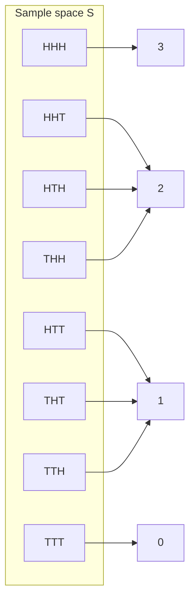
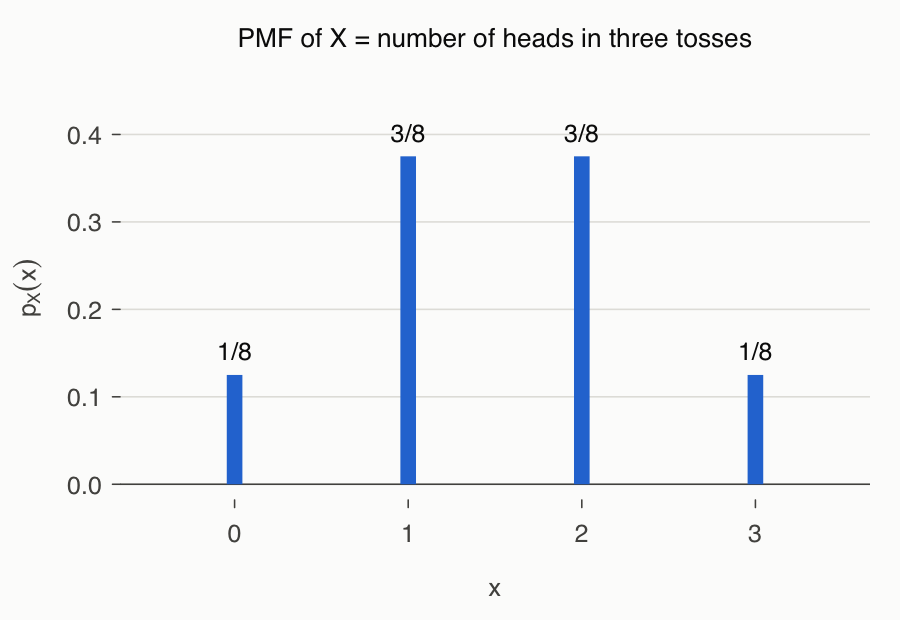
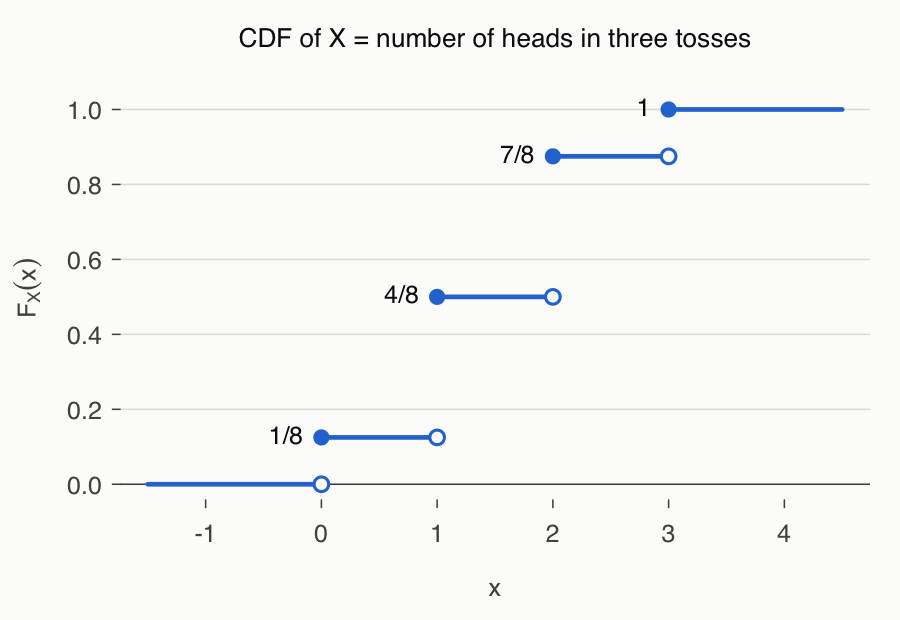

# Lecture 3 — Random Variables and Probability Distributions

[Repository Guide](../../README.md) | [English](Concepts_Lecture.md) | [한국어](Concepts_Lecture.ko.md)

> **Last Updated:** 2026-11-04

> **Learning Objectives:**
> 1. Define a random variable as a function from the sample space to the real numbers, and distinguish discrete from continuous random variables
> 2. Use the correspondence between value ranges of a random variable and events in the sample space to find the probability mass function and the cumulative distribution function, and explain their properties
> 3. Obtain the marginal probability mass functions from a joint probability mass function, and decide whether two random variables are independent
> 4. Compute the expected value, variance, and standard deviation from their definitions, and derive the expected value and variance of a linear transformation aX + b
> 5. Compute a covariance, and explain with an example that independence implies zero covariance but not conversely
> 6. Enumerate a sample space in R to compute a probability distribution and its cumulative distribution function

---

## Table of Contents

- [1. Random Variables](#1-random-variables)
  - [1.1 A Function from the Sample Space to the Real Numbers](#11-a-function-from-the-sample-space-to-the-real-numbers)
  - [1.2 Discrete and Continuous Random Variables](#12-discrete-and-continuous-random-variables)
  - [1.3 Value Ranges and Events](#13-value-ranges-and-events)
- [2. Discrete Probability Distributions](#2-discrete-probability-distributions)
  - [2.1 Probability Mass Function](#21-probability-mass-function)
  - [2.2 Cumulative Distribution Function](#22-cumulative-distribution-function)
  - [2.3 Finding a Distribution with R](#23-finding-a-distribution-with-r)
- [3. Joint Distributions](#3-joint-distributions)
  - [3.1 Joint and Marginal Probability Mass Functions](#31-joint-and-marginal-probability-mass-functions)
  - [3.2 Joint Distribution Function](#32-joint-distribution-function)
- [4. Independence of Random Variables](#4-independence-of-random-variables)
  - [4.1 Definition of Independence](#41-definition-of-independence)
  - [4.2 An Example of Dependent Random Variables](#42-an-example-of-dependent-random-variables)
  - [4.3 An Example of Independent Random Variables and the CDF](#43-an-example-of-independent-random-variables-and-the-cdf)
- [5. Expectation](#5-expectation)
  - [5.1 Definition of the Expected Value](#51-definition-of-the-expected-value)
  - [5.2 Linearity of Expectation](#52-linearity-of-expectation)
  - [5.3 Expectation of a Function of Two Random Variables](#53-expectation-of-a-function-of-two-random-variables)
  - [5.4 Expectation of a Sum and of a Product](#54-expectation-of-a-sum-and-of-a-product)
- [6. Variance and Standard Deviation](#6-variance-and-standard-deviation)
  - [6.1 Variance](#61-variance)
  - [6.2 Standard Deviation](#62-standard-deviation)
  - [6.3 Expectation and Variance of a Linear Transformation](#63-expectation-and-variance-of-a-linear-transformation)
- [7. Covariance](#7-covariance)
  - [7.1 Definition and Meaning of Covariance](#71-definition-and-meaning-of-covariance)
  - [7.2 Independence and Covariance](#72-independence-and-covariance)
  - [7.3 Variance of a Sum](#73-variance-of-a-sum)
- [Concept Applications](#concept-applications)
- [Summary](#summary)
- [Self-Check Questions](#self-check-questions)
- [References](#references)

---

<br>

## 1. Random Variables

Lecture 2 showed how to assign probabilities to events in a sample space. In practice, we are often interested less in the outcome of an experiment itself than in a number obtained from it, such as the number of heads, the sum of dice, or the number of defective items. A random variable turns outcomes into numbers so that probability can be handled as a function of numbers. The sections below define random variables and their distributions, and then derive the expected value, variance, and covariance that summarize a distribution.

### 1.1 A Function from the Sample Space to the Real Numbers

> **Definition:** A **random variable** is a function $X : \mathcal{S} \to \mathbb{R}$ that assigns a real number $X(s)$ to each element (outcome) $s$ of the sample space $\mathcal{S}$. The assignment of probabilities to the values or value ranges that a random variable takes is called its **probability distribution**.

Despite the word "variable" in its name, a random variable is a function. Its value is not chosen freely: once the outcome $s$ of the experiment is fixed, the value $X(s)$ is determined automatically. By convention, random variables are written with capital letters $X$, $Y$, and particular values they take with lowercase letters $x$, $y$.

**Example: tossing a coin three times.** If a coin is tossed three times in sequence, the sample space is as follows, where H is heads and T is tails.

```math
\mathcal{S} = \lbrace HHH,\ HHT,\ HTH,\ HTT,\ THH,\ THT,\ TTH,\ TTT\rbrace
```

Several random variables can be defined on this one sample space.

- $X(s)$ is the number of heads in the outcome $s$. For example, $X(HTH) = 2$.
- $Y(s)$ is the index of the toss at which the first head appears. For example, $Y(TTH) = 3$, and for $TTT$, which has no head, we set $Y(TTT) = 0$.

In this example, $X(s)$ and $Y(s)$ are both integers. Figure 1 shows how $X$ maps the eight outcomes to the four real numbers 0, 1, 2, 3.



*Figure 1. The number of heads X as a function that maps the eight outcomes of the sample space to the real numbers 0, 1, 2, 3*

When the sample space is clear, we often simply write $X$ instead of $X(s)$.

**Structured data and random variables.** Data in the form of a table of rows and columns (structured data) can be viewed as a collection of random variables. Each row is one observed outcome $s$, and each column (height, weight, age, and so on) is a random variable that assigns a real number to that outcome. From the viewpoint of a function that maps real phenomena to real numbers, data analysis deals with the distributions of and relationships among several random variables. Handling several columns together is the subject of joint distributions in Section 3.

### 1.2 Discrete and Continuous Random Variables

Random variables are divided into two kinds according to the form of the values they take.

> **Definition:** A **discrete random variable** is a random variable whose possible values are finite in number or countably infinite. A **continuous random variable** takes uncountably infinitely many values on an interval of real numbers; the probability at a single point is 0, and the probability of an interval is obtained by integrating a probability density function.

**Countably infinite** means infinite in a way that allows every element to be numbered 1st, 2nd, 3rd, and so on without omission. The set of natural numbers $\lbrace1, 2, 3, \dots\rbrace$ and the set of integers are examples. In contrast, an infinity that cannot be fully numbered by any method, such as the real numbers in the interval $[0, 1]$, is **uncountably infinite**.

Since a random variable is defined on a sample space, the size of the sample space indicates its kind. If the sample space is finite, the random variable takes only finitely many values, so it is always discrete. If the sample space is infinite, the random variable is discrete when the sample space is countably infinite and can be continuous when it is uncountably infinite. In summary, a discrete random variable is the case of $X : \mathcal{S} \to \mathbb{R}$ with $\mathcal{S}$ finite or countably infinite, and a continuous random variable is the typical form for $\mathcal{S}$ uncountably infinite.

> **Caution:** The rigorous criterion is not the sample space but **the set of values the random variable takes** [1]. A discrete random variable can be defined even on an uncountable sample space. For example, the waiting time $T$ for a bus is a continuous random variable, but the random variable $X$ that equals 1 if $T$ exceeds 5 minutes and 0 otherwise is a discrete random variable with only the values 0 and 1.

| Random variable | Values taken | Kind |
|:-----|:-----|:-----|
| Number of heads in three coin tosses | 0, 1, 2, 3 | Discrete (finite) |
| Number of rolls of a die until a 6 appears | 1, 2, 3, ... | Discrete (countably infinite) |
| Number of phone calls received in a day | 0, 1, 2, ... | Discrete (countably infinite) |
| Waiting time for a bus (minutes) | Real numbers in $[0, \infty)$ | Continuous |
| Height of a randomly chosen person (cm) | Values in an interval of reals | Continuous |

*Table 1. Examples of random variables classified as discrete or continuous*

Lectures 3-4 deal with discrete random variables; continuous random variables are treated in Lecture 5.

### 1.3 Value Ranges and Events

**Value ranges** of a random variable correspond to events in the sample space. In the experiment of tossing a coin three times, let $X$ be the number of heads. Then:

- The value $X(s) = 2$ corresponds to the event $\lbrace HHT, HTH, THH\rbrace$. Fixing one real number determines the set of outcomes that give that value, that is, an event.
- The range $1 < X(s) \le 3$ corresponds to the event $\lbrace HHH, HHT, HTH, THH\rbrace$.

In general, for a set $A$ of real numbers, $\lbrace X \in A\rbrace$ is shorthand for the following event.

```math
\lbrace X \in A\rbrace = X^{-1}(A) = \lbrace\, s \in \mathcal{S} : X(s) \in A \,\rbrace
```

Here $X^{-1}(A)$ is not an inverse function but the **inverse image**, the set of all outcomes whose function value lies in $A$. The inverse image is always defined, even when $X$ is not one-to-one. Since events have probabilities, value ranges also have probabilities.

```math
P(X \in A) = P(\lbrace\, s \in \mathcal{S} : X(s) \in A \,\rbrace)
```

If a fair coin is tossed independently three times, each of the eight outcomes has probability $1/8$ (Lecture 2). Thus the probability of the range $0 < X \le 2$ is the sum of the probabilities of the six outcomes $\lbrace HHT, HTH, HTT, THH, THT, TTH\rbrace$ that correspond to it.

```math
P(0 < X \le 2) = \frac{6}{8}
```

In the same way one can find $P(X \le -1)$, $P(X \le 0)$, $P(X \le 1)$, $P(X \le 2)$, $P(X \le 3)$, and $P(X \le 4)$; their values are listed in Table 2 of Section 2.2.

Grouping the outcomes in Figure 1 that map to the same value produces four events.

```math
E_0 = \lbrace TTT\rbrace, \quad E_1 = \lbrace HTT, THT, TTH\rbrace, \quad E_2 = \lbrace HHT, HTH, THH\rbrace, \quad E_3 = \lbrace HHH\rbrace
```

> **Key Point:** Because $X$ is a **function**, the events $E_0, E_1, E_2, E_3$ are mutually exclusive and their union is $\mathcal{S}$. A function must be defined for every $s \in \mathcal{S}$, so no outcome is left out, and it is single-valued, so no outcome belongs to two events at once. That is, the events of the form $\lbrace X = x\rbrace$ form a **partition** of the sample space.

---

<br>

## 2. Discrete Probability Distributions

### 2.1 Probability Mass Function

> **Definition:** For a discrete random variable $X$, $p_X(x) \equiv P(X = x)$ is called the **probability mass function (PMF)** of $X$. When the random variable is clear, it is also written $p(x)$ or $f(x)$ instead of $p_X(x)$.

The name "mass" comes from the image of the total probability 1 being split into lumps placed at the points the random variable takes. For the number of heads $X$ in three coin tosses:

```math
\begin{aligned}
p_X(0) &\equiv P(\lbrace TTT\rbrace) = \tfrac{1}{8} \\
p_X(1) &\equiv P(\lbrace HTT, THT, TTH\rbrace) = \tfrac{3}{8} \\
p_X(2) &\equiv P(\lbrace HHT, HTH, THH\rbrace) = \tfrac{3}{8} \\
p_X(3) &\equiv P(\lbrace HHH\rbrace) = \tfrac{1}{8}
\end{aligned}
```

These values add up to $p_X(0) + p_X(1) + p_X(2) + p_X(3) = 1$. The reason lies in the key point of Section 1.3: the four events $\lbrace X = 0\rbrace, \dots, \lbrace X = 3\rbrace$ form a partition of the sample space, so by the axioms of probability the sum of their probabilities is $P(\mathcal{S}) = 1$.

In general, a probability mass function has the following properties.

1. $0 \le p_X(x) \le 1$ for every $x$.
2. Summing over all values of $X$ gives $\sum_x p_X(x) = 1$.
3. For a set $A$ of real numbers, $P(X \in A) = \sum_{x \in A} p_X(x)$.



*Figure 2. Probability mass function of the number of heads X in three coin tosses*

As in Figure 2, a probability mass function is drawn as bars at the values, each with height equal to its probability. This distribution is symmetric about $x = 1.5$.

### 2.2 Cumulative Distribution Function

> **Definition:** For a random variable $X$, $F_X(x) \equiv P(X \le x)$ is called the **cumulative distribution function (CDF)** of $X$. It is also called the probability distribution function, and is written $F(x)$ when the random variable is clear.

The cumulative distribution function is defined at **every real number** $x$, not only at the values $X$ takes. For the number of heads $X$ in three coin tosses, the CDF is as follows.

| $x$ | Event $\lbrace X \le x\rbrace$ | $F(x) = P(X \le x)$ |
|:-----|:-----|:-----|
| $-1$ | Empty event $\emptyset$ | $0$ |
| $0$ | $\lbrace TTT\rbrace$ | $1/8$ |
| $1$ | $\lbrace TTT, HTT, THT, TTH\rbrace$ | $4/8$ |
| $2$ | The seven outcomes other than $HHH$ | $7/8$ |
| $3$ | All eight outcomes ($`\mathcal{S}`$) | $1$ |
| $4$ | All eight outcomes ($`\mathcal{S}`$) | $1$ |

*Table 2. Events {X ≤ x} and values of the cumulative distribution function for the number of heads X*

For example, the probability in Section 1.3 can be obtained as a difference of CDF values.

```math
P(0 < X \le 2) = P(X = 1) + P(X = 2) = F(2) - F(0) = \frac{7}{8} - \frac{1}{8} = \frac{6}{8}
```

The cumulative distribution function has the following properties.

1. **It is non-decreasing.** If $a < b$, the event $\lbrace X \le a\rbrace$ is contained in the event $\lbrace X \le b\rbrace$, so $F(a) \le F(b)$. Since probabilities are nonnegative, accumulating them can only increase the value or leave it unchanged, never decrease it.
2. **$F(-\infty) = 0$ and $F(\infty) = 1$.** Precisely, $\lim_{x \to -\infty} F(x) = 0$ and $\lim_{x \to \infty} F(x) = 1$. As $x$ decreases without bound, the event $\lbrace X \le x\rbrace$ shrinks to the empty event, and as $x$ increases without bound it grows to the whole sample space. Being cumulative, the function starts at 0 and ends at 1.
3. **$P(a < X \le b) = F(b) - F(a)$.** The event $\lbrace X \le b\rbrace$ is the union of the mutually exclusive events $\lbrace X \le a\rbrace$ and $\lbrace a < X \le b\rbrace$, so $F(b) = F(a) + P(a < X \le b)$. Note that the left endpoint $a$ is excluded and the right endpoint $b$ is included.
4. **It is right-continuous.** $\lim_{h \to 0^{+}} F(x + h) = F(x)$ for every $x$ [1]. For a discrete random variable, $F$ jumps up at each value, and its value at that point is the value after the jump.



*Figure 3. Cumulative distribution function of the number of heads X, where filled dots are function values and open dots are left limits*

The CDF of a discrete random variable is a **step function**, as in Figure 3. It jumps by $p_X(x)$ at each value 0, 1, 2, 3 that $X$ takes and is constant in between. Hence $F(1.5) = F(1) = 4/8$, and the probability mass function can be recovered as the size of each jump, $p_X(x) = F(x) - \lim_{h \to 0^{+}} F(x - h)$.

**Probability mass function and probability density function.** The distribution of a discrete random variable is described by a probability mass function, and that of a continuous random variable by a **probability density function (PDF)**. The cumulative distribution function is a common tool for both. Probabilities are obtained by **sums (Σ)** in the discrete case and by **integrals (∫)** in the continuous case.

| Aspect | Discrete random variable | Continuous random variable |
|:-----|:-----|:-----|
| Function describing the distribution | Probability mass function $p_X(x) = P(X = x)$ | Probability density function $f_X(x)$ |
| Cumulative distribution function | $F_X(x) = \sum_{t \le x} p_X(t)$ | $`F_X(x) = \int_{-\infty}^{x} f_X(t)\, dt`$ |
| Probability of an interval $(a, b]$ | $\sum_{a < t \le b} p_X(t)$ | $`\int_{a}^{b} f_X(t)\, dt`$ |
| Probability of a point $P(X = x)$ | Can be greater than 0 | Always 0 |
| Shape of the CDF | Step function | Continuous function |

*Table 3. Comparison of how distributions of discrete and continuous random variables are described*

Because most measurements are continuous and later estimation and hypothesis testing rest on continuous distributions such as the normal distribution, continuous random variables are especially important in statistics (Lectures 5 and 6).

### 2.3 Finding a Distribution with R

For a finite sample space whose outcomes are all equally likely, R can compute a probability distribution directly. There are three steps: enumerate the sample space, apply the random variable to each outcome, and count the outcomes for each value and divide by the total number of outcomes. The basic syntax of R is covered in Lecture 1.

```r
S <- expand.grid(toss1 = c("H", "T"), toss2 = c("H", "T"), toss3 = c("H", "T"))
X <- apply(S, 1, function(s) sum(s == "H"))   # number of heads in each outcome
pX <- table(X) / nrow(S)                       # probability mass function
FX <- cumsum(pX)                               # CDF values F(0), ..., F(3)
pX
FX
```

- `expand.grid()` builds a data frame whose rows are all combinations of the given vectors. Since each of the three tosses is given `"H"` and `"T"`, it creates $2^3 = 8$ rows, that is, the sample space.
- `apply(S, 1, ...)` applies a function to each row of `S` (the second argument `1` means by rows). The function `function(s) sum(s == "H")` counts the cells equal to `"H"` in one outcome. `s == "H"` is a logical vector, and `sum()` counts `TRUE` as 1, so the result is the number of heads. The result `X` is a vector holding $X(s)$ for each of the eight outcomes.
- `table(X)` counts the outcomes for each value (1, 3, 3, 1), and dividing by the total number of outcomes `nrow(S)` = 8 gives the probability mass function.
- `cumsum()` computes cumulative sums, so `FX` holds $F(0), F(1), F(2), F(3)$.

```text
X
    0     1     2     3 
0.125 0.375 0.375 0.125 
    0     1     2     3 
0.125 0.500 0.875 1.000 
```

> **Caution:** Counting outcomes and dividing by the total is correct **only when all outcomes are equally likely**. For a coin whose probability of heads is not 0.5, the outcomes have different probabilities, so the probability of each outcome must be found with the multiplication rule and then added.

The same method solves larger problems such as the sum of four dice and the joint distribution of the maximum and minimum of two dice. These are treated, together with `stepfun()` for drawing step functions, in [Exercises 1-4](Exercises.md).

---

<br>

## 3. Joint Distributions

### 3.1 Joint and Marginal Probability Mass Functions

The probability mass function and the cumulative distribution function can also be functions of **more than one variable**. To handle two random variables defined on the same sample space together, we need the probability that two values occur at the same time.

> **Definition:** For two discrete random variables $X$ and $Y$, $`p_{X,Y}(x, y) \equiv P(X = x,\ Y = y) = P(\lbrace X = x\rbrace \cap \lbrace Y = y\rbrace)`$ is called the **joint probability mass function**.

**Example.** Toss a coin three times, and let $X$ be the number of heads and $Y$ the index of the toss with the first head (0 for $`TTT`$). For example, $p_{X,Y}(2, 1)$ is the probability that there are two heads and the first head occurs at the first toss, that is, two heads with the first toss being heads.

```math
p_{X,Y}(2, 1) = P(X = 2,\ Y = 1) = P(\lbrace HHT, HTH\rbrace) = \frac{2}{8} = \frac{1}{4}
```

To find the whole joint probability mass function, first write down the values of both random variables for each outcome.

| Outcome $s$ | $HHH$ | $HHT$ | $HTH$ | $HTT$ | $THH$ | $THT$ | $TTH$ | $TTT$ |
|:-----|:-----|:-----|:-----|:-----|:-----|:-----|:-----|:-----|
| $X(s)$ | 3 | 2 | 2 | 1 | 2 | 1 | 1 | 0 |
| $Y(s)$ | 1 | 1 | 1 | 1 | 2 | 2 | 3 | 0 |

*Table 4. Number of heads X and position of the first head Y for each outcome of three coin tosses*

Counting the outcomes that give the same $(x, y)$ and dividing by 8 gives the joint probability mass function. For example, only $THT$ gives $(x, y) = (1, 2)$, so $p_{X,Y}(1, 2) = 1/8$.

| | $y = 0$ | $y = 1$ | $y = 2$ | $y = 3$ | $p_X(x)$ |
|:-----|:-----|:-----|:-----|:-----|:-----|
| $x = 0$ | $1/8$ | $0$ | $0$ | $0$ | $1/8$ |
| $x = 1$ | $0$ | $1/8$ | $1/8$ | $1/8$ | $3/8$ |
| $x = 2$ | $0$ | $2/8$ | $1/8$ | $0$ | $3/8$ |
| $x = 3$ | $0$ | $1/8$ | $0$ | $0$ | $1/8$ |
| $p_Y(y)$ | $1/8$ | $4/8$ | $2/8$ | $1/8$ | $1$ |

*Table 5. Joint and marginal probability mass functions of the number of heads X and the position of the first head Y*

The right column and the bottom row of the table are the row sums and column sums.

```math
p_X(x) = \sum_{y} p_{X,Y}(x, y), \qquad p_Y(y) = \sum_{x} p_{X,Y}(x, y)
```

Because they are written in the margins of the table, these are called **marginal probabilities**; $p_X$ is the **marginal PMF** of $X$ and $p_Y$ the marginal PMF of $Y$. A marginal PMF equals the PMF of that random variable considered alone. The event $\lbrace X = x\rbrace$ is the union of the mutually exclusive events $\lbrace X = x, Y = y\rbrace$ ($y$ ranging over all values of $`Y`$), so by the law of total probability of Lecture 2 its probability is the sum of the joint probabilities. Indeed, $p_X$ in Table 5 equals $1/8, 3/8, 3/8, 1/8$ found in Section 2.1.

> **Note:** The marginal distributions can always be obtained from the joint distribution, but the joint distribution cannot be recovered from the marginals alone, because many joint distributions can share the same marginals. Only when the two random variables are independent is the joint distribution determined as the product of the marginals (Section 4).

### 3.2 Joint Distribution Function

The cumulative distribution function also extends to two variables.

```math
F_{X,Y}(x, y) \equiv P(X \le x,\ Y \le y) = \sum_{x_i \le x} \sum_{y_j \le y} p_{X,Y}(x_i, y_j)
```

This is called the **joint cumulative distribution function**, or joint distribution function. It is the sum of the joint probabilities of all cells at most $x$ and at most $y$. For example, from Table 5:

```math
F_{X,Y}(1, 1) = p(0, 0) + p(0, 1) + p(1, 0) + p(1, 1) = \frac{1}{8} + 0 + 0 + \frac{1}{8} = \frac{2}{8}
```

Letting $y$ grow without bound gives $F_{X,Y}(x, \infty) = P(X \le x) = F_X(x)$, so the CDF of each random variable can also be obtained from the joint CDF.

---

<br>

## 4. Independence of Random Variables

### 4.1 Definition of Independence

> **Definition:** Two discrete random variables $X$ and $Y$ are **independent** if $`P(X = x,\ Y = y) = P(X = x) \cdot P(Y = y)`$ for all $x$ and $y$.

The same condition can be written in two other ways.

1. In terms of probability mass functions, $p_{X,Y}(x, y) = p_X(x) \cdot p_Y(y)$ for all $x$ and $y$.
2. In terms of events, $E_x \equiv X^{-1}(\lbrace x\rbrace)$ and $E_y \equiv Y^{-1}(\lbrace y\rbrace)$ are independent events in the sample space $\mathcal{S}$, that is, $P(E_x \cap E_y) = P(E_x) \cdot P(E_y)$ for all $x$ and $y$.

The second form shows that independence of random variables is defined through the independence of events from Lecture 2. Here $`X^{-1}(\lbrace x\rbrace) = \lbrace\, s \in \mathcal{S} : X(s) = x \,\rbrace`$, and in the discrete case $x$ and $y$ are typically integers.

The meaning of independence is clear in terms of conditional probability. When $P(X = x) > 0$, independence is the same as $P(Y = y \mid X = x) = P(Y = y)$: knowing the value of $X$ does not change the distribution of $Y$.

> **Key Point:** Independence requires the product relation to hold for **every** pair $(x, y)$. Hence one pair where the product fails is enough to show dependence, whereas showing independence requires checking all pairs.

### 4.2 An Example of Dependent Random Variables

Are $X$ (the number of heads) and $Y$ (the position of the first head) in Table 5 independent? Compare the joint probability with the product of the marginals at $(x, y) = (0, 1)$.

```math
p_{X,Y}(0, 1) = 0, \qquad p_X(0) \cdot p_Y(1) = \frac{1}{8} \cdot \frac{4}{8} = \frac{1}{16}
```

The two values differ, so there is a pair with $p_{X,Y}(x, y) \ne p_X(x) \cdot p_Y(y)$, and $X$ and $Y$ are **not independent**. Intuitively too, knowing that there is no head ($`X = 0`$) forces $Y = 0$, so the value of $X$ changes the distribution of $Y$.

### 4.3 An Example of Independent Random Variables and the CDF

Are $X$ and $Y$ independent under the following joint probability mass function?

| | $y = 1$ | $y = 2$ | $y = 3$ | $p_X(x)$ |
|:-----|:-----|:-----|:-----|:-----|
| $x = 1$ | $1/3$ | $1/12$ | $1/12$ | $1/2$ |
| $x = 2$ | $2/9$ | $1/18$ | $1/18$ | $1/3$ |
| $x = 3$ | $1/9$ | $1/36$ | $1/36$ | $1/6$ |
| $p_Y(y)$ | $2/3$ | $1/6$ | $1/6$ | $1$ |

*Table 6. Joint and marginal probability mass functions of two independent random variables*

In all nine cells, the joint probability equals the product of the marginals. For example, $p_X(1)p_Y(1) = \frac{1}{2} \cdot \frac{2}{3} = \frac{1}{3}$, $p_X(2)p_Y(2) = \frac{1}{3} \cdot \frac{1}{6} = \frac{1}{18}$, and $p_X(3)p_Y(1) = \frac{1}{6} \cdot \frac{2}{3} = \frac{1}{9}$, and the other six cells check out in the same way. Therefore $X$ and $Y$ **are independent**.

The joint CDF $F_{X,Y}(x, y) \equiv P(X \le x, Y \le y)$ of the same distribution is the sum over the rectangle from the top-left of Table 6 to the given cell.

| | $y = 1$ | $y = 2$ | $y = 3$ | $F_X(x)$ |
|:-----|:-----|:-----|:-----|:-----|
| $x = 1$ | $1/3$ | $5/12$ | $1/2$ | $1/2$ |
| $x = 2$ | $5/9$ | $25/36$ | $5/6$ | $5/6$ |
| $x = 3$ | $2/3$ | $5/6$ | $1$ | $1$ |
| $F_Y(y)$ | $2/3$ | $5/6$ | $1$ | $1$ |

*Table 7. Joint cumulative distribution function of the distribution in Table 6 and the CDF of each random variable*

For example, $F_{X,Y}(2, 2) = \frac{1}{3} + \frac{1}{12} + \frac{2}{9} + \frac{1}{18} = \frac{12 + 3 + 8 + 2}{36} = \frac{25}{36}$, which equals $F_X(2) \cdot F_Y(2) = \frac{5}{6} \cdot \frac{5}{6} = \frac{25}{36}$. The relation $F_{X,Y}(x, y) = F_X(x) \cdot F_Y(y)$ holds in the other cells as well. This is not a coincidence but a general property of independent random variables.

**Property.** The joint CDF of independent random variables $X$ and $Y$ satisfies $F_{X,Y}(x, y) = F_X(x) \cdot F_Y(y)$ for all $x$, $y$.

**Proof.** Let the values of $X$ be $x_1 < x_2 < \cdots$ and those of $Y$ be $y_1 < y_2 < \cdots$. Then:

```math
\begin{aligned}
F_{X,Y}(x_k, y_\ell) &= P(X \le x_k,\ Y \le y_\ell) = \sum_{i \le k} \sum_{j \le \ell} p_{X,Y}(x_i, y_j) \\
&= \sum_{i \le k} \sum_{j \le \ell} p_X(x_i) \cdot p_Y(y_j) && \text{(by independence)} \\
&= \sum_{i \le k} \Big\lbrace p_X(x_i) \sum_{j \le \ell} p_Y(y_j) \Big\rbrace \\
&= \Big\lbrace \sum_{i \le k} p_X(x_i) \Big\rbrace \cdot \Big\lbrace \sum_{j \le \ell} p_Y(y_j) \Big\rbrace = F_X(x_k) \cdot F_Y(y_\ell)
\end{aligned}
```

In the third line, $p_X(x_i)$ does not depend on the sum over $j$, so it is taken out of the inner sum.

> **Note:** The converse also holds: if $F_{X,Y}(x, y) = F_X(x) \cdot F_Y(y)$ for all $x$, $y$, then $X$ and $Y$ are independent [1]. Hence deciding independence through the probability mass function or through the cumulative distribution function leads to the same conclusion.

---

<br>

## 5. Expectation

### 5.1 Definition of the Expected Value

> **Definition:** The **expected value** of a discrete random variable $X$ is $E(X) \equiv \sum_k x_k \cdot P(X = x_k) = \sum_k x_k \cdot p_X(x_k)$, where the sum runs over all values $x_k$ that $X$ takes. The expected value is also called the **mean** of $X$ and is written $\mu$ or $\mu_X$.

The expected value is the **weighted average** of the values of $X$, weighted by their probabilities. If the same experiment is repeated independently a very large number of times, the average of the observations approaches the expected value.

**Example: one roll of a die.** Let $X$ be the number shown by one roll of a fair die; each face has probability $1/6$.

```math
E(X) = 1 \cdot \frac{1}{6} + 2 \cdot \frac{1}{6} + \cdots + 6 \cdot \frac{1}{6} = \frac{1}{6} \sum_{k=1}^{6} k = \frac{1}{6} \cdot 21 = \frac{7}{2}
```

$7/2 = 3.5$ is a value a die can never show. The expected value is the center of mass of the distribution and need not be a value the random variable actually takes.

**Expectation of a function.** A function $g(X)$ of a random variable is also a random variable, and its expected value can be computed directly from the distribution of $X$ without finding the distribution of $g(X)$.

```math
E[g(X)] = \sum_k g(x_k) \cdot p_X(x_k)
```

For example, for a die $E(X^2) = \frac{1}{6}(1^2 + 2^2 + \cdots + 6^2) = \frac{91}{6}$. This formula is used for the variance in Section 6. To avoid nested parentheses, the notation $E(X)$ is used when the argument is simple, and square brackets as in $E[(X - \mu)^2]$ when the argument contains parentheses.

> **Note:** When $X$ takes infinitely many values, the expected value is defined only if the sum converges. Precisely, the expected value is said to exist when $`\sum_k |x_k|\, p_X(x_k) < \infty`$ [1]. All distributions in Lectures 3-4 satisfy this condition.

### 5.2 Linearity of Expectation

For constants $a$ and $b$, the following holds.

```math
E(aX) = a\,E(X), \qquad E(aX + b) = a\,E(X) + b
```

**Proof (discrete random variable).** Substitute $g(x) = ax + b$ into the formula for the expectation of a function.

```math
E(aX + b) = \sum_k (a x_k + b)\, p_X(x_k) = a \sum_k x_k\, p_X(x_k) + b \sum_k p_X(x_k) = a\,E(X) + b \cdot 1
```

The last step uses the fact that the probability mass function sums to 1. Setting $b = 0$ gives $`E(aX) = a\,E(X)`$.

**Proof (continuous random variable).** For a continuous random variable with probability density function $f(x)$, integrals replace sums (Lecture 5). The expected value is $`E(X) = \int_{-\infty}^{\infty} x f(x)\, dx`$, and $`\int_{-\infty}^{\infty} f(x)\, dx = 1`$.

```math
E(aX + b) = \int_{-\infty}^{\infty} (ax + b) f(x)\, dx = a \int_{-\infty}^{\infty} x f(x)\, dx + b \int_{-\infty}^{\infty} f(x)\, dx = a\,E(X) + b
```

For example, if the number $X$ shown by a die is multiplied by 100 and then 400 is subtracted, $Y = 100X - 400$ has expected value $100 \cdot \frac{7}{2} - 400 = -50$. There is no need to find the distribution of $Y$ separately.

### 5.3 Expectation of a Function of Two Random Variables

The expected value of a function $g(X, Y)$ of two random variables is the sum weighted by the joint probability mass function.

```math
E[g(X, Y)] \equiv \sum_k \sum_\ell g(x_k, y_\ell)\, p_{X,Y}(x_k, y_\ell)
```

**Example.** For the distribution in Table 6, find $E(X)$, $E(Y)$, and $E(XY)$. $E(X)$ and $E(Y)$ are computed from the marginal probability mass functions.

```math
E(X) = 1 \cdot \frac{1}{2} + 2 \cdot \frac{1}{3} + 3 \cdot \frac{1}{6} = \frac{5}{3}, \qquad E(Y) = 1 \cdot \frac{2}{3} + 2 \cdot \frac{1}{6} + 3 \cdot \frac{1}{6} = \frac{3}{2}
```

For $E(XY)$, set $g(x, y) = xy$ and add over all nine cells. Each term is $xy$ times the probability of the cell.

```math
\begin{aligned}
E(XY) &= 1 \cdot \frac{1}{3} + 2 \cdot \frac{1}{12} + 3 \cdot \frac{1}{12} \\
&\quad + 2 \cdot \frac{2}{9} + 4 \cdot \frac{1}{18} + 6 \cdot \frac{1}{18} \\
&\quad + 3 \cdot \frac{1}{9} + 6 \cdot \frac{1}{36} + 9 \cdot \frac{1}{36} \\
&= \frac{12 + 6 + 9 + 16 + 8 + 12 + 12 + 6 + 9}{36} = \frac{90}{36} = \frac{5}{2}
\end{aligned}
```

This equals $E(X) \cdot E(Y) = \frac{5}{3} \cdot \frac{3}{2} = \frac{5}{2}$. The reason is that $X$ and $Y$ are independent, as shown in Section 4.3, and Property 2 of Section 5.4 guarantees this in general.

### 5.4 Expectation of a Sum and of a Product

**Property 1.** For any two random variables, $E(X + Y) = E(X) + E(Y)$. $X$ and $Y$ need **not** be independent.

**Proof.** Set $g(x, y) = x + y$, split the sum in two, and in each part carry out the sum over the other variable first.

```math
\begin{aligned}
E(X + Y) &= \sum_k \sum_\ell (x_k + y_\ell)\, p_{X,Y}(x_k, y_\ell) \\
&= \sum_k \sum_\ell x_k\, p_{X,Y}(x_k, y_\ell) + \sum_k \sum_\ell y_\ell\, p_{X,Y}(x_k, y_\ell) \\
&= \sum_k \sum_\ell x_k\, p_{X,Y}(x_k, y_\ell) + \sum_\ell \sum_k y_\ell\, p_{X,Y}(x_k, y_\ell) \\
&= \sum_k \Big\lbrace x_k \sum_\ell p_{X,Y}(x_k, y_\ell) \Big\rbrace + \sum_\ell \Big\lbrace y_\ell \sum_k p_{X,Y}(x_k, y_\ell) \Big\rbrace \\
&= \sum_k x_k\, p_X(x_k) + \sum_\ell y_\ell\, p_Y(y_\ell) = E(X) + E(Y)
\end{aligned}
```

The third line swaps the order of summation in the second sum, and the fifth line uses the marginal PMF formula of Section 3.1. Independence is used nowhere.

**Property 2.** If $X$ and $Y$ are independent, then $E(XY) = E(X) \cdot E(Y)$.

**Proof.** Under independence, the joint PMF factors into the marginal PMFs, so the double sum becomes the product of two sums.

```math
\begin{aligned}
E(XY) &= \sum_k \sum_\ell x_k\, y_\ell\, p_{X,Y}(x_k, y_\ell) \\
&= \sum_k \sum_\ell x_k\, y_\ell\, p_X(x_k)\, p_Y(y_\ell) && \text{(by independence)} \\
&= \sum_k \Big\lbrace x_k\, p_X(x_k) \sum_\ell y_\ell\, p_Y(y_\ell) \Big\rbrace \\
&= \Big\lbrace \sum_k x_k\, p_X(x_k) \Big\rbrace \cdot \Big\lbrace \sum_\ell y_\ell\, p_Y(y_\ell) \Big\rbrace = E(X) \cdot E(Y)
\end{aligned}
```

**The converse does not hold.** The following distribution is an example.

| | $y = 6$ | $y = 8$ | $y = 10$ | $p_X(x)$ |
|:-----|:-----|:-----|:-----|:-----|
| $x = 1$ | $1/5$ | $0$ | $1/5$ | $2/5$ |
| $x = 2$ | $0$ | $1/5$ | $0$ | $1/5$ |
| $x = 3$ | $1/5$ | $0$ | $1/5$ | $2/5$ |
| $p_Y(y)$ | $2/5$ | $1/5$ | $2/5$ | $1$ |

*Table 8. Joint probability mass function of two dependent random variables whose product has expected value equal to the product of their expected values*

The expected values are as follows.

```math
E(X) = 1 \cdot \frac{2}{5} + 2 \cdot \frac{1}{5} + 3 \cdot \frac{2}{5} = \frac{10}{5} = 2, \qquad E(Y) = 6 \cdot \frac{2}{5} + 8 \cdot \frac{1}{5} + 10 \cdot \frac{2}{5} = \frac{40}{5} = 8
```

```math
E(XY) = (1 \cdot 6) \cdot \frac{1}{5} + (1 \cdot 10) \cdot \frac{1}{5} + (2 \cdot 8) \cdot \frac{1}{5} + (3 \cdot 6) \cdot \frac{1}{5} + (3 \cdot 10) \cdot \frac{1}{5} = \frac{6 + 10 + 16 + 18 + 30}{5} = 16
```

Hence $E(XY) = 16 = 2 \cdot 8 = E(X) \cdot E(Y)$. However, $p_{X,Y}(1, 6) = \frac{1}{5}$ while $p_X(1) \cdot p_Y(6) = \frac{2}{5} \cdot \frac{2}{5} = \frac{4}{25}$, so $X$ and $Y$ are not independent. There is also a cell with $p_{X,Y}(1, 8) = 0 \ne \frac{2}{5} \cdot \frac{1}{5}$.

> **Caution:** $E(XY) = E(X)E(Y)$ is only a **necessary** condition for independence, not a sufficient one. One cannot conclude independence from this equation. Among the criteria discussed so far, the ones that work in both directions are the conditions written in terms of probabilities: $p_{X,Y} = p_X \cdot p_Y$ or $F_{X,Y} = F_X \cdot F_Y$ for all $(x, y)$. Conversely, if $E(XY) \ne E(X)E(Y)$, one can conclude that $X$ and $Y$ are not independent.

---

<br>

## 6. Variance and Standard Deviation

### 6.1 Variance

The expected value describes the center of a distribution but says nothing about how spread out the values are. The spread is measured by the variance.

> **Definition:** The **variance** of a random variable $X$ with mean $\mu = E(X)$ is $`\mathrm{Var}(X) \equiv E[(X - \mu)^2] = \sum_k (x_k - \mu)^2\, p_X(x_k)`$.

The variance is the probability-weighted average of the squared distances of the values from the mean, that is, the **average weighted square distance**. Distances are squared because averaging the deviations $x_k - \mu$ as they are always gives 0; indeed, by linearity $E(X - \mu) = E(X) - \mu = 0$. Squaring prevents positive and negative deviations from cancelling and puts more weight on distant values. The variance is always nonnegative, and it is 0 only when $X$ takes a single value with probability 1.

The variance can be rewritten in a simpler form by expanding the square and using the linearity of Section 5.2 ($\mu$ is a constant).

```math
\begin{aligned}
\mathrm{Var}(X) &= E[X^2 - 2\mu X + \mu^2] \\
&= E(X^2) - 2\mu\, E(X) + \mu^2 \\
&= E(X^2) - 2\mu^2 + \mu^2 \\
&= E(X^2) - \mu^2
\end{aligned}
```

In words, the variance is "the mean of the square minus the square of the mean," and this formula is usually more convenient for computation.

**Example: one roll of a die.** $\mu = 7/2$ and $E(X^2) = \frac{1}{6}\sum_{k=1}^{6} k^2$. Substituting $n = 6$ into the sum-of-squares formula $\sum_{k=1}^{n} k^2 = \frac{n(n+1)(2n+1)}{6}$ gives $\frac{6 \cdot 7 \cdot 13}{6} = 91$.

```math
\mathrm{Var}(X) = \sum_{k=1}^{6} \Big[ k^2 \cdot \frac{1}{6} \Big] - \mu^2 = \frac{1}{6} \cdot \frac{6(6+1)(2 \cdot 6+1)}{6} - \Big(\frac{7}{2}\Big)^2 = \frac{91}{6} - \frac{49}{4} = \frac{182 - 147}{12} = \frac{35}{12}
```

The definition gives the same result. The deviations $k - 3.5$ are $-2.5, -1.5, -0.5, 0.5, 1.5, 2.5$, and the sum of their squares is $6.25 + 2.25 + 0.25 + 0.25 + 2.25 + 6.25 = 17.5$, so $\mathrm{Var}(X) = 17.5 / 6 = 35/12 \approx 2.917$.

### 6.2 Standard Deviation

> **Definition:** The **standard deviation** of $X$ is the positive square root of the variance, $\sigma(X) \equiv \sqrt{\mathrm{Var}(X)} = \sqrt{E[(X - \mu)^2]} = \sqrt{E(X^2) - \mu^2}$. It is also written $\sigma_X$, and the variance is written $\sigma^2$ or $\sigma_X^2$.

The variance has squared units (for example, cm²), which makes direct comparison with the original values difficult. The standard deviation has the same unit as $X$ and is interpreted as a typical distance of the values from the mean. The standard deviation of a die is:

```math
\sigma = \sqrt{\frac{35}{12}} \approx 1.708
```

### 6.3 Expectation and Variance of a Linear Transformation

For constants $a$ and $b$, the expected value and variance of $aX + b$ are as follows.

```math
E(aX + b) = a\,E(X) + b, \qquad \mathrm{Var}(aX + b) = a^2\, \mathrm{Var}(X)
```

The first formula was proved in Section 5.2. The second uses the fact that the mean of $aX + b$ is $a\mu_X + b$.

```math
\begin{aligned}
\mathrm{Var}(aX + b) &= E\big[\lbrace(aX + b) - (a\mu_X + b)\rbrace^2\big] \\
&= E\big[a^2 (X - \mu_X)^2\big] \\
&= a^2\, E\big[(X - \mu_X)^2\big] = a^2\, \mathrm{Var}(X)
\end{aligned}
```

Since $b$ cancels in the second line, shifting all values by the same constant does not change the spread. Multiplying all values by $a$ multiplies the deviations by $a$, so the variance is multiplied by $a^2$ and the standard deviation by $|a|$: $`\sigma(aX + b) = |a|\, \sigma(X)`$.

**Example.** For the number $X$ shown by a die and $Y = 100X - 400$, we have $\mu_X = 7/2$ and $\sigma_X^2 = 35/12$, so:

```math
\mu_Y = 100 \cdot \frac{7}{2} - 400 = 350 - 400 = -50, \qquad \sigma_Y^2 = 100^2 \cdot \frac{35}{12} = \frac{350{,}000}{12} \approx 29{,}166.67
```

The standard deviation is $\sigma_Y = 100 \cdot \sigma_X \approx 170.78$.

> **Note:** In particular, with $a = 1/\sigma$ and $b = -\mu/\sigma$, the variable $Z = (X - \mu)/\sigma$ has mean 0 and variance 1. This transformation is called **standardization**, and it reappears with the standard normal distribution in Lecture 5.

---

<br>

## 7. Covariance

### 7.1 Definition and Meaning of Covariance

> **Definition:** The **covariance** of two random variables $X$ and $Y$ with means $E(X) = \mu_X$ and $E(Y) = \mu_Y$ is $`\mathrm{Cov}(X, Y) \equiv E[(X - \mu_X)(Y - \mu_Y)] = \sum_{k, \ell} (x_k - \mu_X)(y_\ell - \mu_Y)\, p_{X,Y}(x_k, y_\ell)`$.

Like the variance, the covariance can be simplified by expanding the product.

```math
\begin{aligned}
\mathrm{Cov}(X, Y) &= E[(X - \mu_X)(Y - \mu_Y)] \\
&= E[XY - \mu_X Y - \mu_Y X + \mu_X \mu_Y] \\
&= E(XY) - \mu_X \mu_Y - \mu_Y \mu_X + \mu_X \mu_Y \\
&= E(XY) - E(X)\,E(Y)
\end{aligned}
```

The third line uses linearity, $`E(\mu_X Y) = \mu_X\, E(Y) = \mu_X \mu_Y`$. Setting $Y = X$ gives $\mathrm{Cov}(X, X) = E(X^2) - \mu_X^2 = \mathrm{Var}(X)$, so the variance is the covariance of a random variable with itself.

The covariance measures the direction in which two random variables move together, their **concordance** or **coherence**.

- If $X > \mu_X$ tends to occur when $Y > \mu_Y$, and $X < \mu_X$ when $Y < \mu_Y$, the product of deviations $(X - \mu_X)(Y - \mu_Y)$ is mostly positive, so $\mathrm{Cov}(X, Y) > 0$.
- If $X > \mu_X$ tends to occur when $Y < \mu_Y$, and $X < \mu_X$ when $Y > \mu_Y$, the product of deviations is mostly negative, so $\mathrm{Cov}(X, Y) < 0$.

The variance ranges over $[0, \infty)$, but the covariance ranges over $(-\infty, \infty)$. For the covariance, the **sign** carries important information in addition to the size.

> **Note:** The size of a covariance changes with the units of measurement; measuring height in m instead of cm divides the covariance by 100. The **correlation coefficient** $\rho = \mathrm{Cov}(X, Y) / (\sigma_X \sigma_Y)$ removes the effect of units and always lies between $-1$ and $1$ [1]. Correlation analysis is covered in Lecture 7.

### 7.2 Independence and Covariance

**Property.** If $X$ and $Y$ are independent, then $\mathrm{Cov}(X, Y) = 0$.

**Proof.** Section 7.1 showed $\mathrm{Cov}(X, Y) = E(XY) - E(X)E(Y)$, and Section 5.4 showed that independence implies $E(XY) = E(X)E(Y)$. Combining the two results, the covariance is 0.

The converse does not hold. For the distribution in Table 8, $E(X) = 2$, $E(Y) = 8$, and $E(XY) = 16$, so the covariance is $\mathrm{Cov}(X, Y) = 16 - 2 \cdot 8 = 0$. Yet, as seen in Section 5.4, $X$ and $Y$ are not independent.

> **Caution:** $\mathrm{Cov}(X, Y) = 0$ does not mean that $X$ and $Y$ are independent. The covariance measures only the **linear** tendency between two random variables. For example, if $X$ takes $-1, 0, 1$ each with probability $1/3$ and $Y = X^2$, then $E(X) = 0$ and $E(XY) = E(X^3) = 0$, so the covariance is 0. But $Y$ is completely determined by $X$, so they are not independent.

The relations among independence, the expectation of a product, and the covariance are:

```math
X, Y \text{ independent} \ \Longrightarrow\ E(XY) = E(X)\,E(Y) \ \Longleftrightarrow\ \mathrm{Cov}(X, Y) = 0
```

The arrow on the left holds in one direction only, while the two conditions on the right are equivalent.

### 7.3 Variance of a Sum

The variance of a sum of two random variables is the sum of their variances plus a covariance term. It uses the fact that the mean of $X + Y$ is $\mu_X + \mu_Y$ (Property 1 of Section 5.4).

```math
\begin{aligned}
\mathrm{Var}(X + Y) &= E\big[\lbrace(X + Y) - (\mu_X + \mu_Y)\rbrace^2\big] = E\big[\lbrace(X - \mu_X) + (Y - \mu_Y)\rbrace^2\big] \\
&= E\big[(X - \mu_X)^2\big] + E\big[(Y - \mu_Y)^2\big] + 2\,E\big[(X - \mu_X)(Y - \mu_Y)\big] \\
&= \mathrm{Var}(X) + \mathrm{Var}(Y) + 2\,\mathrm{Cov}(X, Y)
\end{aligned}
```

**Property.** If $X$ and $Y$ are independent, then $\mathrm{Cov}(X, Y) = 0$, so $\mathrm{Var}(X + Y) = \mathrm{Var}(X) + \mathrm{Var}(Y)$.

In the same way, $`\mathrm{Var}(X - Y) = \mathrm{Var}(X) + \mathrm{Var}(Y) - 2\,\mathrm{Cov}(X, Y)`$, and under independence the variance of a difference is also the **sum** of the variances. For $n$ mutually independent random variables, $\mathrm{Var}(X_1 + \cdots + X_n) = \mathrm{Var}(X_1) + \cdots + \mathrm{Var}(X_n)$, a property used in Lecture 4 to find the variance of the binomial distribution.

**Example.** When four dice are rolled independently, the sum $X_1 + X_2 + X_3 + X_4$ has the following mean and variance.

```math
E\Big(\sum_{i=1}^{4} X_i\Big) = 4 \cdot \frac{7}{2} = 14, \qquad \mathrm{Var}\Big(\sum_{i=1}^{4} X_i\Big) = 4 \cdot \frac{35}{12} = \frac{35}{3} \approx 11.667
```

The standard deviation is $\sqrt{35/3} \approx 3.4157$. Obtaining the same values by listing all 1296 outcomes is the subject of [Exercise 2](Exercises.md#exercise-2-distribution-of-the-sum-of-four-dice).

---

<br>

## Concept Applications

**True/False Check:**

| Statement | Judgment and Reason |
|:-----|:-----|
| A random variable is a function that assigns probabilities to events. | **F.** A random variable is a function that assigns a real number to each outcome of the sample space. Assigning probabilities to events is the job of the probability (probability measure). |
| Every random variable defined on a finite sample space is discrete. | **T.** With finitely many outcomes, the random variable takes finitely many values. |
| The cumulative distribution function can decrease as $x$ increases. | **F.** If $a < b$, then $\lbrace X \le a\rbrace \subset \lbrace X \le b\rbrace$, so $F(a) \le F(b)$. |
| The CDF $F(x)$ of a discrete random variable is defined only at the values $X$ takes. | **F.** It is defined at every real $x$ and is a step function that is constant between values. |
| The marginal PMFs can always be obtained from the joint PMF. | **T.** They are the row and column sums. Conversely, the joint distribution is generally not determined by the marginals. |
| If $E(XY) = E(X)E(Y)$, then $X$ and $Y$ are independent. | **F.** The distribution in Table 8 is a counterexample. This equation is only a necessary condition for independence. |
| Even if $X$ and $Y$ are not independent, $E(X + Y) = E(X) + E(Y)$. | **T.** The additivity of expectation always holds, regardless of independence. |
| $\mathrm{Var}(X + 3) = \mathrm{Var}(X) + 9$. | **F.** Adding a constant does not change the spread, so $\mathrm{Var}(X + 3) = \mathrm{Var}(X)$. |
| $`\mathrm{Var}(-2X) = -2\,\mathrm{Var}(X)`$. | **F.** Since $`\mathrm{Var}(aX) = a^2\,\mathrm{Var}(X)`$, it equals $`4\,\mathrm{Var}(X)`$. A variance cannot be negative. |
| If the covariance is 0, the two random variables are independent. | **F.** There are counterexamples such as $Y = X^2$ with $X$ uniform on $-1, 0, 1$. Independence implies zero covariance, but not conversely. |

---

<br>

## Summary

| Concept | Key Summary |
|:-----|:-----|
| Random variable | A function $X : \mathcal{S} \to \mathbb{R}$ that assigns a real number to each outcome of the sample space. Each column of structured data can be viewed as a random variable. |
| Discrete and continuous | Discrete if the values are finite in number or countably infinite, continuous if they spread continuously over an interval of reals. A random variable on a finite sample space is always discrete. |
| Value ranges and events | $\lbrace X \in A\rbrace = \lbrace s : X(s) \in A\rbrace$ is an event and therefore has a probability. The events $\lbrace X = x\rbrace$ form a partition of the sample space. |
| Probability mass function | $p_X(x) = P(X = x)$. Each value lies between 0 and 1, and the values sum to 1. |
| Cumulative distribution function | $F_X(x) = P(X \le x)$. It is non-decreasing and right-continuous with $F(-\infty) = 0$, $F(\infty) = 1$, and $P(a < X \le b) = F(b) - F(a)$. In the discrete case it is a step function. |
| Joint and marginal distributions | $p_{X,Y}(x, y) = P(X = x, Y = y)$. The marginal PMFs are the row and column sums of the joint probabilities. |
| Independence | $p_{X,Y} = p_X \cdot p_Y$ for all $(x, y)$. Checking the product of CDFs gives the same result. One counterexample shows dependence. |
| Expected value | $`E(X) = \sum_k x_k\, p_X(x_k)`$ is a weighted average. $E(aX + b) = aE(X) + b$ and $E(X + Y) = E(X) + E(Y)$ always hold. |
| Expectation of a product | If $X$ and $Y$ are independent, $E(XY) = E(X)E(Y)$. The converse does not hold. |
| Variance and standard deviation | $\mathrm{Var}(X) = E[(X - \mu)^2] = E(X^2) - \mu^2$ and $\sigma = \sqrt{\mathrm{Var}(X)}$. One roll of a die has $\mu = 7/2$ and $\sigma^2 = 35/12$. |
| Linear transformation | $`\mathrm{Var}(aX + b) = a^2\,\mathrm{Var}(X)`$ and $`\sigma(aX + b) = \vert a \vert\,\sigma(X)`$. An added constant does not affect the variance. |
| Covariance | $\mathrm{Cov}(X, Y) = E[(X - \mu_X)(Y - \mu_Y)] = E(XY) - E(X)E(Y)$. Its range is $(-\infty, \infty)$, and its sign shows the direction of joint movement. |
| Independence and covariance | Independence implies zero covariance, but zero covariance does not imply independence. |
| Variance of a sum | $`\mathrm{Var}(X + Y) = \mathrm{Var}(X) + \mathrm{Var}(Y) + 2\,\mathrm{Cov}(X, Y)`$, which reduces to the sum of variances under independence. |

---

<br>

## Self-Check Questions

1. **Cumulative distribution function:** For the number of heads $X$ in three coin tosses, find $P(X \le 1)$, $P(1 < X \le 3)$, and $F(1.5)$.

   <details>
   <summary>Answer</summary>

   $P(X \le 1) = F(1) = 1/8 + 3/8 = 4/8$. $P(1 < X \le 3) = F(3) - F(1) = 1 - 4/8 = 4/8$. The CDF is constant between values, so $F(1.5) = F(1) = 4/8$.

   </details>

2. **Discrete or continuous:** What kind of random variable is the number of requests a web server receives in a day, and what kind is the response time of one request? Give reasons.

   <details>
   <summary>Answer</summary>

   The number of requests takes only values that can be numbered, $0, 1, 2, \dots$, so it is a discrete random variable (countably infinite if no upper limit is set). The response time takes real values in $[0, \infty)$, so it is a continuous random variable.

   </details>

3. **Marginals and independence:** In Table 5, show $p_Y(2) = 2/8$ from the joint probabilities, and check the product relation at $(x, y) = (3, 1)$.

   <details>
   <summary>Answer</summary>

   $p_Y(2) = p(0, 2) + p(1, 2) + p(2, 2) + p(3, 2) = 0 + 1/8 + 1/8 + 0 = 2/8$. At $(3, 1)$, $p_{X,Y}(3, 1) = 1/8$ while $p_X(3) p_Y(1) = (1/8)(4/8) = 1/16$, so the product relation fails. This single pair already shows that $X$ and $Y$ are not independent.

   </details>

4. **Deciding independence:** Are $X$ and $Y$ with $p(0, 0) = 0.12$, $p(0, 1) = 0.28$, $p(1, 0) = 0.18$, $p(1, 1) = 0.42$ independent?

   <details>
   <summary>Answer</summary>

   The marginals are $p_X(0) = 0.12 + 0.28 = 0.4$, $p_X(1) = 0.6$, $p_Y(0) = 0.12 + 0.18 = 0.3$, and $p_Y(1) = 0.7$. The products for the four cells are $0.4 \cdot 0.3 = 0.12$, $0.4 \cdot 0.7 = 0.28$, $0.6 \cdot 0.3 = 0.18$, and $0.6 \cdot 0.7 = 0.42$, all equal to the joint probabilities, so they are independent.

   </details>

5. **Expected value and variance:** If $X$ takes $-1, 0, 2$ with probabilities $0.2, 0.5, 0.3$, find $E(X)$ and $\mathrm{Var}(X)$.

   <details>
   <summary>Answer</summary>

   $E(X) = (-1)(0.2) + 0(0.5) + 2(0.3) = 0.4$. $E(X^2) = 1(0.2) + 0(0.5) + 4(0.3) = 1.4$, so $\mathrm{Var}(X) = 1.4 - 0.4^2 = 1.24$.

   </details>

6. **Linear transformation:** For $X$ in Question 5, find the expected value, variance, and standard deviation of $Y = 3 - 2X$.

   <details>
   <summary>Answer</summary>

   $E(Y) = 3 - 2E(X) = 3 - 0.8 = 2.2$. $\mathrm{Var}(Y) = (-2)^2 \mathrm{Var}(X) = 4 \cdot 1.24 = 4.96$, and the standard deviation is $\sqrt{4.96} \approx 2.227$. The sign of the coefficient does not affect the variance.

   </details>

7. **Computing a covariance:** Find the covariance of $X$ (the number of heads) and $Y$ (the position of the first head) in Table 4.

   <details>
   <summary>Answer</summary>

   $E(X) = 3/2$. $E(Y) = 0 \cdot 1/8 + 1 \cdot 4/8 + 2 \cdot 2/8 + 3 \cdot 1/8 = 11/8$. The values of $XY$ for the eight outcomes are $3, 2, 2, 1, 4, 2, 3, 0$, which sum to 17, so $E(XY) = 17/8$. Therefore $\mathrm{Cov}(X, Y) = 17/8 - (3/2)(11/8) = 17/8 - 33/16 = 1/16$.

   </details>

8. **Variance of a sum:** If $\mathrm{Var}(X) = 4$, $\mathrm{Var}(Y) = 9$, and $\mathrm{Cov}(X, Y) = -2$, find $\mathrm{Var}(X + Y)$ and $\mathrm{Var}(X - Y)$. What if the two random variables were independent?

   <details>
   <summary>Answer</summary>

   $\mathrm{Var}(X + Y) = 4 + 9 + 2(-2) = 9$ and $\mathrm{Var}(X - Y) = 4 + 9 - 2(-2) = 17$. Under independence the covariance is 0, so both equal $4 + 9 = 13$.

   </details>

9. **Criterion for independence:** Explain why verifying $E(XY) = E(X)E(Y)$ alone does not establish independence.

   <details>
   <summary>Answer</summary>

   Independence implies $E(XY) = E(X)E(Y)$, but the converse does not hold. The distribution in Table 8 has $E(XY) = 16 = E(X)E(Y)$ while $p_{X,Y}(1, 6) = 1/5 \ne p_X(1)p_Y(6) = 4/25$. Independence is decided by the product relation of the PMFs or CDFs at every $(x, y)$.

   </details>

---

<br>

## References

1. S. M. Ross, *A First Course in Probability*, 10th ed. Pearson, 2019.
