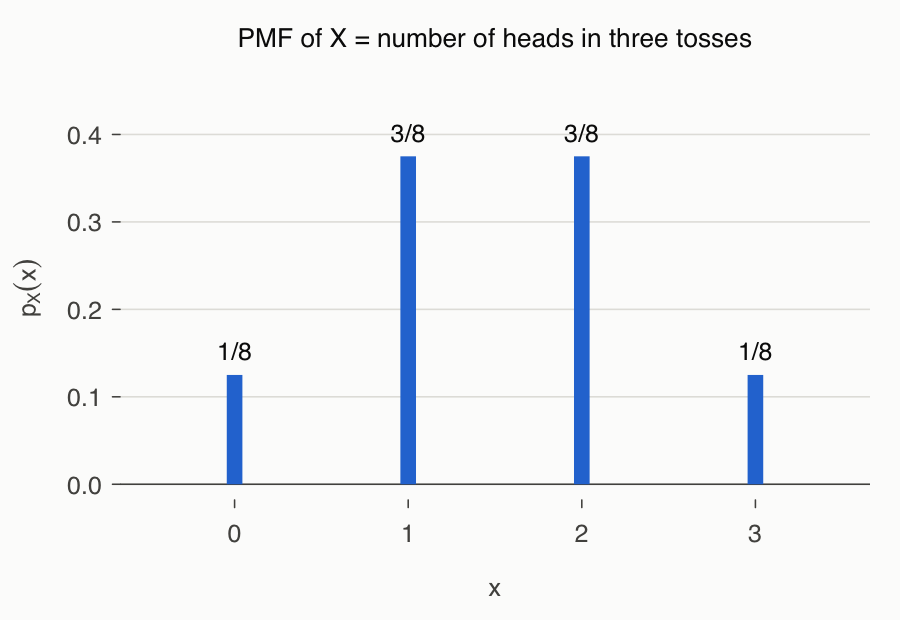
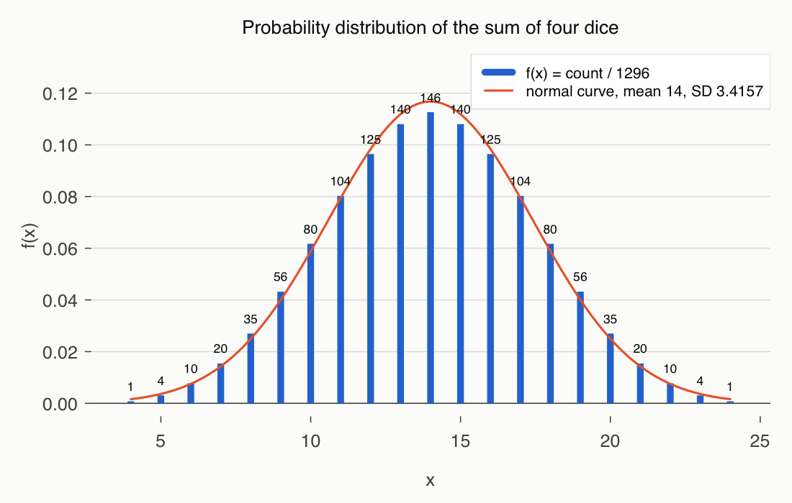
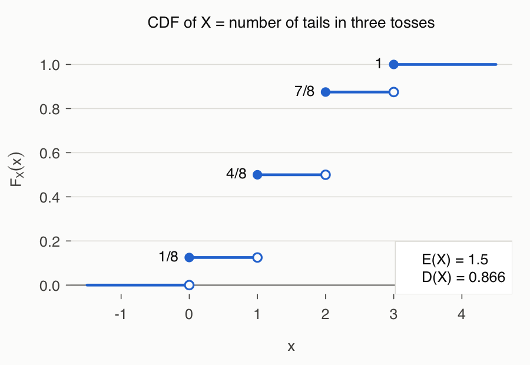
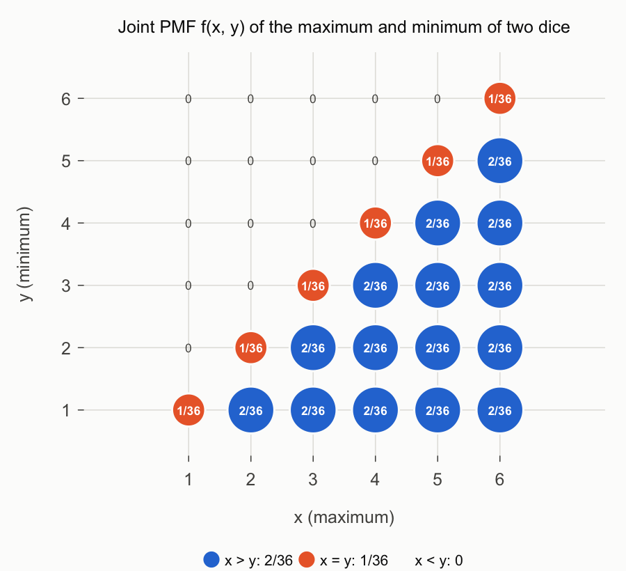

# 3강 연습 문제 풀이 — 확률변수와 확률분포

[레포지토리 안내](../../README.ko.md) | [English](Solutions.md) | [한국어](Solutions.ko.md)

> **최종 수정일:** 2026-11-04

각 풀이는 손으로 하는 계산을 먼저 보이고, 같은 결과를 R 코드로 확인한다. 코드는 기본 R만으로 실행된다.

> **참고:** 표본공간을 만드는 `tosscoin2()`, `rolldie2()`와 분포를 요약하는 `disc.exp()`, `disc.cdf()`, `disc.joint2()`는 Rstat 패키지 [1]의 함수이다. 이 패키지는 CRAN에 등록되어 있지 않으므로, 여기서는 `tosscoin2()`와 `rolldie2()`를 기본 R의 `expand.grid()`로 직접 정의하고 나머지 계산은 몇 줄의 코드로 풀어 쓴다.

---

<br>

## 목차

- [연습 문제 1: 동전 세 번의 앞면 개수의 확률분포](#연습-문제-1-동전-세-번의-앞면-개수의-확률분포)
- [연습 문제 2: 주사위 네 번의 눈의 합의 확률분포](#연습-문제-2-주사위-네-번의-눈의-합의-확률분포)
- [연습 문제 3: 동전 세 번의 뒷면 개수의 누적분포함수](#연습-문제-3-동전-세-번의-뒷면-개수의-누적분포함수)
- [연습 문제 4: 두 주사위의 최댓값과 최솟값의 결합분포](#연습-문제-4-두-주사위의-최댓값과-최솟값의-결합분포)
- [연습 문제 5: 동전 게임 이익의 기댓값](#연습-문제-5-동전-게임-이익의-기댓값)
- [연습 문제 6: 주사위 한 번의 기댓값과 분산](#연습-문제-6-주사위-한-번의-기댓값과-분산)
- [연습 문제 7: 선형변환한 확률변수의 기댓값과 분산](#연습-문제-7-선형변환한-확률변수의-기댓값과-분산)
- [참고 문헌](#참고-문헌)

---

<br>

## 연습 문제 1: 동전 세 번의 앞면 개수의 확률분포

**문제:** 동전을 세 번 던질 때 앞면의 개수 $X$의 확률분포를 구하고 R로 확인하라. 문제 전문은 [연습 문제 1](Exercises.ko.md#연습-문제-1-동전-세-번의-앞면-개수의-확률분포)에 있다.

### 풀이

**접근 방법:** 공정한 동전을 독립적으로 세 번 던지면 $2^3 = 8$개의 결과가 각각 확률 $1/8$로 일어난다. 결과마다 $X$의 값을 적고, 같은 값을 주는 결과의 수를 세어 8로 나눈다([3강 2.1절](Concepts_Lecture.ko.md#21-확률질량함수)).

| 결과 $s$ | $HHH$ | $HHT$ | $HTH$ | $HTT$ | $THH$ | $THT$ | $TTH$ | $TTT$ |
|:-----|:-----|:-----|:-----|:-----|:-----|:-----|:-----|:-----|
| $X(s)$ | 3 | 2 | 2 | 1 | 2 | 1 | 1 | 0 |

*표 1. 동전을 세 번 던질 때 결과마다의 앞면 개수*

값 0은 결과 1개, 값 1과 2는 각각 결과 3개, 값 3은 결과 1개에서 나오므로 확률분포는 다음과 같다.

$$
f(0) = \frac{1}{8}, \quad f(1) = \frac{3}{8}, \quad f(2) = \frac{3}{8}, \quad f(3) = \frac{1}{8}, \qquad \sum_x f(x) = \frac{1 + 3 + 3 + 1}{8} = 1
$$

일반적으로 앞면이 $k$개인 결과의 수는 세 자리 가운데 앞면이 놓일 $k$자리를 고르는 경우의 수 $\binom{3}{k}$이므로 $f(k) = \binom{3}{k} / 8$이다. 이 분포는 4강에서 다루는 이항분포 $B(3, 1/2)$이다.

**코드:**

```r
# 동전을 times번 던지는 시행의 표본공간 (결과 하나가 한 행)
tosscoin2 <- function(times) {
  S <- expand.grid(rep(list(c("H", "T")), times), KEEP.OUT.ATTRS = FALSE)
  names(S) <- paste0("toss", 1:times)
  S
}

S <- tosscoin2(3)                 # 같은 확률의 결과 8개
print(S)

countH <- function(x) {
  sum(x == "H")                   # 한 결과에 들어 있는 앞면의 수
}

X <- apply(S, 1, countH)          # 결과마다의 X 값
print(X)

px <- table(X) / nrow(S)          # 상대도수 = 확률
print(px)
print(sum(px))

plot(px, type = "h", lwd = 4, xlab = "x", ylab = "f(x)")
```

- `tosscoin2()`는 동전을 `times`번 던지는 시행의 표본공간을 만든다. `rep(list(c("H", "T")), times)`는 `c("H", "T")`를 `times`개 담은 리스트이고, `expand.grid()`는 리스트의 각 원소에서 하나씩 고른 모든 조합을 행으로 만든다. `KEEP.OUT.ATTRS = FALSE`는 불필요한 속성을 붙이지 않게 하고, `names(S)`로 열 이름을 `toss1`, `toss2`, `toss3`으로 정한다.
- `countH()`는 한 결과(행)를 받아 `"H"`인 칸의 수를 센다. `x == "H"`는 논리 벡터이고 `sum()`은 `TRUE`를 1로 센다.
- `apply(S, 1, countH)`는 `S`의 각 행에 `countH()`를 적용하여 결과마다의 $X$ 값을 벡터로 돌려준다.
- `table(X) / nrow(S)`는 값마다의 결과 수를 전체 결과 수 8로 나눈 상대도수이다. 결과가 모두 같은 확률이므로 이것이 확률분포이다.
- `sum(px)`로 확률의 합이 1인지 확인하고, `plot(px, type = "h")`로 값마다 세로 막대를 그린다.

**실행 결과:**

```text
  toss1 toss2 toss3
1     H     H     H
2     T     H     H
3     H     T     H
4     T     T     H
5     H     H     T
6     T     H     T
7     H     T     T
8     T     T     T
[1] 3 2 2 1 2 1 1 0
X
    0     1     2     3 
0.125 0.375 0.375 0.125 
[1] 1
```

`expand.grid()`는 첫 번째 열을 가장 빨리 바꾸므로 행의 순서는 $HHH, THH, HTH, TTH, \dots$이다. 순서는 표 1과 다르지만 같은 여덟 결과이며, 확률분포는 손으로 구한 $1/8, 3/8, 3/8, 1/8$과 같다.



*그림 1. 동전을 세 번 던질 때 앞면의 개수 X의 확률분포*

> **참고:** 앞면 대신 뒷면 `"T"`의 개수를 세어도 확률분포는 같다. 앞면이 $k$개인 결과의 수와 뒷면이 $k$개인 결과의 수가 $\binom{3}{k} = \binom{3}{3-k}$로 같기 때문이다. 연습 문제 3은 이 사실을 이용한다.

---

<br>

## 연습 문제 2: 주사위 네 번의 눈의 합의 확률분포

**문제:** 주사위를 네 번 던질 때 눈의 합 $X$의 확률분포, 기댓값, 표준편차를 R로 구하고 정규분포 곡선과 비교하라. 문제 전문은 [연습 문제 2](Exercises.ko.md#연습-문제-2-주사위-네-번의-눈의-합의-확률분포)에 있다.

### 풀이

**접근 방법:** 각 시행에서 6개의 눈이 나올 수 있으므로 표본공간의 크기는 $6^4 = 1296$이고, 결과는 각각 확률 $1/1296$로 일어난다. $X$의 최솟값은 $(1, 1, 1, 1)$의 4, 최댓값은 $(6, 6, 6, 6)$의 24이므로 $X$는 $4, 5, \dots, 24$의 21개 값을 취한다.

작은 값의 결과 수는 손으로 셀 수 있다. $X = 4$는 $(1, 1, 1, 1)$ 하나이다. $X = 5$는 네 주사위 중 하나만 2인 경우이므로 4개이다. $X = 6$은 하나가 3인 경우 4개와 둘이 2인 경우 $\binom{4}{2} = 6$개를 합한 10개이다. 값이 커지면 경우가 많아지므로 R로 1296개의 결과를 모두 나열하여 센다.

분포는 14를 중심으로 대칭이다. 각 눈 $k$를 $7 - k$로 바꾸면 합 $x$가 $28 - x$로 바뀌고 이 대응은 일대일이므로, $f(x) = f(28 - x)$이다. 기댓값과 분산은 독립인 네 주사위의 합이라는 사실로 미리 구할 수 있다([3강 7.3절](Concepts_Lecture.ko.md#73-합의-분산)).

$$
E(X) = 4 \cdot \frac{7}{2} = 14, \qquad \mathrm{Var}(X) = 4 \cdot \frac{35}{12} = \frac{35}{3} \approx 11.667, \qquad D(X) = \sqrt{\frac{35}{3}} \approx 3.4157
$$

**코드:**

```r
# 주사위를 times번 던지는 시행의 표본공간 (결과 하나가 한 행)
rolldie2 <- function(times, nsides = 6) {
  S <- expand.grid(rep(list(1:nsides), times), KEEP.OUT.ATTRS = FALSE)
  names(S) <- paste0("die", 1:times)
  S
}

nTimes <- 4
S <- rolldie2(nTimes)              # 결과 6^4 = 1296개
N <- nrow(S)
X <- apply(S, 1, sum)              # 네 눈의 합
X.freq <- table(X)                 # 합마다의 결과 수
print(addmargins(X.freq))
X.prob <- X.freq / length(X)       # 확률
print(round(addmargins(X.prob), 4))

X.val <- as.numeric(names(X.freq)) # 값 4, 5, ..., 24
EX  <- sum(X.val * X.prob)         # E(X)
EX2 <- sum(X.val^2 * X.prob)       # E(X^2)
VX  <- EX2 - EX^2                  # Var(X)
DX  <- sqrt(VX)                    # 표준편차
cat("N =", N, " E(X) =", EX, " Var(X) =", VX, " D(X) =", round(DX, 4), "\n")

Xmin <- min(X.val)
Xmax <- max(X.val)
plot(X.prob, type = "h", col = "red", lwd = 4,
     main = paste0("Probability Distribution of the Sum of ", nTimes, " Dice"),
     ylim = c(0, max(X.prob) + 0.01))
fitnorm <- function(x) dnorm(x, EX, DX)       # 평균과 표준편차가 같은 정규분포 곡선
curve(fitnorm, Xmin, Xmax, add = TRUE, col = 4)
text(Xmin:Xmax, X.prob, labels = X.freq, pos = 3, col = 4, cex = 1)
legend("topright", c(paste("S-S.Size =", N), paste("E(X) =", EX),
                     paste("D(X) =", round(DX, 4))), bg = "white")
```

- `rolldie2()`는 연습 문제 1의 `tosscoin2()`와 같은 방법으로 주사위를 `times`번 던지는 표본공간을 만든다. `rolldie2(4)`는 1296개의 행을 가진다.
- `apply(S, 1, sum)`은 각 행의 네 눈을 더하여 결과마다의 합을 구한다.
- `table(X)`는 합마다의 결과 수를 세고, `addmargins()`는 그 합계 `Sum`을 덧붙여 출력한다. `X.prob`는 결과 수를 1296으로 나눈 확률분포이다.
- `names(X.freq)`는 표의 이름인 문자열 `"4"`, ..., `"24"`이고, `as.numeric()`으로 숫자로 바꾸어 `X.val`에 저장한다.
- `EX`, `EX2`, `VX`, `DX`는 정의 $E(X) = \sum x f(x)$, $E(X^2) = \sum x^2 f(x)$, $\mathrm{Var}(X) = E(X^2) - E(X)^2$, $D(X) = \sqrt{\mathrm{Var}(X)}$를 그대로 옮긴 것이다.
- `plot(X.prob, type = "h", ...)`은 확률분포를 세로 막대로 그린다. `main`은 `paste0()`으로 제목 문자열을 만든다.
- `fitnorm()`은 평균 `EX`, 표준편차 `DX`인 정규분포의 확률밀도함수이고, `curve(..., add = TRUE)`가 이를 막대그래프 위에 겹쳐 그린다. 정규분포는 5강에서 다룬다.
- `text()`는 각 막대 위(`pos = 3`)에 결과 수를 적고, `legend()`는 표본공간의 크기, 기댓값, 표준편차를 범례로 표시한다.

**실행 결과:**

```text
X
   4    5    6    7    8    9   10   11   12   13   14   15   16   17   18   19 
   1    4   10   20   35   56   80  104  125  140  146  140  125  104   80   56 
  20   21   22   23   24  Sum 
  35   20   10    4    1 1296 
X
     4      5      6      7      8      9     10     11     12     13     14 
0.0008 0.0031 0.0077 0.0154 0.0270 0.0432 0.0617 0.0802 0.0965 0.1080 0.1127 
    15     16     17     18     19     20     21     22     23     24    Sum 
0.1080 0.0965 0.0802 0.0617 0.0432 0.0270 0.0154 0.0077 0.0031 0.0008 1.0000 
N = 1296  E(X) = 14  Var(X) = 11.66667  D(X) = 3.4157 
```



*그림 2. 주사위를 네 번 던질 때 눈의 합의 확률분포와 평균 14, 표준편차 3.4157인 정규분포 곡선*

결과 수는 1, 4, 10, 20, ...으로 늘다가 $X = 14$에서 146으로 가장 크고, 그 뒤로 대칭적으로 줄어든다. R로 구한 기댓값 14와 표준편차 3.4157은 앞에서 계산한 값과 같다. 분포는 종 모양이며, 주사위 네 개의 합인데도 정규분포 곡선과 거의 겹친다. 독립인 확률변수를 여러 개 더하면 분포가 정규분포에 가까워진다는 중심극한정리를 보여 주는 예이다(5강).

> **참고:** Windows의 R에서는 `win.graph(7, 5)`로 가로 7인치, 세로 5인치의 새 그래프 창을 열 수 있다. 이 함수는 Windows에서만 동작하므로, 다른 운영체제에서는 `dev.new(width = 7, height = 5)`를 쓴다.

---

<br>

## 연습 문제 3: 동전 세 번의 뒷면 개수의 누적분포함수

**문제:** 동전을 세 번 던질 때 뒷면의 개수 $X$의 누적분포함수를 구하고 R로 계단함수를 그려라. 문제 전문은 [연습 문제 3](Exercises.ko.md#연습-문제-3-동전-세-번의-뒷면-개수의-누적분포함수)에 있다.

### 풀이

**접근 방법:** 뒷면이 $k$개인 결과의 수는 $\binom{3}{k}$이므로 확률분포는 연습 문제 1과 같은 $f(0) = 1/8$, $f(1) = 3/8$, $f(2) = 3/8$, $f(3) = 1/8$이다. 누적분포함수는 $x$ 이하인 값의 확률을 더한 것이며, 값과 값 사이에서는 일정하다([3강 2.2절](Concepts_Lecture.ko.md#22-누적분포함수)).

$$
F(x) = P(X \le x) =
\begin{cases}
0, & x < 0 \\
1/8, & 0 \le x < 1 \\
4/8, & 1 \le x < 2 \\
7/8, & 2 \le x < 3 \\
1, & x \ge 3
\end{cases}
$$

각 구간은 왼쪽 끝을 포함하고 오른쪽 끝을 포함하지 않는다. 예를 들어 $F(1) = 4/8$이고 $F(0.999) = 1/8$이다. 기댓값과 표준편차는 다음과 같다.

$$
E(X) = \frac{0 \cdot 1 + 1 \cdot 3 + 2 \cdot 3 + 3 \cdot 1}{8} = \frac{12}{8} = 1.5, \qquad E(X^2) = \frac{0 + 3 + 12 + 9}{8} = 3
$$

$$
\mathrm{Var}(X) = 3 - 1.5^2 = 0.75, \qquad D(X) = \sqrt{0.75} \approx 0.866
$$

**코드:**

```r
xv <- 0:3                          # 가능한 뒷면의 수
xp <- choose(3, 0:3)               # 값마다의 결과 수: 1 3 3 1
if (sum(xp) > 1) {
  xp <- xp / sum(xp)               # 개수를 확률로 바꾼다
}
print(xp)

xcdf <- c(0, cumsum(xp))           # 0 바로 왼쪽의 F, 이어서 F(0), F(1), F(2), F(3)
print(xcdf)
sf <- stepfun(xv, xcdf)            # 오른쪽 연속인 계단함수 F(x)
print(sf(c(-1, 0, 0.5, 1, 1.5, 2, 3, 4)))

plot(sf, verticals = FALSE, pch = 19, lwd = 2, cex = 1.2,
     col = 2, xlab = "x", ylab = "F(x)")
grid(col = 3)
points(xv, xcdf[-length(xcdf)], col = 2, cex = 1)       # 왼쪽 극한 위치의 빈 원
text(xv, xcdf[-1], labels = round(xcdf[-1], 3), cex = 1,
     col = 4, pos = 2)

EX  <- sum(xv * xp)
EX2 <- sum(xv^2 * xp)
VX  <- EX2 - EX^2
DX  <- sqrt(VX)
cat("E(X) =", round(EX, 4), " Var(X) =", VX, " D(X) =", round(DX, 4), "\n")
legend("bottomright", c(paste("E(X) =", round(EX, 4)),
                        paste("D(X) =", round(DX, 4))), bg = "white")
```

- `xv`는 $X$가 취하는 값 0, 1, 2, 3이고, `choose(3, 0:3)`은 각 값을 주는 결과의 수 $\binom{3}{k}$, 즉 1, 3, 3, 1이다.
- `if (sum(xp) > 1)` 블록은 `xp`가 결과의 수로 주어졌으면 합으로 나누어 확률로 바꾼다. `xp`가 처음부터 확률이면 합이 1이므로 아무 일도 하지 않는다. 따라서 이 코드는 개수와 확률 어느 쪽을 넣어도 동작한다.
- `c(0, cumsum(xp))`는 다섯 개의 값 $0, F(0), F(1), F(2), F(3)$이다. 맨 앞의 0은 첫 번째 값 0보다 왼쪽에서의 $F$이다.
- `stepfun(xv, xcdf)`는 R의 계단함수 객체를 만든다. 값 `y`의 길이는 점 `x`의 길이보다 하나 길어야 하며, 기본 설정에서 각 구간은 $[x_i, x_{i+1})$로 왼쪽 끝을 포함하므로 오른쪽 연속인 누적분포함수와 같다. `sf(1.5)`처럼 함수로 호출하면 그 점의 $F$ 값을 돌려준다.
- `plot(sf, verticals = FALSE, pch = 19, ...)`은 수평선과 뛰는 점의 채운 원을 그린다. `verticals = FALSE`는 계단을 잇는 세로선을 생략하여 불연속을 드러낸다.
- `points(xv, xcdf[-length(xcdf)], ...)`는 마지막 원소를 뺀 $0, 1/8, 4/8, 7/8$, 즉 각 점의 왼쪽 극한에 빈 원(`pch`의 기본값 1)을 그린다.
- `text()`는 각 계단의 높이를 왼쪽(`pos = 2`)에 적고, 나머지 줄은 기댓값과 표준편차를 계산하여 범례로 표시한다.

**실행 결과:**

```text
[1] 0.125 0.375 0.375 0.125
[1] 0.000 0.125 0.500 0.875 1.000
[1] 0.000 0.125 0.125 0.500 0.500 0.875 1.000 1.000
E(X) = 1.5  Var(X) = 0.75  D(X) = 0.866 
```

세 번째 줄은 $x = -1, 0, 0.5, 1, 1.5, 2, 3, 4$에서의 $F(x)$이다. $F(0.5) = F(0)$, $F(1.5) = F(1)$처럼 값 사이에서는 일정하고, 값에서 뛴다.



*그림 3. 동전을 세 번 던질 때 뒷면의 개수 X의 누적분포함수와 기댓값, 표준편차*

---

<br>

## 연습 문제 4: 두 주사위의 최댓값과 최솟값의 결합분포

**문제:** 주사위를 두 번 던질 때 큰 값 $X$와 작은 값 $Y$의 결합확률분포와 주변확률분포를 구하고, 독립 여부를 판정하라. 문제 전문은 [연습 문제 4](Exercises.ko.md#연습-문제-4-두-주사위의-최댓값과-최솟값의-결합분포)에 있다.

### 풀이

**접근 방법:** 두 번 던진 결과 $(a, b)$는 36개이고 각각 확률 $1/36$이다. $X = \max(a, b)$, $Y = \min(a, b)$이므로 항상 $X \ge Y$이다. $(x, y)$를 주는 결과의 수 $n(x, y)$는 세 경우로 나뉜다.

- $x > y$이면 $(a, b) = (x, y)$와 $(a, b) = (y, x)$의 두 결과가 최댓값 $x$, 최솟값 $y$를 준다.
- $x = y$이면 $(x, x)$ 한 결과뿐이다.
- $x < y$이면 최댓값이 최솟값보다 작을 수 없으므로 결과가 없다.

$$
n(x, y) =
\begin{cases}
1, & x = y \\
2, & x > y
\end{cases}
\quad \Rightarrow \quad
f(x, y) =
\begin{cases}
1/36, & x = y \\
2/36, & x > y
\end{cases}
\qquad (x, y = 1, 2, \dots, 6)
$$

$x < y$인 칸의 $f(x, y)$는 0이다. 결합빈도표는 다음과 같다.

| $X$ \ $Y$ | 1 | 2 | 3 | 4 | 5 | 6 | 합 |
|:-----|:-----|:-----|:-----|:-----|:-----|:-----|:-----|
| 1 | 1 | 0 | 0 | 0 | 0 | 0 | 1 |
| 2 | 2 | 1 | 0 | 0 | 0 | 0 | 3 |
| 3 | 2 | 2 | 1 | 0 | 0 | 0 | 5 |
| 4 | 2 | 2 | 2 | 1 | 0 | 0 | 7 |
| 5 | 2 | 2 | 2 | 2 | 1 | 0 | 9 |
| 6 | 2 | 2 | 2 | 2 | 2 | 1 | 11 |
| 합 | 11 | 9 | 7 | 5 | 3 | 1 | 36 |

*표 2. 두 주사위의 최댓값 X와 최솟값 Y의 결합빈도 n(x, y)와 주변합*

행 합과 열 합을 36으로 나누면 주변확률분포가 된다.

$$
p_X(x) = \frac{2x - 1}{36}, \qquad p_Y(y) = \frac{13 - 2y}{36} \qquad (x, y = 1, \dots, 6)
$$

이 식은 다른 방법으로도 확인된다. 최댓값이 $x$ 이하라는 것은 두 눈이 모두 $x$ 이하라는 뜻이므로 $P(X \le x) = (x/6)^2$이고, $p_X(x) = P(X \le x) - P(X \le x - 1) = \{x^2 - (x - 1)^2\}/36 = (2x - 1)/36$이다. 같은 방법으로 $P(Y \ge y) = \{(7 - y)/6\}^2$에서 $p_Y(y) = (13 - 2y)/36$을 얻는다.

**독립 판정.** $(x, y) = (1, 2)$에서 $f(1, 2) = 0$이지만 $p_X(1) \cdot p_Y(2) = \frac{1}{36} \cdot \frac{9}{36} = \frac{9}{1296} \ne 0$이므로 $X$와 $Y$는 독립이 아니다. 최댓값을 알면 최솟값이 그보다 클 수 없다는 제약이 생기므로 당연한 결과이다.

**코드:**

```r
rolldie2 <- function(times, nsides = 6) {
  S <- expand.grid(rep(list(1:nsides), times), KEEP.OUT.ATTRS = FALSE)
  names(S) <- paste0("die", 1:times)
  S
}

S <- rolldie2(2)                   # 결과 36개
N <- nrow(S)
X <- apply(S, 1, max)              # 큰 눈
Y <- apply(S, 1, min)              # 작은 눈

tXY <- table(X, Y)                 # 결합빈도표 n(x, y)
print(addmargins(tXY))             # 주변합 포함
pXY <- tXY / N                     # 결합확률질량함수 f(x, y)
print(round(addmargins(pXY), 4))

pX <- rowSums(pXY)                 # X의 주변확률질량함수
pY <- colSums(pXY)                 # Y의 주변확률질량함수
print(pX * 36)                     # 분모 36에 대한 분자
print(pY * 36)
all(abs(pXY - outer(pX, pY)) < 1e-12)   # X와 Y가 독립일 때만 TRUE

xy  <- expand.grid(x = 1:6, y = 1:6)          # 모든 (x, y) 칸, x가 가장 빨리 바뀐다
fxy <- as.vector(pXY)                          # 같은 순서의 f(x, y)
pos <- fxy > 0                                 # 확률이 0보다 큰 칸
plot(xy$x[pos], xy$y[pos], cex = 60 * fxy[pos], pch = 19, col = "steelblue",
     xlim = c(0.5, 6.5), ylim = c(0.5, 6.5), xlab = "x (maximum)", ylab = "y (minimum)",
     main = "Joint PMF of X and Y")
text(xy$x[pos], xy$y[pos], round(fxy[pos], 3), pos = 3, cex = 0.8)
```

- `apply(S, 1, max)`와 `apply(S, 1, min)`은 결과마다 두 눈의 큰 값과 작은 값을 구한다.
- `table(X, Y)`는 행이 $X$, 열이 $Y$인 교차표, 즉 결합빈도표를 만든다. `addmargins()`는 행 합과 열 합을 덧붙인다. 이를 36으로 나눈 `pXY`가 결합확률분포이다.
- `rowSums(pXY)`와 `colSums(pXY)`는 주변확률분포이며, 36을 곱해 출력하면 분자 $2x - 1$과 $13 - 2y$를 볼 수 있다.
- `outer(pX, pY)`는 $(x, y)$ 칸에 $p_X(x) \cdot p_Y(y)$를 담은 행렬이다. 모든 칸에서 `pXY`와 같아야 독립이며, `all()`이 `FALSE`를 돌려주므로 독립이 아니다. 실수 계산의 미세한 오차를 고려하여 `==` 대신 차의 절댓값이 $10^{-12}$보다 작은지 비교한다.
- 마지막 부분은 결합확률분포를 그린다. `as.vector(pXY)`는 표를 열 순서로 읽으므로 $x$가 가장 빨리 바뀌고, 이는 `expand.grid(x = 1:6, y = 1:6)`의 행 순서와 같다. 확률이 0보다 큰 칸에만 확률에 비례하는 크기(`cex`)의 점을 찍고 확률을 적는다.

**실행 결과:**

```text
     Y
X      1  2  3  4  5  6 Sum
  1    1  0  0  0  0  0   1
  2    2  1  0  0  0  0   3
  3    2  2  1  0  0  0   5
  4    2  2  2  1  0  0   7
  5    2  2  2  2  1  0   9
  6    2  2  2  2  2  1  11
  Sum 11  9  7  5  3  1  36
     Y
X          1      2      3      4      5      6    Sum
  1   0.0278 0.0000 0.0000 0.0000 0.0000 0.0000 0.0278
  2   0.0556 0.0278 0.0000 0.0000 0.0000 0.0000 0.0833
  3   0.0556 0.0556 0.0278 0.0000 0.0000 0.0000 0.1389
  4   0.0556 0.0556 0.0556 0.0278 0.0000 0.0000 0.1944
  5   0.0556 0.0556 0.0556 0.0556 0.0278 0.0000 0.2500
  6   0.0556 0.0556 0.0556 0.0556 0.0556 0.0278 0.3056
  Sum 0.3056 0.2500 0.1944 0.1389 0.0833 0.0278 1.0000
 1  2  3  4  5  6 
 1  3  5  7  9 11 
 1  2  3  4  5  6 
11  9  7  5  3  1 
[1] FALSE
```



*그림 4. 두 주사위의 최댓값 X와 최솟값 Y의 결합확률분포, 원의 크기는 확률에 비례*

확률은 대각선($x = y$)에서 $1/36 \approx 0.0278$, 그 아래($x > y$)에서 $2/36 \approx 0.0556$이고, 대각선 위($x < y$)는 0이다.

---

<br>

## 연습 문제 5: 동전 게임 이익의 기댓값

**문제:** 동전을 세 번 던져 앞면 하나마다 100원을 받고 뒷면 하나마다 100원을 내는 게임에서 이익 $X$의 기댓값, 분산, 표준편차를 구하라. 문제 전문은 [연습 문제 5](Exercises.ko.md#연습-문제-5-동전-게임-이익의-기댓값)에 있다.

### 풀이

**접근 방법:** 앞면의 수를 $H$라 하면 뒷면의 수는 $3 - H$이므로 이익은 $X = 100\{H - (3 - H)\} = 100(2H - 3)$이다. $H$의 분포는 연습 문제 1에서 구한 $1/8, 3/8, 3/8, 1/8$이다.

| $H$ | 0 | 1 | 2 | 3 |
|:-----|:-----|:-----|:-----|:-----|
| $X = 100(2H - 3)$ | $-300$ | $-100$ | $100$ | $300$ |
| $f(x)$ | $1/8$ | $3/8$ | $3/8$ | $1/8$ |

*표 3. 앞면의 수 H와 이익 X의 값과 확률*

기댓값은 값에 확률을 곱해 더한 것이다([3강 5.1절](Concepts_Lecture.ko.md#51-기댓값의-정의)).

$$
E(X) = \sum_x x f(x) = \frac{300 \cdot 1 + 100 \cdot 3 + (-100) \cdot 3 + (-300) \cdot 1}{8} = \frac{300 + 300 - 300 - 300}{8} = 0
$$

선형성으로도 확인할 수 있다. $E(H) = 3/2$이므로 $E(X) = 100\{2E(H) - 3\} = 100(3 - 3) = 0$이다. 기대 이익이 0이므로 이 게임은 어느 쪽에도 유리하지 않은 **공정한 게임**이다.

분산은 $E(X^2)$에서 구한다.

$$
E(X^2) = \frac{90{,}000 \cdot 1 + 10{,}000 \cdot 3 + 10{,}000 \cdot 3 + 90{,}000 \cdot 1}{8} = \frac{240{,}000}{8} = 30{,}000
$$

$$
\mathrm{Var}(X) = 30{,}000 - 0^2 = 30{,}000, \qquad D(X) = \sqrt{30{,}000} \approx 173.21
$$

선형변환의 성질로 계산해도 $\mathrm{Var}(X) = 200^2\, \mathrm{Var}(H) = 40{,}000 \cdot 0.75 = 30{,}000$으로 같다. 기대 이익은 0이지만 한 번의 게임에서 이익은 평균에서 대략 173원 정도 벗어난다.

**코드:**

```r
tosscoin2 <- function(times) {
  S <- expand.grid(rep(list(c("H", "T")), times), KEEP.OUT.ATTRS = FALSE)
  names(S) <- paste0("toss", 1:times)
  S
}

S <- tosscoin2(3)
nH <- apply(S, 1, function(x) sum(x == "H"))   # 앞면의 수
nT <- 3 - nH                                     # 뒷면의 수
X <- 100 * (nH - nT)                             # 원 단위의 이익
print(data.frame(S, nH, nT, X))

px <- table(X) / nrow(S)                         # X의 확률질량함수
print(px)
xv <- as.numeric(names(px))
EX  <- sum(xv * px)
EX2 <- sum(xv^2 * px)
cat("E(X) =", EX, " Var(X) =", EX2 - EX^2, " D(X) =", round(sqrt(EX2 - EX^2), 4), "\n")
```

- `nH`는 결과마다의 앞면 수, `nT`는 뒷면 수이고, `X`는 이익이다. R의 벡터 연산으로 여덟 결과의 이익을 한 번에 계산한다.
- `data.frame(S, nH, nT, X)`는 결과와 계산값을 한 표로 묶어 출력한다.
- `table(X) / nrow(S)`가 이익의 확률분포이고, `xv`는 표의 이름을 숫자로 바꾼 값 $-300, -100, 100, 300$이다.
- 마지막 두 줄은 기댓값, 분산, 표준편차를 정의대로 계산하여 출력한다.

**실행 결과:**

```text
  toss1 toss2 toss3 nH nT    X
1     H     H     H  3  0  300
2     T     H     H  2  1  100
3     H     T     H  2  1  100
4     T     T     H  1  2 -100
5     H     H     T  2  1  100
6     T     H     T  1  2 -100
7     H     T     T  1  2 -100
8     T     T     T  0  3 -300
X
 -300  -100   100   300 
0.125 0.375 0.375 0.125 
E(X) = 0  Var(X) = 30000  D(X) = 173.2051 
```

---

<br>

## 연습 문제 6: 주사위 한 번의 기댓값과 분산

**문제:** 주사위를 한 번 던질 때 나온 눈 $X$의 기댓값과 분산을 분수로 구하라. 문제 전문은 [연습 문제 6](Exercises.ko.md#연습-문제-6-주사위-한-번의-기댓값과-분산)에 있다.

### 풀이

**접근 방법:** 각 눈의 확률이 $1/6$이므로 정의에 따라 계산한다([3강 6.1절](Concepts_Lecture.ko.md#61-분산)).

$$
\mu_X = E(X) = \frac{1}{6}(1 + 2 + 3 + 4 + 5 + 6) = \frac{21}{6} = \frac{7}{2}
$$

$$
\sigma_X^2 = E(X^2) - \mu_X^2 = \frac{1}{6}(1^2 + 2^2 + 3^2 + 4^2 + 5^2 + 6^2) - \Big(\frac{7}{2}\Big)^2 = \frac{91}{6} - \frac{49}{4} = \frac{35}{12}
$$

$1^2 + \cdots + 6^2 = 1 + 4 + 9 + 16 + 25 + 36 = 91$이고, $\frac{91}{6} - \frac{49}{4} = \frac{182 - 147}{12}$이다. 표준편차는 $\sqrt{35/12} \approx 1.708$이다.

**코드:**

```r
x  <- 1:6                          # 주사위의 눈
fx <- rep(1/6, 6)                  # f(x) = 1/6
EX  <- sum(x * fx)                 # 7/2
EX2 <- sum(x^2 * fx)               # 91/6
VX  <- EX2 - EX^2                  # 35/12
cat("E(X) =", EX, " E(X^2) =", EX2, " Var(X) =", VX, " D(X) =", round(sqrt(VX), 4), "\n")
print(MASS::fractions(c(EX, EX2, VX)))
```

- `x * fx`는 원소별 곱이므로 `sum(x * fx)`가 $\sum x f(x)$이다. `x^2`도 원소별로 제곱한다.
- `MASS::fractions()`는 소수를 가까운 분수로 바꾸어 출력한다. MASS는 R과 함께 설치되는 권장 패키지이며, `패키지::함수` 형식은 `library()` 없이 그 패키지의 함수를 부른다.

**실행 결과:**

```text
E(X) = 3.5  E(X^2) = 15.16667  Var(X) = 2.916667  D(X) = 1.7078 
[1]   7/2  91/6 35/12
```

---

<br>

## 연습 문제 7: 선형변환한 확률변수의 기댓값과 분산

**문제:** 주사위의 눈 $X$에 대해 $Y = 100X - 400$의 기댓값과 분산을 두 가지 방법으로 구하라. 문제 전문은 [연습 문제 7](Exercises.ko.md#연습-문제-7-선형변환한-확률변수의-기댓값과-분산)에 있다.

### 풀이

**방법 1: 선형변환의 성질.** 연습 문제 6에서 $\mu_X = 7/2$, $\sigma_X^2 = 35/12$이다. $E(aX + b) = aE(X) + b$와 $\mathrm{Var}(aX + b) = a^2 \mathrm{Var}(X)$에 $a = 100$, $b = -400$을 넣는다([3강 6.3절](Concepts_Lecture.ko.md#63-선형변환의-기댓값과-분산)).

$$
\mu_Y \equiv E(Y) = 100\,E(X) - 400 = 350 - 400 = -50
$$

$$
\sigma_Y^2 \equiv \mathrm{Var}(Y) = 100^2\, \sigma_X^2 = \frac{350{,}000}{12} \approx 29{,}166.67
$$

**방법 2: 직접 계산.** $Y$는 $-300, -200, -100, 0, 100, 200$을 각각 확률 $1/6$로 취한다.

$$
E(Y) = \frac{-300 - 200 - 100 + 0 + 100 + 200}{6} = \frac{-300}{6} = -50
$$

$$
E(Y^2) = \frac{90{,}000 + 40{,}000 + 10{,}000 + 0 + 10{,}000 + 40{,}000}{6} = \frac{190{,}000}{6}, \qquad \mathrm{Var}(Y) = \frac{190{,}000}{6} - (-50)^2 = \frac{190{,}000 - 15{,}000}{6} = \frac{175{,}000}{6} \approx 29{,}166.67
$$

두 방법의 결과가 같다. $\frac{175{,}000}{6} = \frac{350{,}000}{12}$이다. 표준편차는 $\sigma_Y = 100\,\sigma_X \approx 170.78$이다. 400을 빼는 것은 분포를 옮길 뿐 퍼진 정도를 바꾸지 않으며, 100을 곱하면 표준편차가 100배, 분산이 $100^2$배가 된다.

**코드:**

```r
x  <- 1:6
fx <- rep(1/6, 6)
y  <- 100 * x - 400                # Y = 100X - 400의 값
print(y)
EY  <- sum(y * fx)
VY  <- sum(y^2 * fx) - EY^2
cat("E(Y) =", EY, " Var(Y) =", VY, " D(Y) =", round(sqrt(VY), 4), "\n")

EX <- sum(x * fx)
VX <- sum(x^2 * fx) - EX^2
cat("100*E(X) - 400 =", 100 * EX - 400, " 100^2*Var(X) =", 100^2 * VX, "\n")
```

- `y <- 100 * x - 400`은 $Y$가 취하는 값을 만든다. $X$의 각 값이 하나의 $Y$ 값에 대응하므로 확률은 `fx`를 그대로 쓴다.
- `EY`, `VY`는 방법 2의 직접 계산이고, 마지막 줄은 방법 1의 공식으로 계산한 값이다.

**실행 결과:**

```text
[1] -300 -200 -100    0  100  200
E(Y) = -50  Var(Y) = 29166.67  D(Y) = 170.7825 
100*E(X) - 400 = -50  100^2*Var(X) = 29166.67 
```

---

<br>

## 참고 문헌

1. T. J. Lim, "Rstat: Basic statistical methods in R," GitHub repository. https://github.com/tjssu/Rstat
