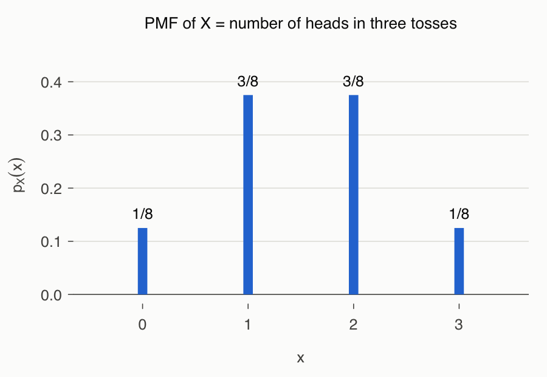
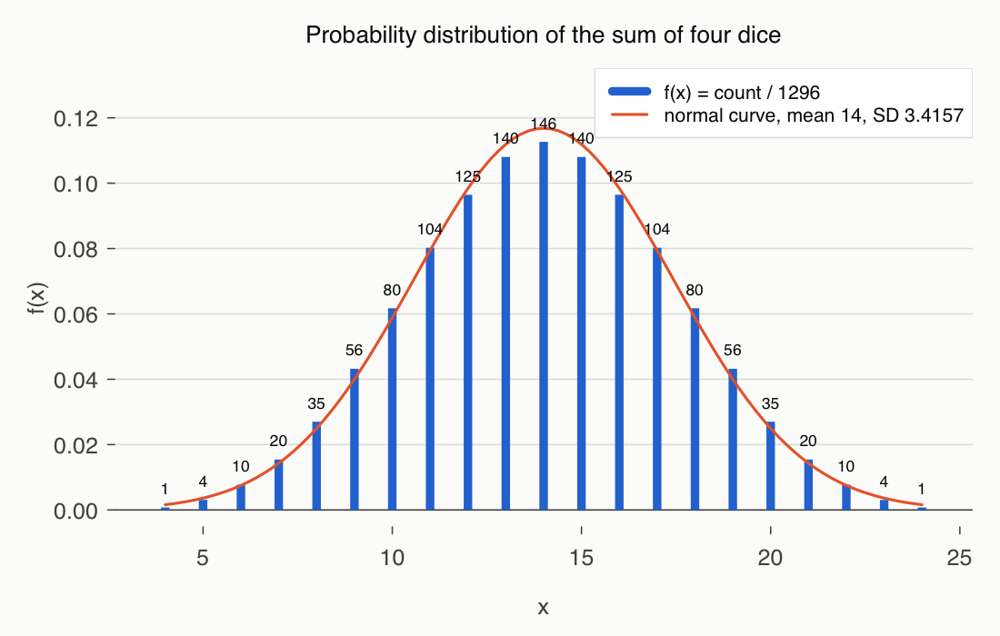
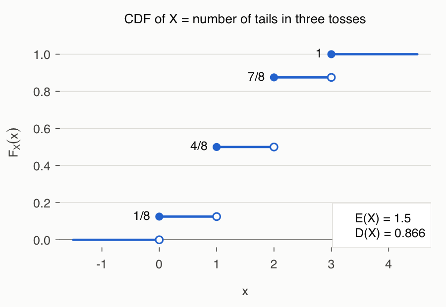
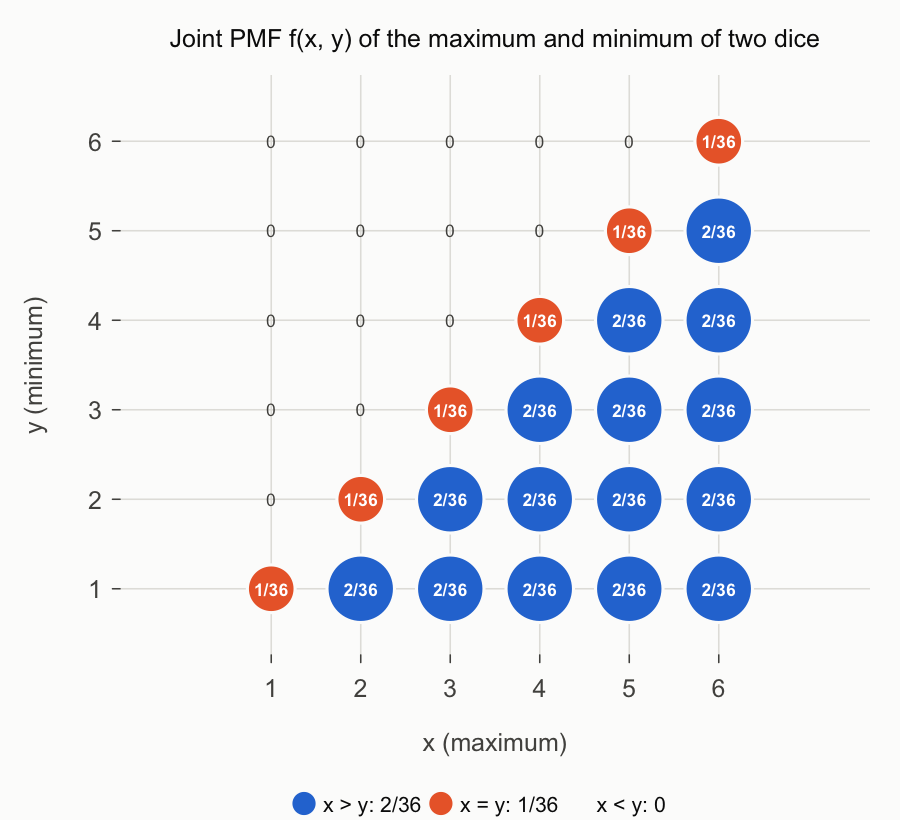

# Lecture 3 Solutions — Random Variables and Probability Distributions

[Repository Guide](../../README.md) | [English](Solutions.md) | [한국어](Solutions.ko.md)

> **Last Updated:** 2026-11-04

---

<br>

## Table of Contents

- [Exercise 1: Distribution of the Number of Heads in Three Tosses](#exercise-1-distribution-of-the-number-of-heads-in-three-tosses)
- [Exercise 2: Distribution of the Sum of Four Dice](#exercise-2-distribution-of-the-sum-of-four-dice)
- [Exercise 3: CDF of the Number of Tails in Three Tosses](#exercise-3-cdf-of-the-number-of-tails-in-three-tosses)
- [Exercise 4: Joint Distribution of the Maximum and Minimum of Two Dice](#exercise-4-joint-distribution-of-the-maximum-and-minimum-of-two-dice)
- [Exercise 5: Expected Profit of a Coin Game](#exercise-5-expected-profit-of-a-coin-game)
- [Exercise 6: Expected Value and Variance of One Roll of a Die](#exercise-6-expected-value-and-variance-of-one-roll-of-a-die)
- [Exercise 7: Expected Value and Variance of a Linearly Transformed Random Variable](#exercise-7-expected-value-and-variance-of-a-linearly-transformed-random-variable)
- [References](#references)

---

<br>

## Exercise 1: Distribution of the Number of Heads in Three Tosses

**Problem:** Find the probability distribution of the number of heads $X$ in three coin tosses and check it with R. The full problem is in [Exercise 1](Exercises.md#exercise-1-distribution-of-the-number-of-heads-in-three-tosses).

### Solution

**Approach:** When a fair coin is tossed independently three times, each of the $2^3 = 8$ outcomes occurs with probability $1/8$. Write the value of $X$ for each outcome, count the outcomes giving the same value, and divide by 8 ([Lecture 3, Section 2.1](Concepts_Lecture.md#21-probability-mass-function)).

| Outcome $s$ | $HHH$ | $HHT$ | $HTH$ | $HTT$ | $THH$ | $THT$ | $TTH$ | $TTT$ |
|:-----|:-----|:-----|:-----|:-----|:-----|:-----|:-----|:-----|
| $X(s)$ | 3 | 2 | 2 | 1 | 2 | 1 | 1 | 0 |

*Table 1. Number of heads for each outcome of three coin tosses*

The value 0 comes from one outcome, the values 1 and 2 from three outcomes each, and the value 3 from one outcome, so the distribution is:

```math
f(0) = \frac{1}{8}, \quad f(1) = \frac{3}{8}, \quad f(2) = \frac{3}{8}, \quad f(3) = \frac{1}{8}, \qquad \sum_x f(x) = \frac{1 + 3 + 3 + 1}{8} = 1
```

In general, the number of outcomes with $k$ heads is the number of ways $\binom{3}{k}$ to choose the $k$ positions of the heads among three, so $f(k) = \binom{3}{k} / 8$. This is the binomial distribution $B(3, 1/2)$ treated in Lecture 4.

**Code:**

```r
# Sample space of tossing a coin `times` times (one row per outcome)
tosscoin2 <- function(times) {
  S <- expand.grid(rep(list(c("H", "T")), times), KEEP.OUT.ATTRS = FALSE)
  names(S) <- paste0("toss", 1:times)
  S
}

S <- tosscoin2(3)                 # 8 equally likely outcomes
print(S)

countH <- function(x) {
  sum(x == "H")                   # number of heads in one outcome
}

X <- apply(S, 1, countH)          # value of X for each outcome
print(X)

px <- table(X) / nrow(S)          # relative frequencies = probabilities
print(px)
print(sum(px))

plot(px, type = "h", lwd = 4, xlab = "x", ylab = "f(x)")
```

- `tosscoin2()` builds the sample space of tossing a coin `times` times. `rep(list(c("H", "T")), times)` is a list containing `times` copies of `c("H", "T")`, and `expand.grid()` makes a row for every combination that picks one element from each list entry. `KEEP.OUT.ATTRS = FALSE` avoids attaching extra attributes, and `names(S)` sets the column names to `toss1`, `toss2`, `toss3`.
- `countH()` takes one outcome (row) and counts the cells equal to `"H"`. `x == "H"` is a logical vector, and `sum()` counts `TRUE` as 1.
- `apply(S, 1, countH)` applies `countH()` to each row of `S` and returns the value of $X$ for each outcome as a vector.
- `table(X) / nrow(S)` is the relative frequency: the count for each value divided by the total number of outcomes, 8. Because all outcomes are equally likely, this is the probability distribution.
- `sum(px)` checks that the probabilities add to 1, and `plot(px, type = "h")` draws a vertical bar at each value.

> **Note:** `tosscoin2()` and `rolldie2()`, which build sample spaces, and `disc.exp()`, `disc.cdf()`, and `disc.joint2()`, which summarize distributions, are functions of the Rstat package [1]. Since this package is not on CRAN, `tosscoin2()` and `rolldie2()` are defined in all solutions directly with base R's `expand.grid()`, and the remaining calculations are written out in a few lines of code.

**Output:**

```text
  toss1 toss2 toss3
1     H     H     H
2     T     H     H
3     H     T     H
4     T     T     H
5     H     H     T
6     T     H     T
7     H     T     T
8     T     T     T
[1] 3 2 2 1 2 1 1 0
X
    0     1     2     3 
0.125 0.375 0.375 0.125 
[1] 1
```

`expand.grid()` varies the first column fastest, so the rows come in the order $HHH, THH, HTH, TTH, \dots$. The order differs from Table 1, but the eight outcomes are the same, and the distribution equals the hand result $1/8, 3/8, 3/8, 1/8$.



*Figure 1. Probability distribution of the number of heads X in three coin tosses*

> **Note:** Counting tails `"T"` instead of heads gives the same distribution, because the number of outcomes with $k$ heads equals the number with $k$ tails: $\binom{3}{k} = \binom{3}{3-k}$. Exercise 3 uses this fact.

---

<br>

## Exercise 2: Distribution of the Sum of Four Dice

**Problem:** Find with R the probability distribution, expected value, and standard deviation of the sum $X$ of four rolls of a die, and compare it with a normal curve. The full problem is in [Exercise 2](Exercises.md#exercise-2-distribution-of-the-sum-of-four-dice).

### Solution

**Approach:** Each roll can show 6 numbers, so the sample space has $6^4 = 1296$ outcomes, each with probability $1/1296$. The minimum of $X$ is 4 from $(1, 1, 1, 1)$ and the maximum is 24 from $(6, 6, 6, 6)$, so $X$ takes the 21 values $4, 5, \dots, 24$.

The counts for small values can be found by hand. $X = 4$ comes only from $(1, 1, 1, 1)$. $X = 5$ requires exactly one of the four dice to show 2, so there are 4 outcomes. $X = 6$ has 4 outcomes with one die showing 3 plus $\binom{4}{2} = 6$ outcomes with two dice showing 2, for 10 in total. Larger values have many more cases, so R lists all 1296 outcomes and counts them.

The distribution is symmetric about 14. Replacing each face $k$ by $7 - k$ changes the sum $x$ into $28 - x$, and this correspondence is one-to-one, so $f(x) = f(28 - x)$. The expected value and variance can be found in advance from the fact that $X$ is the sum of four independent dice ([Lecture 3, Section 7.3](Concepts_Lecture.md#73-variance-of-a-sum)).

```math
E(X) = 4 \cdot \frac{7}{2} = 14, \qquad \mathrm{Var}(X) = 4 \cdot \frac{35}{12} = \frac{35}{3} \approx 11.667, \qquad D(X) = \sqrt{\frac{35}{3}} \approx 3.4157
```

**Code:**

```r
# Sample space of rolling a die `times` times (one row per outcome)
rolldie2 <- function(times, nsides = 6) {
  S <- expand.grid(rep(list(1:nsides), times), KEEP.OUT.ATTRS = FALSE)
  names(S) <- paste0("die", 1:times)
  S
}

nTimes <- 4
S <- rolldie2(nTimes)              # 6^4 = 1296 outcomes
N <- nrow(S)
X <- apply(S, 1, sum)              # sum of the four numbers
X.freq <- table(X)                 # number of outcomes for each sum
print(addmargins(X.freq))
X.prob <- X.freq / length(X)       # probabilities
print(round(addmargins(X.prob), 4))

X.val <- as.numeric(names(X.freq)) # values 4, 5, ..., 24
EX  <- sum(X.val * X.prob)         # E(X)
EX2 <- sum(X.val^2 * X.prob)       # E(X^2)
VX  <- EX2 - EX^2                  # Var(X)
DX  <- sqrt(VX)                    # standard deviation
cat("N =", N, " E(X) =", EX, " Var(X) =", VX, " D(X) =", round(DX, 4), "\n")

Xmin <- min(X.val)
Xmax <- max(X.val)
plot(X.prob, type = "h", col = "red", lwd = 4,
     main = paste0("Probability Distribution of the Sum of ", nTimes, " Dice"),
     ylim = c(0, max(X.prob) + 0.01))
fitnorm <- function(x) dnorm(x, EX, DX)       # normal curve with the same mean and SD
curve(fitnorm, Xmin, Xmax, add = TRUE, col = 4)
text(Xmin:Xmax, X.prob, labels = X.freq, pos = 3, col = 4, cex = 1)
legend("topright", c(paste("S-S.Size =", N), paste("E(X) =", EX),
                     paste("D(X) =", round(DX, 4))), bg = "white")
```

- `rolldie2()` builds the sample space of rolling a die `times` times in the same way as `tosscoin2()` in Exercise 1. `rolldie2(4)` has 1296 rows.
- `apply(S, 1, sum)` adds the four numbers in each row, giving the sum for each outcome.
- `table(X)` counts the outcomes for each sum, and `addmargins()` appends their total `Sum` for printing. `X.prob` is the distribution obtained by dividing the counts by 1296.
- `names(X.freq)` are the table's names, the strings `"4"`, ..., `"24"`; `as.numeric()` converts them to numbers stored in `X.val`.
- `EX`, `EX2`, `VX`, and `DX` transcribe the definitions $E(X) = \sum x f(x)$, $E(X^2) = \sum x^2 f(x)$, $\mathrm{Var}(X) = E(X^2) - E(X)^2$, and $D(X) = \sqrt{\mathrm{Var}(X)}$.
- `plot(X.prob, type = "h", ...)` draws the distribution as vertical bars. `main` builds the title string with `paste0()`.
- `fitnorm()` is the probability density function of the normal distribution with mean `EX` and standard deviation `DX`, and `curve(..., add = TRUE)` overlays it on the bar plot. The normal distribution is covered in Lecture 5.
- `text()` writes the counts above each bar (`pos = 3`), and `legend()` shows the size of the sample space, the expected value, and the standard deviation.

**Output:**

```text
X
   4    5    6    7    8    9   10   11   12   13   14   15   16   17   18   19 
   1    4   10   20   35   56   80  104  125  140  146  140  125  104   80   56 
  20   21   22   23   24  Sum 
  35   20   10    4    1 1296 
X
     4      5      6      7      8      9     10     11     12     13     14 
0.0008 0.0031 0.0077 0.0154 0.0270 0.0432 0.0617 0.0802 0.0965 0.1080 0.1127 
    15     16     17     18     19     20     21     22     23     24    Sum 
0.1080 0.0965 0.0802 0.0617 0.0432 0.0270 0.0154 0.0077 0.0031 0.0008 1.0000 
N = 1296  E(X) = 14  Var(X) = 11.66667  D(X) = 3.4157 
```



*Figure 2. Probability distribution of the sum of four rolls of a die with the normal curve of mean 14 and standard deviation 3.4157*

The counts grow as 1, 4, 10, 20, ..., peak at 146 for $X = 14$, and then decrease symmetrically. The expected value 14 and standard deviation 3.4157 found by R match the values computed above. The distribution is bell-shaped and, although it is a sum of only four dice, almost coincides with the normal curve. It illustrates the central limit theorem: the sum of many independent random variables with a common distribution and finite variance has a distribution close to normal (Lecture 5).

> **Note:** In R on Windows, `win.graph(7, 5)` opens a new graphics window 7 inches wide and 5 inches high. This function works only on Windows; on other operating systems, use `dev.new(width = 7, height = 5)`.

---

<br>

## Exercise 3: CDF of the Number of Tails in Three Tosses

**Problem:** Find the cumulative distribution function of the number of tails $X$ in three coin tosses and draw it as a step function in R. The full problem is in [Exercise 3](Exercises.md#exercise-3-cdf-of-the-number-of-tails-in-three-tosses).

### Solution

**Approach:** The number of outcomes with $k$ tails is $\binom{3}{k}$, so the distribution is the same as in Exercise 1: $f(0) = 1/8$, $f(1) = 3/8$, $f(2) = 3/8$, $f(3) = 1/8$. The CDF adds the probabilities of the values at most $x$ and is constant between values ([Lecture 3, Section 2.2](Concepts_Lecture.md#22-cumulative-distribution-function)).

```math
F(x) = P(X \le x) =
\begin{cases}
0, & x < 0 \\
1/8, & 0 \le x < 1 \\
4/8, & 1 \le x < 2 \\
7/8, & 2 \le x < 3 \\
1, & x \ge 3
\end{cases}
```

Each interval includes its left endpoint and excludes its right endpoint. For example, $F(1) = 4/8$ and $F(0.999) = 1/8$. The expected value and standard deviation are:

```math
E(X) = \frac{0 \cdot 1 + 1 \cdot 3 + 2 \cdot 3 + 3 \cdot 1}{8} = \frac{12}{8} = 1.5, \qquad E(X^2) = \frac{0 + 3 + 12 + 9}{8} = 3
```

```math
\mathrm{Var}(X) = 3 - 1.5^2 = 0.75, \qquad D(X) = \sqrt{0.75} \approx 0.866
```

**Code:**

```r
xv <- 0:3                          # possible numbers of tails
xp <- choose(3, 0:3)               # number of outcomes for each value: 1 3 3 1
if (sum(xp) > 1) {
  xp <- xp / sum(xp)               # counts -> probabilities
}
print(xp)

xcdf <- c(0, cumsum(xp))           # F just left of 0, then F(0), F(1), F(2), F(3)
print(xcdf)
sf <- stepfun(xv, xcdf)            # right-continuous step function F(x)
print(sf(c(-1, 0, 0.5, 1, 1.5, 2, 3, 4)))

plot(sf, verticals = FALSE, pch = 19, lwd = 2, cex = 1.2,
     col = 2, xlab = "x", ylab = "F(x)")
grid(col = 3)
points(xv, xcdf[-length(xcdf)], col = 2, cex = 1)       # open circles at the left limits
text(xv, xcdf[-1], labels = round(xcdf[-1], 3), cex = 1,
     col = 4, pos = 2)

EX  <- sum(xv * xp)
EX2 <- sum(xv^2 * xp)
VX  <- EX2 - EX^2
DX  <- sqrt(VX)
cat("E(X) =", round(EX, 4), " Var(X) =", VX, " D(X) =", round(DX, 4), "\n")
legend("bottomright", c(paste("E(X) =", round(EX, 4)),
                        paste("D(X) =", round(DX, 4))), bg = "white")
```

- `xv` holds the values 0, 1, 2, 3 of $X$, and `choose(3, 0:3)` is the number of outcomes giving each value, $\binom{3}{k}$, that is, 1, 3, 3, 1.
- The `if (sum(xp) > 1)` block converts `xp` into probabilities by dividing by its sum when it is given as counts. If `xp` is already a probability vector, its sum is 1 and nothing happens. So the code works whether counts or probabilities are supplied.
- `c(0, cumsum(xp))` holds five values, $0, F(0), F(1), F(2), F(3)$. The leading 0 is $F$ to the left of the first value 0.
- `stepfun(xv, xcdf)` creates an R step-function object. The values `y` must be one element longer than the points `x`, and by default each interval is $[x_i, x_{i+1})$, closed on the left, which matches the right-continuous CDF. Calling it as a function, as in `sf(1.5)`, returns $F$ at that point.
- `plot(sf, verticals = FALSE, pch = 19, ...)` draws the horizontal segments and filled dots at the jump points. `verticals = FALSE` omits the vertical lines joining the steps, which makes the discontinuities visible.
- `points(xv, xcdf[-length(xcdf)], ...)` draws open circles (the default `pch` 1) at $0, 1/8, 4/8, 7/8$, the vector without its last element, that is, the left limit at each point.
- `text()` writes the height of each step to its left (`pos = 2`), and the remaining lines compute the expected value and standard deviation and show them in a legend.

**Output:**

```text
[1] 0.125 0.375 0.375 0.125
[1] 0.000 0.125 0.500 0.875 1.000
[1] 0.000 0.125 0.125 0.500 0.500 0.875 1.000 1.000
E(X) = 1.5  Var(X) = 0.75  D(X) = 0.866 
```

The third line gives $F(x)$ at $x = -1, 0, 0.5, 1, 1.5, 2, 3, 4$. As $F(0.5) = F(0)$ and $F(1.5) = F(1)$ show, $F$ is constant between values and jumps at the values.



*Figure 3. Cumulative distribution function of the number of tails X in three coin tosses with its expected value and standard deviation*

---

<br>

## Exercise 4: Joint Distribution of the Maximum and Minimum of Two Dice

**Problem:** For two rolls of a die, find the joint and marginal distributions of the larger value $X$ and the smaller value $Y$, and decide whether they are independent. The full problem is in [Exercise 4](Exercises.md#exercise-4-joint-distribution-of-the-maximum-and-minimum-of-two-dice).

### Solution

**Approach:** There are 36 outcomes $(a, b)$, each with probability $1/36$. Since $X = \max(a, b)$ and $Y = \min(a, b)$, always $X \ge Y$. The number of outcomes $n(x, y)$ giving $(x, y)$ falls into three cases.

- If $x > y$, the two outcomes $(a, b) = (x, y)$ and $(a, b) = (y, x)$ give maximum $x$ and minimum $y$.
- If $x = y$, only the outcome $(x, x)$ does.
- If $x < y$, there is no outcome, because the maximum cannot be smaller than the minimum.

```math
n(x, y) =
\begin{cases}
1, & x = y \\
2, & x > y
\end{cases}
\quad \Rightarrow \quad
f(x, y) =
\begin{cases}
1/36, & x = y \\
2/36, & x > y
\end{cases}
\qquad (x, y = 1, 2, \dots, 6)
```

For cells with $x < y$, $f(x, y) = 0$. The joint frequency table is as follows.

| $X$ \ $Y$ | 1 | 2 | 3 | 4 | 5 | 6 | Sum |
|:-----|:-----|:-----|:-----|:-----|:-----|:-----|:-----|
| 1 | 1 | 0 | 0 | 0 | 0 | 0 | 1 |
| 2 | 2 | 1 | 0 | 0 | 0 | 0 | 3 |
| 3 | 2 | 2 | 1 | 0 | 0 | 0 | 5 |
| 4 | 2 | 2 | 2 | 1 | 0 | 0 | 7 |
| 5 | 2 | 2 | 2 | 2 | 1 | 0 | 9 |
| 6 | 2 | 2 | 2 | 2 | 2 | 1 | 11 |
| Sum | 11 | 9 | 7 | 5 | 3 | 1 | 36 |

*Table 2. Joint frequencies n(x, y) and marginal sums of the maximum X and minimum Y of two dice*

Dividing the row sums and column sums by 36 gives the marginal distributions.

```math
p_X(x) = \frac{2x - 1}{36}, \qquad p_Y(y) = \frac{13 - 2y}{36} \qquad (x, y = 1, \dots, 6)
```

These formulas can also be checked another way. The maximum is at most $x$ exactly when both numbers are at most $x$, so $P(X \le x) = (x/6)^2$ and $p_X(x) = P(X \le x) - P(X \le x - 1) = \lbrace x^2 - (x - 1)^2\rbrace/36 = (2x - 1)/36$. In the same way, $P(Y \ge y) = \lbrace(7 - y)/6\rbrace^2$ gives $p_Y(y) = (13 - 2y)/36$.

**Independence.** At $(x, y) = (1, 2)$, $f(1, 2) = 0$ but $p_X(1) \cdot p_Y(2) = \frac{1}{36} \cdot \frac{9}{36} = \frac{9}{1296} \ne 0$, so $X$ and $Y$ are not independent. This is natural: knowing the maximum imposes the constraint that the minimum cannot exceed it.

**Code:**

```r
rolldie2 <- function(times, nsides = 6) {
  S <- expand.grid(rep(list(1:nsides), times), KEEP.OUT.ATTRS = FALSE)
  names(S) <- paste0("die", 1:times)
  S
}

S <- rolldie2(2)                   # 36 outcomes
N <- nrow(S)
X <- apply(S, 1, max)              # larger number
Y <- apply(S, 1, min)              # smaller number

tXY <- table(X, Y)                 # joint frequency table n(x, y)
print(addmargins(tXY))             # with marginal sums
pXY <- tXY / N                     # joint PMF f(x, y)
print(round(addmargins(pXY), 4))

pX <- rowSums(pXY)                 # marginal PMF of X
pY <- colSums(pXY)                 # marginal PMF of Y
print(pX * 36)                     # numerators over 36
print(pY * 36)
all(abs(pXY - outer(pX, pY)) < 1e-12)   # TRUE only if X and Y are independent

xy  <- expand.grid(x = 1:6, y = 1:6)          # all (x, y) cells, x varies fastest
fxy <- as.vector(pXY)                          # f(x, y) in the same order
pos <- fxy > 0                                 # cells with positive probability
plot(xy$x[pos], xy$y[pos], cex = 60 * fxy[pos], pch = 19, col = "steelblue",
     xlim = c(0.5, 6.5), ylim = c(0.5, 6.5), xlab = "x (maximum)", ylab = "y (minimum)",
     main = "Joint PMF of X and Y")
text(xy$x[pos], xy$y[pos], round(fxy[pos], 3), pos = 3, cex = 0.8)
```

- `apply(S, 1, max)` and `apply(S, 1, min)` give the larger and smaller of the two numbers for each outcome.
- `table(X, Y)` builds the cross table with $X$ in the rows and $Y$ in the columns, that is, the joint frequency table. `addmargins()` appends row and column sums. Dividing by 36 gives `pXY`, the joint distribution.
- `rowSums(pXY)` and `colSums(pXY)` are the marginal distributions; printing them multiplied by 36 shows the numerators $2x - 1$ and $13 - 2y$.
- `outer(pX, pY)` is the matrix whose $(x, y)$ cell is $p_X(x) \cdot p_Y(y)$. Independence requires it to equal `pXY` in every cell; since `all()` returns `FALSE`, they are not independent. To allow for tiny floating-point errors, the code checks whether the absolute difference is below $10^{-12}$ instead of using `==`.
- The last part plots the joint distribution. `as.vector(pXY)` reads the table column by column, so $x$ varies fastest, matching the row order of `expand.grid(x = 1:6, y = 1:6)`. Only cells with positive probability get a point whose size (`cex`) is proportional to the probability, labeled with the probability.

**Output:**

```text
     Y
X      1  2  3  4  5  6 Sum
  1    1  0  0  0  0  0   1
  2    2  1  0  0  0  0   3
  3    2  2  1  0  0  0   5
  4    2  2  2  1  0  0   7
  5    2  2  2  2  1  0   9
  6    2  2  2  2  2  1  11
  Sum 11  9  7  5  3  1  36
     Y
X          1      2      3      4      5      6    Sum
  1   0.0278 0.0000 0.0000 0.0000 0.0000 0.0000 0.0278
  2   0.0556 0.0278 0.0000 0.0000 0.0000 0.0000 0.0833
  3   0.0556 0.0556 0.0278 0.0000 0.0000 0.0000 0.1389
  4   0.0556 0.0556 0.0556 0.0278 0.0000 0.0000 0.1944
  5   0.0556 0.0556 0.0556 0.0556 0.0278 0.0000 0.2500
  6   0.0556 0.0556 0.0556 0.0556 0.0556 0.0278 0.3056
  Sum 0.3056 0.2500 0.1944 0.1389 0.0833 0.0278 1.0000
 1  2  3  4  5  6 
 1  3  5  7  9 11 
 1  2  3  4  5  6 
11  9  7  5  3  1 
[1] FALSE
```



*Figure 4. Joint probability distribution of the maximum X and minimum Y of two dice, with circle size proportional to probability*

The probability is $1/36 \approx 0.0278$ on the diagonal ($`x = y`$), $2/36 \approx 0.0556$ below it ($`x > y`$), and 0 above it ($`x < y`$).

---

<br>

## Exercise 5: Expected Profit of a Coin Game

**Problem:** In a game where a coin is tossed three times and the player receives 100 won per head and pays 100 won per tail, find the expected value, variance, and standard deviation of the profit $X$. The full problem is in [Exercise 5](Exercises.md#exercise-5-expected-profit-of-a-coin-game).

### Solution

**Approach:** If $H$ is the number of heads, the number of tails is $3 - H$, so the profit is $X = 100\lbrace H - (3 - H)\rbrace = 100(2H - 3)$. The distribution of $H$ is $1/8, 3/8, 3/8, 1/8$ from Exercise 1.

| $H$ | 0 | 1 | 2 | 3 |
|:-----|:-----|:-----|:-----|:-----|
| $X = 100(2H - 3)$ | $-300$ | $-100$ | $100$ | $300$ |
| $f(x)$ | $1/8$ | $3/8$ | $3/8$ | $1/8$ |

*Table 3. Values and probabilities of the number of heads H and the profit X*

The expected value is the sum of the values times their probabilities ([Lecture 3, Section 5.1](Concepts_Lecture.md#51-definition-of-the-expected-value)).

```math
E(X) = \sum_x x f(x) = \frac{300 \cdot 1 + 100 \cdot 3 + (-100) \cdot 3 + (-300) \cdot 1}{8} = \frac{300 + 300 - 300 - 300}{8} = 0
```

Linearity confirms this: $E(H) = 3/2$, so $E(X) = 100\lbrace2E(H) - 3\rbrace = 100(3 - 3) = 0$. The expected profit is 0, so the game favors neither side; it is a **fair game**.

The variance comes from $E(X^2)$.

```math
E(X^2) = \frac{90{,}000 \cdot 1 + 10{,}000 \cdot 3 + 10{,}000 \cdot 3 + 90{,}000 \cdot 1}{8} = \frac{240{,}000}{8} = 30{,}000
```

```math
\mathrm{Var}(X) = 30{,}000 - 0^2 = 30{,}000, \qquad D(X) = \sqrt{30{,}000} \approx 173.21
```

The linear transformation property gives the same result, $`\mathrm{Var}(X) = 200^2\, \mathrm{Var}(H) = 40{,}000 \cdot 0.75 = 30{,}000`$. Although the expected profit is 0, the profit in one game deviates from the mean by roughly 173 won.

**Code:**

```r
tosscoin2 <- function(times) {
  S <- expand.grid(rep(list(c("H", "T")), times), KEEP.OUT.ATTRS = FALSE)
  names(S) <- paste0("toss", 1:times)
  S
}

S <- tosscoin2(3)
nH <- apply(S, 1, function(x) sum(x == "H"))   # number of heads
nT <- 3 - nH                                     # number of tails
X <- 100 * (nH - nT)                             # profit in won
print(data.frame(S, nH, nT, X))

px <- table(X) / nrow(S)                         # PMF of X
print(px)
xv <- as.numeric(names(px))
EX  <- sum(xv * px)
EX2 <- sum(xv^2 * px)
cat("E(X) =", EX, " Var(X) =", EX2 - EX^2, " D(X) =", round(sqrt(EX2 - EX^2), 4), "\n")
```

- `nH` is the number of heads for each outcome, `nT` the number of tails, and `X` the profit. R's vector arithmetic computes the profit of all eight outcomes at once.
- `data.frame(S, nH, nT, X)` combines the outcomes and the computed values into one table for printing.
- `table(X) / nrow(S)` is the distribution of the profit, and `xv` holds the table names converted to numbers, $-300, -100, 100, 300$.
- The last two lines compute and print the expected value, variance, and standard deviation from their definitions.

**Output:**

```text
  toss1 toss2 toss3 nH nT    X
1     H     H     H  3  0  300
2     T     H     H  2  1  100
3     H     T     H  2  1  100
4     T     T     H  1  2 -100
5     H     H     T  2  1  100
6     T     H     T  1  2 -100
7     H     T     T  1  2 -100
8     T     T     T  0  3 -300
X
 -300  -100   100   300 
0.125 0.375 0.375 0.125 
E(X) = 0  Var(X) = 30000  D(X) = 173.2051 
```

---

<br>

## Exercise 6: Expected Value and Variance of One Roll of a Die

**Problem:** Find as fractions the expected value and variance of the number $X$ shown in one roll of a die. The full problem is in [Exercise 6](Exercises.md#exercise-6-expected-value-and-variance-of-one-roll-of-a-die).

### Solution

**Approach:** Each face has probability $1/6$, so compute from the definitions ([Lecture 3, Section 6.1](Concepts_Lecture.md#61-variance)).

```math
\mu_X = E(X) = \frac{1}{6}(1 + 2 + 3 + 4 + 5 + 6) = \frac{21}{6} = \frac{7}{2}
```

```math
\sigma_X^2 = E(X^2) - \mu_X^2 = \frac{1}{6}(1^2 + 2^2 + 3^2 + 4^2 + 5^2 + 6^2) - \Big(\frac{7}{2}\Big)^2 = \frac{91}{6} - \frac{49}{4} = \frac{35}{12}
```

Here $1^2 + \cdots + 6^2 = 1 + 4 + 9 + 16 + 25 + 36 = 91$ and $\frac{91}{6} - \frac{49}{4} = \frac{182 - 147}{12}$. The standard deviation is $\sqrt{35/12} \approx 1.708$.

**Code:**

```r
x  <- 1:6                          # faces of a die
fx <- rep(1/6, 6)                  # f(x) = 1/6
EX  <- sum(x * fx)                 # 7/2
EX2 <- sum(x^2 * fx)               # 91/6
VX  <- EX2 - EX^2                  # 35/12
cat("E(X) =", EX, " E(X^2) =", EX2, " Var(X) =", VX, " D(X) =", round(sqrt(VX), 4), "\n")
print(MASS::fractions(c(EX, EX2, VX)))
```

- `x * fx` is an elementwise product, so `sum(x * fx)` is $\sum x f(x)$. `x^2` also squares elementwise.
- `MASS::fractions()` prints decimals as nearby fractions. MASS is a recommended package installed with R, and the `package::function` form calls a function of that package without `library()`.

**Output:**

```text
E(X) = 3.5  E(X^2) = 15.16667  Var(X) = 2.916667  D(X) = 1.7078 
[1]   7/2  91/6 35/12
```

---

<br>

## Exercise 7: Expected Value and Variance of a Linearly Transformed Random Variable

**Problem:** For the number $X$ shown by a die, find the expected value and variance of $Y = 100X - 400$ in two ways. The full problem is in [Exercise 7](Exercises.md#exercise-7-expected-value-and-variance-of-a-linearly-transformed-random-variable).

### Solution

**Method 1: properties of linear transformations.** From Exercise 6, $\mu_X = 7/2$ and $\sigma_X^2 = 35/12$. Substitute $a = 100$ and $b = -400$ into $E(aX + b) = aE(X) + b$ and $\mathrm{Var}(aX + b) = a^2 \mathrm{Var}(X)$ ([Lecture 3, Section 6.3](Concepts_Lecture.md#63-expectation-and-variance-of-a-linear-transformation)).

```math
\mu_Y \equiv E(Y) = 100\,E(X) - 400 = 350 - 400 = -50
```

```math
\sigma_Y^2 \equiv \mathrm{Var}(Y) = 100^2\, \sigma_X^2 = \frac{350{,}000}{12} \approx 29{,}166.67
```

**Method 2: direct computation.** $Y$ takes the values $-300, -200, -100, 0, 100, 200$, each with probability $1/6$.

```math
E(Y) = \frac{-300 - 200 - 100 + 0 + 100 + 200}{6} = \frac{-300}{6} = -50
```

```math
E(Y^2) = \frac{90{,}000 + 40{,}000 + 10{,}000 + 0 + 10{,}000 + 40{,}000}{6} = \frac{190{,}000}{6}, \qquad \mathrm{Var}(Y) = \frac{190{,}000}{6} - (-50)^2 = \frac{190{,}000 - 15{,}000}{6} = \frac{175{,}000}{6} \approx 29{,}166.67
```

The two methods agree, since $\frac{175{,}000}{6} = \frac{350{,}000}{12}$. The standard deviation is $`\sigma_Y = 100\,\sigma_X \approx 170.78`$. Subtracting 400 only shifts the distribution without changing its spread, while multiplying by 100 multiplies the standard deviation by 100 and the variance by $100^2$.

**Code:**

```r
x  <- 1:6
fx <- rep(1/6, 6)
y  <- 100 * x - 400                # values of Y = 100X - 400
print(y)
EY  <- sum(y * fx)
VY  <- sum(y^2 * fx) - EY^2
cat("E(Y) =", EY, " Var(Y) =", VY, " D(Y) =", round(sqrt(VY), 4), "\n")

EX <- sum(x * fx)
VX <- sum(x^2 * fx) - EX^2
cat("100*E(X) - 400 =", 100 * EX - 400, " 100^2*Var(X) =", 100^2 * VX, "\n")
```

- `y <- 100 * x - 400` creates the values of $Y$. Each value of $X$ corresponds to one value of $Y$, so the probabilities `fx` are used unchanged.
- `EY` and `VY` are the direct computation of Method 2, and the last line computes the values with the formulas of Method 1.

**Output:**

```text
[1] -300 -200 -100    0  100  200
E(Y) = -50  Var(Y) = 29166.67  D(Y) = 170.7825 
100*E(X) - 400 = -50  100^2*Var(X) = 29166.67 
```

---

<br>

## References

1. T. J. Lim, "Rstat: Basic statistical methods in R," GitHub repository. https://github.com/tjssu/Rstat
