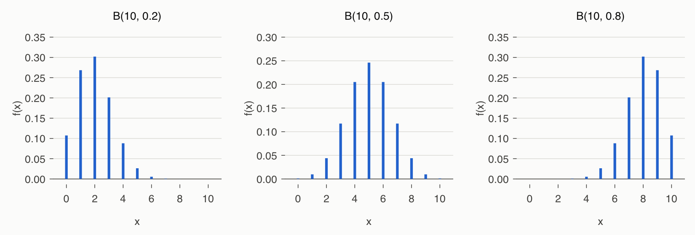
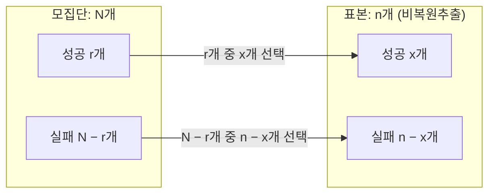
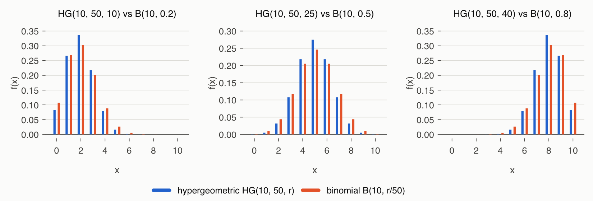
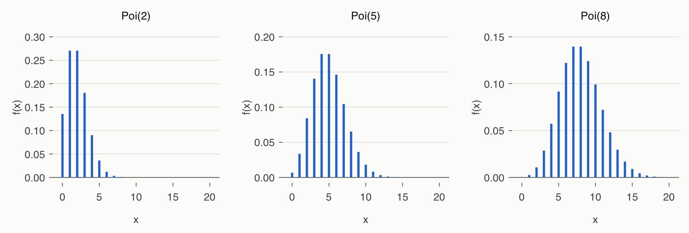
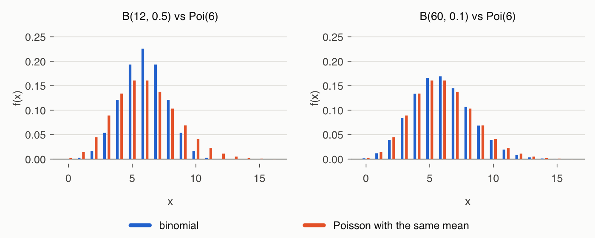
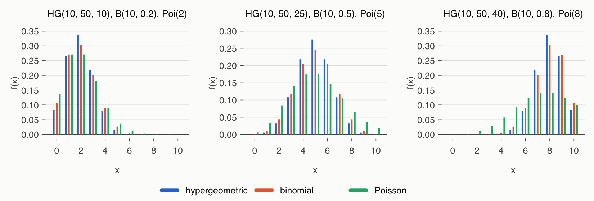
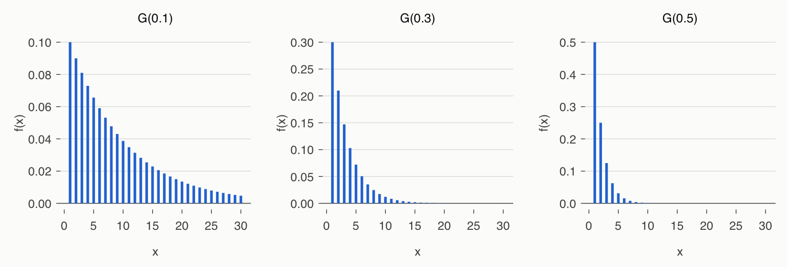
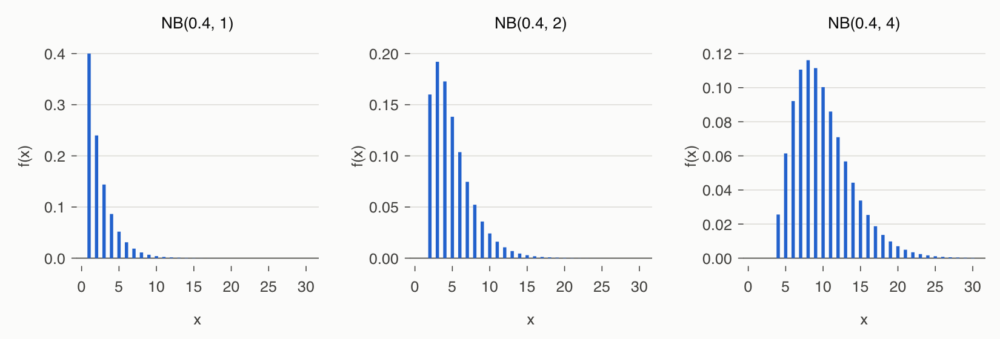
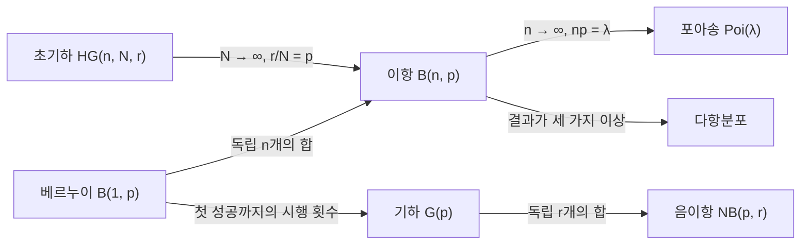

# 4강 — 이산확률변수

[레포지토리 안내](../../README.ko.md) | [English](Concepts_Lecture.md) | [한국어](Concepts_Lecture.ko.md)

> **최종 수정일:** 2026-11-04

> **학습 목표:**
> 1. 이산균등분포, 베르누이분포, 이항분포의 확률질량함수를 쓰고 기댓값과 분산을 유도할 수 있다
> 2. 비복원추출에 초기하분포를 적용하고, 유한모집단 수정계수로 이항분포와의 관계를 설명할 수 있다
> 3. 포아송분포를 이항분포의 극한으로 유도하고, 기댓값과 분산이 모두 λ임을 보일 수 있다
> 4. 기하분포와 음이항분포를 성공까지의 시행 횟수의 분포로 정의하고, 두 분포의 관계를 설명할 수 있다
> 5. 상황에 맞는 이산확률분포를 고르고, R의 d, p, q, r 함수로 확률을 계산할 수 있다

---

## 목차

- [1. 이산확률분포의 개관](#1-이산확률분포의-개관)
  - [1.1 일곱 가지 분포](#11-일곱-가지-분포)
  - [1.2 R의 분포 함수](#12-r의-분포-함수)
- [2. 이산균등분포](#2-이산균등분포)
- [3. 베르누이분포](#3-베르누이분포)
- [4. 이항분포](#4-이항분포)
  - [4.1 이항확률변수와 확률질량함수](#41-이항확률변수와-확률질량함수)
  - [4.2 기댓값과 분산](#42-기댓값과-분산)
  - [4.3 R 함수와 예제](#43-r-함수와-예제)
- [5. 초기하분포](#5-초기하분포)
  - [5.1 비복원추출과 확률질량함수](#51-비복원추출과-확률질량함수)
  - [5.2 기댓값과 분산](#52-기댓값과-분산)
  - [5.3 유한모집단 수정계수와 이항분포](#53-유한모집단-수정계수와-이항분포)
  - [5.4 R 함수와 예제](#54-r-함수와-예제)
- [6. 포아송분포](#6-포아송분포)
  - [6.1 이항분포의 극한으로서의 포아송분포](#61-이항분포의-극한으로서의-포아송분포)
  - [6.2 기댓값, 분산, 누적분포함수](#62-기댓값-분산-누적분포함수)
  - [6.3 점화식을 이용한 계산](#63-점화식을-이용한-계산)
  - [6.4 이항분포와의 비교와 과대산포](#64-이항분포와의-비교와-과대산포)
  - [6.5 R 함수와 예제](#65-r-함수와-예제)
- [7. 기하분포](#7-기하분포)
  - [7.1 확률질량함수와 누적분포함수](#71-확률질량함수와-누적분포함수)
  - [7.2 기댓값과 분산](#72-기댓값과-분산)
  - [7.3 무기억성](#73-무기억성)
  - [7.4 R 함수와 예제](#74-r-함수와-예제)
- [8. 음이항분포](#8-음이항분포)
  - [8.1 확률질량함수](#81-확률질량함수)
  - [8.2 기댓값, 분산과 기하분포와의 관계](#82-기댓값-분산과-기하분포와의-관계)
  - [8.3 R 함수와 예제](#83-r-함수와-예제)
- [9. 분포 사이의 관계](#9-분포-사이의-관계)
- [개념 적용](#개념-적용)
- [요약](#요약)
- [점검 문제](#점검-문제)
- [참고 문헌](#참고-문헌)

---

<br>

## 1. 이산확률분포의 개관

3강에서는 확률변수, 확률질량함수, 기댓값, 분산을 일반적으로 정의하였다. 실제 문제에서 나타나는 이산확률변수의 대부분은 몇 가지 전형적인 실험 구조에서 나오며, 같은 구조에서는 같은 모양의 확률질량함수를 얻는다. 아래에서는 자주 쓰이는 일곱 가지 이산확률분포를 실험 구조, 확률질량함수, 기댓값과 분산의 유도, R 함수의 순서로 정리한다. 확률질량함수는 3강의 $p_X(x)$ 대신 $f(x)$로 쓴다.

### 1.1 일곱 가지 분포

각 분포는 몇 개의 상수로 모양이 정해진다. 분포의 모양을 정하는 이 상수를 **모수(parameter)** 라고 한다. 또한 확률변수가 양의 확률로 취하는 값의 집합을 **지지집합(support)** 이라고 한다.

| 분포 | 표기 | 모수 | 확률변수가 세는 것 |
|:-----|:-----|:-----|:-----|
| 이산균등분포 | 없음 | $n$ | $1, \dots, n$ 가운데 같은 확률로 하나가 나올 때 그 값 |
| 베르누이분포 | $B(1, p)$ | $p$ | 한 번의 시행이 성공하면 1, 실패하면 0 |
| 이항분포 | $B(n, p)$ | $n$, $p$ | 독립인 $n$번의 시행에서 성공 횟수 |
| 초기하분포 | $HG(n, N, r)$ | $n$, $N$, $r$ | 유한모집단에서 비복원추출한 $n$개 가운데 성공 개체의 수 |
| 포아송분포 | $Poi(\lambda)$ | $\lambda$ | 일정한 단위에서 드물게 일어나는 사건의 발생 횟수 |
| 기하분포 | $G(p)$ | $p$ | 처음 성공할 때까지의 시행 횟수 |
| 음이항분포 | $NB(p, r)$ | $p$, $r$ | $r$번째 성공까지의 시행 횟수 |

*표 1. 일곱 가지 이산확률분포의 표기, 모수, 확률변수가 세는 것*

여기서 $p$는 한 번의 시행에서 성공할 확률이다. 이항분포 이후의 분포는 모두 성공과 실패라는 두 가지 결과만 있는 시행을 바탕으로 하므로, 3절의 베르누이 시행이 공통의 출발점이다.

### 1.2 R의 분포 함수

R은 주요 확률분포마다 이름 앞에 `d`, `p`, `q`, `r` 중 하나를 붙인 네 함수를 제공한다 [1]. 예를 들어 이항분포의 이름은 `binom`이므로 `dbinom`, `pbinom`, `qbinom`, `rbinom`이 있다.

| 접두어 | 이름의 유래 | 계산하는 값 | 이산분포에서의 의미 |
|:-----|:-----|:-----|:-----|
| `d` | density (밀도) | 확률질량함수 $f(x)$ | $P(X = x)$ |
| `p` | probability (누적확률) | 누적분포함수 $F(q)$ | $P(X \le q)$, `lower.tail = FALSE`이면 $P(X > q)$ |
| `q` | quantile (분위수) | 분위수 | $F(x) \ge u$를 만족하는 가장 작은 $x$ |
| `r` | random (난수) | 난수 | 그 분포를 따르는 값을 무작위로 생성 |

*표 2. R의 분포 함수 이름에 붙는 네 접두어*

- `p` 함수의 `lower.tail = FALSE`는 위쪽 꼬리 확률 $P(X > q)$를 준다. 이산분포에서 $P(X \ge k)$는 $P(X > k - 1)$이므로 `p...(k - 1, ..., lower.tail = FALSE)`로 구한다. `1 - p...(k - 1, ...)`과 같지만, 매우 작은 꼬리 확률에서는 뺄셈의 반올림 오차가 없는 `lower.tail = FALSE`가 더 정확하다.
- 이산분포의 누적분포함수는 계단함수이므로 $F(x) = u$인 $x$가 없을 수 있다. 그래서 `q` 함수는 $F(x) \ge u$인 가장 작은 $x$를 돌려준다. 특히 `q...(0.5, ...)`는 중앙값이다.
- `r` 함수의 결과는 실행할 때마다 달라진다. `set.seed()`로 난수의 시작점을 정하면 같은 결과를 다시 얻을 수 있다.

> **주의:** 기하분포와 음이항분포에서 R의 함수는 시행 횟수가 아니라 **성공 전까지의 실패 횟수**를 확률변수로 쓴다 [2], [3]. 7절과 8절처럼 시행 횟수로 정의한 분포에 R 함수를 쓰려면 값을 옮겨야 한다(7.4절, 8.3절). 초기하분포의 R 함수는 인수 이름이 $HG(n, N, r)$의 기호와 겹치므로 5.4절에서 따로 정리한다.

---

<br>

## 2. 이산균등분포

> **용어 정의:** $n$개의 결과값 $1, 2, \dots, n$이 같은 확률로 나타나는 확률분포를 **이산균등분포(discrete uniform distribution)** 라고 한다. 확률질량함수는 $f(x) = \dfrac{1}{n}$ $(x = 1, 2, \dots, n)$이다.

모수는 결과값의 개수 $n$이고, 지지집합은 $\lbrace1, 2, \dots, n\rbrace$이다. 공정한 주사위의 눈($n = 6$), 1부터 20까지 번호가 적힌 공에서 하나를 뽑을 때의 번호($n = 20$)가 이 분포를 따른다.

**기댓값.** 자연수의 합 공식 $\sum_{x=1}^{n} x = \frac{n(n+1)}{2}$을 쓴다.

$$
E(X) = \sum_{x=1}^{n} x \Big(\frac{1}{n}\Big) = \frac{1}{n} \times \frac{n(n+1)}{2} = \frac{n+1}{2}
$$

**분산.** 제곱의 합 공식 $\sum_{x=1}^{n} x^2 = \frac{n(n+1)(2n+1)}{6}$으로 $E(X^2)$를 구하고, 3강의 $\mathrm{Var}(X) = E(X^2) - E(X)^2$를 쓴다.

$$
E(X^2) = \sum_{x=1}^{n} x^2 \Big(\frac{1}{n}\Big) = \frac{1}{n} \times \frac{n(n+1)(2n+1)}{6} = \frac{(n+1)(2n+1)}{6}
$$

$$
\mathrm{Var}(X) = \frac{(n+1)(2n+1)}{6} - \Big(\frac{n+1}{2}\Big)^2 = \frac{(n+1)\lbrace2(2n+1) - 3(n+1)\rbrace}{12} = \frac{(n+1)(n-1)}{12}
$$

중괄호 안은 $4n + 2 - 3n - 3 = n - 1$이다. 두 합 공식은 다음과 같이 확인할 수 있다. 첫째 공식은 합 $S = 1 + 2 + \cdots + n$을 거꾸로 쓴 $S = n + (n-1) + \cdots + 1$과 항끼리 더하면 합이 $n + 1$인 쌍이 $n$개 생겨 $2S = n(n+1)$이 되므로 성립한다. 둘째 공식은 항등식 $(k+1)^3 - k^3 = 3k^2 + 3k + 1$을 $k = 1, \dots, n$에 대해 더하면 왼쪽이 $(n+1)^3 - 1$로 줄어드는 것(망원합)을 이용하여 $\sum k^2$에 대해 풀면 얻는다.

**예.** 주사위($n = 6$)는 $E(X) = 7/2$, $\mathrm{Var}(X) = 7 \cdot 5 / 12 = 35/12$이며, 3강에서 정의대로 계산한 값과 같다.

> **참고:** 연속된 정수 $a, a+1, \dots, b$ 위의 균등분포는 $1, \dots, n$ 위의 균등분포 $U$를 $a - 1$만큼 옮긴 $X = U + (a - 1)$이다($n = b - a + 1$). 따라서 $E(X) = \frac{a + b}{2}$이고, 더한 상수는 분산을 바꾸지 않으므로 $\mathrm{Var}(X) = \frac{n^2 - 1}{12}$이다.

기본 R에는 이산균등분포 전용 함수가 없으므로 다음과 같이 계산한다.

| 용도 | R 코드 | 의미 |
|:-----|:-----|:-----|
| 확률질량함수 | `ifelse(x %in% 1:n, 1/n, 0)` | $P(X = x)$ |
| 누적분포함수 | `pmin(pmax(floor(q), 0), n) / n` | $P(X \le q)$ |
| 분위수 | `ceiling(u * n)` | $F(x) \ge u$인 가장 작은 $x$ $(0 < u \le 1)$ |
| 난수 | `sample(1:n, size, replace = TRUE)` | `size`개의 난수 |

*표 3. 이산균등분포의 확률을 기본 R로 계산하는 방법*

누적분포함수는 $q$ 이하인 정수의 개수 $\lfloor q \rfloor$를 0과 $n$ 사이로 자른 뒤 $n$으로 나눈 값이다. 다음 코드는 주사위의 기댓값과 분산을 계산하고 주사위 던지기를 10번 흉내 낸다.

```r
x  <- 1:6                          # 값 1, ..., n (n = 6)
fx <- rep(1/6, 6)                  # f(x) = 1/n
sum(x * fx)                        # E(X) = (n + 1)/2
sum(x^2 * fx) - sum(x * fx)^2      # Var(X) = (n + 1)(n - 1)/12
set.seed(1)                        # 재현할 수 있도록 난수 시드를 고정
sample(1:6, 10, replace = TRUE)    # 주사위 10번 던지기의 모의실험
```

```text
[1] 3.5
[1] 2.916667
 [1] 1 4 1 2 5 3 6 2 3 3
```

`sample(1:6, 10, replace = TRUE)`는 1부터 6까지에서 복원추출로 10개를 뽑으므로 공정한 주사위를 10번 던진 것과 같다. 1에서 20까지의 공을 다루는 문제는 [연습 문제 1](Exercises.ko.md#연습-문제-1-번호가-적힌-공의-이산균등분포)에 있다.

---

<br>

## 3. 베르누이분포

> **용어 정의:** 결과가 두 가지뿐인 시행을 **베르누이 시행(Bernoulli trial)** 이라고 한다. 한 결과를 성공, 다른 결과를 실패라 하고 성공이면 1, 실패이면 0을 주는 확률변수 $X$는 $P(X = 1) = p$, $P(X = 0) = 1 - p$를 만족하며, 이 분포를 **베르누이분포(Bernoulli distribution)** 라고 하고 $X \sim B(1, p)$로 쓴다.

동전 던지기(앞면이면 성공), 게임의 승패, 제품의 불량 여부, 환자의 완치 여부가 베르누이 시행의 예이다. 확률질량함수는 한 식으로 $f(x) = p^x (1 - p)^{1 - x}$ $(x = 0, 1)$로 쓸 수 있다. $x = 1$을 넣으면 $p$, $x = 0$을 넣으면 $1 - p$가 된다. 모수는 성공 확률 $p$ $(0 \le p \le 1)$이다.

**기댓값과 분산.** $X$가 0 또는 1이므로 $X^2 = X$이다.

$$
E(X) = 1 \cdot p + 0 \cdot (1 - p) = p, \qquad E(X^2) = 1^2 \cdot p + 0^2 \cdot (1 - p) = p
$$

$$
\mathrm{Var}(X) = E(X^2) - E(X)^2 = p - p^2 = p(1 - p)
$$

분산 $p(1 - p)$는 $p = 1/2$일 때 최댓값 $1/4$를 가지며, $p$가 0이나 1에 가까울수록, 즉 결과가 거의 정해져 있을수록 작아진다. 특히 $p$가 작으면 $1 - p \approx 1$이므로 $\mathrm{Var}(X) \approx p$이다.

표기 $B(1, p)$는 4절의 이항분포 $B(n, p)$에서 $n = 1$인 경우라는 뜻이다. 따라서 R에서는 이항분포 함수에 `size = 1`을 주어 쓴다.

| 함수 | 계산하는 값 |
|:-----|:-----|
| `dbinom(x, size = 1, prob = p)` | $P(X = x)$ $(x = 0, 1)$ |
| `pbinom(q, size = 1, prob = p)` | $P(X \le q)$ |
| `qbinom(u, size = 1, prob = p)` | $F(x) \ge u$인 가장 작은 $x$ |
| `rbinom(n, size = 1, prob = p)` | 베르누이 시행 $n$번의 결과(0 또는 1) |

*표 4. 베르누이분포의 R 함수*

```r
dbinom(0:1, size = 1, prob = 0.3)  # P(X = 0), P(X = 1)
set.seed(1)
rbinom(10, size = 1, prob = 0.3)   # 베르누이 시행 10번의 모의실험
```

```text
[1] 0.7 0.3
 [1] 0 0 0 1 0 1 1 0 0 0
```

$p = 0.3$인 베르누이분포에서 $P(X = 0) = 0.7$, $P(X = 1) = 0.3$이고, $E(X) = 0.3$, $\mathrm{Var}(X) = 0.3 \times 0.7 = 0.21$이다. 10번의 모의 시행에서는 1이 세 번 나왔다.

---

<br>

## 4. 이항분포

### 4.1 이항확률변수와 확률질량함수

베르누이 시행을 차례로 $n$번 반복하고, 각 시행은 서로 **독립**이며 성공 확률은 매번 $p$로 같다고 하자. 성공을 1, 실패를 0으로 적으면 결과는 길이 $n$의 0과 1의 열이다. 예를 들어 $n = 12$일 때 한 결과는 다음과 같다.

$$
100011001010
$$

이 결과의 확률은 $p^5 (1 - p)^7$이다. 시행이 독립이므로 각 시행의 확률을 곱하면 되고, 1이 다섯 번, 0이 일곱 번 있으므로 $p$를 다섯 번, $1 - p$를 일곱 번 곱한다. 곱셈의 순서는 결과에 영향을 주지 않으므로, 1이 다섯 개인 길이 12의 열은 모두 같은 확률 $p^5 (1 - p)^7$을 가진다.

성공(1)의 개수를 $X$라 하면 $X(100011001010) = 5$이다. 사건 $\lbrace X = 5\rbrace$에는 1이 다섯 개인 모든 열이 들어 있고, 그런 열의 수는 열두 자리 가운데 1이 놓일 다섯 자리를 고르는 경우의 수 $\binom{12}{5} = 792$이다. 따라서 다음과 같다.

$$
P(X = 5) = \binom{12}{5} \cdot p^5 \cdot (1 - p)^7
$$

같은 논리를 일반적인 $n$과 $k$에 적용한다.

> **용어 정의:** 독립이고 성공 확률이 $p$로 같은 베르누이 시행을 $n$번 할 때의 성공 횟수 $X$를 **이항확률변수(binomial random variable)** 라고 하고, 그 분포를 **이항분포(binomial distribution)** 라고 한다. $X \sim B(n, p)$로 쓰며, 확률질량함수는 $P(X = k) = \binom{n}{k}\, p^k (1 - p)^{n - k}$ $(k = 0, 1, \dots, n)$이다.

여기서 $\binom{n}{k} = {}_n C_k = \frac{n!}{k!\,(n - k)!}$는 $n$개에서 $k$개를 고르는 조합의 수이며 **이항계수(binomial coefficient)** 라고 한다. 모수는 시행 횟수 $n$과 성공 확률 $p$이고, 지지집합은 $\lbrace0, 1, \dots, n\rbrace$이다.

확률의 합이 1인 것은 **이항정리** $(a + b)^n = \sum_{k=0}^{n} \binom{n}{k} a^k b^{n-k}$에 $a = p$, $b = 1 - p$를 넣으면 확인된다.

$$
\sum_{k=0}^{n} \binom{n}{k} p^k (1 - p)^{n - k} = \lbrace p + (1 - p)\rbrace^n = 1^n = 1
$$

각 확률이 이항정리 전개의 항이라는 점이 "이항분포"라는 이름의 유래이다.



*그림 1. 이항분포 B(10, 0.2), B(10, 0.5), B(10, 0.8)의 확률질량함수*

그림 1처럼 $p < 0.5$이면 분포가 왼쪽으로 몰리고 오른쪽 꼬리가 길며, $p = 0.5$이면 $n/2$를 중심으로 대칭이고, $p > 0.5$이면 오른쪽으로 몰린다. 성공 대신 실패를 세면 $n - X \sim B(n, 1 - p)$이므로, $B(10, 0.8)$은 $B(10, 0.2)$를 좌우로 뒤집은 모양이다.

### 4.2 기댓값과 분산

정의에 따르면 이항확률변수의 평균은 다음과 같다.

$$
E(X) = \sum_{k=0}^{n} k \cdot P(X = k) = \sum_{k=0}^{n} k \cdot \binom{n}{k} p^k (1 - p)^{n - k}
$$

이 합은 $np$와 같다. 항등식 $k \binom{n}{k} = n \binom{n-1}{k-1}$($k$개를 고른 뒤 그중 대표 하나를 정하는 경우의 수를 두 방법으로 센 것)을 쓰면, $k = 0$인 항은 0이므로

$$
E(X) = np \sum_{k=1}^{n} \binom{n-1}{k-1} p^{k-1} (1 - p)^{n-k} = np \sum_{j=0}^{n-1} \binom{n-1}{j} p^{j} (1 - p)^{(n-1)-j} = np \cdot 1
$$

이다. 둘째 단계에서 $j = k - 1$로 바꾸면 남은 합은 $B(n - 1, p)$의 확률의 합이므로 1이다.

**더 쉬운 방법.** $n$번의 독립인 베르누이 시행에서 $X_k$를 $k$번째 시행의 결과(0 또는 1)라 하면, 성공 횟수는 다음과 같다.

$$
X \equiv X_1 + X_2 + \cdots + X_n
$$

즉 이항확률변수는 "성공을 세는" 베르누이 확률변수의 합이다. 3절에서 $E(X_k) = p$, $\mathrm{Var}(X_k) = E(X_k^2) - \lbrace E(X_k)\rbrace^2 = p - p^2 = p(1 - p)$이다. 3강 5.4절에 따라 합의 기댓값은 기댓값의 합이고, $X_k$들이 독립이므로 3강 7.3절에 따라 합의 분산은 분산의 합이다.

$$
E(X) = \sum_{i=1}^{n} E(X_i) = \sum_{i=1}^{n} p = np
$$

$$
\mathrm{Var}(X) = \sum_{i=1}^{n} \mathrm{Var}(X_i) = \sum_{i=1}^{n} p(1 - p) = np(1 - p)
$$

$p$가 작으면 $1 - p \approx 1$이므로 $\mathrm{Var}(X) \approx np$이다. 이 근사는 6절의 포아송분포로 이어진다. 그림 1의 세 분포는 평균이 각각 2, 5, 8이고 분산이 1.6, 2.5, 1.6이다.

### 4.3 R 함수와 예제

| 함수 | 계산하는 값 |
|:-----|:-----|
| `dbinom(x, size, prob)` | $P(X = x)$, `size`는 $n$, `prob`는 $p$ |
| `pbinom(q, size, prob, lower.tail = TRUE)` | $P(X \le q)$, `lower.tail = FALSE`이면 $P(X > q)$ |
| `qbinom(p, size, prob)` | $F(x) \ge p$인 가장 작은 $x$ |
| `rbinom(n, size, prob)` | $B(\text{size}, \text{prob})$를 따르는 난수 $n$개 |

*표 5. 이항분포의 R 함수*

R의 콘솔에서 `?dbinom`을 입력하면 네 함수의 도움말을 볼 수 있다. `rbinom`의 첫 인수 `n`은 생성할 난수의 개수이며 시행 횟수가 아니다. 시행 횟수는 `size`이다.

**예: 객관식 문항을 무작위로 찍어 맞힌 문항 수.** 보기가 네 개인 객관식 문항 10개를 모두 무작위로 찍으면, 각 문항을 맞힐 확률은 $1/4$이고 문항들은 독립이므로 맞힌 문항 수는 $X \sim B(10, 0.25)$이다. 정확히 3문항을 맞힐 확률은 다음과 같다.

$$
P(X = 3) = \binom{10}{3} (0.25)^3 (0.75)^7 = 120 \times 0.015625 \times 0.1335 \approx 0.2503
$$

평균은 $10 \times 0.25 = 2.5$문항, 분산은 $10 \times 0.25 \times 0.75 = 1.875$이다.

```r
dbinom(3, 10, 0.25)                       # P(X = 3)
round(dbinom(0:10, 10, 0.25), 4)          # 확률질량함수 전체
pbinom(2, 10, 0.25)                       # P(X <= 2)
pbinom(5, 10, 0.25, lower.tail = FALSE)   # P(X > 5) = P(X >= 6)
qbinom(0.5, 10, 0.25)                     # F(x) >= 0.5인 가장 작은 x
set.seed(1)
rbinom(5, 10, 0.25)                       # 다섯 명이 맞힌 문항 수의 모의실험
```

```text
[1] 0.2502823
 [1] 0.0563 0.1877 0.2816 0.2503 0.1460 0.0584 0.0162 0.0031 0.0004 0.0000
[11] 0.0000
[1] 0.5255928
[1] 0.01972771
[1] 2
[1] 2 2 3 4 1
```

- 첫 줄의 0.2503은 손으로 구한 값과 같다. 둘째 줄은 $x = 0, \dots, 10$의 확률 전체이며, 가장 큰 확률은 $x = 2$의 0.2816이다.
- $P(X \le 2) \approx 0.5256$이므로 절반 이상의 확률로 2문항 이하를 맞힌다. 6문항 이상을 맞힐 확률 $P(X \ge 6) = P(X > 5) \approx 0.0197$은 약 2%로 매우 작다.
- `qbinom(0.5, 10, 0.25)`는 $F(x) \ge 0.5$인 가장 작은 $x$인 2이다. $F(1) \approx 0.2440 < 0.5$이고 $F(2) \approx 0.5256 \ge 0.5$이기 때문이다.
- `rbinom(5, 10, 0.25)`는 다섯 명이 각자 10문항을 무작위로 골랐을 때 맞힌 문항 수를 흉내 낸다.

---

<br>

## 5. 초기하분포

### 5.1 비복원추출과 확률질량함수

이항분포는 매 시행의 성공 확률이 같고 시행이 독립이라는 가정에 기반한다. 크기가 유한한 모집단에서 개체를 뽑고 다시 넣지 않으면 이 가정이 깨진다. 한 번 뽑은 개체는 다시 나오지 않으므로, 앞에서 무엇을 뽑았는지에 따라 다음 시행의 성공 확률이 달라진다. 뽑은 개체를 되돌려 넣는 추출을 **복원추출(sampling with replacement)**, 되돌려 넣지 않는 추출을 **비복원추출(sampling without replacement)** 이라고 한다.

> **용어 정의:** 특정한 성질을 가진 개체(성공) $r$개와 갖지 않은 개체(실패) $N - r$개로 이루어진 크기 $N$의 유한모집단에서 $n$개를 비복원추출할 때, 표본에 들어 있는 성공 개체의 수 $X$의 분포를 **초기하분포(hypergeometric distribution)** 라고 하고 $X \sim HG(n, N, r)$로 쓴다.



*그림 2. 초기하분포의 구조, 모집단의 성공 r개와 실패 N − r개에서 표본의 성공 x개와 실패 n − x개를 고르는 과정*

**확률질량함수.** $N$개에서 $n$개를 고르는 방법은 $\binom{N}{n}$가지이고, 비복원 무작위 추출에서는 이 표본들이 모두 같은 확률로 뽑힌다. 그 가운데 성공 개체가 정확히 $x$개인 표본은 성공 $r$개 중 $x$개를 고르고 실패 $N - r$개 중 $n - x$개를 고르는 것이므로 $\binom{r}{x}\binom{N - r}{n - x}$가지이다.

$$
f(x) = \frac{\dbinom{r}{x}\dbinom{N - r}{n - x}}{\dbinom{N}{n}}, \qquad \max(0,\ n - N + r) \le x \le \min(n,\ r)
$$

지지집합의 범위는 다음 세 조건에서 나온다. 표본에 들어간 성공 개체는 표본 크기를 넘을 수 없으므로 $x \le n$이고, 모집단의 성공 개체 수를 넘을 수 없으므로 $x \le r$이다. 또한 표본의 실패 개체 수 $n - x$는 모집단의 실패 개체 수 $N - r$을 넘을 수 없으므로 $x \ge n - (N - r)$이다. 모수는 $n$, $N$, $r$의 세 개이다.

### 5.2 기댓값과 분산

**기댓값.** $i$번째로 뽑은 개체가 성공이면 1, 실패이면 0인 확률변수를 $I_i$라 하면 $X = I_1 + \cdots + I_n$이다. 비복원추출이어도, 앞의 결과를 모르는 상태에서 $i$번째로 뽑히는 개체는 $N$개 가운데 어느 것이든 같은 확률이므로 $P(I_i = 1) = r/N$이다. 3강의 기댓값의 덧셈 성질은 독립을 요구하지 않으므로 다음이 성립한다.

$$
E(X) = n \times P(\text{성공}) = n \times \frac{r}{N} = \frac{nr}{N}
$$

**분산.** $I_i$들은 독립이 아니므로 분산을 단순히 더할 수 없다. 대신 $E(X^2)$보다 계산하기 쉬운 $E[X(X - 1)]$을 먼저 구한다. 항등식 $x(x - 1)\binom{r}{x} = r(r - 1)\binom{r - 2}{x - 2}$를 쓰면 다음과 같다.

$$
E[X(X - 1)] = \frac{r(r - 1)}{\binom{N}{n}} \sum_{x} \binom{r - 2}{x - 2}\binom{N - r}{n - x} = \frac{r(r - 1)\binom{N - 2}{n - 2}}{\binom{N}{n}} = \frac{nr}{N} \times \frac{(n - 1)(r - 1)}{N - 1}
$$

가운데 합은 성공 $r - 2$개와 실패 $N - r$개, 모두 $N - 2$개에서 $n - 2$개를 고르는 방법을 성공의 수에 따라 나누어 센 것이므로 $\binom{N - 2}{n - 2}$이다(방데르몽드 항등식). 마지막 단계에서는 $\binom{N - 2}{n - 2} / \binom{N}{n} = \frac{n(n - 1)}{N(N - 1)}$을 썼다. 이제 $X^2 = X(X - 1) + X$이므로

$$
\begin{aligned}
\mathrm{Var}(X) &= E(X^2) - E(X)^2 = E[X(X - 1)] + E(X) - E(X)^2 \\
&= \frac{nr}{N} \times \frac{(n - 1)(r - 1)}{N - 1} + \frac{nr}{N} - \Big(\frac{nr}{N}\Big)^2 \\
&= n\,\frac{r}{N}\Big(1 - \frac{r}{N}\Big)\Big(\frac{N - n}{N - 1}\Big)
\end{aligned}
$$

이다. 마지막 단계는 $\frac{nr}{N}$을 묶어 낸 뒤 괄호 안을 통분한 것이다. 괄호 안의 분자는 $(n - 1)(r - 1)N + N(N - 1) - nr(N - 1) = N^2 - nN - rN + nr = (N - n)(N - r)$이 되어, $\mathrm{Var}(X) = \frac{nr}{N} \cdot \frac{(N - n)(N - r)}{N(N - 1)}$이고 이는 위의 마지막 식과 같다.

### 5.3 유한모집단 수정계수와 이항분포

성공 개체의 비율을 $p = r/N$이라 하면 초기하분포의 기댓값과 분산은 다음과 같이 쓸 수 있다.

$$
E(X) = np, \qquad \mathrm{Var}(X) = n\,\frac{r}{N}\Big(1 - \frac{r}{N}\Big)\Big(\frac{N - n}{N - 1}\Big) = np(1 - p)\Big(\frac{N - n}{N - 1}\Big)
$$

기댓값은 이항분포 $B(n, p)$와 같고, 분산은 이항분포의 분산에 $\frac{N - n}{N - 1}$을 곱한 값이다. 이 인수를 **유한모집단 수정계수(finite population correction factor)** 라고 한다.

- $n \ge 2$이면 수정계수는 1보다 작으므로, 비복원추출의 분산은 복원추출(이항분포)의 분산보다 작다. 이미 뽑은 개체가 다시 나오지 않으므로 표본이 모집단을 더 고르게 반영하기 때문이다. 극단적으로 $n = N$이면 모집단 전체를 뽑으므로 항상 $X = r$이고 분산은 0이다.
- $N$이 $n$에 비해 매우 크면 수정계수는 1에 가깝고, 초기하분포는 이항분포 $B(n, r/N)$에 가까워진다. 큰 모집단에서는 몇 개를 빼내도 남은 성공 비율이 거의 바뀌지 않으므로, 비복원추출이 복원추출과 거의 같아진다.



*그림 3. 초기하분포 HG(10, 50, r)와 이항분포 B(10, r/50)의 비교 (r = 10, 25, 40)*

그림 3은 $N = 50$에서 $n = 10$개를 뽑는 경우이다. 수정계수는 $40/49 \approx 0.816$이므로 초기하분포의 분산은 이항분포의 약 82%이고, 초기하분포의 막대가 평균 근처에서 더 높고 꼬리에서 더 낮다. 모집단이 표본의 5배에 불과하여 차이가 눈에 보인다.

### 5.4 R 함수와 예제

| 함수 | 계산하는 값 |
|:-----|:-----|
| `dhyper(x, m, n, k)` | $P(X = x)$ |
| `phyper(q, m, n, k, lower.tail = TRUE)` | $P(X \le q)$, `lower.tail = FALSE`이면 $P(X > q)$ |
| `qhyper(p, m, n, k)` | $F(x) \ge p$인 가장 작은 $x$ |
| `rhyper(nn, m, n, k)` | 난수 `nn`개 |

*표 6. 초기하분포의 R 함수*

> **주의:** R의 인수 이름은 $HG(n, N, r)$의 기호와 다르다. `m`은 모집단의 성공 개체 수 $r$, `n`은 모집단의 **실패** 개체 수 $N - r$, `k`는 표본 크기 $n$이다. 따라서 $HG(n, N, r)$의 확률은 `dhyper(x, r, N - r, n)`으로 계산한다. R의 `n`이 표본 크기가 아니라는 점에 특히 유의한다.

**예: 불량 전구의 검사.** 전구 12개가 든 상자에 불량품이 4개 있다. 3개를 비복원으로 뽑을 때 불량품의 수는 $X \sim HG(3, 12, 4)$이다. 전체 표본의 수는 $\binom{12}{3} = 220$이다.

$$
P(X = 0) = \frac{\binom{4}{0}\binom{8}{3}}{220} = \frac{56}{220}, \quad P(X = 1) = \frac{\binom{4}{1}\binom{8}{2}}{220} = \frac{112}{220}, \quad P(X = 2) = \frac{\binom{4}{2}\binom{8}{1}}{220} = \frac{48}{220}, \quad P(X = 3) = \frac{\binom{4}{3}\binom{8}{0}}{220} = \frac{4}{220}
$$

평균은 $3 \times 4/12 = 1$이고, 분산은 $3 \times \frac{1}{3} \times \frac{2}{3} \times \frac{12 - 3}{12 - 1} = \frac{2}{3} \times \frac{9}{11} = \frac{6}{11} \approx 0.545$이다.

```r
dhyper(0:3, m = 4, n = 8, k = 3)          # P(X = 0), ..., P(X = 3)
phyper(1, m = 4, n = 8, k = 3)            # P(X <= 1)
qhyper(0.5, m = 4, n = 8, k = 3)          # F(x) >= 0.5인 가장 작은 x
set.seed(1)
rhyper(5, m = 4, n = 8, k = 3)            # 표본 5개의 모의실험
dbinom(0:3, 3, 4/12)                      # 비교를 위한 이항분포 B(3, 1/3)
```

```text
[1] 0.25454545 0.50909091 0.21818182 0.01818182
[1] 0.7636364
[1] 1
[1] 1 1 1 2 0
[1] 0.29629630 0.44444444 0.22222222 0.03703704
```

첫 줄은 $56/220$, $112/220$, $48/220$, $4/220$과 같다. 마지막 줄은 같은 상자에서 복원추출할 때의 이항분포 $B(3, 1/3)$이다. 이항분포의 분산은 $3 \times \frac{1}{3} \times \frac{2}{3} = \frac{2}{3}$로, 초기하분포의 $6/11$보다 크다. 이항분포 쪽이 양 끝($x = 0, 3$)에 더 큰 확률을 주는 것도 이 때문이다.

---

<br>

## 6. 포아송분포

### 6.1 이항분포의 극한으로서의 포아송분포

> **용어 정의:** 일정한 단위(시간, 면적, 부피, 길이 등)에서 **드물게** 일어나는 사건의 발생 횟수의 분포를 **포아송분포(Poisson distribution)** 라고 한다. 단위당 평균 발생 횟수를 $\lambda > 0$이라 하면 확률질량함수는 $f(x) = \lambda^x \dfrac{e^{-\lambda}}{x!}$ $(x = 0, 1, 2, \dots)$이고, $X \sim Poi(\lambda)$로 쓴다.

1분 동안 콜센터에 걸려 온 전화의 수, 책 한 쪽의 오타 수, 제품 한 단위의 결점 수, 하루 동안의 교통사고 수가 그 예이다. 모수는 $\lambda$ 하나이고, 지지집합은 음이 아닌 정수 전체이다.

포아송분포는 이항분포의 **극한**으로 유도할 수 있다. 단위를 매우 작은 $n$개의 구간으로 나누고, 각 구간에서 사건이 일어날 확률을 $p$라 하자. 구간이 충분히 작으면 한 구간에서 두 번 이상 일어나는 일은 무시할 수 있으므로, 발생 횟수는 $B(n, p)$로 볼 수 있다. 평균 발생 횟수 $\lambda = np$를 고정한 채 $n \to \infty$로 보내면($p = \lambda/n \to 0$) 다음과 같다.

$$
\begin{aligned}
\lim_{n \to \infty} \binom{n}{x} p^x (1 - p)^{n - x}
&= \lim_{n \to \infty} \frac{n!}{x!\,(n - x)!} \Big(\frac{\lambda}{n}\Big)^x \Big(1 - \frac{\lambda}{n}\Big)^{n - x} \\
&= \frac{\lambda^x}{x!} \lim_{n \to \infty} \frac{n(n - 1)\cdots(n - x + 1)}{n^x} \Big(1 - \frac{\lambda}{n}\Big)^{n} \Big(1 - \frac{\lambda}{n}\Big)^{-x} \\
&= \frac{\lambda^x}{x!} \cdot 1 \cdot e^{-\lambda} \cdot 1 = \lambda^x \frac{e^{-\lambda}}{x!}
\end{aligned}
$$

둘째 줄은 $\frac{n!}{(n - x)!} = n(n - 1)\cdots(n - x + 1)$과 $(\lambda/n)^x = \lambda^x / n^x$를 쓰고 $(1 - \lambda/n)^{n - x}$를 둘로 나눈 것이다. 세 극한은 다음과 같다.

- $\frac{n(n - 1)\cdots(n - x + 1)}{n^x} = \frac{n}{n} \cdot \frac{n - 1}{n} \cdots \frac{n - x + 1}{n}$은 1에 가까워지는 $x$개($x$는 고정)의 인수의 곱이므로 1로 간다.
- $(1 - \lambda/n)^n$은 미적분학의 극한 $\lim_{n \to \infty}(1 + a/n)^n = e^a$에 $a = -\lambda$를 넣은 것이므로 $e^{-\lambda}$로 간다.
- $(1 - \lambda/n)^{-x}$는 괄호 안이 1로 가고 지수 $-x$가 고정되어 있으므로 1로 간다.

> **핵심:** 포아송분포는 $\lambda = np$를 유지하면서 $n \to \infty$, $p \to 0$으로 보낸 이항분포의 극한이다. 따라서 $n$이 크고 $p$가 작은 이항분포는 $\lambda = np$인 포아송분포로 근사할 수 있다: $\binom{n}{k} p^k (1 - p)^{n - k} \approx e^{-\lambda} \frac{\lambda^k}{k!}$. 여기서 $\lambda = np$는 평균 성공 횟수이다.

### 6.2 기댓값, 분산, 누적분포함수

**확률의 합.** 미적분학의 테일러 급수 $e^\lambda = \sum_{\ell=0}^{\infty} \frac{\lambda^\ell}{\ell!}$을 쓰면 확률의 합이 1임을 알 수 있다. 포아송확률변수는 이항확률변수와 달리 상한이 없어 **임의로 큰** 정수값을 가질 수 있다.

$$
\sum_{x=0}^{\infty} e^{-\lambda} \frac{\lambda^x}{x!} = e^{-\lambda} e^{\lambda} = 1
$$

**기댓값.** $x = 0$인 항은 0이고, $x / x! = 1/(x - 1)!$이다.

$$
E(X) = \sum_{x=0}^{\infty} x \cdot e^{-\lambda} \frac{\lambda^x}{x!} = \lambda \sum_{x=1}^{\infty} e^{-\lambda} \frac{\lambda^{x - 1}}{(x - 1)!} = \lambda \sum_{j=0}^{\infty} e^{-\lambda} \frac{\lambda^{j}}{j!} = \lambda
$$

**분산.** 같은 방법으로 $E[X(X - 1)]$을 구한다.

$$
E[X(X - 1)] = \sum_{x=2}^{\infty} x(x - 1)\, e^{-\lambda} \frac{\lambda^x}{x!} = \lambda^2 \sum_{x=2}^{\infty} e^{-\lambda} \frac{\lambda^{x - 2}}{(x - 2)!} = \lambda^2
$$

$$
\mathrm{Var}(X) = E[X(X - 1)] + E(X) - E(X)^2 = \lambda^2 + \lambda - \lambda^2 = \lambda
$$

포아송분포는 **기댓값과 분산이 모두 $\lambda$** 이다. 이는 이항분포에서 $E(X) = np = \lambda$, $\mathrm{Var}(X) = np(1 - p) \approx np = \lambda$($p$가 작을 때)인 것과 들어맞는다.

**누적분포함수.**

$$
F(k) = P(X \le k) = \sum_{\ell=0}^{k} e^{-\lambda} \frac{\lambda^\ell}{\ell!} = e^{-\lambda} \sum_{\ell=0}^{k} \frac{\lambda^\ell}{\ell!}
$$

당연히 $\lim_{k \to \infty} F(k) = e^{-\lambda} \sum_{\ell=0}^{\infty} \frac{\lambda^\ell}{\ell!} = e^{-\lambda} e^{\lambda} = 1$이다.



*그림 4. 포아송분포 Poi(2), Poi(5), Poi(8)의 확률질량함수*

그림 4처럼 $\lambda$가 작으면 분포가 0 쪽으로 몰리고 오른쪽 꼬리가 길다. $\lambda$가 커지면 중심이 오른쪽으로 옮겨 가고, 분산 $\lambda$도 커져 넓게 퍼지며, 모양이 대칭에 가까워진다.

### 6.3 점화식을 이용한 계산

확률 $e^{-\lambda} \lambda^k / k!$을 그대로 계산하면 $k$가 클 때 $\lambda^k$와 $k!$이 따로 매우 커진다. 예를 들어 $171!$은 컴퓨터의 배정밀도 실수가 나타낼 수 있는 최댓값(약 $1.8 \times 10^{308}$)을 넘는다. 포아송 확률을 **안정적이고 효율적으로** 계산하는 방법은 연속한 두 확률의 비를 이용하는 **점화식(recurrence relation)** 이다.

$$
P(X = k) = e^{-\lambda} \frac{\lambda^k}{k!}, \qquad P(X = k + 1) = e^{-\lambda} \frac{\lambda^{k+1}}{(k + 1)!}
$$

두 식을 나누면 $\frac{P(X = k + 1)}{P(X = k)} = \frac{\lambda}{k + 1}$이므로 다음을 얻는다.

$$
P(X = 0) = e^{-\lambda}, \qquad P(X = k + 1) = \frac{\lambda}{k + 1} \cdot P(X = k) \quad (k = 0, 1, 2, \dots)
$$

매 단계에서 적당한 크기의 수 $\lambda/(k + 1)$을 한 번 곱할 뿐이므로 큰 수가 생기지 않는다. 이 비는 분포의 모양도 알려 준다. $\lambda/(k + 1) > 1$, 즉 $k + 1 < \lambda$인 동안 확률이 커지고 그 뒤로 작아지므로, 확률이 가장 큰 값(최빈값)은 $\lambda$ 이하의 가장 큰 정수 $\lfloor \lambda \rfloor$이다. $\lambda$가 정수이면 $P(X = \lambda) = P(X = \lambda - 1)$이 되어 두 값이 함께 최빈값이다.

```r
lambda <- 3
p <- numeric(6)                           # P(X = 0), ..., P(X = 5)
p[1] <- exp(-lambda)                      # P(X = 0) = e^(-lambda)
for (k in 0:4) {
  p[k + 2] <- lambda / (k + 1) * p[k + 1] # P(X = k + 1) = lambda/(k + 1) * P(X = k)
}
round(p, 4)
round(dpois(0:5, lambda), 4)              # dpois()로 구한 같은 값
```

```text
[1] 0.0498 0.1494 0.2240 0.2240 0.1680 0.1008
[1] 0.0498 0.1494 0.2240 0.2240 0.1680 0.1008
```

점화식으로 구한 첫 줄이 `dpois()`의 값과 같다. $\lambda = 3$은 정수이므로 $P(X = 2) = P(X = 3) = 0.2240$으로 두 최빈값이 나타난다.

### 6.4 이항분포와의 비교와 과대산포

이항분포는 $E(X) = np$, $\mathrm{Var}(X) = np(1 - p)$이고, $\lambda = np$인 포아송분포는 $E(X) = np$, $\mathrm{Var}(X) = np$이다. $p$가 작으면 $np(1 - p) \approx np$이므로 둘이 비슷해진다. 평균이 6으로 같은 두 경우를 비교하면 다음과 같다.

| 경우 | 분포 | $E(X)$ | $\mathrm{Var}(X)$ | $\sigma(X)$ |
|:-----|:-----|:-----|:-----|:-----|
| $n = 12$, $p = 0.5$ | 이항분포 | 6.0000 | 3.0000 | 1.7321 |
| $n = 12$, $p = 0.5$ | 포아송분포 ($\lambda = 6$) | 6.0000 | 6.0000 | 2.4495 |
| $n = 60$, $p = 0.1$ | 이항분포 | 6.0000 | 5.4000 | 2.3238 |
| $n = 60$, $p = 0.1$ | 포아송분포 ($\lambda = 6$) | 6.0000 | 6.0000 | 2.4495 |

*표 7. 평균이 같은 이항분포와 포아송분포의 기댓값, 분산, 표준편차*



*그림 5. 평균이 6인 이항분포 B(12, 0.5), B(60, 0.1)와 포아송분포 Poi(6)의 비교*

$p = 0.5$이면 이항분포의 분산(3)이 포아송분포의 분산(6)의 절반이어서 근사가 맞지 않는다. $p = 0.1$이면 분산이 5.4와 6으로 가까워 그림 5의 오른쪽처럼 두 분포가 거의 겹친다. $p$가 더 작으면 근사는 더 정확해진다. 다음은 $n = 1000$, $p = 0.002$($\lambda = 2$)인 경우이다.

```r
round(rbind(binom = dbinom(0:5, 1000, 0.002),
            pois  = dpois(0:5, 2)), 5)
```

```text
         [,1]    [,2]    [,3]    [,4]    [,5]    [,6]
binom 0.13506 0.27067 0.27094 0.18063 0.09022 0.03602
pois  0.13534 0.27067 0.27067 0.18045 0.09022 0.03609
```

두 행의 차이는 모든 값에서 0.0003보다 작다.



*그림 6. 초기하분포 HG(10, 50, r), 이항분포 B(10, r/50), 포아송분포 Poi(10r/50)의 비교 (r = 10, 25, 40)*

그림 6은 5.3절의 초기하분포와 이항분포에, 평균이 같은 포아송분포를 더한 것이다. 성공 비율이 0.2로 작은 왼쪽에서는 세 분포가 비슷하지만, 0.5와 0.8에서는 포아송분포가 훨씬 넓게 퍼지고 10을 넘는 값에도 확률을 준다(그림은 10까지만 표시한다). 포아송 근사는 성공이 **드문** 경우에만 쓸 수 있다.

> **참고:** **과대산포(overdispersion).** 포아송분포는 분산이 평균과 같다는 강한 제약을 가진다. 실제 횟수 자료에서는 분산이 평균보다 큰 경우가 흔하다. 예를 들어 단위마다 발생률 $\lambda$ 자체가 다르면 전체 자료는 하나의 포아송분포보다 넓게 퍼진다. 이런 현상을 과대산포라고 하며, 이때 포아송분포를 쓰면 변동을 과소평가하므로 분산이 평균보다 클 수 있는 음이항분포(8절) 같은 모형을 대신 쓴다 [4].

### 6.5 R 함수와 예제

| 함수 | 계산하는 값 |
|:-----|:-----|
| `dpois(x, lambda)` | $P(X = x)$ |
| `ppois(q, lambda, lower.tail = TRUE)` | $P(X \le q)$, `lower.tail = FALSE`이면 $P(X > q)$ |
| `qpois(p, lambda)` | $F(x) \ge p$인 가장 작은 $x$ |
| `rpois(n, lambda)` | $Poi(\lambda)$를 따르는 난수 $n$개 |

*표 8. 포아송분포의 R 함수*

**예: 콜센터에 걸려 오는 전화.** 어느 콜센터에 1분 동안 걸려 오는 전화가 평균 3통이고 포아송분포를 따른다고 하자($X \sim Poi(3)$). 1분 동안 전화가 한 통도 없을 확률, 2통 이하일 확률, 5통 이상일 확률은 다음과 같다.

$$
P(X = 0) = e^{-3} \approx 0.0498, \qquad P(X \le 2) = e^{-3}\Big(1 + 3 + \frac{3^2}{2!}\Big) = 8.5\,e^{-3} \approx 0.4232
$$

$$
P(X \ge 5) = 1 - P(X \le 4) \approx 0.1847
$$

```r
dpois(0, 3)                               # P(X = 0)
ppois(2, 3)                               # P(X <= 2)
ppois(4, 3, lower.tail = FALSE)           # P(X > 4) = P(X >= 5)
qpois(0.95, 3)                            # F(x) >= 0.95인 가장 작은 x
set.seed(1)
rpois(5, 3)                               # 5분 동안의 모의실험
```

```text
[1] 0.04978707
[1] 0.4231901
[1] 0.1847368
[1] 6
[1] 2 2 3 5 2
```

`qpois(0.95, 3)`이 6이므로, 1분에 6통까지 처리할 수 있으면 95% 이상의 시간에 모든 전화를 받을 수 있다. $F(5) \approx 0.916 < 0.95$이고 $F(6) \approx 0.966 \ge 0.95$이다.

---

<br>

## 7. 기하분포

### 7.1 확률질량함수와 누적분포함수

> **용어 정의:** 성공 확률이 $p$로 일정한 독립 시행을 반복할 때, **처음 성공할 때까지의 시행 횟수** $X$의 분포를 **기하분포(geometric distribution)** 라고 하고 $X \sim G(p)$로 쓴다. 확률질량함수는 $f(x) = (1 - p)^{x - 1} p$ $(x = 1, 2, \dots)$이다.

$X = x$는 처음 $x - 1$번이 모두 실패하고 $x$번째에 성공한다는 뜻이다. 시행이 독립이므로 실패 확률 $1 - p$를 $x - 1$번, 성공 확률 $p$를 한 번 곱한다. 확률이 등비수열 $p, pq, pq^2, \dots$($q = 1 - p$)을 이루므로 "기하"분포라는 이름이 붙었다. 모수는 $p$ $(0 < p \le 1)$이고, 지지집합은 $\lbrace1, 2, 3, \dots\rbrace$이다.

**누적분포함수.** 등비수열의 합 공식 $\sum_{j=0}^{x-1} q^j = \frac{1 - q^x}{1 - q}$를 쓴다.

$$
F(x) \equiv P(X \le x) = \sum_{y=1}^{x} (1 - p)^{y - 1} p = \frac{p\,[1 - (1 - p)^x]}{1 - (1 - p)} = 1 - (1 - p)^x \qquad (x = 1, 2, \dots)
$$

같은 결과를 더 직관적으로 얻을 수도 있다. $X > x$는 처음 $x$번이 모두 실패한다는 뜻이므로 $P(X > x) = (1 - p)^x$이고, $F(x) = 1 - P(X > x)$이다.



*그림 7. 기하분포 G(0.1), G(0.3), G(0.5)의 확률질량함수*

기하분포의 확률은 $x = 1$에서 $p$로 가장 크고, 그 뒤로 매번 $1 - p$배씩 줄어든다. 그림 7처럼 $p$가 작을수록 천천히 줄어들어 꼬리가 길다.

### 7.2 기댓값과 분산

$q = 1 - p$라 하면 기댓값과 분산은 다음과 같다.

$$
E(X) = \frac{1}{p}, \qquad \mathrm{Var}(X) = \frac{q}{p^2} = \frac{1 - p}{p^2}
$$

**유도.** $|q| < 1$에서 등비급수 $\sum_{x=0}^{\infty} q^x = \frac{1}{1 - q}$를 $q$로 한 번, 두 번 미분하면 다음 두 식을 얻는다.

$$
\sum_{x=1}^{\infty} x\, q^{x - 1} = \frac{1}{(1 - q)^2}, \qquad \sum_{x=2}^{\infty} x(x - 1)\, q^{x - 2} = \frac{2}{(1 - q)^3}
$$

이를 써서 $E(X)$와 $E[X(X - 1)]$을 구한다($1 - q = p$이다).

$$
E(X) = \sum_{x=1}^{\infty} x\, q^{x - 1} p = p \cdot \frac{1}{p^2} = \frac{1}{p}, \qquad E[X(X - 1)] = \sum_{x=2}^{\infty} x(x - 1)\, q^{x - 1} p = pq \cdot \frac{2}{p^3} = \frac{2q}{p^2}
$$

$$
\mathrm{Var}(X) = E[X(X - 1)] + E(X) - E(X)^2 = \frac{2q}{p^2} + \frac{1}{p} - \frac{1}{p^2} = \frac{2q + p - 1}{p^2} = \frac{q}{p^2}
$$

마지막 단계에서 $p - 1 = -q$이므로 분자는 $2q - q = q$이다. 성공 확률이 $p$이면 평균적으로 $1/p$번 만에 처음 성공한다. 예를 들어 주사위에서 6이 처음 나올 때까지는 평균 6번을 던진다.

### 7.3 무기억성

기하분포는 **무기억성(memoryless property)** 을 가진다. 음이 아닌 정수 $s$, $t$에 대해 다음이 성립한다.

$$
P(X > s + t \mid X > s) = \frac{P(X > s + t)}{P(X > s)} = \frac{q^{s + t}}{q^s} = q^t = P(X > t)
$$

첫 단계에서 $\lbrace X > s + t\rbrace$는 $\lbrace X > s\rbrace$에 포함되므로 교집합이 $\lbrace X > s + t\rbrace$이다. 이미 $s$번 실패했다는 조건 아래에서 앞으로 $t$번 더 실패할 확률은, 처음부터 $t$번 실패할 확률과 같다. 즉 지금까지 실패를 많이 했다고 해서 다음 시행에서 성공할 가능성이 커지지 않는다. 시행이 독립이므로 과거의 실패는 미래에 영향을 주지 않는다.

### 7.4 R 함수와 예제

R의 `dgeom(x, prob)`은 **처음 성공하기 전까지의 실패 횟수** $Y = X - 1$의 확률질량함수 $P(Y = y) = (1 - p)^y p$ $(y = 0, 1, 2, \dots)$를 계산한다 [2]. 시행 횟수 $X$에 대한 확률은 값을 하나씩 옮겨 계산한다.

| 계산하는 값 ($X$는 시행 횟수) | R 코드 |
|:-----|:-----|
| $P(X = x)$ | `dgeom(x - 1, prob)` |
| $P(X \le x)$ | `pgeom(x - 1, prob)` |
| $P(X > x)$ | `pgeom(x - 1, prob, lower.tail = FALSE)` |
| $F(x) \ge u$인 가장 작은 $x$ | `qgeom(u, prob) + 1` |
| 난수 $n$개 | `rgeom(n, prob) + 1` |

*표 9. 시행 횟수로 정의한 기하분포의 R 계산*

> **주의:** `dgeom(x, p)`를 그대로 쓰면 시행 횟수 $x + 1$의 확률이 나온다. 예를 들어 첫 시행에서 성공할 확률 $P(X = 1) = p$는 `dgeom(0, p)`이다. 교재나 소프트웨어마다 기하분포를 시행 횟수로 정의하기도 하고 실패 횟수로 정의하기도 하므로, 지지집합이 1부터인지 0부터인지 먼저 확인한다.

**예: 불량품이 처음 나올 때까지의 검사 수.** 불량률이 0.05인 공정에서 제품을 하나씩 검사할 때, 처음 불량품이 나올 때까지 검사한 제품 수는 $X \sim G(0.05)$이다.

$$
P(X = 10) = 0.95^9 \times 0.05 \approx 0.0315, \qquad P(X \le 10) = 1 - 0.95^{10} \approx 0.4013
$$

평균은 $1/0.05 = 20$개, 분산은 $0.95 / 0.05^2 = 380$이다. 무기억성에 따라 이미 5개를 검사해 모두 양품이었을 때 15개를 넘게 검사해야 할 확률은 처음부터 10개를 넘게 검사해야 할 확률과 같다: $P(X > 15 \mid X > 5) = P(X > 10) = 0.95^{10} \approx 0.5987$.

```r
dgeom(10 - 1, 0.05)                       # P(X = 10): 실패 9번 뒤 성공
pgeom(10 - 1, 0.05)                       # P(X <= 10)
pgeom(15 - 1, 0.05, lower.tail = FALSE) /
  pgeom(5 - 1, 0.05, lower.tail = FALSE)  # P(X > 15 | X > 5)
pgeom(10 - 1, 0.05, lower.tail = FALSE)   # P(X > 10)
qgeom(0.5, 0.05) + 1                      # 시행 횟수의 중앙값
set.seed(1)
rgeom(5, 0.05) + 1                        # 시행 횟수 5개의 모의실험
```

```text
[1] 0.03151247
[1] 0.4012631
[1] 0.5987369
[1] 0.5987369
[1] 14
[1] 14  6  8 53 17
```

셋째와 넷째 줄이 같은 0.5987이므로 무기억성이 확인된다. 시행 횟수의 중앙값은 14로 평균 20보다 작다. 오른쪽 꼬리가 긴 분포에서는 큰 값이 평균을 끌어올리기 때문이다.

---

<br>

## 8. 음이항분포

### 8.1 확률질량함수

> **용어 정의:** 성공 확률이 $p$로 일정한 독립 시행을 반복할 때, **$r$번째 성공이 일어날 때까지의 시행 횟수** $X$의 분포를 **음이항분포(negative binomial distribution)** 라고 하고 $X \sim NB(p, r)$로 쓴다. 확률질량함수는 $f(x) = \binom{x - 1}{r - 1} p^r q^{x - r}$ $(x = r, r + 1, r + 2, \dots)$이며 $q = 1 - p$이다.

$X = x$가 되려면 다음 두 조건이 모두 성립해야 한다.

```text
시행 번호 :  1   2   3   ...                              x-1    x
결과      :  O   O   *   ...   O   *   O   ...   O   O     O     *
            |<---- 처음 x-1번: 성공 r-1번, 실패 x-r번 ---->|   r번째 성공
            (* = 성공, O = 실패, 처음 x-1번 안의 순서는 자유)
```

*그림 8. 음이항분포에서 X = x가 되는 결과의 구조, 마지막 x번째 시행이 r번째 성공*

1. 마지막 $x$번째 시행이 성공이어야 한다. 그래야 그 시점에 성공이 정확히 $r$번째가 된다.
2. 처음 $x - 1$번의 시행에는 성공이 정확히 $r - 1$번, 실패가 $x - r$번 있어야 한다. 그 순서는 자유이므로 $x - 1$자리 중 성공이 놓일 $r - 1$자리를 고르는 $\binom{x - 1}{r - 1}$가지가 있고, 각각의 확률은 $p^{r - 1} q^{x - r}$이다.

마지막 성공의 확률 $p$를 곱하면 $\binom{x - 1}{r - 1} p^{r - 1} q^{x - r} \cdot p = \binom{x - 1}{r - 1} p^r q^{x - r}$이다. 모수는 $p$와 $r$($r = 1, 2, \dots$)이고, 지지집합은 $\lbrace r, r + 1, \dots\rbrace$이다. $r$번 성공하려면 적어도 $r$번은 시행해야 하기 때문이다.

### 8.2 기댓값, 분산과 기하분포와의 관계

$X_1$을 첫 번째 성공까지의 시행 횟수, $X_2$를 첫 번째 성공 다음부터 두 번째 성공까지의 시행 횟수, 일반적으로 $X_i$를 $(i - 1)$번째 성공 다음부터 $i$번째 성공까지의 시행 횟수라 하자. 시행이 독립이고 성공 확률이 같으므로 각 $X_i$는 $G(p)$를 따르고 서로 독립이다. $r$번째 성공까지의 전체 시행 횟수는 이 대기 횟수들의 합이다.

$$
X_1, X_2, \dots, X_r \overset{iid}{\sim} G(p) \ \Longrightarrow\ X \equiv \sum_{i=1}^{r} X_i \sim NB(p, r)
$$

여기서 **iid**는 독립이고 분포가 같다(independent and identically distributed)는 뜻이다. 기댓값의 덧셈 성질과 독립인 확률변수의 분산의 덧셈 성질(3강 5.4절, 7.3절)에 7.2절의 결과를 넣는다.

$$
E(X) = \sum_{i=1}^{r} E(X_i) = \frac{r}{p}, \qquad \mathrm{Var}(X) = \sum_{i=1}^{r} \mathrm{Var}(X_i) = \frac{rq}{p^2}
$$

특히 $r = 1$이면 $NB(p, 1) = G(p)$이다. 기하분포는 음이항분포의 특수한 경우이다.

> **참고:** **이항분포와의 쌍대 관계.** "$r$번째 성공이 $x$번째 시행 이전(또는 그때)에 일어난다"는 것은 "처음 $x$번의 시행에서 성공이 $r$번 이상이다"와 같은 사건이다. 따라서 $X \sim NB(p, r)$, $Y \sim B(x, p)$이면 $P(X \le x) = P(Y \ge r)$이다 [5]. 음이항분포의 누적확률을 이항분포로 계산할 수 있다.

### 8.3 R 함수와 예제

R의 `dnbinom(x, size, prob)`은 **`size`번째 성공 전까지의 실패 횟수** $Y = X - r$의 확률질량함수 $P(Y = y) = \binom{y + r - 1}{y} p^r q^y$ $(y = 0, 1, 2, \dots)$를 계산한다 [3]. 시행 횟수 $X$에 대한 확률은 $r$만큼 옮겨 계산한다.

| 계산하는 값 ($X$는 시행 횟수) | R 코드 |
|:-----|:-----|
| $P(X = x)$ | `dnbinom(x - r, size = r, prob = p)` |
| $P(X \le x)$ | `pnbinom(x - r, size = r, prob = p)` |
| $P(X > x)$ | `pnbinom(x - r, size = r, prob = p, lower.tail = FALSE)` |
| $F(x) \ge u$인 가장 작은 $x$ | `qnbinom(u, size = r, prob = p) + r` |
| 난수 $n$개 | `rnbinom(n, size = r, prob = p) + r` |

*표 10. 시행 횟수로 정의한 음이항분포의 R 계산*

$\binom{x - 1}{r - 1} = \binom{x - 1}{x - r}$이므로 $y = x - r$을 넣으면 두 식이 같다. `dnbinom`은 `prob` 대신 실패 횟수의 평균 `mu` $= r(1 - p)/p$로 모수를 줄 수도 있다. 이때 분산은 $\mu + \mu^2/r$로 평균 $\mu$보다 크므로, 이 형태는 과대산포가 있는 횟수 자료의 모형에 쓰인다 [3].



*그림 9. 음이항분포 NB(0.4, 1), NB(0.4, 2), NB(0.4, 4)의 확률질량함수*

그림 9에서 $r = 1$인 왼쪽은 기하분포 $G(0.4)$이다. $r$이 커지면 지지집합의 시작점 $r$과 평균 $r/p$가 오른쪽으로 옮겨 가고, 독립인 기하분포를 더하는 것이므로 모양이 점점 대칭에 가까워진다.

**예: 세 번째 불량품까지의 검사 수.** 7.4절의 공정(불량률 0.05)에서 불량품이 세 개 나올 때까지 검사한 제품 수는 $X \sim NB(0.05, 3)$이다. 평균은 $3/0.05 = 60$개, 분산은 $3 \times 0.95 / 0.05^2 = 1140$이다. 정확히 40번째 제품에서 세 번째 불량품이 나올 확률은 다음과 같다.

$$
P(X = 40) = \binom{39}{2} (0.05)^3 (0.95)^{37} = 741 \times 0.000125 \times 0.1499 \approx 0.0139
$$

```r
dnbinom(40 - 3, size = 3, prob = 0.05)    # P(X = 40): 세 번째 성공 전 실패 37번
pnbinom(40 - 3, size = 3, prob = 0.05)    # P(X <= 40)
1 - pbinom(2, 40, 0.05)                   # P(40개 중 불량품이 3개 이상)
qnbinom(0.5, size = 3, prob = 0.05) + 3   # 시행 횟수의 중앙값
set.seed(1)
rnbinom(5, size = 3, prob = 0.05) + 3     # 시행 횟수 5개의 모의실험
```

```text
[1] 0.01388358
[1] 0.3232642
[1] 0.3232642
[1] 54
[1]  40 100 139  66  26
```

둘째 줄 $P(X \le 40) \approx 0.3233$은 셋째 줄의 "40개 가운데 불량품이 3개 이상일 확률"과 같아 8.2절의 쌍대 관계를 확인해 준다. 중앙값 54가 평균 60보다 작은 것은 기하분포와 같은 이유이다.

---

<br>

## 9. 분포 사이의 관계

앞에서 다룬 분포들은 따로 떨어져 있지 않고 특수한 경우, 합, 극한으로 서로 연결된다.



*그림 10. 일곱 가지 이산확률분포와 다항분포 사이의 관계*

- **특수한 경우:** $B(1, p)$는 베르누이분포이고, $NB(p, 1)$은 기하분포 $G(p)$이다.
- **합:** 성공 확률이 같은 독립 베르누이 확률변수 $n$개의 합은 이항분포를, 성공 확률이 같은 독립 기하 확률변수 $r$개의 합은 음이항분포를 따른다.
- **극한:** 모집단이 커지면 초기하분포가 이항분포에 가까워지고(5.3절), $np = \lambda$를 유지하며 $n \to \infty$이면 이항분포가 포아송분포에 가까워진다(6.1절).

**다항분포.** 이항분포는 각 시행의 결과가 두 가지인 경우이다. 결과가 $k$가지($k \ge 3$)이고 각 결과의 확률이 $p_1, \dots, p_k$($\sum p_i = 1$)인 독립 시행을 $n$번 할 때, 각 결과가 나온 횟수 $(X_1, \dots, X_k)$의 결합분포를 **다항분포(multinomial distribution)** 라고 한다 [5].

$$
P(X_1 = x_1, \dots, X_k = x_k) = \frac{n!}{x_1!\, x_2! \cdots x_k!}\, p_1^{x_1} p_2^{x_2} \cdots p_k^{x_k}, \qquad x_1 + \cdots + x_k = n
$$

$k = 2$이면 $X_2 = n - X_1$이므로 이항분포가 된다. 예를 들어 주사위를 여섯 번 던져 여섯 눈이 한 번씩 나올 확률은 $\frac{6!}{1! \cdots 1!} (1/6)^6 = 720/46656 \approx 0.0154$이다. R에서는 `dmultinom()`으로 계산한다.

```r
dmultinom(c(1, 1, 1, 1, 1, 1), prob = rep(1/6, 6))   # 여섯 번 던져 각 눈이 한 번씩
factorial(6) / 6^6
```

```text
[1] 0.0154321
[1] 0.0154321
```

이 밖에도 많은 확률분포가 특수한 경우, 변환, 극한의 관계로 이어져 있다. ProbOnto [6]는 80개가 넘는 일변량과 다변량 확률분포의 정의, 특성, 재모수화 공식과 분포 사이의 관계를 모은 지식 베이스이다. 그 관계도는 각 분포를 상자로, 특수한 경우나 극한 같은 관계를 화살표로 나타내며, 앞에서 다룬 일곱 분포는 그 그래프의 작은 일부를 이룬다.

| 분포 | 확률질량함수 $f(x)$ | 지지집합 | $E(X)$ | $\mathrm{Var}(X)$ | R의 `d` 함수 |
|:-----|:-----|:-----|:-----|:-----|:-----|
| 이산균등 | $1/n$ | $1, \dots, n$ | $\frac{n+1}{2}$ | $\frac{(n+1)(n-1)}{12}$ | 없음 |
| 베르누이 $B(1, p)$ | $p^x (1-p)^{1-x}$ | $0, 1$ | $p$ | $p(1-p)$ | `dbinom(x, 1, p)` |
| 이항 $B(n, p)$ | $\binom{n}{x} p^x (1-p)^{n-x}$ | $0, \dots, n$ | $np$ | $np(1-p)$ | `dbinom(x, n, p)` |
| 초기하 $HG(n, N, r)$ | $\binom{r}{x}\binom{N-r}{n-x} / \binom{N}{n}$ | $\max(0, n-N+r), \dots, \min(n, r)$ | $\frac{nr}{N}$ | $n\frac{r}{N}(1-\frac{r}{N})\frac{N-n}{N-1}$ | `dhyper(x, r, N - r, n)` |
| 포아송 $Poi(\lambda)$ | $\lambda^x e^{-\lambda} / x!$ | $0, 1, 2, \dots$ | $\lambda$ | $\lambda$ | `dpois(x, lambda)` |
| 기하 $G(p)$ | $(1-p)^{x-1} p$ | $1, 2, \dots$ | $\frac{1}{p}$ | $\frac{1-p}{p^2}$ | `dgeom(x - 1, p)` |
| 음이항 $NB(p, r)$ | $\binom{x-1}{r-1} p^r (1-p)^{x-r}$ | $r, r+1, \dots$ | $\frac{r}{p}$ | $\frac{r(1-p)}{p^2}$ | `dnbinom(x - r, r, p)` |

*표 11. 일곱 가지 이산확률분포의 확률질량함수, 지지집합, 기댓값, 분산, R 함수*

---

<br>

## 개념 적용

다음 상황에서 확률변수가 따르는 분포를 고르면 다음과 같다.

| 상황 | 분포 | 근거 |
|:-----|:-----|:-----|
| 1부터 45까지의 번호 중 하나를 무작위로 뽑을 때 그 번호 | 이산균등분포 ($n = 45$) | 45개의 값이 같은 확률을 가진다. |
| 동전을 한 번 던져 앞면이면 1, 뒷면이면 0 | 베르누이분포 $B(1, 0.5)$ | 결과가 두 가지인 한 번의 시행이다. |
| 불량률 2%인 공정에서 무작위로 고른 제품 50개 가운데 불량품의 수 | 이항분포 $B(50, 0.02)$ | 독립이고 성공 확률이 같은 시행 50번의 성공 횟수이다. $p$가 작으므로 $Poi(1)$로 근사할 수도 있다. |
| 카드 52장에서 5장을 뽑을 때 하트의 장수 | 초기하분포 $HG(5, 52, 13)$ | 하트 13장이 든 유한모집단에서 비복원추출한다. |
| 한 시간 동안 어느 웹사이트에 들어온 접속 수 | 포아송분포 $Poi(\lambda)$ | 단위 시간당 많은 사용자 각각에게 드물게 일어나는 사건의 횟수이다. |
| 자유투 성공률 0.7인 선수가 처음 성공할 때까지 던진 횟수 | 기하분포 $G(0.7)$ | 첫 성공까지의 시행 횟수이다. |
| 같은 선수가 세 번째 성공까지 던진 횟수 | 음이항분포 $NB(0.7, 3)$ | $r = 3$번째 성공까지의 시행 횟수이다. |

*표 12. 상황에 따른 이산확률분포의 선택*

**T/F 점검:**

| 문장 | 판단과 근거 |
|:-----|:-----|
| 이항분포 $B(n, p)$의 분산은 $p$가 0.5일 때 가장 크다. | **T.** $np(1 - p)$는 $p = 0.5$에서 최댓값 $n/4$를 가진다. |
| 비복원추출에서는 각 시행의 결과가 독립이므로 이항분포를 쓴다. | **F.** 비복원추출에서는 시행이 독립이 아니며 초기하분포를 쓴다. 모집단이 표본보다 매우 크면 이항분포로 근사할 수 있다. |
| 초기하분포의 분산은 같은 평균의 이항분포의 분산보다 크다. | **F.** 유한모집단 수정계수 $(N - n)/(N - 1) \le 1$을 곱하므로 작거나 같다. |
| 포아송분포는 기댓값과 분산이 같다. | **T.** 둘 다 $\lambda$이다. |
| $B(12, 0.5)$는 $Poi(6)$으로 잘 근사된다. | **F.** 포아송 근사는 $p$가 작을 때 맞는다. $B(12, 0.5)$의 분산은 3으로 $Poi(6)$의 분산 6의 절반이다. |
| 포아송확률변수는 상한이 없다. | **T.** 지지집합이 음이 아닌 정수 전체이므로 임의로 큰 값을 가질 수 있다. |
| R의 `dgeom(3, p)`는 세 번째 시행에서 처음 성공할 확률이다. | **F.** `dgeom`은 실패 횟수를 세므로 `dgeom(3, p)`는 실패 3번 뒤 네 번째 시행에서 처음 성공할 확률이다. 세 번째 시행은 `dgeom(2, p)`이다. |
| 기하분포에서 이미 여러 번 실패했으면 다음 시행에서 성공할 확률이 커진다. | **F.** 무기억성에 따라 과거의 실패는 앞으로의 대기 시간 분포에 영향을 주지 않는다. |
| $NB(p, 1)$은 기하분포 $G(p)$와 같다. | **T.** 첫 번째 성공까지의 시행 횟수이다. |

---

<br>

## 요약

| 개념 | 핵심 요약 |
|:-----|:-----|
| 모수와 지지집합 | 모수는 분포의 모양을 정하는 상수이고, 지지집합은 확률변수가 양의 확률로 취하는 값의 집합이다. |
| R의 분포 함수 | `d`는 $P(X = x)$, `p`는 $P(X \le q)$, `q`는 $F(x) \ge u$인 가장 작은 $x$, `r`은 난수를 준다. |
| 이산균등분포 | $f(x) = 1/n$ $(x = 1, \dots, n)$이고 $E(X) = (n+1)/2$, $\mathrm{Var}(X) = (n+1)(n-1)/12$이다. |
| 베르누이분포 | 결과가 두 가지인 한 번의 시행이다. $E(X) = p$, $\mathrm{Var}(X) = p(1 - p)$이다. |
| 이항분포 | 독립인 베르누이 시행 $n$번의 성공 횟수이다. $f(k) = \binom{n}{k} p^k (1-p)^{n-k}$이고, 베르누이 확률변수의 합으로 보면 $E(X) = np$, $\mathrm{Var}(X) = np(1 - p)$이다. |
| 초기하분포 | 유한모집단에서 비복원추출한 표본의 성공 개체 수이다. $E(X) = nr/N$이고 분산은 이항분포의 분산에 유한모집단 수정계수 $(N - n)/(N - 1)$을 곱한 값이다. |
| 포아송분포 | 단위당 드문 사건의 횟수이다. $\lambda = np$를 유지한 이항분포의 극한이며 $E(X) = \mathrm{Var}(X) = \lambda$이다. 점화식 $P(k + 1) = \frac{\lambda}{k + 1} P(k)$로 안정적으로 계산한다. |
| 과대산포 | 실제 횟수 자료의 분산이 평균보다 큰 현상이다. 포아송분포 대신 음이항분포 같은 모형을 쓴다. |
| 기하분포 | 첫 성공까지의 시행 횟수이다. $F(x) = 1 - (1 - p)^x$, $E(X) = 1/p$, $\mathrm{Var}(X) = q/p^2$이고 무기억성을 가진다. |
| 음이항분포 | $r$번째 성공까지의 시행 횟수이다. $f(x) = \binom{x-1}{r-1} p^r q^{x-r}$이고, 독립인 기하 확률변수 $r$개의 합이므로 $E(X) = r/p$, $\mathrm{Var}(X) = rq/p^2$이다. |
| R의 매개변수화 | `dhyper(x, r, N - r, n)`의 `n`은 실패 개체 수이다. `dgeom`, `dnbinom`은 실패 횟수를 세므로 시행 횟수 $x$는 `x - 1`, `x - r`로 옮겨 넣는다. |
| 분포 사이의 관계 | $B(1, p)$와 $NB(p, 1)$은 특수한 경우이고, 이항분포와 음이항분포는 독립인 합이며, 초기하분포와 이항분포는 극한으로 각각 이항분포와 포아송분포에 가까워진다. |

---

<br>

## 점검 문제

1. **이산균등분포:** 1부터 10까지의 정수 중 하나를 같은 확률로 고를 때 $X$의 평균과 분산을 구하라.

   <details>
   <summary>정답</summary>

   $n = 10$이므로 $E(X) = 11/2 = 5.5$이고 $\mathrm{Var}(X) = 11 \times 9 / 12 = 99/12 = 8.25$이다.

   </details>

2. **이항확률:** 앞면이 나올 확률이 0.5인 동전을 6번 던질 때 앞면이 정확히 4번 나올 확률을 구하라.

   <details>
   <summary>정답</summary>

   $X \sim B(6, 0.5)$이므로 $P(X = 4) = \binom{6}{4} (0.5)^4 (0.5)^2 = 15/64 \approx 0.2344$이다. R에서는 `dbinom(4, 6, 0.5)`이다.

   </details>

3. **이항분포의 분산:** 이항분포의 분산을 베르누이 확률변수의 합으로 유도할 때 어떤 가정이 필요한가?

   <details>
   <summary>정답</summary>

   $X = X_1 + \cdots + X_n$에서 각 $X_k$가 서로 독립이어야 한다. 독립이면 공분산이 0이므로 $\mathrm{Var}(X) = \sum \mathrm{Var}(X_k) = np(1 - p)$이다. 기댓값 $E(X) = np$는 독립이 아니어도 성립한다.

   </details>

4. **초기하분포:** 남학생 6명과 여학생 4명 중에서 3명을 비복원으로 뽑을 때 여학생 수 $X$의 분포, 평균, 분산을 구하라.

   <details>
   <summary>정답</summary>

   $X \sim HG(3, 10, 4)$이다. $E(X) = 3 \times 4/10 = 1.2$이고 $\mathrm{Var}(X) = 3 \times 0.4 \times 0.6 \times \frac{10 - 3}{10 - 1} = 0.72 \times \frac{7}{9} = 0.56$이다. 예를 들어 $P(X = 0) = \binom{4}{0}\binom{6}{3} / \binom{10}{3} = 20/120 = 1/6$이다.

   </details>

5. **유한모집단 수정계수:** $N = 10{,}000$인 모집단에서 $n = 20$개를 뽑을 때 수정계수는 얼마이며, 이 값은 무엇을 뜻하는가?

   <details>
   <summary>정답</summary>

   $(N - n)/(N - 1) = 9980/9999 \approx 0.998$이다. 1에 매우 가까우므로 비복원추출이어도 분산이 이항분포와 거의 같고, 초기하분포를 이항분포 $B(20, r/N)$으로 근사해도 된다.

   </details>

6. **포아송 근사:** 어떤 희귀한 부작용이 환자 1000명 중 1명꼴로 나타난다. 환자 2000명 가운데 부작용이 3명 이상일 확률을 포아송 근사로 구하라.

   <details>
   <summary>정답</summary>

   $\lambda = np = 2000 \times 0.001 = 2$이다. $P(X \ge 3) = 1 - e^{-2}(1 + 2 + 2^2/2) = 1 - 5e^{-2} \approx 1 - 0.6767 = 0.3233$이다. R에서는 `ppois(2, 2, lower.tail = FALSE)`이다.

   </details>

7. **포아송분포의 성질:** 포아송분포의 분산이 기댓값과 같다는 사실을 이항분포의 분산 $np(1 - p)$로 설명하라.

   <details>
   <summary>정답</summary>

   포아송분포는 $\lambda = np$를 유지하며 $p \to 0$으로 보낸 이항분포의 극한이다. 이때 $1 - p \to 1$이므로 이항분포의 분산 $np(1 - p)$는 $np = \lambda$로 가고, 이는 기댓값 $np = \lambda$와 같다.

   </details>

8. **기하분포:** 성공 확률이 0.2인 독립 시행에서 처음 성공할 때까지의 시행 횟수 $X$에 대해 $E(X)$, $\mathrm{Var}(X)$, $P(X > 3)$을 구하라.

   <details>
   <summary>정답</summary>

   $E(X) = 1/0.2 = 5$이고 $\mathrm{Var}(X) = 0.8/0.04 = 20$이다. $P(X > 3)$은 처음 세 번이 모두 실패할 확률이므로 $0.8^3 = 0.512$이다.

   </details>

9. **무기억성:** 8번의 $X$에 대해 $P(X > 7 \mid X > 4)$를 구하라.

   <details>
   <summary>정답</summary>

   무기억성에 따라 $P(X > 7 \mid X > 4) = P(X > 3) = 0.8^3 = 0.512$이다. 직접 계산해도 $0.8^7 / 0.8^4 = 0.8^3$이다.

   </details>

10. **음이항분포:** 성공 확률이 0.5인 독립 시행에서 두 번째 성공이 정확히 다섯 번째 시행에서 일어날 확률과, 두 번째 성공까지의 평균 시행 횟수를 구하라.

    <details>
    <summary>정답</summary>

    $X \sim NB(0.5, 2)$이다. $P(X = 5) = \binom{4}{1} (0.5)^2 (0.5)^3 = 4/32 = 0.125$이다. 처음 네 번 중 성공이 한 번이고 다섯 번째가 성공인 경우이다. 평균은 $r/p = 2/0.5 = 4$번이다. R에서는 `dnbinom(5 - 2, 2, 0.5)`이다.

    </details>

---

<br>

## 참고 문헌

1. R Core Team, "Distributions in the stats package," *R Documentation*. https://stat.ethz.ch/R-manual/R-devel/library/stats/html/Distributions.html
2. R Core Team, "The Geometric Distribution," *R Documentation*. https://stat.ethz.ch/R-manual/R-devel/library/stats/html/Geometric.html
3. R Core Team, "The Negative Binomial Distribution," *R Documentation*. https://stat.ethz.ch/R-manual/R-devel/library/stats/html/NegBinomial.html
4. A. Agresti, *Categorical Data Analysis*, 3rd ed. Hoboken, NJ, USA: Wiley, 2013.
5. S. M. Ross, *A First Course in Probability*, 10th ed. Pearson, 2019.
6. M. J. Swat, P. Grenon, and S. Wimalaratne, "ProbOnto: ontology and knowledge base of probability distributions," *Bioinformatics*, vol. 32, no. 17, pp. 2719-2721, 2016.
