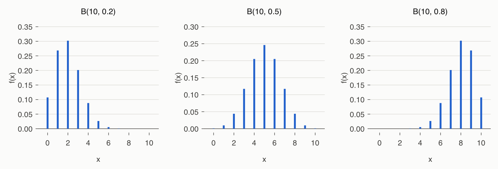
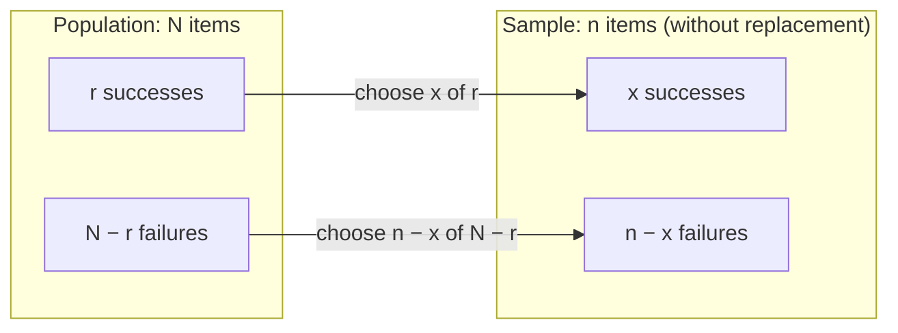
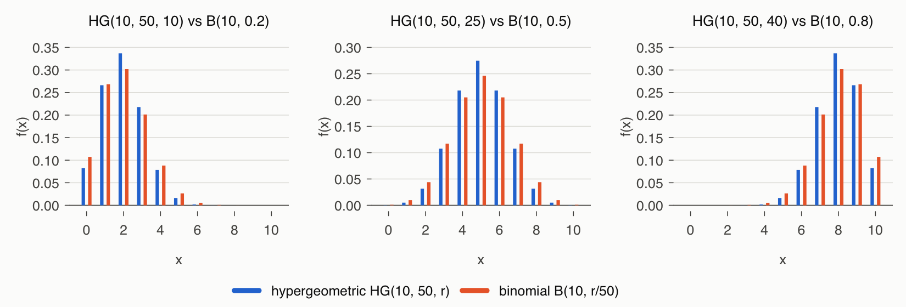
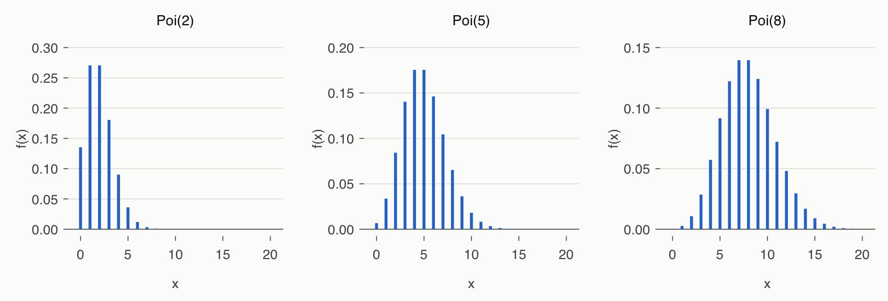
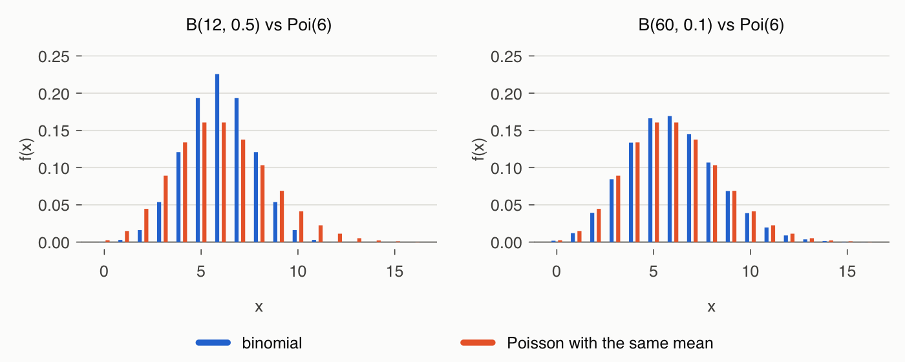
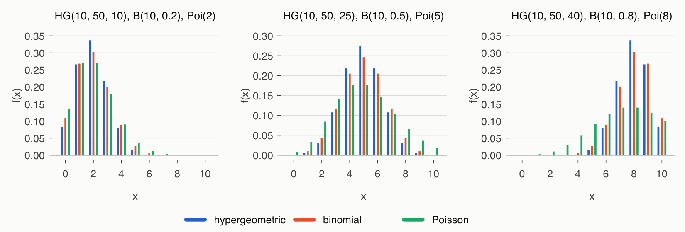
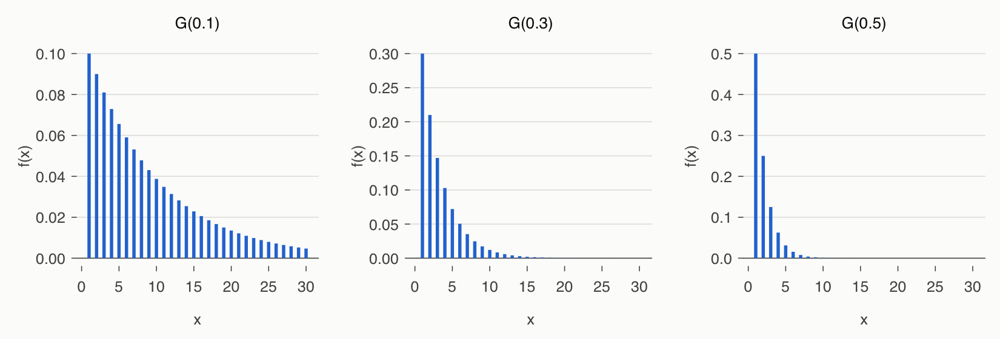
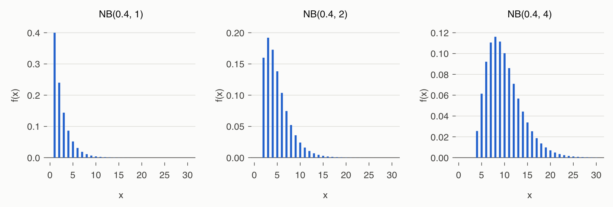
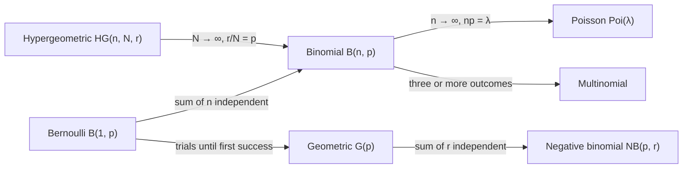

# Lecture 4 — Discrete Random Variables

[Repository Guide](../../README.md) | [English](Concepts_Lecture.md) | [한국어](Concepts_Lecture.ko.md)

> **Last Updated:** 2026-11-04

> **Learning Objectives:**
> 1. Write the probability mass functions of the discrete uniform, Bernoulli, and binomial distributions and derive their expected values and variances
> 2. Apply the hypergeometric distribution to sampling without replacement, and explain its relation to the binomial distribution through the finite population correction factor
> 3. Derive the Poisson distribution as a limit of the binomial distribution, and show that its expected value and variance are both λ
> 4. Define the geometric and negative binomial distributions as distributions of the number of trials until success, and explain how they are related
> 5. Choose the discrete distribution that fits a situation, and compute probabilities with R's d, p, q, and r functions

---

## Table of Contents

- [1. Overview of Discrete Distributions](#1-overview-of-discrete-distributions)
  - [1.1 Seven Distributions](#11-seven-distributions)
  - [1.2 Distribution Functions in R](#12-distribution-functions-in-r)
- [2. Discrete Uniform Distribution](#2-discrete-uniform-distribution)
- [3. Bernoulli Distribution](#3-bernoulli-distribution)
- [4. Binomial Distribution](#4-binomial-distribution)
  - [4.1 The Binomial Random Variable and Its PMF](#41-the-binomial-random-variable-and-its-pmf)
  - [4.2 Expected Value and Variance](#42-expected-value-and-variance)
  - [4.3 R Functions and an Example](#43-r-functions-and-an-example)
- [5. Hypergeometric Distribution](#5-hypergeometric-distribution)
  - [5.1 Sampling Without Replacement and the PMF](#51-sampling-without-replacement-and-the-pmf)
  - [5.2 Expected Value and Variance](#52-expected-value-and-variance)
  - [5.3 Finite Population Correction and the Binomial Distribution](#53-finite-population-correction-and-the-binomial-distribution)
  - [5.4 R Functions and an Example](#54-r-functions-and-an-example)
- [6. Poisson Distribution](#6-poisson-distribution)
  - [6.1 The Poisson Distribution as a Limit of the Binomial](#61-the-poisson-distribution-as-a-limit-of-the-binomial)
  - [6.2 Expected Value, Variance, and CDF](#62-expected-value-variance-and-cdf)
  - [6.3 Computing with a Recurrence Relation](#63-computing-with-a-recurrence-relation)
  - [6.4 Comparison with the Binomial and Overdispersion](#64-comparison-with-the-binomial-and-overdispersion)
  - [6.5 R Functions and an Example](#65-r-functions-and-an-example)
- [7. Geometric Distribution](#7-geometric-distribution)
  - [7.1 PMF and CDF](#71-pmf-and-cdf)
  - [7.2 Expected Value and Variance](#72-expected-value-and-variance)
  - [7.3 Memoryless Property](#73-memoryless-property)
  - [7.4 R Functions and an Example](#74-r-functions-and-an-example)
- [8. Negative Binomial Distribution](#8-negative-binomial-distribution)
  - [8.1 Probability Mass Function](#81-probability-mass-function)
  - [8.2 Expected Value, Variance, and the Link to the Geometric Distribution](#82-expected-value-variance-and-the-link-to-the-geometric-distribution)
  - [8.3 R Functions and an Example](#83-r-functions-and-an-example)
- [9. Relationships Among the Distributions](#9-relationships-among-the-distributions)
- [Concept Applications](#concept-applications)
- [Summary](#summary)
- [Self-Check Questions](#self-check-questions)
- [References](#references)

---

<br>

## 1. Overview of Discrete Distributions

Lecture 3 defined random variables, probability mass functions, expected values, and variances in general. Most discrete random variables met in practice arise from a few typical experimental structures, and the same structure always yields the same form of probability mass function. This lecture organizes seven frequently used discrete distributions in the order of experimental structure, probability mass function, derivation of the expected value and variance, and R functions. The probability mass function is written $f(x)$ instead of $p_X(x)$ of Lecture 3.

### 1.1 Seven Distributions

The shape of each distribution is determined by a few constants. These shape-determining constants are called **parameters**. The set of values that a random variable takes with positive probability is called its **support**.

| Distribution | Notation | Parameters | What the random variable counts |
|:-----|:-----|:-----|:-----|
| Discrete uniform | None | $n$ | The value when one of $1, \dots, n$ occurs with equal probability |
| Bernoulli | $B(1, p)$ | $p$ | 1 if a single trial succeeds, 0 if it fails |
| Binomial | $B(n, p)$ | $n$, $p$ | Number of successes in $n$ independent trials |
| Hypergeometric | $HG(n, N, r)$ | $n$, $N$, $r$ | Number of successes among $n$ items drawn without replacement from a finite population |
| Poisson | $Poi(\lambda)$ | $\lambda$ | Number of occurrences of a rare event in a fixed unit |
| Geometric | $G(p)$ | $p$ | Number of trials until the first success |
| Negative binomial | $NB(p, r)$ | $p$, $r$ | Number of trials until the $r$th success |

*Table 1. The seven discrete distributions covered in this lecture*

Here $p$ is the probability of success in one trial. All distributions from the binomial onward are built on trials with only two outcomes, success and failure, so the Bernoulli trial of Section 3 is their common starting point.

### 1.2 Distribution Functions in R

For each major distribution, R provides four functions whose names prefix the distribution's name with `d`, `p`, `q`, or `r` [1]. For example, the binomial distribution is named `binom`, so there are `dbinom`, `pbinom`, `qbinom`, and `rbinom`.

| Prefix | Origin of the name | Value computed | Meaning for a discrete distribution |
|:-----|:-----|:-----|:-----|
| `d` | density | Probability mass function $f(x)$ | $P(X = x)$ |
| `p` | probability (cumulative) | Cumulative distribution function $F(q)$ | $P(X \le q)$, or $P(X > q)$ with `lower.tail = FALSE` |
| `q` | quantile | Quantile | Smallest $x$ with $F(x) \ge u$ |
| `r` | random | Random numbers | Values generated at random from the distribution |

*Table 2. The four prefixes attached to R's distribution function names*

- `lower.tail = FALSE` in a `p` function gives the upper-tail probability $P(X > q)$. For a discrete distribution, $P(X \ge k)$ equals $P(X > k - 1)$, so it is computed as `p...(k - 1, ..., lower.tail = FALSE)`. This equals `1 - p...(k - 1, ...)`, but for very small tail probabilities `lower.tail = FALSE` is more accurate because it avoids the rounding error of the subtraction.
- The CDF of a discrete distribution is a step function, so there may be no $x$ with $F(x) = u$. The `q` function therefore returns the smallest $x$ with $F(x) \ge u$. In particular, `q...(0.5, ...)` is the median.
- The result of an `r` function changes on every run. Fixing the starting point of the random numbers with `set.seed()` reproduces the same result.

> **Caution:** For the geometric and negative binomial distributions, R's functions use **the number of failures before success** as the random variable, not the number of trials [1]. To use R functions for distributions defined by the number of trials, as in this lecture, the values must be shifted (Sections 7.4 and 8.3). The argument names of R's hypergeometric functions clash with this lecture's symbols, so they are summarized separately in Section 5.4.

---

<br>

## 2. Discrete Uniform Distribution

> **Definition:** The probability distribution in which $n$ result values $1, 2, \dots, n$ occur with equal probability is called the **discrete uniform distribution**. Its probability mass function is $f(x) = \dfrac{1}{n}$ $(x = 1, 2, \dots, n)$.

The parameter is the number of result values $n$, and the support is $\{1, 2, \dots, n\}$. The number shown by a fair die ($n = 6$) and the number on a ball drawn from balls numbered 1 to 20 ($n = 20$) follow this distribution.

**Expected value.** Use the formula for the sum of natural numbers, $\sum_{x=1}^{n} x = \frac{n(n+1)}{2}$.

$$
E(X) = \sum_{x=1}^{n} x \Big(\frac{1}{n}\Big) = \frac{1}{n} \times \frac{n(n+1)}{2} = \frac{n+1}{2}
$$

**Variance.** Find $E(X^2)$ with the sum-of-squares formula $\sum_{x=1}^{n} x^2 = \frac{n(n+1)(2n+1)}{6}$, and use $\mathrm{Var}(X) = E(X^2) - E(X)^2$ from Lecture 3.

$$
E(X^2) = \sum_{x=1}^{n} x^2 \Big(\frac{1}{n}\Big) = \frac{1}{n} \times \frac{n(n+1)(2n+1)}{6} = \frac{(n+1)(2n+1)}{6}
$$

$$
\mathrm{Var}(X) = \frac{(n+1)(2n+1)}{6} - \Big(\frac{n+1}{2}\Big)^2 = \frac{(n+1)\{2(2n+1) - 3(n+1)\}}{12} = \frac{(n+1)(n-1)}{12}
$$

The expression in braces is $4n + 2 - 3n - 3 = n - 1$. The two sum formulas can be checked as follows. The first holds because pairing the front and back terms, $1 + n$, $2 + (n-1)$, and so on, produces $n/2$ pairs each summing to $n + 1$. The second follows by adding the identity $(k+1)^3 - k^3 = 3k^2 + 3k + 1$ over $k = 1, \dots, n$; the left side collapses to $(n+1)^3 - 1$ (a telescoping sum), and solving for $\sum k^2$ gives the formula.

**Example.** A die ($n = 6$) has $E(X) = 7/2$ and $\mathrm{Var}(X) = 7 \cdot 5 / 12 = 35/12$, the same values computed from the definitions in Lecture 3.

> **Note:** The uniform distribution on the consecutive integers $a, a+1, \dots, b$ is the uniform distribution $U$ on $1, \dots, n$ shifted by $a - 1$, that is, $X = U + (a - 1)$ with $n = b - a + 1$. Hence $E(X) = \frac{a + b}{2}$, and since an added constant does not change the variance, $\mathrm{Var}(X) = \frac{n^2 - 1}{12}$.

Base R has no dedicated functions for the discrete uniform distribution, so it is computed as follows.

| Purpose | R code | Meaning |
|:-----|:-----|:-----|
| Probability mass function | `ifelse(x %in% 1:n, 1/n, 0)` | $P(X = x)$ |
| Cumulative distribution function | `pmin(pmax(floor(q), 0), n) / n` | $P(X \le q)$ |
| Quantile | `ceiling(u * n)` | Smallest $x$ with $F(x) \ge u$ $(0 < u \le 1)$ |
| Random numbers | `sample(1:n, size, replace = TRUE)` | `size` random numbers |

*Table 3. Computing discrete uniform probabilities with base R*

The CDF takes the number of integers at most $q$, $\lfloor q \rfloor$, clips it between 0 and $n$, and divides by $n$. The following code computes the expected value and variance of a die and simulates 10 rolls.

```r
x  <- 1:6                          # values 1, ..., n with n = 6
fx <- rep(1/6, 6)                  # f(x) = 1/n
sum(x * fx)                        # E(X) = (n + 1)/2
sum(x^2 * fx) - sum(x * fx)^2      # Var(X) = (n + 1)(n - 1)/12
set.seed(1)                        # fix the random seed for reproducibility
sample(1:6, 10, replace = TRUE)    # 10 simulated rolls of a die
```

```text
[1] 3.5
[1] 2.916667
 [1] 1 4 1 2 5 3 6 2 3 3
```

`sample(1:6, 10, replace = TRUE)` draws 10 values from 1 to 6 with replacement, which is the same as rolling a fair die 10 times. A problem with balls numbered 1 to 20 is in [Exercise 1](Exercises.md#exercise-1-discrete-uniform-distribution-of-numbered-balls).

---

<br>

## 3. Bernoulli Distribution

> **Definition:** A trial with only two outcomes is called a **Bernoulli trial**. Calling one outcome success and the other failure, the random variable $X$ that equals 1 for success and 0 for failure satisfies $P(X = 1) = p$ and $P(X = 0) = 1 - p$; this distribution is called the **Bernoulli distribution**, written $X \sim B(1, p)$.

Tossing a coin (success if heads), winning or losing a game, whether a product is defective, and whether a patient recovers are examples of Bernoulli trials. The probability mass function can be written in one formula as $f(x) = p^x (1 - p)^{1 - x}$ $(x = 0, 1)$; substituting $x = 1$ gives $p$, and $x = 0$ gives $1 - p$. The parameter is the success probability $p$ $(0 \le p \le 1)$.

**Expected value and variance.** Since $X$ is 0 or 1, $X^2 = X$.

$$
E(X) = 1 \cdot p + 0 \cdot (1 - p) = p, \qquad E(X^2) = 1^2 \cdot p + 0^2 \cdot (1 - p) = p
$$

$$
\mathrm{Var}(X) = E(X^2) - E(X)^2 = p - p^2 = p(1 - p)
$$

The variance $p(1 - p)$ attains its maximum $1/4$ at $p = 1/2$ and becomes smaller as $p$ approaches 0 or 1, that is, as the outcome becomes nearly certain. In particular, if $p$ is small, $1 - p \approx 1$, so $\mathrm{Var}(X) \approx p$.

The notation $B(1, p)$ means the case $n = 1$ of the binomial distribution $B(n, p)$ in Section 4. Accordingly, R uses the binomial functions with `size = 1`.

| Function | Value computed |
|:-----|:-----|
| `dbinom(x, size = 1, prob = p)` | $P(X = x)$ $(x = 0, 1)$ |
| `pbinom(q, size = 1, prob = p)` | $P(X \le q)$ |
| `qbinom(u, size = 1, prob = p)` | Smallest $x$ with $F(x) \ge u$ |
| `rbinom(n, size = 1, prob = p)` | Outcomes (0 or 1) of $n$ Bernoulli trials |

*Table 4. R functions for the Bernoulli distribution*

```r
dbinom(0:1, size = 1, prob = 0.3)  # P(X = 0), P(X = 1)
set.seed(1)
rbinom(10, size = 1, prob = 0.3)   # 10 simulated Bernoulli trials
```

```text
[1] 0.7 0.3
 [1] 0 0 0 1 0 1 1 0 0 0
```

For the Bernoulli distribution with $p = 0.3$, $P(X = 0) = 0.7$ and $P(X = 1) = 0.3$, with $E(X) = 0.3$ and $\mathrm{Var}(X) = 0.3 \times 0.7 = 0.21$. In the 10 simulated trials, 1 appeared three times.

---

<br>

## 4. Binomial Distribution

### 4.1 The Binomial Random Variable and Its PMF

Perform a Bernoulli trial $n$ times in sequence, and assume the trials are **independent** with the same success probability $p$ each time. Writing 1 for success and 0 for failure, an outcome is a sequence of 0s and 1s of length $n$. For example, with $n = 12$, one outcome is:

$$
100011001010
$$

This outcome has probability $p^5 (1 - p)^7$. Because the trials are independent, their probabilities multiply, and with five 1s and seven 0s we multiply $p$ five times and $1 - p$ seven times. The order of multiplication does not matter, so every sequence of length 12 with five 1s has the same probability $p^5 (1 - p)^7$.

Let $X$ be the number of successes (1s); then $X(100011001010) = 5$. The event $\{X = 5\}$ contains every sequence with five 1s, and the number of such sequences is the number of ways to choose the five positions of the 1s among twelve, $\binom{12}{5} = 792$. Therefore:

$$
P(X = 5) = \binom{12}{5} \cdot p^5 \cdot (1 - p)^7
$$

The same reasoning applies to general $n$ and $k$.

> **Definition:** The number of successes $X$ in $n$ independent Bernoulli trials with common success probability $p$ is called a **binomial random variable**, and its distribution the **binomial distribution**. It is written $X \sim B(n, p)$, and its probability mass function is $P(X = k) = \binom{n}{k}\, p^k (1 - p)^{n - k}$ $(k = 0, 1, \dots, n)$.

Here $\binom{n}{k} = {}_n C_k = \frac{n!}{k!\,(n - k)!}$ is the number of combinations of $k$ items chosen from $n$, called the **binomial coefficient**. The parameters are the number of trials $n$ and the success probability $p$, and the support is $\{0, 1, \dots, n\}$.

The probabilities sum to 1, as the **binomial theorem** $(a + b)^n = \sum_{k=0}^{n} \binom{n}{k} a^k b^{n-k}$ with $a = p$ and $b = 1 - p$ shows.

$$
\sum_{k=0}^{n} \binom{n}{k} p^k (1 - p)^{n - k} = \{p + (1 - p)\}^n = 1^n = 1
$$

The fact that each probability is a term of the binomial expansion is the origin of the name "binomial distribution."



*Figure 1. Probability mass functions of the binomial distributions B(10, 0.2), B(10, 0.5), and B(10, 0.8)*

As Figure 1 shows, for $p < 0.5$ the distribution is concentrated on the left with a long right tail, for $p = 0.5$ it is symmetric about $n/2$, and for $p > 0.5$ it is concentrated on the right. Counting failures instead of successes gives $n - X \sim B(n, 1 - p)$, so $B(10, 0.8)$ is the mirror image of $B(10, 0.2)$.

### 4.2 Expected Value and Variance

By definition, the mean of a binomial random variable is:

$$
E(X) = \sum_{k=0}^{n} k \cdot P(X = k) = \sum_{k=0}^{n} k \cdot \binom{n}{k} p^k (1 - p)^{n - k}
$$

This sum equals $np$. Using the identity $k \binom{n}{k} = n \binom{n-1}{k-1}$ (counting in two ways the choices of $k$ items together with one representative among them), and noting that the $k = 0$ term is 0,

$$
E(X) = np \sum_{k=1}^{n} \binom{n-1}{k-1} p^{k-1} (1 - p)^{n-k} = np \sum_{j=0}^{n-1} \binom{n-1}{j} p^{j} (1 - p)^{(n-1)-j} = np \cdot 1
$$

holds. After the substitution $j = k - 1$ in the second step, the remaining sum is the total probability of $B(n - 1, p)$, which is 1.

**An easier way.** In $n$ independent Bernoulli trials, let $X_k$ be the outcome (0 or 1) of the $k$th trial. The number of successes is then:

$$
X \equiv X_1 + X_2 + \cdots + X_n
$$

That is, a binomial random variable is a sum of Bernoulli random variables that "count the successes." From Section 3, $E(X_k) = p$ and $\mathrm{Var}(X_k) = E(X_k^2) - \{E(X_k)\}^2 = p - p^2 = p(1 - p)$. By Lecture 3, Section 5.4, the expected value of a sum is the sum of the expected values, and since the $X_k$ are independent, by Lecture 3, Section 7.3, the variance of the sum is the sum of the variances.

$$
E(X) = \sum_{i=1}^{n} E(X_i) = \sum_{i=1}^{n} p = np
$$

$$
\mathrm{Var}(X) = \sum_{i=1}^{n} \mathrm{Var}(X_i) = \sum_{i=1}^{n} p(1 - p) = np(1 - p)
$$

If $p$ is small, $1 - p \approx 1$, so $\mathrm{Var}(X) \approx np$. This approximation leads to the Poisson distribution in Section 6. The three distributions in Figure 1 have means 2, 5, 8 and variances 1.6, 2.5, 1.6.

### 4.3 R Functions and an Example

| Function | Value computed |
|:-----|:-----|
| `dbinom(x, size, prob)` | $P(X = x)$, where `size` is $n$ and `prob` is $p$ |
| `pbinom(q, size, prob, lower.tail = TRUE)` | $P(X \le q)$, or $P(X > q)$ with `lower.tail = FALSE` |
| `qbinom(p, size, prob)` | Smallest $x$ with $F(x) \ge p$ |
| `rbinom(n, size, prob)` | $n$ random numbers from $B(\text{size}, \text{prob})$ |

*Table 5. R functions for the binomial distribution*

Typing `?dbinom` in the R console shows the help page for all four functions. The first argument `n` of `rbinom` is the number of random numbers to generate, not the number of trials; the number of trials is `size`.

**Example: the number of correct guesses on a multiple-choice test.** If all 10 multiple-choice questions with four options each are answered at random, each question is correct with probability $1/4$ and the questions are independent, so the number of correct answers is $X \sim B(10, 0.25)$. The probability of exactly 3 correct answers is:

$$
P(X = 3) = \binom{10}{3} (0.25)^3 (0.75)^7 = 120 \times 0.015625 \times 0.1335 \approx 0.2503
$$

The mean is $10 \times 0.25 = 2.5$ questions and the variance is $10 \times 0.25 \times 0.75 = 1.875$.

```r
dbinom(3, 10, 0.25)                       # P(X = 3)
round(dbinom(0:10, 10, 0.25), 4)          # whole PMF
pbinom(2, 10, 0.25)                       # P(X <= 2)
pbinom(5, 10, 0.25, lower.tail = FALSE)   # P(X > 5) = P(X >= 6)
qbinom(0.5, 10, 0.25)                     # smallest x with F(x) >= 0.5
set.seed(1)
rbinom(5, 10, 0.25)                       # five simulated scores
```

```text
[1] 0.2502823
 [1] 0.0563 0.1877 0.2816 0.2503 0.1460 0.0584 0.0162 0.0031 0.0004 0.0000
[11] 0.0000
[1] 0.5255928
[1] 0.01972771
[1] 2
[1] 2 2 3 4 1
```

- The 0.2503 on the first line matches the hand computation. The second line lists all probabilities for $x = 0, \dots, 10$; the largest is 0.2816 at $x = 2$.
- $P(X \le 2) \approx 0.5256$, so with probability over one half at most 2 questions are correct. The probability of 6 or more correct answers, $P(X \ge 6) = P(X > 5) \approx 0.0197$, is very small, about 2%.
- `qbinom(0.5, 10, 0.25)` is 2, the smallest $x$ with $F(x) \ge 0.5$, because $F(1) \approx 0.2440 < 0.5$ and $F(2) \approx 0.5256 \ge 0.5$.
- `rbinom(5, 10, 0.25)` simulates five people taking this test by guessing.

---

<br>

## 5. Hypergeometric Distribution

### 5.1 Sampling Without Replacement and the PMF

The binomial distribution assumes that every trial has the same success probability and that the trials are independent. These assumptions break when items are drawn from a finite population and not put back. An item drawn once cannot appear again, so the success probability of the next draw depends on what was drawn before. Drawing in which each item is returned is called **sampling with replacement**, and drawing in which it is not returned is called **sampling without replacement**.

> **Definition:** When $n$ items are drawn without replacement from a finite population of size $N$ consisting of $r$ items with a particular property (successes) and $N - r$ items without it (failures), the distribution of the number of successes $X$ in the sample is called the **hypergeometric distribution**, written $X \sim HG(n, N, r)$.



*Figure 2. Structure of the hypergeometric distribution, choosing x successes and n − x failures for the sample from the r successes and N − r failures of the population*

**Probability mass function.** There are $\binom{N}{n}$ ways to choose $n$ of $N$ items, and in random sampling without replacement all these samples are equally likely. Those with exactly $x$ successes are formed by choosing $x$ of the $r$ successes and $n - x$ of the $N - r$ failures, which can be done in $\binom{r}{x}\binom{N - r}{n - x}$ ways.

$$
f(x) = \frac{\dbinom{r}{x}\dbinom{N - r}{n - x}}{\dbinom{N}{n}}, \qquad \max(0,\ n - N + r) \le x \le \min(n,\ r)
$$

The range of the support comes from three conditions. The successes in the sample cannot exceed the sample size, so $x \le n$, nor the number of successes in the population, so $x \le r$. Also, the number of failures in the sample, $n - x$, cannot exceed the number of failures in the population, $N - r$, so $x \ge n - (N - r)$. There are three parameters, $n$, $N$, and $r$.

### 5.2 Expected Value and Variance

**Expected value.** Let $I_i$ be 1 if the $i$th item drawn is a success and 0 otherwise; then $X = I_1 + \cdots + I_n$. Even without replacement, if the earlier results are unknown, the $i$th item drawn is equally likely to be any of the $N$ items, so $P(I_i = 1) = r/N$. The additivity of expectation from Lecture 3 does not require independence, so:

$$
E(X) = n \times P(\text{success}) = n \times \frac{r}{N} = \frac{nr}{N}
$$

**Variance.** The $I_i$ are not independent, so their variances cannot simply be added. Instead, first compute $E[X(X - 1)]$, which is easier than $E(X^2)$. Using the identity $x(x - 1)\binom{r}{x} = r(r - 1)\binom{r - 2}{x - 2}$:

$$
E[X(X - 1)] = \frac{r(r - 1)}{\binom{N}{n}} \sum_{x} \binom{r - 2}{x - 2}\binom{N - r}{n - x} = \frac{r(r - 1)\binom{N - 2}{n - 2}}{\binom{N}{n}} = \frac{nr}{N} \times \frac{(n - 1)(r - 1)}{N - 1}
$$

The middle sum counts the ways to choose $n - 2$ items from $N - 2$ items ($r - 2$ successes and $N - r$ failures), split by the number of successes, so it equals $\binom{N - 2}{n - 2}$ (Vandermonde's identity). The last step uses $\binom{N - 2}{n - 2} / \binom{N}{n} = \frac{n(n - 1)}{N(N - 1)}$. Now $X^2 = X(X - 1) + X$, so

$$
\begin{aligned}
\mathrm{Var}(X) &= E(X^2) - E(X)^2 = E[X(X - 1)] + E(X) - E(X)^2 \\
&= \frac{nr}{N} \times \frac{(n - 1)(r - 1)}{N - 1} + \frac{nr}{N} - \Big(\frac{nr}{N}\Big)^2 \\
&= n\,\frac{r}{N}\Big(1 - \frac{r}{N}\Big)\Big(\frac{N - n}{N - 1}\Big)
\end{aligned}
$$

holds. The last step factors out $\frac{nr}{N}$ and brings the bracket to a common denominator. The numerator of the bracket becomes $(n - 1)(r - 1)N + N(N - 1) - nr(N - 1) = N^2 - nN - rN + nr = (N - n)(N - r)$, so $\mathrm{Var}(X) = \frac{nr}{N} \cdot \frac{(N - n)(N - r)}{N(N - 1)}$, which equals the last line above.

### 5.3 Finite Population Correction and the Binomial Distribution

Writing the proportion of successes as $p = r/N$, the expected value and variance of the hypergeometric distribution become:

$$
E(X) = np, \qquad \mathrm{Var}(X) = n\,\frac{r}{N}\Big(1 - \frac{r}{N}\Big)\Big(\frac{N - n}{N - 1}\Big) = np(1 - p)\Big(\frac{N - n}{N - 1}\Big)
$$

The expected value equals that of the binomial distribution $B(n, p)$, and the variance is the binomial variance multiplied by $\frac{N - n}{N - 1}$. This factor is called the **finite population correction factor**.

- For $n \ge 2$ the correction factor is less than 1, so the variance under sampling without replacement is smaller than under sampling with replacement (the binomial). Because items already drawn cannot reappear, the sample reflects the population more evenly. In the extreme case $n = N$, the whole population is drawn, so always $X = r$ and the variance is 0.
- If $N$ is much larger than $n$, the correction factor is close to 1, and the hypergeometric distribution approaches the binomial distribution $B(n, r/N)$. In a large population, removing a few items barely changes the remaining proportion of successes, so sampling without replacement is nearly the same as sampling with replacement.



*Figure 3. Comparison of the hypergeometric distribution HG(10, 50, r) and the binomial distribution B(10, r/50) (r = 10, 25, 40)*

Figure 3 shows the case of drawing $n = 10$ items from $N = 50$. The correction factor is $40/49 \approx 0.816$, so the hypergeometric variance is about 82% of the binomial variance, and the hypergeometric bars are higher near the mean and lower in the tails. The population is only five times the sample, so the difference is visible.

### 5.4 R Functions and an Example

| Function | Value computed |
|:-----|:-----|
| `dhyper(x, m, n, k)` | $P(X = x)$ |
| `phyper(q, m, n, k, lower.tail = TRUE)` | $P(X \le q)$, or $P(X > q)$ with `lower.tail = FALSE` |
| `qhyper(p, m, n, k)` | Smallest $x$ with $F(x) \ge p$ |
| `rhyper(nn, m, n, k)` | `nn` random numbers |

*Table 6. R functions for the hypergeometric distribution*

> **Caution:** R's argument names differ from this lecture's symbols. `m` is the number of successes $r$ in the population, `n` is the number of **failures** $N - r$ in the population, and `k` is the sample size $n$. Hence probabilities of $HG(n, N, r)$ are computed with `dhyper(x, r, N - r, n)`. Note in particular that R's `n` is not the sample size.

**Example: inspecting defective bulbs.** A box of 12 bulbs contains 4 defective ones. When 3 bulbs are drawn without replacement, the number of defectives is $X \sim HG(3, 12, 4)$. The total number of samples is $\binom{12}{3} = 220$.

$$
P(X = 0) = \frac{\binom{4}{0}\binom{8}{3}}{220} = \frac{56}{220}, \quad P(X = 1) = \frac{\binom{4}{1}\binom{8}{2}}{220} = \frac{112}{220}, \quad P(X = 2) = \frac{\binom{4}{2}\binom{8}{1}}{220} = \frac{48}{220}, \quad P(X = 3) = \frac{\binom{4}{3}\binom{8}{0}}{220} = \frac{4}{220}
$$

The mean is $3 \times 4/12 = 1$, and the variance is $3 \times \frac{1}{3} \times \frac{2}{3} \times \frac{12 - 3}{12 - 1} = \frac{2}{3} \times \frac{9}{11} = \frac{6}{11} \approx 0.545$.

```r
dhyper(0:3, m = 4, n = 8, k = 3)          # P(X = 0), ..., P(X = 3)
phyper(1, m = 4, n = 8, k = 3)            # P(X <= 1)
qhyper(0.5, m = 4, n = 8, k = 3)          # smallest x with F(x) >= 0.5
set.seed(1)
rhyper(5, m = 4, n = 8, k = 3)            # five simulated samples
dbinom(0:3, 3, 4/12)                      # binomial B(3, 1/3) for comparison
```

```text
[1] 0.25454545 0.50909091 0.21818182 0.01818182
[1] 0.7636364
[1] 1
[1] 1 1 1 2 0
[1] 0.29629630 0.44444444 0.22222222 0.03703704
```

The first line equals $56/220$, $112/220$, $48/220$, $4/220$. The last line is the binomial distribution $B(3, 1/3)$ for drawing from the same box with replacement. Its variance $3 \times \frac{1}{3} \times \frac{2}{3} = \frac{2}{3}$ is larger than the hypergeometric $6/11$, which is also why the binomial puts more probability at both ends ($x = 0, 3$).

---

<br>

## 6. Poisson Distribution

### 6.1 The Poisson Distribution as a Limit of the Binomial

> **Definition:** The distribution of the number of occurrences of a **rare** event in a fixed unit (of time, area, volume, length, and so on) is called the **Poisson distribution**. If $\lambda > 0$ is the average number of occurrences per unit, the probability mass function is $f(x) = \lambda^x \dfrac{e^{-\lambda}}{x!}$ $(x = 0, 1, 2, \dots)$, written $X \sim Poi(\lambda)$.

The number of calls to a call center in one minute, the number of typos on a page, the number of flaws in one unit of a product, and the number of traffic accidents in a day are examples. There is one parameter, $\lambda$, and the support is the set of all nonnegative integers.

The Poisson distribution resembles the binomial but is defined as a **limit**. Divide the unit into $n$ very small intervals, and let $p$ be the probability that the event occurs in each interval. If the intervals are small enough, two or more occurrences in one interval can be ignored, so the number of occurrences can be viewed as $B(n, p)$. Letting $n \to \infty$ while keeping the average number of occurrences $\lambda = np$ fixed (so $p = \lambda/n \to 0$):

$$
\begin{aligned}
\lim_{n \to \infty} \binom{n}{x} p^x (1 - p)^{n - x}
&= \lim_{n \to \infty} \frac{n!}{x!\,(n - x)!} \Big(\frac{\lambda}{n}\Big)^x \Big(1 - \frac{\lambda}{n}\Big)^{n - x} \\
&= \frac{\lambda^x}{x!} \lim_{n \to \infty} \frac{n(n - 1)\cdots(n - x + 1)}{n^x} \Big(1 - \frac{\lambda}{n}\Big)^{n} \Big(1 - \frac{\lambda}{n}\Big)^{-x} \\
&= \frac{\lambda^x}{x!} \cdot 1 \cdot e^{-\lambda} \cdot 1 = \lambda^x \frac{e^{-\lambda}}{x!}
\end{aligned}
$$

The second line uses $\frac{n!}{(n - x)!} = n(n - 1)\cdots(n - x + 1)$ and $(\lambda/n)^x = \lambda^x / n^x$, and splits $(1 - \lambda/n)^{n - x}$ in two. The three limits are as follows.

- $\frac{n(n - 1)\cdots(n - x + 1)}{n^x} = \frac{n}{n} \cdot \frac{n - 1}{n} \cdots \frac{n - x + 1}{n}$ is a product of $x$ factors ($x$ fixed), each approaching 1, so it tends to 1.
- $(1 - \lambda/n)^n$ is the calculus limit $\lim_{n \to \infty}(1 + a/n)^n = e^a$ with $a = -\lambda$, so it tends to $e^{-\lambda}$.
- $(1 - \lambda/n)^{-x}$ tends to 1, since the base tends to 1 and the exponent $-x$ is fixed.

> **Key Point:** The Poisson distribution is the limit of the binomial distribution as $n \to \infty$ and $p \to 0$ with $\lambda = np$ held fixed. Hence a binomial distribution with large $n$ and small $p$ can be approximated by the Poisson distribution with $\lambda = np$: $\binom{n}{k} p^k (1 - p)^{n - k} \approx e^{-\lambda} \frac{\lambda^k}{k!}$. Here $\lambda = np$ is the average number of successes.

### 6.2 Expected Value, Variance, and CDF

**Total probability.** The Taylor series from calculus, $e^\lambda = \sum_{\ell=0}^{\infty} \frac{\lambda^\ell}{\ell!}$, shows that the probabilities sum to 1. Unlike a binomial random variable, a Poisson random variable has no upper limit and can take **arbitrarily large** integer values.

$$
\sum_{x=0}^{\infty} e^{-\lambda} \frac{\lambda^x}{x!} = e^{-\lambda} e^{\lambda} = 1
$$

**Expected value.** The $x = 0$ term is 0, and $x / x! = 1/(x - 1)!$.

$$
E(X) = \sum_{x=0}^{\infty} x \cdot e^{-\lambda} \frac{\lambda^x}{x!} = \lambda \sum_{x=1}^{\infty} e^{-\lambda} \frac{\lambda^{x - 1}}{(x - 1)!} = \lambda \sum_{j=0}^{\infty} e^{-\lambda} \frac{\lambda^{j}}{j!} = \lambda
$$

**Variance.** Compute $E[X(X - 1)]$ in the same way.

$$
E[X(X - 1)] = \sum_{x=2}^{\infty} x(x - 1)\, e^{-\lambda} \frac{\lambda^x}{x!} = \lambda^2 \sum_{x=2}^{\infty} e^{-\lambda} \frac{\lambda^{x - 2}}{(x - 2)!} = \lambda^2
$$

$$
\mathrm{Var}(X) = E[X(X - 1)] + E(X) - E(X)^2 = \lambda^2 + \lambda - \lambda^2 = \lambda
$$

The Poisson distribution has **expected value and variance both equal to $\lambda$**. This agrees with the binomial, for which $E(X) = np = \lambda$ and $\mathrm{Var}(X) = np(1 - p) \approx np = \lambda$ when $p$ is small.

**Cumulative distribution function.**

$$
F(k) = P(X \le k) = \sum_{\ell=0}^{k} e^{-\lambda} \frac{\lambda^\ell}{\ell!} = e^{-\lambda} \sum_{\ell=0}^{k} \frac{\lambda^\ell}{\ell!}
$$

As it should be, $\lim_{k \to \infty} F(k) = e^{-\lambda} \sum_{\ell=0}^{\infty} \frac{\lambda^\ell}{\ell!} = e^{-\lambda} e^{\lambda} = 1$.



*Figure 4. Probability mass functions of the Poisson distributions Poi(2), Poi(5), and Poi(8)*

As Figure 4 shows, for small $\lambda$ the distribution is concentrated near 0 with a long right tail. As $\lambda$ grows, the center moves to the right, the variance $\lambda$ grows so that the distribution spreads out, and the shape becomes nearly symmetric.

### 6.3 Computing with a Recurrence Relation

Computing $e^{-\lambda} \lambda^k / k!$ directly makes $\lambda^k$ and $k!$ separately very large when $k$ is large. For example, $171!$ exceeds the largest double-precision number a computer can represent (about $1.8 \times 10^{308}$). A **stable and efficient** way to compute Poisson probabilities is a **recurrence relation** that uses the ratio of two consecutive probabilities.

$$
P(X = k) = e^{-\lambda} \frac{\lambda^k}{k!}, \qquad P(X = k + 1) = e^{-\lambda} \frac{\lambda^{k+1}}{(k + 1)!}
$$

Dividing the two gives $\frac{P(X = k + 1)}{P(X = k)} = \frac{\lambda}{k + 1}$, hence:

$$
P(X = 0) = e^{-\lambda}, \qquad P(X = k + 1) = \frac{\lambda}{k + 1} \cdot P(X = k) \quad (k = 0, 1, 2, \dots)
$$

Each step multiplies by a moderate number $\lambda/(k + 1)$ only once, so no huge numbers appear. The ratio also reveals the shape of the distribution. The probabilities increase while $\lambda/(k + 1) > 1$, that is, while $k + 1 < \lambda$, and decrease afterward, so the most probable value (the mode) is the largest integer not exceeding $\lambda$, $\lfloor \lambda \rfloor$. If $\lambda$ is an integer, $P(X = \lambda) = P(X = \lambda - 1)$, and both values are modes.

```r
lambda <- 3
p <- numeric(6)                           # P(X = 0), ..., P(X = 5)
p[1] <- exp(-lambda)                      # P(X = 0) = e^(-lambda)
for (k in 0:4) {
  p[k + 2] <- lambda / (k + 1) * p[k + 1] # P(X = k + 1) = lambda/(k + 1) * P(X = k)
}
round(p, 4)
round(dpois(0:5, lambda), 4)              # same values from dpois()
```

```text
[1] 0.0498 0.1494 0.2240 0.2240 0.1680 0.1008
[1] 0.0498 0.1494 0.2240 0.2240 0.1680 0.1008
```

The first line, computed by the recurrence, equals the values from `dpois()`. Since $\lambda = 3$ is an integer, $P(X = 2) = P(X = 3) = 0.2240$, showing the two modes.

### 6.4 Comparison with the Binomial and Overdispersion

The binomial distribution has $E(X) = np$ and $\mathrm{Var}(X) = np(1 - p)$, while the Poisson distribution with $\lambda = np$ has $E(X) = np$ and $\mathrm{Var}(X) = np$. When $p$ is small, $np(1 - p) \approx np$, so the two become similar. Comparing two cases with the same mean 6:

| Case | Distribution | $E(X)$ | $\mathrm{Var}(X)$ | $\sigma(X)$ |
|:-----|:-----|:-----|:-----|:-----|
| $n = 12$, $p = 0.5$ | Binomial | 6.0000 | 3.0000 | 1.7321 |
| $n = 12$, $p = 0.5$ | Poisson ($\lambda = 6$) | 6.0000 | 6.0000 | 2.4495 |
| $n = 60$, $p = 0.1$ | Binomial | 6.0000 | 5.4000 | 2.3238 |
| $n = 60$, $p = 0.1$ | Poisson ($\lambda = 6$) | 6.0000 | 6.0000 | 2.4495 |

*Table 7. Expected value, variance, and standard deviation of binomial and Poisson distributions with the same mean*



*Figure 5. Comparison of the binomial distributions B(12, 0.5) and B(60, 0.1) with the Poisson distribution Poi(6), all with mean 6*

With $p = 0.5$, the binomial variance (3) is half the Poisson variance (6), so the approximation fails. With $p = 0.1$, the variances 5.4 and 6 are close, and the two distributions nearly coincide, as on the right of Figure 5. The smaller $p$ is, the more accurate the approximation. The following is the case $n = 1000$, $p = 0.002$ ($\lambda = 2$).

```r
round(rbind(binom = dbinom(0:5, 1000, 0.002),
            pois  = dpois(0:5, 2)), 5)
```

```text
         [,1]    [,2]    [,3]    [,4]    [,5]    [,6]
binom 0.13506 0.27067 0.27094 0.18063 0.09022 0.03602
pois  0.13534 0.27067 0.27067 0.18045 0.09022 0.03609
```

The two rows agree to three decimal places.



*Figure 6. Comparison of the hypergeometric HG(10, 50, r), binomial B(10, r/50), and Poisson Poi(10r/50) distributions (r = 10, 25, 40)*

Figure 6 adds the Poisson distribution with the same mean to the hypergeometric and binomial distributions of Section 5.3. On the left, where the success proportion is a small 0.2, the three distributions are similar, but at 0.5 and 0.8 the Poisson spreads much wider and even gives probability to values above 10 (the figure shows values up to 10 only). The Poisson approximation can be used only when successes are **rare**.

> **Note:** **Overdispersion.** The Poisson distribution carries the strong constraint that its variance equals its mean. In real count data, the variance is often larger than the mean. For example, if the rate $\lambda$ itself differs from unit to unit, the data as a whole spread more widely than a single Poisson distribution. This phenomenon is called overdispersion; using the Poisson distribution then underestimates the variability, so models that allow the variance to exceed the mean, such as the negative binomial distribution (Section 8), are used instead [2].

### 6.5 R Functions and an Example

| Function | Value computed |
|:-----|:-----|
| `dpois(x, lambda)` | $P(X = x)$ |
| `ppois(q, lambda, lower.tail = TRUE)` | $P(X \le q)$, or $P(X > q)$ with `lower.tail = FALSE` |
| `qpois(p, lambda)` | Smallest $x$ with $F(x) \ge p$ |
| `rpois(n, lambda)` | $n$ random numbers from $Poi(\lambda)$ |

*Table 8. R functions for the Poisson distribution*

**Example: calls to a call center.** Suppose a call center receives on average 3 calls per minute and the number of calls follows a Poisson distribution ($X \sim Poi(3)$). The probabilities of no call in a minute, of at most 2 calls, and of 5 or more calls are:

$$
P(X = 0) = e^{-3} \approx 0.0498, \qquad P(X \le 2) = e^{-3}\Big(1 + 3 + \frac{3^2}{2!}\Big) = 8.5\,e^{-3} \approx 0.4232
$$

$$
P(X \ge 5) = 1 - P(X \le 4) \approx 0.1847
$$

```r
dpois(0, 3)                               # P(X = 0)
ppois(2, 3)                               # P(X <= 2)
ppois(4, 3, lower.tail = FALSE)           # P(X > 4) = P(X >= 5)
qpois(0.95, 3)                            # smallest x with F(x) >= 0.95
set.seed(1)
rpois(5, 3)                               # five simulated minutes
```

```text
[1] 0.04978707
[1] 0.4231901
[1] 0.1847368
[1] 6
[1] 2 2 3 5 2
```

Since `qpois(0.95, 3)` is 6, a capacity of 6 calls per minute handles every call in at least 95% of minutes: $F(5) \approx 0.916 < 0.95$ and $F(6) \approx 0.966 \ge 0.95$.

---

<br>

## 7. Geometric Distribution

### 7.1 PMF and CDF

> **Definition:** When independent trials with constant success probability $p$ are repeated, the distribution of **the number of trials until the first success**, $X$, is called the **geometric distribution**, written $X \sim G(p)$. Its probability mass function is $f(x) = (1 - p)^{x - 1} p$ $(x = 1, 2, \dots)$.

$X = x$ means that the first $x - 1$ trials all fail and the $x$th succeeds. Because the trials are independent, we multiply the failure probability $1 - p$ $x - 1$ times and the success probability $p$ once. The probabilities form a geometric sequence $p, pq, pq^2, \dots$ ($q = 1 - p$), which gives the distribution its name. The parameter is $p$ $(0 < p \le 1)$, and the support is $\{1, 2, 3, \dots\}$.

**Cumulative distribution function.** Use the geometric sum $\sum_{j=0}^{x-1} q^j = \frac{1 - q^x}{1 - q}$.

$$
F(x) \equiv P(X \le x) = \sum_{y=1}^{x} (1 - p)^{y - 1} p = \frac{p\,[1 - (1 - p)^x]}{1 - (1 - p)} = 1 - (1 - p)^x \qquad (x = 1, 2, \dots)
$$

The same result can be obtained more intuitively. $X > x$ means that the first $x$ trials all fail, so $P(X > x) = (1 - p)^x$ and $F(x) = 1 - P(X > x)$.



*Figure 7. Probability mass functions of the geometric distributions G(0.1), G(0.3), and G(0.5)*

The geometric probability is largest at $x = 1$, where it equals $p$, and then shrinks by a factor of $1 - p$ at each step. As Figure 7 shows, the smaller $p$ is, the more slowly it decreases and the longer the tail.

### 7.2 Expected Value and Variance

With $q = 1 - p$, the expected value and variance are:

$$
E(X) = \frac{1}{p}, \qquad \mathrm{Var}(X) = \frac{q}{p^2} = \frac{1 - p}{p^2}
$$

**Derivation.** Differentiating the geometric series $\sum_{x=0}^{\infty} q^x = \frac{1}{1 - q}$ ($|q| < 1$) once and twice with respect to $q$ gives the following two formulas.

$$
\sum_{x=1}^{\infty} x\, q^{x - 1} = \frac{1}{(1 - q)^2}, \qquad \sum_{x=2}^{\infty} x(x - 1)\, q^{x - 2} = \frac{2}{(1 - q)^3}
$$

These give $E(X)$ and $E[X(X - 1)]$ (note $1 - q = p$).

$$
E(X) = \sum_{x=1}^{\infty} x\, q^{x - 1} p = p \cdot \frac{1}{p^2} = \frac{1}{p}, \qquad E[X(X - 1)] = \sum_{x=2}^{\infty} x(x - 1)\, q^{x - 1} p = pq \cdot \frac{2}{p^3} = \frac{2q}{p^2}
$$

$$
\mathrm{Var}(X) = E[X(X - 1)] + E(X) - E(X)^2 = \frac{2q}{p^2} + \frac{1}{p} - \frac{1}{p^2} = \frac{2q + p - 1}{p^2} = \frac{q}{p^2}
$$

In the last step, $p - 1 = -q$, so the numerator is $2q - q = q$. With success probability $p$, the first success comes after $1/p$ trials on average. For example, rolling a die until the first 6 takes 6 rolls on average.

### 7.3 Memoryless Property

The geometric distribution has the **memoryless property**. For nonnegative integers $s$ and $t$:

$$
P(X > s + t \mid X > s) = \frac{P(X > s + t)}{P(X > s)} = \frac{q^{s + t}}{q^s} = q^t = P(X > t)
$$

In the first step, $\{X > s + t\}$ is contained in $\{X > s\}$, so their intersection is $\{X > s + t\}$. Given that $s$ failures have already occurred, the probability of $t$ more failures equals the probability of $t$ failures from the start. In other words, many past failures do not make a success on the next trial more likely. Because the trials are independent, past failures have no effect on the future.

### 7.4 R Functions and an Example

R's `dgeom(x, prob)` computes the PMF of **the number of failures before the first success**, $Y = X - 1$, namely $P(Y = y) = (1 - p)^y p$ $(y = 0, 1, 2, \dots)$ [1]. Probabilities for the number of trials $X$ are computed by shifting the value by one.

| Value computed ($X$ = number of trials) | R code |
|:-----|:-----|
| $P(X = x)$ | `dgeom(x - 1, prob)` |
| $P(X \le x)$ | `pgeom(x - 1, prob)` |
| $P(X > x)$ | `pgeom(x - 1, prob, lower.tail = FALSE)` |
| Smallest $x$ with $F(x) \ge u$ | `qgeom(u, prob) + 1` |
| $n$ random numbers | `rgeom(n, prob) + 1` |

*Table 9. R computations for the geometric distribution defined by the number of trials*

> **Caution:** Using `dgeom(x, p)` as it is gives the probability of $x + 1$ trials. For example, the probability of success on the first trial, $P(X = 1) = p$, is `dgeom(0, p)`. Textbooks and software define the geometric distribution either by the number of trials or by the number of failures, so first check whether the support starts at 1 or at 0.

**Example: the number of inspections until the first defective.** In a process with defect rate 0.05, products are inspected one by one; the number of products inspected until the first defective is $X \sim G(0.05)$.

$$
P(X = 10) = 0.95^9 \times 0.05 \approx 0.0315, \qquad P(X \le 10) = 1 - 0.95^{10} \approx 0.4013
$$

The mean is $1/0.05 = 20$ products and the variance is $0.95 / 0.05^2 = 380$. By the memoryless property, given that the first 5 products were all good, the probability of needing more than 15 inspections equals the probability of needing more than 10 from the start: $P(X > 15 \mid X > 5) = P(X > 10) = 0.95^{10} \approx 0.5987$.

```r
dgeom(10 - 1, 0.05)                       # P(X = 10): 9 failures, then a success
pgeom(10 - 1, 0.05)                       # P(X <= 10)
pgeom(15 - 1, 0.05, lower.tail = FALSE) /
  pgeom(5 - 1, 0.05, lower.tail = FALSE)  # P(X > 15 | X > 5)
pgeom(10 - 1, 0.05, lower.tail = FALSE)   # P(X > 10)
qgeom(0.5, 0.05) + 1                      # median number of trials
set.seed(1)
rgeom(5, 0.05) + 1                        # five simulated numbers of trials
```

```text
[1] 0.03151247
[1] 0.4012631
[1] 0.5987369
[1] 0.5987369
[1] 14
[1] 14  6  8 53 17
```

The third and fourth lines are the same 0.5987, confirming the memoryless property. The median number of trials, 14, is smaller than the mean 20. In a distribution with a long right tail, large values pull the mean up.

---

<br>

## 8. Negative Binomial Distribution

### 8.1 Probability Mass Function

> **Definition:** When independent trials with constant success probability $p$ are repeated, the distribution of **the number of trials until the $r$th success**, $X$, is called the **negative binomial distribution**, written $X \sim NB(p, r)$. Its probability mass function is $f(x) = \binom{x - 1}{r - 1} p^r q^{x - r}$ $(x = r, r + 1, r + 2, \dots)$ with $q = 1 - p$.

For $X = x$, both of the following conditions must hold.

```text
Trial no. :  1   2   3   ...                              x-1    x
Result    :  O   O   *   ...   O   *   O   ...   O   O     O     *
            |<-- first x-1 trials: r-1 successes, x-r failures -->|  rth success
            (* = success, O = failure, any order within the first x-1 trials)
```

*Figure 8. Structure of the outcomes with X = x in the negative binomial distribution, where the last trial x is the rth success*

1. The last, $x$th trial must be a success, so that the success at that moment is exactly the $r$th.
2. The first $x - 1$ trials must contain exactly $r - 1$ successes and $x - r$ failures. Their order is free, so there are $\binom{x - 1}{r - 1}$ ways to choose the $r - 1$ positions of the successes among $x - 1$, each with probability $p^{r - 1} q^{x - r}$.

Multiplying by the probability $p$ of the last success gives $\binom{x - 1}{r - 1} p^{r - 1} q^{x - r} \cdot p = \binom{x - 1}{r - 1} p^r q^{x - r}$. The parameters are $p$ and $r$ ($r = 1, 2, \dots$), and the support is $\{r, r + 1, \dots\}$, because $r$ successes require at least $r$ trials.

### 8.2 Expected Value, Variance, and the Link to the Geometric Distribution

Let $X_1$ be the number of trials until the first success, $X_2$ the number of trials after the first success until the second, and in general $X_i$ the number of trials after the $(i - 1)$th success until the $i$th. Since the trials are independent with the same success probability, each $X_i$ follows $G(p)$ and they are mutually independent. The total number of trials until the $r$th success is the sum of these waiting counts.

$$
X_1, X_2, \dots, X_r \overset{iid}{\sim} G(p) \ \Longrightarrow\ X \equiv \sum_{i=1}^{r} X_i \sim NB(p, r)
$$

Here **iid** means independent and identically distributed. Substitute the results of Section 7.2 into the additivity of expectation and of variance for independent random variables (Lecture 3, Sections 5.4 and 7.3).

$$
E(X) = \sum_{i=1}^{r} E(X_i) = \frac{r}{p}, \qquad \mathrm{Var}(X) = \sum_{i=1}^{r} \mathrm{Var}(X_i) = \frac{rq}{p^2}
$$

In particular, for $r = 1$, $NB(p, 1) = G(p)$: the geometric distribution is a special case of the negative binomial distribution.

> **Note:** **Duality with the binomial distribution.** "The $r$th success occurs at or before trial $x$" is the same event as "the first $x$ trials contain at least $r$ successes." Hence if $X \sim NB(p, r)$ and $Y \sim B(x, p)$, then $P(X \le x) = P(Y \ge r)$ [3]. Cumulative negative binomial probabilities can be computed with the binomial distribution.

### 8.3 R Functions and an Example

R's `dnbinom(x, size, prob)` computes the PMF of **the number of failures before the `size`th success**, $Y = X - r$, namely $P(Y = y) = \binom{y + r - 1}{y} p^r q^y$ $(y = 0, 1, 2, \dots)$ [1]. Probabilities for the number of trials $X$ are computed by shifting by $r$.

| Value computed ($X$ = number of trials) | R code |
|:-----|:-----|
| $P(X = x)$ | `dnbinom(x - r, size = r, prob = p)` |
| $P(X \le x)$ | `pnbinom(x - r, size = r, prob = p)` |
| $P(X > x)$ | `pnbinom(x - r, size = r, prob = p, lower.tail = FALSE)` |
| Smallest $x$ with $F(x) \ge u$ | `qnbinom(u, size = r, prob = p) + r` |
| $n$ random numbers | `rnbinom(n, size = r, prob = p) + r` |

*Table 10. R computations for the negative binomial distribution defined by the number of trials*

Since $\binom{x - 1}{r - 1} = \binom{x - 1}{x - r}$, substituting $y = x - r$ makes the two formulas equal. `dnbinom` can also take the mean number of failures `mu` $= r(1 - p)/p$ instead of `prob`; this form is used in models for overdispersed count data.



*Figure 9. Probability mass functions of the negative binomial distributions NB(0.4, 1), NB(0.4, 2), and NB(0.4, 4)*

In Figure 9, the left panel with $r = 1$ is the geometric distribution $G(0.4)$. As $r$ grows, the start of the support $r$ and the mean $r/p$ move to the right, and because the distribution is a sum of independent geometric variables, its shape becomes increasingly symmetric.

**Example: the number of inspections until the third defective.** In the process of Section 7.4 (defect rate 0.05), the number of products inspected until three defectives appear is $X \sim NB(0.05, 3)$. The mean is $3/0.05 = 60$ products and the variance is $3 \times 0.95 / 0.05^2 = 1140$. The probability that the third defective appears exactly at the 40th product is:

$$
P(X = 40) = \binom{39}{2} (0.05)^3 (0.95)^{37} = 741 \times 0.000125 \times 0.1499 \approx 0.0139
$$

```r
dnbinom(40 - 3, size = 3, prob = 0.05)    # P(X = 40): 37 failures before the 3rd success
pnbinom(40 - 3, size = 3, prob = 0.05)    # P(X <= 40)
1 - pbinom(2, 40, 0.05)                   # P(at least 3 defects among 40 items)
qnbinom(0.5, size = 3, prob = 0.05) + 3   # median number of trials
set.seed(1)
rnbinom(5, size = 3, prob = 0.05) + 3     # five simulated numbers of trials
```

```text
[1] 0.01388358
[1] 0.3232642
[1] 0.3232642
[1] 54
[1]  40 100 139  66  26
```

The second line, $P(X \le 40) \approx 0.3233$, equals the third line, "the probability of at least 3 defectives among 40 products," confirming the duality of Section 8.2. The median 54 is smaller than the mean 60 for the same reason as with the geometric distribution.

---

<br>

## 9. Relationships Among the Distributions

The distributions of this lecture are not isolated; they are connected through special cases, sums, and limits.



*Figure 10. Relationships among the discrete distributions covered in this lecture*

- **Special cases:** $B(1, p)$ is the Bernoulli distribution, and $NB(p, 1)$ is the geometric distribution $G(p)$.
- **Sums:** A sum of $n$ independent Bernoulli random variables follows the binomial distribution, and a sum of $r$ independent geometric random variables follows the negative binomial distribution.
- **Limits:** As the population grows, the hypergeometric distribution approaches the binomial (Section 5.3), and as $n \to \infty$ with $np = \lambda$ fixed, the binomial approaches the Poisson (Section 6.1).

**Multinomial distribution.** The binomial distribution is the case of trials with two outcomes. For $n$ independent trials, each with $k$ outcomes ($k \ge 3$) of probabilities $p_1, \dots, p_k$ ($\sum p_i = 1$), the joint distribution of the counts $(X_1, \dots, X_k)$ of each outcome is called the **multinomial distribution** [3].

$$
P(X_1 = x_1, \dots, X_k = x_k) = \frac{n!}{x_1!\, x_2! \cdots x_k!}\, p_1^{x_1} p_2^{x_2} \cdots p_k^{x_k}, \qquad x_1 + \cdots + x_k = n
$$

For $k = 2$, $X_2 = n - X_1$, so it reduces to the binomial distribution. For example, the probability that six rolls of a die show each face exactly once is $\frac{6!}{1! \cdots 1!} (1/6)^6 = 720/46656 \approx 0.0154$. In R it is computed with `dmultinom()`.

```r
dmultinom(c(1, 1, 1, 1, 1, 1), prob = rep(1/6, 6))   # each face once in six rolls
factorial(6) / 6^6
```

```text
[1] 0.0154321
[1] 0.0154321
```

Many more probability distributions are linked through special cases, transformations, and limits. ProbOnto [4] is a knowledge base collecting the definitions, characteristics, and re-parameterization formulas of more than 80 univariate and multivariate distributions, together with the relationships among them. Its relationship diagram shows each distribution as a box and relations such as special cases and limits as arrows, and the seven distributions of this lecture form a small part of that graph.

| Distribution | PMF $f(x)$ | Support | $E(X)$ | $\mathrm{Var}(X)$ | R `d` function |
|:-----|:-----|:-----|:-----|:-----|:-----|
| Discrete uniform | $1/n$ | $1, \dots, n$ | $\frac{n+1}{2}$ | $\frac{(n+1)(n-1)}{12}$ | None |
| Bernoulli $B(1, p)$ | $p^x (1-p)^{1-x}$ | $0, 1$ | $p$ | $p(1-p)$ | `dbinom(x, 1, p)` |
| Binomial $B(n, p)$ | $\binom{n}{x} p^x (1-p)^{n-x}$ | $0, \dots, n$ | $np$ | $np(1-p)$ | `dbinom(x, n, p)` |
| Hypergeometric $HG(n, N, r)$ | $\binom{r}{x}\binom{N-r}{n-x} / \binom{N}{n}$ | $\max(0, n-N+r), \dots, \min(n, r)$ | $\frac{nr}{N}$ | $n\frac{r}{N}(1-\frac{r}{N})\frac{N-n}{N-1}$ | `dhyper(x, r, N - r, n)` |
| Poisson $Poi(\lambda)$ | $\lambda^x e^{-\lambda} / x!$ | $0, 1, 2, \dots$ | $\lambda$ | $\lambda$ | `dpois(x, lambda)` |
| Geometric $G(p)$ | $(1-p)^{x-1} p$ | $1, 2, \dots$ | $\frac{1}{p}$ | $\frac{1-p}{p^2}$ | `dgeom(x - 1, p)` |
| Negative binomial $NB(p, r)$ | $\binom{x-1}{r-1} p^r (1-p)^{x-r}$ | $r, r+1, \dots$ | $\frac{r}{p}$ | $\frac{r(1-p)}{p^2}$ | `dnbinom(x - r, r, p)` |

*Table 11. PMF, support, expected value, variance, and R function of the seven discrete distributions*

---

<br>

## Concept Applications

The distributions that random variables follow in the following situations are:

| Situation | Distribution | Reason |
|:-----|:-----|:-----|
| The number drawn at random from 1 to 45 | Discrete uniform ($n = 45$) | All 45 values have the same probability. |
| 1 if one coin toss shows heads, 0 if tails | Bernoulli $B(1, 0.5)$ | A single trial with two outcomes. |
| The number of defectives among 50 randomly chosen products from a process with a 2% defect rate | Binomial $B(50, 0.02)$ | The number of successes in 50 independent trials with the same success probability. Since $p$ is small, it can also be approximated by $Poi(1)$. |
| The number of hearts when 5 cards are drawn from 52 | Hypergeometric $HG(5, 52, 13)$ | Sampling without replacement from a finite population containing 13 hearts. |
| The number of visits to a website in one hour | Poisson $Poi(\lambda)$ | The count of events that are rare for each of many users per unit time. |
| The number of shots a player with free-throw success rate 0.7 takes until the first success | Geometric $G(0.7)$ | The number of trials until the first success. |
| The number of shots the same player takes until the third success | Negative binomial $NB(0.7, 3)$ | The number of trials until the $r = 3$rd success. |

*Table 12. Choosing a discrete distribution for each situation*

**True/False Check:**

| Statement | Judgment and Reason |
|:-----|:-----|
| The variance of the binomial distribution $B(n, p)$ is largest when $p$ is 0.5. | **T.** $np(1 - p)$ attains its maximum $n/4$ at $p = 0.5$. |
| In sampling without replacement the trial outcomes are independent, so the binomial distribution applies. | **F.** Trials without replacement are not independent, and the hypergeometric distribution applies. If the population is much larger than the sample, the binomial can approximate it. |
| The variance of the hypergeometric distribution is larger than that of the binomial with the same mean. | **F.** It is multiplied by the finite population correction factor $(N - n)/(N - 1) \le 1$, so it is smaller or equal. |
| The Poisson distribution has equal expected value and variance. | **T.** Both are $\lambda$. |
| $B(12, 0.5)$ is well approximated by $Poi(6)$. | **F.** The Poisson approximation works when $p$ is small. The variance of $B(12, 0.5)$ is 3, half the variance 6 of $Poi(6)$. |
| A Poisson random variable has no upper limit. | **T.** Its support is all nonnegative integers, so it can take arbitrarily large values. |
| R's `dgeom(3, p)` is the probability of the first success on the third trial. | **F.** `dgeom` counts failures, so `dgeom(3, p)` is the probability of the first success on the fourth trial after 3 failures. The third trial is `dgeom(2, p)`. |
| In the geometric distribution, many failures so far make a success on the next trial more likely. | **F.** By the memoryless property, past failures do not affect the distribution of the remaining waiting time. |
| $NB(p, 1)$ is the same as the geometric distribution $G(p)$. | **T.** Both are the number of trials until the first success. |

---

<br>

## Summary

| Concept | Key Summary |
|:-----|:-----|
| Parameters and support | A parameter is a constant that determines the shape of a distribution, and the support is the set of values the random variable takes with positive probability. |
| Distribution functions in R | `d` gives $P(X = x)$, `p` gives $P(X \le q)$, `q` gives the smallest $x$ with $F(x) \ge u$, and `r` gives random numbers. |
| Discrete uniform distribution | $f(x) = 1/n$ $(x = 1, \dots, n)$, with $E(X) = (n+1)/2$ and $\mathrm{Var}(X) = (n+1)(n-1)/12$. |
| Bernoulli distribution | A single trial with two outcomes. $E(X) = p$ and $\mathrm{Var}(X) = p(1 - p)$. |
| Binomial distribution | The number of successes in $n$ independent Bernoulli trials. $f(k) = \binom{n}{k} p^k (1-p)^{n-k}$, and viewing it as a sum of Bernoulli variables gives $E(X) = np$ and $\mathrm{Var}(X) = np(1 - p)$. |
| Hypergeometric distribution | The number of successes in a sample drawn without replacement from a finite population. $E(X) = nr/N$, and the variance is the binomial variance times the finite population correction factor $(N - n)/(N - 1)$. |
| Poisson distribution | The count of rare events per unit. It is the limit of the binomial with $\lambda = np$ fixed, and $E(X) = \mathrm{Var}(X) = \lambda$. The recurrence $P(k + 1) = \frac{\lambda}{k + 1} P(k)$ computes it stably. |
| Overdispersion | Real count data with variance larger than the mean. Models such as the negative binomial are used instead of the Poisson. |
| Geometric distribution | The number of trials until the first success. $F(x) = 1 - (1 - p)^x$, $E(X) = 1/p$, $\mathrm{Var}(X) = q/p^2$, and it is memoryless. |
| Negative binomial distribution | The number of trials until the $r$th success. $f(x) = \binom{x-1}{r-1} p^r q^{x-r}$; as a sum of $r$ independent geometric variables, $E(X) = r/p$ and $\mathrm{Var}(X) = rq/p^2$. |
| Parameterization in R | In `dhyper(x, r, N - r, n)`, `n` is the number of failures. `dgeom` and `dnbinom` count failures, so a number of trials $x$ is passed as `x - 1` or `x - r`. |
| Relationships among distributions | $B(1, p)$ and $NB(p, 1)$ are special cases, the binomial and negative binomial are independent sums, and through limits the hypergeometric approaches the binomial and the binomial approaches the Poisson. |

---

<br>

## Self-Check Questions

1. **Discrete uniform distribution:** If one of the integers 1 to 10 is chosen with equal probability, find the mean and variance of $X$.

   <details>
   <summary>Answer</summary>

   With $n = 10$, $E(X) = 11/2 = 5.5$ and $\mathrm{Var}(X) = 11 \times 9 / 12 = 99/12 = 8.25$.

   </details>

2. **Binomial probability:** A coin with probability 0.5 of heads is tossed 6 times. Find the probability of exactly 4 heads.

   <details>
   <summary>Answer</summary>

   $X \sim B(6, 0.5)$, so $P(X = 4) = \binom{6}{4} (0.5)^4 (0.5)^2 = 15/64 \approx 0.2344$. In R, `dbinom(4, 6, 0.5)`.

   </details>

3. **Variance of the binomial:** What assumption is needed to derive the binomial variance as a sum of Bernoulli random variables?

   <details>
   <summary>Answer</summary>

   In $X = X_1 + \cdots + X_n$, the $X_k$ must be mutually independent. Independence makes the covariances 0, so $\mathrm{Var}(X) = \sum \mathrm{Var}(X_k) = np(1 - p)$. The expected value $E(X) = np$ holds even without independence.

   </details>

4. **Hypergeometric distribution:** From 6 male and 4 female students, 3 are chosen without replacement. Find the distribution, mean, and variance of the number of female students $X$.

   <details>
   <summary>Answer</summary>

   $X \sim HG(3, 10, 4)$. $E(X) = 3 \times 4/10 = 1.2$ and $\mathrm{Var}(X) = 3 \times 0.4 \times 0.6 \times \frac{10 - 3}{10 - 1} = 0.72 \times \frac{7}{9} = 0.56$. For example, $P(X = 0) = \binom{4}{0}\binom{6}{3} / \binom{10}{3} = 20/120 = 1/6$.

   </details>

5. **Finite population correction:** When $n = 20$ items are drawn from a population of $N = 10{,}000$, what is the correction factor, and what does it mean?

   <details>
   <summary>Answer</summary>

   $(N - n)/(N - 1) = 9980/9999 \approx 0.998$. It is very close to 1, so even without replacement the variance is almost the binomial variance, and the hypergeometric distribution may be approximated by the binomial $B(20, r/N)$.

   </details>

6. **Poisson approximation:** A rare side effect occurs in about 1 in 1000 patients. Use the Poisson approximation to find the probability that 3 or more of 2000 patients have the side effect.

   <details>
   <summary>Answer</summary>

   $\lambda = np = 2000 \times 0.001 = 2$. $P(X \ge 3) = 1 - e^{-2}(1 + 2 + 2^2/2) = 1 - 5e^{-2} \approx 1 - 0.6767 = 0.3233$. In R, `ppois(2, 2, lower.tail = FALSE)`.

   </details>

7. **Property of the Poisson:** Explain, using the binomial variance $np(1 - p)$, why the Poisson variance equals its expected value.

   <details>
   <summary>Answer</summary>

   The Poisson distribution is the limit of the binomial as $p \to 0$ with $\lambda = np$ fixed. Then $1 - p \to 1$, so the binomial variance $np(1 - p)$ tends to $np = \lambda$, which equals the expected value $np = \lambda$.

   </details>

8. **Geometric distribution:** For the number of trials $X$ until the first success in independent trials with success probability 0.2, find $E(X)$, $\mathrm{Var}(X)$, and $P(X > 3)$.

   <details>
   <summary>Answer</summary>

   $E(X) = 1/0.2 = 5$ and $\mathrm{Var}(X) = 0.8/0.04 = 20$. $P(X > 3)$ is the probability that the first three trials all fail, $0.8^3 = 0.512$.

   </details>

9. **Memoryless property:** For $X$ in Question 8, find $P(X > 7 \mid X > 4)$.

   <details>
   <summary>Answer</summary>

   By the memoryless property, $P(X > 7 \mid X > 4) = P(X > 3) = 0.8^3 = 0.512$. Direct computation also gives $0.8^7 / 0.8^4 = 0.8^3$.

   </details>

10. **Negative binomial distribution:** In independent trials with success probability 0.5, find the probability that the second success occurs exactly on the fifth trial, and the mean number of trials until the second success.

    <details>
    <summary>Answer</summary>

    $X \sim NB(0.5, 2)$. $P(X = 5) = \binom{4}{1} (0.5)^2 (0.5)^3 = 4/32 = 0.125$; this is the case of one success among the first four trials and a success on the fifth. The mean is $r/p = 2/0.5 = 4$ trials. In R, `dnbinom(5 - 2, 2, 0.5)`.

    </details>

---

<br>

## References

1. R Core Team, "Distributions in the stats package," *R Documentation*. https://stat.ethz.ch/R-manual/R-devel/library/stats/html/Distributions.html
2. A. Agresti, *Categorical Data Analysis*, 3rd ed. Hoboken, NJ, USA: Wiley, 2013.
3. S. M. Ross, *A First Course in Probability*, 10th ed. Pearson, 2019.
4. M. J. Swat, P. Grenon, and S. Wimalaratne, "ProbOnto: ontology and knowledge base of probability distributions," *Bioinformatics*, vol. 32, no. 17, pp. 2719-2721, 2016.
