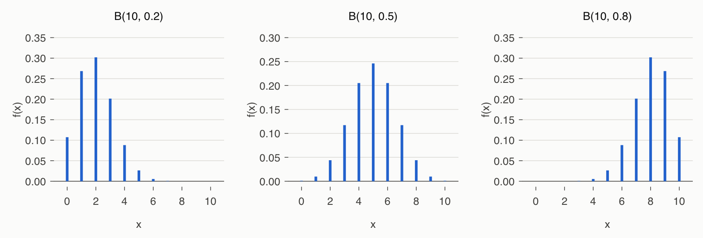
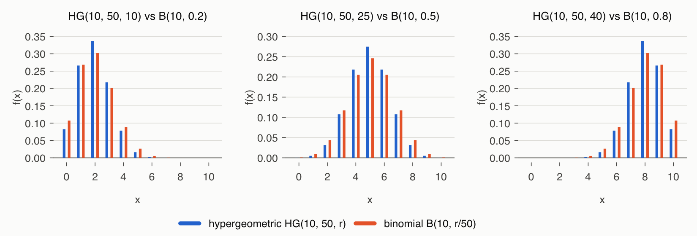
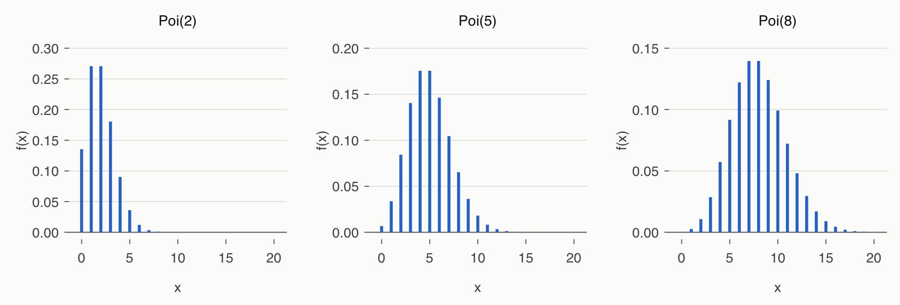
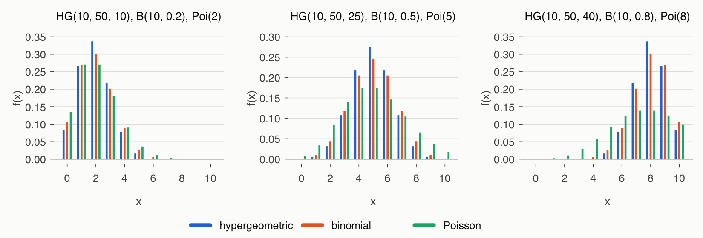
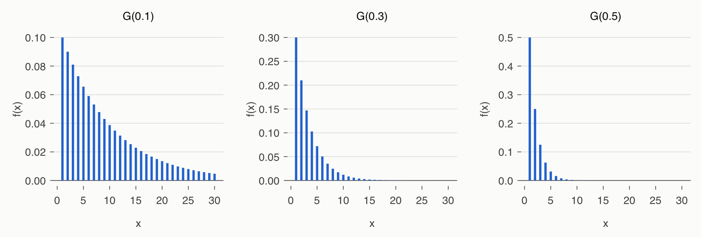
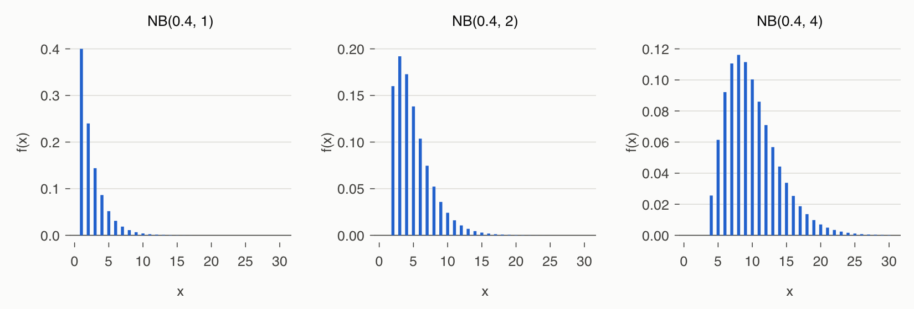

# 4강 연습 문제 풀이 — 이산확률변수

[레포지토리 안내](../../README.ko.md) | [English](Solutions.md) | [한국어](Solutions.ko.md)

> **최종 수정일:** 2026-11-04

---

<br>

## 목차

- [연습 문제 1: 번호가 적힌 공의 이산균등분포](#연습-문제-1-번호가-적힌-공의-이산균등분포)
- [연습 문제 2: 성공 확률이 다른 세 이항분포](#연습-문제-2-성공-확률이-다른-세-이항분포)
- [연습 문제 3: 불량률 0.03인 공정의 불량품 수](#연습-문제-3-불량률-003인-공정의-불량품-수)
- [연습 문제 4: 세 유한모집단에서의 초기하분포](#연습-문제-4-세-유한모집단에서의-초기하분포)
- [연습 문제 5: 제품 1000개에서 뽑은 표본의 불량품 수](#연습-문제-5-제품-1000개에서-뽑은-표본의-불량품-수)
- [연습 문제 6: 평균 발생 횟수가 다른 세 포아송분포](#연습-문제-6-평균-발생-횟수가-다른-세-포아송분포)
- [연습 문제 7: 단위당 결점 수의 포아송분포](#연습-문제-7-단위당-결점-수의-포아송분포)
- [연습 문제 8: 성공 확률이 다른 세 기하분포](#연습-문제-8-성공-확률이-다른-세-기하분포)
- [연습 문제 9: 6이 나올 때까지 주사위를 던진 횟수](#연습-문제-9-6이-나올-때까지-주사위를-던진-횟수)
- [연습 문제 10: 1, 2, 4번째 성공까지의 음이항분포](#연습-문제-10-1-2-4번째-성공까지의-음이항분포)
- [연습 문제 11: 인기곡 세 곡까지의 프로젝트 수](#연습-문제-11-인기곡-세-곡까지의-프로젝트-수)
- [참고 문헌](#참고-문헌)

---

<br>

## 연습 문제 1: 번호가 적힌 공의 이산균등분포

**문제:** 1부터 20까지의 공에서 하나를 뽑을 때 번호 $X$의 확률질량함수, 기댓값, 분산, $P(X \ge 15)$를 구하라. 문제 전문은 [연습 문제 1](Exercises.ko.md#연습-문제-1-번호가-적힌-공의-이산균등분포)에 있다.

### 풀이

**접근 방법:** 공 20개의 모양이 같으므로 각 번호가 나올 확률은 모두 같다. 따라서 $X$는 $n = 20$인 이산균등분포를 따른다([4강 2절](Concepts_Lecture.ko.md#2-이산균등분포)).

$$
f(x) = \frac{1}{20}, \qquad x = 1, 2, \dots, 20
$$

이산균등분포의 공식 $E(X) = \frac{n+1}{2}$, $\mathrm{Var}(X) = \frac{(n+1)(n-1)}{12}$에 $n = 20$을 넣는다.

$$
E(X) = \frac{20 + 1}{2} = 10.5, \qquad \mathrm{Var}(X) = \frac{(20 + 1)(20 - 1)}{12} = \frac{399}{12} = 33.25
$$

15 이상의 번호는 15, 16, 17, 18, 19, 20의 6개이므로 다음과 같다.

$$
P(X \ge 15) = \sum_{x=15}^{20} \frac{1}{20} = \frac{6}{20} = 0.3
$$

**코드:**

```r
x  <- 1:20                         # 공에 적힌 번호
fx <- rep(1/20, 20)                # f(x) = 1/20
EX  <- sum(x * fx)
VX  <- sum(x^2 * fx) - EX^2
cat("E(X) =", EX, " Var(X) =", VX, " D(X) =", round(sqrt(VX), 4), "\n")
cat("formula:", (20 + 1) / 2, (20 + 1) * (20 - 1) / 12, "\n")
sum(x >= 15) / length(x)           # 개수를 세어 구한 P(X >= 15)
sum(fx[x >= 15])                   # 확률질량함수를 더해 구한 P(X >= 15)
```

- `x`는 가능한 값 1, ..., 20이고 `fx`는 각 값의 확률 $1/20$을 20번 반복한 벡터이다.
- `EX`와 `VX`는 정의 $\sum x f(x)$와 $\sum x^2 f(x) - E(X)^2$로 계산한 값이며, 다음 줄은 공식으로 계산한 값이다. 둘이 같다.
- `x >= 15`는 논리 벡터이므로 `sum(x >= 15)`는 15 이상인 값의 개수 6이고, 이를 20으로 나누면 확률이다. 결과가 모두 같은 확률일 때만 쓸 수 있는 방법이다.
- `fx[x >= 15]`는 15 이상인 값의 확률만 골라낸 벡터이며, 그 합이 $P(X \ge 15)$이다. 이 방법은 확률이 서로 달라도 쓸 수 있다.

> **참고:** 분포의 기댓값과 분산을 출력하는 `disc.exp()`와 여러 분포를 나란히 그리는 `disc.mexp()`는 Rstat 패키지 [1]의 함수이다. 이 패키지는 CRAN에 등록되어 있지 않으므로, 모든 풀이는 같은 계산을 기댓값과 분산의 정의에 따라 몇 줄의 코드로 쓰고 그래프는 `par(mfrow = ...)`로 나란히 그린다. Windows 전용 함수 `win.graph()`는 쓰지 않는다.

**실행 결과:**

```text
E(X) = 10.5  Var(X) = 33.25  D(X) = 5.7663 
formula: 10.5 33.25 
[1] 0.3
[1] 0.3
```

표준편차는 $\sqrt{33.25} \approx 5.766$이다.

---

<br>

## 연습 문제 2: 성공 확률이 다른 세 이항분포

**문제:** 성공 확률이 0.2, 0.5, 0.8인 무한모집단에서 표본 10개를 뽑을 때 성공 횟수의 분포를 구하고 비교하라. 문제 전문은 [연습 문제 2](Exercises.ko.md#연습-문제-2-성공-확률이-다른-세-이항분포)에 있다.

### 풀이

**접근 방법:** 무한모집단에서 뽑으므로 앞의 결과가 뒤의 성공 확률을 바꾸지 않는다. 각 표본은 성공 확률이 일정한 독립 베르누이 시행이고, 성공 횟수는 이항분포 $B(10, p)$를 따른다([4강 4절](Concepts_Lecture.ko.md#4-이항분포)).

$$
\begin{aligned}
p = 0.2:&\quad X \sim B(10, 0.2), \quad f(x) = \binom{10}{x} (0.2)^x (0.8)^{10 - x} \\
p = 0.5:&\quad X \sim B(10, 0.5), \quad f(x) = \binom{10}{x} (0.5)^x (0.5)^{10 - x} \\
p = 0.8:&\quad X \sim B(10, 0.8), \quad f(x) = \binom{10}{x} (0.8)^x (0.2)^{10 - x}
\end{aligned}
\qquad (x = 0, 1, \dots, 10)
$$

기댓값 $np$는 2, 5, 8이고 분산 $np(1 - p)$는 $10 \times 0.2 \times 0.8 = 1.6$, $10 \times 0.5 \times 0.5 = 2.5$, $10 \times 0.8 \times 0.2 = 1.6$이다.

**코드:**

```r
n <- 10
p <- c(0.2, 0.5, 0.8)
x <- 0:n

fx1 <- list()
for (i in 1:3) {
  fx1[[i]] <- dbinom(x, n, p[i])   # B(10, p[i])의 확률질량함수
}
print(sapply(fx1, sum))            # 각 확률질량함수의 합은 1

tab <- sapply(fx1, round, 4)
dimnames(tab) <- list(x = x, p = p)
print(tab)

for (i in 1:3) {
  EX <- sum(x * fx1[[i]])
  VX <- sum(x^2 * fx1[[i]]) - EX^2
  cat("p =", p[i], " E(X) =", EX, " Var(X) =", VX, " np(1-p) =", n * p[i] * (1 - p[i]), "\n")
}

mt1 <- paste0("B(10,", p, ")")
par(mfrow = c(1, 3))
for (i in 1:3) {
  plot(x, fx1[[i]], type = "h", lwd = 3, col = 2, main = mt1[i], xlab = "x", ylab = "f(x)")
}
```

- `fx1 <- list()`는 빈 리스트를 만들고, `for` 문이 `fx1[[1]]`, `fx1[[2]]`, `fx1[[3]]`에 세 분포의 확률 벡터를 넣는다. `dbinom(x, n, p[i])`는 `x`의 각 원소에 대한 확률을 한 번에 계산한다.
- `sapply(fx1, sum)`은 리스트의 각 원소에 `sum`을 적용하여 확률의 합을 확인한다.
- `sapply(fx1, round, 4)`는 각 확률 벡터를 소수 넷째 자리로 반올림하여 11행 3열의 행렬로 묶고, `dimnames`로 행과 열에 이름을 붙인다.
- 둘째 `for` 문은 각 분포의 기댓값과 분산을 정의대로 계산하고 공식 $np(1 - p)$와 함께 출력한다.
- `par(mfrow = c(1, 3))`는 그래프 영역을 1행 3열로 나누어 세 분포를 나란히 그리게 한다.

**실행 결과:**

```text
[1] 1 1 1
    p
x       0.2    0.5    0.8
  0  0.1074 0.0010 0.0000
  1  0.2684 0.0098 0.0000
  2  0.3020 0.0439 0.0001
  3  0.2013 0.1172 0.0008
  4  0.0881 0.2051 0.0055
  5  0.0264 0.2461 0.0264
  6  0.0055 0.2051 0.0881
  7  0.0008 0.1172 0.2013
  8  0.0001 0.0439 0.3020
  9  0.0000 0.0098 0.2684
  10 0.0000 0.0010 0.1074
p = 0.2  E(X) = 2  Var(X) = 1.6  np(1-p) = 1.6 
p = 0.5  E(X) = 5  Var(X) = 2.5  np(1-p) = 2.5 
p = 0.8  E(X) = 8  Var(X) = 1.6  np(1-p) = 1.6 
```



*그림 1. 이항분포 B(10, 0.2), B(10, 0.5), B(10, 0.8)의 확률질량함수*

$B(10, 0.2)$는 $x = 2$에서 가장 크고 오른쪽 꼬리가 길며, $B(10, 0.5)$는 $x = 5$를 중심으로 대칭이고, $B(10, 0.8)$은 $B(10, 0.2)$를 좌우로 뒤집은 모양이다. 확률표의 $p = 0.2$ 열과 $p = 0.8$ 열이 위아래로 뒤집힌 관계인 것도 같은 이유이다. 성공 확률이 0.5에서 멀어질수록 분산이 작아진다.

---

<br>

## 연습 문제 3: 불량률 0.03인 공정의 불량품 수

**문제:** 불량률 0.03인 공정에서 표본 20개를 검사할 때 불량품 수 $X$의 확률질량함수, 기댓값, 분산, $P(X = 2)$, $P(X \ge 3)$을 구하라. 문제 전문은 [연습 문제 3](Exercises.ko.md#연습-문제-3-불량률-003인-공정의-불량품-수)에 있다.

### 풀이

**접근 방법:** 공정에서 나오는 제품마다 불량일 확률이 0.03으로 일정하고 서로 독립이라고 보면 $X \sim B(20, 0.03)$이다.

$$
f(x) = \binom{20}{x} (0.03)^x (0.97)^{20 - x}, \qquad x = 0, 1, 2, \dots, 20
$$

$$
E(X) = 20 \times 0.03 = 0.6, \qquad \mathrm{Var}(X) = 20 \times 0.03 \times 0.97 = 0.582
$$

$\binom{20}{2} = \frac{20 \times 19}{2} = 190$이므로 불량품이 정확히 2개일 확률은 다음과 같다.

$$
f(2) = \binom{20}{2} (0.03)^2 (0.97)^{20 - 2} = 190 \times (0.03)^2 \times (0.97)^{18} \approx 190 \times 0.0009 \times 0.5780 \approx 0.0988
$$

3개 이상일 확률은 여사건 $\lbrace X \le 2\rbrace$의 확률을 1에서 빼서 구한다. 4개 이상의 경우를 하나씩 더하는 것보다 계산이 훨씬 적다.

$$
\begin{aligned}
P(X \ge 3) &= 1 - P(X \le 2) = 1 - [f(0) + f(1) + f(2)] \\
&= 1 - \big[{}_{20}C_0 (0.03)^0 (0.97)^{20} + {}_{20}C_1 (0.03)^1 (0.97)^{19} + {}_{20}C_2 (0.03)^2 (0.97)^{18}\big] \\
&= 1 - \big[(0.97)^{20} + 20 \times 0.03 \times (0.97)^{19} + 190 \times (0.03)^2 (0.97)^{18}\big] \\
&\approx 1 - (0.5438 + 0.3364 + 0.0988) = 1 - 0.9790 = 0.0210
\end{aligned}
$$

**코드:**

```r
x  <- 0:20
fx <- dbinom(x, 20, 0.03)          # B(20, 0.03)의 확률질량함수
EX <- sum(x * fx)
VX <- sum(x^2 * fx) - EX^2
cat("E(X) =", EX, " Var(X) =", VX, "\n")
print(round(fx[1:6], 4))           # f(0), ..., f(5)

dbinom(0:2, 20, 0.03)              # P(X = 0), P(X = 1), P(X = 2)
dbinom(2, 20, 0.03)                # P(X = 2)
1 - sum(dbinom(0:2, 20, 0.03))     # P(X >= 3), 방법 1
pbinom(2, 20, 0.03, lower.tail = FALSE)   # P(X > 2) = P(X >= 3), 방법 2
```

- `dbinom(x, 20, 0.03)`은 $x = 0, \dots, 20$의 확률 전체이고, 이로부터 기댓값과 분산을 계산한다. `fx[1:6]`은 $f(0), \dots, f(5)$이다(R의 인덱스는 1부터 시작하므로 `fx[1]`이 $f(0)$이다).
- `1 - sum(dbinom(0:2, 20, 0.03))`은 여사건을 이용하는 첫 번째 방법이다.
- `pbinom(2, 20, 0.03, lower.tail = FALSE)`는 $P(X > 2)$를 바로 계산하는 두 번째 방법이다. 이산분포에서 $P(X > 2) = P(X \ge 3)$이다.

**실행 결과:**

```text
E(X) = 0.6  Var(X) = 0.582 
[1] 0.5438 0.3364 0.0988 0.0183 0.0024 0.0002
[1] 0.54379434 0.33636763 0.09882967
[1] 0.09882967
[1] 0.02100836
[1] 0.02100836
```

불량품이 3개 이상 발견될 확률은 약 2.1%이다. 평균이 0.6개이므로 대부분의 표본에서 불량품은 0개 또는 1개이다($f(0) + f(1) \approx 0.880$).

---

<br>

## 연습 문제 4: 세 유한모집단에서의 초기하분포

**문제:** 성공 개체가 10, 25, 40개인 크기 50의 세 유한모집단에서 표본 10개를 비복원추출할 때 성공 개체 수의 분포를 구하고 이항분포와 비교하라. 문제 전문은 [연습 문제 4](Exercises.ko.md#연습-문제-4-세-유한모집단에서의-초기하분포)에 있다.

### 풀이

**접근 방법:** 유한모집단에서 비복원추출하므로 성공 개체 수는 초기하분포 $HG(n, N, r)$를 따른다. $n = 10$, $N = 50$이고 $r$은 10, 25, 40이다([4강 5절](Concepts_Lecture.ko.md#5-초기하분포)).

$$
\begin{aligned}
X \sim HG(10, 50, 10):&\quad f(x) = \binom{10}{x}\binom{40}{10 - x} \Big/ \binom{50}{10} \\
X \sim HG(10, 50, 25):&\quad f(x) = \binom{25}{x}\binom{25}{10 - x} \Big/ \binom{50}{10} \\
X \sim HG(10, 50, 40):&\quad f(x) = \binom{40}{x}\binom{10}{10 - x} \Big/ \binom{50}{10}
\end{aligned}
\qquad (x = 0, 1, \dots, 10)
$$

지지집합은 $\max(0, n - N + r) \le x \le \min(n, r)$이다. 세 경우 모두 $n - N + r = r - 40 \le 0$, $\min(10, r) = 10$이므로 $x = 0, \dots, 10$ 전체이다. 성공 비율은 $p = r/N = 0.2, 0.5, 0.8$이므로 기댓값 $np$는 2, 5, 8이다. 분산은 이항분포의 분산 $np(1 - p)$에 유한모집단 수정계수 $\frac{N - n}{N - 1} = \frac{40}{49} \approx 0.8163$을 곱한 값이다.

$$
1.6 \times \frac{40}{49} \approx 1.3061, \qquad 2.5 \times \frac{40}{49} \approx 2.0408, \qquad 1.6 \times \frac{40}{49} \approx 1.3061
$$

**코드:**

```r
N <- 50                            # 모집단 크기
S <- c(10, 25, 40)                 # 세 모집단의 성공 개체 수
n <- 10                            # 표본 크기
x <- 0:n

fx2 <- list()
for (i in 1:3) {
  fx2[[i]] <- dhyper(x, S[i], N - S[i], n)   # HG(10, 50, S[i])의 확률질량함수
}
print(sapply(fx2, sum))

tab <- sapply(fx2, round, 4)
dimnames(tab) <- list(x = x, r = S)
print(tab)

p <- S / N                         # 0.2, 0.5, 0.8
for (i in 1:3) {
  EX <- sum(x * fx2[[i]])
  VX <- sum(x^2 * fx2[[i]]) - EX^2
  cat("r =", S[i], " E(X) =", EX, " Var(X) =", round(VX, 4),
      " binomial Var =", n * p[i] * (1 - p[i]),
      " FPC =", round((N - n) / (N - 1), 4), "\n")
}
cat("max |HG - B| for each r:",
    round(sapply(1:3, function(i) max(abs(fx2[[i]] - dbinom(x, n, p[i])))), 4), "\n")
```

- `dhyper(x, S[i], N - S[i], n)`의 인수는 순서대로 값, 모집단의 성공 개체 수 $r$, 모집단의 실패 개체 수 $N - r$, 표본 크기 $n$이다. R의 셋째 인수 이름이 `n`이지만 표본 크기가 아니라 실패 개체 수라는 점에 유의한다.
- 확률표와 기댓값, 분산의 계산은 연습 문제 2와 같은 방식이다. 출력의 `FPC`는 유한모집단 수정계수이다.
- 마지막 줄은 같은 $p$의 이항분포와 확률의 차이가 가장 큰 칸의 절댓값을 출력한다.

**실행 결과:**

```text
[1] 1 1 1
    r
x        10     25     40
  0  0.0825 0.0003 0.0000
  1  0.2662 0.0050 0.0000
  2  0.3369 0.0316 0.0000
  3  0.2178 0.1076 0.0001
  4  0.0785 0.2181 0.0019
  5  0.0161 0.2748 0.0161
  6  0.0019 0.2181 0.0785
  7  0.0001 0.1076 0.2178
  8  0.0000 0.0316 0.3369
  9  0.0000 0.0050 0.2662
  10 0.0000 0.0003 0.0825
r = 10  E(X) = 2  Var(X) = 1.3061  binomial Var = 1.6  FPC = 0.8163 
r = 25  E(X) = 5  Var(X) = 2.0408  binomial Var = 2.5  FPC = 0.8163 
r = 40  E(X) = 8  Var(X) = 1.3061  binomial Var = 1.6  FPC = 0.8163 
max |HG - B| for each r: 0.0349 0.0287 0.0349 
```



*그림 2. 초기하분포 HG(10, 50, r)와 이항분포 B(10, r/50)의 비교 (r = 10, 25, 40)*

기댓값은 이항분포와 같고 분산은 약 82%로 작다. 그래서 초기하분포는 평균 근처의 확률이 더 크고(예: $r = 10$에서 $f(2)$가 0.3369 대 0.3020) 꼬리의 확률이 더 작다. 확률의 차이는 많아야 0.035 정도이다. 모집단 크기 50이 표본 크기 10의 5배에 불과하여 차이가 이 정도로 나타난다.

---

<br>

## 연습 문제 5: 제품 1000개에서 뽑은 표본의 불량품 수

**문제:** 불량률 5%인 제품 1000개에서 30개를 비복원추출할 때 불량품 수 $X$의 확률질량함수, 기댓값, 분산, $P(X = 3)$, $P(X \le 3)$을 구하고 이항분포 근사와 비교하라. 문제 전문은 [연습 문제 5](Exercises.ko.md#연습-문제-5-제품-1000개에서-뽑은-표본의-불량품-수)에 있다.

### 풀이

**접근 방법:** 제품 1000개 중 불량품은 $1000 \times 0.05 = 50$개, 양품은 950개이다. 30개를 비복원추출하므로 $X \sim HG(30, 1000, 50)$이다.

$$
f(x) = \frac{\dbinom{50}{x}\dbinom{950}{30 - x}}{\dbinom{1000}{30}}, \qquad x = 0, 1, 2, \dots, 30
$$

$p = r/N = 0.05$이므로 기댓값과 분산은 다음과 같다.

$$
E(X) = np = 30 \times 0.05 = 1.5, \qquad \mathrm{Var}(X) = np(1 - p)\Big(\frac{N - n}{N - 1}\Big) = 30 \times 0.05 \times 0.95 \times \frac{970}{999} \approx 1.384
$$

$P(X = 3)$과 $P(X \le 3)$은 확률질량함수에 값을 넣어 계산한다. 이항계수가 매우 커지므로 R로 계산한다.

$$
f(3) = \frac{\dbinom{50}{3}\dbinom{950}{27}}{\dbinom{1000}{30}} \approx 0.1277, \qquad P(X \le 3) = \sum_{x=0}^{3} \frac{\dbinom{50}{x}\dbinom{950}{30 - x}}{\dbinom{1000}{30}} \approx 0.2097 + 0.3415 + 0.2632 + 0.1277 = 0.9421
$$

**코드:**

```r
x  <- 0:30                         # 지지집합: 0, 1, ..., 30
fx <- dhyper(x, 50, 950, 30)       # 불량품 50개, 양품 950개, 표본 30개
EX <- sum(x * fx)
VX <- sum(x^2 * fx) - EX^2
cat("E(X) =", EX, " Var(X) =", round(VX, 4), "\n")
cat("formula: ", 30 * 0.05, round(30 * 0.05 * 0.95 * (1000 - 30) / (1000 - 1), 4), "\n")

dhyper(0:3, 50, 950, 30)           # P(X = 0), ..., P(X = 3)
sum(dhyper(0:3, 50, 950, 30))      # P(X <= 3), 방법 1
phyper(3, 50, 950, 30)             # P(X <= 3), 방법 2
round(dbinom(0:3, 30, 0.05), 4)    # 이항분포 B(30, 0.05)로의 근사
round(pbinom(3, 30, 0.05), 4)
```

- `dhyper(x, 50, 950, 30)`은 불량품 50개(성공), 양품 950개(실패)에서 30개를 뽑는 초기하분포의 확률이다. 지지집합 0, ..., 30 전체에 대해 계산해야 기댓값과 분산이 정확하다.
- `sum(dhyper(0:3, ...))`과 `phyper(3, ...)`은 $P(X \le 3)$을 구하는 두 방법이다.
- 마지막 두 줄은 비교를 위한 이항분포 $B(30, 0.05)$의 확률이다.

**실행 결과:**

```text
E(X) = 1.5  Var(X) = 1.3836 
formula:  1.5 1.3836 
[1] 0.2096813 0.3415005 0.2631628 0.1277323
[1] 0.942077
[1] 0.942077
[1] 0.2146 0.3389 0.2586 0.1270
[1] 0.9392
```

이항분포 근사는 $P(X \le 3) \approx 0.9392$로 정확한 값 0.9421과 0.003 정도 다르다. 모집단 1000개가 표본 30개보다 훨씬 커서 유한모집단 수정계수가 $970/999 \approx 0.971$로 1에 가깝기 때문에 근사가 잘 맞는다.

---

<br>

## 연습 문제 6: 평균 발생 횟수가 다른 세 포아송분포

**문제:** 단위당 평균 발생 횟수가 2, 5, 8인 세 포아송분포를 구하고 초기하분포, 이항분포와 비교하라. 문제 전문은 [연습 문제 6](Exercises.ko.md#연습-문제-6-평균-발생-횟수가-다른-세-포아송분포)에 있다.

### 풀이

**접근 방법:** 일정한 단위에서의 발생 횟수이므로 포아송분포를 따른다([4강 6절](Concepts_Lecture.ko.md#6-포아송분포)).

$$
X \sim Poi(2): f(x) = 2^x \frac{e^{-2}}{x!}, \qquad X \sim Poi(5): f(x) = 5^x \frac{e^{-5}}{x!}, \qquad X \sim Poi(8): f(x) = 8^x \frac{e^{-8}}{x!} \qquad (x = 0, 1, 2, \dots)
$$

포아송분포의 기댓값과 분산은 모두 $\lambda$이므로 각각 2, 5, 8이다. 평균 2, 5, 8은 연습 문제 2의 이항분포 $B(10, p)$와 연습 문제 4의 초기하분포 $HG(10, 50, r)$의 평균 $10p$와 같으므로 세 분포를 나란히 비교할 수 있다.

**코드:**

```r
L <- c(2, 5, 8)                    # 단위당 평균 발생 수
x <- 0:30

fx3 <- list()
for (i in 1:3) {
  fx3[[i]] <- dpois(x, L[i])       # x = 0, ..., 30에서 Poi(L[i])의 확률질량함수
}
print(sapply(fx3, sum))            # 거의 1 (30 초과의 꼬리는 잘림)

for (i in 1:3) {
  EX <- sum(x * fx3[[i]])
  VX <- sum(x^2 * fx3[[i]]) - EX^2
  cat("lambda =", L[i], " E(X) =", round(EX, 4), " Var(X) =", round(VX, 4),
      " mode =", x[which.max(fx3[[i]])], "\n")
}
print(round(sapply(fx3, function(f) f[1:13]), 4))

# HG(10, 50, r), B(10, p)와 비교 (10p = lambda)
N <- 50; S <- c(10, 25, 40); n <- 10; p <- S / N
x <- 0:10
for (i in 1:3) {
  hg <- dhyper(x, S[i], N - S[i], n)
  bi <- dbinom(x, n, p[i])
  po <- dpois(x, L[i])
  cat("lambda =", L[i], " max|B - Poi| =", round(max(abs(bi - po)), 4),
      " max|HG - Poi| =", round(max(abs(hg - po)), 4),
      " P(Poi > 10) =", round(ppois(10, L[i], lower.tail = FALSE), 4), "\n")
}
```

- `dpois(x, L[i])`로 $x = 0, \dots, 30$의 확률을 구한다. 포아송분포는 상한이 없지만 $\lambda = 8$에서도 30을 넘을 확률은 $10^{-6}$보다 작으므로, 30에서 잘라도 합과 기댓값, 분산이 소수 넷째 자리까지 정확하다.
- `which.max()`는 확률이 가장 큰 첫 번째 위치를 돌려주므로 `x[which.max(...)]`는 최빈값이다.
- `sapply(fx3, function(f) f[1:13])`은 각 분포의 $f(0), \dots, f(12)$를 열로 모은 행렬이다.
- 마지막 `for` 문은 $x = 0, \dots, 10$에서 이항분포와 포아송분포, 초기하분포와 포아송분포의 확률 차이의 최댓값과, 포아송분포가 10을 넘을 확률 $P(X > 10)$을 출력한다.

**실행 결과:**

```text
[1] 1 1 1
lambda = 2  E(X) = 2  Var(X) = 2  mode = 1 
lambda = 5  E(X) = 5  Var(X) = 5  mode = 4 
lambda = 8  E(X) = 8  Var(X) = 8  mode = 7 
        [,1]   [,2]   [,3]
 [1,] 0.1353 0.0067 0.0003
 [2,] 0.2707 0.0337 0.0027
 [3,] 0.2707 0.0842 0.0107
 [4,] 0.1804 0.1404 0.0286
 [5,] 0.0902 0.1755 0.0573
 [6,] 0.0361 0.1755 0.0916
 [7,] 0.0120 0.1462 0.1221
 [8,] 0.0034 0.1044 0.1396
 [9,] 0.0009 0.0653 0.1396
[10,] 0.0002 0.0363 0.1241
[11,] 0.0000 0.0181 0.0993
[12,] 0.0000 0.0082 0.0722
[13,] 0.0000 0.0034 0.0481
lambda = 2  max|B - Poi| = 0.0313  max|HG - Poi| = 0.0662  P(Poi > 10) = 0 
lambda = 5  max|B - Poi| = 0.0706  max|HG - Poi| = 0.0993  P(Poi > 10) = 0.0137 
lambda = 8  max|B - Poi| = 0.1624  max|HG - Poi| = 0.1973  P(Poi > 10) = 0.1841 
```



*그림 3. 포아송분포 Poi(2), Poi(5), Poi(8)의 확률질량함수*

출력된 최빈값은 1, 4, 7이지만, $\lambda$가 정수이면 $f(\lambda - 1) = f(\lambda)$이므로 2, 5, 8도 최빈값이다(확률표의 $f(1) = f(2) = 0.2707$, $f(4) = f(5) = 0.1755$, $f(7) = f(8) = 0.1396$). `which.max()`가 같은 값 중 첫 번째만 돌려주기 때문이다.



*그림 4. 초기하분포 HG(10, 50, r), 이항분포 B(10, r/50), 포아송분포 Poi(10r/50)의 비교 (r = 10, 25, 40)*

$\lambda = 2$($p = 0.2$)에서는 이항분포와 포아송분포의 차이가 최대 0.031로 작지만, $\lambda = 5$($p = 0.5$)에서는 0.071, $\lambda = 8$($p = 0.8$)에서는 0.162로 커진다. $\lambda = 8$의 포아송분포는 10을 넘는 값에 18%의 확률을 주는데, 표본이 10개뿐인 이항분포와 초기하분포에서는 그런 값이 나올 수 없다. 포아송 근사는 성공 확률이 작을 때만 맞으며, 분산 $\lambda$가 이항분포의 분산 $np(1 - p)$보다 크기 때문에 분포가 더 넓게 퍼진다.

---

<br>

## 연습 문제 7: 단위당 결점 수의 포아송분포

**문제:** 단위당 평균 결점 수가 1.5인 공정에서 한 단위의 결점 수 $X$의 확률질량함수, 기댓값, 분산과 결점이 두 개일 확률, 세 개 이상일 확률을 구하라. 문제 전문은 [연습 문제 7](Exercises.ko.md#연습-문제-7-단위당-결점-수의-포아송분포)에 있다.

### 풀이

**접근 방법:** 한 단위에서 드물게 생기는 결점의 수이므로 $X \sim Poi(1.5)$이다.

$$
f(x) = (1.5)^x \frac{e^{-1.5}}{x!}, \quad x = 0, 1, 2, \dots, \qquad E(X) = \lambda = 1.5, \qquad \mathrm{Var}(X) = \lambda = 1.5
$$

$e^{-1.5} \approx 0.2231$이므로 결점이 정확히 두 개일 확률은 다음과 같다.

$$
f(2) = \frac{1.5^2}{2!} e^{-1.5} = 1.125 \times 0.2231 \approx 0.2510
$$

세 개 이상일 확률은 여사건을 이용한다.

$$
P(X \ge 3) = 1 - P(X \le 2) = 1 - e^{-1.5} \times \Big(1 + 1.5 + \frac{1.5^2}{2}\Big) = 1 - 3.625\, e^{-1.5} \approx 1 - 0.8088 = 0.1912
$$

**코드:**

```r
x  <- 0:100
fx <- dpois(x, 1.5)                # Poi(1.5)의 확률질량함수, 100에서 자름
EX <- sum(x * fx)
VX <- sum(x^2 * fx) - EX^2
cat("E(X) =", round(EX, 4), " Var(X) =", round(VX, 4), "\n")
round(dpois(0:3, 1.5), 4)          # f(0), f(1), f(2), f(3)
dpois(2, 1.5)                      # P(X = 2)
1 - sum(dpois(0:2, 1.5))           # P(X >= 3), 방법 1
ppois(2, 1.5, lower.tail = FALSE)  # P(X > 2) = P(X >= 3), 방법 2
```

- `dpois(x, 1.5)`로 $x = 0, \dots, 100$의 확률을 구해 기댓값과 분산을 확인한다. 100을 넘는 값의 확률은 무시할 수 있을 만큼 작다.
- `1 - sum(dpois(0:2, 1.5))`와 `ppois(2, 1.5, lower.tail = FALSE)`는 $P(X \ge 3)$을 구하는 두 방법이다.

**실행 결과:**

```text
E(X) = 1.5  Var(X) = 1.5 
[1] 0.2231 0.3347 0.2510 0.1255
[1] 0.2510214
[1] 0.1911532
[1] 0.1911532
```

결점이 정확히 두 개일 확률은 약 25.1%, 세 개 이상일 확률은 약 19.1%이다.

---

<br>

## 연습 문제 8: 성공 확률이 다른 세 기하분포

**문제:** 성공 확률이 0.1, 0.3, 0.5일 때 처음 성공할 때까지의 시행 횟수의 분포를 구하고 기댓값과 분산을 확인하라. 문제 전문은 [연습 문제 8](Exercises.ko.md#연습-문제-8-성공-확률이-다른-세-기하분포)에 있다.

### 풀이

**접근 방법:** 처음 성공할 때까지의 시행 횟수이므로 기하분포 $G(p)$를 따른다([4강 7절](Concepts_Lecture.ko.md#7-기하분포)).

$$
G(0.1): f(x) = 0.1 \times 0.9^{x - 1}, \qquad G(0.3): f(x) = 0.3 \times 0.7^{x - 1}, \qquad G(0.5): f(x) = 0.5 \times 0.5^{x - 1} \qquad (x = 1, 2, 3, \dots)
$$

기댓값 $1/p$는 $10$, $10/3 \approx 3.333$, $2$이고, 분산 $(1 - p)/p^2$은 $0.9/0.01 = 90$, $0.7/0.09 \approx 7.778$, $0.5/0.25 = 2$이다.

**코드:**

```r
p <- c(0.1, 0.3, 0.5)
x <- 1:200                         # 시행 횟수 (지지집합은 1, 2, ...)

fx4 <- list()
for (i in 1:3) {
  fx4[[i]] <- dgeom(x - 1, p[i])   # dgeom은 실패 수를 세므로 1만큼 옮긴다
}
print(sapply(fx4, sum))

for (i in 1:3) {
  EX <- sum(x * fx4[[i]])
  VX <- sum(x^2 * fx4[[i]]) - EX^2
  cat("p =", p[i], " E(X) =", round(EX, 4), " Var(X) =", round(VX, 4),
      " 1/p =", 1 / p[i], " q/p^2 =", (1 - p[i]) / p[i]^2, "\n")
}
print(round(sapply(fx4, function(f) f[1:6]), 4))

mt4 <- paste0("Geometric(", p, ")")
par(mfrow = c(1, 3), mar = c(3, 4, 4, 2))
for (k in 1:3) {
  plot(1:50, fx4[[k]][1:50], type = "h", main = mt4[k], ylab = "f(x)", xlab = "", lwd = 3, col = 2)
}
```

- R의 `dgeom()`은 처음 성공하기 전까지의 **실패 횟수**의 확률을 계산하므로, 시행 횟수 $x$의 확률은 `dgeom(x - 1, p)`이다.
- 시행 횟수는 상한이 없으므로 $x = 1, \dots, 200$에서 자른다. 200번을 넘을 확률은 $p = 0.1$에서도 $0.9^{200} \approx 7 \times 10^{-10}$이어서 합과 기댓값, 분산에 영향이 없다.
- 그래프는 $x = 1, \dots, 50$만 그린다. `par(mar = ...)`는 각 그래프의 아래, 왼쪽, 위, 오른쪽 여백을 줄 수 단위로 정한다.

**실행 결과:**

```text
[1] 1 1 1
p = 0.1  E(X) = 10  Var(X) = 90  1/p = 10  q/p^2 = 90 
p = 0.3  E(X) = 3.3333  Var(X) = 7.7778  1/p = 3.333333  q/p^2 = 7.777778 
p = 0.5  E(X) = 2  Var(X) = 2  1/p = 2  q/p^2 = 2 
       [,1]   [,2]   [,3]
[1,] 0.1000 0.3000 0.5000
[2,] 0.0900 0.2100 0.2500
[3,] 0.0810 0.1470 0.1250
[4,] 0.0729 0.1029 0.0625
[5,] 0.0656 0.0720 0.0312
[6,] 0.0590 0.0504 0.0156
```



*그림 5. 기하분포 G(0.1), G(0.3), G(0.5)의 확률질량함수*

세 분포 모두 $x = 1$에서 확률 $p$로 가장 크고, 그 뒤로 매번 $1 - p$배씩 줄어든다(확률표의 각 열에서 다음 값은 앞 값의 0.9배, 0.7배, 0.5배이다). 성공 확률이 작을수록 꼬리가 길어 평균과 분산이 크다.

---

<br>

## 연습 문제 9: 6이 나올 때까지 주사위를 던진 횟수

**문제:** 6이 나올 때까지 주사위를 던진 횟수 $X$의 확률질량함수, 기댓값, 분산과 3번 이내에 6이 나올 확률을 구하라. 문제 전문은 [연습 문제 9](Exercises.ko.md#연습-문제-9-6이-나올-때까지-주사위를-던진-횟수)에 있다.

### 풀이

**접근 방법:** 한 번 던질 때 6이 나올 확률은 $1/6$이고 던질 때마다 독립이므로 $X \sim G(1/6)$이다. $q = 5/6$이다.

$$
f(x) = \frac{1}{6}\Big(\frac{5}{6}\Big)^{x - 1}, \quad x = 1, 2, 3, \dots, \qquad E(X) = \frac{1}{p} = 6, \qquad \mathrm{Var}(X) = \frac{q}{p^2} = \frac{5/6}{(1/6)^2} = 30
$$

3번 이내에 6이 나올 확률은 누적분포함수 $F(x) = 1 - q^x$로 구한다. 처음 세 번이 모두 6이 아닐 확률 $(5/6)^3$을 1에서 뺀 것과 같다.

$$
F(3) = 1 - q^3 = 1 - \Big(\frac{5}{6}\Big)^3 = 1 - \frac{125}{216} = \frac{91}{216} \approx 0.421
$$

**코드:**

```r
x  <- 1:500
fx <- dgeom(x - 1, 1/6)            # X = 처음 6이 나올 때까지 던진 횟수
EX <- sum(x * fx)
VX <- sum(x^2 * fx) - EX^2
cat("E(X) =", round(EX, 4), " Var(X) =", round(VX, 4), "\n")
round(dgeom(0:2, 1/6), 4)          # P(X = 1), P(X = 2), P(X = 3)
sum(dgeom(0:2, 1/6))               # P(X <= 3), 방법 1
pgeom(2, 1/6)                      # P(X <= 3) = P(실패 2번 이하), 방법 2
1 - (5/6)^3                        # 닫힌 식 91/216
```

- `dgeom(0:2, 1/6)`은 실패 0, 1, 2번 뒤에 성공할 확률, 즉 $P(X = 1)$, $P(X = 2)$, $P(X = 3)$이다.
- `pgeom(2, 1/6)`은 실패가 2번 이하일 확률이므로 $P(X \le 3)$이다. 세 방법(합, `pgeom`, 닫힌 식)이 같은 값을 준다.

**실행 결과:**

```text
E(X) = 6  Var(X) = 30 
[1] 0.1667 0.1389 0.1157
[1] 0.4212963
[1] 0.4212963
[1] 0.4212963
```

평균적으로 6번 던져야 처음 6이 나오지만, 3번 이내에 나올 확률도 약 42%이다. 표준편차가 $\sqrt{30} \approx 5.48$로 평균에 가까울 만큼 커서 시행 횟수의 변동이 크다.

---

<br>

## 연습 문제 10: 1, 2, 4번째 성공까지의 음이항분포

**문제:** 성공 확률이 0.4일 때 1번, 2번, 4번 성공할 때까지의 시행 횟수의 분포를 구하고 기댓값과 분산을 확인하라. 문제 전문은 [연습 문제 10](Exercises.ko.md#연습-문제-10-1-2-4번째-성공까지의-음이항분포)에 있다.

### 풀이

**접근 방법:** $r$번째 성공까지의 시행 횟수이므로 음이항분포 $NB(0.4, r)$를 따른다([4강 8절](Concepts_Lecture.ko.md#8-음이항분포)).

$$
\begin{aligned}
r = 1:&\quad X \sim NB(0.4, 1) \equiv G(0.4), \quad f(x) = \binom{x - 1}{0} (0.4)(0.6)^{x - 1}, \quad x = 1, 2, 3, \dots \\
r = 2:&\quad X \sim NB(0.4, 2), \quad f(x) = \binom{x - 1}{1} (0.4)^2 (0.6)^{x - 2}, \quad x = 2, 3, 4, \dots \\
r = 4:&\quad X \sim NB(0.4, 4), \quad f(x) = \binom{x - 1}{3} (0.4)^4 (0.6)^{x - 4}, \quad x = 4, 5, 6, \dots
\end{aligned}
$$

$r = 1$이면 $\binom{x - 1}{0} = 1$이므로 기하분포 $G(0.4)$와 같다. 기댓값 $r/p$는 2.5, 5, 10이고, 분산 $r(1 - p)/p^2$은 $0.6/0.16 = 3.75$, $7.5$, $15$이다.

**코드:**

```r
ps <- 0.4
r  <- c(1, 2, 4)                   # 필요한 성공 횟수
xr <- 1:100                        # 시행 횟수

fx5 <- list()
for (i in 1:3) {
  fx5[[i]] <- dnbinom(xr - r[i], r[i], ps)   # dnbinom은 실패 수를 세므로 x - r을 넘긴다
}
print(sapply(fx5, sum))

for (i in 1:3) {
  EX <- sum(xr * fx5[[i]])
  VX <- sum(xr^2 * fx5[[i]]) - EX^2
  cat("r =", r[i], " E(X) =", round(EX, 4), " Var(X) =", round(VX, 4),
      " r/p =", r[i] / ps, " rq/p^2 =", r[i] * (1 - ps) / ps^2,
      " mode =", xr[which.max(fx5[[i]])], "\n")
}
print(round(sapply(fx5, function(f) f[1:8]), 4))
all.equal(fx5[[1]], dgeom(xr - 1, ps))       # NB(0.4, 1)은 G(0.4)이다
```

- R의 `dnbinom(y, size, prob)`은 `size`번째 성공 전까지의 **실패 횟수** $y$의 확률이다. 시행 횟수가 `xr`이면 실패 횟수는 `xr - r[i]`이므로 그 값을 넘긴다. `xr < r[i]`이면 `xr - r[i]`가 음수이므로 확률 0이 나오며, 이는 지지집합 밖이라는 뜻이다.
- `which.max()`로 최빈값을 구하고, 확률표는 $x = 1, \dots, 8$을 보인다.
- `all.equal(fx5[[1]], dgeom(xr - 1, ps))`는 $NB(0.4, 1)$의 확률이 $G(0.4)$의 확률과 같은지 확인한다.

**실행 결과:**

```text
[1] 1 1 1
r = 1  E(X) = 2.5  Var(X) = 3.75  r/p = 2.5  rq/p^2 = 3.75  mode = 1 
r = 2  E(X) = 5  Var(X) = 7.5  r/p = 5  rq/p^2 = 7.5  mode = 3 
r = 4  E(X) = 10  Var(X) = 15  r/p = 10  rq/p^2 = 15  mode = 8 
       [,1]   [,2]   [,3]
[1,] 0.4000 0.0000 0.0000
[2,] 0.2400 0.1600 0.0000
[3,] 0.1440 0.1920 0.0000
[4,] 0.0864 0.1728 0.0256
[5,] 0.0518 0.1382 0.0614
[6,] 0.0311 0.1037 0.0922
[7,] 0.0187 0.0746 0.1106
[8,] 0.0112 0.0523 0.1161
[1] TRUE
```



*그림 6. 음이항분포 NB(0.4, 1), NB(0.4, 2), NB(0.4, 4)의 확률질량함수*

확률표에서 $r = 2$의 열은 $x = 1$에서, $r = 4$의 열은 $x = 1, 2, 3$에서 0이다. 필요한 성공 횟수보다 적은 시행으로는 끝날 수 없기 때문이다. $r$이 커질수록 최빈값(1, 3, 8)과 평균(2.5, 5, 10)이 오른쪽으로 옮겨 가고 모양이 대칭에 가까워진다.

---

<br>

## 연습 문제 11: 인기곡 세 곡까지의 프로젝트 수

**문제:** 곡마다 인기곡이 될 확률이 0.1일 때 세 곡이 인기곡이 될 때까지의 프로젝트 수 $X$의 확률질량함수, 기댓값, 분산과 정확히 10번째 프로젝트에서 세 번째 인기곡이 나올 확률을 구하라. 문제 전문은 [연습 문제 11](Exercises.ko.md#연습-문제-11-인기곡-세-곡까지의-프로젝트-수)에 있다.

### 풀이

**접근 방법:** 곡마다 독립이고 성공 확률이 0.1로 같으므로, 세 번째 성공까지의 시행 횟수는 $X \sim NB(0.1, 3)$이다.

$$
f(x) = \binom{x - 1}{2} (0.1)^3 (0.9)^{x - 3}, \quad x = 3, 4, 5, \dots
$$

$$
E(X) = \frac{r}{p} = \frac{3}{0.1} = 30, \qquad \mathrm{Var}(X) = \frac{rq}{p^2} = \frac{3 \times 0.9}{0.1^2} = 270
$$

정확히 10번째 프로젝트에서 세 번째 인기곡이 나오려면 처음 9곡 가운데 정확히 2곡이 인기곡이고 10번째 곡이 인기곡이어야 한다. $\binom{9}{2} = 36$이다.

$$
f(10) = \binom{10 - 1}{2} (0.1)^3 (0.9)^{10 - 3} = 36 \times 0.001 \times 0.4783 \approx 0.0172
$$

**코드:**

```r
x  <- 3:500                        # 프로젝트 수 (지지집합은 r = 3부터)
ps <- 0.1
r  <- 3
fx <- dnbinom(x - r, r, ps)        # NB(0.1, 3)의 확률질량함수
EX <- sum(x * fx)
VX <- sum(x^2 * fx) - EX^2
cat("sum =", round(sum(fx), 6), " E(X) =", round(EX, 4), " Var(X) =", round(VX, 4), "\n")
dnbinom(10 - r, r, ps)             # P(X = 10): 10번째 프로젝트에서 세 번째 인기곡
choose(9, 2) * 0.1^3 * 0.9^7       # 공식으로 구한 같은 값
dgeom(10 - 1, ps)                  # 비교: P(첫 인기곡이 10번째 프로젝트)
pnbinom(30 - r, r, ps)             # P(X <= 30)
```

- `x <- 3:500`은 지지집합의 시작인 3부터 충분히 큰 값까지의 프로젝트 수이며, `dnbinom(x - r, r, ps)`로 각 확률을 구해 합, 기댓값, 분산을 확인한다.
- `dnbinom(10 - r, r, ps)`는 $P(X = 10)$이고, 다음 줄은 같은 값을 공식으로 계산한다.
- `dgeom(10 - 1, ps)`는 비교를 위한 값으로, **첫 번째** 인기곡이 10번째 프로젝트에서 나올 확률 $0.9^9 \times 0.1$이다.
- `pnbinom(30 - r, r, ps)`는 30번째 프로젝트 이내에 세 곡이 인기곡이 될 확률이다.

**실행 결과:**

```text
sum = 1  E(X) = 30  Var(X) = 270 
[1] 0.01721869
[1] 0.01721869
[1] 0.03874205
[1] 0.5886488
```

> **주의:** "10번째 프로젝트에서 세 번째 인기곡이 나올 확률" $f(10) \approx 0.0172$와 "10번째 프로젝트에서 첫 인기곡이 나올 확률" $0.9^9 \times 0.1 \approx 0.0387$은 다른 사건이다. 앞의 것은 음이항분포 $NB(0.1, 3)$, 뒤의 것은 기하분포 $G(0.1)$의 확률이다. 문제가 몇 번째 성공을 묻는지 먼저 확인해야 한다.

평균은 30곡이지만 30곡 이내에 세 곡이 인기곡이 될 확률은 약 0.589로 절반을 넘는다. 오른쪽 꼬리가 긴 분포여서 중앙값(`qnbinom(0.5, 3, 0.1) + 3`의 값 27)이 평균 30보다 작기 때문이다.

---

<br>

## 참고 문헌

1. T. J. Lim, "Rstat: Basic statistical methods in R," GitHub repository. https://github.com/tjssu/Rstat
