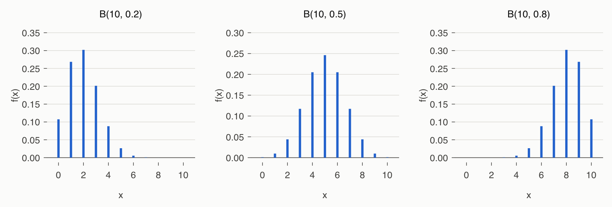
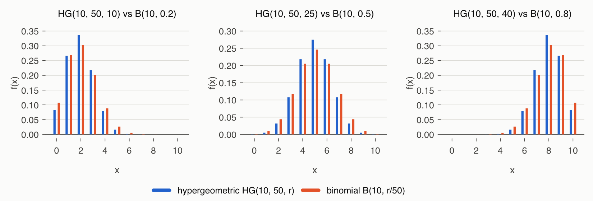
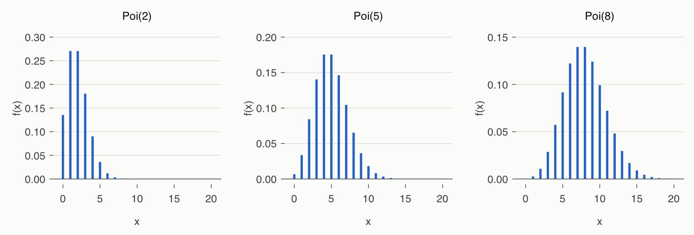
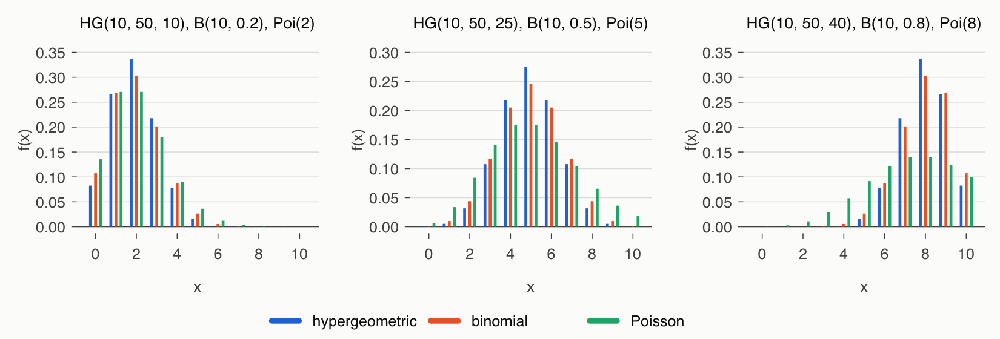
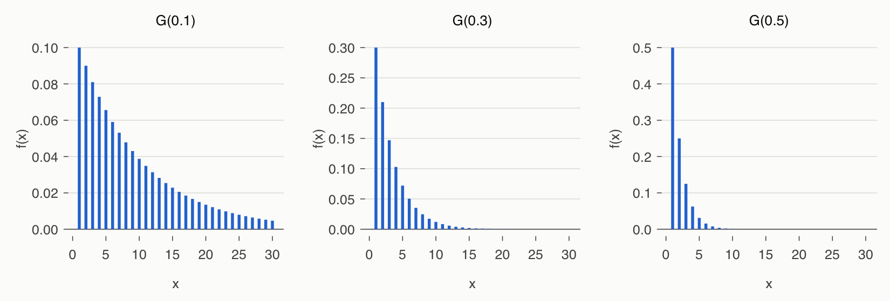
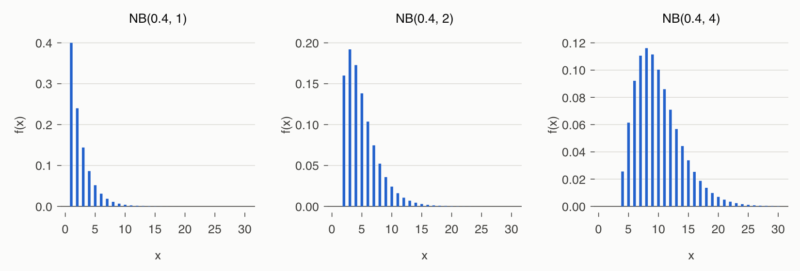

# Lecture 4 Solutions — Discrete Random Variables

[Repository Guide](../../README.md) | [English](Solutions.md) | [한국어](Solutions.ko.md)

> **Last Updated:** 2026-11-04

---

<br>

## Table of Contents

- [Exercise 1: Discrete Uniform Distribution of Numbered Balls](#exercise-1-discrete-uniform-distribution-of-numbered-balls)
- [Exercise 2: Three Binomial Distributions with Different Success Probabilities](#exercise-2-three-binomial-distributions-with-different-success-probabilities)
- [Exercise 3: Number of Defectives in a Process with Defect Rate 0.03](#exercise-3-number-of-defectives-in-a-process-with-defect-rate-003)
- [Exercise 4: Hypergeometric Distributions from Three Finite Populations](#exercise-4-hypergeometric-distributions-from-three-finite-populations)
- [Exercise 5: Number of Defectives in a Sample from 1000 Products](#exercise-5-number-of-defectives-in-a-sample-from-1000-products)
- [Exercise 6: Three Poisson Distributions with Different Means](#exercise-6-three-poisson-distributions-with-different-means)
- [Exercise 7: Poisson Distribution of Defects per Unit](#exercise-7-poisson-distribution-of-defects-per-unit)
- [Exercise 8: Three Geometric Distributions with Different Success Probabilities](#exercise-8-three-geometric-distributions-with-different-success-probabilities)
- [Exercise 9: Number of Rolls Until a 6 Appears](#exercise-9-number-of-rolls-until-a-6-appears)
- [Exercise 10: Negative Binomial Distributions Until the 1st, 2nd, and 4th Successes](#exercise-10-negative-binomial-distributions-until-the-1st-2nd-and-4th-successes)
- [Exercise 11: Number of Projects Until Three Hit Songs](#exercise-11-number-of-projects-until-three-hit-songs)
- [References](#references)

---

<br>

## Exercise 1: Discrete Uniform Distribution of Numbered Balls

**Problem:** For the number $X$ of a ball drawn from balls numbered 1 to 20, find the probability mass function, expected value, variance, and $P(X \ge 15)$. The full problem is in [Exercise 1](Exercises.md#exercise-1-discrete-uniform-distribution-of-numbered-balls).

### Solution

**Approach:** The 20 balls look identical, so every number is equally likely. Hence $X$ follows the discrete uniform distribution with $n = 20$ ([Lecture 4, Section 2](Concepts_Lecture.md#2-discrete-uniform-distribution)).

$$
f(x) = \frac{1}{20}, \qquad x = 1, 2, \dots, 20
$$

Substitute $n = 20$ into the discrete uniform formulas $E(X) = \frac{n+1}{2}$ and $\mathrm{Var}(X) = \frac{(n+1)(n-1)}{12}$.

$$
E(X) = \frac{20 + 1}{2} = 10.5, \qquad \mathrm{Var}(X) = \frac{(20 + 1)(20 - 1)}{12} = \frac{399}{12} = 33.25
$$

The numbers of 15 or more are the six numbers 15, 16, 17, 18, 19, 20, so:

$$
P(X \ge 15) = \sum_{x=15}^{20} \frac{1}{20} = \frac{6}{20} = 0.3
$$

**Code:**

```r
x  <- 1:20                         # numbers on the balls
fx <- rep(1/20, 20)                # f(x) = 1/20
EX  <- sum(x * fx)
VX  <- sum(x^2 * fx) - EX^2
cat("E(X) =", EX, " Var(X) =", VX, " D(X) =", round(sqrt(VX), 4), "\n")
cat("formula:", (20 + 1) / 2, (20 + 1) * (20 - 1) / 12, "\n")
sum(x >= 15) / length(x)           # P(X >= 15) by counting
sum(fx[x >= 15])                   # P(X >= 15) by summing the PMF
```

- `x` holds the possible values 1, ..., 20, and `fx` repeats the probability $1/20$ twenty times.
- `EX` and `VX` are computed from the definitions $\sum x f(x)$ and $\sum x^2 f(x) - E(X)^2$, and the next line computes the formula values. The two agree.
- `x >= 15` is a logical vector, so `sum(x >= 15)` is 6, the number of values at least 15; dividing by 20 gives the probability. This works only when all outcomes are equally likely.
- `fx[x >= 15]` selects the probabilities of the values at least 15, and their sum is $P(X \ge 15)$. This method works even when the probabilities differ.

> **Note:** `disc.exp()`, which prints the expected value and variance of a distribution, and `disc.mexp()`, which plots several distributions side by side, are functions of the Rstat package [1]. Since this package is not on CRAN, all solutions write the same calculations in a few lines following the definitions of expected value and variance, and the plots are placed side by side with `par(mfrow = ...)`. The Windows-only function `win.graph()` is not used.

**Output:**

```text
E(X) = 10.5  Var(X) = 33.25  D(X) = 5.7663 
formula: 10.5 33.25 
[1] 0.3
[1] 0.3
```

The standard deviation is $\sqrt{33.25} \approx 5.766$.

---

<br>

## Exercise 2: Three Binomial Distributions with Different Success Probabilities

**Problem:** Find and compare the distributions of the number of successes in samples of 10 from infinite populations with success probabilities 0.2, 0.5, and 0.8. The full problem is in [Exercise 2](Exercises.md#exercise-2-three-binomial-distributions-with-different-success-probabilities).

### Solution

**Approach:** Sampling from an infinite population means that earlier results do not change later success probabilities. Each draw is an independent Bernoulli trial with constant success probability, and the number of successes follows the binomial distribution $B(10, p)$ ([Lecture 4, Section 4](Concepts_Lecture.md#4-binomial-distribution)).

$$
\begin{aligned}
p = 0.2:&\quad X \sim B(10, 0.2), \quad f(x) = \binom{10}{x} (0.2)^x (0.8)^{10 - x} \\
p = 0.5:&\quad X \sim B(10, 0.5), \quad f(x) = \binom{10}{x} (0.5)^x (0.5)^{10 - x} \\
p = 0.8:&\quad X \sim B(10, 0.8), \quad f(x) = \binom{10}{x} (0.8)^x (0.2)^{10 - x}
\end{aligned}
\qquad (x = 0, 1, \dots, 10)
$$

The expected values $np$ are 2, 5, 8, and the variances $np(1 - p)$ are $10 \times 0.2 \times 0.8 = 1.6$, $10 \times 0.5 \times 0.5 = 2.5$, and $10 \times 0.8 \times 0.2 = 1.6$.

**Code:**

```r
n <- 10
p <- c(0.2, 0.5, 0.8)
x <- 0:n

fx1 <- list()
for (i in 1:3) {
  fx1[[i]] <- dbinom(x, n, p[i])   # PMF of B(10, p[i])
}
print(sapply(fx1, sum))            # each PMF sums to 1

tab <- sapply(fx1, round, 4)
dimnames(tab) <- list(x = x, p = p)
print(tab)

for (i in 1:3) {
  EX <- sum(x * fx1[[i]])
  VX <- sum(x^2 * fx1[[i]]) - EX^2
  cat("p =", p[i], " E(X) =", EX, " Var(X) =", VX, " np(1-p) =", n * p[i] * (1 - p[i]), "\n")
}

mt1 <- paste0("B(10,", p, ")")
par(mfrow = c(1, 3))
for (i in 1:3) {
  plot(x, fx1[[i]], type = "h", lwd = 3, col = 2, main = mt1[i], xlab = "x", ylab = "f(x)")
}
```

- `fx1 <- list()` creates an empty list, and the `for` loop stores the probability vectors of the three distributions in `fx1[[1]]`, `fx1[[2]]`, and `fx1[[3]]`. `dbinom(x, n, p[i])` computes the probability for every element of `x` at once.
- `sapply(fx1, sum)` applies `sum` to each element of the list to check that the probabilities add to 1.
- `sapply(fx1, round, 4)` rounds each probability vector to four decimal places and binds them into an 11-by-3 matrix, and `dimnames` names its rows and columns.
- The second `for` loop computes each distribution's expected value and variance from the definitions and prints them together with the formula $np(1 - p)$.
- `par(mfrow = c(1, 3))` divides the plotting area into 1 row and 3 columns so that the three distributions are drawn side by side.

**Output:**

```text
[1] 1 1 1
    p
x       0.2    0.5    0.8
  0  0.1074 0.0010 0.0000
  1  0.2684 0.0098 0.0000
  2  0.3020 0.0439 0.0001
  3  0.2013 0.1172 0.0008
  4  0.0881 0.2051 0.0055
  5  0.0264 0.2461 0.0264
  6  0.0055 0.2051 0.0881
  7  0.0008 0.1172 0.2013
  8  0.0001 0.0439 0.3020
  9  0.0000 0.0098 0.2684
  10 0.0000 0.0010 0.1074
p = 0.2  E(X) = 2  Var(X) = 1.6  np(1-p) = 1.6 
p = 0.5  E(X) = 5  Var(X) = 2.5  np(1-p) = 2.5 
p = 0.8  E(X) = 8  Var(X) = 1.6  np(1-p) = 1.6 
```



*Figure 1. Probability mass functions of the binomial distributions B(10, 0.2), B(10, 0.5), and B(10, 0.8)*

$B(10, 0.2)$ peaks at $x = 2$ with a long right tail, $B(10, 0.5)$ is symmetric about $x = 5$, and $B(10, 0.8)$ is the mirror image of $B(10, 0.2)$. For the same reason, the $p = 0.2$ and $p = 0.8$ columns of the probability table are each other upside down. The farther the success probability is from 0.5, the smaller the variance.

---

<br>

## Exercise 3: Number of Defectives in a Process with Defect Rate 0.03

**Problem:** For the number of defectives $X$ in 20 samples inspected from a process with defect rate 0.03, find the probability mass function, expected value, variance, $P(X = 2)$, and $P(X \ge 3)$. The full problem is in [Exercise 3](Exercises.md#exercise-3-number-of-defectives-in-a-process-with-defect-rate-003).

### Solution

**Approach:** If each product from the process is defective with constant probability 0.03, independently of the others, then $X \sim B(20, 0.03)$.

$$
f(x) = \binom{20}{x} (0.03)^x (0.97)^{20 - x}, \qquad x = 0, 1, 2, \dots, 20
$$

$$
E(X) = 20 \times 0.03 = 0.6, \qquad \mathrm{Var}(X) = 20 \times 0.03 \times 0.97 = 0.582
$$

Since $\binom{20}{2} = \frac{20 \times 19}{2} = 190$, the probability of exactly 2 defectives is:

$$
f(2) = \binom{20}{2} (0.03)^2 (0.97)^{20 - 2} = 190 \times (0.03)^2 \times (0.97)^{18} \approx 190 \times 0.0009 \times 0.5780 \approx 0.0988
$$

The probability of 3 or more is found by subtracting the probability of the complement $\lbrace X \le 2\rbrace$ from 1, which takes far less computation than adding the cases of 3 or more one by one.

$$
\begin{aligned}
P(X \ge 3) &= 1 - P(X \le 2) = 1 - [f(0) + f(1) + f(2)] \\
&= 1 - \big[{}_{20}C_0 (0.03)^0 (0.97)^{20} + {}_{20}C_1 (0.03)^1 (0.97)^{19} + {}_{20}C_2 (0.03)^2 (0.97)^{18}\big] \\
&= 1 - \big[(0.97)^{20} + 20 \times 0.03 \times (0.97)^{19} + 190 \times (0.03)^2 (0.97)^{18}\big] \\
&\approx 1 - (0.5438 + 0.3364 + 0.0988) = 1 - 0.9790 = 0.0210
\end{aligned}
$$

**Code:**

```r
x  <- 0:20
fx <- dbinom(x, 20, 0.03)          # PMF of B(20, 0.03)
EX <- sum(x * fx)
VX <- sum(x^2 * fx) - EX^2
cat("E(X) =", EX, " Var(X) =", VX, "\n")
print(round(fx[1:6], 4))           # f(0), ..., f(5)

dbinom(0:2, 20, 0.03)              # P(X = 0), P(X = 1), P(X = 2)
dbinom(2, 20, 0.03)                # P(X = 2)
1 - sum(dbinom(0:2, 20, 0.03))     # P(X >= 3), method 1
pbinom(2, 20, 0.03, lower.tail = FALSE)   # P(X > 2) = P(X >= 3), method 2
```

- `dbinom(x, 20, 0.03)` holds all probabilities for $x = 0, \dots, 20$, from which the expected value and variance are computed. `fx[1:6]` is $f(0), \dots, f(5)$ (R indices start at 1, so `fx[1]` is $f(0)$).
- `1 - sum(dbinom(0:2, 20, 0.03))` is the first method, using the complement.
- `pbinom(2, 20, 0.03, lower.tail = FALSE)` is the second method, computing $P(X > 2)$ directly. For a discrete distribution, $P(X > 2) = P(X \ge 3)$.

**Output:**

```text
E(X) = 0.6  Var(X) = 0.582 
[1] 0.5438 0.3364 0.0988 0.0183 0.0024 0.0002
[1] 0.54379434 0.33636763 0.09882967
[1] 0.09882967
[1] 0.02100836
[1] 0.02100836
```

The probability of finding 3 or more defectives is about 2.1%. The mean is 0.6, so most samples contain 0 or 1 defective ($f(0) + f(1) \approx 0.880$).

---

<br>

## Exercise 4: Hypergeometric Distributions from Three Finite Populations

**Problem:** Find the distributions of the number of successes in samples of 10 drawn without replacement from three finite populations of size 50 containing 10, 25, and 40 successes, and compare them with binomial distributions. The full problem is in [Exercise 4](Exercises.md#exercise-4-hypergeometric-distributions-from-three-finite-populations).

### Solution

**Approach:** Sampling without replacement from a finite population makes the number of successes follow the hypergeometric distribution $HG(n, N, r)$, with $n = 10$, $N = 50$, and $r$ equal to 10, 25, 40 ([Lecture 4, Section 5](Concepts_Lecture.md#5-hypergeometric-distribution)).

$$
\begin{aligned}
X \sim HG(10, 50, 10):&\quad f(x) = \binom{10}{x}\binom{40}{10 - x} \Big/ \binom{50}{10} \\
X \sim HG(10, 50, 25):&\quad f(x) = \binom{25}{x}\binom{25}{10 - x} \Big/ \binom{50}{10} \\
X \sim HG(10, 50, 40):&\quad f(x) = \binom{40}{x}\binom{10}{10 - x} \Big/ \binom{50}{10}
\end{aligned}
\qquad (x = 0, 1, \dots, 10)
$$

The support is $\max(0, n - N + r) \le x \le \min(n, r)$. In all three cases $n - N + r = r - 40 \le 0$ and $\min(10, r) = 10$, so it is all of $x = 0, \dots, 10$. The success proportions are $p = r/N = 0.2, 0.5, 0.8$, so the expected values $np$ are 2, 5, 8. The variances are the binomial variances $np(1 - p)$ multiplied by the finite population correction factor $\frac{N - n}{N - 1} = \frac{40}{49} \approx 0.8163$.

$$
1.6 \times \frac{40}{49} \approx 1.3061, \qquad 2.5 \times \frac{40}{49} \approx 2.0408, \qquad 1.6 \times \frac{40}{49} \approx 1.3061
$$

**Code:**

```r
N <- 50                            # population size
S <- c(10, 25, 40)                 # numbers of successes in the three populations
n <- 10                            # sample size
x <- 0:n

fx2 <- list()
for (i in 1:3) {
  fx2[[i]] <- dhyper(x, S[i], N - S[i], n)   # PMF of HG(10, 50, S[i])
}
print(sapply(fx2, sum))

tab <- sapply(fx2, round, 4)
dimnames(tab) <- list(x = x, r = S)
print(tab)

p <- S / N                         # 0.2, 0.5, 0.8
for (i in 1:3) {
  EX <- sum(x * fx2[[i]])
  VX <- sum(x^2 * fx2[[i]]) - EX^2
  cat("r =", S[i], " E(X) =", EX, " Var(X) =", round(VX, 4),
      " binomial Var =", n * p[i] * (1 - p[i]),
      " FPC =", round((N - n) / (N - 1), 4), "\n")
}
cat("max |HG - B| for each r:",
    round(sapply(1:3, function(i) max(abs(fx2[[i]] - dbinom(x, n, p[i])))), 4), "\n")
```

- The arguments of `dhyper(x, S[i], N - S[i], n)` are, in order, the value, the number of successes $r$ in the population, the number of failures $N - r$ in the population, and the sample size $n$. Note that R's third argument is named `n` but is the number of failures, not the sample size.
- The probability table, expected value, and variance are computed as in Exercise 2. `FPC` in the output is the finite population correction factor.
- The last line prints, for each case, the largest absolute difference between the probabilities and those of the binomial distribution with the same $p$.

**Output:**

```text
[1] 1 1 1
    r
x        10     25     40
  0  0.0825 0.0003 0.0000
  1  0.2662 0.0050 0.0000
  2  0.3369 0.0316 0.0000
  3  0.2178 0.1076 0.0001
  4  0.0785 0.2181 0.0019
  5  0.0161 0.2748 0.0161
  6  0.0019 0.2181 0.0785
  7  0.0001 0.1076 0.2178
  8  0.0000 0.0316 0.3369
  9  0.0000 0.0050 0.2662
  10 0.0000 0.0003 0.0825
r = 10  E(X) = 2  Var(X) = 1.3061  binomial Var = 1.6  FPC = 0.8163 
r = 25  E(X) = 5  Var(X) = 2.0408  binomial Var = 2.5  FPC = 0.8163 
r = 40  E(X) = 8  Var(X) = 1.3061  binomial Var = 1.6  FPC = 0.8163 
max |HG - B| for each r: 0.0349 0.0287 0.0349 
```



*Figure 2. Comparison of the hypergeometric distribution HG(10, 50, r) and the binomial distribution B(10, r/50) (r = 10, 25, 40)*

The expected values equal the binomial ones, while the variances are smaller, about 82%. The hypergeometric distribution therefore puts more probability near the mean (for example, $f(2)$ is 0.3369 versus 0.3020 for $r = 10$) and less in the tails. The probabilities differ by at most about 0.035. The population of 50 is only five times the sample size of 10, which is why the difference is this large.

---

<br>

## Exercise 5: Number of Defectives in a Sample from 1000 Products

**Problem:** For the number of defectives $X$ when 30 products are drawn without replacement from 1000 products with a 5% defect rate, find the probability mass function, expected value, variance, $P(X = 3)$, and $P(X \le 3)$, and compare with the binomial approximation. The full problem is in [Exercise 5](Exercises.md#exercise-5-number-of-defectives-in-a-sample-from-1000-products).

### Solution

**Approach:** Of the 1000 products, $1000 \times 0.05 = 50$ are defective and 950 are good. Drawing 30 without replacement gives $X \sim HG(30, 1000, 50)$.

$$
f(x) = \frac{\dbinom{50}{x}\dbinom{950}{30 - x}}{\dbinom{1000}{30}}, \qquad x = 0, 1, 2, \dots, 30
$$

With $p = r/N = 0.05$, the expected value and variance are:

$$
E(X) = np = 30 \times 0.05 = 1.5, \qquad \mathrm{Var}(X) = np(1 - p)\Big(\frac{N - n}{N - 1}\Big) = 30 \times 0.05 \times 0.95 \times \frac{970}{999} \approx 1.384
$$

$P(X = 3)$ and $P(X \le 3)$ are computed by substituting into the probability mass function. The binomial coefficients become very large, so R does the computation.

$$
f(3) = \frac{\dbinom{50}{3}\dbinom{950}{27}}{\dbinom{1000}{30}} \approx 0.1277, \qquad P(X \le 3) = \sum_{x=0}^{3} \frac{\dbinom{50}{x}\dbinom{950}{30 - x}}{\dbinom{1000}{30}} \approx 0.2097 + 0.3415 + 0.2632 + 0.1277 = 0.9421
$$

**Code:**

```r
x  <- 0:30                         # support: 0, 1, ..., 30
fx <- dhyper(x, 50, 950, 30)       # 50 defective, 950 good, sample of 30
EX <- sum(x * fx)
VX <- sum(x^2 * fx) - EX^2
cat("E(X) =", EX, " Var(X) =", round(VX, 4), "\n")
cat("formula: ", 30 * 0.05, round(30 * 0.05 * 0.95 * (1000 - 30) / (1000 - 1), 4), "\n")

dhyper(0:3, 50, 950, 30)           # P(X = 0), ..., P(X = 3)
sum(dhyper(0:3, 50, 950, 30))      # P(X <= 3), method 1
phyper(3, 50, 950, 30)             # P(X <= 3), method 2
round(dbinom(0:3, 30, 0.05), 4)    # binomial approximation B(30, 0.05)
round(pbinom(3, 30, 0.05), 4)
```

- `dhyper(x, 50, 950, 30)` gives the hypergeometric probabilities of drawing 30 from 50 defectives (successes) and 950 good products (failures). The expected value and variance are exact only if computed over the whole support 0, ..., 30.
- `sum(dhyper(0:3, ...))` and `phyper(3, ...)` are two ways to find $P(X \le 3)$.
- The last two lines give the binomial probabilities of $B(30, 0.05)$ for comparison.

**Output:**

```text
E(X) = 1.5  Var(X) = 1.3836 
formula:  1.5 1.3836 
[1] 0.2096813 0.3415005 0.2631628 0.1277323
[1] 0.942077
[1] 0.942077
[1] 0.2146 0.3389 0.2586 0.1270
[1] 0.9392
```

The binomial approximation gives $P(X \le 3) \approx 0.9392$, about 0.003 away from the exact 0.9421. The population of 1000 is much larger than the sample of 30, so the finite population correction factor $970/999 \approx 0.971$ is close to 1 and the approximation works well.

---

<br>

## Exercise 6: Three Poisson Distributions with Different Means

**Problem:** Find the three Poisson distributions with 2, 5, and 8 average occurrences per unit, and compare them with the hypergeometric and binomial distributions. The full problem is in [Exercise 6](Exercises.md#exercise-6-three-poisson-distributions-with-different-means).

### Solution

**Approach:** The number of occurrences in a fixed unit follows a Poisson distribution ([Lecture 4, Section 6](Concepts_Lecture.md#6-poisson-distribution)).

$$
X \sim Poi(2): f(x) = 2^x \frac{e^{-2}}{x!}, \qquad X \sim Poi(5): f(x) = 5^x \frac{e^{-5}}{x!}, \qquad X \sim Poi(8): f(x) = 8^x \frac{e^{-8}}{x!} \qquad (x = 0, 1, 2, \dots)
$$

The expected value and variance of a Poisson distribution are both $\lambda$, so they are 2, 5, and 8. These means equal the means $10p$ of the binomial distributions $B(10, p)$ of Exercise 2 and the hypergeometric distributions $HG(10, 50, r)$ of Exercise 4, so the three families can be compared side by side.

**Code:**

```r
L <- c(2, 5, 8)                    # average numbers of occurrences per unit
x <- 0:30

fx3 <- list()
for (i in 1:3) {
  fx3[[i]] <- dpois(x, L[i])       # PMF of Poi(L[i]) for x = 0, ..., 30
}
print(sapply(fx3, sum))            # almost 1 (the tail beyond 30 is cut off)

for (i in 1:3) {
  EX <- sum(x * fx3[[i]])
  VX <- sum(x^2 * fx3[[i]]) - EX^2
  cat("lambda =", L[i], " E(X) =", round(EX, 4), " Var(X) =", round(VX, 4),
      " mode =", x[which.max(fx3[[i]])], "\n")
}
print(round(sapply(fx3, function(f) f[1:13]), 4))

# Comparison with HG(10, 50, r) and B(10, p), where 10p = lambda
N <- 50; S <- c(10, 25, 40); n <- 10; p <- S / N
x <- 0:10
for (i in 1:3) {
  hg <- dhyper(x, S[i], N - S[i], n)
  bi <- dbinom(x, n, p[i])
  po <- dpois(x, L[i])
  cat("lambda =", L[i], " max|B - Poi| =", round(max(abs(bi - po)), 4),
      " max|HG - Poi| =", round(max(abs(hg - po)), 4),
      " P(Poi > 10) =", round(ppois(10, L[i], lower.tail = FALSE), 4), "\n")
}
```

- `dpois(x, L[i])` gives the probabilities for $x = 0, \dots, 30$. The Poisson distribution has no upper limit, but even for $\lambda = 8$ the probability of exceeding 30 is below $10^{-6}$, so truncating at 30 keeps the total, expected value, and variance accurate to four decimal places.
- `which.max()` returns the first position of the largest probability, so `x[which.max(...)]` is the mode.
- `sapply(fx3, function(f) f[1:13])` is the matrix whose columns are $f(0), \dots, f(12)$ of each distribution.
- The last `for` loop prints, over $x = 0, \dots, 10$, the largest difference between binomial and Poisson probabilities and between hypergeometric and Poisson probabilities, together with the Poisson probability of exceeding 10, $P(X > 10)$.

**Output:**

```text
[1] 1 1 1
lambda = 2  E(X) = 2  Var(X) = 2  mode = 1 
lambda = 5  E(X) = 5  Var(X) = 5  mode = 4 
lambda = 8  E(X) = 8  Var(X) = 8  mode = 7 
        [,1]   [,2]   [,3]
 [1,] 0.1353 0.0067 0.0003
 [2,] 0.2707 0.0337 0.0027
 [3,] 0.2707 0.0842 0.0107
 [4,] 0.1804 0.1404 0.0286
 [5,] 0.0902 0.1755 0.0573
 [6,] 0.0361 0.1755 0.0916
 [7,] 0.0120 0.1462 0.1221
 [8,] 0.0034 0.1044 0.1396
 [9,] 0.0009 0.0653 0.1396
[10,] 0.0002 0.0363 0.1241
[11,] 0.0000 0.0181 0.0993
[12,] 0.0000 0.0082 0.0722
[13,] 0.0000 0.0034 0.0481
lambda = 2  max|B - Poi| = 0.0313  max|HG - Poi| = 0.0662  P(Poi > 10) = 0 
lambda = 5  max|B - Poi| = 0.0706  max|HG - Poi| = 0.0993  P(Poi > 10) = 0.0137 
lambda = 8  max|B - Poi| = 0.1624  max|HG - Poi| = 0.1973  P(Poi > 10) = 0.1841 
```



*Figure 3. Probability mass functions of the Poisson distributions Poi(2), Poi(5), and Poi(8)*

The printed modes are 1, 4, 7, but when $\lambda$ is an integer, $f(\lambda - 1) = f(\lambda)$, so 2, 5, 8 are also modes (in the table, $f(1) = f(2) = 0.2707$, $f(4) = f(5) = 0.1755$, and $f(7) = f(8) = 0.1396$). This happens because `which.max()` returns only the first of tied values.



*Figure 4. Comparison of the hypergeometric HG(10, 50, r), binomial B(10, r/50), and Poisson Poi(10r/50) distributions (r = 10, 25, 40)*

For $\lambda = 2$ ($p = 0.2$) the binomial and Poisson differ by at most 0.031, but for $\lambda = 5$ ($p = 0.5$) the difference grows to 0.071 and for $\lambda = 8$ ($p = 0.8$) to 0.162. The Poisson distribution with $\lambda = 8$ gives 18% probability to values above 10, which cannot occur in the binomial and hypergeometric distributions with only 10 samples. The Poisson approximation works only for small success probabilities; its variance $\lambda$ exceeds the binomial variance $np(1 - p)$, so it spreads more widely.

---

<br>

## Exercise 7: Poisson Distribution of Defects per Unit

**Problem:** In a process with an average of 1.5 defects per unit, find the probability mass function, expected value, and variance of the number of defects $X$ in one unit, and the probabilities of exactly two and of three or more defects. The full problem is in [Exercise 7](Exercises.md#exercise-7-poisson-distribution-of-defects-per-unit).

### Solution

**Approach:** The number of defects that occur rarely in one unit gives $X \sim Poi(1.5)$.

$$
f(x) = (1.5)^x \frac{e^{-1.5}}{x!}, \quad x = 0, 1, 2, \dots, \qquad E(X) = \lambda = 1.5, \qquad \mathrm{Var}(X) = \lambda = 1.5
$$

Since $e^{-1.5} \approx 0.2231$, the probability of exactly two defects is:

$$
f(2) = \frac{1.5^2}{2!} e^{-1.5} = 1.125 \times 0.2231 \approx 0.2510
$$

The probability of three or more uses the complement.

$$
P(X \ge 3) = 1 - P(X \le 2) = 1 - e^{-1.5} \times \Big(1 + 1.5 + \frac{1.5^2}{2}\Big) = 1 - 3.625\, e^{-1.5} \approx 1 - 0.8088 = 0.1912
$$

**Code:**

```r
x  <- 0:100
fx <- dpois(x, 1.5)                # PMF of Poi(1.5), truncated at 100
EX <- sum(x * fx)
VX <- sum(x^2 * fx) - EX^2
cat("E(X) =", round(EX, 4), " Var(X) =", round(VX, 4), "\n")
round(dpois(0:3, 1.5), 4)          # f(0), f(1), f(2), f(3)
dpois(2, 1.5)                      # P(X = 2)
1 - sum(dpois(0:2, 1.5))           # P(X >= 3), method 1
ppois(2, 1.5, lower.tail = FALSE)  # P(X > 2) = P(X >= 3), method 2
```

- `dpois(x, 1.5)` gives the probabilities for $x = 0, \dots, 100$ to check the expected value and variance. The probability of values above 100 is negligibly small.
- `1 - sum(dpois(0:2, 1.5))` and `ppois(2, 1.5, lower.tail = FALSE)` are two ways to find $P(X \ge 3)$.

**Output:**

```text
E(X) = 1.5  Var(X) = 1.5 
[1] 0.2231 0.3347 0.2510 0.1255
[1] 0.2510214
[1] 0.1911532
[1] 0.1911532
```

The probability of exactly two defects is about 25.1%, and of three or more about 19.1%.

---

<br>

## Exercise 8: Three Geometric Distributions with Different Success Probabilities

**Problem:** Find the distributions of the number of trials until the first success for success probabilities 0.1, 0.3, and 0.5, and check their expected values and variances. The full problem is in [Exercise 8](Exercises.md#exercise-8-three-geometric-distributions-with-different-success-probabilities).

### Solution

**Approach:** The number of trials until the first success follows the geometric distribution $G(p)$ ([Lecture 4, Section 7](Concepts_Lecture.md#7-geometric-distribution)).

$$
G(0.1): f(x) = 0.1 \times 0.9^{x - 1}, \qquad G(0.3): f(x) = 0.3 \times 0.7^{x - 1}, \qquad G(0.5): f(x) = 0.5 \times 0.5^{x - 1} \qquad (x = 1, 2, 3, \dots)
$$

The expected values $1/p$ are $10$, $10/3 \approx 3.333$, and $2$, and the variances $(1 - p)/p^2$ are $0.9/0.01 = 90$, $0.7/0.09 \approx 7.778$, and $0.5/0.25 = 2$.

**Code:**

```r
p <- c(0.1, 0.3, 0.5)
x <- 1:200                         # numbers of trials (support is 1, 2, ...)

fx4 <- list()
for (i in 1:3) {
  fx4[[i]] <- dgeom(x - 1, p[i])   # dgeom counts failures, so shift by 1
}
print(sapply(fx4, sum))

for (i in 1:3) {
  EX <- sum(x * fx4[[i]])
  VX <- sum(x^2 * fx4[[i]]) - EX^2
  cat("p =", p[i], " E(X) =", round(EX, 4), " Var(X) =", round(VX, 4),
      " 1/p =", 1 / p[i], " q/p^2 =", (1 - p[i]) / p[i]^2, "\n")
}
print(round(sapply(fx4, function(f) f[1:6]), 4))

mt4 <- paste0("Geometric(", p, ")")
par(mfrow = c(1, 3), mar = c(3, 4, 4, 2))
for (k in 1:3) {
  plot(1:50, fx4[[k]][1:50], type = "h", main = mt4[k], ylab = "f(x)", xlab = "", lwd = 3, col = 2)
}
```

- R's `dgeom()` computes probabilities of the **number of failures** before the first success, so the probability of $x$ trials is `dgeom(x - 1, p)`.
- The number of trials has no upper limit, so it is truncated at $x = 1, \dots, 200$. The probability of more than 200 trials is $0.9^{200} \approx 7 \times 10^{-10}$ even for $p = 0.1$, so the total, expected value, and variance are unaffected.
- The plots show $x = 1, \dots, 50$ only. `par(mar = ...)` sets the bottom, left, top, and right margins of each plot in lines.

**Output:**

```text
[1] 1 1 1
p = 0.1  E(X) = 10  Var(X) = 90  1/p = 10  q/p^2 = 90 
p = 0.3  E(X) = 3.3333  Var(X) = 7.7778  1/p = 3.333333  q/p^2 = 7.777778 
p = 0.5  E(X) = 2  Var(X) = 2  1/p = 2  q/p^2 = 2 
       [,1]   [,2]   [,3]
[1,] 0.1000 0.3000 0.5000
[2,] 0.0900 0.2100 0.2500
[3,] 0.0810 0.1470 0.1250
[4,] 0.0729 0.1029 0.0625
[5,] 0.0656 0.0720 0.0312
[6,] 0.0590 0.0504 0.0156
```



*Figure 5. Probability mass functions of the geometric distributions G(0.1), G(0.3), and G(0.5)*

All three distributions are largest at $x = 1$, with probability $p$, and then shrink by a factor of $1 - p$ at each step (in each column of the table, the next value is 0.9, 0.7, or 0.5 times the previous one). The smaller the success probability, the longer the tail and the larger the mean and variance.

---

<br>

## Exercise 9: Number of Rolls Until a 6 Appears

**Problem:** For the number of rolls $X$ of a die until a 6 appears, find the probability mass function, expected value, variance, and the probability that a 6 appears within 3 rolls. The full problem is in [Exercise 9](Exercises.md#exercise-9-number-of-rolls-until-a-6-appears).

### Solution

**Approach:** Each roll shows a 6 with probability $1/6$, independently of the other rolls, so $X \sim G(1/6)$ with $q = 5/6$.

$$
f(x) = \frac{1}{6}\Big(\frac{5}{6}\Big)^{x - 1}, \quad x = 1, 2, 3, \dots, \qquad E(X) = \frac{1}{p} = 6, \qquad \mathrm{Var}(X) = \frac{q}{p^2} = \frac{5/6}{(1/6)^2} = 30
$$

The probability of a 6 within 3 rolls comes from the CDF $F(x) = 1 - q^x$, which equals 1 minus the probability $(5/6)^3$ that none of the first three rolls is a 6.

$$
F(3) = 1 - q^3 = 1 - \Big(\frac{5}{6}\Big)^3 = 1 - \frac{125}{216} = \frac{91}{216} \approx 0.421
$$

**Code:**

```r
x  <- 1:500
fx <- dgeom(x - 1, 1/6)            # X = number of rolls until the first 6
EX <- sum(x * fx)
VX <- sum(x^2 * fx) - EX^2
cat("E(X) =", round(EX, 4), " Var(X) =", round(VX, 4), "\n")
round(dgeom(0:2, 1/6), 4)          # P(X = 1), P(X = 2), P(X = 3)
sum(dgeom(0:2, 1/6))               # P(X <= 3), method 1
pgeom(2, 1/6)                      # P(X <= 3) = P(at most 2 failures), method 2
1 - (5/6)^3                        # closed form 91/216
```

- `dgeom(0:2, 1/6)` gives the probabilities of success after 0, 1, and 2 failures, that is, $P(X = 1)$, $P(X = 2)$, and $P(X = 3)$.
- `pgeom(2, 1/6)` is the probability of at most 2 failures, which is $P(X \le 3)$. The three methods (the sum, `pgeom`, and the closed form) give the same value.

**Output:**

```text
E(X) = 6  Var(X) = 30 
[1] 0.1667 0.1389 0.1157
[1] 0.4212963
[1] 0.4212963
[1] 0.4212963
```

On average it takes 6 rolls to see the first 6, yet the probability of seeing it within 3 rolls is about 42%. The standard deviation $\sqrt{30} \approx 5.48$ is nearly as large as the mean, so the number of rolls varies widely.

---

<br>

## Exercise 10: Negative Binomial Distributions Until the 1st, 2nd, and 4th Successes

**Problem:** With success probability 0.4, find the distributions of the number of trials until 1, 2, and 4 successes, and check their expected values and variances. The full problem is in [Exercise 10](Exercises.md#exercise-10-negative-binomial-distributions-until-the-1st-2nd-and-4th-successes).

### Solution

**Approach:** The number of trials until the $r$th success follows the negative binomial distribution $NB(0.4, r)$ ([Lecture 4, Section 8](Concepts_Lecture.md#8-negative-binomial-distribution)).

$$
\begin{aligned}
r = 1:&\quad X \sim NB(0.4, 1) \equiv G(0.4), \quad f(x) = \binom{x - 1}{0} (0.4)(0.6)^{x - 1}, \quad x = 1, 2, 3, \dots \\
r = 2:&\quad X \sim NB(0.4, 2), \quad f(x) = \binom{x - 1}{1} (0.4)^2 (0.6)^{x - 2}, \quad x = 2, 3, 4, \dots \\
r = 4:&\quad X \sim NB(0.4, 4), \quad f(x) = \binom{x - 1}{3} (0.4)^4 (0.6)^{x - 4}, \quad x = 4, 5, 6, \dots
\end{aligned}
$$

For $r = 1$, $\binom{x - 1}{0} = 1$, so the distribution equals the geometric distribution $G(0.4)$. The expected values $r/p$ are 2.5, 5, 10, and the variances $r(1 - p)/p^2$ are $0.6/0.16 = 3.75$, $7.5$, and $15$.

**Code:**

```r
ps <- 0.4
r  <- c(1, 2, 4)                   # required numbers of successes
xr <- 1:100                        # numbers of trials

fx5 <- list()
for (i in 1:3) {
  fx5[[i]] <- dnbinom(xr - r[i], r[i], ps)   # dnbinom counts failures, so pass x - r
}
print(sapply(fx5, sum))

for (i in 1:3) {
  EX <- sum(xr * fx5[[i]])
  VX <- sum(xr^2 * fx5[[i]]) - EX^2
  cat("r =", r[i], " E(X) =", round(EX, 4), " Var(X) =", round(VX, 4),
      " r/p =", r[i] / ps, " rq/p^2 =", r[i] * (1 - ps) / ps^2,
      " mode =", xr[which.max(fx5[[i]])], "\n")
}
print(round(sapply(fx5, function(f) f[1:8]), 4))
all.equal(fx5[[1]], dgeom(xr - 1, ps))       # NB(0.4, 1) is G(0.4)
```

- R's `dnbinom(y, size, prob)` is the probability of $y$ **failures** before the `size`th success. With `xr` trials there are `xr - r[i]` failures, so that value is passed. If `xr < r[i]`, then `xr - r[i]` is negative and the probability is 0, meaning the value lies outside the support.
- `which.max()` finds the mode, and the probability table shows $x = 1, \dots, 8$.
- `all.equal(fx5[[1]], dgeom(xr - 1, ps))` checks that the probabilities of $NB(0.4, 1)$ equal those of $G(0.4)$.

**Output:**

```text
[1] 1 1 1
r = 1  E(X) = 2.5  Var(X) = 3.75  r/p = 2.5  rq/p^2 = 3.75  mode = 1 
r = 2  E(X) = 5  Var(X) = 7.5  r/p = 5  rq/p^2 = 7.5  mode = 3 
r = 4  E(X) = 10  Var(X) = 15  r/p = 10  rq/p^2 = 15  mode = 8 
       [,1]   [,2]   [,3]
[1,] 0.4000 0.0000 0.0000
[2,] 0.2400 0.1600 0.0000
[3,] 0.1440 0.1920 0.0000
[4,] 0.0864 0.1728 0.0256
[5,] 0.0518 0.1382 0.0614
[6,] 0.0311 0.1037 0.0922
[7,] 0.0187 0.0746 0.1106
[8,] 0.0112 0.0523 0.1161
[1] TRUE
```



*Figure 6. Probability mass functions of the negative binomial distributions NB(0.4, 1), NB(0.4, 2), and NB(0.4, 4)*

In the probability table, the $r = 2$ column is 0 at $x = 1$ and the $r = 4$ column is 0 at $x = 1, 2, 3$, because the process cannot end in fewer trials than the required number of successes. As $r$ grows, the mode (1, 3, 8) and the mean (2.5, 5, 10) move to the right, and the shape becomes more nearly symmetric.

---

<br>

## Exercise 11: Number of Projects Until Three Hit Songs

**Problem:** If each song becomes a hit with probability 0.1, find the probability mass function, expected value, and variance of the number of projects $X$ until three songs become hits, and the probability that the third hit comes exactly on the 10th project. The full problem is in [Exercise 11](Exercises.md#exercise-11-number-of-projects-until-three-hit-songs).

### Solution

**Approach:** The songs are independent with the same success probability 0.1, so the number of trials until the third success is $X \sim NB(0.1, 3)$.

$$
f(x) = \binom{x - 1}{2} (0.1)^3 (0.9)^{x - 3}, \quad x = 3, 4, 5, \dots
$$

$$
E(X) = \frac{r}{p} = \frac{3}{0.1} = 30, \qquad \mathrm{Var}(X) = \frac{rq}{p^2} = \frac{3 \times 0.9}{0.1^2} = 270
$$

For the third hit to come exactly on the 10th project, exactly 2 of the first 9 songs must be hits and the 10th song must be a hit. Here $\binom{9}{2} = 36$.

$$
f(10) = \binom{10 - 1}{2} (0.1)^3 (0.9)^{10 - 3} = 36 \times 0.001 \times 0.4783 \approx 0.0172
$$

**Code:**

```r
x  <- 3:500                        # numbers of projects (support starts at r = 3)
ps <- 0.1
r  <- 3
fx <- dnbinom(x - r, r, ps)        # PMF of NB(0.1, 3)
EX <- sum(x * fx)
VX <- sum(x^2 * fx) - EX^2
cat("sum =", round(sum(fx), 6), " E(X) =", round(EX, 4), " Var(X) =", round(VX, 4), "\n")
dnbinom(10 - r, r, ps)             # P(X = 10): third hit on the 10th project
choose(9, 2) * 0.1^3 * 0.9^7       # same value from the formula
dgeom(10 - 1, ps)                  # P(first hit on the 10th project), for comparison
pnbinom(30 - r, r, ps)             # P(X <= 30)
```

- `x <- 3:500` holds the numbers of projects from 3, the start of the support, to a sufficiently large value; `dnbinom(x - r, r, ps)` gives each probability to check the total, expected value, and variance.
- `dnbinom(10 - r, r, ps)` is $P(X = 10)$, and the next line computes the same value from the formula.
- `dgeom(10 - 1, ps)` is a value for comparison: the probability $0.9^9 \times 0.1$ that the **first** hit comes on the 10th project.
- `pnbinom(30 - r, r, ps)` is the probability that three songs become hits within 30 projects.

**Output:**

```text
sum = 1  E(X) = 30  Var(X) = 270 
[1] 0.01721869
[1] 0.01721869
[1] 0.03874205
[1] 0.5886488
```

> **Caution:** "The probability that the third hit comes on the 10th project," $f(10) \approx 0.0172$, and "the probability that the first hit comes on the 10th project," $0.9^9 \times 0.1 \approx 0.0387$, are different events. The former is a probability of the negative binomial distribution $NB(0.1, 3)$, the latter of the geometric distribution $G(0.1)$. Always check which success the problem asks about.

The mean is 30 songs, yet the probability that three songs become hits within 30 projects is about 0.589, more than one half. The distribution has a long right tail, so its median (27, the value of `qnbinom(0.5, 3, 0.1) + 3`) is smaller than the mean 30.

---

<br>

## References

1. T. J. Lim, "Rstat: Basic statistical methods in R," GitHub repository. https://github.com/tjssu/Rstat
