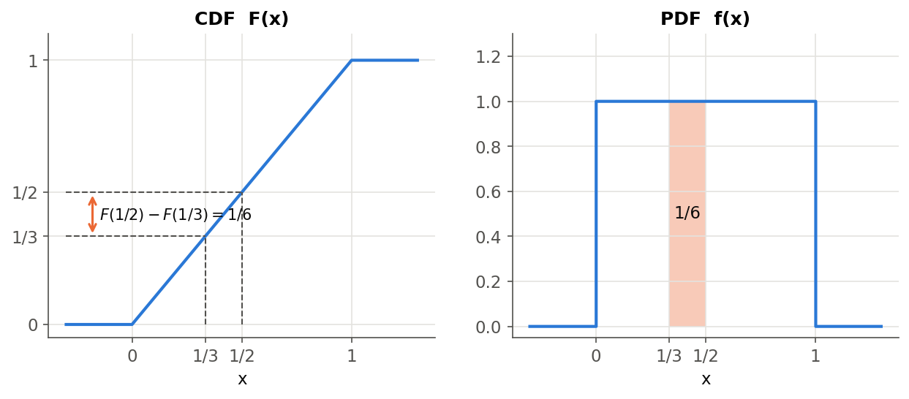
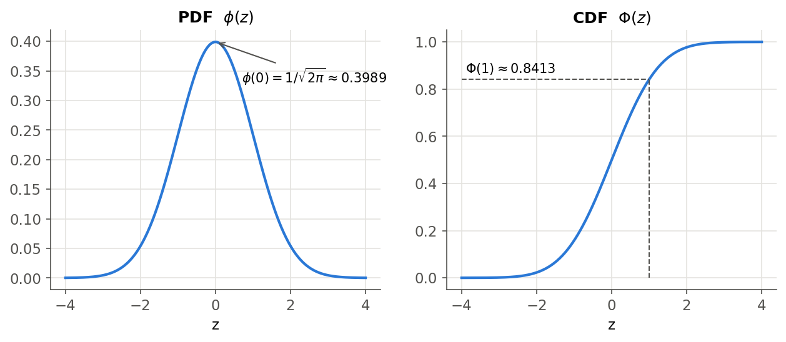
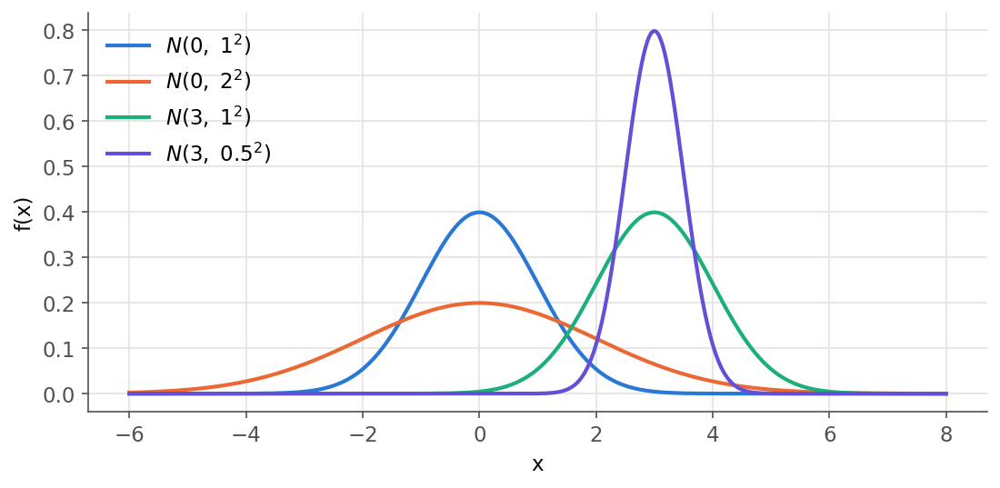
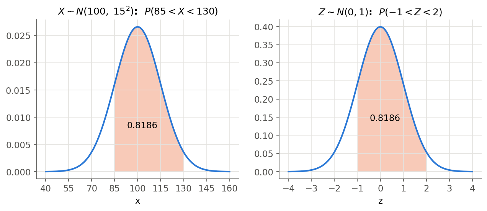
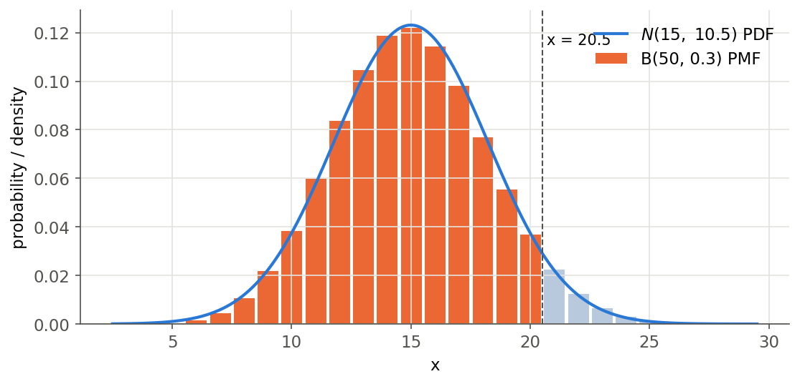
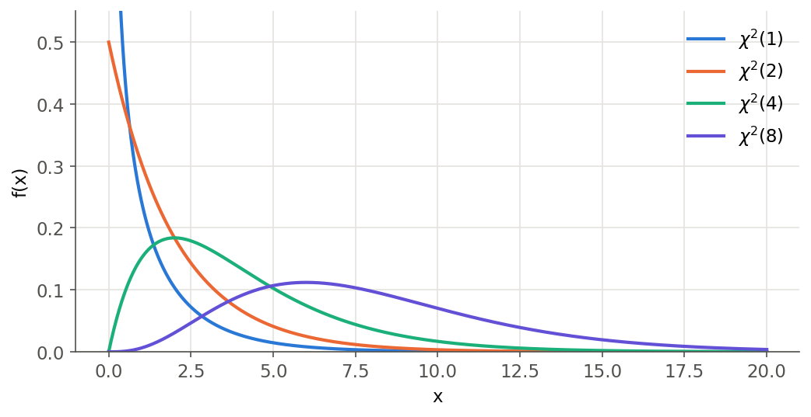
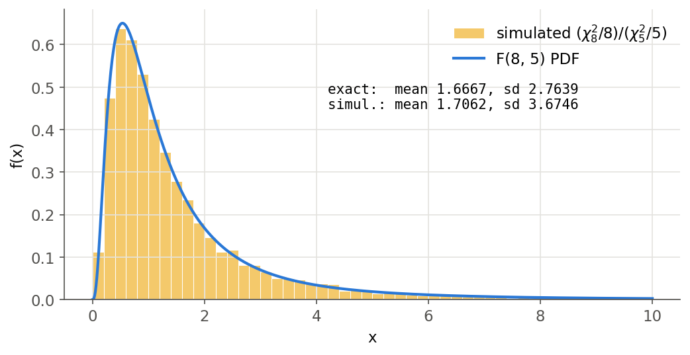
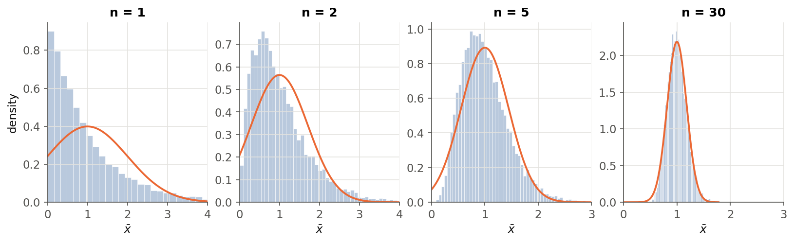

# 5강 — 연속확률변수와 정규분포

[레포지토리 안내](../../README.ko.md) | [English](Concepts_Lecture.md) | [한국어](Concepts_Lecture.ko.md)

> **최종 수정일:** 2026-11-04

> **학습 목표:**
> 1. 연속확률변수의 누적분포함수와 확률밀도함수의 관계를 설명하고, 구간의 확률을 적분으로 계산할 수 있다
> 2. 연속균등분포와 정규분포의 확률밀도함수에서 기댓값과 분산을 유도할 수 있다
> 3. 정규분포를 표준화하여 정규분포표나 R의 `pnorm()`으로 확률과 분위수를 구할 수 있다
> 4. 이항분포의 정규 근사를 연속성 수정과 함께 적용하고 그 적용 조건을 설명할 수 있다
> 5. 카이제곱 분포, t 분포, F 분포를 표준정규분포로부터 정의하고 자유도에 따른 모양을 비교할 수 있다
> 6. 중심극한정리의 조건과 내용을 설명하고 표본평균의 근사 분포를 구할 수 있다

---

## 목차

- [1. 연속확률변수](#1-연속확률변수)
  - [1.1 정의와 예](#11-정의와-예)
  - [1.2 누적분포함수](#12-누적분포함수)
  - [1.3 확률밀도함수](#13-확률밀도함수)
  - [1.4 기댓값과 분산](#14-기댓값과-분산)
- [2. 대표적인 연속확률분포](#2-대표적인-연속확률분포)
- [3. 연속균등분포](#3-연속균등분포)
  - [3.1 확률밀도함수와 누적분포함수](#31-확률밀도함수와-누적분포함수)
  - [3.2 기댓값과 분산](#32-기댓값과-분산)
- [4. 표준정규분포](#4-표준정규분포)
  - [4.1 확률밀도함수](#41-확률밀도함수)
  - [4.2 기댓값과 분산](#42-기댓값과-분산)
  - [4.3 누적분포함수와 정규분포표](#43-누적분포함수와-정규분포표)
- [5. 정규분포](#5-정규분포)
  - [5.1 확률밀도함수와 모수의 의미](#51-확률밀도함수와-모수의-의미)
  - [5.2 기댓값과 분산](#52-기댓값과-분산)
  - [5.3 선형변환과 표준화](#53-선형변환과-표준화)
  - [5.4 확률과 분위수의 계산](#54-확률과-분위수의-계산)
- [6. 이항분포의 정규 근사](#6-이항분포의-정규-근사)
  - [6.1 근사의 내용과 조건](#61-근사의-내용과-조건)
  - [6.2 연속성 수정](#62-연속성-수정)
- [7. 정규분포에서 유도되는 분포](#7-정규분포에서-유도되는-분포)
  - [7.1 카이제곱 분포](#71-카이제곱-분포)
  - [7.2 카이제곱 분포의 가법성과 자유도](#72-카이제곱-분포의-가법성과-자유도)
  - [7.3 t 분포](#73-t-분포)
  - [7.4 F 분포](#74-f-분포)
- [8. 중심극한정리](#8-중심극한정리)
  - [8.1 정리의 내용](#81-정리의-내용)
  - [8.2 성립 조건](#82-성립-조건)
  - [8.3 시뮬레이션으로 본 중심극한정리](#83-시뮬레이션으로-본-중심극한정리)
  - [8.4 의미와 한계](#84-의미와-한계)
- [9. R에서 연속확률분포 다루기](#9-r에서-연속확률분포-다루기)
- [요약](#요약)
- [점검 문제](#점검-문제)
- [참고 문헌](#참고-문헌)

---

<br>

## 1. 연속확률변수

3강은 확률변수를 표본공간의 각 결과에 실수를 대응시키는 함수로 정의했고, 4강은 가능한 값을 하나씩 셀 수 있는 이산확률변수의 분포를 다루었다. 이 강의는 값이 실수 구간에 연속적으로 퍼져 있는 연속확률변수를 다룬다. 키, 몸무게, 대기 시간, 측정 오차처럼 측정으로 얻는 양이 대표적인 예이다.

### 1.1 정의와 예

> **용어 정의:** **연속확률변수(continuous random variable)** 는 비가산 무한(uncountably infinite) 표본공간 $\mathcal{S}$에서 실수 집합 $\mathbb{R}$로 가는 함수 $X(\cdot) : \mathcal{S} \to \mathbb{R}$이다. 비가산 무한 집합은 자연수와 일대일로 대응시킬 수 없을 만큼 원소가 많은 집합이며, 실수 구간 $(0, 1]$이 대표적인 예이다.

확률변수가 이산인지 연속인지는 현상 자체보다 그 결과를 실수에 대응시키는 방식으로 정해진다. 사람의 키를 측정한 실수 값 그대로 기록하면 연속확률변수이지만, 1cm 단위로 반올림하여 정수로 기록하면 가능한 값을 셀 수 있으므로 이산확률변수가 된다.

> **참고:** 표본공간이 비가산 무한이라는 조건만으로 연속확률변수가 되지는 않는다. 구간 $(0, 1]$에서 고른 수 $\theta$에 대해 $\theta > 1/2$이면 $X(\theta) = 1$, 그 밖에는 $X(\theta) = 0$으로 정하면 $X$는 두 값만 갖는 이산확률변수이다. 엄밀하게는 어떤 함수 $f \geq 0$가 있어 모든 $x$에 대해 $P(X \leq x) = \int_{-\infty}^{x} f(t)\,dt$가 성립할 때 $X$를 연속확률변수라 하며 [1], 이 강의에서 다루는 연속확률변수는 모두 이 조건을 만족한다.

가장 단순한 예는 구간 $(0, 1]$에서 수 $\theta$를 고르고 $X(\theta) = \theta$로 두는 확률변수이다. 어떤 값의 $\theta$든 같은 정도로 일어날 법하다(equally likely)고 하자. 그러면 $\theta$가 어떤 구간에 들어갈 확률은 그 구간의 길이에 비례하고, 전체 구간의 길이가 1이므로 확률은 구간의 길이와 같다.

$$
P\left(0 < \theta \leq \tfrac{1}{2}\right) = \tfrac{1}{2}, \qquad P\left(\tfrac{1}{3} < \theta \leq \tfrac{1}{2}\right) = \tfrac{1}{2} - \tfrac{1}{3} = \tfrac{1}{6}, \qquad P\left(\theta = \tfrac{1}{\sqrt{2}}\right) = 0
$$

한 점 $\theta = 1/\sqrt{2}$는 길이가 0인 구간이므로 확률이 0이다. 확률이 0이라는 것은 그 결과가 불가능하다는 뜻이 아니다. $\theta$는 반드시 어떤 값을 갖지만, 미리 정한 특정한 값과 정확히 일치할 확률은 0이다. 그래서 연속확률변수에서는 한 점의 확률이 아니라 **구간의 확률**을 다룬다.

### 1.2 누적분포함수

> **용어 정의:** 확률변수 $X$의 **누적분포함수(cumulative distribution function, CDF)** 는 $F_X(x) \equiv P(X \leq x)$이다. 분포함수(distribution function)라고도 부른다.

$a < b$일 때 사건 $\{X \leq b\}$는 서로소인 두 사건 $\{X \leq a\}$와 $\{a < X \leq b\}$의 합사건이므로, 확률의 덧셈 법칙에 의해 다음이 성립한다.

$$
F_X(b) - F_X(a) = P(a < X \leq b)
$$

누적분포함수는 다음 성질을 갖는다.

- 양 끝의 극한은 $F_X(-\infty) \equiv \lim_{x \to -\infty} F_X(x) = 0$, $F_X(\infty) \equiv \lim_{x \to \infty} F_X(x) = 1$이다.
- $F_X$는 $x$에 대해 감소하지 않는(non-decreasing) 함수이다. $a < b$이면 $F_X(b) - F_X(a) = P(a < X \leq b) \geq 0$이기 때문이다.
- $F_X$는 오른쪽 연속(right-continuous)이며, 연속확률변수의 $F_X$는 모든 점에서 연속이다.

이 성질은 3강의 이산확률변수에서도 똑같이 성립한다. 차이는 그래프의 모양에 있다. 이산확률변수의 누적분포함수는 값이 있는 점마다 뛰어오르는 계단 모양이고, 연속확률변수의 누적분포함수는 끊어짐 없이 이어진 곡선이다.

### 1.3 확률밀도함수

> **용어 정의:** 연속확률변수 $X$의 **확률밀도함수(probability density function, PDF)** 는 누적분포함수의 도함수 $f_X(x) \equiv F_X'(x) = \dfrac{d}{dx} F_X(x)$이다.

$f = F'$, $F(-\infty) = 0$, $F(\infty) = 1$로부터 다음 기본 항등식을 얻는다. 아래에서는 첨자 $X$를 생략한다.

$$
\int_{-\infty}^{\infty} f(x)\,dx = \int_{-\infty}^{\infty} F'(x)\,dx = F(\infty) - F(-\infty) = 1
$$

$$
\int_{-\infty}^{x} f(t)\,dt = F(x) - F(-\infty) = F(x) = P(X \leq x)
$$

$$
\int_{a}^{b} f(x)\,dx = F(b) - F(a) = P(a < X \leq b)
$$

$$
\int_{a}^{a} f(x)\,dx = F(a) - F(a) = 0 = P(X = a)
$$

> **[미적분학]** 미적분학의 기본정리는 $F' = f$이고 $f$가 연속이면 $\int_a^b f(x)\,dx = F(b) - F(a)$임을 말한다. 위 항등식은 이 정리를 누적분포함수에 적용한 결과이며, 구간의 확률이 그 구간에서 확률밀도함수 곡선 아래의 넓이와 같다는 뜻이다.

마지막 식처럼 연속확률변수는 한 점의 확률이 0이므로, 구간의 끝점을 포함하는지는 확률에 영향을 주지 않는다. 즉 $P(a < X < b) = P(a \leq X < b) = P(a < X \leq b) = P(a \leq X \leq b)$이다. 이산확률변수에서는 끝점의 확률이 0이 아닐 수 있으므로 이 등식이 일반적으로 성립하지 않는다.

> **주의:** 확률밀도함수의 값 $f(x)$ 자체는 확률이 아니다. 충분히 작은 폭 $\Delta x$에 대해 $P(x < X \leq x + \Delta x) \approx f(x)\,\Delta x$이므로 $f(x)$는 단위 길이당 확률, 즉 확률의 밀도이다. 따라서 $f(x)$는 1보다 클 수 있다. 예를 들어 구간 $(0, 0.5]$의 균등분포는 그 구간에서 $f(x) = 2$이다.

1.1절의 예 $X(\theta) = \theta$의 누적분포함수와 확률밀도함수는 다음과 같다.

$$
F(x) = \begin{cases} 0, & x \leq 0 \\ x, & 0 < x \leq 1 \\ 1, & 1 < x \end{cases} \qquad\qquad f(x) = \begin{cases} 0, & x \leq 0 \\ 1, & 0 < x \leq 1 \\ 0, & 1 < x \end{cases}
$$

$F$는 $x = 0$과 $x = 1$에서 꺾이므로 그 두 점에서는 도함수가 없다. 그러나 한 점에서의 값은 적분에 영향을 주지 않으므로 그 점의 $f$ 값은 편의상 정해도 된다. 그림 1의 왼쪽은 $F$, 오른쪽은 $f$이다. $P(1/3 < X \leq 1/2)$는 왼쪽 그래프에서는 두 높이의 차 $F(1/2) - F(1/3)$로, 오른쪽 그래프에서는 색칠한 직사각형의 넓이로 나타난다.

$$
P\left(\tfrac{1}{3} < X \leq \tfrac{1}{2}\right) = \int_{1/3}^{1/2} f(x)\,dx = \int_{1/3}^{1/2} 1\,dx = \tfrac{1}{2} - \tfrac{1}{3} = \tfrac{1}{6}
$$



*그림 1. 0과 1 사이에서 고른 수의 누적분포함수와 확률밀도함수, 색칠한 넓이는 1/3과 1/2 사이의 확률 1/6*

### 1.4 기댓값과 분산

3강에서 정의한 기댓값은 이산확률변수에서는 합으로, 연속확률변수에서는 적분으로 계산한다. 연속확률변수의 기댓값은 이산확률변수의 합에서 확률 $f(x)$를 확률 요소 $f(x)\,dx$로, 합을 적분으로 바꾼 것이다.

| 확률변수 | 기댓값 $\mu_X = E(X)$ |
|:-----|:-----|
| 이산 | $\sum_x x\,f(x)$ |
| 연속 | $\int_{-\infty}^{\infty} x\,f(x)\,dx$ |

*표 1. 이산확률변수와 연속확률변수의 기댓값*

함수 $g$에 대해서도 $E[g(X)] = \int_{-\infty}^{\infty} g(x)\,f(x)\,dx$이다. 따라서 분산은 이산의 경우와 같이 $Var(X) = E[(X - \mu)^2] = E(X^2) - \mu^2$이고, 연속확률변수에서는 $E(X^2) = \int_{-\infty}^{\infty} x^2 f(x)\,dx$로 계산한다. 표준편차는 $\sigma_X = \sqrt{Var(X)}$이다.

> **주의:** 기댓값은 $\int_{-\infty}^{\infty} |x|\,f(x)\,dx < \infty$일 때만 정의된다. 7.3절의 자유도 1인 t 분포(코시 분포)는 이 적분이 발산하므로 기댓값이 존재하지 않는다.

---

<br>

## 2. 대표적인 연속확률분포

자주 쓰는 연속확률분포와 그 표기는 표 2와 같다. 이 가운데 정규분포가 가장 중요하며, 카이제곱 분포, t 분포, F 분포는 6강 가설검정에서 검정통계량이 따르는 분포이다. 균등분포, 표준정규분포, 정규분포, 카이제곱 분포, t 분포, F 분포는 3절부터 자세히 다루고, 지수분포, 감마분포, 베타분포는 아래에 정의와 쓰임만 정리한다 [1].

| 분포 | 표기 | 확률밀도함수 또는 정의 | 기댓값 | 분산 |
|:-----|:-----|:-----|:-----|:-----|
| 균등분포 | $X \sim U(a, b)$ | $\frac{1}{b-a}$, $a < x \leq b$ | $\frac{a+b}{2}$ | $\frac{(b-a)^2}{12}$ |
| 지수분포 | $X \sim Exp(\lambda)$ | $\lambda e^{-\lambda x}$, $x > 0$ | $\frac{1}{\lambda}$ | $\frac{1}{\lambda^2}$ |
| 감마분포 | $X \sim \Gamma(\alpha, \beta)$ | $\frac{x^{\alpha-1} e^{-x/\beta}}{\Gamma(\alpha)\,\beta^{\alpha}}$, $x > 0$ | $\alpha\beta$ | $\alpha\beta^2$ |
| 베타분포 | $X \sim Beta(\alpha, \beta)$ | $\frac{x^{\alpha-1}(1-x)^{\beta-1}}{B(\alpha, \beta)}$, $0 < x < 1$ | $\frac{\alpha}{\alpha+\beta}$ | $\frac{\alpha\beta}{(\alpha+\beta)^2(\alpha+\beta+1)}$ |
| 표준정규분포 | $Z \sim N(0, 1)$ | $\frac{1}{\sqrt{2\pi}} e^{-z^2/2}$ | $0$ | $1$ |
| 정규분포 | $X \sim N(\mu, \sigma^2)$ | $\frac{1}{\sqrt{2\pi}\,\sigma} e^{-(x-\mu)^2/(2\sigma^2)}$ | $\mu$ | $\sigma^2$ |
| 카이제곱 분포 | $\sum_{i=1}^{n} Z_i^2 \sim \chi^2(n)$ | 독립인 표준정규 확률변수 $n$개의 제곱합 | $n$ | $2n$ |
| t 분포 | $T \equiv \frac{Z}{\sqrt{Y/\nu}} \sim t(\nu)$ | $Z \sim N(0,1)$과 독립인 $Y \sim \chi^2(\nu)$로 만든 비 | $0$ ($\nu > 1$) | $\frac{\nu}{\nu-2}$ ($\nu > 2$) |
| F 분포 | $F \equiv \frac{U/\nu_1}{V/\nu_2} \sim F(\nu_1, \nu_2)$ | 독립인 $U \sim \chi^2(\nu_1)$, $V \sim \chi^2(\nu_2)$로 만든 비 | $\frac{\nu_2}{\nu_2-2}$ ($\nu_2 > 2$) | $\frac{2\nu_2^2(\nu_1+\nu_2-2)}{\nu_1(\nu_2-2)^2(\nu_2-4)}$ ($\nu_2 > 4$) |

*표 2. 대표적인 연속확률분포의 표기, 확률밀도함수 또는 정의, 기댓값, 분산*

- **지수분포(exponential distribution):** 4강의 포아송분포처럼 단위 시간당 평균 $\lambda$번 무작위로 일어나는 사건에서, 한 사건이 일어난 뒤 다음 사건까지의 대기 시간을 모형화한다. 이미 $s$만큼 기다렸다는 사실이 앞으로의 대기 시간에 영향을 주지 않는 무기억성(memoryless property) $P(X > s + t \mid X > s) = P(X > t)$를 갖는다.
- **감마분포(gamma distribution):** 형태 모수(shape parameter) $\alpha$와 척도 모수(scale parameter) $\beta$를 갖는다. $\alpha$가 자연수이면 서로 독립이고 평균이 $\beta$인 지수분포 확률변수 $\alpha$개의 합이 따르는 분포이다. $\Gamma(\alpha) = \int_0^\infty t^{\alpha-1} e^{-t}\,dt$는 감마함수이며, 자연수 $n$에 대해 $\Gamma(n) = (n-1)!$이다.
- **베타분포(beta distribution):** 값이 $0$과 $1$ 사이에 있으므로 비율이나 확률 자체를 모형화한다. $B(\alpha, \beta) = \Gamma(\alpha)\Gamma(\beta)/\Gamma(\alpha+\beta)$는 베타함수이며, $\alpha = \beta = 1$이면 $U(0, 1)$과 같다.

> **주의:** 감마분포의 두 번째 모수를 척도 $\beta$로 쓰는 교재와 비율(rate) $1/\beta$로 쓰는 교재가 있다. 표 2는 척도를 쓴다. R의 `dgamma(x, shape, rate)`는 세 번째 위치의 인수가 비율이므로, 척도를 주려면 `dgamma(x, shape = 2, scale = 3)`처럼 인수 이름을 붙인다.

---

<br>

## 3. 연속균등분포

### 3.1 확률밀도함수와 누적분포함수

**연속균등분포(continuous uniform distribution)** 는 구간 $(a, b]$ 안의 모든 값이 같은 정도로 일어날 법한 분포이며 $X \sim U(a, b)$로 쓴다. 이 강의에서는 줄여서 균등분포라 부른다. 1.1절의 예는 $a = 0$, $b = 1$인 경우이다.

$$
f(x) = \begin{cases} \dfrac{1}{b-a}, & a < x \leq b \\ 0, & \text{otherwise} \end{cases} \qquad\qquad F(x) = \begin{cases} 0, & x \leq a \\ \dfrac{x-a}{b-a}, & a < x \leq b \\ 1, & x > b \end{cases}
$$

확률밀도함수의 높이 $1/(b-a)$는 전체 넓이 $(b-a) \times \frac{1}{b-a} = 1$이 되도록 정해진 값이다. 누적분포함수는 $a$에서 $b$까지 기울기가 $1/(b-a)$인 직선이다. 구간 안의 두 점 $x_1 < x_2$에 대해

$$
P(x_1 < X \leq x_2) = F(x_2) - F(x_1) = \frac{x_2 - x_1}{b - a}
$$

이므로, 확률은 구간의 위치와 관계없이 길이에만 비례한다. 끝점의 포함 여부는 확률에 영향을 주지 않으므로 $U(a, b)$를 $a < x < b$로 정의해도 같은 분포이다.

예를 들어 버스가 정확히 10분 간격으로 오고 정류장에 도착하는 시각이 무작위이면, 대기 시간은 $X \sim U(0, 10)$(분)으로 볼 수 있다. 7분 넘게 기다릴 확률은 $P(X > 7) = (10 - 7)/10 = 0.3$이다.

### 3.2 기댓값과 분산

$X \sim U(a, b)$의 평균이 $\mu = (a+b)/2$이고 표준편차가 $\sigma = (b-a)/(2\sqrt{3})$임을 보인다. 먼저 기댓값은 다음과 같다.

$$
E(X) = \int_a^b \frac{x}{b-a}\,dx = \frac{1}{b-a}\left[\frac{x^2}{2}\right]_a^b = \frac{b^2 - a^2}{2(b-a)} = \frac{(b-a)(b+a)}{2(b-a)} = \frac{a+b}{2}
$$

같은 방법으로 $E(X^2)$를 구할 때는 $b^3 - a^3 = (b-a)(b^2 + ab + a^2)$을 쓴다.

$$
E(X^2) = \int_a^b \frac{x^2}{b-a}\,dx = \frac{b^3 - a^3}{3(b-a)} = \frac{b^2 + ab + a^2}{3}
$$

따라서 분산은 다음과 같다. 두 분수를 통분하면 분자가 $4(b^2 + ab + a^2) - 3(a^2 + 2ab + b^2) = b^2 - 2ab + a^2$이 된다.

$$
Var(X) = E(X^2) - E(X)^2 = \frac{b^2 + ab + a^2}{3} - \left(\frac{a+b}{2}\right)^2 = \frac{b^2 - 2ab + a^2}{12} = \frac{(b-a)^2}{12}
$$

표준편차는 $\sigma = \sqrt{(b-a)^2/12} = (b-a)/\sqrt{12} = (b-a)/(2\sqrt{3})$이다. 평균은 구간의 중점이고, 분산은 구간의 위치와 관계없이 길이에만 의존한다. 버스 예에서는 $E(X) = 5$분, $\sigma = 10/(2\sqrt{3}) \approx 2.887$분이다.

---

<br>

## 4. 표준정규분포

### 4.1 확률밀도함수

**표준정규분포(standard normal distribution)** 를 따르는 확률변수는 보통 $Z$로 쓰고 $Z \sim N(0, 1)$로 표기한다. 그 확률밀도함수에는 흔히 기호 $\phi$를 쓴다.

$$
\phi(z) = \frac{1}{\sqrt{2\pi}}\,e^{-\frac{1}{2}z^2}, \qquad -\infty < z < \infty
$$

곡선은 $z = 0$에서 가장 높고($\phi(0) = 1/\sqrt{2\pi} \approx 0.3989$), $0$을 중심으로 좌우 대칭인 종 모양이며, $z = \pm 1$에서 굽은 방향이 바뀐다(변곡점). $|z|$가 커지면 $e^{-z^2/2}$가 빠르게 0에 가까워지므로 확률의 대부분이 $-3$과 $3$ 사이에 모인다.

전체 넓이가 1이라는 사실은 다음과 같이 보인다. $I = \int_{-\infty}^{\infty} e^{-z^2/2}\,dz$라 하고 $I$를 두 번 곱한 이중적분을 극좌표 $x = r\cos\theta$, $y = r\sin\theta$($dx\,dy = r\,dr\,d\theta$)로 바꾸면 다음을 얻는다.

$$
I^2 = \int_{-\infty}^{\infty}\int_{-\infty}^{\infty} e^{-(x^2 + y^2)/2}\,dx\,dy = \int_0^{2\pi}\int_0^{\infty} e^{-r^2/2}\,r\,dr\,d\theta = 2\pi\left[-e^{-r^2/2}\right]_0^{\infty} = 2\pi
$$

따라서 $I = \sqrt{2\pi}$이고 $\int_{-\infty}^{\infty}\phi(z)\,dz = I/\sqrt{2\pi} = 1$이다. 이 적분을 가우스 적분(Gaussian integral)이라 한다.

### 4.2 기댓값과 분산

$z\,\phi(z)$는 $z$의 부호를 바꾸면 값의 부호도 바뀌는 기함수이고 그 적분이 수렴하므로, 양쪽 넓이가 상쇄되어 평균은 0이다.

$$
\mu = E(Z) = \int_{-\infty}^{\infty} z\,\phi(z)\,dz = 0
$$

$E(Z^2)$는 부분적분으로 구한다. $\phi'(z) = -z\,\phi(z)$이므로 $u = z$, $dv = z\,\phi(z)\,dz$로 두면 $v = -\phi(z)$이다. $|z| \to \infty$일 때 $z\,\phi(z) \to 0$이므로 경계항은 0이다.

$$
E(Z^2) = \int_{-\infty}^{\infty} z \cdot z\,\phi(z)\,dz = \Big[-z\,\phi(z)\Big]_{-\infty}^{\infty} + \int_{-\infty}^{\infty} \phi(z)\,dz = 0 + 1 = 1
$$

따라서 $Var(Z) = E(Z^2) - \mu^2 = 1$이고 $\sigma(Z) = 1$이다. 같은 부분적분을 $u = z^3$으로 한 번 더 적용하면 $E(Z^4) = 3E(Z^2) = 3$이며, 이 값은 7.1절에서 쓴다.

### 4.3 누적분포함수와 정규분포표

표준정규분포의 누적분포함수는 기호 $\Phi$로 쓴다.

$$
\Phi(z) = P(Z \leq z) = \frac{1}{\sqrt{2\pi}}\int_{-\infty}^{z} e^{-\frac{1}{2}t^2}\,dt
$$



*그림 2. 표준정규분포의 확률밀도함수와 누적분포함수*

$\Phi$는 다음 성질을 갖는다.

- $\Phi(0) = 0.5$이다. 곡선이 0을 중심으로 대칭이기 때문이다.
- $\Phi(-z) = 1 - \Phi(z)$이다. 대칭성에 의해 $P(Z \leq -z) = P(Z \geq z)$이기 때문이다.
- $P(|Z| \leq z) = \Phi(z) - \Phi(-z) = 2\Phi(z) - 1$이다. 이 식으로 $P(|Z| \leq 1) \approx 0.6827$, $P(|Z| \leq 2) \approx 0.9545$, $P(|Z| \leq 3) \approx 0.9973$을 얻는다. 정규분포에서 평균으로부터 표준편차 1, 2, 3배 안에 각각 약 68%, 95%, 99.7%가 들어간다는 이 사실을 68-95-99.7 규칙이라 한다.

$e^{-t^2/2}$의 원시함수는 초등함수로 나타낼 수 없으므로 $\Phi(z)$에는 닫힌 식이 없다. 그래서 값을 수치적으로 계산한다. 예를 들어 $e^{-t^2/2} = \sum_{k=0}^{\infty} (-t^2/2)^k/k!$를 항별로 $0$부터 $z$까지 적분하면 다음 급수를 얻는다.

$$
\Phi(z) = \frac{1}{2} + \frac{1}{\sqrt{2\pi}}\sum_{k=0}^{\infty} \frac{(-1)^k\,z^{2k+1}}{2^k\,k!\,(2k+1)}
$$

$z = 1$에서 이 급수의 처음 21개 항을 더하면 $\Phi(1) = 0.8413447$을 얻는다. 중고등학교 교과서 뒤에 실린 정규분포표도 이런 수치 계산으로 만든 것이며, R에서는 `pnorm()`이 같은 값을 계산한다.

**정규분포표(standard normal table)** 는 $z = 0.00$부터 $3.09$까지의 $\Phi(z)$를, 행에는 $z$의 소수 첫째 자리까지를, 열에는 소수 둘째 자리를 두어 배열한 표이다. 표 3은 그 가운데 몇 행이다.

| $z$ | 0.00 | 0.01 | 0.02 | 0.03 | 0.04 | 0.05 | 0.06 | 0.07 | 0.08 | 0.09 |
|:-----|:-----|:-----|:-----|:-----|:-----|:-----|:-----|:-----|:-----|:-----|
| 0.6 | 0.7257 | 0.7291 | 0.7324 | 0.7357 | 0.7389 | 0.7422 | 0.7454 | 0.7486 | 0.7517 | 0.7549 |
| 0.9 | 0.8159 | 0.8186 | 0.8212 | 0.8238 | 0.8264 | 0.8289 | 0.8315 | 0.8340 | 0.8365 | 0.8389 |
| 1.0 | 0.8413 | 0.8438 | 0.8461 | 0.8485 | 0.8508 | 0.8531 | 0.8554 | 0.8577 | 0.8599 | 0.8621 |
| 1.2 | 0.8849 | 0.8869 | 0.8888 | 0.8907 | 0.8925 | 0.8944 | 0.8962 | 0.8980 | 0.8997 | 0.9015 |
| 1.5 | 0.9332 | 0.9345 | 0.9357 | 0.9370 | 0.9382 | 0.9394 | 0.9406 | 0.9418 | 0.9429 | 0.9441 |
| 2.0 | 0.9772 | 0.9778 | 0.9783 | 0.9788 | 0.9793 | 0.9798 | 0.9803 | 0.9808 | 0.9812 | 0.9817 |
| 2.1 | 0.9821 | 0.9826 | 0.9830 | 0.9834 | 0.9838 | 0.9842 | 0.9846 | 0.9850 | 0.9854 | 0.9857 |

*표 3. 정규분포표의 일부, 칸의 값은 Φ(행 + 열)*

표를 읽는 방법은 다음과 같다.

- $\Phi(1.25)$는 1.2 행과 0.05 열이 만나는 칸의 값 0.8944이다.
- 음수는 대칭성을 쓴다. $\Phi(-1.25) = 1 - \Phi(1.25) = 1 - 0.8944 = 0.1056$이다.
- 표에 없는 소수 셋째 자리는 이웃한 두 값 사이를 선형 보간한다. $\Phi(2.125) \approx \frac{1}{2}\{\Phi(2.12) + \Phi(2.13)\} = \frac{1}{2}(0.9830 + 0.9834) = 0.9832$이다.

검정과 구간 추정에서 자주 쓰는 값은 표 4와 같다. 오른쪽 꼬리 확률이 $\alpha$인 점, 즉 $P(Z > z_\alpha) = \alpha$인 $z_\alpha$를 위쪽 $\alpha$ 분위수라 하며, $z_{0.05} = 1.645$, $z_{0.025} = 1.960$, $z_{0.005} = 2.576$이다.

| $z$ | $\Phi(z)$ | $1 - \Phi(z)$ | $2\{1 - \Phi(z)\}$ |
|:-----|:-----|:-----|:-----|
| 0.500 | 0.6915 | 0.3085 | 0.6171 |
| 1.000 | 0.8413 | 0.1587 | 0.3173 |
| 1.282 | 0.9001 | 0.0999 | 0.1998 |
| 1.645 | 0.9500 | 0.0500 | 0.1000 |
| 1.960 | 0.9750 | 0.0250 | 0.0500 |
| 2.000 | 0.9772 | 0.0228 | 0.0455 |
| 2.326 | 0.9900 | 0.0100 | 0.0200 |
| 2.576 | 0.9950 | 0.0050 | 0.0100 |
| 3.000 | 0.9987 | 0.0013 | 0.0027 |

*표 4. 자주 쓰는 z 값의 누적 확률, 오른쪽 꼬리 확률, 양쪽 꼬리 확률*

---

<br>

## 5. 정규분포

### 5.1 확률밀도함수와 모수의 의미

**정규분포(normal distribution)** 는 평균 $\mu$와 분산 $\sigma^2$ 두 모수로 정해지며 $X \sim N(\mu, \sigma^2)$로 쓴다. 가우스 분포(Gaussian distribution)라고도 한다.

$$
f(x) = \frac{1}{\sqrt{2\pi}\,\sigma}\exp\left[-\frac{(x-\mu)^2}{2\sigma^2}\right], \qquad -\infty < x < \infty
$$

- **$\mu$는 위치 모수이다.** 곡선의 대칭축이자 가장 높은 점의 위치이며, $\mu$를 바꾸면 곡선이 모양을 유지한 채 좌우로 평행이동한다.
- **$\sigma$는 척도 모수이다.** 변곡점이 $\mu \pm \sigma$에 있고 가장 높은 점의 높이가 $1/(\sqrt{2\pi}\,\sigma)$이다. $\sigma$가 두 배가 되면 곡선의 폭은 두 배, 높이는 절반이 되어 넓이 1이 유지된다.



*그림 3. 평균과 표준편차에 따른 정규분포 확률밀도함수의 위치와 퍼짐*

측정 오차나 키처럼 서로 독립인 작은 요인이 많이 더해져 정해지는 양은 대체로 정규분포에 가깝다. 8절의 중심극한정리가 그 이유를 설명한다.

> **주의:** $N(\mu, \sigma^2)$의 두 번째 자리는 분산이다. 따라서 $N(0, 4)$는 표준편차가 2인 정규분포이다. 그런데 두 번째 자리에 표준편차를 써서 표준편차가 15인 분포를 $N(100, 15)$처럼 표기하는 교재도 있으므로, 두 번째 값이 분산인지 표준편차인지 문맥으로 확인해야 한다. 1\~8강은 모두 분산 표기 $N(\mu, \sigma^2)$를 쓴다. R의 `dnorm()`, `pnorm()`, `rnorm()`은 표준편차를 인수로 받는다.

### 5.2 기댓값과 분산

평균이 $\mu$라는 사실은 $E[X - \mu] = 0$을 보이면 된다. $(x - \mu)\,e^{-\frac{1}{2}(x-\mu)^2/\sigma^2}$의 원시함수는 $-\sigma^2 e^{-\frac{1}{2}(x-\mu)^2/\sigma^2}$이다(미분하여 확인할 수 있다).

$$
E[X - \mu] = \int_{-\infty}^{\infty}(x - \mu)f(x)\,dx = \frac{1}{\sqrt{2\pi}\,\sigma}\int_{-\infty}^{\infty}(x-\mu)\,e^{-\frac{1}{2}(x-\mu)^2/\sigma^2}\,dx = \frac{-\sigma^2}{\sqrt{2\pi}\,\sigma}\,e^{-\frac{1}{2}(x-\mu)^2/\sigma^2}\,\Bigg|_{-\infty}^{\infty} = 0
$$

양 끝에서 지수함수가 0으로 가므로 결과는 0이고, 따라서 $E(X) = \mu$이다.

분산은 치환 $z = (x - \mu)/\sigma$, $dx = \sigma\,dz$로 4.2절의 결과로 바꾸어 구한다.

$$
Var(X) = \int_{-\infty}^{\infty}(x-\mu)^2 f(x)\,dx = \int_{-\infty}^{\infty}\sigma^2 z^2\,\frac{1}{\sqrt{2\pi}\,\sigma}\,e^{-z^2/2}\,\sigma\,dz = \sigma^2\int_{-\infty}^{\infty} z^2\phi(z)\,dz = \sigma^2
$$

즉 $Var(X) \equiv E[(X - \mu)^2] = \sigma^2$이므로 모수 $\sigma$는 실제로 표준편차이다. 같은 치환으로 $\int f(x)\,dx = \int \phi(z)\,dz = 1$도 확인된다.

### 5.3 선형변환과 표준화

정규분포를 따르는 확률변수에 상수를 곱하고 더해도 정규분포를 따른다. $d \neq 0$일 때 다음이 성립한다.

$$
X \sim N(\mu, \sigma^2),\quad Y = c + dX \quad\Rightarrow\quad Y \sim N(c + d\mu,\ d^2\sigma^2)
$$

평균과 분산은 3강의 성질 $E(c + dX) = c + d\,E(X)$, $Var(c + dX) = d^2\,Var(X)$에서 바로 나온다. 모양이 정규분포로 유지된다는 사실은 누적분포함수로 보인다. $d > 0$이면

$$
F_Y(y) = P(c + dX \leq y) = P\left(X \leq \frac{y - c}{d}\right) = F_X\left(\frac{y - c}{d}\right)
$$

이고, 양변을 $y$로 미분하면 연쇄 법칙에 의해

$$
f_Y(y) = \frac{1}{d}\,f_X\left(\frac{y - c}{d}\right) = \frac{1}{\sqrt{2\pi}\,d\sigma}\exp\left[-\frac{(y - c - d\mu)^2}{2d^2\sigma^2}\right]
$$

이므로 $N(c + d\mu, d^2\sigma^2)$의 확률밀도함수이다. $d < 0$이면 부등호의 방향이 바뀌어 $F_Y(y) = 1 - F_X((y-c)/d)$가 되고, 미분하면 $1/d$ 대신 $1/|d|$가 나와 같은 결론을 얻는다.

특히 $c = -\mu/\sigma$, $d = 1/\sigma$로 두면 **표준화(standardization)** 를 얻는다.

$$
X \sim N(\mu, \sigma^2),\quad Z = \frac{X - \mu}{\sigma} \quad\Rightarrow\quad Z \sim N(0, 1)
$$

$$
E(Z) = E\left(\frac{X - \mu}{\sigma}\right) = \frac{1}{\sigma}E(X - \mu) = \frac{1}{\sigma}(\mu - \mu) = 0, \qquad Var(Z) = Var\left(\frac{X - \mu}{\sigma}\right) = \frac{1}{\sigma^2}Var(X - \mu) = \frac{\sigma^2}{\sigma^2} = 1
$$

값 $z = (x - \mu)/\sigma$는 $x$가 평균에서 표준편차 몇 개만큼 떨어져 있는지를 나타내며 **표준점수(standard score)** 또는 z 점수라 한다. 표준화 덕분에 모든 정규분포의 확률을 하나의 함수 $\Phi$로 계산할 수 있다.

$$
P(a < X < b) = P\left(\frac{a - \mu}{\sigma} < Z < \frac{b - \mu}{\sigma}\right) = \Phi\left(\frac{b - \mu}{\sigma}\right) - \Phi\left(\frac{a - \mu}{\sigma}\right)
$$

> **핵심:** 정규분포의 확률 계산은 언제나 같은 두 단계로 이루어진다. 구간의 끝점을 $z = (x - \mu)/\sigma$로 표준화하고, 표준정규분포의 누적분포함수 $\Phi$의 차를 구한다.

### 5.4 확률과 분위수의 계산

**예 1 (확률).** 어떤 지능검사 점수가 $X \sim N(100, 15^2)$를 따른다고 하자. 점수가 85점과 130점 사이일 확률은 다음과 같다. 끝점을 표준화하면 $(85 - 100)/15 = -1$, $(130 - 100)/15 = 2$이다.

$$
P(85 < X < 130) = P(-1 < Z < 2) = \Phi(2) - \Phi(-1) = \Phi(2) - \{1 - \Phi(1)\} = 0.9772 - (1 - 0.8413) = 0.8185
$$

표의 값을 반올림하지 않으면 0.8186이다. 그림 4처럼 왼쪽의 넓이와 표준화한 오른쪽의 넓이는 같다.



*그림 4. N(100, 15²)에서 85와 130 사이의 넓이와 표준화한 N(0, 1)에서 -1과 2 사이의 넓이*

**예 2 (분위수).** 같은 검사에서 상위 5%에 들려면 몇 점 이상이어야 하는가? 구하는 점수 $x$는 $P(X > x) = 0.05$를 만족한다. 표준화하면 $P(Z > (x - 100)/15) = 0.05$이므로 $(x - 100)/15 = z_{0.05} = 1.645$이다.

$$
x = \mu + z_{0.05}\,\sigma = 100 + 1.645 \times 15 = 124.7
$$

일반적으로 누적 확률 $p$에 해당하는 값은 $x = \mu + z\,\sigma$이며 $z$는 $\Phi(z) = p$인 값이다. 확률에서 값을 거꾸로 구하는 이 계산을 분위수 계산이라 하며, R에서는 `qnorm()`이 맡는다(9절).

---

<br>

## 6. 이항분포의 정규 근사

### 6.1 근사의 내용과 조건

4강의 이항분포 $X \sim B(n, p)$는 성공 확률이 $p$인 독립 시행을 $n$번 했을 때의 성공 횟수이며, $E(X) = np$, $Var(X) = np(1-p)$이다. $n$이 크면 이항확률을 직접 더하는 계산이 번거롭지만, 이항분포를 표준화한 값은 정규분포에 가까워진다. 이 사실을 드무아브르-라플라스 정리(de Moivre-Laplace theorem)라 한다.

$$
X \sim B(n, p) \quad\Rightarrow\quad Z \equiv \frac{X - np}{\sqrt{np(1-p)}} \xrightarrow{d} N(0, 1) \qquad (n \to \infty,\ 0 < p < 1\ \text{고정})
$$

화살표 $\xrightarrow{d}$는 **분포수렴(convergence in distribution)** 을 뜻한다. 즉 모든 $z$에서 $P(Z \leq z)$가 $\Phi(z)$로 수렴한다. 이항분포는 서로 독립인 베르누이 확률변수 $n$개의 합이므로, 이 정리는 8절 중심극한정리의 특수한 경우이다.

근사의 정확도는 $n$과 $p$에 함께 달려 있다.

- $n$이 클수록 정확하다.
- $p$가 $1/2$에 가까우면 이항분포가 좌우 대칭에 가까워 작은 $n$에서도 근사가 좋다. $p$가 0이나 1에 가까우면 분포가 한쪽으로 치우치므로 더 큰 $n$이 필요하다.
- 흔히 쓰는 경험 법칙은 $np \geq 5$이고 $n(1-p) \geq 5$일 때 근사를 쓰는 것이다(더 엄격하게 10을 기준으로 삼기도 한다). $n$이 크고 $p$가 작아 $np$가 이 기준에 못 미치면 4강의 포아송 근사가 더 적합하다.

### 6.2 연속성 수정

이항분포는 정수에만 확률이 있는 이산분포이고 정규분포는 연속분포이다. 정수 $k$의 확률 막대가 구간 $[k - 0.5, k + 0.5]$를 차지한다고 보고 그 구간의 정규분포 넓이로 근사하면 정확도가 높아진다. 이를 **연속성 수정(continuity correction)** 이라 한다. $\sigma = \sqrt{np(1-p)}$로 쓰면 표 5와 같다.

| 이항확률 | 연속성 수정을 한 정규 근사 |
|:-----|:-----|
| $P(X \leq k)$ | $\Phi\left(\frac{k + 0.5 - np}{\sigma}\right)$ |
| $P(X \geq k)$ | $1 - \Phi\left(\frac{k - 0.5 - np}{\sigma}\right)$ |
| $P(k_1 \leq X \leq k_2)$ | $\Phi\left(\frac{k_2 + 0.5 - np}{\sigma}\right) - \Phi\left(\frac{k_1 - 0.5 - np}{\sigma}\right)$ |
| $P(X = k)$ | $\Phi\left(\frac{k + 0.5 - np}{\sigma}\right) - \Phi\left(\frac{k - 0.5 - np}{\sigma}\right)$ |

*표 5. 이항확률의 연속성 수정 정규 근사*

**예.** $X \sim B(50, 0.3)$에서 $P(X \leq 20)$을 구한다. $np = 15$, $n(1-p) = 35$로 경험 법칙을 만족하고 $\sigma = \sqrt{50 \times 0.3 \times 0.7} = \sqrt{10.5} \approx 3.240$이다.

- 연속성 수정을 하면 $P(X \leq 20) \approx \Phi\left(\frac{20.5 - 15}{3.240}\right) = \Phi(1.697) \approx 0.9552$이다.
- 연속성 수정을 하지 않으면 $\Phi\left(\frac{20 - 15}{3.240}\right) = \Phi(1.543) \approx 0.9386$이다.
- 이항분포로 직접 계산한 값은 $\sum_{x=0}^{20}\binom{50}{x}0.3^x\,0.7^{50-x} \approx 0.9522$이다.

연속성 수정을 한 근사의 오차는 0.003 정도로, 수정하지 않은 근사의 오차 0.014보다 훨씬 작다. 그림 5에서 주황색 막대의 넓이 합이 정확한 확률이고, 근사는 정규 곡선 아래에서 20.5까지의 넓이이다.



*그림 5. B(50, 0.3)의 확률질량함수와 N(15, 10.5)의 확률밀도함수, 20 이하의 막대와 연속성 수정 경계 20.5*

---

<br>

## 7. 정규분포에서 유도되는 분포

이 절의 세 분포는 자연 현상을 직접 모형화하기보다, 정규 모집단에서 뽑은 표본으로 계산한 통계량의 분포로 등장한다. 표본분산은 카이제곱 분포와, 표본평균을 표본표준편차로 표준화한 값은 t 분포와, 두 표본분산의 비는 F 분포와 연결된다. 그래서 이 분포들은 6강에서 다루는 통계적 가설검정의 기반이 되며, 가설검정은 데이터로부터 결론을 이끌어 내는 데이터 과학의 핵심 도구이다.

### 7.1 카이제곱 분포

> **용어 정의:** 확률변수들이 **독립동일분포(independent and identically distributed, iid)** 를 따른다는 것은 서로 독립이고 모두 정확히 같은 확률분포를 따른다는 뜻이다. "동일한"은 비슷하다는 뜻이 아니라 분포가 완전히 같다는 뜻이다. $X_1, \ldots, X_n \overset{iid}{\sim} N(\mu, \sigma^2)$처럼 쓴다.

$Z_1, Z_2, \ldots, Z_n \overset{iid}{\sim} N(0, 1)$일 때 그 제곱합이 따르는 분포를 자유도(degrees of freedom) $n$인 **카이제곱 분포(chi-square distribution)** 라 한다.

$$
Z_1, Z_2, \ldots, Z_n \overset{iid}{\sim} N(0, 1) \quad\Rightarrow\quad \chi_n^2 \equiv Z_1^2 + Z_2^2 + \cdots + Z_n^2 \sim \chi^2(n)
$$

기호 $\chi_n^2$의 위첨자 2는 이름의 일부이고, $Z_1^2$의 위첨자 2는 제곱이라는 점에 주의한다. 자유도가 1이면 $\chi_1^2 = Z_1^2$, 즉 표준정규 확률변수 하나의 제곱이다.

확률밀도함수는 다음과 같다. 이는 감마분포 $\Gamma(n/2, 2)$와 같다.

$$
f(x) = \frac{1}{2^{n/2}\,\Gamma(n/2)}\,x^{n/2 - 1}\,e^{-x/2}, \qquad x > 0
$$

실제로는 이 식보다 다음 세 값이 더 자주 쓰인다.

$$
E[\chi_n^2] = n, \qquad Var(\chi_n^2) = 2n, \qquad \sigma(\chi_n^2) = \sqrt{2n}
$$

이 값은 정의에서 바로 유도된다. 4.2절에서 $E(Z_i^2) = 1$이므로 $n$개를 더하면 평균이 $n$이다. 또 $Var(Z_i^2) = E(Z_i^4) - \{E(Z_i^2)\}^2 = 3 - 1 = 2$이고, 독립인 확률변수의 합의 분산은 분산의 합이므로 $Var(\chi_n^2) = 2n$이다.



*그림 6. 자유도 1, 2, 4, 8인 카이제곱 분포의 확률밀도함수*

그림 6에서 카이제곱 분포의 모양은 다음과 같이 정리된다.

- 값은 항상 양수이고 오른쪽으로 꼬리가 긴 비대칭 분포이다.
- 자유도가 1이면 $x \to 0$에서 밀도가 무한히 커지고, 자유도가 2이면 $x = 0$에서 $1/2$로 시작해 감소하는 지수분포이다. 자유도가 3 이상이면 올라갔다 내려오며 최빈값이 $n - 2$에 있다.
- 자유도가 커지면 평균 $n$과 퍼짐 $\sqrt{2n}$이 커지고, 독립인 항 $n$개의 합이므로 8절의 중심극한정리에 의해 모양이 정규분포에 가까워진다.

카이제곱 분포는 7강의 분할표(contingency table) 분석에 쓰는 카이제곱 검정과 밀접하게 연결되어 있고, 다음 절처럼 표본분산의 분포를 설명한다.

### 7.2 카이제곱 분포의 가법성과 자유도

서로 독립인 카이제곱 확률변수의 합은 다시 카이제곱 분포를 따르고, 자유도는 더해진다. 이를 **가법성(additivity)** 이라 한다.

$$
X_1, X_2, \ldots, X_k\ \text{독립},\quad X_i \sim \chi^2(\nu_i) \quad\Rightarrow\quad \sum_{i=1}^{k} X_i \sim \chi^2(\nu_1 + \nu_2 + \cdots + \nu_k)
$$

정의로부터 이 성질은 자연스럽다. 각 $X_i$는 독립인 표준정규 확률변수 $\nu_i$개의 제곱합이고, $X_i$들이 서로 독립이므로 그 합은 독립인 표준정규 확률변수 $\nu_1 + \cdots + \nu_k$개의 제곱합이다.

**자유도(degrees of freedom)** 는 모집단에 관한 정보를 주는 독립적인 원천(자료)의 수이다. 자료 $n$개에서 표본평균 $\bar{X}$를 먼저 계산하면 편차 $X_i - \bar{X}$들의 합은 항상 0이므로, $n - 1$개의 편차를 알면 나머지 하나가 정해진다. 그래서 편차로 계산하는 표본분산 $S^2 = \frac{1}{n-1}\sum (X_i - \bar{X})^2$의 자유도는 $n - 1$이다. 실제로 $X_1, \ldots, X_n \overset{iid}{\sim} N(\mu, \sigma^2)$이면 다음이 성립하고, 이 통계량은 $\bar{X}$와 독립이다 [1].

$$
\frac{(n-1)S^2}{\sigma^2} = \sum_{i=1}^{n}\left(\frac{X_i - \bar{X}}{\sigma}\right)^2 \sim \chi^2(n-1)
$$

$\mu$를 알아서 $\sum (X_i - \mu)^2/\sigma^2$을 계산하면 정의에 의해 $\chi^2(n)$이다. $\mu$를 $\bar{X}$로 추정하는 데 정보 하나를 쓰므로 자유도가 1 줄어든다.

### 7.3 t 분포

> **용어 정의:** $Z \sim N(0, 1)$이고 $Y \sim \chi^2(\nu)$이며 $Y$와 $Z$가 서로 독립일 때($Y \perp Z$), $T \equiv Z / \sqrt{Y/\nu}$가 따르는 분포를 자유도 $\nu$인 **t 분포(t distribution)** 라 하고 $T \sim t(\nu)$로 쓴다.

$$
T \equiv \frac{Z}{\sqrt{Y/\nu}} \sim t(\nu), \qquad f(t) = \frac{\Gamma\left(\frac{\nu+1}{2}\right)}{\sqrt{\nu\pi}\,\Gamma\left(\frac{\nu}{2}\right)}\left(1 + \frac{t^2}{\nu}\right)^{-(\nu+1)/2}
$$

t 분포는 다음 성질을 갖는다.

- 0을 중심으로 좌우 대칭인 종 모양이지만, 표준정규분포보다 가운데가 낮고 꼬리가 두껍다. 분모 $\sqrt{Y/\nu}$가 무작위로 흔들려 가끔 작은 값이 나오면 $T$가 크게 튀기 때문이다.
- 평균은 $\nu > 1$일 때 0이고, 분산은 $\nu > 2$일 때 $\nu/(\nu - 2)$로 1보다 크다. 자유도 1인 t 분포는 코시 분포(Cauchy distribution)이며 평균이 존재하지 않는다.
- $\nu \to \infty$이면 큰 수의 법칙에 의해 $Y/\nu \to 1$이므로 $t(\nu)$는 $N(0, 1)$에 가까워진다. 자유도 30 정도면 두 분포가 상당히 비슷하다.

| 자유도 $\nu$ | 최고 높이 $f(0)$ | 위쪽 2.5% 점 $t_{0.025, \nu}$ | $P(T > 2)$ |
|:-----|:-----|:-----|:-----|
| 1 | 0.3183 | 12.706 | 0.1476 |
| 5 | 0.3796 | 2.571 | 0.0510 |
| 10 | 0.3891 | 2.228 | 0.0367 |
| 30 | 0.3956 | 2.042 | 0.0273 |
| $\infty$ ($N(0,1)$) | 0.3989 | 1.960 | 0.0228 |

*표 6. 자유도에 따른 t 분포의 최고 높이, 위쪽 2.5% 점, 꼬리 확률*

표 6에서 자유도가 작을수록 같은 꼬리 확률을 얻기 위해 더 먼 점까지 가야 한다. 이는 6강에서 모분산을 모를 때의 검정이 같은 유의수준에서 더 큰 임계값을 쓰는 이유이다.

t 분포가 중요한 이유는 정규 모집단에서 표본평균을 표준화할 때 모르는 $\sigma$ 대신 표본표준편차 $S$를 쓰면 이 분포가 나오기 때문이다. $X_1, \ldots, X_n \overset{iid}{\sim} N(\mu, \sigma^2)$이면 분자 $(\bar{X} - \mu)/(\sigma/\sqrt{n}) \sim N(0, 1)$이고, 7.2절에 의해 $(n-1)S^2/\sigma^2 \sim \chi^2(n-1)$이 분자와 독립이므로 다음이 성립한다.

$$
\frac{\bar{X} - \mu}{S/\sqrt{n}} = \frac{(\bar{X} - \mu)/(\sigma/\sqrt{n})}{\sqrt{\dfrac{(n-1)S^2/\sigma^2}{n-1}}} \sim t(n-1)
$$

이 결과는 1908년 W. S. Gosset이 "Student"라는 필명으로 발표했으며, 그래서 이 분포를 Student의 t 분포라고도 부른다 [2].

### 7.4 F 분포

> **용어 정의:** $U \sim \chi^2(\nu_1)$과 $V \sim \chi^2(\nu_2)$가 서로 독립일 때, 각각을 자유도로 나눈 비 $F \equiv (U/\nu_1)/(V/\nu_2)$가 따르는 분포를 자유도 $(\nu_1, \nu_2)$인 **F 분포(F distribution)** 라 하고 $F \sim F(\nu_1, \nu_2)$로 쓴다. $\nu_1$을 분자 자유도, $\nu_2$를 분모 자유도라 한다.

$$
U \sim \chi^2(\nu_1) \perp V \sim \chi^2(\nu_2) \quad\Rightarrow\quad F \equiv \frac{U/\nu_1}{V/\nu_2} \sim F(\nu_1, \nu_2)
$$

F 분포는 다음 성질을 갖는다.

- 값은 양수이고 오른쪽으로 꼬리가 긴 분포이다. 평균은 $\nu_2 > 2$일 때 $\nu_2/(\nu_2 - 2)$이고, 분산은 $\nu_2 > 4$일 때 표 2의 식과 같다.
- $F \sim F(\nu_1, \nu_2)$이면 $1/F \sim F(\nu_2, \nu_1)$이다. 분자와 분모를 바꾸었기 때문이다.
- $T \sim t(\nu)$이면 $T^2 \sim F(1, \nu)$이다. $T^2 = Z^2/(Y/\nu)$에서 $Z^2 \sim \chi^2(1)$이기 때문이다.
- 두 정규 모집단에서 독립인 표본을 뽑으면 $(S_1^2/\sigma_1^2)/(S_2^2/\sigma_2^2) \sim F(n_1 - 1, n_2 - 1)$이다. 그래서 F 분포는 두 분산의 비교(6강)와 7강의 분산분석(ANOVA)에 쓰인다.

그림 7은 $(\chi_8^2/8)/(\chi_5^2/5)$를 10,000번 생성한 값의 히스토그램과 $F(8, 5)$의 확률밀도함수이다. 히스토그램이 곡선을 잘 따른다. 이론적인 평균은 $5/3 = 1.6667$, 표준편차는 $\sqrt{2 \cdot 5^2 \cdot 11/(8 \cdot 3^2 \cdot 1)} = \sqrt{7.6389} = 2.7639$이고, 시뮬레이션 값은 평균 1.7062, 표준편차 3.6746이다.



*그림 7. 카이제곱 비를 10,000번 생성한 값의 히스토그램과 F(8, 5)의 확률밀도함수*

> **참고:** 시뮬레이션의 평균은 이론값에 가깝지만 표준편차는 차이가 크며, 난수를 바꾸면 이론값보다 작게 나오기도 한다. $F(8, 5)$는 분산이 유한하지만($\nu_2 = 5 > 4$), 표본분산이 안정적으로 수렴하려면 4차 적률이 유한해야 하고 F 분포의 4차 적률은 $\nu_2 > 8$일 때만 존재한다. 그래서 가끔 나오는 매우 큰 값이 표본표준편차를 크게 흔든다. 꼬리가 두꺼운 분포에서는 시뮬레이션으로 분산을 추정할 때 이 점에 주의해야 한다.

---

<br>

## 8. 중심극한정리

### 8.1 정리의 내용

중심극한정리는 모집단의 분포가 어떤 모양이든 표본평균의 분포는 표본이 커질수록 정규분포에 가까워진다는 정리이며, 통계학에서 가장 중요한 결과 가운데 하나이다. 입문 교재는 흔히 이를 평균이 $\mu$이고 표준편차 $\sigma$가 유한한 임의의 모집단에서 크기 $n$인 단순 무작위 표본(simple random sample, SRS)을 뽑으면, $n$이 클 때 표본평균 $\bar{x}$의 표본분포가 근사적으로 평균이 $\mu$이고 표준편차가 $\sigma/\sqrt{n}$인 정규분포라고 서술한다. 확률변수로 정확히 쓰면 다음과 같다 [1].

> **용어 정의:** **중심극한정리(central limit theorem, CLT)** 는 $X_1, \ldots, X_n$이 평균 $\mu$, 분산 $\sigma^2$($0 < \sigma^2 < \infty$)인 분포를 따르는 iid 확률변수일 때, 표준화한 표본평균의 분포가 $n \to \infty$에서 표준정규분포로 수렴한다는 정리이다.

$$
\frac{\bar{X}_n - \mu}{\sigma/\sqrt{n}} \xrightarrow{d} N(0, 1), \qquad \bar{X}_n = \frac{1}{n}\sum_{i=1}^{n} X_i
$$

$n$이 충분히 크면 이를 합 $S_n$과 평균 $\bar{X}$의 근사 분포로 바꾸어 쓸 수 있다. 기호 $\overset{a}{\sim}$는 근사적으로(approximately) 따른다는 뜻이다.

$$
S_n = X_1 + X_2 + \cdots + X_n \overset{a}{\sim} N(n\mu,\ n\sigma^2), \qquad \bar{X} = \frac{1}{n}\sum_{i=1}^{n} X_i \overset{a}{\sim} N\left(\mu,\ \frac{\sigma^2}{n}\right)
$$

평균과 분산 $E(S_n) = n\mu$, $Var(S_n) = n\sigma^2$, $E(\bar{X}) = \mu$, $Var(\bar{X}) = \sigma^2/n$은 기댓값의 선형성과 독립성만으로 정확히 성립한다(6강 1절). 중심극한정리가 새로 알려 주는 것은 그 분포의 **모양**이 정규분포에 가까워진다는 사실이다.

> **주의:** 표본평균의 분포를 $N(\mu, \sigma/\sqrt{n})$으로 쓰는 교재는 두 번째 자리에 표준편차를 쓴 것이다. 분산 표기로는 $N(\mu, \sigma^2/n)$이며 두 표기는 같은 분포를 가리킨다.

### 8.2 성립 조건

중심극한정리를 적용하기 전에 다음 조건을 확인한다.

- **독립성:** 관측값이 서로 독립이어야 한다. 무작위 표본이면 만족된다. 유한한 모집단에서 비복원추출하면 엄밀히 독립은 아니지만, 표본 크기가 모집단의 10% 이하 정도이면 독립으로 보아도 무방하다는 것이 흔한 경험 법칙이다.
- **동일한 분포:** 위의 기본형은 모든 $X_i$가 같은 분포를 따른다고 가정한다. 분포가 조금씩 달라도 성립하게 하는 일반화(린데베르그 조건 등)가 있지만, 각 항이 합에 기여하는 정도가 고르게 작아야 한다는 조건이 붙는다.
- **유한한 분산:** $\sigma^2 < \infty$이어야 한다. 코시 분포처럼 분산(그리고 평균)이 존재하지 않는 분포에서는 독립인 $n$개의 평균이 다시 같은 코시 분포를 따르므로, $n$을 아무리 키워도 정규분포에 가까워지지 않는다 [1].
- **충분히 큰 $n$:** 얼마나 커야 하는지는 모집단의 모양에 달려 있다. 모집단의 왜도(skewness, 비대칭의 정도)가 $\gamma$이면 $\bar{X}$의 왜도는 $\gamma/\sqrt{n}$으로 줄어든다. 예를 들어 왜도가 2인 지수분포에서 $n = 30$이면 $\bar{X}$의 왜도는 $2/\sqrt{30} \approx 0.37$로 아직 남아 있다. "$n \geq 30$"은 대략적인 경험 법칙일 뿐이며, 심하게 치우치거나 꼬리가 두꺼운 모집단은 더 큰 $n$이 필요하다.

모집단 자체가 정규분포이면 $\bar{X}$는 $n$과 관계없이 정확히 $N(\mu, \sigma^2/n)$을 따른다(6강 2절). 이 경우에는 중심극한정리가 필요하지 않다.

### 8.3 시뮬레이션으로 본 중심극한정리

그림 8은 평균과 표준편차가 모두 1이고 오른쪽으로 크게 치우친 지수분포 $Exp(1)$에서 크기 $n$인 표본을 10,000번 뽑아 계산한 표본평균의 히스토그램이다. 주황색 곡선은 중심극한정리가 주는 근사 분포 $N(1, 1/n)$이다.



*그림 8. 지수분포에서 뽑은 표본의 크기 n에 따른 표본평균의 히스토그램과 정규 근사 곡선*

$n = 1$의 히스토그램은 모집단 자체의 모양이다. $n = 2, 5$에서는 봉우리가 생기지만 아직 오른쪽으로 치우쳐 있고, $n = 30$이면 히스토그램이 정규 곡선과 거의 겹친다. 동시에 퍼짐은 $1/\sqrt{n}$에 비례하여 줄어든다.

근사의 정확도를 수치로 확인한다. $n = 30$일 때 $P(\bar{X} > 1.2)$의 정규 근사는

$$
P(\bar{X} > 1.2) \approx P\left(Z > \frac{1.2 - 1}{1/\sqrt{30}}\right) = P(Z > 1.095) = 1 - \Phi(1.095) \approx 0.1367
$$

이다. 지수분포 30개의 합은 감마분포 $\Gamma(30, 1)$을 따르므로 정확한 값은 $P(S_{30} > 36) \approx 0.1379$이며, 근사의 오차는 0.001 정도이다.

### 8.4 의미와 한계

- 중심극한정리 덕분에 근사적으로 정규분포인 분포를 다루는 것으로 통계 문제를 단순화할 수 있다.
- $n$이 크면 모집단의 모양을 몰라도 표본평균에 관한 확률을 계산할 수 있다.
- 따라서 가장 기본적인 정규분포에 근거한 분석 방법을 분명히 이해하면, 평균을 다루는 매우 다양한 종류의 데이터를 분석할 수 있다. 6강의 Z 검정과 t 검정이 그 예이다.

> **주의:** 중심극한정리는 표본평균(과 합)의 분포에 관한 정리이다. 개별 관측값이나 데이터 자체가 정규분포가 된다는 뜻이 아니며, 중앙값이나 최댓값 같은 다른 통계량에 그대로 적용되지도 않는다. 관측값이 서로 종속이거나 분산이 무한하면 성립하지 않고, 표본이 작으면서 모집단이 치우친 경우에는 근사가 부정확하다. 이런 경우에는 8강의 비모수적 방법을 고려한다.

---

<br>

## 9. R에서 연속확률분포 다루기

R은 분포마다 이름 앞에 네 가지 접두어를 붙인 함수를 제공한다.

| 접두어 | 계산하는 값 | 정규분포의 예 | 결과 |
|:-----|:-----|:-----|:-----|
| `d` | 확률밀도함수 $f(x)$ (이산분포에서는 확률질량함수) | `dnorm(0)` | 0.3989 |
| `p` | 누적분포함수 $F(x) = P(X \leq x)$ | `pnorm(1.96)` | 0.9750 |
| `q` | 분위수, 즉 $F(x) = p$인 $x$ | `qnorm(0.975)` | 1.9600 |
| `r` | 난수 생성 | `rnorm(5)` | 실행할 때마다 다름 |

*표 7. R 분포 함수의 네 가지 접두어*

| 분포 | R 이름 | 모수 인수 |
|:-----|:-----|:-----|
| 균등분포 $U(a, b)$ | `unif` | `min = a`, `max = b` |
| 지수분포 $Exp(\lambda)$ | `exp` | `rate = λ` |
| 감마분포 $\Gamma(\alpha, \beta)$ | `gamma` | `shape = α`, `scale = β` (또는 `rate = 1/β`) |
| 베타분포 $Beta(\alpha, \beta)$ | `beta` | `shape1 = α`, `shape2 = β` |
| 정규분포 $N(\mu, \sigma^2)$ | `norm` | `mean = μ`, `sd = σ` |
| 카이제곱 분포 $\chi^2(n)$ | `chisq` | `df = n` |
| t 분포 $t(\nu)$ | `t` | `df = ν` |
| F 분포 $F(\nu_1, \nu_2)$ | `f` | `df1 = ν₁`, `df2 = ν₂` |
| 이항분포 $B(n, p)$ | `binom` | `size = n`, `prob = p` |

*표 8. 연속확률분포와 이항분포의 R 함수 이름과 모수 인수*

5.4절과 6.2절의 계산을 R로 하면 다음과 같다.

```r
pnorm(130, mean = 100, sd = 15) - pnorm(85, mean = 100, sd = 15)  # P(85 < X < 130)
qnorm(0.95, mean = 100, sd = 15)                                   # 상위 5%의 경계
1 - pnorm(2.56)                                                    # P(Z > 2.56)
pnorm(2.56, lower.tail = FALSE)                                    # 같은 확률
pbinom(20, size = 50, prob = 0.3)                                  # B(50, 0.3)에서 P(X <= 20)
```

```text
[1] 0.8185946
[1] 124.6728
[1] 0.005233608
[1] 0.005233608
[1] 0.9522362
```

- 첫째 줄은 $F(130) - F(85)$를 계산한다. 정규분포 함수의 두 번째, 세 번째 인수는 평균과 **표준편차**이므로 $N(100, 15^2)$에는 `sd = 15`를 준다.
- 둘째 줄의 `qnorm(0.95, ...)`는 누적 확률이 0.95인 값, 즉 위쪽 5% 경계 124.7을 돌려준다.
- 셋째 줄과 넷째 줄은 오른쪽 꼬리 확률을 두 방법으로 구한다. `lower.tail = FALSE`는 $P(X > x)$를 직접 계산하므로 꼬리 확률이 매우 작을 때 `1 - pnorm()`보다 수치적으로 정확하다.
- 다섯째 줄은 연속성 수정을 한 근사 0.9552와 비교할 정확한 이항확률이다.

> **참고:** 이 단원의 실습 코드 일부는 `cont.spdf()`(여러 분포의 확률밀도함수 그리기)와 `norm.trans()`(정규분포의 표준화 그림) 같은 함수를 쓰는데, 이들은 R 기본 함수가 아니라 `Rstat` 패키지의 함수이다 [3]. 이 패키지는 CRAN에 등록되어 있지 않고 그림 창을 여는 데 Windows 전용 함수 `win.graph()`를 쓴다. [연습 문제](Exercises.ko.md)와 [풀이](Solutions.ko.md)는 같은 작업을 R 기본 함수만으로 수행한다.

---

<br>

## 요약

| 개념 | 핵심 요약 |
|:-----|:-----|
| 연속확률변수 | 값이 실수 구간에 연속적으로 퍼져 있는 확률변수이다. 한 점의 확률은 0이므로 구간의 확률을 다루며, 끝점의 포함 여부는 확률에 영향을 주지 않는다. |
| 누적분포함수 | $F(x) = P(X \leq x)$이다. 감소하지 않고 $F(-\infty) = 0$, $F(\infty) = 1$이며 $P(a < X \leq b) = F(b) - F(a)$이다. |
| 확률밀도함수 | $f = F'$이고 구간의 확률은 $f$ 아래의 넓이이다. $f(x)$는 확률이 아니라 밀도이므로 1보다 클 수 있다. |
| 기댓값과 분산 | $E(X) = \int x f(x)\,dx$, $Var(X) = E(X^2) - \mu^2$이다. 적분이 발산하면 기댓값이 존재하지 않는다. |
| 균등분포 | $U(a, b)$는 높이 $1/(b-a)$의 평평한 밀도를 갖고, 평균 $(a+b)/2$, 분산 $(b-a)^2/12$이다. |
| 표준정규분포 | $\phi(z) = e^{-z^2/2}/\sqrt{2\pi}$, 평균 0, 분산 1이다. $\Phi$는 닫힌 식이 없어 정규분포표나 `pnorm()`으로 구하며 $\Phi(-z) = 1 - \Phi(z)$이다. |
| 정규분포 | $N(\mu, \sigma^2)$에서 $\mu$는 위치, $\sigma$는 퍼짐을 정한다. 선형변환해도 정규분포이고 $Z = (X-\mu)/\sigma \sim N(0, 1)$로 표준화한다. |
| 정규 근사 | $B(n, p)$는 $np \geq 5$, $n(1-p) \geq 5$ 정도이면 $N(np, np(1-p))$로 근사하며, 연속성 수정으로 끝점을 0.5만큼 넓힌다. |
| 카이제곱 분포 | 독립인 표준정규 $n$개의 제곱합이 따르는 분포 $\chi^2(n)$이다. 평균 $n$, 분산 $2n$이고 독립이면 자유도가 더해진다. |
| t 분포 | $Z/\sqrt{Y/\nu}$의 분포이다. 정규분포보다 꼬리가 두껍고 $\nu \to \infty$에서 $N(0, 1)$이 되며, 정규 표본의 $(\bar{X} - \mu)/(S/\sqrt{n})$이 $t(n-1)$을 따른다. |
| F 분포 | 독립인 두 카이제곱을 각 자유도로 나눈 비의 분포이다. 분산의 비교와 분산분석에 쓰인다. |
| 중심극한정리 | iid이고 분산이 유한하면 $(\bar{X} - \mu)/(\sigma/\sqrt{n})$이 $N(0, 1)$로 수렴한다. 필요한 $n$은 모집단의 왜도와 꼬리에 달려 있다. |
| R 분포 함수 | `d`, `p`, `q`, `r` 접두어로 밀도, 누적 확률, 분위수, 난수를 구한다. 정규분포 함수는 표준편차를 받는다. |

---

<br>

## 점검 문제

1. **균등분포:** $X \sim U(2, 8)$일 때 $P(3 < X \leq 5)$, $E(X)$, $Var(X)$를 구하라.

   <details>
   <summary>정답</summary>

   밀도의 높이는 $1/(8-2) = 1/6$이므로 $P(3 < X \leq 5) = (5 - 3)/6 = 1/3$이다. $E(X) = (2 + 8)/2 = 5$, $Var(X) = (8 - 2)^2/12 = 36/12 = 3$이다.

   </details>

2. **밀도와 확률:** $f(x) = 3x^2$($0 < x < 1$), 그 밖에서 $0$인 함수가 확률밀도함수임을 보이고 $P(X \leq 0.5)$를 구하라. $f(1) = 3 > 1$인 것은 문제가 되는가?

   <details>
   <summary>정답</summary>

   $f \geq 0$이고 $\int_0^1 3x^2\,dx = [x^3]_0^1 = 1$이므로 확률밀도함수이다. $P(X \leq 0.5) = [x^3]_0^{0.5} = 0.125$이다. $f(x)$는 확률이 아니라 단위 길이당 확률의 밀도이므로 1보다 커도 된다. 확률이 되는 것은 넓이이며 넓이는 언제나 0과 1 사이이다.

   </details>

3. **표준화:** $X \sim N(50, 10^2)$일 때 $P(X > 65)$를 정규분포표로 구하라.

   <details>
   <summary>정답</summary>

   $z = (65 - 50)/10 = 1.5$이므로 $P(X > 65) = P(Z > 1.5) = 1 - \Phi(1.5) = 1 - 0.9332 = 0.0668$이다.

   </details>

4. **분위수:** 같은 $X \sim N(50, 10^2)$에서 위쪽 2.5%의 경계값을 구하라.

   <details>
   <summary>정답</summary>

   $P(Z > z) = 0.025$인 $z$는 $z_{0.025} = 1.96$이다. 경계값은 $x = \mu + z\sigma = 50 + 1.96 \times 10 = 69.6$이다. R에서는 `qnorm(0.975, 50, 10)`이 69.59964를 준다.

   </details>

5. **선형변환:** $X \sim N(1, 4)$일 때 $Y = 3 - 2X$의 분포를 구하라.

   <details>
   <summary>정답</summary>

   $c = 3$, $d = -2$이므로 $Y \sim N(3 - 2 \cdot 1,\ (-2)^2 \cdot 4) = N(1, 16)$이다. 즉 $Y$는 평균 1, 표준편차 4인 정규분포를 따른다. $d$가 음수여도 분산은 $d^2$배가 된다.

   </details>

6. **연속성 수정:** $X \sim B(100, 0.4)$에서 $P(X \geq 45)$를 연속성 수정을 한 정규 근사로 구하라.

   <details>
   <summary>정답</summary>

   $np = 40$, $n(1-p) = 60$이므로 근사를 쓸 수 있고 $\sigma = \sqrt{100 \times 0.4 \times 0.6} = \sqrt{24} \approx 4.899$이다. $P(X \geq 45) \approx 1 - \Phi\left(\frac{44.5 - 40}{4.899}\right) = 1 - \Phi(0.92) = 1 - 0.8212 = 0.1788$이다. 정확한 이항확률은 약 0.1789이다.

   </details>

7. **카이제곱 분포:** $Z_1, Z_2, Z_3 \overset{iid}{\sim} N(0, 1)$일 때 $W = Z_1^2 + Z_2^2 + Z_3^2$의 분포, 평균, 분산을 쓰라. $W$와 독립인 $V \sim \chi^2(5)$를 더하면 어떤 분포가 되는가?

   <details>
   <summary>정답</summary>

   정의에 의해 $W \sim \chi^2(3)$이고 평균 3, 분산 $2 \times 3 = 6$이다. 가법성에 의해 $W + V \sim \chi^2(8)$이다.

   </details>

8. **t 분포:** 자유도 5인 t 분포의 위쪽 2.5% 점이 2.571로 표준정규분포의 1.960보다 큰 이유를 설명하라.

   <details>
   <summary>정답</summary>

   $T = Z/\sqrt{Y/\nu}$의 분모가 무작위로 변해 작은 값이 나올 때 $T$가 크게 튀므로, t 분포는 정규분포보다 꼬리가 두껍다. 꼬리에 확률이 더 많으므로 오른쪽 꼬리 확률을 0.025로 맞추려면 더 먼 점까지 가야 한다. 자유도가 커지면 $Y/\nu \to 1$이 되어 이 점이 1.960에 가까워진다.

   </details>

9. **중심극한정리:** 평균 50, 표준편차 12인 치우친 분포에서 크기 36인 무작위 표본을 뽑는다. $P(\bar{X} > 53)$의 근사값을 구하고, 이 근사가 기대는 조건을 쓰라.

   <details>
   <summary>정답</summary>

   $\bar{X} \overset{a}{\sim} N(50, 12^2/36) = N(50, 2^2)$이므로 $P(\bar{X} > 53) \approx P(Z > (53 - 50)/2) = 1 - \Phi(1.5) = 0.0668$이다. 관측값이 독립이고 같은 분포를 따르며 분산이 유한해야 하고, 모집단의 치우침에 비해 $n = 36$이 충분히 커야 한다.

   </details>

10. **중심극한정리의 실패:** 코시 분포에서 뽑은 표본의 평균에는 중심극한정리를 적용할 수 없는 이유를 설명하라.

    <details>
    <summary>정답</summary>

    중심극한정리는 분산이 유한하다는 조건을 요구하지만 코시 분포는 평균과 분산이 존재하지 않는다. 실제로 독립인 코시 확률변수 $n$개의 평균은 다시 같은 코시 분포를 따르므로, $n$을 키워도 퍼짐이 줄지 않고 정규분포에 가까워지지도 않는다.

    </details>

---

<br>

## 참고 문헌

1. G. Casella and R. L. Berger, *Statistical Inference*, 2nd ed. Pacific Grove, CA, USA: Duxbury, 2002.
2. Student, "The probable error of a mean," *Biometrika*, vol. 6, no. 1, pp. 1-25, 1908.
3. T. J. Lim, "Rstat: Basic statistical methods in R," GitHub repository. https://github.com/tjssu/Rstat
