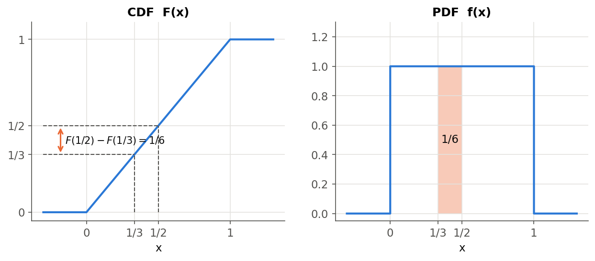
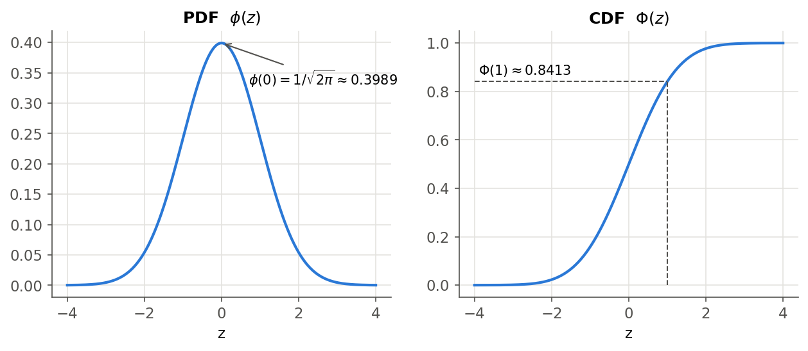
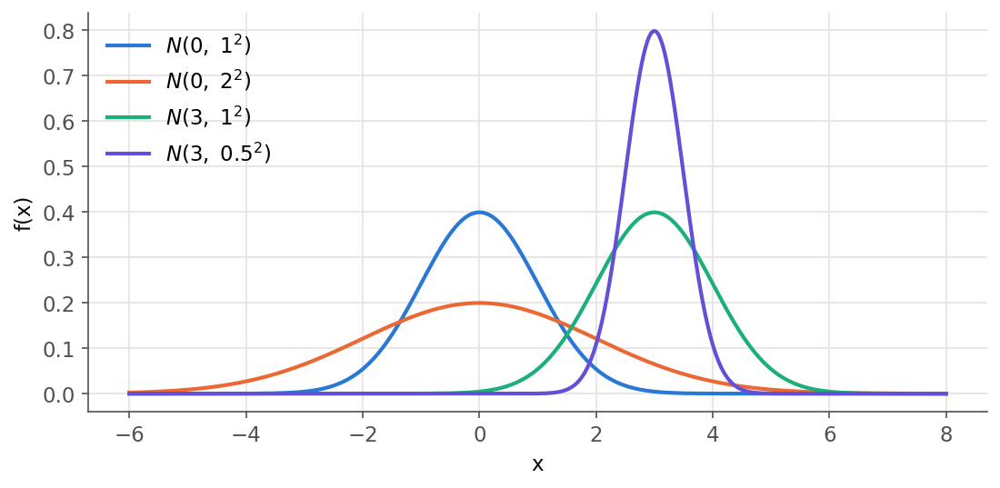
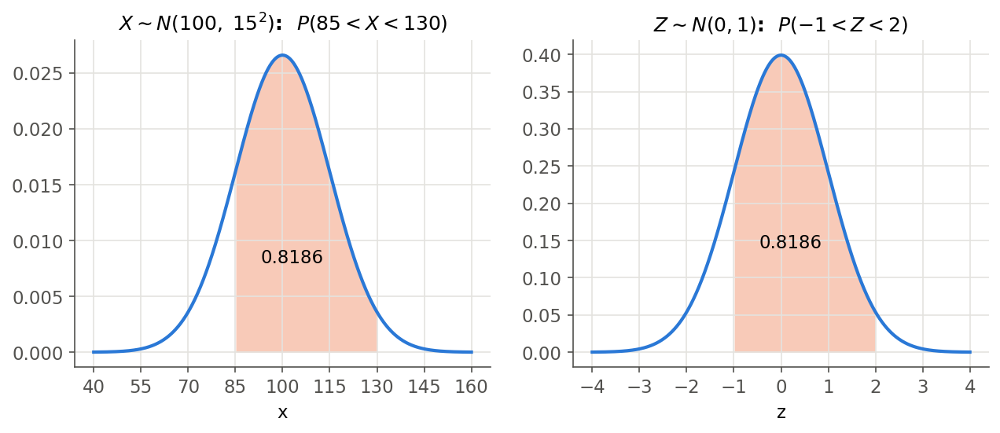
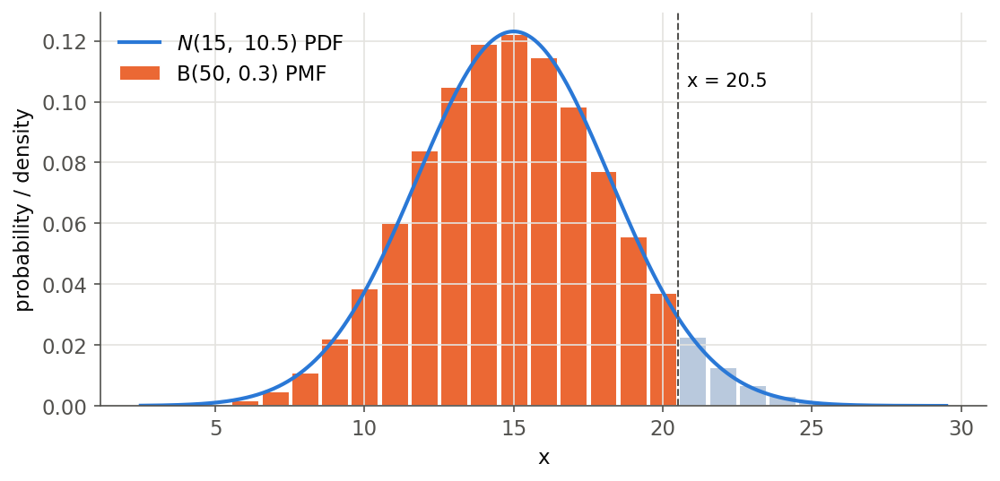
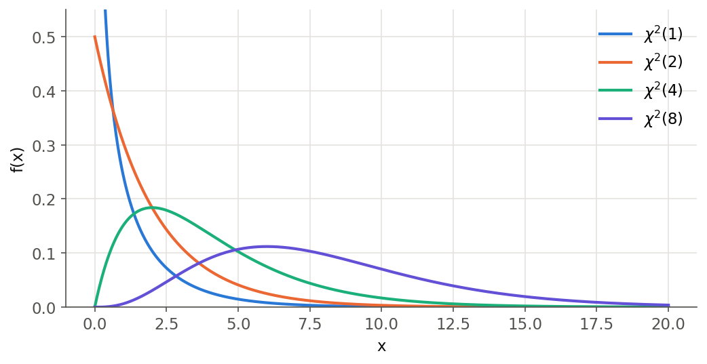
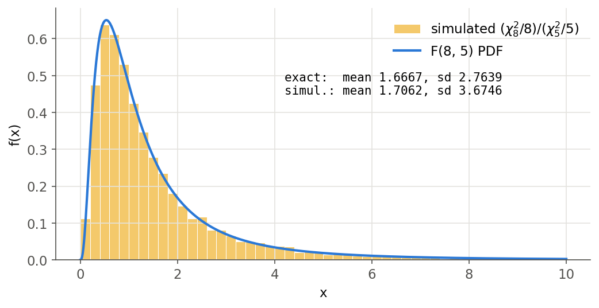
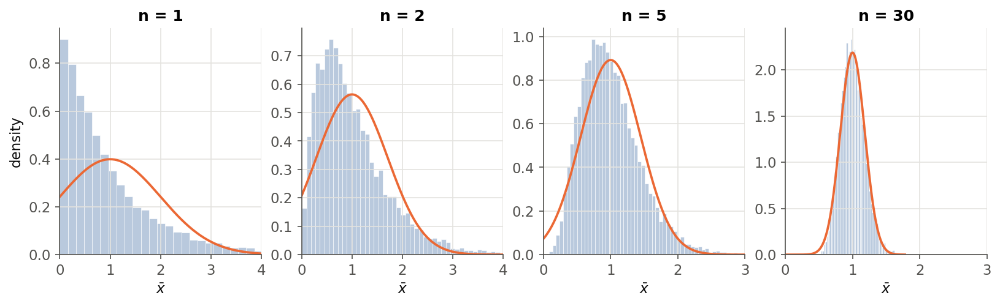

# Lecture 5 — Continuous Random Variables and the Normal Distribution

[Repository Guide](../../README.md) | [English](Concepts_Lecture.md) | [한국어](Concepts_Lecture.ko.md)

> **Last Updated:** 2026-11-04

> **Learning Objectives:**
> 1. Explain the relationship between the cumulative distribution function and the probability density function of a continuous random variable, and compute interval probabilities by integration
> 2. Derive the expected value and variance of the continuous uniform and normal distributions from their probability density functions
> 3. Standardize a normal distribution and find probabilities and quantiles with the standard normal table or R's `pnorm()`
> 4. Apply the normal approximation to the binomial distribution with a continuity correction and explain when it is appropriate
> 5. Define the chi-square, t, and F distributions from the standard normal distribution and compare their shapes across degrees of freedom
> 6. State the conditions and content of the central limit theorem and find the approximate distribution of a sample mean

---

## Table of Contents

- [1. Continuous Random Variables](#1-continuous-random-variables)
  - [1.1 Definition and Example](#11-definition-and-example)
  - [1.2 Cumulative Distribution Function](#12-cumulative-distribution-function)
  - [1.3 Probability Density Function](#13-probability-density-function)
  - [1.4 Expected Value and Variance](#14-expected-value-and-variance)
- [2. Common Continuous Distributions](#2-common-continuous-distributions)
- [3. The Continuous Uniform Distribution](#3-the-continuous-uniform-distribution)
  - [3.1 PDF and CDF](#31-pdf-and-cdf)
  - [3.2 Expected Value and Variance](#32-expected-value-and-variance)
- [4. The Standard Normal Distribution](#4-the-standard-normal-distribution)
  - [4.1 Probability Density Function](#41-probability-density-function)
  - [4.2 Expected Value and Variance](#42-expected-value-and-variance)
  - [4.3 CDF and the Standard Normal Table](#43-cdf-and-the-standard-normal-table)
- [5. The Normal Distribution](#5-the-normal-distribution)
  - [5.1 PDF and the Meaning of the Parameters](#51-pdf-and-the-meaning-of-the-parameters)
  - [5.2 Expected Value and Variance](#52-expected-value-and-variance)
  - [5.3 Linear Transformation and Standardization](#53-linear-transformation-and-standardization)
  - [5.4 Computing Probabilities and Quantiles](#54-computing-probabilities-and-quantiles)
- [6. Normal Approximation to the Binomial](#6-normal-approximation-to-the-binomial)
  - [6.1 Statement and Conditions](#61-statement-and-conditions)
  - [6.2 Continuity Correction](#62-continuity-correction)
- [7. Distributions Derived from the Normal](#7-distributions-derived-from-the-normal)
  - [7.1 The Chi-Square Distribution](#71-the-chi-square-distribution)
  - [7.2 Additivity and Degrees of Freedom](#72-additivity-and-degrees-of-freedom)
  - [7.3 The t Distribution](#73-the-t-distribution)
  - [7.4 The F Distribution](#74-the-f-distribution)
- [8. The Central Limit Theorem](#8-the-central-limit-theorem)
  - [8.1 Statement](#81-statement)
  - [8.2 Conditions](#82-conditions)
  - [8.3 The CLT in Simulation](#83-the-clt-in-simulation)
  - [8.4 Meaning and Limitations](#84-meaning-and-limitations)
- [9. Working with Continuous Distributions in R](#9-working-with-continuous-distributions-in-r)
- [Summary](#summary)
- [Self-Check Questions](#self-check-questions)
- [References](#references)

---

<br>

## 1. Continuous Random Variables

Lecture 3 defined a random variable as a function that assigns a real number to each outcome of a sample space, and Lecture 4 covered discrete random variables, whose possible values can be counted one by one. In contrast, a random variable whose values are spread continuously over an interval of real numbers is a continuous random variable. Measured quantities such as height, weight, waiting time, and measurement error are typical examples.

### 1.1 Definition and Example

> **Definition:** A **continuous random variable** is a function $X(\cdot) : \mathcal{S} \to \mathbb{R}$ from an uncountably infinite sample space $\mathcal{S}$ to the real numbers $\mathbb{R}$. An uncountably infinite set has so many elements that it cannot be put into one-to-one correspondence with the natural numbers; an interval of real numbers such as $(0, 1]$ is the standard example.

Whether a random variable is discrete or continuous depends less on the phenomenon itself than on how its outcomes are mapped to real numbers. If a person's height is recorded as the measured real value, it is a continuous random variable; if it is rounded to the nearest centimeter and recorded as an integer, its possible values can be counted and it becomes a discrete random variable.

> **Note:** An uncountably infinite sample space alone does not make a random variable continuous. For a number $\theta$ chosen from $(0, 1]$, define $X(\theta) = 1$ if $\theta > 1/2$ and $X(\theta) = 0$ otherwise; then $X$ is a discrete random variable with only two values. Strictly, $X$ is called continuous when there is a function $f \geq 0$ with $P(X \leq x) = \int_{-\infty}^{x} f(t)\,dt$ for every $x$ [1], and the random variables with the uniform, normal, chi-square, t, and F distributions treated from Section 3 on all satisfy this condition.

The simplest example chooses a number $\theta$ from the interval $(0, 1]$ and sets $X(\theta) = \theta$. Suppose any value of $\theta$ is equally likely. Then the probability that $\theta$ falls in an interval is proportional to the length of that interval, and since the whole interval has length 1, the probability equals the length.

$$
P\left(0 < \theta \leq \tfrac{1}{2}\right) = \tfrac{1}{2}, \qquad P\left(\tfrac{1}{3} < \theta \leq \tfrac{1}{2}\right) = \tfrac{1}{2} - \tfrac{1}{3} = \tfrac{1}{6}, \qquad P\left(\theta = \tfrac{1}{\sqrt{2}}\right) = 0
$$

The single point $\theta = 1/\sqrt{2}$ is an interval of length 0, so its probability is 0. Probability 0 does not mean that the outcome is impossible. $\theta$ always takes some value, but the probability that it equals one particular value fixed in advance is exactly 0. For this reason, continuous random variables are described through **probabilities of intervals** rather than probabilities of points.

### 1.2 Cumulative Distribution Function

> **Definition:** The **cumulative distribution function (CDF)** of a random variable $X$ is $F_X(x) \equiv P(X \leq x)$. It is also called the distribution function.

For $a < b$, the event $\lbrace X \leq b\rbrace$ is the union of the disjoint events $\lbrace X \leq a\rbrace$ and $\lbrace a < X \leq b\rbrace$, so the addition rule of probability gives the following.

$$
F_X(b) - F_X(a) = P(a < X \leq b)
$$

A CDF has the following properties.

- The limits at both ends are $F_X(-\infty) \equiv \lim_{x \to -\infty} F_X(x) = 0$ and $F_X(\infty) \equiv \lim_{x \to \infty} F_X(x) = 1$.
- $F_X$ is a non-decreasing function of $x$. This is because $a < b$ implies $F_X(b) - F_X(a) = P(a < X \leq b) \geq 0$.
- $F_X$ is right-continuous, and the CDF of a continuous random variable is continuous at every point.

These properties hold equally for the discrete random variables of Lecture 3. The difference lies in the shape of the graph. The CDF of a discrete random variable is a staircase that jumps at each possible value, whereas the CDF of a continuous random variable is an unbroken curve.

### 1.3 Probability Density Function

> **Definition:** The **probability density function (PDF)** of a continuous random variable $X$ is the derivative of its CDF, $f_X(x) \equiv F_X'(x) = \dfrac{d}{dx} F_X(x)$.

From $f = F'$, $F(-\infty) = 0$, and $F(\infty) = 1$ we obtain the following basic identities. The subscript $X$ is dropped below.

$$
\int_{-\infty}^{\infty} f(x)\,dx = \int_{-\infty}^{\infty} F'(x)\,dx = F(\infty) - F(-\infty) = 1
$$

$$
\int_{-\infty}^{x} f(t)\,dt = F(x) - F(-\infty) = F(x) = P(X \leq x)
$$

$$
\int_{a}^{b} f(x)\,dx = F(b) - F(a) = P(a < X \leq b)
$$

$$
\int_{a}^{a} f(x)\,dx = F(a) - F(a) = 0 = P(X = a)
$$

> **[Calculus]** The fundamental theorem of calculus states that if $F' = f$ and $f$ is continuous, then $\int_a^b f(x)\,dx = F(b) - F(a)$. The identities above apply this theorem to the CDF, and they say that the probability of an interval equals the area under the PDF curve over that interval.

As the last identity shows, a single point has probability 0 for a continuous random variable, so whether an interval includes its endpoints does not affect its probability. That is, $P(a < X < b) = P(a \leq X < b) = P(a < X \leq b) = P(a \leq X \leq b)$. For a discrete random variable an endpoint can carry positive probability, so these equalities do not hold in general.

> **Caution:** The value $f(x)$ of a PDF is not itself a probability. For a sufficiently small width $\Delta x$, $P(x < X \leq x + \Delta x) \approx f(x)\,\Delta x$, so $f(x)$ is probability per unit length, that is, a probability density. Hence $f(x)$ can exceed 1. For example, the uniform distribution on $(0, 0.5]$ has $f(x) = 2$ on that interval.

For the example $X(\theta) = \theta$ of Section 1.1, the CDF and PDF are as follows.

$$
F(x) = \begin{cases} 0, & x \leq 0 \\ x, & 0 < x \leq 1 \\ 1, & 1 < x \end{cases} \qquad\qquad f(x) = \begin{cases} 0, & x \leq 0 \\ 1, & 0 < x \leq 1 \\ 0, & 1 < x \end{cases}
$$

$F$ has corners at $x = 0$ and $x = 1$, so its derivative does not exist at those two points. However, the value at a single point does not affect any integral, so $f$ may be defined there for convenience. In Figure 1, the left panel is $F$ and the right panel is $f$. $P(1/3 < X \leq 1/2)$ appears as the difference of two heights $F(1/2) - F(1/3)$ on the left, and as the area of the shaded rectangle on the right.

$$
P\left(\tfrac{1}{3} < X \leq \tfrac{1}{2}\right) = \int_{1/3}^{1/2} f(x)\,dx = \int_{1/3}^{1/2} 1\,dx = \tfrac{1}{2} - \tfrac{1}{3} = \tfrac{1}{6}
$$



*Figure 1. CDF and PDF of a number chosen between 0 and 1, with the shaded area being the probability 1/6 between 1/3 and 1/2*

### 1.4 Expected Value and Variance

The expected value defined in Lecture 3 is a sum for a discrete random variable and an integral for a continuous one. The continuous formula replaces the probability $f(x)$ in the discrete sum with the probability element $f(x)\,dx$ and the sum with an integral.

| Random variable | Expected value $\mu_X = E(X)$ |
|:-----|:-----|
| Discrete | $\sum_x x\,f(x)$ |
| Continuous | $\int_{-\infty}^{\infty} x\,f(x)\,dx$ |

*Table 1. Expected value of discrete and continuous random variables*

For a function $g$, $E[g(X)] = \int_{-\infty}^{\infty} g(x)\,f(x)\,dx$. Hence the variance is, as in the discrete case, $Var(X) = E[(X - \mu)^2] = E(X^2) - \mu^2$, with $E(X^2) = \int_{-\infty}^{\infty} x^2 f(x)\,dx$ for a continuous random variable. The standard deviation is $\sigma_X = \sqrt{Var(X)}$.

> **Caution:** The expected value is defined only when $\int_{-\infty}^{\infty} |x|\,f(x)\,dx < \infty$. The t distribution with 1 degree of freedom (the Cauchy distribution) in Section 7.3 has a divergent integral of this kind, so its expected value does not exist.

---

<br>

## 2. Common Continuous Distributions

Table 2 lists frequently used continuous distributions and their notation. The normal distribution is the most important of them, and the chi-square, t, and F distributions are the distributions followed by test statistics in the hypothesis tests from Lecture 6 on. The uniform, standard normal, normal, chi-square, t, and F distributions are treated in detail from Section 3 on; for the exponential, gamma, and beta distributions only the definitions and uses are summarized below [1].

| Distribution | Notation | PDF or definition | Expected value | Variance |
|:-----|:-----|:-----|:-----|:-----|
| Uniform | $X \sim U(a, b)$ | $\frac{1}{b-a}$, $a < x \leq b$ | $\frac{a+b}{2}$ | $\frac{(b-a)^2}{12}$ |
| Exponential | $X \sim Exp(\lambda)$ | $\lambda e^{-\lambda x}$, $x > 0$ | $\frac{1}{\lambda}$ | $\frac{1}{\lambda^2}$ |
| Gamma | $X \sim \Gamma(\alpha, \beta)$ | $\frac{x^{\alpha-1} e^{-x/\beta}}{\Gamma(\alpha)\,\beta^{\alpha}}$, $x > 0$ | $\alpha\beta$ | $\alpha\beta^2$ |
| Beta | $X \sim Beta(\alpha, \beta)$ | $\frac{x^{\alpha-1}(1-x)^{\beta-1}}{B(\alpha, \beta)}$, $0 < x < 1$ | $\frac{\alpha}{\alpha+\beta}$ | $\frac{\alpha\beta}{(\alpha+\beta)^2(\alpha+\beta+1)}$ |
| Standard normal | $Z \sim N(0, 1)$ | $\frac{1}{\sqrt{2\pi}} e^{-z^2/2}$ | $0$ | $1$ |
| Normal | $X \sim N(\mu, \sigma^2)$ | $\frac{1}{\sqrt{2\pi}\,\sigma} e^{-(x-\mu)^2/(2\sigma^2)}$ | $\mu$ | $\sigma^2$ |
| Chi-square | $\sum_{i=1}^{n} Z_i^2 \sim \chi^2(n)$ | Sum of squares of $n$ independent standard normal variables | $n$ | $2n$ |
| t | $T \equiv \frac{Z}{\sqrt{Y/\nu}} \sim t(\nu)$ | Ratio built from $Z \sim N(0,1)$ and an independent $Y \sim \chi^2(\nu)$ | $0$ ($\nu > 1$) | $\frac{\nu}{\nu-2}$ ($\nu > 2$) |
| F | $F \equiv \frac{U/\nu_1}{V/\nu_2} \sim F(\nu_1, \nu_2)$ | Ratio built from independent $U \sim \chi^2(\nu_1)$ and $V \sim \chi^2(\nu_2)$ | $\frac{\nu_2}{\nu_2-2}$ ($\nu_2 > 2$) | $\frac{2\nu_2^2(\nu_1+\nu_2-2)}{\nu_1(\nu_2-2)^2(\nu_2-4)}$ ($\nu_2 > 4$) |

*Table 2. Notation, PDF or definition, expected value, and variance of common continuous distributions*

- **Exponential distribution:** For events that occur at random with an average of $\lambda$ per unit time, as in the Poisson distribution of Lecture 4, it models the waiting time from one event to the next. It has the memoryless property $P(X > s + t \mid X > s) = P(X > t)$: having already waited $s$ does not change the distribution of the remaining wait.
- **Gamma distribution:** It has a shape parameter $\alpha$ and a scale parameter $\beta$. When $\alpha$ is a natural number, it is the distribution of the sum of $\alpha$ independent exponential random variables with mean $\beta$. $\Gamma(\alpha) = \int_0^\infty t^{\alpha-1} e^{-t}\,dt$ is the gamma function, and $\Gamma(n) = (n-1)!$ for a natural number $n$.
- **Beta distribution:** Its values lie between $0$ and $1$, so it models proportions or probabilities themselves. $B(\alpha, \beta) = \Gamma(\alpha)\Gamma(\beta)/\Gamma(\alpha+\beta)$ is the beta function, and $\alpha = \beta = 1$ gives $U(0, 1)$.

> **Caution:** Some texts write the second parameter of the gamma distribution as the scale $\beta$ and others as the rate $1/\beta$. Table 2 uses the scale. In R, the third positional argument of `dgamma(x, shape, rate)` is the rate, so to supply a scale, name the argument as in `dgamma(x, shape = 2, scale = 3)`.

---

<br>

## 3. The Continuous Uniform Distribution

### 3.1 PDF and CDF

The **continuous uniform distribution** makes every value in the interval $(a, b]$ equally likely and is written $X \sim U(a, b)$. Hereafter it is called the uniform distribution for short. The example of Section 1.1 is the case $a = 0$, $b = 1$.

$$
f(x) = \begin{cases} \dfrac{1}{b-a}, & a < x \leq b \\ 0, & \text{otherwise} \end{cases} \qquad\qquad F(x) = \begin{cases} 0, & x \leq a \\ \dfrac{x-a}{b-a}, & a < x \leq b \\ 1, & x > b \end{cases}
$$

The height $1/(b-a)$ of the PDF is chosen so that the total area is $(b-a) \times \frac{1}{b-a} = 1$. The CDF is a straight line with slope $1/(b-a)$ from $a$ to $b$. For two points $x_1 < x_2$ inside the interval,

$$
P(x_1 < X \leq x_2) = F(x_2) - F(x_1) = \frac{x_2 - x_1}{b - a}
$$

so the probability is proportional to the length of the subinterval, regardless of its position. Whether the endpoints are included does not affect any probability, so defining $U(a, b)$ on $a < x < b$ gives the same distribution.

For example, if buses arrive exactly every 10 minutes and a passenger reaches the stop at a random time, the waiting time can be modeled as $X \sim U(0, 10)$ (minutes). The probability of waiting more than 7 minutes is $P(X > 7) = (10 - 7)/10 = 0.3$.

### 3.2 Expected Value and Variance

We show that $X \sim U(a, b)$ has mean $\mu = (a+b)/2$ and standard deviation $\sigma = (b-a)/(2\sqrt{3})$. First, the expected value is as follows.

$$
E(X) = \int_a^b \frac{x}{b-a}\,dx = \frac{1}{b-a}\left[\frac{x^2}{2}\right]_a^b = \frac{b^2 - a^2}{2(b-a)} = \frac{(b-a)(b+a)}{2(b-a)} = \frac{a+b}{2}
$$

$E(X^2)$ is obtained in the same way using $b^3 - a^3 = (b-a)(b^2 + ab + a^2)$.

$$
E(X^2) = \int_a^b \frac{x^2}{b-a}\,dx = \frac{b^3 - a^3}{3(b-a)} = \frac{b^2 + ab + a^2}{3}
$$

The variance follows. Bringing the two fractions to a common denominator gives the numerator $4(b^2 + ab + a^2) - 3(a^2 + 2ab + b^2) = b^2 - 2ab + a^2$.

$$
Var(X) = E(X^2) - E(X)^2 = \frac{b^2 + ab + a^2}{3} - \left(\frac{a+b}{2}\right)^2 = \frac{b^2 - 2ab + a^2}{12} = \frac{(b-a)^2}{12}
$$

The standard deviation is $\sigma = \sqrt{(b-a)^2/12} = (b-a)/\sqrt{12} = (b-a)/(2\sqrt{3})$. The mean is the midpoint of the interval, and the variance depends only on the length of the interval, not on its position. In the bus example, $E(X) = 5$ minutes and $\sigma = 10/(2\sqrt{3}) \approx 2.887$ minutes.

---

<br>

## 4. The Standard Normal Distribution

### 4.1 Probability Density Function

A random variable with the **standard normal distribution** is usually written $Z$, with $Z \sim N(0, 1)$. Its PDF is commonly denoted by $\phi$.

$$
\phi(z) = \frac{1}{\sqrt{2\pi}}\,e^{-\frac{1}{2}z^2}, \qquad -\infty < z < \infty
$$

The curve is highest at $z = 0$ ($\phi(0) = 1/\sqrt{2\pi} \approx 0.3989$), is a bell shape symmetric about $0$, and changes the direction of its bending at $z = \pm 1$ (inflection points). As $|z|$ grows, $e^{-z^2/2}$ approaches 0 quickly, so most of the probability lies between $-3$ and $3$.

That the total area is 1 is shown as follows. Let $I = \int_{-\infty}^{\infty} e^{-z^2/2}\,dz$, multiply $I$ by itself to form a double integral, and change to polar coordinates $x = r\cos\theta$, $y = r\sin\theta$ ($dx\,dy = r\,dr\,d\theta$).

$$
I^2 = \int_{-\infty}^{\infty}\int_{-\infty}^{\infty} e^{-(x^2 + y^2)/2}\,dx\,dy = \int_0^{2\pi}\int_0^{\infty} e^{-r^2/2}\,r\,dr\,d\theta = 2\pi\left[-e^{-r^2/2}\right]_0^{\infty} = 2\pi
$$

Hence $I = \sqrt{2\pi}$ and $\int_{-\infty}^{\infty}\phi(z)\,dz = I/\sqrt{2\pi} = 1$. This integral is called the Gaussian integral.

### 4.2 Expected Value and Variance

$z\,\phi(z)$ is an odd function, whose sign flips when the sign of $z$ flips, and its integral converges, so the areas on the two sides cancel and the mean is 0.

$$
\mu = E(Z) = \int_{-\infty}^{\infty} z\,\phi(z)\,dz = 0
$$

$E(Z^2)$ is obtained by integration by parts. Since $\phi'(z) = -z\,\phi(z)$, setting $u = z$ and $dv = z\,\phi(z)\,dz$ gives $v = -\phi(z)$. Because $z\,\phi(z) \to 0$ as $|z| \to \infty$, the boundary term is 0.

$$
E(Z^2) = \int_{-\infty}^{\infty} z \cdot z\,\phi(z)\,dz = \Big[-z\,\phi(z)\Big]_{-\infty}^{\infty} + \int_{-\infty}^{\infty} \phi(z)\,dz = 0 + 1 = 1
$$

Therefore $Var(Z) = E(Z^2) - \mu^2 = 1$ and $\sigma(Z) = 1$. Applying the same integration by parts once more with $u = z^3$ gives $E(Z^4) = 3E(Z^2) = 3$, a value used in Section 7.1.

### 4.3 CDF and the Standard Normal Table

The CDF of the standard normal distribution is denoted by $\Phi$.

$$
\Phi(z) = P(Z \leq z) = \frac{1}{\sqrt{2\pi}}\int_{-\infty}^{z} e^{-\frac{1}{2}t^2}\,dt
$$



*Figure 2. PDF and CDF of the standard normal distribution*

$\Phi$ has the following properties.

- $\Phi(0) = 0.5$, because the curve is symmetric about 0.
- $\Phi(-z) = 1 - \Phi(z)$, because symmetry gives $P(Z \leq -z) = P(Z \geq z)$.
- $P(|Z| \leq z) = \Phi(z) - \Phi(-z) = 2\Phi(z) - 1$. This gives $P(|Z| \leq 1) \approx 0.6827$, $P(|Z| \leq 2) \approx 0.9545$, and $P(|Z| \leq 3) \approx 0.9973$. The fact that about 68%, 95%, and 99.7% of a normal distribution lie within 1, 2, and 3 standard deviations of the mean is called the 68-95-99.7 rule.

The antiderivative of $e^{-t^2/2}$ cannot be written with elementary functions, so $\Phi(z)$ has no closed form and its values are computed numerically. For example, integrating $e^{-t^2/2} = \sum_{k=0}^{\infty} (-t^2/2)^k/k!$ term by term from $0$ to $z$ gives the following series.

$$
\Phi(z) = \frac{1}{2} + \frac{1}{\sqrt{2\pi}}\sum_{k=0}^{\infty} \frac{(-1)^k\,z^{2k+1}}{2^k\,k!\,(2k+1)}
$$

Summing the first 21 terms of this series at $z = 1$ gives $\Phi(1) = 0.8413447$. The normal tables printed at the back of statistics textbooks were produced by numerical computations of this kind, and in R the function `pnorm()` computes the same values.

The **standard normal table** lists $\Phi(z)$ for nonnegative $z$ (for example, $0.00$ to $3.89$), with $z$ up to the first decimal place in the rows and the second decimal place in the columns. Table 3 shows some of its rows.

| $z$ | 0.00 | 0.01 | 0.02 | 0.03 | 0.04 | 0.05 | 0.06 | 0.07 | 0.08 | 0.09 |
|:-----|:-----|:-----|:-----|:-----|:-----|:-----|:-----|:-----|:-----|:-----|
| 0.6 | 0.7257 | 0.7291 | 0.7324 | 0.7357 | 0.7389 | 0.7422 | 0.7454 | 0.7486 | 0.7517 | 0.7549 |
| 0.9 | 0.8159 | 0.8186 | 0.8212 | 0.8238 | 0.8264 | 0.8289 | 0.8315 | 0.8340 | 0.8365 | 0.8389 |
| 1.0 | 0.8413 | 0.8438 | 0.8461 | 0.8485 | 0.8508 | 0.8531 | 0.8554 | 0.8577 | 0.8599 | 0.8621 |
| 1.2 | 0.8849 | 0.8869 | 0.8888 | 0.8907 | 0.8925 | 0.8944 | 0.8962 | 0.8980 | 0.8997 | 0.9015 |
| 1.5 | 0.9332 | 0.9345 | 0.9357 | 0.9370 | 0.9382 | 0.9394 | 0.9406 | 0.9418 | 0.9429 | 0.9441 |
| 2.0 | 0.9772 | 0.9778 | 0.9783 | 0.9788 | 0.9793 | 0.9798 | 0.9803 | 0.9808 | 0.9812 | 0.9817 |
| 2.1 | 0.9821 | 0.9826 | 0.9830 | 0.9834 | 0.9838 | 0.9842 | 0.9846 | 0.9850 | 0.9854 | 0.9857 |

*Table 3. Part of the standard normal table, where each cell is Φ(row + column)*

The table is read as follows.

- $\Phi(1.25)$ is 0.8944, the cell where row 1.2 meets column 0.05.
- Negative values use symmetry: $\Phi(-1.25) = 1 - \Phi(1.25) = 1 - 0.8944 = 0.1056$.
- A third decimal place not in the table is handled by linear interpolation between neighboring values: $\Phi(2.125) \approx \frac{1}{2}\lbrace\Phi(2.12) + \Phi(2.13)\rbrace = \frac{1}{2}(0.9830 + 0.9834) = 0.9832$.

Table 4 lists values often used in tests and interval estimation. The point with right-tail probability $\alpha$, that is, $z_\alpha$ with $P(Z > z_\alpha) = \alpha$, is called the upper $\alpha$ quantile; $z_{0.05} = 1.645$, $z_{0.025} = 1.960$, and $z_{0.005} = 2.576$.

| $z$ | $\Phi(z)$ | $1 - \Phi(z)$ | $2\lbrace1 - \Phi(z)\rbrace$ |
|:-----|:-----|:-----|:-----|
| 0.500 | 0.6915 | 0.3085 | 0.6171 |
| 1.000 | 0.8413 | 0.1587 | 0.3173 |
| 1.282 | 0.9001 | 0.0999 | 0.1998 |
| 1.645 | 0.9500 | 0.0500 | 0.1000 |
| 1.960 | 0.9750 | 0.0250 | 0.0500 |
| 2.000 | 0.9772 | 0.0228 | 0.0455 |
| 2.326 | 0.9900 | 0.0100 | 0.0200 |
| 2.576 | 0.9950 | 0.0050 | 0.0100 |
| 3.000 | 0.9987 | 0.0013 | 0.0027 |

*Table 4. Cumulative, right-tail, and two-tail probabilities of frequently used z values*

---

<br>

## 5. The Normal Distribution

### 5.1 PDF and the Meaning of the Parameters

The **normal distribution** is determined by two parameters, the mean $\mu$ and the variance $\sigma^2$, and is written $X \sim N(\mu, \sigma^2)$. It is also called the Gaussian distribution.

$$
f(x) = \frac{1}{\sqrt{2\pi}\,\sigma}\exp\left[-\frac{(x-\mu)^2}{2\sigma^2}\right], \qquad -\infty < x < \infty
$$

- **$\mu$ is a location parameter.** It is the axis of symmetry and the position of the peak; changing $\mu$ shifts the curve left or right without changing its shape.
- **$\sigma$ is a scale parameter.** The inflection points are at $\mu \pm \sigma$ and the peak height is $1/(\sqrt{2\pi}\,\sigma)$. Doubling $\sigma$ doubles the width and halves the height of the curve, so the area stays 1.



*Figure 3. Location and spread of normal PDFs for different means and standard deviations*

Quantities determined by the sum of many small independent factors, such as measurement errors or heights, are often approximately normal. The central limit theorem of Section 8 explains why.

> **Caution:** The second slot of $N(\mu, \sigma^2)$ is the variance, so $N(0, 4)$ is the normal distribution with standard deviation 2. Some textbooks put the standard deviation in the second slot and write, for example, $N(100, 15)$ for a distribution with standard deviation 15, so check from the context whether the second value is a variance or a standard deviation. Lectures 1-8 use the variance notation $N(\mu, \sigma^2)$ throughout. R's `dnorm()`, `pnorm()`, and `rnorm()` take the standard deviation as their argument.

### 5.2 Expected Value and Variance

To show that the mean is $\mu$, it suffices to show $E[X - \mu] = 0$. An antiderivative of $(x - \mu)\,e^{-\frac{1}{2}(x-\mu)^2/\sigma^2}$ is $-\sigma^2 e^{-\frac{1}{2}(x-\mu)^2/\sigma^2}$ (this can be checked by differentiation).

$$
E[X - \mu] = \int_{-\infty}^{\infty}(x - \mu)f(x)\,dx = \frac{1}{\sqrt{2\pi}\,\sigma}\int_{-\infty}^{\infty}(x-\mu)\,e^{-\frac{1}{2}(x-\mu)^2/\sigma^2}\,dx = \frac{-\sigma^2}{\sqrt{2\pi}\,\sigma}\,e^{-\frac{1}{2}(x-\mu)^2/\sigma^2}\,\Bigg|_{-\infty}^{\infty} = 0
$$

The exponential vanishes at both ends, so the result is 0, and therefore $E(X) = \mu$.

The variance is reduced to the result of Section 4.2 by the substitution $z = (x - \mu)/\sigma$, $dx = \sigma\,dz$.

$$
Var(X) = \int_{-\infty}^{\infty}(x-\mu)^2 f(x)\,dx = \int_{-\infty}^{\infty}\sigma^2 z^2\,\frac{1}{\sqrt{2\pi}\,\sigma}\,e^{-z^2/2}\,\sigma\,dz = \sigma^2\int_{-\infty}^{\infty} z^2\phi(z)\,dz = \sigma^2
$$

That is, $Var(X) \equiv E[(X - \mu)^2] = \sigma^2$, so the parameter $\sigma$ is indeed the standard deviation. The same substitution also confirms $\int f(x)\,dx = \int \phi(z)\,dz = 1$.

### 5.3 Linear Transformation and Standardization

Multiplying a normal random variable by a constant and adding a constant again gives a normal random variable. For $d \neq 0$, the following holds.

$$
X \sim N(\mu, \sigma^2),\quad Y = c + dX \quad\Rightarrow\quad Y \sim N(c + d\mu,\ d^2\sigma^2)
$$

The mean and variance follow directly from the Lecture 3 properties $E(c + dX) = c + d\,E(X)$ and $Var(c + dX) = d^2\,Var(X)$. That the shape stays normal is shown through the CDF. If $d > 0$,

$$
F_Y(y) = P(c + dX \leq y) = P\left(X \leq \frac{y - c}{d}\right) = F_X\left(\frac{y - c}{d}\right)
$$

and differentiating both sides with respect to $y$ by the chain rule gives

$$
f_Y(y) = \frac{1}{d}\,f_X\left(\frac{y - c}{d}\right) = \frac{1}{\sqrt{2\pi}\,d\sigma}\exp\left[-\frac{(y - c - d\mu)^2}{2d^2\sigma^2}\right]
$$

which is the PDF of $N(c + d\mu, d^2\sigma^2)$. If $d < 0$, the inequality reverses, so $F_Y(y) = 1 - F_X((y-c)/d)$, and differentiation produces $1/|d|$ instead of $1/d$, leading to the same conclusion.

In particular, setting $c = -\mu/\sigma$ and $d = 1/\sigma$ gives **standardization**.

$$
X \sim N(\mu, \sigma^2),\quad Z = \frac{X - \mu}{\sigma} \quad\Rightarrow\quad Z \sim N(0, 1)
$$

$$
E(Z) = E\left(\frac{X - \mu}{\sigma}\right) = \frac{1}{\sigma}E(X - \mu) = \frac{1}{\sigma}(\mu - \mu) = 0, \qquad Var(Z) = Var\left(\frac{X - \mu}{\sigma}\right) = \frac{1}{\sigma^2}Var(X - \mu) = \frac{\sigma^2}{\sigma^2} = 1
$$

The value $z = (x - \mu)/\sigma$ tells how many standard deviations $x$ lies from the mean and is called the **standard score** or z-score. Thanks to standardization, the probabilities of every normal distribution can be computed with the single function $\Phi$.

$$
P(a < X < b) = P\left(\frac{a - \mu}{\sigma} < Z < \frac{b - \mu}{\sigma}\right) = \Phi\left(\frac{b - \mu}{\sigma}\right) - \Phi\left(\frac{a - \mu}{\sigma}\right)
$$

> **Key Point:** A normal probability is always computed in the same two steps. Standardize the endpoints of the interval as $z = (x - \mu)/\sigma$, then take the difference of the standard normal CDF $\Phi$ at those points.

### 5.4 Computing Probabilities and Quantiles

**Example 1 (probability).** Suppose the scores of an intelligence test follow $X \sim N(100, 15^2)$. The probability of a score between 85 and 130 is found as follows. Standardizing the endpoints gives $(85 - 100)/15 = -1$ and $(130 - 100)/15 = 2$.

$$
P(85 < X < 130) = P(-1 < Z < 2) = \Phi(2) - \Phi(-1) = \Phi(2) - \lbrace1 - \Phi(1)\rbrace = 0.9772 - (1 - 0.8413) = 0.8185
$$

Without rounding the table values the result is 0.8186. As Figure 4 shows, the area on the left equals the standardized area on the right.



*Figure 4. Area between 85 and 130 under N(100, 15²) and the standardized area between -1 and 2 under N(0, 1)*

**Example 2 (quantile).** On the same test, what score is needed to be in the top 5%? The required score $x$ satisfies $P(X > x) = 0.05$. Standardizing gives $P(Z > (x - 100)/15) = 0.05$, so $(x - 100)/15 = z_{0.05} = 1.645$.

$$
x = \mu + z_{0.05}\,\sigma = 100 + 1.645 \times 15 = 124.7
$$

In general, the value with cumulative probability $p$ is $x = \mu + z\,\sigma$, where $z$ satisfies $\Phi(z) = p$. Recovering a value from a probability in this way is called computing a quantile, and in R it is done by `qnorm()` (Section 9).

---

<br>

## 6. Normal Approximation to the Binomial

### 6.1 Statement and Conditions

The binomial distribution $X \sim B(n, p)$ of Lecture 4 counts the successes in $n$ independent trials with success probability $p$, with $E(X) = np$ and $Var(X) = np(1-p)$. For large $n$, adding binomial probabilities directly is tedious, but the standardized binomial variable approaches the normal distribution. This fact is the de Moivre-Laplace theorem.

$$
X \sim B(n, p) \quad\Rightarrow\quad Z \equiv \frac{X - np}{\sqrt{np(1-p)}} \xrightarrow{d} N(0, 1) \qquad (n \to \infty,\ 0 < p < 1\ \text{fixed})
$$

The arrow $\xrightarrow{d}$ denotes **convergence in distribution**: $P(Z \leq z)$ converges to $\Phi(z)$ at every $z$. A binomial variable is the sum of $n$ independent Bernoulli variables, so this theorem is a special case of the central limit theorem of Section 8.

The accuracy of the approximation depends on both $n$ and $p$.

- The larger $n$ is, the better the approximation.
- When $p$ is close to $1/2$, the binomial distribution is nearly symmetric and the approximation is good even for moderate $n$. When $p$ is close to 0 or 1, the distribution is skewed, and a larger $n$ is needed.
- A common rule of thumb uses the approximation when $np \geq 5$ and $n(1-p) \geq 5$ (some use 10 as a stricter threshold). When $n$ is large but $p$ is so small that $np$ falls short of this, the Poisson approximation of Lecture 4 is more suitable.

### 6.2 Continuity Correction

The binomial distribution is discrete, with probability only on integers, while the normal distribution is continuous. Treating the probability bar of the integer $k$ as occupying the interval $[k - 0.5, k + 0.5]$ and approximating it by the normal area over that interval improves the accuracy. This is the **continuity correction**. Writing $\sigma = \sqrt{np(1-p)}$, the rules are given in Table 5.

| Binomial probability | Normal approximation with continuity correction |
|:-----|:-----|
| $P(X \leq k)$ | $\Phi\left(\frac{k + 0.5 - np}{\sigma}\right)$ |
| $P(X \geq k)$ | $1 - \Phi\left(\frac{k - 0.5 - np}{\sigma}\right)$ |
| $P(k_1 \leq X \leq k_2)$ | $\Phi\left(\frac{k_2 + 0.5 - np}{\sigma}\right) - \Phi\left(\frac{k_1 - 0.5 - np}{\sigma}\right)$ |
| $P(X = k)$ | $\Phi\left(\frac{k + 0.5 - np}{\sigma}\right) - \Phi\left(\frac{k - 0.5 - np}{\sigma}\right)$ |

*Table 5. Normal approximations of binomial probabilities with continuity correction*

**Example.** Find $P(X \leq 20)$ for $X \sim B(50, 0.3)$. Since $np = 15$ and $n(1-p) = 35$, the rule of thumb is met, and $\sigma = \sqrt{50 \times 0.3 \times 0.7} = \sqrt{10.5} \approx 3.240$.

- With the continuity correction, $P(X \leq 20) \approx \Phi\left(\frac{20.5 - 15}{3.240}\right) = \Phi(1.697) \approx 0.9552$.
- Without it, $\Phi\left(\frac{20 - 15}{3.240}\right) = \Phi(1.543) \approx 0.9386$.
- The exact binomial value is $\sum_{x=0}^{20}\binom{50}{x}0.3^x\,0.7^{50-x} \approx 0.9522$.

The error of the corrected approximation is about 0.003, much smaller than the error of about 0.014 without the correction. In Figure 5, the total area of the orange bars is the exact probability, and the approximation is the area under the normal curve up to 20.5.



*Figure 5. PMF of B(50, 0.3) and PDF of N(15, 10.5), with the bars up to 20 and the continuity-corrected boundary 20.5*

---

<br>

## 7. Distributions Derived from the Normal

The three distributions of this section appear less as direct models of natural phenomena than as the distributions of statistics computed from samples of a normal population. The sample variance is linked to the chi-square distribution, the sample mean standardized by the sample standard deviation to the t distribution, and the ratio of two sample variances to the F distribution. These distributions are therefore the foundation of the statistical hypothesis tests of Lecture 6, and hypothesis testing is a core tool of data science for drawing conclusions from data.

### 7.1 The Chi-Square Distribution

> **Definition:** Random variables are **independent and identically distributed (iid)** when they are mutually independent and all follow exactly the same probability distribution. "Identically" does not mean similar; it means the distributions are the same. This is written as $X_1, \ldots, X_n \overset{iid}{\sim} N(\mu, \sigma^2)$.

When $Z_1, Z_2, \ldots, Z_n \overset{iid}{\sim} N(0, 1)$, the distribution of their sum of squares is the **chi-square distribution** with $n$ degrees of freedom.

$$
Z_1, Z_2, \ldots, Z_n \overset{iid}{\sim} N(0, 1) \quad\Rightarrow\quad \chi_n^2 \equiv Z_1^2 + Z_2^2 + \cdots + Z_n^2 \sim \chi^2(n)
$$

Note that the superscript 2 in the symbol $\chi_n^2$ is part of its name, while the superscript 2 in $Z_1^2$ is a square. With 1 degree of freedom, $\chi_1^2 = Z_1^2$, the square of a single standard normal variable.

The PDF is as follows; it coincides with the gamma distribution $\Gamma(n/2, 2)$.

$$
f(x) = \frac{1}{2^{n/2}\,\Gamma(n/2)}\,x^{n/2 - 1}\,e^{-x/2}, \qquad x > 0
$$

In practice, the following three values are used more often than this formula.

$$
E[\chi_n^2] = n, \qquad Var(\chi_n^2) = 2n, \qquad \sigma(\chi_n^2) = \sqrt{2n}
$$

These follow directly from the definition. By Section 4.2, $E(Z_i^2) = 1$, so the sum of $n$ terms has mean $n$. Also $Var(Z_i^2) = E(Z_i^4) - \lbrace E(Z_i^2)\rbrace^2 = 3 - 1 = 2$, and the variance of a sum of independent variables is the sum of their variances, so $Var(\chi_n^2) = 2n$.



*Figure 6. PDFs of chi-square distributions with 1, 2, 4, and 8 degrees of freedom*

The shape of the chi-square distribution in Figure 6 can be summarized as follows.

- Its values are always positive, and it is asymmetric with a long right tail.
- With 1 degree of freedom the density grows without bound as $x \to 0$; with 2 degrees of freedom it is an exponential distribution that starts at $1/2$ at $x = 0$ and decreases. With 3 or more degrees of freedom it rises and then falls, with its mode at $n - 2$.
- As the degrees of freedom grow, the mean $n$ and the spread $\sqrt{2n}$ grow, and since the variable is a sum of $n$ independent terms, the central limit theorem of Section 8 makes its shape approach the normal.

The chi-square distribution is closely related to the chi-square test used to analyze contingency tables in Lecture 7, and, as the next section shows, it describes the distribution of the sample variance.

### 7.2 Additivity and Degrees of Freedom

A sum of independent chi-square random variables again follows a chi-square distribution, and the degrees of freedom add. This is called **additivity**.

$$
X_1, X_2, \ldots, X_k\ \text{independent},\quad X_i \sim \chi^2(\nu_i) \quad\Rightarrow\quad \sum_{i=1}^{k} X_i \sim \chi^2(\nu_1 + \nu_2 + \cdots + \nu_k)
$$

The property is natural given the definition. Each $X_i$ is the sum of squares of $\nu_i$ independent standard normal variables, and since the $X_i$ are independent of one another, their sum is the sum of squares of $\nu_1 + \cdots + \nu_k$ independent standard normal variables.

The **degrees of freedom** are the number of independent sources (data) that give information about the population. Once the sample mean $\bar{X}$ of $n$ observations is computed, the deviations $X_i - \bar{X}$ always sum to 0, so knowing $n - 1$ of them determines the last one. That is why the sample variance $S^2 = \frac{1}{n-1}\sum (X_i - \bar{X})^2$, computed from the deviations, has $n - 1$ degrees of freedom. Indeed, if $X_1, \ldots, X_n \overset{iid}{\sim} N(\mu, \sigma^2)$, the following holds, and this statistic is independent of $\bar{X}$ [1].

$$
\frac{(n-1)S^2}{\sigma^2} = \sum_{i=1}^{n}\left(\frac{X_i - \bar{X}}{\sigma}\right)^2 \sim \chi^2(n-1)
$$

If $\mu$ were known, $\sum (X_i - \mu)^2/\sigma^2$ would be $\chi^2(n)$ by definition. Estimating $\mu$ by $\bar{X}$ uses up one piece of information, so one degree of freedom is lost.

### 7.3 The t Distribution

> **Definition:** If $Z \sim N(0, 1)$ and $Y \sim \chi^2(\nu)$ are independent ($Y \perp Z$), the distribution of $T \equiv Z / \sqrt{Y/\nu}$ is the **t distribution** with $\nu$ degrees of freedom, written $T \sim t(\nu)$.

$$
T \equiv \frac{Z}{\sqrt{Y/\nu}} \sim t(\nu), \qquad f(t) = \frac{\Gamma\left(\frac{\nu+1}{2}\right)}{\sqrt{\nu\pi}\,\Gamma\left(\frac{\nu}{2}\right)}\left(1 + \frac{t^2}{\nu}\right)^{-(\nu+1)/2}
$$

The t distribution has the following properties.

- It is a bell shape symmetric about 0, but compared with the standard normal it is lower in the center and has heavier tails. The denominator $\sqrt{Y/\nu}$ fluctuates at random, and when it happens to be small, $T$ becomes large.
- Its mean is 0 when $\nu > 1$, and its variance is $\nu/(\nu - 2)$, which exceeds 1, when $\nu > 2$. The t distribution with 1 degree of freedom is the Cauchy distribution, which has no mean.
- As $\nu \to \infty$, the law of large numbers gives $Y/\nu \to 1$, so $t(\nu)$ approaches $N(0, 1)$. With about 30 degrees of freedom the two distributions are already quite similar.

| Degrees of freedom $\nu$ | Peak height $f(0)$ | Upper 2.5% point $t_{0.025, \nu}$ | $P(T > 2)$ |
|:-----|:-----|:-----|:-----|
| 1 | 0.3183 | 12.706 | 0.1476 |
| 5 | 0.3796 | 2.571 | 0.0510 |
| 10 | 0.3891 | 2.228 | 0.0367 |
| 30 | 0.3956 | 2.042 | 0.0273 |
| $\infty$ ($N(0,1)$) | 0.3989 | 1.960 | 0.0228 |

*Table 6. Peak height, upper 2.5% point, and tail probability of t distributions by degrees of freedom*

Table 6 shows that the fewer the degrees of freedom, the farther out one must go to reach the same tail probability. This is why the tests of Lecture 6 that do not know the population variance use larger critical values at the same significance level.

The t distribution matters because it appears when the unknown $\sigma$ in the standardized sample mean of a normal population is replaced by the sample standard deviation $S$. If $X_1, \ldots, X_n \overset{iid}{\sim} N(\mu, \sigma^2)$, the numerator $(\bar{X} - \mu)/(\sigma/\sqrt{n}) \sim N(0, 1)$, and by Section 7.2, $(n-1)S^2/\sigma^2 \sim \chi^2(n-1)$ is independent of the numerator, so the following holds.

$$
\frac{\bar{X} - \mu}{S/\sqrt{n}} = \frac{(\bar{X} - \mu)/(\sigma/\sqrt{n})}{\sqrt{\dfrac{(n-1)S^2/\sigma^2}{n-1}}} \sim t(n-1)
$$

W. S. Gosset published this result in 1908 under the pen name "Student", which is why the distribution is also called Student's t distribution [2].

### 7.4 The F Distribution

> **Definition:** If $U \sim \chi^2(\nu_1)$ and $V \sim \chi^2(\nu_2)$ are independent, the distribution of the ratio $F \equiv (U/\nu_1)/(V/\nu_2)$, each divided by its degrees of freedom, is the **F distribution** with $(\nu_1, \nu_2)$ degrees of freedom, written $F \sim F(\nu_1, \nu_2)$. $\nu_1$ is the numerator and $\nu_2$ the denominator degrees of freedom.

$$
U \sim \chi^2(\nu_1) \perp V \sim \chi^2(\nu_2) \quad\Rightarrow\quad F \equiv \frac{U/\nu_1}{V/\nu_2} \sim F(\nu_1, \nu_2)
$$

The F distribution has the following properties.

- Its values are positive and it has a long right tail. Its mean is $\nu_2/(\nu_2 - 2)$ when $\nu_2 > 2$, and its variance is given in Table 2 when $\nu_2 > 4$.
- If $F \sim F(\nu_1, \nu_2)$, then $1/F \sim F(\nu_2, \nu_1)$, because the numerator and denominator are swapped.
- If $T \sim t(\nu)$, then $T^2 \sim F(1, \nu)$, because $T^2 = Z^2/(Y/\nu)$ with $Z^2 \sim \chi^2(1)$.
- For independent samples from two normal populations, $(S_1^2/\sigma_1^2)/(S_2^2/\sigma_2^2) \sim F(n_1 - 1, n_2 - 1)$. The F distribution is therefore used to compare two variances (Lecture 6) and in the analysis of variance (ANOVA) of Lecture 7.

Figure 7 shows a histogram of 10,000 generated values of $(\chi_8^2/8)/(\chi_5^2/5)$ together with the PDF of $F(8, 5)$. The histogram follows the curve well. The theoretical mean is $5/3 = 1.6667$ and the standard deviation is $\sqrt{2 \cdot 5^2 \cdot 11/(8 \cdot 3^2 \cdot 1)} = \sqrt{7.6389} = 2.7639$, while the simulation gives a mean of 1.7062 and a standard deviation of 3.6746.



*Figure 7. Histogram of 10,000 generated chi-square ratios and the PDF of F(8, 5)*

> **Note:** The simulated mean is close to the theoretical value, but the standard deviation differs considerably, and with other random numbers it can come out below the theoretical value. $F(8, 5)$ has a finite variance ($\nu_2 = 5 > 4$), so the sample variance eventually converges to the theoretical value, but the variance of the sample variance itself is finite only when the fourth moment is finite, and the fourth moment of the F distribution exists only when $\nu_2 > 8$. Occasional very large values therefore shake the sample standard deviation strongly. This must be kept in mind when estimating a variance by simulation from a heavy-tailed distribution.

---

<br>

## 8. The Central Limit Theorem

### 8.1 Statement

The central limit theorem states that, whatever the shape of the population distribution, the distribution of the sample mean approaches the normal as the sample grows; it is one of the most important results in statistics. Introductory textbooks often phrase it as follows: if a simple random sample (SRS) of size $n$ is drawn from any population with mean $\mu$ and finite standard deviation $\sigma$, then for large $n$ the sampling distribution of the sample mean $\bar{x}$ is approximately normal with mean $\mu$ and standard deviation $\sigma/\sqrt{n}$. Stated precisely in terms of random variables, it reads as follows [1].

> **Definition:** The **central limit theorem (CLT)** states that if $X_1, \ldots, X_n$ are iid random variables from a distribution with mean $\mu$ and variance $\sigma^2$ ($0 < \sigma^2 < \infty$), then the distribution of the standardized sample mean converges to the standard normal distribution as $n \to \infty$.

$$
\frac{\bar{X}_n - \mu}{\sigma/\sqrt{n}} \xrightarrow{d} N(0, 1), \qquad \bar{X}_n = \frac{1}{n}\sum_{i=1}^{n} X_i
$$

For sufficiently large $n$, this can be restated as approximate distributions of the sum $S_n$ and the mean $\bar{X}$. The symbol $\overset{a}{\sim}$ means "approximately distributed as".

$$
S_n = X_1 + X_2 + \cdots + X_n \overset{a}{\sim} N(n\mu,\ n\sigma^2), \qquad \bar{X} = \frac{1}{n}\sum_{i=1}^{n} X_i \overset{a}{\sim} N\left(\mu,\ \frac{\sigma^2}{n}\right)
$$

The means and variances $E(S_n) = n\mu$, $Var(S_n) = n\sigma^2$, $E(\bar{X}) = \mu$, and $Var(\bar{X}) = \sigma^2/n$ hold exactly by linearity of expectation and independence alone (Lecture 6, Section 1). What the central limit theorem adds is that the **shape** of the distribution approaches the normal.

> **Caution:** Textbooks that write the distribution of the sample mean as $N(\mu, \sigma/\sqrt{n})$ put the standard deviation in the second slot. In variance notation it is $N(\mu, \sigma^2/n)$, and both notations denote the same distribution.

### 8.2 Conditions

Before applying the central limit theorem, check the following conditions.

- **Independence:** The observations must be independent, which a random sample satisfies. Sampling without replacement from a finite population is not strictly independent, but a common rule of thumb treats it as independent when the sample is at most about 10% of the population.
- **Identical distribution:** The basic form above assumes that every $X_i$ has the same distribution. Generalizations (such as the Lindeberg condition) allow the distributions to differ, but they require that no single term dominate the sum.
- **Finite variance:** $\sigma^2 < \infty$ is required. For a distribution without a variance (or mean), such as the Cauchy distribution, the mean of $n$ independent variables again follows the same Cauchy distribution, so it never approaches the normal however large $n$ becomes [1].
- **Sufficiently large $n$:** How large depends on the shape of the population. If the population has skewness (degree of asymmetry) $\gamma$, then $\bar{X}$ has skewness $\gamma/\sqrt{n}$. For example, for the exponential distribution with skewness 2 and $n = 30$, the skewness of $\bar{X}$ is still $2/\sqrt{30} \approx 0.37$. "$n \geq 30$" is only a rough rule of thumb, and strongly skewed or heavy-tailed populations need a larger $n$.

If the population itself is normal, $\bar{X}$ follows $N(\mu, \sigma^2/n)$ exactly for every $n$ (Lecture 6, Section 2). In that case the central limit theorem is not needed.

### 8.3 The CLT in Simulation

Figure 8 shows histograms of sample means computed from 10,000 samples of size $n$ drawn from the exponential distribution $Exp(1)$, which has mean and standard deviation 1 and is strongly right-skewed. The orange curve is the approximating distribution $N(1, 1/n)$ given by the central limit theorem.



*Figure 8. Histograms of sample means of exponential samples by sample size n, with normal approximation curves*

The histogram for $n = 1$ is the shape of the population itself. For $n = 2$ and $5$ a peak forms but the distribution is still skewed to the right, and for $n = 30$ the histogram nearly coincides with the normal curve. At the same time, the spread shrinks in proportion to $1/\sqrt{n}$.

The accuracy can be checked numerically. For $n = 30$, the normal approximation of $P(\bar{X} > 1.2)$ is

$$
P(\bar{X} > 1.2) \approx P\left(Z > \frac{1.2 - 1}{1/\sqrt{30}}\right) = P(Z > 1.095) = 1 - \Phi(1.095) \approx 0.1367
$$

The sum of 30 exponential variables follows the gamma distribution $\Gamma(30, 1)$, so the exact value is $P(S_{30} > 36) \approx 0.1379$, and the error of the approximation is about 0.001.

### 8.4 Meaning and Limitations

- The central limit theorem simplifies statistical problems by letting us work with a distribution that is approximately normal.
- When $n$ is large, probabilities about the sample mean can be computed without knowing the shape of the population.
- Hence a clear understanding of the analysis methods based on the most basic distribution, the normal, makes it possible to analyze a very wide range of data through their means. The Z-test and t-test of Lecture 6 are examples.

> **Caution:** The central limit theorem concerns the distribution of the sample mean (and sum). It does not say that individual observations or the data themselves become normal, and it does not apply as such to other statistics such as the median or the maximum. It fails for dependent observations or infinite variance, and for small samples from skewed populations the approximation is poor. In such cases, consider the nonparametric methods of Lecture 8.

---

<br>

## 9. Working with Continuous Distributions in R

For each distribution, R provides functions formed by attaching one of four prefixes to the distribution name.

| Prefix | Computed value | Normal example | Result |
|:-----|:-----|:-----|:-----|
| `d` | PDF $f(x)$ (PMF for a discrete distribution) | `dnorm(0)` | 0.3989 |
| `p` | CDF $F(x) = P(X \leq x)$ | `pnorm(1.96)` | 0.9750 |
| `q` | Quantile, the $x$ with $F(x) = p$ | `qnorm(0.975)` | 1.9600 |
| `r` | Random number generation | `rnorm(5)` | Different on every run |

*Table 7. The four prefixes of R distribution functions*

| Distribution | R name | Parameter arguments |
|:-----|:-----|:-----|
| Uniform $U(a, b)$ | `unif` | `min = a`, `max = b` |
| Exponential $Exp(\lambda)$ | `exp` | `rate = λ` |
| Gamma $\Gamma(\alpha, \beta)$ | `gamma` | `shape = α`, `scale = β` (or `rate = 1/β`) |
| Beta $Beta(\alpha, \beta)$ | `beta` | `shape1 = α`, `shape2 = β` |
| Normal $N(\mu, \sigma^2)$ | `norm` | `mean = μ`, `sd = σ` |
| Chi-square $\chi^2(n)$ | `chisq` | `df = n` |
| t $t(\nu)$ | `t` | `df = ν` |
| F $F(\nu_1, \nu_2)$ | `f` | `df1 = ν₁`, `df2 = ν₂` |
| Binomial $B(n, p)$ | `binom` | `size = n`, `prob = p` |

*Table 8. R function names and parameter arguments of continuous distributions and the binomial distribution*

The computations of Sections 5.4 and 6.2 are done in R as follows.

```r
pnorm(130, mean = 100, sd = 15) - pnorm(85, mean = 100, sd = 15)  # P(85 < X < 130)
qnorm(0.95, mean = 100, sd = 15)                                   # boundary of the top 5%
1 - pnorm(2.56)                                                    # P(Z > 2.56)
pnorm(2.56, lower.tail = FALSE)                                    # the same probability
pbinom(20, size = 50, prob = 0.3)                                  # P(X <= 20) for B(50, 0.3)
```

```text
[1] 0.8185946
[1] 124.6728
[1] 0.005233608
[1] 0.005233608
[1] 0.9522362
```

- The first line computes $F(130) - F(85)$. The second and third arguments of the normal functions are the mean and the **standard deviation**, so $N(100, 15^2)$ is given `sd = 15`.
- In the second line, `qnorm(0.95, ...)` returns the value with cumulative probability 0.95, the upper 5% boundary 124.7.
- The third and fourth lines compute a right-tail probability in two ways. `lower.tail = FALSE` computes $P(X > x)$ directly, which is numerically more accurate than `1 - pnorm()` when the tail probability is very small.
- The fifth line gives the exact binomial probability to compare with the corrected approximation 0.9552.

> **Note:** Some practice code for this unit uses functions such as `cont.spdf()` (plotting the PDFs of several distributions) and `norm.trans()` (a standardization plot of a normal distribution); these are not base R functions but functions of the `Rstat` package [3]. The package is not on CRAN and opens plot windows with the Windows-only function `win.graph()`. The [Exercises](Exercises.md) and [Solutions](Solutions.md) perform the same tasks with base R functions only.

---

<br>

## Summary

| Concept | Key Summary |
|:-----|:-----|
| Continuous random variable | A random variable whose values are spread continuously over an interval of real numbers. A single point has probability 0, so probabilities are assigned to intervals, and including endpoints does not change them. |
| CDF | $F(x) = P(X \leq x)$. It is non-decreasing with $F(-\infty) = 0$, $F(\infty) = 1$, and $P(a < X \leq b) = F(b) - F(a)$. |
| PDF | $f = F'$, and the probability of an interval is the area under $f$. $f(x)$ is a density, not a probability, so it can exceed 1. |
| Expected value and variance | $E(X) = \int x f(x)\,dx$ and $Var(X) = E(X^2) - \mu^2$. If the integral diverges, the expected value does not exist. |
| Uniform distribution | $U(a, b)$ has a flat density of height $1/(b-a)$, mean $(a+b)/2$, and variance $(b-a)^2/12$. |
| Standard normal distribution | $\phi(z) = e^{-z^2/2}/\sqrt{2\pi}$, with mean 0 and variance 1. $\Phi$ has no closed form and is found from the standard normal table or `pnorm()`, with $\Phi(-z) = 1 - \Phi(z)$. |
| Normal distribution | In $N(\mu, \sigma^2)$, $\mu$ sets the location and $\sigma$ the spread. A linear transformation stays normal, and $Z = (X-\mu)/\sigma \sim N(0, 1)$ standardizes it. |
| Normal approximation | $B(n, p)$ is approximated by $N(np, np(1-p))$ when roughly $np \geq 5$ and $n(1-p) \geq 5$, with the continuity correction widening the endpoints by 0.5. |
| Chi-square distribution | $\chi^2(n)$ is the distribution of the sum of squares of $n$ independent standard normals. It has mean $n$ and variance $2n$, and degrees of freedom add for independent terms. |
| t distribution | The distribution of $Z/\sqrt{Y/\nu}$. It has heavier tails than the normal, becomes $N(0, 1)$ as $\nu \to \infty$, and $(\bar{X} - \mu)/(S/\sqrt{n})$ of a normal sample follows $t(n-1)$. |
| F distribution | The distribution of the ratio of two independent chi-squares, each divided by its degrees of freedom. It is used to compare variances and in the analysis of variance. |
| Central limit theorem | For iid variables with finite variance, $(\bar{X} - \mu)/(\sigma/\sqrt{n})$ converges to $N(0, 1)$. The required $n$ depends on the skewness and tails of the population. |
| R distribution functions | The prefixes `d`, `p`, `q`, and `r` give the density, cumulative probability, quantile, and random numbers. The normal functions take the standard deviation. |

---

<br>

## Self-Check Questions

1. **Uniform distribution:** For $X \sim U(2, 8)$, find $P(3 < X \leq 5)$, $E(X)$, and $Var(X)$.

   <details>
   <summary>Answer</summary>

   The density has height $1/(8-2) = 1/6$, so $P(3 < X \leq 5) = (5 - 3)/6 = 1/3$. $E(X) = (2 + 8)/2 = 5$ and $Var(X) = (8 - 2)^2/12 = 36/12 = 3$.

   </details>

2. **Density and probability:** Show that $f(x) = 3x^2$ for $0 < x < 1$ and $0$ elsewhere is a PDF, and find $P(X \leq 0.5)$. Is it a problem that $f(1) = 3 > 1$?

   <details>
   <summary>Answer</summary>

   $f \geq 0$ and $\int_0^1 3x^2\,dx = [x^3]_0^1 = 1$, so it is a PDF. $P(X \leq 0.5) = [x^3]_0^{0.5} = 0.125$. $f(x)$ is a probability per unit length, not a probability, so it may exceed 1. Probabilities are areas, which always lie between 0 and 1.

   </details>

3. **Standardization:** For $X \sim N(50, 10^2)$, find $P(X > 65)$ with the standard normal table.

   <details>
   <summary>Answer</summary>

   $z = (65 - 50)/10 = 1.5$, so $P(X > 65) = P(Z > 1.5) = 1 - \Phi(1.5) = 1 - 0.9332 = 0.0668$.

   </details>

4. **Quantile:** For the same $X \sim N(50, 10^2)$, find the boundary of the upper 2.5%.

   <details>
   <summary>Answer</summary>

   The $z$ with $P(Z > z) = 0.025$ is $z_{0.025} = 1.96$. The boundary is $x = \mu + z\sigma = 50 + 1.96 \times 10 = 69.6$. In R, `qnorm(0.975, 50, 10)` gives 69.59964.

   </details>

5. **Linear transformation:** For $X \sim N(1, 4)$, find the distribution of $Y = 3 - 2X$.

   <details>
   <summary>Answer</summary>

   With $c = 3$ and $d = -2$, $Y \sim N(3 - 2 \cdot 1,\ (-2)^2 \cdot 4) = N(1, 16)$. That is, $Y$ is normal with mean 1 and standard deviation 4. Even with a negative $d$, the variance is multiplied by $d^2$.

   </details>

6. **Continuity correction:** For $X \sim B(100, 0.4)$, find $P(X \geq 45)$ with the normal approximation and continuity correction.

   <details>
   <summary>Answer</summary>

   $np = 40$ and $n(1-p) = 60$, so the approximation can be used, and $\sigma = \sqrt{100 \times 0.4 \times 0.6} = \sqrt{24} \approx 4.899$. $P(X \geq 45) \approx 1 - \Phi\left(\frac{44.5 - 40}{4.899}\right) = 1 - \Phi(0.92) = 1 - 0.8212 = 0.1788$. The exact binomial probability is about 0.1789.

   </details>

7. **Chi-square distribution:** For $Z_1, Z_2, Z_3 \overset{iid}{\sim} N(0, 1)$, give the distribution, mean, and variance of $W = Z_1^2 + Z_2^2 + Z_3^2$. What is the distribution after adding $V \sim \chi^2(5)$ independent of $W$?

   <details>
   <summary>Answer</summary>

   By definition, $W \sim \chi^2(3)$ with mean 3 and variance $2 \times 3 = 6$. By additivity, $W + V \sim \chi^2(8)$.

   </details>

8. **t distribution:** Explain why the upper 2.5% point of the t distribution with 5 degrees of freedom, 2.571, is larger than the standard normal value 1.960.

   <details>
   <summary>Answer</summary>

   The denominator of $T = Z/\sqrt{Y/\nu}$ varies at random, and when it is small $T$ becomes large, so the t distribution has heavier tails than the normal. With more probability in the tails, one must go farther out to make the right-tail probability 0.025. As the degrees of freedom grow, $Y/\nu \to 1$ and the point approaches 1.960.

   </details>

9. **Central limit theorem:** A random sample of size 36 is drawn from a skewed distribution with mean 50 and standard deviation 12. Approximate $P(\bar{X} > 53)$ and state the conditions this approximation relies on.

   <details>
   <summary>Answer</summary>

   $\bar{X} \overset{a}{\sim} N(50, 12^2/36) = N(50, 2^2)$, so $P(\bar{X} > 53) \approx P(Z > (53 - 50)/2) = 1 - \Phi(1.5) = 0.0668$. The observations must be independent and identically distributed with finite variance, and $n = 36$ must be large enough relative to the skewness of the population.

   </details>

10. **Failure of the CLT:** Explain why the central limit theorem cannot be applied to the mean of a sample from the Cauchy distribution.

    <details>
    <summary>Answer</summary>

    The central limit theorem requires a finite variance, but the Cauchy distribution has neither a mean nor a variance. In fact, the mean of $n$ independent Cauchy variables again follows the same Cauchy distribution, so increasing $n$ neither reduces the spread nor brings the distribution closer to the normal.

    </details>

---

<br>

## References

1. G. Casella and R. L. Berger, *Statistical Inference*, 2nd ed. Pacific Grove, CA, USA: Duxbury, 2002.
2. Student, "The probable error of a mean," *Biometrika*, vol. 6, no. 1, pp. 1-25, 1908.
3. T. J. Lim, "Rstat: Basic statistical methods in R," GitHub repository. https://github.com/tjssu/Rstat
