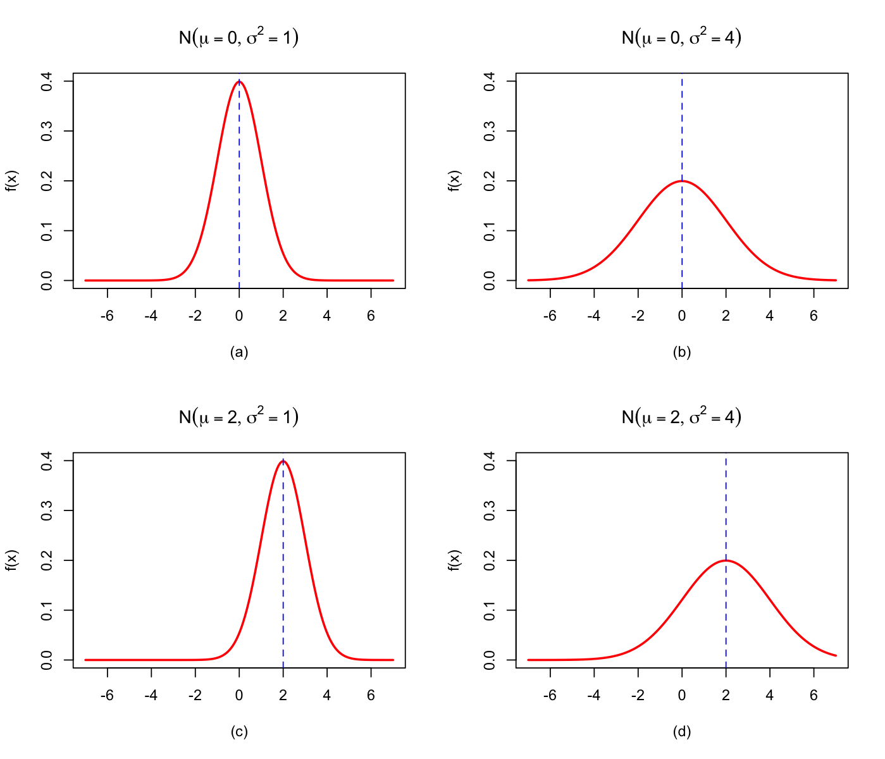
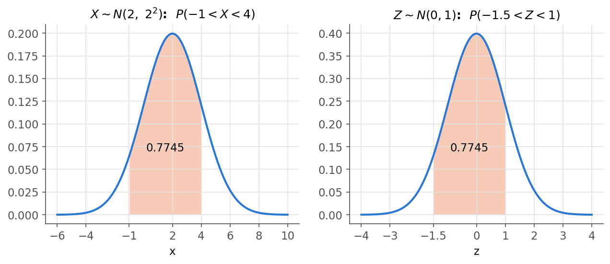
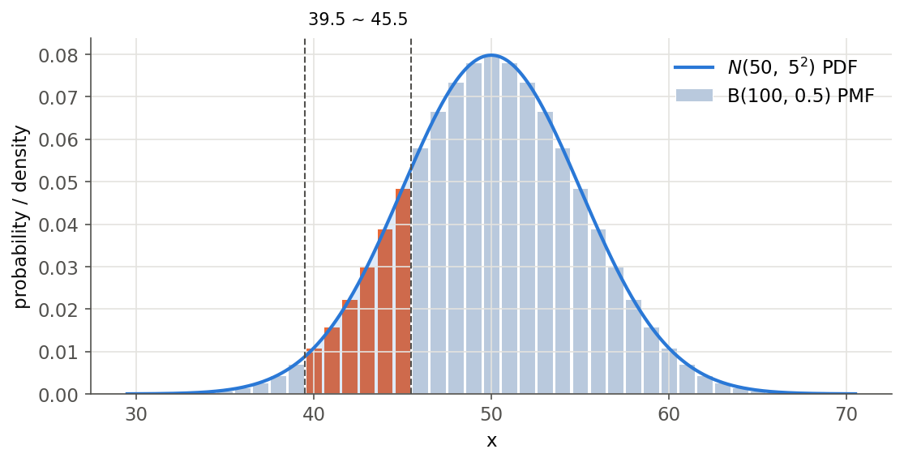
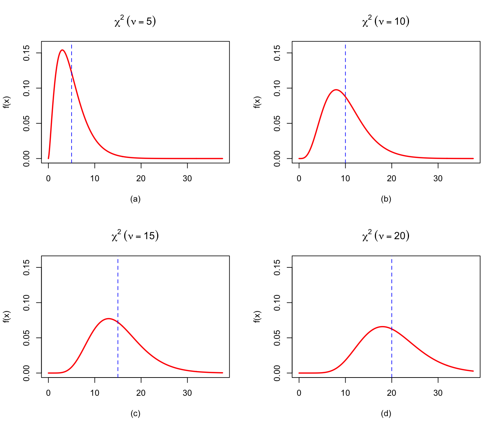
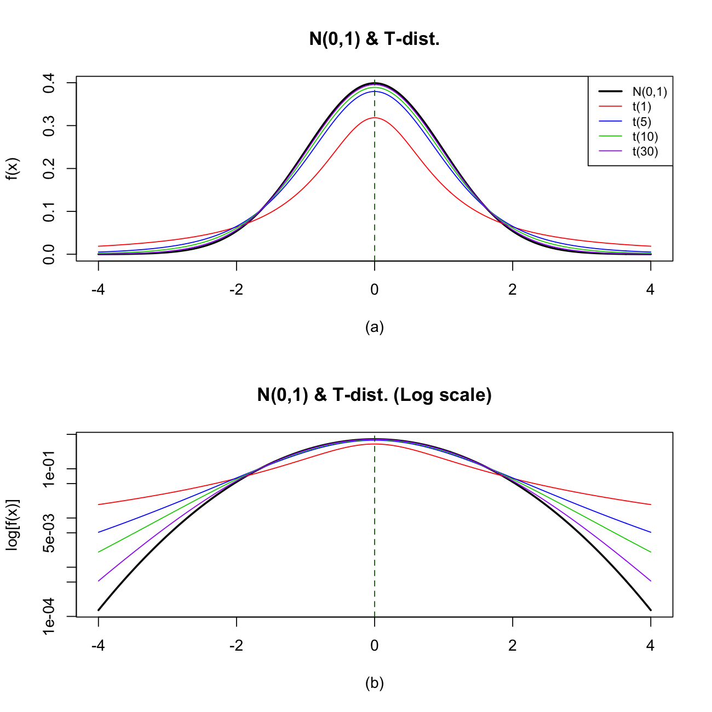
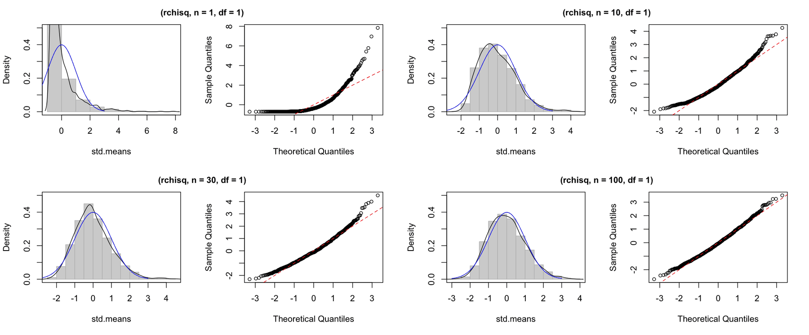
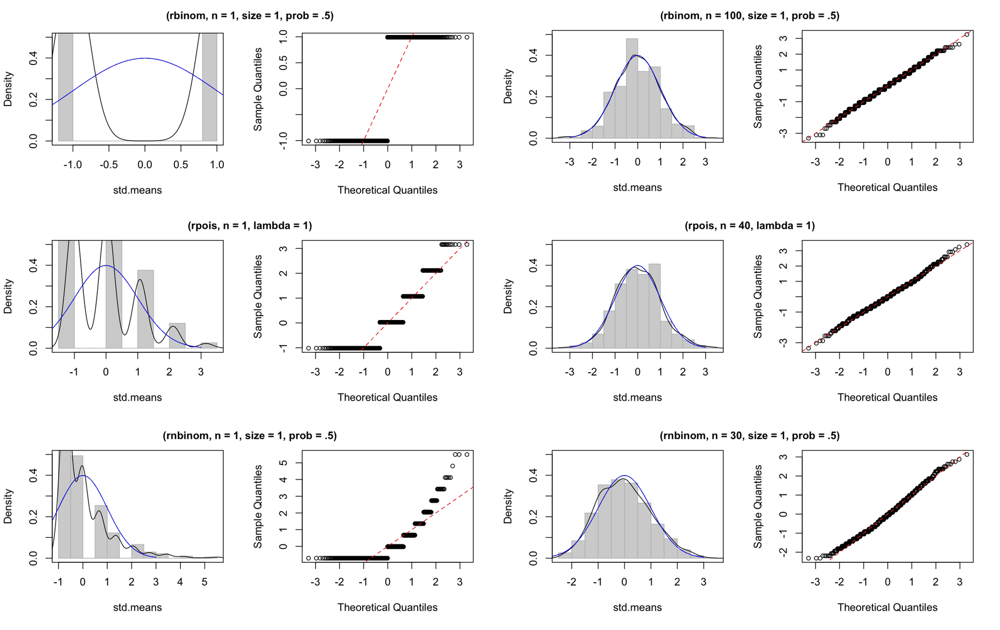

# 5강 연습 문제 풀이 — 연속확률변수와 정규분포

[레포지토리 안내](../../README.ko.md) | [English](Solutions.md) | [한국어](Solutions.ko.md)

> **최종 수정일:** 2026-11-04

---

<br>

## 목차

- [연습 문제 1: 정규분포 확률밀도함수의 모양 비교](#연습-문제-1-정규분포-확률밀도함수의-모양-비교)
- [연습 문제 2: 정규분포의 구간 확률](#연습-문제-2-정규분포의-구간-확률)
- [연습 문제 3: 정규분포표 만들기](#연습-문제-3-정규분포표-만들기)
- [연습 문제 4: 20대 남성의 키](#연습-문제-4-20대-남성의-키)
- [연습 문제 5: 주사위 던지기와 정규 근사](#연습-문제-5-주사위-던지기와-정규-근사)
- [연습 문제 6: 카이제곱 분포의 확률밀도함수](#연습-문제-6-카이제곱-분포의-확률밀도함수)
- [연습 문제 7: t 분포와 표준정규분포의 비교](#연습-문제-7-t-분포와-표준정규분포의-비교)
- [연습 문제 8: 중심극한정리의 시뮬레이션](#연습-문제-8-중심극한정리의-시뮬레이션)

---

<br>

## 연습 문제 1: 정규분포 확률밀도함수의 모양 비교

**문제:** $N(0, 1)$, $N(0, 4)$, $N(2, 1)$, $N(2, 4)$의 확률밀도함수를 그려 모양을 비교한다. 문제는 [연습 문제 1](Exercises.ko.md#연습-문제-1-정규분포-확률밀도함수의-모양-비교)에 있다.

### 풀이

**정답:** 평균 $\mu$는 곡선의 위치만, 분산 $\sigma^2$은 폭과 높이만 바꾼다. 분산이 4인 두 곡선은 분산이 1인 곡선보다 폭이 두 배이고 높이가 절반이다.

**해설:** 표기 $N(\mu, \sigma^2)$의 두 번째 값은 분산이므로 표준편차는 각각 $1, 2, 1, 2$이다. R의 정규분포 함수는 표준편차를 받는다([5강 5.1절](Concepts_Lecture.ko.md#51-확률밀도함수와-모수의-의미)). 아래 코드는 여러 분포의 확률밀도함수를 한 번에 계산하는 함수 `getpdf()`를 정의하고, 그 결과를 네 칸에 그린다.

```r
getpdf <- function(dist, xa, para, para2) {
  np <- length(xa)
  N <- max(length(para), length(para2))

  # PDF name
  dpdf <- paste0("d", dist)
  pdf <- matrix(NA, nrow = np, ncol = N)

  # Vector of the PDF
  if (dist %in% c("exp", "t", "chisq")) {
    for (k in 1:N) {
      pdf[, k] <- do.call(dpdf, list(xa, para[k]))
    }
  } else if (dist == "gamma") {
    for (k in 1:N) {
      pdf[, k] <- do.call(dpdf, list(xa, para[k], 1 / para2[k]))
    }
  } else {
    for (k in 1:N) {
      pdf[, k] <- do.call(dpdf, list(xa, para[k], para2[k]))
    }
  }
  invisible(pdf)
}

mu <- c(0, 0, 2, 2)
sig <- c(1, 2, 1, 2)
xa <- seq(-7, 7, length.out = 200)
pdf <- getpdf("norm", xa, mu, sig)

par(mfrow = c(2, 2))
for (k in 1:4) {
  plot(xa, pdf[, k], type = "l", lwd = 2, col = "red", ylim = c(0, 0.4),
       xlab = paste0("(", letters[k], ")"), ylab = "f(x)",
       main = bquote(N(mu == .(mu[k]), sigma^2 == .(sig[k]^2))))
  abline(v = mu[k], lty = 2, col = "blue")
}
par(mfrow = c(1, 1))
apply(pdf, 2, max)
dnorm(0, 0, c(1, 2))
```

- `getpdf()`의 인수는 분포 이름 `dist`(예: `"norm"`), 확률밀도함수를 계산할 점의 벡터 `xa`, 첫째 모수 벡터 `para`, 둘째 모수 벡터 `para2`이다. `np`는 점의 개수, `N`은 그릴 분포의 개수이다.
- `paste0("d", dist)`는 문자열을 이어 `"dnorm"` 같은 함수 이름을 만든다. `matrix(NA, nrow = np, ncol = N)`은 결과를 담을 빈 행렬로, 열 하나가 분포 하나이다.
- `do.call(dpdf, list(...))`는 이름이 문자열 `dpdf`인 함수를 리스트의 인수로 호출한다. 예를 들어 `do.call("dnorm", list(xa, 0, 1))`은 `dnorm(xa, 0, 1)`과 같다.
- 모수가 하나인 지수분포, t 분포, 카이제곱 분포는 `para[k]`만 넘긴다. 감마분포는 둘째 모수를 척도로 받아 그 역수(비율)를 `dgamma()`의 세 번째 위치 인수로 넘긴다. 나머지(정규분포 등)는 두 모수를 그대로 넘긴다. `invisible(pdf)`는 값을 화면에 출력하지 않고 돌려준다.
- `mu`와 `sig`는 네 분포의 평균과 표준편차이고, `xa`는 $-7$부터 $7$까지 200개의 점이다.
- `par(mfrow = c(2, 2))`는 그림 창을 2행 2열로 나눈다. 반복문은 칸마다 `plot()`으로 곡선을 그리고 `abline(v = mu[k], lty = 2)`로 평균에 점선을 긋는다. `bquote()`의 `.()` 안의 식은 값으로 바뀌어 제목이 $N(\mu = 0, \sigma^2 = 1)$처럼 표시된다.
- 마지막 두 줄은 계산한 곡선의 최댓값과 이론적인 최고 높이 $1/(\sqrt{2\pi}\,\sigma)$를 비교한다.

```text
[1] 0.3986955 0.1994403 0.3989372 0.1994705
[1] 0.3989423 0.1994711
```



*그림 1. N(0, 1), N(0, 4), N(2, 1), N(2, 4)의 확률밀도함수와 평균 위치의 점선*

그림 1의 네 그래프를 비교하면 다음과 같다.

- **(a)와 (c), (b)와 (d):** 분산이 같고 평균만 0에서 2로 바뀌었다. 곡선의 모양은 그대로이고 오른쪽으로 2만큼 평행이동한다.
- **(a)와 (b), (c)와 (d):** 평균이 같고 분산이 1에서 4로, 즉 표준편차가 1에서 2로 바뀌었다. 곡선의 폭은 두 배가 되고 최고 높이는 $0.3989$에서 $0.1995$로 절반이 된다. 넓이가 1로 유지되어야 하기 때문이다.
- 첫 번째 출력의 최댓값이 이론값보다 조금 작은 것은 200개의 점 가운데 평균과 정확히 같은 점이 없기 때문이다.

> **참고:** 이 문제의 원래 실습 코드는 `getpdf()`만 정의한 뒤 `cont.spdf("norm", -7, 7, mu, sd, xp = mu)`로 그래프를 그린다. `cont.spdf()`는 `Rstat` 패키지의 함수이며, 그 패키지 안에서 `getpdf()`를 불러 네 칸 그래프를 그린다([5강 9절](Concepts_Lecture.ko.md#9-r에서-연속확률분포-다루기)). 위 코드는 같은 그래프를 R 기본 함수로 그린다.

---

<br>

## 연습 문제 2: 정규분포의 구간 확률

**문제:** $X \sim N(2, 4)$에서 $P(-1 < X < 4)$를 구한다. 문제는 [연습 문제 2](Exercises.ko.md#연습-문제-2-정규분포의-구간-확률)에 있다.

### 풀이

**정답:** $P(-1 < X < 4) = \Phi(1) - \Phi(-1.5) \approx 0.7745$

**해설:** 분산이 4이므로 표준편차는 $\sigma = 2$이다. 끝점을 표준화하면 $(-1 - 2)/2 = -1.5$, $(4 - 2)/2 = 1$이다([5강 5.3절](Concepts_Lecture.ko.md#53-선형변환과-표준화)).

$$
P(-1 < X < 4) = P\left(\frac{-1 - 2}{2} < Z < \frac{4 - 2}{2}\right) = P(-1.5 < Z < 1) = \Phi(1) - \Phi(-1.5)
$$

정규분포표에서 $\Phi(1) = 0.8413$, $\Phi(1.5) = 0.9332$이고 대칭성에 의해 $\Phi(-1.5) = 1 - 0.9332 = 0.0668$이다.

$$
\Phi(1) - \Phi(-1.5) = 0.8413 - 0.0668 = 0.7745
$$

R로는 두 가지 방법으로 확인한다.

```r
pnorm(1) - pnorm(-1.5)
pnorm(4, mean = 2, sd = 2) - pnorm(-1, mean = 2, sd = 2)
```

```text
[1] 0.7745375
[1] 0.7745375
```

- 첫째 줄은 표준화한 끝점으로 표준정규분포의 누적 확률을 뺀다. `pnorm()`의 평균과 표준편차 기본값은 0과 1이다.
- 둘째 줄은 원래 분포 $N(2, 2^2)$의 누적분포함수를 직접 쓴다. 분산 4가 아니라 표준편차 `sd = 2`를 준다. 두 결과가 같은 것은 표준화가 확률을 바꾸지 않기 때문이다.



*그림 2. N(2, 2²)에서 -1과 4 사이의 넓이와 표준화한 N(0, 1)에서 -1.5와 1 사이의 넓이*

> **참고:** 원래 실습 코드의 `norm.trans(mu = 2, sig = 2, a = -1, b = 4)`는 `Rstat` 패키지의 함수로, 그림 2처럼 원래 분포와 표준화한 분포의 넓이를 함께 그린다.

---

<br>

## 연습 문제 3: 정규분포표 만들기

**문제:** $z = 0.00, 0.01, \ldots, 2.99$의 $\Phi(z)$를 30행 10열의 표로 만든다. 문제는 [연습 문제 3](Exercises.ko.md#연습-문제-3-정규분포표-만들기)에 있다.

### 풀이

**정답:** `pnorm()`으로 300개의 값을 계산하여 행 단위로 10개씩 채운 행렬을 만든다.

```r
pv <- matrix(pnorm(0:299/100), ncol = 10, byrow = TRUE)
colnames(pv) <- 0:9/100
rownames(pv) <- 0:29/10
print(round(pv, 4))
```

- `0:299/100`은 정수 0, 1, ..., 299를 100으로 나눈 벡터 $0.00, 0.01, \ldots, 2.99$이다. 연산자 `:`가 `/`보다 먼저 계산된다.
- `pnorm()`은 벡터를 받아 각 원소의 $\Phi$ 값을 돌려준다.
- `matrix(..., ncol = 10, byrow = TRUE)`는 300개의 값을 한 행에 10개씩 왼쪽에서 오른쪽으로 채운다. 따라서 $i$번째 행은 $z = (i-1)/10 + 0.00, \ldots, (i-1)/10 + 0.09$의 값이다. `byrow`의 기본값 `FALSE`로 두면 열 방향으로 채워져 표가 틀어진다.
- `colnames()`와 `rownames()`는 열 이름(소수 둘째 자리 0, 0.01, ..., 0.09)과 행 이름(0, 0.1, ..., 2.9)을 붙인다.
- `round(pv, 4)`는 소수 넷째 자리로 반올림한다.

```text
         0   0.01   0.02   0.03   0.04   0.05   0.06   0.07   0.08   0.09
0   0.5000 0.5040 0.5080 0.5120 0.5160 0.5199 0.5239 0.5279 0.5319 0.5359
0.1 0.5398 0.5438 0.5478 0.5517 0.5557 0.5596 0.5636 0.5675 0.5714 0.5753
0.2 0.5793 0.5832 0.5871 0.5910 0.5948 0.5987 0.6026 0.6064 0.6103 0.6141
0.3 0.6179 0.6217 0.6255 0.6293 0.6331 0.6368 0.6406 0.6443 0.6480 0.6517
0.4 0.6554 0.6591 0.6628 0.6664 0.6700 0.6736 0.6772 0.6808 0.6844 0.6879
0.5 0.6915 0.6950 0.6985 0.7019 0.7054 0.7088 0.7123 0.7157 0.7190 0.7224
0.6 0.7257 0.7291 0.7324 0.7357 0.7389 0.7422 0.7454 0.7486 0.7517 0.7549
0.7 0.7580 0.7611 0.7642 0.7673 0.7704 0.7734 0.7764 0.7794 0.7823 0.7852
0.8 0.7881 0.7910 0.7939 0.7967 0.7995 0.8023 0.8051 0.8078 0.8106 0.8133
0.9 0.8159 0.8186 0.8212 0.8238 0.8264 0.8289 0.8315 0.8340 0.8365 0.8389
1   0.8413 0.8438 0.8461 0.8485 0.8508 0.8531 0.8554 0.8577 0.8599 0.8621
1.1 0.8643 0.8665 0.8686 0.8708 0.8729 0.8749 0.8770 0.8790 0.8810 0.8830
1.2 0.8849 0.8869 0.8888 0.8907 0.8925 0.8944 0.8962 0.8980 0.8997 0.9015
1.3 0.9032 0.9049 0.9066 0.9082 0.9099 0.9115 0.9131 0.9147 0.9162 0.9177
1.4 0.9192 0.9207 0.9222 0.9236 0.9251 0.9265 0.9279 0.9292 0.9306 0.9319
1.5 0.9332 0.9345 0.9357 0.9370 0.9382 0.9394 0.9406 0.9418 0.9429 0.9441
1.6 0.9452 0.9463 0.9474 0.9484 0.9495 0.9505 0.9515 0.9525 0.9535 0.9545
1.7 0.9554 0.9564 0.9573 0.9582 0.9591 0.9599 0.9608 0.9616 0.9625 0.9633
1.8 0.9641 0.9649 0.9656 0.9664 0.9671 0.9678 0.9686 0.9693 0.9699 0.9706
1.9 0.9713 0.9719 0.9726 0.9732 0.9738 0.9744 0.9750 0.9756 0.9761 0.9767
2   0.9772 0.9778 0.9783 0.9788 0.9793 0.9798 0.9803 0.9808 0.9812 0.9817
2.1 0.9821 0.9826 0.9830 0.9834 0.9838 0.9842 0.9846 0.9850 0.9854 0.9857
2.2 0.9861 0.9864 0.9868 0.9871 0.9875 0.9878 0.9881 0.9884 0.9887 0.9890
2.3 0.9893 0.9896 0.9898 0.9901 0.9904 0.9906 0.9909 0.9911 0.9913 0.9916
2.4 0.9918 0.9920 0.9922 0.9925 0.9927 0.9929 0.9931 0.9932 0.9934 0.9936
2.5 0.9938 0.9940 0.9941 0.9943 0.9945 0.9946 0.9948 0.9949 0.9951 0.9952
2.6 0.9953 0.9955 0.9956 0.9957 0.9959 0.9960 0.9961 0.9962 0.9963 0.9964
2.7 0.9965 0.9966 0.9967 0.9968 0.9969 0.9970 0.9971 0.9972 0.9973 0.9974
2.8 0.9974 0.9975 0.9976 0.9977 0.9977 0.9978 0.9979 0.9979 0.9980 0.9981
2.9 0.9981 0.9982 0.9982 0.9983 0.9984 0.9984 0.9985 0.9985 0.9986 0.9986
```

출력은 교과서의 정규분포표와 같다. 예를 들어 1.2 행과 0.05 열의 값 0.8944는 $\Phi(1.25)$이다. 음수 $z$의 값은 $\Phi(-z) = 1 - \Phi(z)$로 얻으므로 양수 부분만 있으면 충분하다.

---

<br>

## 연습 문제 4: 20대 남성의 키

**문제:** $X \sim N(175, 8^2)$에서 $P(180 < X < 185)$를 구한다. 문제는 [연습 문제 4](Exercises.ko.md#연습-문제-4-20대-남성의-키)에 있다.

### 풀이

**정답:** 약 $0.1603$, 즉 약 16%이다.

**해설:** 끝점을 표준화하면 $(180 - 175)/8 = 0.625$, $(185 - 175)/8 = 1.25$이다.

$$
P(180 < X < 185) = P\left(\frac{180 - 175}{8} < Z < \frac{185 - 175}{8}\right) = P(0.625 < Z < 1.25) = \Phi(1.25) - \Phi(0.625)
$$

정규분포표에서 $\Phi(1.25) = 0.8944$이다. $0.625$는 소수 셋째 자리까지 있으므로 이웃한 두 값 $\Phi(0.62) = 0.7324$와 $\Phi(0.63) = 0.7357$ 사이를 선형 보간한다. $0.625$는 두 점의 가운데이므로 두 값의 평균을 쓴다.

$$
\Phi(0.625) \approx \frac{0.7324 + 0.7357}{2} = 0.73405 \approx 0.7341, \qquad P(180 < X < 185) \approx 0.8944 - 0.7341 = 0.1603
$$

```r
pnorm(185, 175, 8) - pnorm(180, 175, 8)
```

```text
[1] 0.1603358
```

`pnorm(q, mean, sd)`의 두 번째, 세 번째 위치 인수는 평균과 표준편차이므로 `pnorm(185, 175, 8)`은 $P(X \leq 185)$이다. R의 값 0.1603358은 손 계산과 소수 넷째 자리까지 같다. 따라서 20대 남성 가운데 약 16%의 키가 180cm와 185cm 사이에 있다.

---

<br>

## 연습 문제 5: 주사위 던지기와 정규 근사

**문제:** 주사위 100번 중 4 이상이 나오는 횟수 $X$에 대해 $P(40 \leq X \leq 45)$를 구한다. 문제는 [연습 문제 5](Exercises.ko.md#연습-문제-5-주사위-던지기와-정규-근사)에 있다.

### 풀이

**정답:** 정확한 값은 약 $0.1665$, 연속성 수정을 한 정규 근사는 약 $0.1662$이다.

**해설:** 한 번 던질 때 4 이상(4, 5, 6)이 나올 확률은 $3/6 = 1/2$이고 시행은 서로 독립이므로 $X \sim B(100, 0.5)$이다.

**(1) 이항분포로 정확히 계산하기.** 40부터 45까지의 이항확률을 더한다.

$$
P(40 \leq X \leq 45) = \sum_{x=40}^{45}\binom{100}{x}\left(\frac{1}{2}\right)^{x}\left(\frac{1}{2}\right)^{100-x} \approx 0.1665
$$

**(2) 정규 근사.** $np = 50$, $n(1-p) = 50$으로 근사의 조건을 넉넉히 만족하고 $\sigma = \sqrt{100 \times 0.5 \times 0.5} = 5$이다. 정수 40부터 45까지의 막대는 구간 $[39.5, 45.5]$를 차지하므로 연속성 수정을 하면 다음과 같다([5강 6.2절](Concepts_Lecture.ko.md#62-연속성-수정)).

$$
P(40 \leq X \leq 45) \approx P(39.5 < X < 45.5) = P\left(\frac{39.5 - 50}{5} < Z < \frac{45.5 - 50}{5}\right) = P(-2.1 < Z < -0.9)
$$

$$
= \Phi(-0.9) - \Phi(-2.1) = \lbrace1 - \Phi(0.9)\rbrace - \lbrace1 - \Phi(2.1)\rbrace = (1 - 0.8159) - (1 - 0.9821) = 0.1841 - 0.0179 = 0.1662
$$

```r
pbinom(45, 100, 0.5) - pbinom(39, 100, 0.5)
pnorm(-0.9) - pnorm(-2.1)
pnorm(45, 50, 5) - pnorm(40, 50, 5)
```

```text
[1] 0.1665007
[1] 0.1661957
[1] 0.1359051
```

- 첫째 줄의 `pbinom(45, 100, 0.5)`는 $P(X \leq 45)$이다. $P(40 \leq X \leq 45) = P(X \leq 45) - P(X \leq 39)$이므로 빼는 값은 `pbinom(39, ...)`이다. `pbinom(40, ...)`을 빼면 $X = 40$의 확률이 빠진다.
- 둘째 줄은 연속성 수정을 한 정규 근사이다.
- 셋째 줄은 연속성 수정 없이 $N(50, 5^2)$에서 40과 45 사이의 넓이를 구한 값이다.

| 방법 | 값 | 정확한 값과의 차 |
|:-----|:-----|:-----|
| 이항분포 (정확) | 0.1665 | 0 |
| 정규 근사, 연속성 수정 | 0.1662 | 0.0003 |
| 정규 근사, 연속성 수정 없음 | 0.1359 | 0.0306 |

*표 1. 세 방법으로 구한 P(40 ≤ X ≤ 45)와 오차*

연속성 수정을 하지 않으면 양 끝 막대 40과 45의 절반씩이 빠져 확률을 크게 과소평가한다. 그림 3에서 주황색 막대의 넓이 합이 정확한 확률이고, 근사는 정규 곡선 아래에서 39.5와 45.5 사이의 넓이이다.



*그림 3. B(100, 0.5)의 확률질량함수와 N(50, 5²)의 확률밀도함수, 40부터 45까지의 막대와 연속성 수정 구간*

---

<br>

## 연습 문제 6: 카이제곱 분포의 확률밀도함수

**문제:** 자유도 5, 10, 15, 20인 카이제곱 분포의 확률밀도함수를 그린다. 문제는 [연습 문제 6](Exercises.ko.md#연습-문제-6-카이제곱-분포의-확률밀도함수)에 있다.

### 풀이

**정답:** 자유도가 커질수록 분포는 오른쪽으로 이동하고 넓게 퍼지며, 왼쪽으로 치우친 봉우리가 점차 대칭에 가까워진다.

**해설:** 연습 문제 1의 `getpdf()`를 그대로 쓴다.

```r
nu <- c(5, 10, 15, 20)
up <- qchisq(0.99, max(nu))
up
xa <- seq(0, up, length.out = 300)
pdf <- getpdf("chisq", xa, nu, nu)

par(mfrow = c(2, 2))
for (k in 1:4) {
  plot(xa, pdf[, k], type = "l", lwd = 2, col = "red", ylim = c(0, 0.16),
       xlab = paste0("(", letters[k], ")"), ylab = "f(x)",
       main = bquote(chi^2 ~ (nu == .(nu[k]))))
  abline(v = nu[k], lty = 2, col = "blue")
}
par(mfrow = c(1, 1))
xa[apply(pdf, 2, which.max)]
```

- `qchisq(0.99, max(nu))`는 자유도 20인 카이제곱 분포의 99% 분위수이며, 가로축의 오른쪽 끝으로 쓴다.
- `getpdf("chisq", xa, nu, nu)`에서 카이제곱 분포는 모수가 자유도 하나뿐이므로 네 번째 인수는 쓰이지 않는다. 그러나 `getpdf()`가 `length(para2)`를 계산하므로 인수를 비워 두면 오류가 나며, 그래서 같은 벡터를 한 번 더 넘긴다.
- 반복문은 연습 문제 1과 같고, 점선은 자유도 위치, 즉 각 분포의 평균 $E[\chi_\nu^2] = \nu$를 표시한다.
- 마지막 줄의 `which.max()`는 각 열에서 밀도가 가장 큰 점의 위치를 돌려주므로, 그 점의 $x$ 값은 최빈값의 근삿값이다.

```text
[1] 37.56623
[1]  3.015350  8.040933 12.940877 17.966460
```



*그림 4. 자유도 5, 10, 15, 20인 카이제곱 분포의 확률밀도함수와 자유도 위치의 점선*

그림 4에서 다음을 확인할 수 있다.

- 봉우리(최빈값)는 약 3.0, 8.0, 12.9, 18.0으로 이론값 $\nu - 2 = 3, 8, 13, 18$과 일치한다. 평균 $\nu$(점선)가 최빈값보다 오른쪽에 있는 것은 오른쪽 꼬리가 길기 때문이다.
- 자유도가 커지면 표준편차 $\sqrt{2\nu}$가 $3.16, 4.47, 5.48, 6.32$로 커져 곡선이 낮고 넓어진다.
- 자유도가 커질수록 좌우 비대칭이 줄어든다. 카이제곱 분포는 독립인 항 $\nu$개의 합이므로 중심극한정리에 의해 정규분포에 가까워진다([5강 7.1절](Concepts_Lecture.ko.md#71-카이제곱-분포)).

---

<br>

## 연습 문제 7: t 분포와 표준정규분포의 비교

**문제:** 표준정규분포와 자유도 1, 5, 10, 30인 t 분포를 보통 척도와 로그 척도로 비교한다. 문제는 [연습 문제 7](Exercises.ko.md#연습-문제-7-t-분포와-표준정규분포의-비교)에 있다.

### 풀이

**정답:** t 분포는 표준정규분포보다 가운데가 낮고 꼬리가 두꺼우며, 자유도가 커질수록 표준정규분포에 가까워진다. 꼬리의 차이는 로그 척도에서 뚜렷하게 보인다.

```r
nu <- c(1, 5, 10, 30)
x <- seq(-4, 4, length.out = 400)
cols <- c("red", "blue", "green3", "purple")

par(mfrow = c(2, 1))
plot(x, dnorm(x), type = "l", lwd = 2, ylab = "f(x)", xlab = "(a)",
     main = "N(0,1) & T-dist.")
for (k in 1:4) lines(x, dt(x, nu[k]), col = cols[k])
abline(v = 0, lty = 2, col = "darkgreen")
legend("topright", c("N(0,1)", paste0("t(", nu, ")")),
       col = c("black", cols), lwd = c(2, 1, 1, 1, 1), cex = 0.8)

plot(x, dnorm(x), type = "l", lwd = 2, log = "y", ylab = "log[f(x)]", xlab = "(b)",
     main = "N(0,1) & T-dist. (Log scale)")
for (k in 1:4) lines(x, dt(x, nu[k]), col = cols[k])
abline(v = 0, lty = 2, col = "darkgreen")
par(mfrow = c(1, 1))

round(c(dnorm(0), dt(0, nu)), 4)
signif(c(dnorm(4), dt(4, nu)), 3)
```

- `dt(x, df)`는 자유도 `df`인 t 분포의 확률밀도함수이다. 먼저 `plot()`으로 표준정규분포를 굵은 검은 선으로 그리고, `lines()`로 t 분포 네 개를 겹친다.
- `legend()`는 오른쪽 위에 범례를 둔다. `paste0("t(", nu, ")")`는 `"t(1)"`, `"t(5)"` 같은 이름을 만든다.
- 두 번째 그래프의 `log = "y"`는 세로축을 로그 척도로 만든다. 확률밀도함수의 값은 그대로이고 눈금만 로그 간격이 된다.
- 마지막 두 줄은 $x = 0$에서의 높이와 $x = 4$에서의 꼬리 높이를 비교한다.

```text
[1] 0.3989 0.3183 0.3796 0.3891 0.3956
[1] 0.000134 0.018700 0.005120 0.002030 0.000525
```



*그림 5. 표준정규분포와 자유도 1, 5, 10, 30인 t 분포의 확률밀도함수, 보통 척도와 로그 척도*

- **보통 척도 (a):** 모든 곡선이 0을 중심으로 대칭이다. 가운데 높이는 $t(1)$이 0.3183으로 가장 낮고, 자유도가 커질수록 0.3796, 0.3891, 0.3956으로 표준정규분포의 0.3989에 가까워진다. $t(30)$은 표준정규분포와 거의 구별되지 않는다.
- **로그 척도 (b):** 보통 척도에서는 0에 붙어 보이는 꼬리의 차이가 드러난다. $x = 4$에서 표준정규분포의 밀도는 0.000134이지만 $t(1)$은 0.0187로 약 140배이다. 표준정규분포의 로그 밀도는 $-z^2/2$에 상수를 더한 포물선이라 꼬리가 빠르게 떨어지지만, t 분포의 밀도는 $(1 + t^2/\nu)^{-(\nu+1)/2}$로 거듭제곱의 속도로만 줄어들기 때문이다.
- 이 두꺼운 꼬리 때문에 표본이 작을 때(자유도가 작을 때)의 t 검정은 같은 유의수준에서 더 큰 임계값을 쓴다([5강 7.3절](Concepts_Lecture.ko.md#73-t-분포)).

---

<br>

## 연습 문제 8: 중심극한정리의 시뮬레이션

**문제:** 표본평균 1,000개를 표준화하여 히스토그램과 Q-Q 그림을 그리는 함수 `plotForCLT()`를 작성하고 네 모집단에 적용한다. 문제는 [연습 문제 8](Exercises.ko.md#연습-문제-8-중심극한정리의-시뮬레이션)에 있다.

### 풀이

**정답:** 네 모집단 모두 표본 크기가 커질수록 표준화한 표본평균의 히스토그램이 $N(0, 1)$의 곡선에 가까워지고 Q-Q 그림의 점이 직선에 모인다. 필요한 표본 크기는 모집단의 왜도가 클수록 크다.

```r
# Define function for CLT check
plotForCLT <- function(r.dist, n, ...) {

  means <- c()

  for (i in 1:1000) {
    means[i] <- mean(r.dist(n, ...))
  }

  std.means <- scale(means)
  par(mfrow = c(1, 2))

  hist(std.means, prob = T, col = "light grey",
       border = "grey", main = NULL, ylim = c(0, 0.5))
  lines(density(std.means))
  box()

  curve(dnorm(x, 0, 1), -3, 3, col = 'blue', add = T)

  qqnorm(std.means, main = "", cex = 0.8)
  abline(0, 1, lty = 2, col = "red")
  par(mfrow = c(1, 1))
}

set.seed(1)

# Sampling from the Chi-squared distribution
plotForCLT(rchisq, n = 1, df = 1)
plotForCLT(rchisq, n = 10, df = 1)
plotForCLT(rchisq, n = 20, df = 1)
plotForCLT(rchisq, n = 30, df = 1)
plotForCLT(rchisq, n = 100, df = 1)

# Sampling from the Binomial distribution
plotForCLT(rbinom, n = 1, size = 1, prob = .5)
plotForCLT(rbinom, n = 10, size = 1, prob = .5)
plotForCLT(rbinom, n = 20, size = 1, prob = .5)
plotForCLT(rbinom, n = 30, size = 1, prob = .5)
plotForCLT(rbinom, n = 50, size = 1, prob = .5)
plotForCLT(rbinom, n = 100, size = 1, prob = .5)

# Sampling from the Poisson distribution
plotForCLT(rpois, n = 1, lambda = 1)
plotForCLT(rpois, n = 10, lambda = 1)
plotForCLT(rpois, n = 20, lambda = 1)
plotForCLT(rpois, n = 30, lambda = 1)
plotForCLT(rpois, n = 40, lambda = 1)

# Sampling from the Negative Binomial distribution
plotForCLT(rnbinom, n = 1, size = 1, prob = .5)
plotForCLT(rnbinom, n = 10, size = 1, prob = .5)
plotForCLT(rnbinom, n = 20, size = 1, prob = .5)
plotForCLT(rnbinom, n = 30, size = 1, prob = .5)
```

- `plotForCLT(r.dist, n, ...)`의 첫째 인수는 `rchisq` 같은 난수 생성 함수 자체이다. R에서는 함수도 값처럼 인수로 넘길 수 있다. `...`는 `df = 1`처럼 함수 이름 뒤에 준 나머지 인수를 받아 `r.dist(n, ...)`에 그대로 전달한다.
- `means <- c()`로 빈 벡터를 만들고, 반복문이 크기 `n`인 표본을 1,000번 생성하여 그 평균을 `means[i]`에 저장한다.
- `scale(means)`는 1,000개의 평균에서 그 표본평균을 빼고 표본표준편차로 나누어 표준화한다. 이론값 $\mu$, $\sigma/\sqrt{n}$이 아니라 시뮬레이션 값으로 표준화하므로, 결과는 항상 평균 0, 표준편차 1이고 그래프는 분포의 **모양**만 비교한다.
- `hist(..., prob = T)`는 막대 높이를 빈도가 아니라 밀도로 그려 넓이의 합이 1이 되게 한다. `lines(density(std.means))`는 커널 밀도 추정 곡선(검은 선)을 겹치고, `curve(dnorm(x, 0, 1), -3, 3, add = T)`는 $N(0, 1)$의 확률밀도함수(파란 선)를 겹친다.
- `qqnorm()`은 표준화한 평균을 정렬한 값(세로축)을 표준정규분포의 분위수(가로축)에 대해 그린 정규 Q-Q 그림이다. 분포가 $N(0, 1)$이면 점이 `abline(0, 1)`의 빨간 점선 $y = x$ 위에 놓인다.
- `set.seed(1)`은 난수의 시작점을 정해 결과를 재현할 수 있게 한다.
- 이항분포의 성공 확률 인수 이름은 `prob`이다. `p = .5`로 써도 R의 인수 이름 부분 일치에 의해 `prob`로 해석되지만, 전체 이름을 쓰는 편이 안전하다.

그림 6은 자유도 1인 카이제곱 분포에서 $n = 1, 10, 30, 100$일 때의 결과이다.



*그림 6. 자유도 1인 카이제곱 분포에서 n이 1, 10, 30, 100일 때 표준화한 표본평균의 히스토그램과 정규 Q-Q 그림*

그림 7은 베르누이분포($n = 1, 100$), 포아송분포($n = 1, 40$), 음이항분포($n = 1, 30$)의 결과이다.



*그림 7. 베르누이분포, 포아송분포, 음이항분포에서 가장 작은 n과 가장 큰 n일 때 표준화한 표본평균의 히스토그램과 정규 Q-Q 그림*

수렴 속도는 모집단의 왜도 $\gamma$로 설명된다. 표본평균의 왜도는 $\gamma/\sqrt{n}$이므로([5강 8.2절](Concepts_Lecture.ko.md#82-성립-조건)) 표 2와 같다.

| 모집단 | 평균, 분산 | 왜도 $\gamma$ | 가장 큰 $n$에서 $\bar{X}$의 왜도 |
|:-----|:-----|:-----|:-----|
| 카이제곱 분포 $\chi^2(1)$ | 1, 2 | $\sqrt{8} \approx 2.83$ | $n = 100$: 0.28 |
| 베르누이분포 ($p = 0.5$) | 0.5, 0.25 | 0 | $n = 100$: 0 |
| 포아송분포 ($\lambda = 1$) | 1, 1 | 1 | $n = 40$: 0.16 |
| 음이항분포 (`size = 1`, `prob = 0.5`) | 1, 2 | $1.5/\sqrt{0.5} \approx 2.12$ | $n = 30$: 0.39 |

*표 2. 네 모집단의 평균, 분산, 왜도와 가장 큰 표본 크기에서 표본평균의 왜도*

- **카이제곱 분포 $\chi^2(1)$:** $n = 1$이면 모집단 자체로, 0 근처에 몰리고 오른쪽 꼬리가 매우 긴 분포이다. Q-Q 그림이 오른쪽 위로 크게 휘어 있다. $n = 10$, $30$에서는 봉우리가 생기지만 Q-Q 그림의 오른쪽 끝이 여전히 직선 위로 올라가 오른쪽 꼬리가 남아 있음을 보여 준다. $n = 100$이면 점이 거의 직선 위에 놓인다.
- **베르누이분포:** $n = 1$이면 값이 0과 1 두 개뿐이라 히스토그램은 두 막대이고 Q-Q 그림은 두 개의 수평선이다. 모집단이 대칭($\gamma = 0$)이므로 $n$이 커지면 빠르게 정규분포에 가까워지며, $n = 100$에서는 평균이 $0, 0.01, \ldots, 1$의 이산값만 갖는데도 히스토그램과 Q-Q 그림이 정규분포와 잘 맞는다.
- **포아송분포:** $n = 1$이면 0, 1, 2, ...의 정수값이 계단 모양의 Q-Q 그림을 만든다. $n = 40$에서는 왜도가 0.16으로 줄어 정규분포와 잘 맞는다.
- **음이항분포:** `rnbinom(n, size = 1, prob = 0.5)`는 첫 성공 전까지의 실패 횟수를 세는 형태의 기하분포이며, 성공까지의 시행 횟수로 정의한 기하분포에서 1을 뺀 값과 같다. 오른쪽으로 치우쳐 있어 $n = 30$에서도 왜도 0.39가 남지만, Q-Q 그림은 대체로 직선을 따른다.

> **핵심:** 모집단이 이산이든 연속이든, 대칭이든 치우쳤든, 분산이 유한하면 표본평균의 분포는 $n$이 커질수록 정규분포에 가까워진다. 다만 필요한 $n$은 모집단마다 다르며, 대칭인 베르누이분포보다 왜도가 큰 $\chi^2(1)$이 훨씬 큰 $n$을 요구한다.
