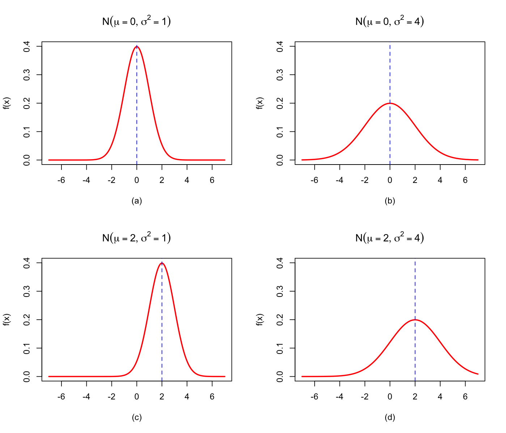
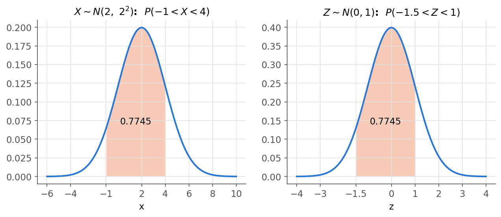
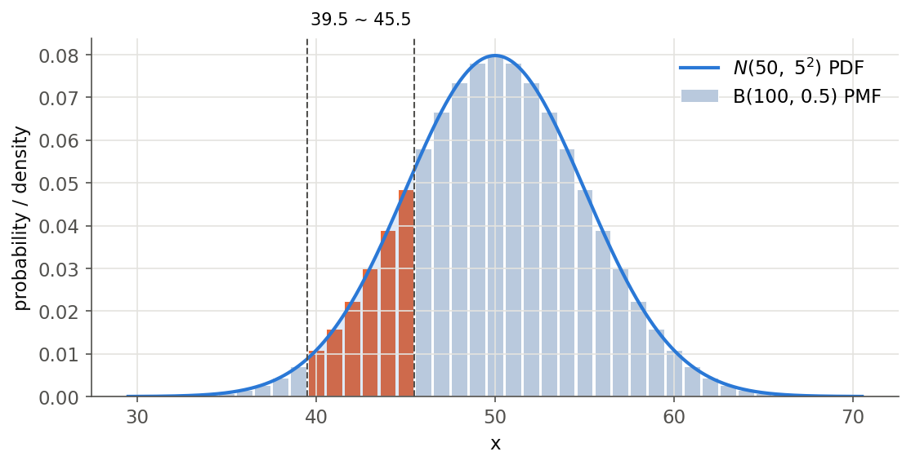
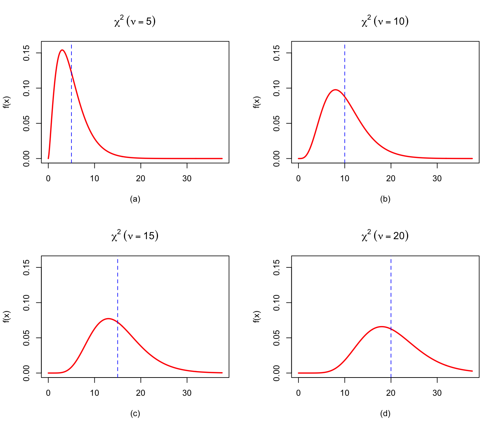
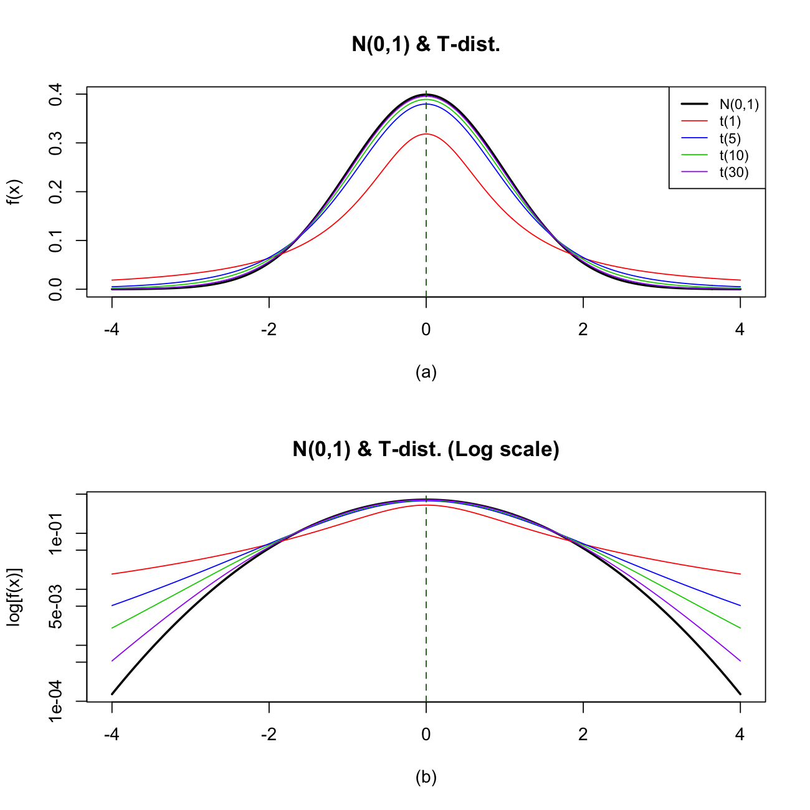
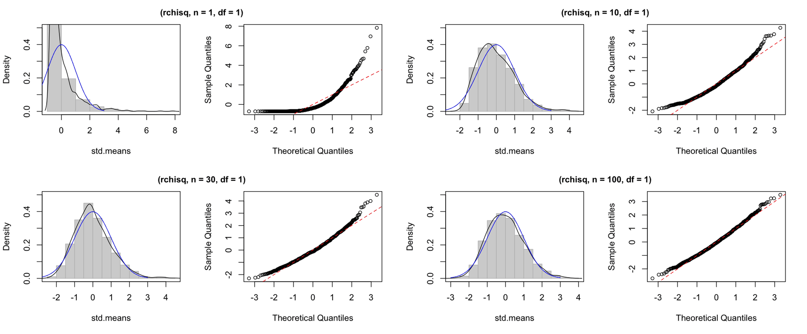
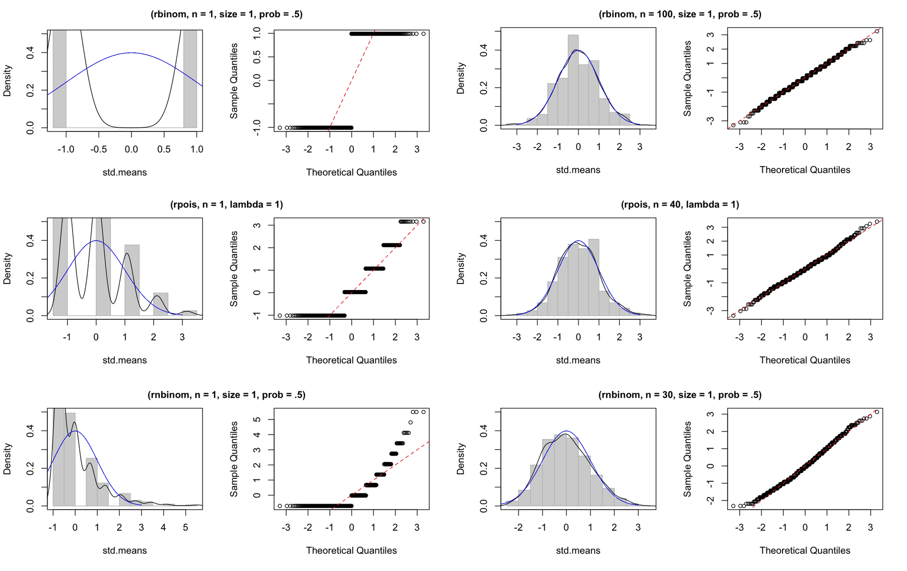

# Lecture 5 Solutions — Continuous Random Variables and the Normal Distribution

[Repository Guide](../../README.md) | [English](Solutions.md) | [한국어](Solutions.ko.md)

> **Last Updated:** 2026-11-04

---

<br>

## Table of Contents

- [Exercise 1: Comparing the Shapes of Normal PDFs](#exercise-1-comparing-the-shapes-of-normal-pdfs)
- [Exercise 2: An Interval Probability of a Normal Distribution](#exercise-2-an-interval-probability-of-a-normal-distribution)
- [Exercise 3: Building a Standard Normal Table](#exercise-3-building-a-standard-normal-table)
- [Exercise 4: Heights of Men in Their Twenties](#exercise-4-heights-of-men-in-their-twenties)
- [Exercise 5: Rolling a Die and the Normal Approximation](#exercise-5-rolling-a-die-and-the-normal-approximation)
- [Exercise 6: PDFs of Chi-Square Distributions](#exercise-6-pdfs-of-chi-square-distributions)
- [Exercise 7: Comparing t Distributions with the Standard Normal](#exercise-7-comparing-t-distributions-with-the-standard-normal)
- [Exercise 8: Simulating the Central Limit Theorem](#exercise-8-simulating-the-central-limit-theorem)

---

<br>

## Exercise 1: Comparing the Shapes of Normal PDFs

**Problem:** Plot the PDFs of $N(0, 1)$, $N(0, 4)$, $N(2, 1)$, and $N(2, 4)$ and compare their shapes. The problem is in [Exercise 1](Exercises.md#exercise-1-comparing-the-shapes-of-normal-pdfs).

### Solution

**Answer:** The mean $\mu$ changes only the position of the curve, and the variance $\sigma^2$ changes only its width and height. The two curves with variance 4 are twice as wide and half as tall as those with variance 1.

**Explanation:** The second value of $N(\mu, \sigma^2)$ is the variance, so the standard deviations are $1, 2, 1, 2$. R's normal functions take the standard deviation ([Lecture 5, Section 5.1](Concepts_Lecture.md#51-pdf-and-the-meaning-of-the-parameters)). The code below defines a function `getpdf()` that computes the PDFs of several distributions at once and plots the results in four panels.

```r
getpdf <- function(dist, xa, para, para2) {
  np <- length(xa)
  N <- max(length(para), length(para2))

  # PDF name
  dpdf <- paste0("d", dist)
  pdf <- matrix(NA, nrow = np, ncol = N)

  # Vector of the PDF
  if (dist %in% c("exp", "t", "chisq")) {
    for (k in 1:N) {
      pdf[, k] <- do.call(dpdf, list(xa, para[k]))
    }
  } else if (dist == "gamma") {
    for (k in 1:N) {
      pdf[, k] <- do.call(dpdf, list(xa, para[k], 1 / para2[k]))
    }
  } else {
    for (k in 1:N) {
      pdf[, k] <- do.call(dpdf, list(xa, para[k], para2[k]))
    }
  }
  invisible(pdf)
}

mu <- c(0, 0, 2, 2)
sig <- c(1, 2, 1, 2)
xa <- seq(-7, 7, length.out = 200)
pdf <- getpdf("norm", xa, mu, sig)

par(mfrow = c(2, 2))
for (k in 1:4) {
  plot(xa, pdf[, k], type = "l", lwd = 2, col = "red", ylim = c(0, 0.4),
       xlab = paste0("(", letters[k], ")"), ylab = "f(x)",
       main = bquote(N(mu == .(mu[k]), sigma^2 == .(sig[k]^2))))
  abline(v = mu[k], lty = 2, col = "blue")
}
par(mfrow = c(1, 1))
apply(pdf, 2, max)
dnorm(0, 0, c(1, 2))
```

- The arguments of `getpdf()` are the distribution name `dist` (for example `"norm"`), the vector `xa` of points at which to evaluate the PDF, the first parameter vector `para`, and the second parameter vector `para2`. `np` is the number of points and `N` the number of distributions to draw.
- `paste0("d", dist)` concatenates strings to form a function name such as `"dnorm"`. `matrix(NA, nrow = np, ncol = N)` is an empty matrix for the results, one column per distribution.
- `do.call(dpdf, list(...))` calls the function whose name is the string `dpdf` with the arguments in the list. For example, `do.call("dnorm", list(xa, 0, 1))` is the same as `dnorm(xa, 0, 1)`.
- The one-parameter exponential, t, and chi-square distributions receive only `para[k]`. The gamma distribution takes its second parameter as a scale and passes its reciprocal (the rate) as the third positional argument of `dgamma()`. The others (such as the normal) receive both parameters unchanged. `invisible(pdf)` returns the value without printing it.
- `mu` and `sig` are the means and standard deviations of the four distributions, and `xa` holds 200 points from $-7$ to $7$.
- `par(mfrow = c(2, 2))` splits the plot window into 2 rows and 2 columns. The loop draws a curve in each panel with `plot()` and a dashed line at the mean with `abline(v = mu[k], lty = 2)`. Expressions inside `.()` in `bquote()` are replaced by their values, so the titles read like $N(\mu = 0, \sigma^2 = 1)$.
- The last two lines compare the maxima of the computed curves with the theoretical peak heights $1/(\sqrt{2\pi}\,\sigma)$.

```text
[1] 0.3986955 0.1994403 0.3989372 0.1994705
[1] 0.3989423 0.1994711
```



*Figure 1. PDFs of N(0, 1), N(0, 4), N(2, 1), and N(2, 4) with dashed lines at the means*

Comparing the four graphs of Figure 1 gives the following.

- **(a) and (c), (b) and (d):** The variance is the same and only the mean changes from 0 to 2. The curve keeps its shape and shifts 2 to the right.
- **(a) and (b), (c) and (d):** The mean is the same and the variance changes from 1 to 4, that is, the standard deviation from 1 to 2. The curve becomes twice as wide and its peak height halves from $0.3989$ to $0.1995$, because the area must remain 1.
- The maxima in the first output are slightly below the theoretical values because none of the 200 points coincides exactly with the mean.

> **Note:** The original practice code for this problem defines only `getpdf()` and then plots with `cont.spdf("norm", -7, 7, mu, sd, xp = mu)`. `cont.spdf()` is a function of the `Rstat` package, which calls `getpdf()` internally to draw the four-panel graph ([Lecture 5, Section 9](Concepts_Lecture.md#9-working-with-continuous-distributions-in-r)). The code above draws the same graph with base R functions.

---

<br>

## Exercise 2: An Interval Probability of a Normal Distribution

**Problem:** Find $P(-1 < X < 4)$ for $X \sim N(2, 4)$. The problem is in [Exercise 2](Exercises.md#exercise-2-an-interval-probability-of-a-normal-distribution).

### Solution

**Answer:** $P(-1 < X < 4) = \Phi(1) - \Phi(-1.5) \approx 0.7745$

**Explanation:** The variance is 4, so the standard deviation is $\sigma = 2$. Standardizing the endpoints gives $(-1 - 2)/2 = -1.5$ and $(4 - 2)/2 = 1$ ([Lecture 5, Section 5.3](Concepts_Lecture.md#53-linear-transformation-and-standardization)).

$$
P(-1 < X < 4) = P\left(\frac{-1 - 2}{2} < Z < \frac{4 - 2}{2}\right) = P(-1.5 < Z < 1) = \Phi(1) - \Phi(-1.5)
$$

From the standard normal table, $\Phi(1) = 0.8413$ and $\Phi(1.5) = 0.9332$, and by symmetry $\Phi(-1.5) = 1 - 0.9332 = 0.0668$.

$$
\Phi(1) - \Phi(-1.5) = 0.8413 - 0.0668 = 0.7745
$$

In R, the value is confirmed in two ways.

```r
pnorm(1) - pnorm(-1.5)
pnorm(4, mean = 2, sd = 2) - pnorm(-1, mean = 2, sd = 2)
```

```text
[1] 0.7745375
[1] 0.7745375
```

- The first line subtracts standard normal cumulative probabilities at the standardized endpoints. The default mean and standard deviation of `pnorm()` are 0 and 1.
- The second line uses the CDF of the original distribution $N(2, 2^2)$ directly, supplying the standard deviation `sd = 2` rather than the variance 4. The two results agree because standardization does not change probabilities.



*Figure 2. Area between -1 and 4 under N(2, 2²) and the standardized area between -1.5 and 1 under N(0, 1)*

> **Note:** The call `norm.trans(mu = 2, sig = 2, a = -1, b = 4)` in the original practice code is a function of the `Rstat` package that draws the areas under the original and the standardized distributions together, as in Figure 2.

---

<br>

## Exercise 3: Building a Standard Normal Table

**Problem:** Build a 30-by-10 table of $\Phi(z)$ for $z = 0.00, 0.01, \ldots, 2.99$. The problem is in [Exercise 3](Exercises.md#exercise-3-building-a-standard-normal-table).

### Solution

**Answer:** Compute 300 values with `pnorm()` and fill a matrix row by row, 10 values per row.

```r
pv <- matrix(pnorm(0:299/100), ncol = 10, byrow = TRUE)
colnames(pv) <- 0:9/100
rownames(pv) <- 0:29/10
print(round(pv, 4))
```

- `0:299/100` is the vector $0.00, 0.01, \ldots, 2.99$ obtained by dividing the integers 0, 1, ..., 299 by 100. The operator `:` is evaluated before `/`.
- `pnorm()` takes a vector and returns $\Phi$ of each element.
- `matrix(..., ncol = 10, byrow = TRUE)` fills the 300 values from left to right, 10 per row. Row $i$ therefore holds the values for $z = (i-1)/10 + 0.00, \ldots, (i-1)/10 + 0.09$. With the default `byrow = FALSE` the matrix would be filled column by column and the table would be scrambled.
- `colnames()` and `rownames()` attach the column names (second decimal 0, 0.01, ..., 0.09) and row names (0, 0.1, ..., 2.9).
- `round(pv, 4)` rounds to four decimal places.

```text
         0   0.01   0.02   0.03   0.04   0.05   0.06   0.07   0.08   0.09
0   0.5000 0.5040 0.5080 0.5120 0.5160 0.5199 0.5239 0.5279 0.5319 0.5359
0.1 0.5398 0.5438 0.5478 0.5517 0.5557 0.5596 0.5636 0.5675 0.5714 0.5753
0.2 0.5793 0.5832 0.5871 0.5910 0.5948 0.5987 0.6026 0.6064 0.6103 0.6141
0.3 0.6179 0.6217 0.6255 0.6293 0.6331 0.6368 0.6406 0.6443 0.6480 0.6517
0.4 0.6554 0.6591 0.6628 0.6664 0.6700 0.6736 0.6772 0.6808 0.6844 0.6879
0.5 0.6915 0.6950 0.6985 0.7019 0.7054 0.7088 0.7123 0.7157 0.7190 0.7224
0.6 0.7257 0.7291 0.7324 0.7357 0.7389 0.7422 0.7454 0.7486 0.7517 0.7549
0.7 0.7580 0.7611 0.7642 0.7673 0.7704 0.7734 0.7764 0.7794 0.7823 0.7852
0.8 0.7881 0.7910 0.7939 0.7967 0.7995 0.8023 0.8051 0.8078 0.8106 0.8133
0.9 0.8159 0.8186 0.8212 0.8238 0.8264 0.8289 0.8315 0.8340 0.8365 0.8389
1   0.8413 0.8438 0.8461 0.8485 0.8508 0.8531 0.8554 0.8577 0.8599 0.8621
1.1 0.8643 0.8665 0.8686 0.8708 0.8729 0.8749 0.8770 0.8790 0.8810 0.8830
1.2 0.8849 0.8869 0.8888 0.8907 0.8925 0.8944 0.8962 0.8980 0.8997 0.9015
1.3 0.9032 0.9049 0.9066 0.9082 0.9099 0.9115 0.9131 0.9147 0.9162 0.9177
1.4 0.9192 0.9207 0.9222 0.9236 0.9251 0.9265 0.9279 0.9292 0.9306 0.9319
1.5 0.9332 0.9345 0.9357 0.9370 0.9382 0.9394 0.9406 0.9418 0.9429 0.9441
1.6 0.9452 0.9463 0.9474 0.9484 0.9495 0.9505 0.9515 0.9525 0.9535 0.9545
1.7 0.9554 0.9564 0.9573 0.9582 0.9591 0.9599 0.9608 0.9616 0.9625 0.9633
1.8 0.9641 0.9649 0.9656 0.9664 0.9671 0.9678 0.9686 0.9693 0.9699 0.9706
1.9 0.9713 0.9719 0.9726 0.9732 0.9738 0.9744 0.9750 0.9756 0.9761 0.9767
2   0.9772 0.9778 0.9783 0.9788 0.9793 0.9798 0.9803 0.9808 0.9812 0.9817
2.1 0.9821 0.9826 0.9830 0.9834 0.9838 0.9842 0.9846 0.9850 0.9854 0.9857
2.2 0.9861 0.9864 0.9868 0.9871 0.9875 0.9878 0.9881 0.9884 0.9887 0.9890
2.3 0.9893 0.9896 0.9898 0.9901 0.9904 0.9906 0.9909 0.9911 0.9913 0.9916
2.4 0.9918 0.9920 0.9922 0.9925 0.9927 0.9929 0.9931 0.9932 0.9934 0.9936
2.5 0.9938 0.9940 0.9941 0.9943 0.9945 0.9946 0.9948 0.9949 0.9951 0.9952
2.6 0.9953 0.9955 0.9956 0.9957 0.9959 0.9960 0.9961 0.9962 0.9963 0.9964
2.7 0.9965 0.9966 0.9967 0.9968 0.9969 0.9970 0.9971 0.9972 0.9973 0.9974
2.8 0.9974 0.9975 0.9976 0.9977 0.9977 0.9978 0.9979 0.9979 0.9980 0.9981
2.9 0.9981 0.9982 0.9982 0.9983 0.9984 0.9984 0.9985 0.9985 0.9986 0.9986
```

The output is the same as a textbook standard normal table. For example, the value 0.8944 in row 1.2 and column 0.05 is $\Phi(1.25)$. Values for negative $z$ are obtained from $\Phi(-z) = 1 - \Phi(z)$, so the positive half is sufficient.

---

<br>

## Exercise 4: Heights of Men in Their Twenties

**Problem:** Find $P(180 < X < 185)$ for $X \sim N(175, 8^2)$. The problem is in [Exercise 4](Exercises.md#exercise-4-heights-of-men-in-their-twenties).

### Solution

**Answer:** About $0.1603$, or about 16%.

**Explanation:** Standardizing the endpoints gives $(180 - 175)/8 = 0.625$ and $(185 - 175)/8 = 1.25$.

$$
P(180 < X < 185) = P\left(\frac{180 - 175}{8} < Z < \frac{185 - 175}{8}\right) = P(0.625 < Z < 1.25) = \Phi(1.25) - \Phi(0.625)
$$

The standard normal table gives $\Phi(1.25) = 0.8944$. Since $0.625$ has a third decimal place, interpolate linearly between the neighboring values $\Phi(0.62) = 0.7324$ and $\Phi(0.63) = 0.7357$. $0.625$ is the midpoint of the two points, so take the average of the two values.

$$
\Phi(0.625) \approx \frac{0.7324 + 0.7357}{2} = 0.73405 \approx 0.7341, \qquad P(180 < X < 185) \approx 0.8944 - 0.7341 = 0.1603
$$

```r
pnorm(185, 175, 8) - pnorm(180, 175, 8)
```

```text
[1] 0.1603358
```

The second and third positional arguments of `pnorm(q, mean, sd)` are the mean and standard deviation, so `pnorm(185, 175, 8)` is $P(X \leq 185)$. R's value 0.1603358 agrees with the hand computation to four decimal places. Hence about 16% of men in their twenties are between 180 cm and 185 cm tall.

---

<br>

## Exercise 5: Rolling a Die and the Normal Approximation

**Problem:** For the number $X$ of rolls showing 4 or more in 100 rolls of a die, find $P(40 \leq X \leq 45)$. The problem is in [Exercise 5](Exercises.md#exercise-5-rolling-a-die-and-the-normal-approximation).

### Solution

**Answer:** The exact value is about $0.1665$, and the normal approximation with continuity correction is about $0.1662$.

**Explanation:** In a single roll, the probability of 4 or more (4, 5, or 6) is $3/6 = 1/2$, and the rolls are independent, so $X \sim B(100, 0.5)$.

**(1) Exact computation with the binomial distribution.** Add the binomial probabilities from 40 to 45.

$$
P(40 \leq X \leq 45) = \sum_{x=40}^{45}\binom{100}{x}\left(\frac{1}{2}\right)^{x}\left(\frac{1}{2}\right)^{100-x} \approx 0.1665
$$

**(2) Normal approximation.** $np = 50$ and $n(1-p) = 50$ comfortably meet the conditions, and $\sigma = \sqrt{100 \times 0.5 \times 0.5} = 5$. The bars of the integers 40 to 45 occupy the interval $[39.5, 45.5]$, so the continuity correction gives the following ([Lecture 5, Section 6.2](Concepts_Lecture.md#62-continuity-correction)).

$$
P(40 \leq X \leq 45) \approx P(39.5 < X < 45.5) = P\left(\frac{39.5 - 50}{5} < Z < \frac{45.5 - 50}{5}\right) = P(-2.1 < Z < -0.9)
$$

$$
= \Phi(-0.9) - \Phi(-2.1) = \lbrace1 - \Phi(0.9)\rbrace - \lbrace1 - \Phi(2.1)\rbrace = (1 - 0.8159) - (1 - 0.9821) = 0.1841 - 0.0179 = 0.1662
$$

```r
pbinom(45, 100, 0.5) - pbinom(39, 100, 0.5)
pnorm(-0.9) - pnorm(-2.1)
pnorm(45, 50, 5) - pnorm(40, 50, 5)
```

```text
[1] 0.1665007
[1] 0.1661957
[1] 0.1359051
```

- In the first line, `pbinom(45, 100, 0.5)` is $P(X \leq 45)$. Since $P(40 \leq X \leq 45) = P(X \leq 45) - P(X \leq 39)$, the subtracted value is `pbinom(39, ...)`. Subtracting `pbinom(40, ...)` would drop the probability of $X = 40$.
- The second line is the normal approximation with continuity correction.
- The third line is the area between 40 and 45 under $N(50, 5^2)$ without continuity correction.

| Method | Value | Difference from the exact value |
|:-----|:-----|:-----|
| Binomial (exact) | 0.1665 | 0 |
| Normal approximation with continuity correction | 0.1662 | 0.0003 |
| Normal approximation without continuity correction | 0.1359 | 0.0306 |

*Table 1. P(40 ≤ X ≤ 45) by three methods and their errors*

Without the continuity correction, half of each end bar (40 and 45) is left out, and the probability is strongly underestimated. In Figure 3, the total area of the orange bars is the exact probability, and the approximation is the area under the normal curve between 39.5 and 45.5.



*Figure 3. PMF of B(100, 0.5) and PDF of N(50, 5²), with the bars from 40 to 45 and the continuity-corrected interval*

---

<br>

## Exercise 6: PDFs of Chi-Square Distributions

**Problem:** Plot the PDFs of chi-square distributions with 5, 10, 15, and 20 degrees of freedom. The problem is in [Exercise 6](Exercises.md#exercise-6-pdfs-of-chi-square-distributions).

### Solution

**Answer:** As the degrees of freedom grow, the distribution moves to the right and spreads out, and the peak, which leans to the left, gradually becomes more symmetric.

**Explanation:** The function `getpdf()` of Exercise 1 is reused.

```r
nu <- c(5, 10, 15, 20)
up <- qchisq(0.99, max(nu))
up
xa <- seq(0, up, length.out = 300)
pdf <- getpdf("chisq", xa, nu, nu)

par(mfrow = c(2, 2))
for (k in 1:4) {
  plot(xa, pdf[, k], type = "l", lwd = 2, col = "red", ylim = c(0, 0.16),
       xlab = paste0("(", letters[k], ")"), ylab = "f(x)",
       main = bquote(chi^2 ~ (nu == .(nu[k]))))
  abline(v = nu[k], lty = 2, col = "blue")
}
par(mfrow = c(1, 1))
xa[apply(pdf, 2, which.max)]
```

- `qchisq(0.99, max(nu))` is the 99% quantile of the chi-square distribution with 20 degrees of freedom, used as the right end of the horizontal axis.
- In `getpdf("chisq", xa, nu, nu)`, the chi-square distribution has a single parameter, so the fourth argument is not used. However, `getpdf()` evaluates `length(para2)`, so leaving the argument out causes an error; the same vector is therefore passed again.
- The loop is the same as in Exercise 1, and the dashed line marks the degrees of freedom, which is the mean $E[\chi_\nu^2] = \nu$ of each distribution.
- In the last line, `which.max()` returns the position of the largest density in each column, so the corresponding $x$ value approximates the mode.

```text
[1] 37.56623
[1]  3.015350  8.040933 12.940877 17.966460
```



*Figure 4. PDFs of chi-square distributions with 5, 10, 15, and 20 degrees of freedom, with dashed lines at the degrees of freedom*

Figure 4 shows the following.

- The peaks (modes) are at about 3.0, 8.0, 12.9, and 18.0, matching the theoretical values $\nu - 2 = 3, 8, 13, 18$. The mean $\nu$ (dashed line) lies to the right of the mode because the right tail is long.
- As the degrees of freedom grow, the standard deviation $\sqrt{2\nu}$ grows as $3.16, 4.47, 5.48, 6.32$, so the curve becomes lower and wider.
- The asymmetry decreases as the degrees of freedom grow. A chi-square variable is a sum of $\nu$ independent terms, so the central limit theorem brings it closer to the normal ([Lecture 5, Section 7.1](Concepts_Lecture.md#71-the-chi-square-distribution)).

---

<br>

## Exercise 7: Comparing t Distributions with the Standard Normal

**Problem:** Compare the standard normal distribution with t distributions with 1, 5, 10, and 30 degrees of freedom on an ordinary scale and a log scale. The problem is in [Exercise 7](Exercises.md#exercise-7-comparing-t-distributions-with-the-standard-normal).

### Solution

**Answer:** The t distributions are lower in the center and heavier in the tails than the standard normal, and they approach the standard normal as the degrees of freedom grow. The difference in the tails is clearly visible on the log scale.

```r
nu <- c(1, 5, 10, 30)
x <- seq(-4, 4, length.out = 400)
cols <- c("red", "blue", "green3", "purple")

par(mfrow = c(2, 1))
plot(x, dnorm(x), type = "l", lwd = 2, ylab = "f(x)", xlab = "(a)",
     main = "N(0,1) & T-dist.")
for (k in 1:4) lines(x, dt(x, nu[k]), col = cols[k])
abline(v = 0, lty = 2, col = "darkgreen")
legend("topright", c("N(0,1)", paste0("t(", nu, ")")),
       col = c("black", cols), lwd = c(2, 1, 1, 1, 1), cex = 0.8)

plot(x, dnorm(x), type = "l", lwd = 2, log = "y", ylab = "log[f(x)]", xlab = "(b)",
     main = "N(0,1) & T-dist. (Log scale)")
for (k in 1:4) lines(x, dt(x, nu[k]), col = cols[k])
abline(v = 0, lty = 2, col = "darkgreen")
par(mfrow = c(1, 1))

round(c(dnorm(0), dt(0, nu)), 4)
signif(c(dnorm(4), dt(4, nu)), 3)
```

- `dt(x, df)` is the PDF of the t distribution with `df` degrees of freedom. `plot()` first draws the standard normal as a thick black line, and `lines()` overlays the four t distributions.
- `legend()` places a legend in the upper right. `paste0("t(", nu, ")")` builds names such as `"t(1)"` and `"t(5)"`.
- `log = "y"` in the second graph makes the vertical axis logarithmic. The PDF values are unchanged; only the tick marks are spaced logarithmically.
- The last two lines compare the heights at $x = 0$ and the tail heights at $x = 4$.

```text
[1] 0.3989 0.3183 0.3796 0.3891 0.3956
[1] 0.000134 0.018700 0.005120 0.002030 0.000525
```



*Figure 5. PDFs of the standard normal and of t distributions with 1, 5, 10, and 30 degrees of freedom on ordinary and log scales*

- **Ordinary scale (a):** All curves are symmetric about 0. The central height is lowest for $t(1)$ at 0.3183 and approaches the standard normal value 0.3989 as the degrees of freedom grow, through 0.3796, 0.3891, and 0.3956. $t(30)$ is almost indistinguishable from the standard normal.
- **Log scale (b):** Differences in the tails, which look glued to 0 on the ordinary scale, become visible. At $x = 4$ the standard normal density is 0.000134, while $t(1)$ has 0.0187, about 140 times larger. The log density of the standard normal is the parabola $-z^2/2$ plus a constant, so its tails drop quickly, whereas the t density $(1 + t^2/\nu)^{-(\nu+1)/2}$ decreases only at a power-law rate.
- Because of these heavy tails, t-tests with small samples (few degrees of freedom) use larger critical values at the same significance level ([Lecture 5, Section 7.3](Concepts_Lecture.md#73-the-t-distribution)).

---

<br>

## Exercise 8: Simulating the Central Limit Theorem

**Problem:** Write a function `plotForCLT()` that standardizes 1,000 sample means and draws a histogram and a Q-Q plot, and apply it to four populations. The problem is in [Exercise 8](Exercises.md#exercise-8-simulating-the-central-limit-theorem).

### Solution

**Answer:** For all four populations, as the sample size grows, the histogram of the standardized sample means approaches the $N(0, 1)$ curve and the points of the Q-Q plot gather on the straight line. The more skewed the population, the larger the required sample size.

```r
# Define function for CLT check
plotForCLT <- function(r.dist, n, ...) {

  means <- c()

  for (i in 1:1000) {
    means[i] <- mean(r.dist(n, ...))
  }

  std.means <- scale(means)
  par(mfrow = c(1, 2))

  hist(std.means, prob = T, col = "light grey",
       border = "grey", main = NULL, ylim = c(0, 0.5))
  lines(density(std.means))
  box()

  curve(dnorm(x, 0, 1), -3, 3, col = 'blue', add = T)

  qqnorm(std.means, main = "", cex = 0.8)
  abline(0, 1, lty = 2, col = "red")
  par(mfrow = c(1, 1))
}

set.seed(1)

# Sampling from the Chi-squared distribution
plotForCLT(rchisq, n = 1, df = 1)
plotForCLT(rchisq, n = 10, df = 1)
plotForCLT(rchisq, n = 20, df = 1)
plotForCLT(rchisq, n = 30, df = 1)
plotForCLT(rchisq, n = 100, df = 1)

# Sampling from the Binomial distribution
plotForCLT(rbinom, n = 1, size = 1, prob = .5)
plotForCLT(rbinom, n = 10, size = 1, prob = .5)
plotForCLT(rbinom, n = 20, size = 1, prob = .5)
plotForCLT(rbinom, n = 30, size = 1, prob = .5)
plotForCLT(rbinom, n = 50, size = 1, prob = .5)
plotForCLT(rbinom, n = 100, size = 1, prob = .5)

# Sampling from the Poisson distribution
plotForCLT(rpois, n = 1, lambda = 1)
plotForCLT(rpois, n = 10, lambda = 1)
plotForCLT(rpois, n = 20, lambda = 1)
plotForCLT(rpois, n = 30, lambda = 1)
plotForCLT(rpois, n = 40, lambda = 1)

# Sampling from the Negative Binomial distribution
plotForCLT(rnbinom, n = 1, size = 1, prob = .5)
plotForCLT(rnbinom, n = 10, size = 1, prob = .5)
plotForCLT(rnbinom, n = 20, size = 1, prob = .5)
plotForCLT(rnbinom, n = 30, size = 1, prob = .5)
```

- The first argument of `plotForCLT(r.dist, n, ...)` is a random number generator itself, such as `rchisq`. In R, functions can be passed as arguments like any other value. `...` collects the remaining arguments given after the function name, such as `df = 1`, and passes them unchanged to `r.dist(n, ...)`.
- `means <- c()` creates an empty vector, and the loop generates a sample of size `n` 1,000 times and stores its mean in `means[i]`.
- `scale(means)` standardizes the 1,000 means by subtracting their sample mean and dividing by their sample standard deviation. Because it uses the simulated values rather than the theoretical $\mu$ and $\sigma/\sqrt{n}$, the result always has mean 0 and standard deviation 1, and the plots compare only the **shape** of the distribution.
- `hist(..., prob = T)` draws bar heights as densities rather than counts, so the total area is 1. `lines(density(std.means))` overlays a kernel density estimate (black line), and `curve(dnorm(x, 0, 1), -3, 3, add = T)` overlays the PDF of $N(0, 1)$ (blue line).
- `qqnorm()` draws a normal Q-Q plot of the sorted standardized means (vertical axis) against standard normal quantiles (horizontal axis). If the distribution is $N(0, 1)$, the points lie on the red dashed line $y = x$ drawn by `abline(0, 1)`.
- `set.seed(1)` fixes the starting point of the random numbers so that the results can be reproduced.
- The success-probability argument of the binomial generators is named `prob`. Writing `p = .5` also works, because R's partial matching of argument names interprets it as `prob`, but the full name is safer.

Figure 6 shows the results for the chi-square distribution with 1 degree of freedom at $n = 1, 10, 30, 100$.



*Figure 6. Histograms and normal Q-Q plots of standardized sample means from the chi-square distribution with 1 degree of freedom for n of 1, 10, 30, and 100*

Figure 7 shows the results for the Bernoulli ($n = 1, 100$), Poisson ($n = 1, 40$), and negative binomial ($n = 1, 30$) distributions.



*Figure 7. Histograms and normal Q-Q plots of standardized sample means from the Bernoulli, Poisson, and negative binomial distributions for the smallest and largest n*

The speed of convergence is explained by the skewness $\gamma$ of the population. The skewness of the sample mean is $\gamma/\sqrt{n}$ ([Lecture 5, Section 8.2](Concepts_Lecture.md#82-conditions)), which gives Table 2.

| Population | Mean, variance | Skewness $\gamma$ | Skewness of $\bar{X}$ at the largest $n$ |
|:-----|:-----|:-----|:-----|
| Chi-square $\chi^2(1)$ | 1, 2 | $\sqrt{8} \approx 2.83$ | $n = 100$: 0.28 |
| Bernoulli ($p = 0.5$) | 0.5, 0.25 | 0 | $n = 100$: 0 |
| Poisson ($\lambda = 1$) | 1, 1 | 1 | $n = 40$: 0.16 |
| Negative binomial (`size = 1`, `prob = 0.5`) | 1, 2 | $1.5/\sqrt{0.5} \approx 2.12$ | $n = 30$: 0.39 |

*Table 2. Mean, variance, and skewness of the four populations and the skewness of the sample mean at the largest sample size*

- **Chi-square $\chi^2(1)$:** For $n = 1$ the histogram is the population itself, concentrated near 0 with a very long right tail, and the Q-Q plot bends strongly upward. For $n = 10$ and $30$ a peak forms, but the right end of the Q-Q plot still rises above the line, showing that a right tail remains. For $n = 100$ the points lie almost on the line.
- **Bernoulli:** For $n = 1$ the only values are 0 and 1, so the histogram has two bars and the Q-Q plot consists of two horizontal lines. The population is symmetric ($\gamma = 0$), so it approaches the normal quickly as $n$ grows; at $n = 100$ the histogram and Q-Q plot match the normal well even though the mean takes only the discrete values $0, 0.01, \ldots, 1$.
- **Poisson:** For $n = 1$ the integer values 0, 1, 2, ... produce a staircase Q-Q plot. At $n = 40$ the skewness has dropped to 0.16 and the fit to the normal is good.
- **Negative binomial:** `rnbinom(n, size = 1, prob = 0.5)` counts the failures before the first success, a form of the geometric distribution equal to the geometric distribution defined as the number of trials until the first success, minus 1. It is right-skewed, so a skewness of 0.39 remains even at $n = 30$, but the Q-Q plot mostly follows the line.

> **Key Point:** Whether the population is discrete or continuous, symmetric or skewed, the distribution of the sample mean approaches the normal as $n$ grows, provided the variance is finite. The required $n$, however, differs between populations; the highly skewed $\chi^2(1)$ needs a much larger $n$ than the symmetric Bernoulli distribution.
