# 6강 — 가설검정

[레포지토리 안내](../../README.ko.md) | [English](Concepts_Lecture.md) | [한국어](Concepts_Lecture.ko.md)

> **최종 수정일:** 2026-11-04

> **학습 목표:**
> 1. 통계량, 추정량, 불편성을 정의하고 표본평균과 표본분산이 불편추정량임을 보일 수 있다
> 2. 표본평균의 표본분포와 표준오차를 구하고 신뢰구간의 의미를 올바르게 해석할 수 있다
> 3. 귀무가설과 대립가설을 세우고 제1종 오류, 제2종 오류, 검정력을 혼동 행렬의 지표와 연결하여 설명할 수 있다
> 4. 단일 표본 Z 검정의 검정통계량과 단측, 양측 유의확률(p-value)을 계산하고 유의수준과 비교하여 결론을 내릴 수 있다
> 5. 독립 2표본 t 검정(합동 분산, Welch)과 대응표본 t 검정의 가정과 검정통계량을 구분하여 적용할 수 있다
> 6. R의 `pnorm()`과 `t.test()`로 Z 검정과 t 검정을 수행하고 출력을 해석할 수 있다

---

## 목차

- [1. 통계량과 추정량](#1-통계량과-추정량)
  - [1.1 확률표본, 통계량, 추정량](#11-확률표본-통계량-추정량)
  - [1.2 불편성](#12-불편성)
  - [1.3 표본평균의 기댓값과 분산](#13-표본평균의-기댓값과-분산)
  - [1.4 표본분산의 불편성](#14-표본분산의-불편성)
- [2. 표본평균의 표본분포](#2-표본평균의-표본분포)
  - [2.1 정규 모집단에서 표본평균의 분포](#21-정규-모집단에서-표본평균의-분포)
  - [2.2 표준오차와 표본분포의 의미](#22-표준오차와-표본분포의-의미)
  - [2.3 모집단이 정규분포가 아닐 때](#23-모집단이-정규분포가-아닐-때)
- [3. 추정](#3-추정)
  - [3.1 점추정](#31-점추정)
  - [3.2 구간추정과 신뢰구간](#32-구간추정과-신뢰구간)
  - [3.3 신뢰구간의 해석](#33-신뢰구간의-해석)
- [4. 가설검정의 기본 개념](#4-가설검정의-기본-개념)
  - [4.1 데이터에 던지는 질문과 통계적 가설](#41-데이터에-던지는-질문과-통계적-가설)
  - [4.2 불확실성 아래의 의사결정](#42-불확실성-아래의-의사결정)
  - [4.3 귀무가설과 대립가설](#43-귀무가설과-대립가설)
  - [4.4 반증의 논리](#44-반증의-논리)
- [5. 두 종류의 오류](#5-두-종류의-오류)
  - [5.1 제1종 오류와 제2종 오류](#51-제1종-오류와-제2종-오류)
  - [5.2 혼동 행렬](#52-혼동-행렬)
  - [5.3 혼동 행렬에서 얻는 지표](#53-혼동-행렬에서-얻는-지표)
  - [5.4 유의수준, 검정력, 표본 크기](#54-유의수준-검정력-표본-크기)
- [6. 단일 표본 Z 검정](#6-단일-표본-z-검정)
  - [6.1 예제: 체중 연구](#61-예제-체중-연구)
  - [6.2 검정통계량](#62-검정통계량)
  - [6.3 유의확률(p-value)](#63-유의확률p-value)
  - [6.4 유의확률의 해석](#64-유의확률의-해석)
  - [6.5 유의수준과 기각역](#65-유의수준과-기각역)
  - [6.6 검정 절차의 요약](#66-검정-절차의-요약)
  - [6.7 적용 예: Lake Wobegon의 지능검사 점수](#67-적용-예-lake-wobegon의-지능검사-점수)
  - [6.8 모표준편차를 모를 때: 단일 표본 t 검정](#68-모표준편차를-모를-때-단일-표본-t-검정)
- [7. 두 집단의 비교](#7-두-집단의-비교)
  - [7.1 비교의 목적](#71-비교의-목적)
  - [7.2 자료 수집 방식](#72-자료-수집-방식)
  - [7.3 검정 방법의 선택](#73-검정-방법의-선택)
- [8. 독립 2표본 t 검정](#8-독립-2표본-t-검정)
  - [8.1 가정](#81-가정)
  - [8.2 검정통계량과 합동 분산](#82-검정통계량과-합동-분산)
  - [8.3 등분산을 가정하지 않을 때: Welch t 검정](#83-등분산을-가정하지-않을-때-welch-t-검정)
  - [8.4 R 실습: p24 수준 자료](#84-r-실습-p24-수준-자료)
- [9. 대응표본 t 검정](#9-대응표본-t-검정)
  - [9.1 자료 구조와 가정](#91-자료-구조와-가정)
  - [9.2 검정통계량](#92-검정통계량)
  - [9.3 R 실습: 수면 시간 자료](#93-r-실습-수면-시간-자료)
- [10. R로 수행하는 Z 검정과 t 검정](#10-r로-수행하는-z-검정과-t-검정)
- [요약](#요약)
- [점검 문제](#점검-문제)
- [참고 문헌](#참고-문헌)

---

<br>

## 1. 통계량과 추정량

5강까지는 모집단의 분포를 알 때 사건의 확률을 계산했다. 통계학의 실제 문제는 그 반대 방향이다. 모집단 전체를 관측할 수 없으므로 일부인 표본을 관측하고, 표본에서 모집단의 특성을 추론한다. 그 두 가지 방법이 추정과 가설검정이다.

### 1.1 확률표본, 통계량, 추정량

> **용어 정의:** **확률표본(random sample)** 은 서로 독립이고 같은 분포를 따르는 확률변수의 모임 $X_1, \ldots, X_n$이다. **통계량(statistic)** 은 확률표본의 함수 가운데 알려지지 않은 모수를 포함하지 않는 것이다. **추정량(estimator)** 은 알려지지 않은 모수를 추정하는 데 쓰는 통계량이다.

**모수(parameter)** 는 모평균 $\mu$나 모분산 $\sigma^2$처럼 모집단의 분포를 정하는 고정된 값이며, 보통 알려져 있지 않다. 통계량은 표본만 있으면 계산할 수 있는 양이다. 예를 들어 $\mu$를 모를 때 $\bar{X} - \mu$는 통계량이 아니다. 가장 기본적인 두 추정량은 모평균을 추정하는 **표본평균(sample mean)** 과 모분산을 추정하는 **표본분산(sample variance)** 이다.

```math
\bar{X} = \frac{1}{n}\sum_{i=1}^{n} X_i, \qquad S^2 = \frac{1}{n-1}\sum_{i=1}^{n}(X_i - \bar{X})^2
```

추정량은 표본이 달라지면 값이 달라지는 확률변수이고, 실제로 관측한 자료로 계산한 하나의 값은 **추정값(estimate)** 이라 한다. 확률변수인 추정량은 대문자 $\bar{X}$, $S^2$으로, 관측한 값은 소문자 $\bar{x}$, $s^2$으로 구분하여 쓴다. 모수 $\theta$의 추정량은 흔히 $\hat{\theta}$로 쓴다.

### 1.2 불편성

> **용어 정의:** 추정량 $\hat{\theta}$의 기댓값이 추정하려는 모수와 같을 때, 즉 $E(\hat{\theta}) = \theta$일 때 $\hat{\theta}$를 **불편추정량(unbiased estimator)** 이라 하고, 이 성질을 **불편성(unbiasedness)** 이라 한다.

불편성은 좋은 추정량의 첫 번째 요건이다. 같은 크기의 표본을 반복해서 뽑아 추정값을 계산하면 그 평균이 참값에 맞는다는 뜻이며, 체계적으로 크거나 작게 추정하지 않는다는 뜻이다. $E(\hat{\theta}) - \theta$를 **편향(bias)** 이라 한다.

불편성만으로 충분하지는 않다. 예를 들어 첫 번째 관측값 $X_1$ 하나도 $E(X_1) = \mu$이므로 불편추정량이지만, 분산이 $\sigma^2$으로 $\bar{X}$의 분산 $\sigma^2/n$보다 크다. 그래서 불편추정량 가운데 분산이 작은 것을 선호하며, 편향과 분산을 함께 평가하는 평균제곱오차 $E[(\hat{\theta} - \theta)^2] = Var(\hat{\theta}) + \lbrace E(\hat{\theta}) - \theta\rbrace^2$도 쓴다.

### 1.3 표본평균의 기댓값과 분산

$X_1, \ldots, X_n$이 평균 $\mu$, 분산 $\sigma^2$인 확률표본이면 기댓값의 선형성에 의해 표본평균은 불편추정량이다.

```math
E(\bar{X}) = E\left(\frac{1}{n}\sum_{i=1}^{n} X_i\right) = \frac{1}{n}\sum_{i=1}^{n} E(X_i) = \frac{1}{n}\sum_{i=1}^{n}\mu = \mu
```

분산은 상수 $1/n$이 밖으로 나오면서 제곱되고, $X_i$들이 독립이므로 합의 분산이 분산의 합이 된다(3강).

```math
Var(\bar{X}) = Var\left(\frac{1}{n}\sum_{i=1}^{n} X_i\right) = \frac{1}{n^2}\sum_{i=1}^{n} Var(X_i) = \frac{1}{n^2}\sum_{i=1}^{n}\sigma^2 = \frac{\sigma^2}{n}
```

표본평균의 표준편차는 $\sigma/\sqrt{n}$이다. 자료가 많을수록 표본평균은 모평균 근처에 더 촘촘하게 모이지만, 그 속도는 $\sqrt{n}$에 비례하므로 퍼짐을 절반으로 줄이려면 표본이 네 배 필요하다.

### 1.4 표본분산의 불편성

표본분산이 $n$이 아니라 $n - 1$로 나누는 이유는 불편성 때문이다. 먼저 다음 항등식을 보인다. $X_i - \bar{X} = (X_i - \mu) - (\bar{X} - \mu)$를 제곱하여 더하고 $\sum (X_i - \mu) = n(\bar{X} - \mu)$를 쓴다.

```math
\sum_{i=1}^{n}(X_i - \bar{X})^2 = \sum_{i=1}^{n}(X_i - \mu)^2 - 2(\bar{X} - \mu)\sum_{i=1}^{n}(X_i - \mu) + n(\bar{X} - \mu)^2 = \sum_{i=1}^{n}(X_i - \mu)^2 - n(\bar{X} - \mu)^2
```

양변의 기댓값을 구하면 $E[(X_i - \mu)^2] = \sigma^2$이고 $E[(\bar{X} - \mu)^2] = Var(\bar{X}) = \sigma^2/n$이므로

```math
E\left[\sum_{i=1}^{n}(X_i - \bar{X})^2\right] = n\sigma^2 - n \cdot \frac{\sigma^2}{n} = (n - 1)\sigma^2
```

이다. 따라서 $E(S^2) = \sigma^2$이다. $n$으로 나누면 기댓값이 $(n-1)\sigma^2/n$이 되어 모분산을 체계적으로 작게 추정한다. 편차를 모평균 $\mu$가 아니라 자료에 맞춘 $\bar{X}$에서 재면 편차제곱합이 작아지기 때문이며, 5강 7.2절에서 본 자유도 $n - 1$과 같은 현상이다.

> **주의:** $S^2$이 $\sigma^2$의 불편추정량이어도 표본표준편차 $S = \sqrt{S^2}$은 $\sigma$의 불편추정량이 아니며, 평균적으로 $\sigma$보다 조금 작다. 제곱근이 선형함수가 아니어서 $E(\sqrt{S^2}) \neq \sqrt{E(S^2)}$이기 때문이다. 다만 $n$이 크면 그 차이는 작다.

---

<br>

## 2. 표본평균의 표본분포

### 2.1 정규 모집단에서 표본평균의 분포

> **용어 정의:** 같은 크기의 표본을 반복해서 뽑을 때 통계량이 따르는 확률분포를 그 통계량의 **표본분포(sampling distribution)** 라 한다.

모집단이 정규분포이면 표본평균의 표본분포는 $n$과 관계없이 정확히 정규분포이다.

```math
X_1, X_2, \ldots, X_n \overset{iid}{\sim} N(\mu, \sigma^2) \quad\Rightarrow\quad \bar{X} = \frac{1}{n}\sum_{i=1}^{n} X_i \sim N\left(\mu, \frac{\sigma^2}{n}\right)
```

이유는 두 단계이다. 첫째, 서로 독립인 정규 확률변수의 합은 정규분포를 따르므로 [1] $Y = \sum_{i=1}^{n} X_i \sim N(n\mu, n\sigma^2)$이다. 평균과 분산은 기댓값의 선형성과 독립성에서 나온다. 둘째, $\bar{X} = Y/n$은 $Y$의 선형변환이므로 5강 5.3절에 의해 $N(n\mu/n, n\sigma^2/n^2) = N(\mu, \sigma^2/n)$이다.

```math
Y = \sum_{i=1}^{n} X_i \sim N(n\mu, n\sigma^2) \quad\Rightarrow\quad \bar{X} = \frac{1}{n}Y \sim N\left(\mu, \frac{\sigma^2}{n}\right)
```

이를 표준화하면 표준정규분포를 얻는다. 평균과 분산은 5강 5.3절의 표준화와 같은 계산으로 확인된다.

```math
X_1, \ldots, X_n \overset{iid}{\sim} N(\mu, \sigma^2) \quad\Rightarrow\quad Z = \frac{\bar{X} - \mu}{\sigma/\sqrt{n}} \sim N(0, 1), \qquad E(Z) = 0,\ Var(Z) = 1
```

예를 들어 평균 100, 분산 100인 정규 모집단에서 크기 10인 표본을 뽑으면 $\bar{X} \sim N(100, 100/10) = N(100, 10)$이고, $(\bar{X} - 100)/(10/\sqrt{10}) \sim N(0, 1)$이다. [연습 문제 1](Exercises.ko.md#연습-문제-1-표본평균의-분포-시뮬레이션)은 이 결과를 시뮬레이션으로 확인한다.

### 2.2 표준오차와 표본분포의 의미

표본분포의 뜻을 예로 설명한다. 1970년대 미국의 20\~29세 남성의 체중은 평균 $\mu = 170$파운드, 표준편차 $\sigma = 40$파운드였다. 이 모집단에서 크기 $n = 64$인 단순 무작위 표본을 서로 독립적으로 여러 번 뽑아 표본마다 평균을 계산하면, 첫 표본의 평균은 $`\bar{x}_1 = 173`$, 둘째는 $`\bar{x}_2 = 185`$, 셋째는 $`\bar{x}_3 = 164`$처럼 표본마다 다르다. 이렇게 얻은 모든 $\bar{x}$의 분포가 표본평균의 표본분포이다(그림 1).

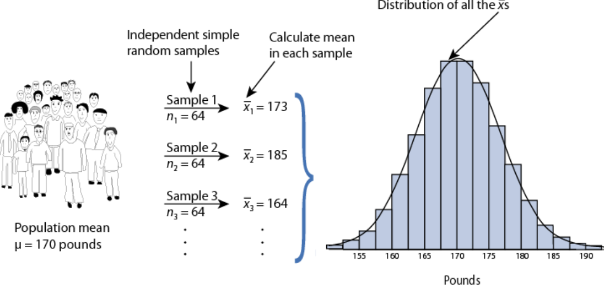

*그림 1. 모집단에서 크기 64인 표본을 반복해서 뽑아 계산한 표본평균들과 그 분포*

> **용어 정의:** 추정량의 표준편차를 그 추정량의 **표준오차(standard error, SE)** 라 한다. 표본평균의 표준오차는 $SE_{\bar{x}} = \sigma/\sqrt{n}$이다.

체중 예에서 $SE_{\bar{x}} = 40/\sqrt{64} = 5$이다. 표본평균의 표본분포는 평균 170, 표준오차 5인 정규분포이므로, 5강 4.3절의 68-95-99.7 규칙에 의해 표본평균의 약 68%는 $\mu \pm SE$, 즉 165와 175 사이에, 약 95%는 $\mu \pm 2SE$, 즉 160과 180 사이에 들어간다. 표본평균의 표본분포(sampling distribution of a mean, SDM)는 이렇게 표본평균이 표본마다 어떻게 움직이는지를 기술한다.

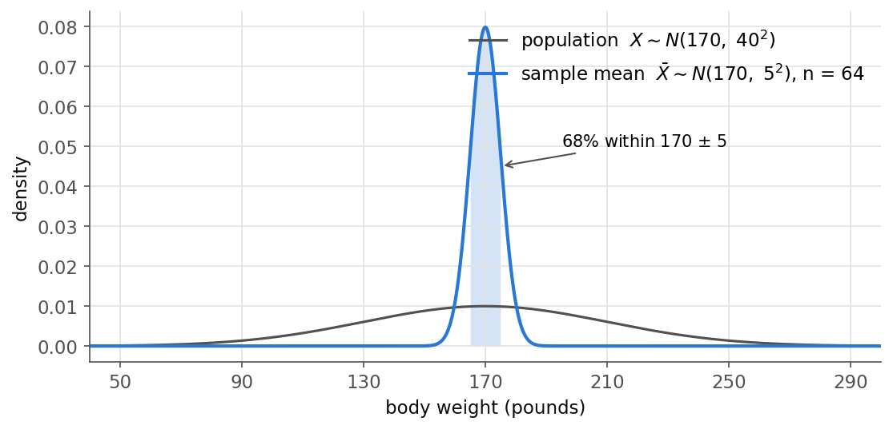

*그림 2. 체중 모집단의 분포와 크기 64인 표본의 표본평균의 분포*

그림 2에서 개인의 체중은 넓게 퍼져 있지만 64명의 평균은 170 근처에 좁게 모인다. 표준오차가 모표준편차의 $1/\sqrt{64} = 1/8$이기 때문이다.

> **참고:** 표본평균의 분포를 $\bar{x} \sim N(\mu, SE_{\bar{x}})$처럼 두 번째 자리에 표준오차를 써서 나타내기도 한다. 이 표기는 표준편차 표기이며, 분산 표기로는 $N(\mu, SE_{\bar{x}}^2) = N(\mu, \sigma^2/n)$이다.

### 2.3 모집단이 정규분포가 아닐 때

모집단이 정규분포가 아니어도 $E(\bar{X}) = \mu$와 $Var(\bar{X}) = \sigma^2/n$은 그대로 성립한다. 분포의 모양은 5강 8절의 중심극한정리에 의해 $n$이 충분히 크면 근사적으로 정규분포가 된다. 즉 관측값이 독립이고 분산이 유한하면 $\bar{X} \overset{a}{\sim} N(\mu, \sigma^2/n)$이다. 체중처럼 분포가 다소 치우친 모집단에서도 $n = 64$이면 이 근사를 쓸 수 있다. 이후의 Z 검정과 t 검정은 모두 이 표본분포에 근거한다.

---

<br>

## 3. 추정

### 3.1 점추정

> **용어 정의:** **점추정(point estimation)** 은 추정량의 관측값 하나로 모수의 참값을 추정하는 절차이다.

모평균은 $\hat{\mu} = \bar{x}$로, 모분산은 $\hat{\sigma}^2 = s^2$으로 추정한다. 1절에서 보았듯이 $E(\bar{X}) = \mu$, $E(S^2) = \sigma^2$이므로 두 추정량은 불편추정량이다. 그러나 점추정값 하나만으로는 그 값이 참값에서 얼마나 떨어져 있을 수 있는지 알 수 없다. 이 불확실성을 함께 나타내는 방법이 구간추정이다.

### 3.2 구간추정과 신뢰구간

- **구간추정(interval estimation):** 모수의 참값을 포함할 확률이 신뢰수준 $1 - \alpha$인 신뢰구간을 정하는 절차이다.
- **신뢰구간(confidence interval):** 모수의 참값을 포함할 확률이 $1 - \alpha$인 구간 $`[\hat{\theta}_L, \hat{\theta}_U]`$이다. 양 끝 $`\hat{\theta}_L`$, $`\hat{\theta}_U`$는 표본으로 계산하는 통계량이다.
- **신뢰수준(confidence level):** 신뢰구간이 모수의 참값을 포함할 확률 $`P(\hat{\theta}_L < \theta < \hat{\theta}_U) = 1 - \alpha`$이다.
- **유의수준(significance level):** 신뢰구간이 모수의 참값을 포함하지 않을 확률 $`1 - P(\hat{\theta}_L < \theta < \hat{\theta}_U) = \alpha`$이다. 같은 $\alpha$가 6절의 가설검정에서도 쓰인다.

모평균의 신뢰구간은 2절의 표본분포에서 만든다. $\sigma$를 알면 $(\bar{X} - \mu)/(\sigma/\sqrt{n})$은 모집단이 정규분포일 때 정확히, $n$이 클 때 중심극한정리에 의해 근사적으로 $N(0, 1)$을 따른다. 따라서 5강 4.3절의 위쪽 분위수 $z_{\alpha/2}$에 대해 다음이 성립한다(두 번째 경우에는 근사적으로).

```math
P\left(-z_{\alpha/2} < \frac{\bar{X} - \mu}{\sigma/\sqrt{n}} < z_{\alpha/2}\right) = 1 - \alpha
```

괄호 안의 부등식을 $\mu$에 대해 풀면 다음을 얻는다.

```math
P\left(\bar{X} - z_{\alpha/2}\frac{\sigma}{\sqrt{n}} < \mu < \bar{X} + z_{\alpha/2}\frac{\sigma}{\sqrt{n}}\right) = 1 - \alpha
```

따라서 $\mu$의 $`100(1-\alpha)\%`$ 신뢰구간은 $`\bar{x} \pm z_{\alpha/2}\,\sigma/\sqrt{n}`$이며, 95% 신뢰구간은 $z_{0.025} = 1.96$을 쓴다. $\sigma$를 모르고 모집단이 정규분포이면 5강 7.3절의 t 분포를 써서 $`\bar{x} \pm t_{\alpha/2,\,n-1}\,s/\sqrt{n}`$으로 구한다.

체중 예에서 표본평균이 $\bar{x} = 173$이었다면 95% 신뢰구간은 $173 \pm 1.96 \times 5 = (163.2, 182.8)$이다. 구간의 폭 $`2z_{\alpha/2}\,\sigma/\sqrt{n}`$은 신뢰수준을 높이면 넓어지고, 표본 크기를 키우면 $1/\sqrt{n}$에 비례하여 좁아진다.

### 3.3 신뢰구간의 해석

신뢰구간에서 확률적인 것은 모수 $\mu$가 아니라 구간이다. $\mu$는 고정된 값이고, 구간의 양 끝은 표본에 따라 달라지는 확률변수이다. 따라서 "95%"는 표본을 뽑기 전 이 절차로 만든 구간이 $\mu$를 포함할 확률, 즉 절차를 반복할 때 $\mu$를 포함하는 구간의 장기적 비율을 뜻한다.

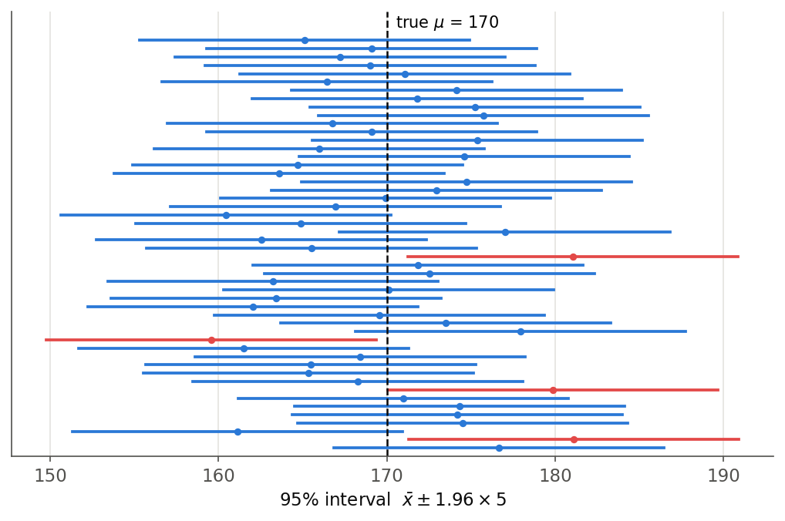

*그림 3. 체중 모집단에서 크기 64인 표본 50개로 만든 95% 신뢰구간, 빨간 구간은 참값 170을 포함하지 않음*

그림 3에서 50개의 구간 가운데 46개는 참값 170을 포함하고 4개는 포함하지 않는다. 평균적으로는 50개 가운데 2.5개가 포함하지 않으며, 실제 개수는 표본에 따라 달라진다.

> **주의:** 관측한 구간 $(163.2, 182.8)$에 대해 "$`\mu`$가 이 구간에 있을 확률이 95%이다"라고 말하는 것은 빈도주의(frequentist) 틀에서 옳지 않다. 이미 계산된 구간은 $\mu$를 포함하거나 포함하지 않거나 둘 중 하나이다. 올바른 표현은 "이 구간은 참값을 95%의 확률로 포함하는 절차로 만든 구간이다"이다.

---

<br>

## 4. 가설검정의 기본 개념

### 4.1 데이터에 던지는 질문과 통계적 가설

데이터가 주어졌을 때 던지는 기본 질문은 두 가지이다.

- **차이(difference):** 두 집단이나 두 조건이 다른가?
- **동등성(equivalency):** 두 집단이나 두 조건이 같은가?

이 질문을 검정할 수 있는 형태로 쓴 것이 통계적 가설이다. **통계적 가설(statistical hypothesis)** 은 확률변수들로 모형화한 과정을 관측하여 검정할 수 있는 가설이며, 이를 검증하는 분석을 확증적 자료 분석(confirmatory data analysis)이라고도 한다. 통계적 가설은 **귀무가설(null hypothesis)** $H_0$와 **대립가설(alternative hypothesis)** $H_1$의 쌍으로 세운다. $H_0$의 아래첨자 0은 숫자 0이 아니라 "null(없음)"을 뜻하며, 기본적으로 $H_0$는 "같다"를, $H_1$은 "다르다"를 나타낸다.

### 4.2 불확실성 아래의 의사결정

진학, 결혼, 치료, 취업처럼 사람은 결과가 확실하지 않아도 결정을 내려야 한다. 통계학은 **불확실성 아래의 의사결정(decision making under uncertainty)** 에 대한 방법을 제공한다. 내기를 걸 때처럼 가능한 결과와 그 확률을 따져 기대효용(expected utility, 주관적 가치의 기댓값)이 가장 큰 선택을 하는 것이다.

추론 통계학에서 귀무가설은 새로운 일이 일어나지 않았다는 일반적인 진술이나 기본 입장이다. 예를 들어 집단 사이에 연관이 없다거나, 측정한 두 현상 사이에 관계가 없다는 진술이 귀무가설이다. 가설검정은 데이터가 이 기본 입장을 버릴 만큼 강한 증거를 주는지를 판단한다.

### 4.3 귀무가설과 대립가설

| 구분 | 대립가설 | 귀무가설 |
|:-----|:-----|:-----|
| 기호 | $H_1$, $H_A$ ($`H_a`$) | $H_0$ |
| 역할 | 연구의 주된 목적인 가설 | 연구의 목적에 반대되는 가설 |
| 연구자의 입장 | 옳다고 주장하고 싶은 가설 | 틀렸다고 주장하고 싶은 가설 |
| 일반적인 형태 | 다르다($\neq$, $>$, $`<`$) | 같다($`=`$) |

*표 1. 대립가설과 귀무가설의 비교*

가설검정은 귀무가설이 옳다고 가정한 뒤 데이터와의 **모순**을 이끌어 내는 방식이다. 모순이 충분히 크면 귀무가설을 버리고 대립가설을 받아들인다.

### 4.4 반증의 논리

가설검정의 핵심 생각은 다음과 같다.

- 어떤 사실이 "옳다"는 것을 증명하기는 어렵다.
- 그러나 "틀렸다"는 것을 보이기는 쉽다.
- 반례 하나만 찾으면 되기 때문이다.

예를 들어 다음 명제를 보이려 한다고 가정한다.

```math
H_1:\ \text{일반적으로 남성과 여성의 키는 다르다}
```

이 명제가 "참"임을 보이는 것이 목표이다. 그러기 위해 반대 가설을 세운다.

```math
H_0:\ \text{남성과 여성의 키는 같다}
```

남성과 여성의 키가 같다고 가정하고, 수집한 자료에서 남성과 여성의 키를 각각 조사하여 평균과 분산을 구한다. 이 가정 아래에서는 거의 일어날 수 없을 만큼 두 집단의 키가 다르다는 수치적 증거를 찾으면, 귀무가설이 "거짓"이라는 증거가 되고 원래 명제 $H_1$이 "참"이라는 결론을 얻는다. 이는 수학의 귀류법(proof by contradiction)과 같은 구조이다.

> **주의:** 통계적 증거는 논리적 반례와 다르다. 데이터가 $H_0$ 아래에서 일어나기 어렵다는 것이지 불가능하다는 것은 아니므로, $H_0$를 기각하는 결론에는 언제나 틀릴 위험이 있다(5절). 또 $H_0$를 기각하지 못했다고 해서 $H_0$가 참이라고 증명된 것은 아니다. 증거가 부족하다는 뜻일 뿐이므로 "$`H_0`$를 채택한다" 대신 "$`H_0`$를 기각하지 못한다" 또는 "$`H_0`$를 유지한다"고 쓴다.

---

<br>

## 5. 두 종류의 오류

### 5.1 제1종 오류와 제2종 오류

통계적 검정의 결과는 귀무가설을 기각하거나 기각하지 않는 것 둘 중 하나이다. 실제 상태도 $H_0$가 참이거나 $H_1$이 참이거나 둘 중 하나이므로 네 가지 경우가 생긴다. 신호 검출에 비유하면 $H_1$은 "신호가 있다", $H_0$는 "신호가 없다"이고, $H_0$를 기각하는 것은 "검출(detection)", 기각하지 않는 것은 "귀무 결과(null result)"이다.

| 검정 결과 \ 실제 상태 | $H_1$ 참 (신호 있음) | $H_0$ 참 (신호 없음) |
|:-----|:-----|:-----|
| $H_0$ 기각 (검출) | 참양성(true positive, TP) | 위양성(false positive, FP), **제1종 오류** |
| $H_0$ 기각 못 함 (귀무 결과) | 위음성(false negative, FN), **제2종 오류** | 참음성(true negative, TN) |
| 열의 비율 | TPF = 민감도 = 검정력 = TP/(TP+FN) | FPF = 1 − 특이도 = FP/(FP+TN) |

*표 2. 검정 결과와 실제 상태에 따른 네 경우와 두 종류의 오류*

- **제1종 오류(type I error):** $H_0$가 참인데 기각하는 오류이다. 화재가 없는데 울리는 경보처럼 없는 효과를 있다고 판단한다. 그 확률 $P(H_0 \text{ 기각} \mid H_0 \text{ 참})$을 $\alpha$로 쓴다.
- **제2종 오류(type II error):** $H_1$이 참인데 $H_0$를 기각하지 못하는 오류이다. 실제 화재를 놓치는 경보처럼 있는 효과를 놓친다. 그 확률 $P(H_0 \text{ 기각 못 함} \mid H_1 \text{ 참})$을 $\beta$로 쓴다.
- **검정력(power):** $H_1$이 참일 때 $H_0$를 올바르게 기각할 확률 $1 - \beta$이다. 표 2의 TPF(true positive fraction)이며 민감도(sensitivity)라고도 한다.
- 표 2의 FPF(false positive fraction)는 $H_0$가 참일 때 기각하는 비율, 즉 $\alpha$이다. $1 - \alpha$는 특이도(specificity)에 해당하며 3.2절의 신뢰수준과 같은 값이다.

### 5.2 혼동 행렬

표 2를 확률로 나타낸 것을 **혼동 행렬(confusion matrix)** 또는 이진 가설검정의 분할표라 한다. 아래에서 $P(H_i \mid H_j)$는 실제로 $H_j$가 참일 때 $H_i$로 선언할 확률이며, 각 확률은 해당 표본의 비율로 추정한다.

| 선언 \ 실제 | 실제 $H_0$ (귀무) | 실제 $H_1$ |
|:-----|:-----|:-----|
| $H_0$로 선언 | $P(H_0 \mid H_0) = P_{spec}$ (특이도) = $H_0$로 선언된 $H_0$ 표본 수 / $H_0$ 표본 수 | $P(H_0 \mid H_1) = P_{miss}$ (놓침) = $H_0$로 선언된 $H_1$ 표본 수 / $H_1$ 표본 수 |
| $H_1$로 선언 | $P(H_1 \mid H_0) = P_{FA}$ (오경보) = $H_1$로 선언된 $H_0$ 표본 수 / $H_0$ 표본 수 | $P(H_1 \mid H_1) = P_D$ (검출) = $H_1$로 선언된 $H_1$ 표본 수 / $H_1$ 표본 수 |

*표 3. 이진 가설검정의 혼동 행렬과 조건부 확률*

각 열은 같은 실제 상태에 대한 두 선언이므로 확률의 합이 1이다.

```math
P(H_0 \mid H_0) + P(H_1 \mid H_0) = 1, \qquad P(H_0 \mid H_1) + P(H_1 \mid H_1) = 1
```

실제 상태의 사전 확률 $P(H_0)$, $P(H_1)$을 알면 2강의 전확률 공식으로 올바르게 분류할 확률 $P_{cc}$와 오류 확률 $P_e$를 구할 수 있다.

```math
P_{cc} = P(\text{correct classification}) = P(H_0 \mid H_0)P(H_0) + P(H_1 \mid H_1)P(H_1)
```

```math
P_e = P(\text{error}) = 1 - P_{cc} = P(H_0 \mid H_1)P(H_1) + P(H_1 \mid H_0)P(H_0)
```

올바른 분류의 비용을 0($`C_{00} = C_{11} = 0`$), 잘못된 분류의 비용을 1($`C_{01} = C_{10} = 1`$)로 두면 기대 비용은 $P_e$와 같다. 따라서 이 비용 구조에서는 오류 확률을 최소화하는 것이 기대 비용을 최소화하는 것이다. 실제로는 두 오류의 비용이 다른 경우가 많으며(예: 질병을 놓치는 비용과 건강한 사람을 재검사하는 비용), 그때는 비용을 반영하여 판단 기준을 정한다.

> **[기계학습]** 기계학습의 이진 분류기 평가도 같은 혼동 행렬을 쓴다. 모델의 예측이 "선언", 실제 레이블이 "실제 상태"에 해당하며, 다음 절의 재현율, 정밀도, 정확도는 분류 모델의 대표적인 평가 지표이다. 분류 임계값을 바꾸면 위양성과 위음성이 서로 맞바뀌는 것도 검정의 $\alpha$와 $\beta$의 관계와 같다.

### 5.3 혼동 행렬에서 얻는 지표

혼동 행렬의 네 칸은 참양성(TP), 참음성(TN), 위양성(FP, 제1종 오류), 위음성(FN, 제2종 오류)이다. 이 칸의 수로 표 4의 지표를 정의한다. 통계학과 데이터 과학 전반에서 가장 널리 쓰이는 척도이므로 정의와 관계를 정확히 이해해야 한다.

| 지표 | 다른 이름 | 식 | 관계 |
|:-----|:-----|:-----|:-----|
| TPR (true positive rate) | 검정력, 민감도, 적중률(hit rate), 재현율(recall) | $\frac{TP}{TP + FN}$ | $1 - FNR$ |
| TNR (true negative rate) | 특이도(specificity) | $\frac{TN}{TN + FP}$ | $1 - FPR$ |
| PPV (positive predictive value) | 양성예측도, 정밀도(precision) | $\frac{TP}{TP + FP}$ | $1 - FDR$ |
| NPV (negative predictive value) | 음성예측도 | $\frac{TN}{TN + FN}$ | $1 - FOR$ |
| FNR (false negative rate) | 놓침률(miss rate) | $\frac{FN}{FN + TP}$ | $1 - TPR$ |
| FPR (false positive rate) | 오경보율(fall-out) | $\frac{FP}{FP + TN}$ | $1 - TNR$ |
| FDR (false discovery rate) | 위발견율 | $\frac{FP}{FP + TP}$ | $1 - PPV$ |
| FOR (false omission rate) | 위누락률 | $\frac{FN}{FN + TN}$ | $1 - NPV$ |
| ACC (accuracy) | 정확도 | $\frac{TP + TN}{TP + TN + FP + FN}$ | $1 - ERR$ |
| ERR (error rate) | 오류율 | $\frac{FP + FN}{TP + TN + FP + FN}$ | $1 - ACC$ |

*표 4. 혼동 행렬에서 정의하는 지표*

지표는 분모가 무엇인지로 구분하면 기억하기 쉽다. TPR, TNR, FNR, FPR은 **실제 상태**(혼동 행렬의 열)로 나누고, PPV, NPV, FDR, FOR은 **선언**(행)으로 나눈다. 가설검정과 대응시키면 $\alpha$는 FPR, $\beta$는 FNR, 검정력은 TPR이다. FDR은 여러 가설을 동시에 검정할 때 기각한 가설 가운데 잘못 기각한 것의 비율로 쓰인다.

**예.** 1,000명 가운데 100명이 질병을 가진 집단에 선별 검사를 했더니 환자 100명 중 90명이 양성(TP = 90, FN = 10), 건강한 900명 중 45명이 양성(FP = 45, TN = 855)이었다.

| | 실제 환자 | 실제 건강 | 합 |
|:-----|:-----|:-----|:-----|
| 검사 양성 | TP = 90 | FP = 45 | 135 |
| 검사 음성 | FN = 10 | TN = 855 | 865 |
| 합 | 100 | 900 | 1,000 |

*표 5. 선별 검사 예의 혼동 행렬*

- TPR(민감도) $= 90/100 = 0.90$, TNR(특이도) $= 855/900 = 0.95$이다.
- PPV(정밀도) $= 90/135 \approx 0.667$, NPV $= 855/865 \approx 0.988$이다.
- FNR $= 0.10$, FPR $= 0.05$, FDR $= 45/135 \approx 0.333$, FOR $= 10/865 \approx 0.012$이다.
- ACC $= (90 + 855)/1000 = 0.945$, ERR $= 0.055$이다.

민감도와 특이도가 모두 높은데도 양성 판정의 3분의 1은 틀린 판정이다. 질병의 유병률이 10%로 낮아 건강한 사람이 훨씬 많고, 그 5%만 위양성이어도 45명이 되기 때문이다(2강 베이즈 정리). 또 모든 사람을 음성으로 판정해도 정확도가 0.90이 되므로, 한쪽 상태가 드문 경우 정확도만으로 검사를 평가하면 안 된다.

### 5.4 유의수준, 검정력, 표본 크기

두 오류는 서로 맞물려 있다. 6절의 체중 예에서 $H_0: \mu = 170$을 $H_a: \mu > 170$에 대해 유의수준 $\alpha = 0.05$로 검정하면, $\bar{x}$가 임계값 $170 + 1.645 \times 5 = 178.22$ 이상일 때 $H_0$를 기각한다. 실제 평균이 $\mu = 180$이라면 검정력은

```math
P(\bar{X} \geq 178.22 \mid \mu = 180) = P\left(Z \geq \frac{178.22 - 180}{5}\right) = P(Z \geq -0.355) \approx 0.639
```

이고 $\beta \approx 0.361$이다. 실제로 체중이 10파운드 늘었어도 이 검정은 36% 정도의 확률로 그 변화를 놓친다.

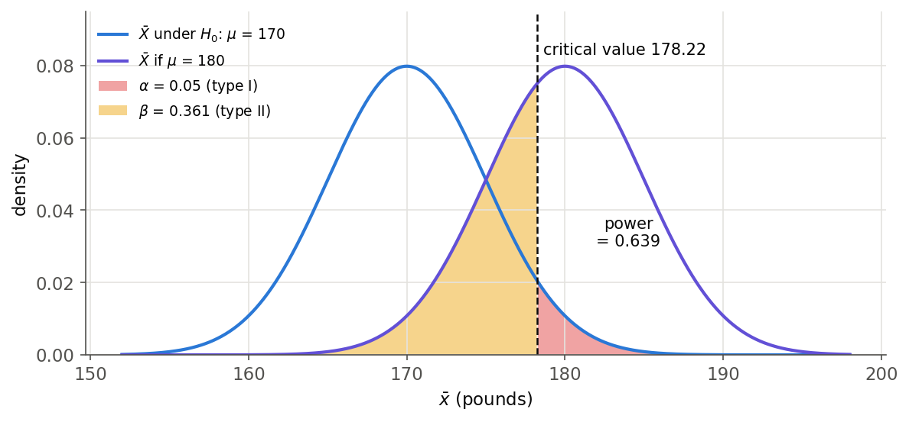

*그림 4. H0와 H1 아래의 표본평균 분포, 임계값 178.22, 제1종 오류 확률과 제2종 오류 확률*

그림 4에서 다음 관계를 읽을 수 있다.

- $\alpha$를 줄이면 임계값이 오른쪽으로 이동하여 $\beta$가 커진다. 같은 자료로 두 오류를 동시에 줄일 수는 없다.
- 표본 크기를 키우면 두 분포가 모두 좁아져 $\alpha$를 유지하면서 $\beta$를 줄일 수 있다. 같은 문제에서 $n = 100$이면 $SE = 4$, 임계값은 $176.58$이 되어 검정력이 약 $0.804$로 높아진다.
- 실제 효과가 클수록(참 평균이 170에서 멀수록) 두 분포가 멀어져 검정력이 커진다.

그래서 연구를 설계할 때는 먼저 $\alpha$를 정하고(보통 0.05), 찾고 싶은 효과의 크기를 원하는 검정력(흔히 0.8)으로 검출할 수 있도록 표본 크기를 정한다.

---

<br>

## 6. 단일 표본 Z 검정

### 6.1 예제: 체중 연구

1970년대 미국의 20\~29세 남성의 체중은 평균 $\mu = 170$파운드, 표준편차 $\sigma = 40$파운드였다. 현재 모집단의 평균 체중이 그때와 다른지 검정하고자 한다.

- 귀무가설은 $H_0: \mu = 170$("차이 없음")이다.
- 대립가설은 $H_a: \mu > 170$(**단측 검정**, one-sided test)이거나 $H_a: \mu \neq 170$(**양측 검정**, two-sided test)이다.

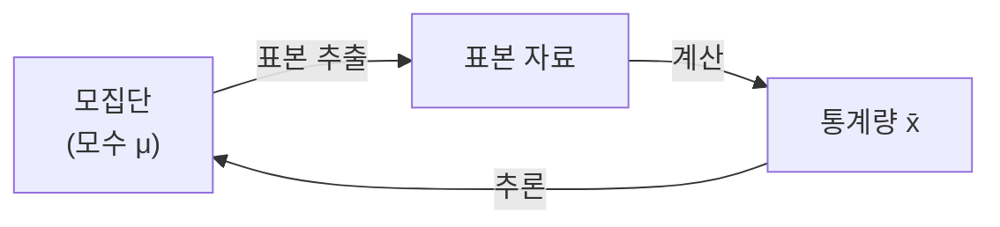

*그림 5. 모집단에서 표본을 뽑아 통계량으로 모수를 추론하는 과정*

단측 검정과 양측 검정은 대립가설의 방향으로 구분한다. 연구 질문이 "늘었는가"처럼 한 방향만 의미가 있으면 단측 검정을, "달라졌는가"처럼 양방향의 변화를 모두 찾으면 양측 검정을 쓴다. 방향은 자료를 보기 **전에** 연구 질문으로 정해야 한다. 자료를 본 뒤 관측된 방향으로 단측 검정을 고르면 실제 제1종 오류 확률이 정한 $\alpha$의 두 배가 된다.

### 6.2 검정통계량

이 예는 **$\sigma$를 아는 경우의 모평균에 대한 단일 표본 검정**이다. 다음 통계량을 쓴다.

```math
z_{\text{stat}} = \frac{\bar{x} - \mu_0}{SE_{\bar{x}}}, \qquad SE_{\bar{x}} = \frac{\sigma}{\sqrt{n}}
```

여기서 $\mu_0$는 $H_0$가 참일 때의 모평균이다. $H_0$가 참이고 모집단이 정규분포이거나 $n$이 크면, 2절에 의해 $Z = (\bar{X} - \mu_0)/(\sigma/\sqrt{n}) \sim N(0, 1)$(또는 근사적으로)이다. 따라서 $z_{\text{stat}}$는 관측한 표본평균이 $\mu_0$에서 표준오차 몇 개만큼 떨어져 있는지를 나타낸다. 이를 **Z 통계량(Z statistic)** 이라 하며 검정에 쓰는 통계량을 일반적으로 **검정통계량(test statistic)** 이라 한다.

검정통계량의 크기 $|z_{\text{stat}}|$는 다음 경우에 커진다.

- 표본평균과 $\mu_0$의 차이 $|\bar{x} - \mu_0|$가 클수록 커진다.
- 모표준편차 $\sigma$가 작을수록, 즉 자료의 잡음이 작을수록 커진다.
- 표본 크기 $n$이 클수록 커진다. 같은 차이 3파운드라도 $n = 64$이면 $z = 0.6$이지만 $n = 1600$이면 $SE = 1$이 되어 $z = 3$이다.

체중 예에서 $\mu_0 = 170$, $\sigma = 40$, $n = 64$이므로 표준오차는 다음과 같다.

```math
SE_{\bar{x}} = \frac{\sigma}{\sqrt{n}} = \frac{40}{\sqrt{64}} = 5
```

표본평균이 173이면 $z_{\text{stat}} = (173 - 170)/5 = 0.60$이고, 185이면 $z_{\text{stat}} = (185 - 170)/5 = 3.00$이다.

### 6.3 유의확률(p-value)

> **용어 정의:** **유의확률(p-value)** 은 $H_0$가 참이라는 가정 아래에서, 관측한 검정통계량과 같거나 그보다 더 $H_1$ 쪽으로 치우친(극단적인) 값이 나올 확률이다.

유의확률이 답하는 질문은 "$`H_0`$가 참이라면 지금 관측한 것만큼 또는 그보다 극단적인 결과가 나올 확률은 얼마인가?"이다. Z 통계량은 대립가설의 방향에 따라 표 6처럼 유의확률로 바꾼다.

| 대립가설 | 유의확률 | 뜻 |
|:-----|:-----|:-----|
| $H_a: \mu > \mu_0$ | $P = P(Z \geq z_{\text{stat}})$ | $z_{\text{stat}}$ 오른쪽 꼬리 넓이 |
| $H_a: \mu < \mu_0$ | $P = P(Z \leq z_{\text{stat}})$ | $z_{\text{stat}}$ 왼쪽 꼬리 넓이 |
| $H_a: \mu \neq \mu_0$ | $P = 2 \times P(Z \geq \vert z_{\text{stat}} \vert)$ | 단측 유의확률의 두 배 |

*표 6. 대립가설의 방향에 따른 Z 통계량의 유의확률*

양측 검정의 "단측 유의확률의 두 배"에서 단측 값은 관측한 $z_{\text{stat}}$ 쪽 꼬리의 넓이이다. $z_{\text{stat}}$가 음수이면 왼쪽 꼬리를 쓰며, 절댓값을 쓰면 두 경우를 한 식으로 쓸 수 있다.

체중 예의 단측 유의확률은 다음과 같다(5강 표 4).

- $z_{\text{stat}} = 0.6$이면 $P = 1 - \Phi(0.6) = 0.2743$이다. $H_0$가 참이어도 이 정도 이상으로 큰 표본평균은 27%의 확률로 나온다.
- $z_{\text{stat}} = 3.0$이면 $P = 1 - \Phi(3.0) = 0.0013$이다. $H_0$가 참이라면 1,000번에 1번 정도만 나오는 결과이다.

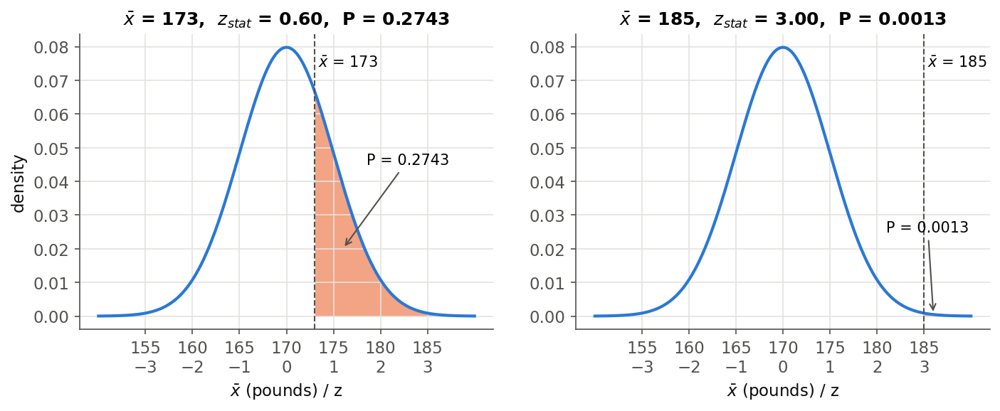

*그림 6. 표본평균 173과 185에 대한 단측 유의확률, H0 아래 표본평균 분포의 오른쪽 꼬리 넓이*

양측 검정이면 각각 $2 \times 0.2743 = 0.5485$, $2 \times 0.0013 = 0.0027$이다.

### 6.4 유의확률의 해석

유의확률이 작을수록 데이터가 $H_0$에 반하는 증거가 강하다. 흔히 쓰는 관례는 표 7과 같다.

| 유의확률 | 해석 |
|:-----|:-----|
| $P > 0.10$ | $H_0$에 반하는 증거가 유의하지 않음 |
| $0.05 < P \leq 0.10$ | 경계적으로 유의한 증거 |
| $0.01 < P \leq 0.05$ | $H_0$에 반하는 유의한 증거 |
| $P \leq 0.01$ | $H_0$에 반하는 매우 유의한 증거 |

*표 7. 유의확률 해석의 관례*

예를 들어 $P = 0.27$이면 $H_0$에 반하는 유의한 증거가 없고, $P = 0.01$이면 매우 유의한 증거가 있다. 다만 유의성에 확고한 경계를 긋는 것은 현명하지 않다. $P = 0.049$와 $P = 0.051$은 증거의 강도가 거의 같으므로, 하나는 "유의"하고 다른 하나는 "유의하지 않다"고 정반대로 해석하면 안 된다.

> **주의:** 유의확률은 자주 잘못 해석된다. 미국통계학회(ASA)의 성명은 다음을 강조한다 [2]. 유의확률은 $H_0$가 참일 확률이 아니며, 결과가 우연만으로 생겼을 확률도 아니다. $H_0$와 모형의 가정 아래에서 데이터가 얼마나 어울리지 않는지를 나타낼 뿐이다. 작은 유의확률이 효과가 크거나 중요하다는 뜻은 아니다. 표본이 매우 크면 실질적으로 무의미한 작은 차이도 작은 유의확률을 낸다. 큰 유의확률이 $H_0$가 참이라는 증거도 아니다. 따라서 유의확률만 보고하지 말고 효과의 크기(예: $`\bar{x} - \mu_0`$)와 신뢰구간을 함께 보고한다.

### 6.5 유의수준과 기각역

> **용어 정의:** **유의수준(significance level)** $\alpha$는 $H_0$를 잘못 기각할 확률, 즉 검정이 허용하는 제1종 오류 확률의 상한이다.

검정 전에 $\alpha$의 기준을 정하고(예: $\alpha = 0.10$, $0.05$ 등), 다음 규칙으로 결론을 내린다.

- $P \leq \alpha$이면 $H_0$를 기각한다.
- $P > \alpha$이면 $H_0$를 유지한다.

예를 들어 $\alpha = 0.10$으로 정했는데 $P = 0.27$이면 $H_0$를 유지하고, $\alpha = 0.01$로 정했는데 $P = 0.001$이면 $H_0$를 기각한다. 연속형 검정통계량의 귀무분포를 정확히 알면 이 규칙에서 $H_0$가 참일 때 기각할 확률이 정확히 $\alpha$가 된다. 이때 $H_0$ 아래에서 유의확률은 0과 1 사이의 균등분포를 따르기 때문이다. 귀무분포가 중심극한정리 등에 의한 근사이면 그 확률도 근사적으로 $\alpha$이다.

같은 결론을 검정통계량의 값으로 내릴 수도 있다. $H_0$를 기각하게 되는 검정통계량의 범위를 **기각역(rejection region)**, 그 경계를 **임계값(critical value)** 이라 한다. $P \leq \alpha$와 "검정통계량이 기각역에 있다"는 같은 조건이다.

| 대립가설 | 기각역 | $\alpha = 0.05$일 때 |
|:-----|:-----|:-----|
| $H_a: \mu \neq \mu_0$ | $\vert z_{\text{stat}} \vert \geq z_{\alpha/2}$ | $\vert z_{\text{stat}} \vert \geq 1.96$ |
| $H_a: \mu > \mu_0$ | $z_{\text{stat}} \geq z_{\alpha}$ | $z_{\text{stat}} \geq 1.645$ |
| $H_a: \mu < \mu_0$ | $z_{\text{stat}} \leq -z_{\alpha}$ | $z_{\text{stat}} \leq -1.645$ |

*표 8. 대립가설의 방향에 따른 Z 검정의 기각역*

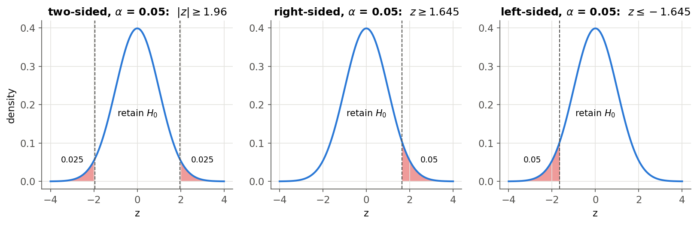

*그림 7. 유의수준 0.05에서 양측, 오른쪽 단측, 왼쪽 단측 Z 검정의 기각역*

양측 검정은 유의수준 $\alpha$를 두 꼬리에 $\alpha/2$씩 나누므로, 같은 $\alpha$에서 단측 검정보다 한쪽 임계값이 더 멀다(1.96 > 1.645).

양측 검정과 신뢰구간은 같은 정보를 준다. 유의수준 $\alpha$의 양측 검정이 $H_0: \mu = \mu_0$를 기각하는 것은 $\mu_0$가 $`100(1-\alpha)\%`$ 신뢰구간 밖에 있는 것과 같다. 체중 예에서 $\bar{x} = 185$의 95% 신뢰구간은 $185 \pm 9.8 = (175.2, 194.8)$로 170을 포함하지 않으며, 양측 유의확률 $0.0027 < 0.05$와 일치한다.

### 6.6 검정 절차의 요약

단일 표본 Z 검정은 다음 네 단계로 수행한다.

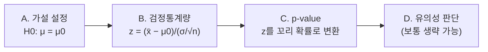

*그림 8. 단일 표본 Z 검정의 네 단계*

- **A. 가설 설정:** $H_0: \mu = \mu_0$ 대 $H_a: \mu \neq \mu_0$(양측), $H_a: \mu < \mu_0$(왼쪽 단측), $H_a: \mu > \mu_0$(오른쪽 단측) 가운데 하나를 연구 질문에 따라 고른다.
- **B. 검정통계량:** $z_{\text{stat}} = (\bar{x} - \mu_0)/(\sigma/\sqrt{n})$를 계산한다.
- **C. 유의확률:** 표 6으로 $z_{\text{stat}}$를 유의확률로 바꾼다.
- **D. 유의성 판단:** $\alpha$와 비교하여 기각 여부를 밝힌다. 유의확률 자체가 더 많은 정보를 담으므로 이 단계는 보통 필요하지 않다.

> **주의:** Z 검정을 쓰려면 다음 조건이 필요하다. 모표준편차 $\sigma$를 알아야 하고, 관측값이 서로 독립인 무작위 표본이어야 하며, 모집단이 정규분포이거나 표본이 충분히 커서 중심극한정리를 적용할 수 있어야 한다. $\sigma$를 모르면 6.8절의 t 검정을 쓴다.

### 6.7 적용 예: Lake Wobegon의 지능검사 점수

$X$를 웩슬러 성인 지능검사(Wechsler Adult Intelligence Scale, WAIS) 점수라 하자. 일반 모집단에서 $X \sim N(100, 15^2)$이다(평균 100, 표준편차 15). Lake Wobegon이라는 마을의 모집단에서 $n = 9$명을 뽑아 다음 점수를 얻었다.

```math
\lbrace116,\ 128,\ 125,\ 119,\ 89,\ 99,\ 105,\ 116,\ 118\rbrace
```

점수의 합은 1015이므로 $\bar{x} = 1015/9 = 112.78 \approx 112.8$이다. 이 표본평균은 이 마을의 모평균 $\mu$가 100보다 크다는 강한 증거인가?

**A. 가설:** $H_0: \mu = 100$ 대 $H_a: \mu > 100$(단측) 또는 $H_a: \mu \neq 100$(양측)이다.

**B. 검정통계량:** 모집단의 표준편차 $\sigma = 15$를 안다.

```math
SE_{\bar{x}} = \frac{\sigma}{\sqrt{n}} = \frac{15}{\sqrt{9}} = 5, \qquad z_{\text{stat}} = \frac{\bar{x} - \mu_0}{SE_{\bar{x}}} = \frac{112.8 - 100}{5} = 2.56
```

**C. 유의확률:** 단측 검정이면 $P = P(Z \geq 2.56) = 1 - 0.9948 = 0.0052$이다. 이 표본이 $H_0$의 분포에서 나왔을 가능성은 낮으므로 $H_0$에 반하는 강한 증거이다. 양측 검정은 $\mu_0$에서 위와 아래 양방향으로 우연히 벗어나는 경우를 모두 고려하므로 $\pm z_{\text{stat}}$ 바깥의 두 꼬리를 더한다. 따라서 양측 $P = 2 \times 0.0052 = 0.0104$이다.

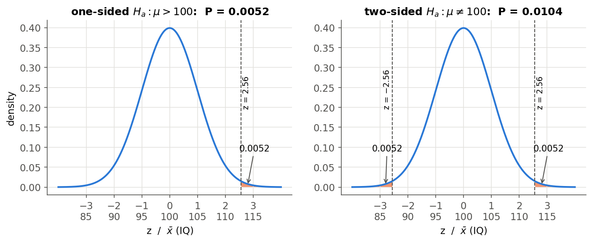

*그림 9. Lake Wobegon 예의 단측 유의확률과 양측 유의확률*

**D. 결론:** 단측 검정은 $\alpha = 0.05$와 $\alpha = 0.01$ 모두에서 $H_0$를 기각한다. 양측 검정은 $\alpha = 0.05$에서는 기각하지만 $\alpha = 0.01$에서는 $0.0104 > 0.01$이므로 기각하지 못한다. 같은 자료라도 대립가설의 방향과 유의수준에 따라 결론이 달라질 수 있으므로, 둘 다 자료를 보기 전에 정해야 한다. 반올림하지 않은 $\bar{x} = 112.78$을 쓰면 $z_{\text{stat}} = 2.556$, 단측 $P = 0.0053$, 양측 $P = 0.0106$이며 결론은 같다.

이 검정이 정당하려면 9명이 이 마을 모집단의 무작위 표본이어야 하고, 마을 주민의 점수도 표준편차 15인 정규분포를 따른다고 가정해야 한다. 모집단이 정규분포이므로 $n = 9$로 작아도 Z 통계량은 정확히 $N(0, 1)$을 따른다.

### 6.8 모표준편차를 모를 때: 단일 표본 t 검정

실제 자료 분석에서는 $\sigma$를 모르는 경우가 대부분이다. 그때는 $\sigma$ 대신 표본표준편차 $s$를 쓴 다음 통계량을 쓰며, 모집단이 정규분포이면 5강 7.3절에 의해 $H_0$ 아래에서 자유도 $n - 1$인 t 분포를 따른다.

```math
t_{\text{stat}} = \frac{\bar{x} - \mu_0}{s/\sqrt{n}} \sim t(n-1) \quad \text{under } H_0
```

이를 **단일 표본 t 검정(one-sample t-test)** 이라 한다. 유의확률은 표 6에서 $Z$ 대신 $t(n-1)$의 꼬리 확률로 구한다. 표본이 크면 중심극한정리에 의해 모집단이 정규분포가 아니어도 근사적으로 쓸 수 있다.

Lake Wobegon의 9명 점수에서 $\sigma = 15$를 쓰지 않고 자료로 추정하면 $s = 12.67$이므로 $t_{\text{stat}} = (112.78 - 100)/(12.67/3) = 3.026$이고 자유도는 8이다. R의 `t.test()`로 계산하면 다음과 같다.

```r
wais <- c(116, 128, 125, 119, 89, 99, 105, 116, 118)
t.test(wais, mu = 100, alternative = "greater")
```

```text
        One Sample t-test

data:  wais
t = 3.0263, df = 8, p-value = 0.008201
alternative hypothesis: true mean is greater than 100
95 percent confidence interval:
 104.9264      Inf
sample estimates:
mean of x
 112.7778
```

- `mu = 100`은 귀무가설의 평균 $\mu_0$이고, `alternative = "greater"`는 대립가설 $H_a: \mu > 100$을 뜻한다.
- 출력의 `t`는 검정통계량, `df`는 자유도, `p-value`는 $P(T \geq 3.0263)$이다. 단측 $P = 0.0082$이므로 $\alpha = 0.01$에서도 $H_0$를 기각한다.
- 단측 검정에 대응하는 신뢰구간은 한쪽이 열린 구간 $(104.93, \infty)$이며 100을 포함하지 않는다.

이 자료에서는 $s = 12.67$이 $\sigma = 15$보다 작아 t 통계량이 Z 통계량보다 크지만, t 분포의 꼬리가 두꺼우므로 같은 통계량 값이면 t 검정의 유의확률이 더 크다.

---

<br>

## 7. 두 집단의 비교

### 7.1 비교의 목적

두 집단 비교의 목표는 서로 다른 두 특정 집단 사이에서 모평균과 변동성의 차이를 비교하는 것이다. 예를 들어 사람들을 두 무리로 나누어 세웠을 때, 두 무리의 평균 키나 평균 체중이 다른지를 묻는다. 각 모집단의 특성은 모평균 $\mu_1$, $\mu_2$가 나타내고, 각 표본의 평균 $`\bar{x}_1`$, $`\bar{x}_2`$가 그 모평균에 대한 정보를 준다.

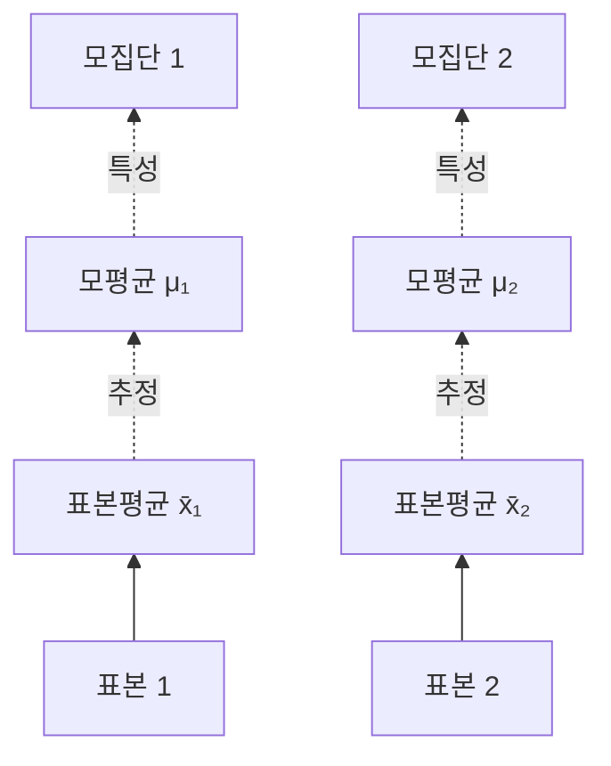

*그림 10. 두 모집단의 모평균과 각 표본의 표본평균의 관계*

### 7.2 자료 수집 방식

두 집단의 자료는 두 가지 방식으로 수집하며, 방식에 따라 쓰는 검정이 다르다.

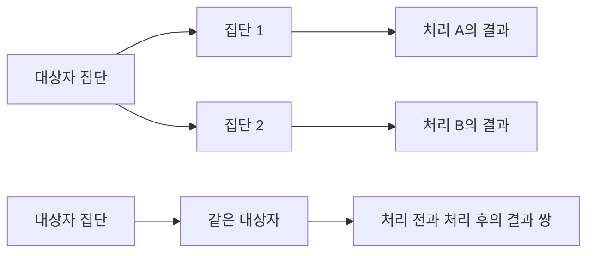

*그림 11. 두 처리 집단에서 독립적으로 추출한 자료와 같은 대상에서 짝지어 얻은 자료*

- **(1) 독립 표본(independent samples):** 두 처리 집단에서 자료를 서로 독립적으로 추출한다. 예를 들어 연구에 참여한 환자를 두 집단으로 나누어 서로 다른 치료법을 적용하고 결과를 비교한다. 한 집단의 관측값은 다른 집단의 관측값과 무관하다.
- **(2) 대응 표본(paired samples):** 같은 대상에서 두 처리의 자료를 짝지어 얻는다. 예를 들어 같은 암 환자에게 항암 치료를 하여 치료 전과 치료 후의 상태를 비교한다. 같은 사람의 두 값은 서로 관련되어 있다.

### 7.3 검정 방법의 선택

두 집단 비교의 검정은 자료 수집 방식(독립 또는 대응)과 정규성 조건, 표본 크기로 고른다. 정규성이 성립하면 t 검정을 쓴다. 정규분포를 따르지 않는 자료라도 표본이 크면 중심극한정리에 의해 t 검정을 쓸 수 있고, 표본이 작으면 비모수 검정(nonparametric test)을 쓴다.

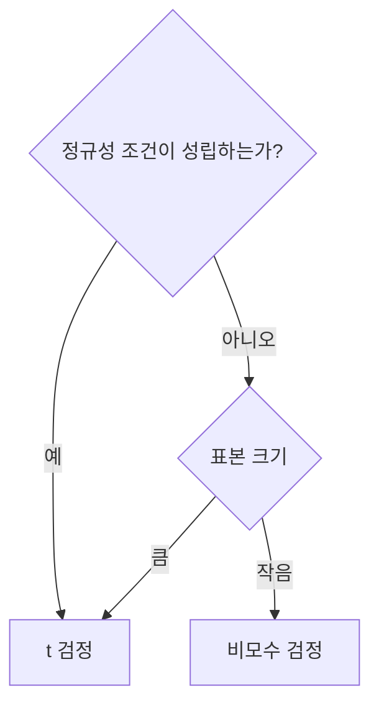

*그림 12. 두 집단 비교에서 t 검정과 비모수 검정의 선택*

| 자료 수집 방식 | t 검정 | 비모수 검정 |
|:-----|:-----|:-----|
| 독립 | 독립 2표본 t 검정 | Wilcoxon 순위합 검정, Mann-Whitney 검정, 순열 검정 |
| 대응 | 대응표본 t 검정 | Wilcoxon 부호순위 검정, 순열 검정 |

*표 9. 자료 수집 방식과 분포 조건에 따른 두 집단 비교의 검정*

Wilcoxon 순위합 검정과 Mann-Whitney 검정은 같은 검정을 다르게 표현한 것이다. 비모수 검정은 8강에서 다룬다.

---

<br>

## 8. 독립 2표본 t 검정

### 8.1 가정

**독립 2표본 t 검정(independent two-sample t-test)** 은 다음 가정 아래에서 두 모평균을 비교한다.

- **충분한 표본 크기:** 각 집단의 표본 크기가 충분히 커야 한다. 흔히 $n_1 \geq 30$, $n_2 \geq 30$을 기준으로 삼는다.
- **정규성:** 각 집단 안에서 비교하려는 연속형 변수가 정규분포를 따라야 한다. 표본이 크면 이 조건은 필요하지 않다. 중심극한정리에 의해 표본평균의 차가 근사적으로 정규분포를 따르기 때문이다.
- **독립성:** 두 집단은 서로 독립이어야 하고, 각 집단 안의 관측값도 서로 독립이어야 한다. 즉 $x_i \sim N(\mu_1, \sigma^2)$과 $y_j \sim N(\mu_2, \sigma^2)$이 서로 독립이다.
- **등분산성:** 두 집단의 관심 변수의 분산이 같아야 한다($`\sigma_1^2 = \sigma_2^2 = \sigma^2`$). 분산이 다르다고 가정하는 경우(이분산)에는 8.3절의 다른 검정통계량을 쓴다.

> **참고:** 첫째와 둘째 가정은 둘 중 하나만 있으면 된다. 두 모집단이 정규분포이고 분산이 같으면 다음 절의 t 통계량은 표본 크기와 관계없이 **정확히** t 분포를 따르므로 $n \geq 30$이 필요 없다. 반대로 정규성이 의심스러우면 표본이 커야 중심극한정리에 의한 근사가 정당화되며, 그 크기는 분포의 치우침에 달려 있다(5강 8.2절). $n \geq 30$은 이 근사를 위한 대략적인 기준이다.

### 8.2 검정통계량과 합동 분산

귀무가설은 두 모평균이 같다는 것이다.

```math
H_0: \mu_1 = \mu_2
```

검정통계량은 다음과 같으며, $H_0$ 아래에서 자유도 $n_1 + n_2 - 2$인 t 분포를 따른다.

```math
t = \frac{\bar{X} - \bar{Y}}{s_p\sqrt{\dfrac{1}{n_1} + \dfrac{1}{n_2}}} \sim t_{n_1 + n_2 - 2} \quad \text{under } H_0
```

여기서 $\bar{X}$와 $\bar{Y}$는 각 집단의 표본평균이고, $s_p$는 두 집단의 자료를 합쳐 공통 분산 $\sigma^2$을 추정한 **합동 표준편차(pooled standard deviation)** 이다. 그 제곱인 **합동 분산(pooled variance)** 은 다음과 같다.

```math
s_p^2 = \frac{\sum_{i=1}^{n_1}(x_i - \bar{x})^2 + \sum_{j=1}^{n_2}(y_j - \bar{y})^2}{n_1 + n_2 - 2} = \frac{(n_1 - 1)s_1^2 + (n_2 - 1)s_2^2}{n_1 + n_2 - 2}
```

합동 분산은 두 표본분산을 각자의 자유도로 가중평균한 값이다. 분모가 $n_1 + n_2 - 2$인 것은 두 집단의 평균을 각각 추정하느라 자유도를 하나씩 잃기 때문이다.

이 통계량이 t 분포를 따르는 이유는 5강 7절의 결과로 설명된다.

1. 두 표본평균은 독립인 정규 확률변수이므로 그 차도 정규분포를 따르고, 분산은 더해진다. $`\bar{X} - \bar{Y} \sim N(\mu_1 - \mu_2,\ \sigma^2(1/n_1 + 1/n_2))`$이다.
2. $H_0$ 아래에서 $\mu_1 - \mu_2 = 0$이므로 $Z = (\bar{X} - \bar{Y})/(\sigma\sqrt{1/n_1 + 1/n_2}) \sim N(0, 1)$이다.
3. $(n_1 - 1)S_1^2/\sigma^2 \sim \chi^2(n_1 - 1)$과 $(n_2 - 1)S_2^2/\sigma^2 \sim \chi^2(n_2 - 1)$은 서로 독립이므로, 가법성에 의해 그 합 $(n_1 + n_2 - 2)S_p^2/\sigma^2 \sim \chi^2(n_1 + n_2 - 2)$이다. 이 값은 $Z$와도 독립이다.
4. t 분포의 정의 $T = Z/\sqrt{Y/\nu}$에 넣으면 모르는 $\sigma$가 약분되어 위의 $t$가 되고, 자유도는 $\nu = n_1 + n_2 - 2$이다.

**결정 규칙:** 계산한 t 통계량과 t 분포로 유의확률을 구하고, 유의확률이 정한 유의수준보다 작으면 귀무가설을 기각하고 대립가설을 택한다. 양측 검정이면 $`|t| \geq t_{\alpha/2,\, n_1 + n_2 - 2}`$일 때 기각하는 것과 같다. 대립가설은 $\mu_1 \neq \mu_2$(양측) 또는 $\mu_1 > \mu_2$, $\mu_1 < \mu_2$(단측)로 세울 수 있다.

### 8.3 등분산을 가정하지 않을 때: Welch t 검정

두 모분산이 다를 수 있으면 합동 분산 대신 각 집단의 분산을 따로 쓴 **Welch t 검정(Welch's t-test)** 을 쓴다 [3].

```math
t_{W} = \frac{\bar{X} - \bar{Y}}{\sqrt{\dfrac{S_1^2}{n_1} + \dfrac{S_2^2}{n_2}}}, \qquad \nu = \frac{\left(\dfrac{s_1^2}{n_1} + \dfrac{s_2^2}{n_2}\right)^2}{\dfrac{(s_1^2/n_1)^2}{n_1 - 1} + \dfrac{(s_2^2/n_2)^2}{n_2 - 1}}
```

$H_0$ 아래에서 $t_W$는 자유도 $\nu$인 t 분포를 근사적으로 따른다. 자유도 $\nu$는 정수가 아닐 수 있으며 Welch-Satterthwaite 근사라고 한다. 두 표본 크기가 같으면($`n_1 = n_2`$) $t_W$는 합동 분산의 $t$와 값이 같고 자유도만 다르다.

R의 `t.test()`는 기본값이 `var.equal = FALSE`이므로 아무 옵션 없이 쓰면 Welch t 검정을 수행한다. 분산이 같을 때 Welch 검정을 써도 잃는 검정력은 작지만, 분산이 다를 때 합동 분산 검정을 쓰면(특히 표본 크기도 다를 때) 실제 제1종 오류 확률이 $\alpha$에서 크게 벗어날 수 있다. 따라서 등분산을 확신할 수 없으면 Welch 검정을 쓰는 편이 안전하다.

> **주의:** 등분산 여부를 F 검정(`var.test()`, 5강 7.4절)으로 먼저 검정한 뒤 그 결과로 t 검정의 종류를 고르는 방법도 쓰이지만, F 검정은 정규성이 조금만 깨져도 결과가 크게 흔들린다. 두 단계로 나누어 검정하면 전체 오류 확률을 통제하기도 어렵다.

### 8.4 R 실습: p24 수준 자료

두 처리 집단(300mg, 600mg)의 p24 수준을 비교한다. 각 집단은 10명이다.

| 용량 | p24 수준 |
|:-----|:-----|
| 300mg | 284, 279, 289, 292, 287, 295, 285, 279, 306, 298 |
| 600mg | 298, 307, 297, 279, 291, 335, 299, 300, 306, 291 |

*표 10. 두 처리 집단의 p24 수준*

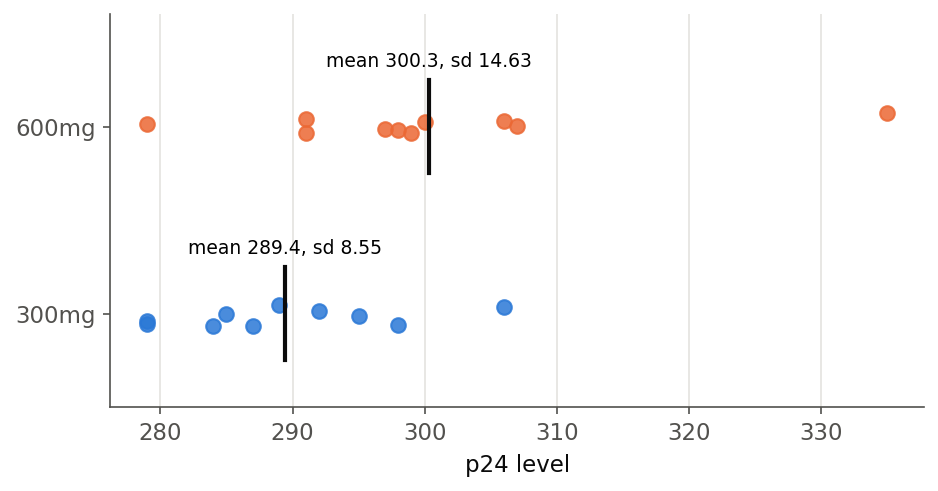

*그림 13. 두 처리 집단의 p24 수준과 집단별 평균*

손으로 계산하면 다음과 같다.

- 표본평균은 $\bar{x} = 289.4$, $\bar{y} = 300.3$이고, 편차제곱합은 $\sum (x_i - \bar{x})^2 = 658.4$, $\sum (y_j - \bar{y})^2 = 1926.1$이다. 표본분산은 $s_1^2 = 73.16$, $s_2^2 = 214.01$이다.
- 합동 분산은 $s_p^2 = (658.4 + 1926.1)/(10 + 10 - 2) = 2584.5/18 = 143.58$이고 $s_p = 11.98$이다.
- 표준오차는 $s_p\sqrt{1/10 + 1/10} = 11.98 \times 0.4472 = 5.359$이고, $t = (289.4 - 300.3)/5.359 = -10.9/5.359 = -2.034$이다.
- 자유도 18인 t 분포의 위쪽 2.5% 점은 $t_{0.025, 18} = 2.101$이다. $|t| = 2.034 < 2.101$이므로 유의수준 0.05의 양측 검정에서 $H_0$를 기각하지 못한다.

R로 같은 검정을 한다.

```r
x <- c(284, 279, 289, 292, 287, 295, 285, 279, 306, 298)
y <- c(298, 307, 297, 279, 291, 335, 299, 300, 306, 291)
t.test(x, y, var.equal = TRUE)
```

```text
        Two Sample t-test

data:  x and y
t = -2.034, df = 18, p-value = 0.05696
alternative hypothesis: true difference in means is not equal to 0
95 percent confidence interval:
 -22.1584072   0.3584072
sample estimates:
mean of x mean of y
    289.4     300.3
```

- `var.equal = TRUE`는 등분산을 가정한 합동 분산 t 검정을 지정한다.
- `t = -2.034, df = 18`은 손 계산과 같고, 양측 `p-value = 0.05696`이다.
- `alternative hypothesis`는 대립가설이 $\mu_1 - \mu_2 \neq 0$임을 밝힌다.
- 95% 신뢰구간 $(-22.16, 0.36)$은 $\mu_1 - \mu_2$에 대한 구간이며 0을 포함하므로, 유의수준 0.05의 양측 검정에서 $H_0$를 기각하지 못한다는 결론과 일치한다.

같은 자료에 `t.test(x, y)`로 Welch t 검정을 하면 결과는 다음과 같다.

```text
        Welch Two Sample t-test

data:  x and y
t = -2.034, df = 14.509, p-value = 0.06065
alternative hypothesis: true difference in means is not equal to 0
95 percent confidence interval:
 -22.3557409   0.5557409
sample estimates:
mean of x mean of y
    289.4     300.3
```

두 집단의 크기가 같으므로 t 값은 같고, 600mg 집단의 분산이 커서 Welch 자유도가 14.509로 줄어 유의확률이 조금 커진다. 두 검정 모두 유의확률이 0.05와 0.10 사이이므로 표 7의 관례로는 경계적으로 유의한 증거이다. 이 결과는 두 용량의 효과가 같다는 증거가 아니다. 각 집단이 10명뿐이어서 검정력이 낮고, 600mg 집단의 335처럼 큰 값 하나가 분산을 키운다. 표본이 작으므로 정규성 가정에 기대는 정도가 크며, 그 가정이 의심스러우면 8강의 비모수 검정을 함께 검토한다.

---

<br>

## 9. 대응표본 t 검정

### 9.1 자료 구조와 가정

같은 개체에서 두 값 $x$와 $y$를 짝지어 관측하면 **대응표본 t 검정(paired t-test)** 을 쓴다. 자료는 쌍과 그 차이로 이루어진다.

```text
쌍 1:  (x1, y1)    d1 = x1 - y1
쌍 2:  (x2, y2)    d2 = x2 - y2
  ...
쌍 n:  (xn, yn)    dn = xn - yn
```

*그림 14. 대응 표본의 자료 구조: 쌍마다의 관측값과 그 차이*

같은 개체의 $x_i$와 $y_i$는 서로 독립이 아니지만, 서로 다른 개체의 값($x_i$와 $x_k$ 등)은 독립이어야 한다. 따라서 차이 $d_1, \ldots, d_n$은 서로 독립이다. 가정은 다음과 같다.

- 차이가 정규분포를 따른다. 즉 $d_i \overset{iid}{\sim} N(\mu_d, \sigma_d^2)$이다(iid는 독립동일분포).
- 표본이 크면($n > 30$ 정도) 중심극한정리에 의해 차이가 정규분포가 아니어도 근사적으로 쓸 수 있다.

### 9.2 검정통계량

귀무가설은 차이의 평균이 0이라는 것이며, 이는 두 조건의 모평균이 같다는 것과 같다.

```math
H_0: \mu_d = 0 \quad (\Leftrightarrow\ \mu_1 = \mu_2)
```

```math
t = \frac{\bar{d}}{s_d/\sqrt{n}} \sim t_{n-1} \quad \text{under } H_0
```

여기서 $\bar{d}$는 차이의 평균, $s_d$는 차이의 표준편차이다. 즉 대응표본 t 검정은 차이 $d_i$에 6.8절의 단일 표본 t 검정을 적용한 것이다.

짝을 지으면 검정력이 높아지는 이유는 분산에 있다. 같은 개체의 두 값이 양의 상관을 가지면 $`Var(X - Y) = \sigma_1^2 + \sigma_2^2 - 2\,Cov(X, Y)`$가 두 분산의 합보다 작아진다. 사람마다 다른 체질처럼 개체 사이의 변동이 차이를 계산할 때 상쇄되기 때문이다.

### 9.3 R 실습: 수면 시간 자료

R에 내장된 `sleep` 자료는 환자 10명에게 두 수면제를 각각 투여했을 때 늘어난 수면 시간(시간)이다 [4]. Student가 t 분포를 발표하며 분석한 자료이기도 하다 [5]. 같은 환자가 두 약을 모두 먹었으므로 대응 자료이다.

| 환자 | 1 | 2 | 3 | 4 | 5 | 6 | 7 | 8 | 9 | 10 |
|:-----|:-----|:-----|:-----|:-----|:-----|:-----|:-----|:-----|:-----|:-----|
| 약 1 | 0.7 | -1.6 | -0.2 | -1.2 | -0.1 | 3.4 | 3.7 | 0.8 | 0.0 | 2.0 |
| 약 2 | 1.9 | 0.8 | 1.1 | 0.1 | -0.1 | 4.4 | 5.5 | 1.6 | 4.6 | 3.4 |
| 차이 $d$ | 1.2 | 2.4 | 1.3 | 1.3 | 0.0 | 1.0 | 1.8 | 0.8 | 4.6 | 1.4 |

*표 11. 두 수면제를 투여한 환자 10명의 수면 시간 증가량과 그 차이*

차이의 평균은 $\bar{d} = 1.58$, 표준편차는 $s_d = 1.230$이므로 $t = 1.58/(1.230/\sqrt{10}) = 1.58/0.389 = 4.062$이고 자유도는 9이다.

```r
drug1 <- sleep$extra[sleep$group == 1]
drug2 <- sleep$extra[sleep$group == 2]
t.test(drug2, drug1, paired = TRUE)
```

```text
        Paired t-test

data:  drug2 and drug1
t = 4.0621, df = 9, p-value = 0.002833
alternative hypothesis: true mean difference is not equal to 0
95 percent confidence interval:
 0.7001142 2.4598858
sample estimates:
mean difference
           1.58
```

- `sleep$extra[sleep$group == 1]`은 `group`이 1인 행의 `extra` 열을 고른다. 자료는 환자 번호 순서로 저장되어 있으므로 `drug1`과 `drug2`의 같은 위치가 같은 환자이다.
- `paired = TRUE`는 두 벡터의 같은 위치를 짝으로 보고 차이 `drug2 - drug1`에 단일 표본 t 검정을 한다.
- $p = 0.0028$이므로 유의수준 0.01에서도 $H_0$를 기각한다. 약 2가 약 1보다 수면 시간을 평균 1.58시간 더 늘리며, 그 95% 신뢰구간은 $(0.70, 2.46)$시간이다.

같은 자료를 짝을 무시하고 독립 2표본 t 검정(`t.test(drug2, drug1)`)으로 분석하면 $t = 1.861$, $df = 17.776$, $p = 0.0794$가 되어 유의수준 0.05에서 기각하지 못한다. 두 약에 대한 반응이 환자 안에서 강하게 상관되어(상관계수 0.795) 있는데, 짝을 무시하면 환자 사이의 큰 변동이 그대로 오차에 남기 때문이다. 검정은 유의확률이 아니라 자료를 수집한 설계에 따라 골라야 하며, 이 자료에는 대응표본 t 검정이 맞다.

> **주의:** R 4.4.0부터 수식 인터페이스 `t.test(extra ~ group, data = sleep, paired = TRUE)`는 "cannot use 'paired' in formula method" 오류를 낸다. 대응 자료는 위처럼 두 벡터를 넘기거나, `t.test(Pair(drug2, drug1) ~ 1)`로 쓰거나, 차이를 직접 계산하여 `t.test(drug2 - drug1, mu = 0)`으로 검정한다.

---

<br>

## 10. R로 수행하는 Z 검정과 t 검정

R의 기본 패키지에는 Z 검정 함수가 없으므로 6.2절의 식을 그대로 계산한다. Lake Wobegon 예는 다음과 같다.

```r
wais <- c(116, 128, 125, 119, 89, 99, 105, 116, 118)
z <- (mean(wais) - 100) / (15 / sqrt(length(wais)))
z
1 - pnorm(z)          # H1: mu > 100
pnorm(z)              # H1: mu < 100
2 * pnorm(-abs(z))    # H1: mu != 100
```

```text
[1] 2.555556
[1] 0.005300922
[1] 0.9946991
[1] 0.01060184
```

- 둘째 줄은 $z_{\text{stat}} = (\bar{x} - \mu_0)/(\sigma/\sqrt{n})$를 계산한다. `length(wais)`는 표본 크기 $n = 9$이다.
- 오른쪽 단측 유의확률은 `1 - pnorm(z)`, 왼쪽 단측 유의확률은 `pnorm(z)`이다. 왼쪽 단측 검정의 유의확률 0.9947은 자료가 $H_a: \mu < 100$과 반대 방향으로 치우쳤음을 뜻한다.
- 양측 유의확률은 `2 * pnorm(-abs(z))`이다. `-abs(z)`는 $z$의 부호와 관계없이 왼쪽 꼬리를 가리키므로 $z$가 음수일 때도 올바르다.

t 검정은 `t.test()` 하나로 수행하며 주요 인수는 표 12와 같다.

| 인수 | 뜻 | 기본값 |
|:-----|:-----|:-----|
| `x`, `y` | 첫째 표본, 둘째 표본 (`y`가 없으면 단일 표본 검정) | 없음 |
| `mu` | 귀무가설의 값($\mu_0$ 또는 $\mu_1 - \mu_2$, $`\mu_d`$) | 0 |
| `alternative` | 대립가설의 방향 `"two.sided"`, `"less"`, `"greater"` | `"two.sided"` |
| `paired` | 대응표본 t 검정 여부 | `FALSE` |
| `var.equal` | 등분산 가정 여부 (`FALSE`이면 Welch t 검정) | `FALSE` |
| `conf.level` | 신뢰구간의 신뢰수준 | 0.95 |

*표 12. R `t.test()`의 주요 인수*

`"less"`와 `"greater"`는 항상 **첫째 표본에서 둘째 표본을 뺀 값** $\mu_1 - \mu_2$를 기준으로 한다. 예를 들어 `t.test(x, y, alternative = "less")`의 대립가설은 $\mu_1 - \mu_2 < 0$이다.

> **주의:** 수식 인터페이스 `t.test(Height ~ Gender, data = Data)`에서 첫째 집단과 둘째 집단은 범주형 변수 `Gender`의 수준(level) 순서로 정해진다. 문자열로 만든 팩터의 수준은 알파벳 순서이므로 `"Female"`이 첫째, `"Male"`이 둘째가 되어, `alternative = "greater"`는 "여성 평균 − 남성 평균 > 0"을 뜻한다. 방향이 있는 가설을 검정할 때는 `levels()`로 순서를 먼저 확인한다.

> **핵심:** 데이터와 가설이 주어지면 다음을 할 수 있어야 한다. Z 검정과 t 검정의 원리를 이해하고, 자료의 구조(단일 표본, 독립 두 표본, 대응 표본)와 $\sigma$를 아는지에 따라 알맞은 검정을 고르고, 대립가설의 방향에 맞는 유의확률을 계산하고, 그 검정을 R로 수행한다. [연습 문제](Exercises.ko.md)에서 이를 연습한다.

---

<br>

## 요약

| 개념 | 핵심 요약 |
|:-----|:-----|
| 통계량과 추정량 | 통계량은 모르는 모수를 포함하지 않는 확률표본의 함수이고, 추정량은 모수를 추정하는 통계량이다. 표본마다 값이 달라지는 확률변수이다. |
| 불편성 | $E(\hat{\theta}) = \theta$이면 불편추정량이다. $E(\bar{X}) = \mu$, $E(S^2) = \sigma^2$이며, $S^2$은 이를 위해 $n - 1$로 나눈다. |
| 표본평균의 표본분포 | $Var(\bar{X}) = \sigma^2/n$이다. 정규 모집단이면 정확히, 그렇지 않으면 큰 $n$에서 근사적으로 $\bar{X} \sim N(\mu, \sigma^2/n)$이다. |
| 표준오차 | 추정량의 표준편차이다. 표본평균은 $SE = \sigma/\sqrt{n}$이며 표본을 네 배로 늘려야 절반이 된다. |
| 신뢰구간 | $\sigma$를 알 때 $`\bar{x} \pm z_{\alpha/2}\,\sigma/\sqrt{n}`$이다. 신뢰수준은 반복된 절차가 참값을 포함하는 비율이며, 계산된 구간에 $\mu$가 있을 확률이 아니다. |
| 귀무가설과 대립가설 | $H_0$는 "차이 없음"의 기본 입장, $H_1$은 연구자가 보이고 싶은 주장이다. $H_0$를 가정하고 데이터와의 모순을 찾는다. |
| 두 종류의 오류 | 제1종 오류는 참인 $H_0$를 기각하는 것(확률 $`\alpha`$), 제2종 오류는 거짓인 $H_0$를 유지하는 것(확률 $`\beta`$)이다. 검정력은 $1 - \beta$이다. |
| 혼동 행렬 | TP, FP, FN, TN으로 민감도(재현율), 특이도, 정밀도, FDR, 정확도 등을 정의한다. 실제 상태로 나누는 지표와 선언으로 나누는 지표를 구분한다. |
| 단일 표본 Z 검정 | $\sigma$를 알 때 $z = (\bar{x} - \mu_0)/(\sigma/\sqrt{n})$를 $N(0, 1)$과 비교한다. 독립성과 정규성(또는 큰 $`n`$)이 필요하다. |
| 유의확률 | $H_0$ 아래에서 관측값 이상으로 $H_1$ 쪽에 치우친 결과가 나올 확률이다. 단측은 한쪽 꼬리, 양측은 두 배이며, $H_0$가 참일 확률이 아니다. |
| 유의수준과 기각역 | $P \leq \alpha$이면 기각한다. 같은 $\alpha$에서 양측 임계값(1.96)이 단측(1.645)보다 멀며, 양측 검정은 신뢰구간과 같은 결론을 준다. |
| 단일 표본 t 검정 | $\sigma$를 모르면 $t = (\bar{x} - \mu_0)/(s/\sqrt{n})$을 쓰며, 이 통계량은 $H_0$ 아래에서 모집단이 정규분포이면 $t(n-1)$을, $n$이 크면 근사적으로 같은 분포를 따른다. |
| 독립 2표본 t 검정 | 등분산이면 합동 분산 $s_p^2$로 $t \sim t_{n_1 + n_2 - 2}$, 이분산이면 Welch t 검정을 쓴다. R의 기본값은 Welch이다. |
| 대응표본 t 검정 | 같은 개체의 차이 $d_i$에 단일 표본 t 검정을 적용하여 $t = \bar{d}/(s_d/\sqrt{n}) \sim t_{n-1}$로 검정한다. 개체 사이의 변동이 상쇄되어 검정력이 높다. |
| 검정 방법의 선택 | 자료 수집 방식(독립 또는 대응)과 정규성, 표본 크기로 고른다. 작은 표본의 비정규 자료에는 비모수 검정을 쓴다. |

---

<br>

## 점검 문제

1. **통계량:** 모평균 $\mu$와 모분산 $\sigma^2$을 모를 때 $\bar{X}$, $\max(X_1, \ldots, X_n)$, $(\bar{X} - \mu)/(S/\sqrt{n})$, $S^2$ 가운데 통계량이 아닌 것은 무엇인가?

   <details>
   <summary>정답</summary>

   $(\bar{X} - \mu)/(S/\sqrt{n})$이다. 모르는 모수 $\mu$를 포함하므로 표본만으로 계산할 수 없다. 나머지 셋은 표본만으로 계산되는 통계량이다. 다만 $H_0: \mu = \mu_0$ 아래에서 $\mu$에 $\mu_0$를 넣은 $(\bar{X} - \mu_0)/(S/\sqrt{n})$은 계산할 수 있으므로 검정통계량이 된다.

   </details>

2. **불편성:** 편차제곱합을 $n$으로 나눈 $\hat{\sigma}^2 = \frac{1}{n}\sum (X_i - \bar{X})^2$의 기댓값을 구하고, 이 추정량의 편향을 쓰라.

   <details>
   <summary>정답</summary>

   1.4절에서 $E[\sum (X_i - \bar{X})^2] = (n-1)\sigma^2$이므로 $E(\hat{\sigma}^2) = (n-1)\sigma^2/n$이다. 편향은 $(n-1)\sigma^2/n - \sigma^2 = -\sigma^2/n$으로, 모분산을 체계적으로 작게 추정한다. $n$이 커지면 편향은 0에 가까워진다.

   </details>

3. **표준오차:** $\sigma = 12$인 모집단에서 $n = 36$이면 표본평균의 표준오차는 얼마인가? 표준오차를 1로 줄이려면 표본이 몇 개 필요한가?

   <details>
   <summary>정답</summary>

   $SE = 12/\sqrt{36} = 2$이다. $12/\sqrt{n} = 1$에서 $\sqrt{n} = 12$이므로 $n = 144$, 즉 표본을 네 배로 늘려야 한다.

   </details>

4. **신뢰구간의 해석:** 95% 신뢰구간 $(163.2, 182.8)$을 얻은 뒤 "$`\mu`$가 163.2와 182.8 사이에 있을 확률은 0.95이다"라고 말했다. 이 표현의 문제점은 무엇인가?

   <details>
   <summary>정답</summary>

   $\mu$는 고정된 값이고 이미 계산된 구간도 고정되어 있으므로, 이 구간은 $\mu$를 포함하거나 포함하지 않거나 둘 중 하나이다. 0.95는 표본을 뽑기 전 구간을 만드는 절차가 $\mu$를 포함할 확률, 즉 절차를 반복할 때 참값을 포함하는 구간의 비율이다.

   </details>

5. **오류와 검정력:** 새 약이 효과가 있는지 검정한다($H_0$: 효과 없음). 제1종 오류와 제2종 오류가 각각 무엇인지 쓰고, 표본 크기를 늘리면 어느 오류가 어떻게 달라지는지 설명하라.

   <details>
   <summary>정답</summary>

   제1종 오류는 효과가 없는 약을 효과가 있다고 판단하는 것이고, 제2종 오류는 효과가 있는 약을 효과가 없다고 판단하는(효과를 놓치는) 것이다. 유의수준 $\alpha$를 그대로 두고 표본 크기를 늘리면 표준오차가 줄어 제2종 오류 확률 $\beta$가 줄고 검정력 $1 - \beta$가 커진다. 제1종 오류 확률은 정한 $\alpha$로 유지된다.

   </details>

6. **혼동 행렬:** 어떤 분류기가 TP = 40, FP = 10, FN = 20, TN = 130을 냈다. 재현율, 정밀도, 특이도, 정확도를 구하라.

   <details>
   <summary>정답</summary>

   재현율(TPR) $= 40/(40 + 20) = 0.667$, 정밀도(PPV) $= 40/(40 + 10) = 0.8$, 특이도(TNR) $= 130/(130 + 10) = 0.929$, 정확도 $= (40 + 130)/200 = 0.85$이다.

   </details>

7. **Z 검정:** $\sigma = 10$인 정규 모집단에서 $n = 25$, $\bar{x} = 104$를 얻었다. $H_0: \mu = 100$을 $H_a: \mu > 100$과 $H_a: \mu \neq 100$에 대해 각각 검정하고, $\alpha = 0.05$와 $\alpha = 0.01$에서의 결론을 쓰라.

   <details>
   <summary>정답</summary>

   $SE = 10/5 = 2$, $z = (104 - 100)/2 = 2.0$이다. 단측 $P = 1 - \Phi(2) = 0.0228$, 양측 $P = 2 \times 0.0228 = 0.0455$이다. $\alpha = 0.05$에서는 두 검정 모두 기각하고, $\alpha = 0.01$에서는 두 검정 모두 기각하지 못한다.

   </details>

8. **단측과 양측:** 자료를 본 뒤 표본평균이 $\mu_0$보다 크게 나온 것을 확인하고 오른쪽 단측 검정을 고르면 무엇이 문제인가?

   <details>
   <summary>정답</summary>

   어느 방향으로 치우치든 그 방향의 단측 검정을 고르게 되므로, $H_0$가 참일 때 기각할 확률이 두 꼬리의 넓이 $2\alpha$가 된다. 즉 실제 제1종 오류 확률이 정한 유의수준의 두 배가 된다. 검정의 방향은 자료를 보기 전에 연구 질문으로 정해야 한다.

   </details>

9. **유의확률의 해석:** "$`p = 0.03`$이므로 귀무가설이 참일 확률은 3%이다"라는 해석은 옳은가?

   <details>
   <summary>정답</summary>

   옳지 않다. 유의확률은 $H_0$가 참이라고 **가정한** 상태에서 관측한 결과 이상으로 극단적인 결과가 나올 조건부 확률이며, $H_0$ 자체가 참일 확률이 아니다. $p = 0.03$은 $H_0$ 아래에서 이런 자료가 나올 가능성이 낮다는 뜻일 뿐이다.

   </details>

10. **합동 분산과 Welch:** 두 집단의 표본 크기가 $n_1 = 10$, $n_2 = 40$이고 작은 집단의 분산이 훨씬 크다. 합동 분산 t 검정과 Welch t 검정 가운데 어느 것을 써야 하는가?

    <details>
    <summary>정답</summary>

    Welch t 검정을 쓴다. 합동 분산은 큰 집단의 작은 분산에 가중치를 많이 두므로 작은 집단의 큰 변동을 과소평가하고, 그 결과 표준오차가 작게 계산되어 실제 제1종 오류 확률이 $\alpha$보다 커진다. 표본 크기와 분산이 모두 다를 때 이 문제가 가장 심하다.

    </details>

11. **검정 방법의 선택:** 다음 경우에 알맞은 검정을 고르라. (a) 환자 12명의 치료 전후 혈압 차이에 이상값이 많아 정규분포를 따르지 않는 것으로 보인다. (b) 서로 다른 두 학교에서 각각 학생 200명의 수학 점수를 비교한다. (c) $\sigma$를 아는 정규 모집단에서 평균이 기준값과 다른지 검정한다.

    <details>
    <summary>정답</summary>

    (a) 대응 자료이고 표본이 작으며 정규성이 의심스러우므로 Wilcoxon 부호순위 검정(또는 순열 검정)을 쓴다. (b) 독립인 두 집단이고 표본이 크므로 독립 2표본 t 검정(분산이 같다고 확신할 수 없으면 Welch t 검정)을 쓴다. (c) 단일 표본 Z 검정을 쓴다.

    </details>

12. **대응 설계:** 같은 사람에게서 두 조건의 값을 얻은 자료를 독립 2표본 t 검정으로 분석하면 결과가 어떻게 달라지는가?

    <details>
    <summary>정답</summary>

    같은 사람의 두 값이 양의 상관을 가지면 차이의 분산 $`\sigma_1^2 + \sigma_2^2 - 2\,Cov`$가 두 분산의 합보다 작다. 독립 2표본 검정은 이 공분산을 무시하여 표준오차를 크게 계산하므로 t 값이 작아지고 유의확률이 커져 검정력을 잃는다. 수면 시간 자료에서 대응표본 검정의 $p = 0.0028$이 독립 검정에서는 $0.0794$가 되었다.

    </details>

---

<br>

## 참고 문헌

1. G. Casella and R. L. Berger, *Statistical Inference*, 2nd ed. Pacific Grove, CA, USA: Duxbury, 2002.
2. R. L. Wasserstein and N. A. Lazar, "The ASA statement on p-values: Context, process, and purpose," *The American Statistician*, vol. 70, no. 2, pp. 129-133, 2016.
3. B. L. Welch, "The generalization of 'Student's' problem when several different population variances are involved," *Biometrika*, vol. 34, no. 1/2, pp. 28-35, 1947.
4. A. R. Cushny and A. R. Peebles, "The action of optical isomers: II. Hyoscines," *The Journal of Physiology*, vol. 32, pp. 501-510, 1905.
5. Student, "The probable error of a mean," *Biometrika*, vol. 6, no. 1, pp. 1-25, 1908.
