# Lecture 6 — Hypothesis Testing

[Repository Guide](../../README.md) | [English](Concepts_Lecture.md) | [한국어](Concepts_Lecture.ko.md)

> **Last Updated:** 2026-11-10

> **Learning Objectives:**
> 1. Define statistics, estimators, and unbiasedness, and show that the sample mean and sample variance are unbiased estimators
> 2. Find the sampling distribution and standard error of the sample mean and interpret a confidence interval correctly
> 3. Set up null and alternative hypotheses and explain type I errors, type II errors, and power in terms of confusion matrix measures
> 4. Compute the test statistic and the one-sided and two-sided p-values of a one-sample Z-test and draw a conclusion by comparing them with the significance level
> 5. Distinguish the assumptions and test statistics of the independent two-sample t-test (pooled and Welch) and the paired t-test, and apply them
> 6. Perform Z-tests and t-tests with R's `pnorm()` and `t.test()` and interpret the output

---

## Table of Contents

- [1. Statistics and Estimators](#1-statistics-and-estimators)
  - [1.1 Random Samples, Statistics, and Estimators](#11-random-samples-statistics-and-estimators)
  - [1.2 Unbiasedness](#12-unbiasedness)
  - [1.3 Expected Value and Variance of the Sample Mean](#13-expected-value-and-variance-of-the-sample-mean)
  - [1.4 Unbiasedness of the Sample Variance](#14-unbiasedness-of-the-sample-variance)
- [2. Sampling Distribution of the Sample Mean](#2-sampling-distribution-of-the-sample-mean)
  - [2.1 The Sample Mean of a Normal Population](#21-the-sample-mean-of-a-normal-population)
  - [2.2 Standard Error and the Meaning of a Sampling Distribution](#22-standard-error-and-the-meaning-of-a-sampling-distribution)
  - [2.3 When the Population Is Not Normal](#23-when-the-population-is-not-normal)
- [3. Estimation](#3-estimation)
  - [3.1 Point Estimation](#31-point-estimation)
  - [3.2 Interval Estimation and Confidence Intervals](#32-interval-estimation-and-confidence-intervals)
  - [3.3 Interpreting a Confidence Interval](#33-interpreting-a-confidence-interval)
- [4. Basic Concepts of Hypothesis Testing](#4-basic-concepts-of-hypothesis-testing)
  - [4.1 Questions Asked of Data and Statistical Hypotheses](#41-questions-asked-of-data-and-statistical-hypotheses)
  - [4.2 Decision Making under Uncertainty](#42-decision-making-under-uncertainty)
  - [4.3 Null and Alternative Hypotheses](#43-null-and-alternative-hypotheses)
  - [4.4 The Logic of Refutation](#44-the-logic-of-refutation)
- [5. Two Types of Errors](#5-two-types-of-errors)
  - [5.1 Type I and Type II Errors](#51-type-i-and-type-ii-errors)
  - [5.2 The Confusion Matrix](#52-the-confusion-matrix)
  - [5.3 Measures Derived from the Confusion Matrix](#53-measures-derived-from-the-confusion-matrix)
  - [5.4 Significance Level, Power, and Sample Size](#54-significance-level-power-and-sample-size)
- [6. The One-Sample Z-Test](#6-the-one-sample-z-test)
  - [6.1 Example: A Body Weight Study](#61-example-a-body-weight-study)
  - [6.2 Test Statistic](#62-test-statistic)
  - [6.3 The p-Value](#63-the-p-value)
  - [6.4 Interpreting p-Values](#64-interpreting-p-values)
  - [6.5 Significance Level and Rejection Region](#65-significance-level-and-rejection-region)
  - [6.6 Summary of the Test Procedure](#66-summary-of-the-test-procedure)
  - [6.7 Application: Intelligence Scores in Lake Wobegon](#67-application-intelligence-scores-in-lake-wobegon)
  - [6.8 Unknown Population Standard Deviation: The One-Sample t-Test](#68-unknown-population-standard-deviation-the-one-sample-t-test)
- [7. Comparing Two Groups](#7-comparing-two-groups)
  - [7.1 Purpose of the Comparison](#71-purpose-of-the-comparison)
  - [7.2 Data Collection Designs](#72-data-collection-designs)
  - [7.3 Choosing a Test](#73-choosing-a-test)
- [8. The Independent Two-Sample t-Test](#8-the-independent-two-sample-t-test)
  - [8.1 Assumptions](#81-assumptions)
  - [8.2 Test Statistic and Pooled Variance](#82-test-statistic-and-pooled-variance)
  - [8.3 Without Equal Variances: Welch's t-Test](#83-without-equal-variances-welchs-t-test)
  - [8.4 R Practice: p24 Level Data](#84-r-practice-p24-level-data)
- [9. The Paired t-Test](#9-the-paired-t-test)
  - [9.1 Data Structure and Assumptions](#91-data-structure-and-assumptions)
  - [9.2 Test Statistic](#92-test-statistic)
  - [9.3 R Practice: Sleep Data](#93-r-practice-sleep-data)
- [10. Z-Tests and t-Tests in R](#10-z-tests-and-t-tests-in-r)
- [Summary](#summary)
- [Self-Check Questions](#self-check-questions)
- [References](#references)

---

<br>

## 1. Statistics and Estimators

Up to Lecture 5, probabilities of events were computed for a known population distribution. The real problems of statistics run in the opposite direction. The whole population cannot be observed, so a sample, which is a part of it, is observed and the characteristics of the population are inferred from the sample. The two ways of doing so are estimation and hypothesis testing.

### 1.1 Random Samples, Statistics, and Estimators

> **Definition:** A **random sample** is a collection of random variables $X_1, \ldots, X_n$ that are independent and follow the same distribution. A **statistic** is a function of a random sample that does not involve any unknown parameter. An **estimator** is a statistic used to estimate an unknown parameter.

A **parameter** is a fixed value, such as the population mean $\mu$ or the population variance $\sigma^2$, that determines the population distribution and is usually unknown. A statistic is a quantity that can be computed from the sample alone. For example, when $\mu$ is unknown, $\bar{X} - \mu$ is not a statistic. The two most basic estimators are the **sample mean**, which estimates the population mean, and the **sample variance**, which estimates the population variance.

```math
\bar{X} = \frac{1}{n}\sum_{i=1}^{n} X_i, \qquad S^2 = \frac{1}{n-1}\sum_{i=1}^{n}(X_i - \bar{X})^2
```

An estimator is a random variable whose value changes from sample to sample, and the single value computed from the observed data is called an **estimate**. Estimators, which are random variables, are written in uppercase as $\bar{X}$ and $S^2$, and observed values are distinguished in lowercase as $\bar{x}$ and $s^2$. An estimator of a parameter $\theta$ is often written $\hat{\theta}$.

### 1.2 Unbiasedness

> **Definition:** When the expected value of an estimator $\hat{\theta}$ equals the parameter it estimates, that is, $E(\hat{\theta}) = \theta$, $\hat{\theta}$ is called an **unbiased estimator**, and this property is called **unbiasedness**.

Unbiasedness is the first requirement for a good estimator. It means that if samples of the same size are drawn repeatedly and the estimate is computed each time, the average of the estimates matches the true value, so the estimator does not systematically overestimate or underestimate. $E(\hat{\theta}) - \theta$ is called the **bias**.

Unbiasedness alone is not enough. For example, the first observation $X_1$ by itself satisfies $E(X_1) = \mu$ and is therefore unbiased, but its variance $\sigma^2$ is larger than the variance $\sigma^2/n$ of $\bar{X}$. Among unbiased estimators, those with smaller variance are preferred, and the mean squared error $E[(\hat{\theta} - \theta)^2] = Var(\hat{\theta}) + \lbrace E(\hat{\theta}) - \theta\rbrace^2$, which accounts for both bias and variance, is also used.

### 1.3 Expected Value and Variance of the Sample Mean

If $X_1, \ldots, X_n$ is a random sample with mean $\mu$ and variance $\sigma^2$, linearity of expectation shows that the sample mean is unbiased.

```math
E(\bar{X}) = E\left(\frac{1}{n}\sum_{i=1}^{n} X_i\right) = \frac{1}{n}\sum_{i=1}^{n} E(X_i) = \frac{1}{n}\sum_{i=1}^{n}\mu = \mu
```

For the variance, the constant $1/n$ comes out squared, and since the $X_i$ are independent, the variance of the sum is the sum of the variances (Lecture 3).

```math
Var(\bar{X}) = Var\left(\frac{1}{n}\sum_{i=1}^{n} X_i\right) = \frac{1}{n^2}\sum_{i=1}^{n} Var(X_i) = \frac{1}{n^2}\sum_{i=1}^{n}\sigma^2 = \frac{\sigma^2}{n}
```

The standard deviation of the sample mean is $\sigma/\sqrt{n}$. The more data there are, the more tightly the sample mean gathers around the population mean, but the rate is proportional to $\sqrt{n}$, so halving the spread requires four times as many observations.

### 1.4 Unbiasedness of the Sample Variance

The sample variance divides by $n - 1$ rather than $n$ because of unbiasedness. First, we show the following identity by squaring $X_i - \bar{X} = (X_i - \mu) - (\bar{X} - \mu)$, summing, and using $\sum (X_i - \mu) = n(\bar{X} - \mu)$.

```math
\sum_{i=1}^{n}(X_i - \bar{X})^2 = \sum_{i=1}^{n}(X_i - \mu)^2 - 2(\bar{X} - \mu)\sum_{i=1}^{n}(X_i - \mu) + n(\bar{X} - \mu)^2 = \sum_{i=1}^{n}(X_i - \mu)^2 - n(\bar{X} - \mu)^2
```

Taking expectations of both sides, with $E[(X_i - \mu)^2] = \sigma^2$ and $E[(\bar{X} - \mu)^2] = Var(\bar{X}) = \sigma^2/n$, gives

```math
E\left[\sum_{i=1}^{n}(X_i - \bar{X})^2\right] = n\sigma^2 - n \cdot \frac{\sigma^2}{n} = (n - 1)\sigma^2
```

Hence $E(S^2) = \sigma^2$. Dividing by $n$ would give the expected value $(n-1)\sigma^2/n$, a systematic underestimate of the population variance. Deviations measured from $\bar{X}$, which is fitted to the data, are smaller than deviations from the population mean $\mu$; this is the same phenomenon as the $n - 1$ degrees of freedom of Lecture 5, Section 7.2.

> **Caution:** Although $S^2$ is an unbiased estimator of $\sigma^2$, the sample standard deviation $S = \sqrt{S^2}$ is not an unbiased estimator of $\sigma$; on average it is slightly smaller than $\sigma$. This is because the square root is not linear, so $E(\sqrt{S^2}) \neq \sqrt{E(S^2)}$. For large $n$ the difference is small.

---

<br>

## 2. Sampling Distribution of the Sample Mean

### 2.1 The Sample Mean of a Normal Population

> **Definition:** The probability distribution that a statistic follows when samples of the same size are drawn repeatedly is called the **sampling distribution** of that statistic.

If the population is normal, the sampling distribution of the sample mean is exactly normal for every $n$.

```math
X_1, X_2, \ldots, X_n \overset{iid}{\sim} N(\mu, \sigma^2) \quad\Rightarrow\quad \bar{X} = \frac{1}{n}\sum_{i=1}^{n} X_i \sim N\left(\mu, \frac{\sigma^2}{n}\right)
```

The reason has two steps. First, a sum of independent normal random variables is normal [1], so $Y = \sum_{i=1}^{n} X_i \sim N(n\mu, n\sigma^2)$; the mean and variance come from linearity of expectation and independence. Second, $\bar{X} = Y/n$ is a linear transformation of $Y$, so by Lecture 5, Section 5.3, it follows $N(n\mu/n, n\sigma^2/n^2) = N(\mu, \sigma^2/n)$.

```math
Y = \sum_{i=1}^{n} X_i \sim N(n\mu, n\sigma^2) \quad\Rightarrow\quad \bar{X} = \frac{1}{n}Y \sim N\left(\mu, \frac{\sigma^2}{n}\right)
```

Standardizing gives the standard normal distribution. The mean and variance are checked by the same computation as the standardization of Lecture 5, Section 5.3.

```math
X_1, \ldots, X_n \overset{iid}{\sim} N(\mu, \sigma^2) \quad\Rightarrow\quad Z = \frac{\bar{X} - \mu}{\sigma/\sqrt{n}} \sim N(0, 1), \qquad E(Z) = 0,\ Var(Z) = 1
```

For example, a sample of size 10 from a normal population with mean 100 and variance 100 gives $\bar{X} \sim N(100, 100/10) = N(100, 10)$ and $(\bar{X} - 100)/(10/\sqrt{10}) \sim N(0, 1)$. [Exercise 1](Exercises.md#exercise-1-simulating-the-distribution-of-the-sample-mean) checks this result by simulation.

### 2.2 Standard Error and the Meaning of a Sampling Distribution

An example illustrates what a sampling distribution means. In the 1970s, the body weight of 20-29-year-old men in the U.S. had mean $\mu = 170$ pounds and standard deviation $\sigma = 40$ pounds. If simple random samples of size $n = 64$ are drawn independently from this population many times and the mean of each sample is computed, the means differ from sample to sample: $`\bar{x}_1 = 173`$ for the first, $`\bar{x}_2 = 185`$ for the second, $`\bar{x}_3 = 164`$ for the third, and so on. The distribution of all these $\bar{x}$ values is the sampling distribution of the sample mean (Figure 1).

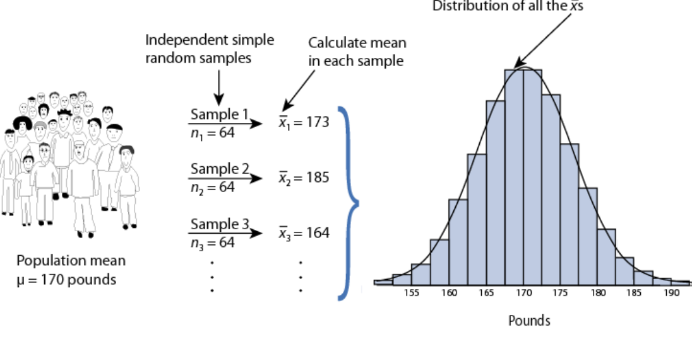

*Figure 1. Sample means computed from repeated samples of size 64 drawn from a population, and their distribution*

> **Definition:** The standard deviation of an estimator is called the **standard error (SE)** of the estimator. The standard error of the sample mean is $SE_{\bar{x}} = \sigma/\sqrt{n}$.

In the body weight example, $SE_{\bar{x}} = 40/\sqrt{64} = 5$. The sampling distribution of the sample mean is normal with mean 170 and standard error 5, so by the 68-95-99.7 rule of Lecture 5, Section 4.3, about 68% of sample means fall within $\mu \pm SE$, that is, between 165 and 175, and about 95% within $\mu \pm 2SE$, that is, between 160 and 180. The sampling distribution of a mean (SDM) thus describes how the sample mean behaves from sample to sample.

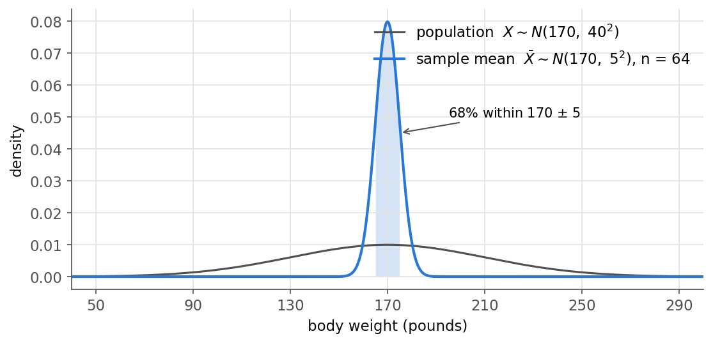

*Figure 2. Distribution of the body weight population and of the sample mean of samples of size 64*

In Figure 2, individual body weights are widely spread, but the means of 64 people gather narrowly around 170, because the standard error is $1/\sqrt{64} = 1/8$ of the population standard deviation.

> **Note:** The distribution of the sample mean is sometimes written as $\bar{x} \sim N(\mu, SE_{\bar{x}})$, with the standard error in the second slot. This is standard deviation notation; in variance notation it is $N(\mu, SE_{\bar{x}}^2) = N(\mu, \sigma^2/n)$.

### 2.3 When the Population Is Not Normal

Even if the population is not normal, $E(\bar{X}) = \mu$ and $Var(\bar{X}) = \sigma^2/n$ still hold. As for the shape, the central limit theorem of Lecture 5, Section 8 makes it approximately normal for sufficiently large $n$. That is, if the observations are independent with finite variance, $\bar{X} \overset{a}{\sim} N(\mu, \sigma^2/n)$. Even for a somewhat skewed population such as body weights, the approximation can be used with $n = 64$. All the Z-tests and t-tests that follow rest on this sampling distribution.

---

<br>

## 3. Estimation

### 3.1 Point Estimation

> **Definition:** **Point estimation** is the procedure of estimating the true value of a parameter by a single observed value of an estimator.

The population mean is estimated by $\hat{\mu} = \bar{x}$ and the population variance by $\hat{\sigma}^2 = s^2$. As shown in Section 1, $E(\bar{X}) = \mu$ and $E(S^2) = \sigma^2$, so both estimators are unbiased. A single point estimate, however, does not tell how far it may be from the true value. Interval estimation expresses this uncertainty as well.

### 3.2 Interval Estimation and Confidence Intervals

- **Interval estimation:** The procedure of determining a confidence interval whose probability of containing the true value of the parameter is the confidence level $1 - \alpha$.
- **Confidence interval:** An interval $`[\hat{\theta}_L, \hat{\theta}_U]`$ whose probability of containing the true value of the parameter is $1 - \alpha$. Its endpoints $`\hat{\theta}_L`$ and $`\hat{\theta}_U`$ are statistics computed from the sample.
- **Confidence level:** The probability that the confidence interval contains the true value of the parameter, $`P(\hat{\theta}_L < \theta < \hat{\theta}_U) = 1 - \alpha`$.
- **Significance level:** The probability that the confidence interval does not contain the true value of the parameter, $`1 - P(\hat{\theta}_L < \theta < \hat{\theta}_U) = \alpha`$. The same $\alpha$ is used in the hypothesis tests of Section 6.

A confidence interval for the population mean is built from the sampling distribution of Section 2. If $\sigma$ is known, $(\bar{X} - \mu)/(\sigma/\sqrt{n})$ follows $N(0, 1)$ exactly when the population is normal and approximately, by the central limit theorem, when $n$ is large. Hence, for the upper quantile $z_{\alpha/2}$ of Lecture 5, Section 4.3, the following holds (approximately in the second case).

```math
P\left(-z_{\alpha/2} < \frac{\bar{X} - \mu}{\sigma/\sqrt{n}} < z_{\alpha/2}\right) = 1 - \alpha
```

Solving the inequalities inside the parentheses for $\mu$ gives the following.

```math
P\left(\bar{X} - z_{\alpha/2}\frac{\sigma}{\sqrt{n}} < \mu < \bar{X} + z_{\alpha/2}\frac{\sigma}{\sqrt{n}}\right) = 1 - \alpha
```

Hence the $`100(1-\alpha)\%`$ confidence interval for $\mu$ is $`\bar{x} \pm z_{\alpha/2}\,\sigma/\sqrt{n}`$, and the 95% interval uses $z_{0.025} = 1.96$. If $\sigma$ is unknown and the population is normal, the t distribution of Lecture 5, Section 7.3 gives $`\bar{x} \pm t_{\alpha/2,\,n-1}\,s/\sqrt{n}`$.

In the body weight example, if the sample mean were $\bar{x} = 173$, the 95% confidence interval would be $173 \pm 1.96 \times 5 = (163.2, 182.8)$. The width $`2z_{\alpha/2}\,\sigma/\sqrt{n}`$ grows with the confidence level and shrinks in proportion to $1/\sqrt{n}$ as the sample size grows.

### 3.3 Interpreting a Confidence Interval

In a confidence interval, what is random is the interval, not the parameter $\mu$. $\mu$ is a fixed value, and the endpoints of the interval are random variables that change with the sample. "95%" therefore means the probability, before the sample is drawn, that an interval made by this procedure contains $\mu$, that is, the long-run proportion of intervals containing $\mu$ when the procedure is repeated.

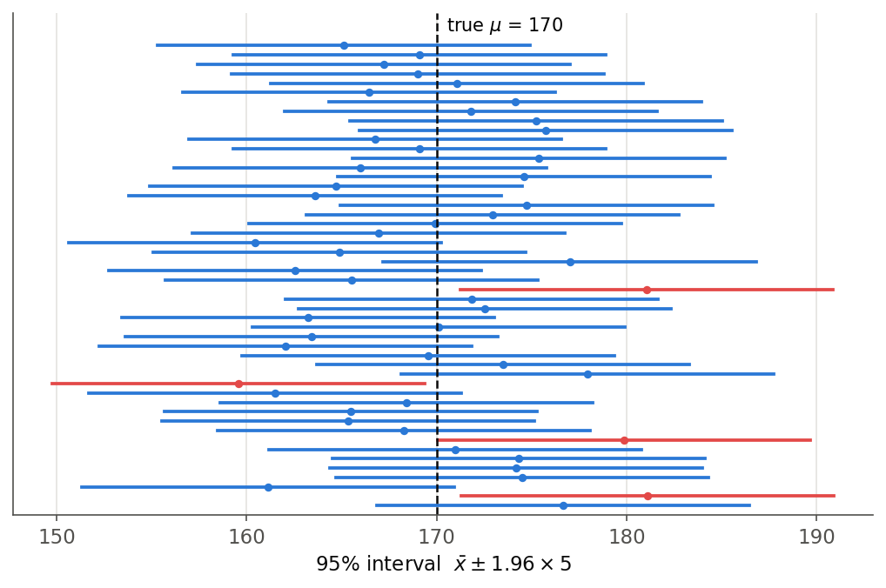

*Figure 3. 95% confidence intervals from 50 samples of size 64 from the body weight population, with red intervals missing the true value 170*

In Figure 3, 46 of the 50 intervals contain the true value 170 and 4 do not. On average, 2.5 of 50 intervals miss it, and the actual count varies from sample to sample.

> **Caution:** For an observed interval $(163.2, 182.8)$, saying "the probability that $\mu$ is in this interval is 95%" is incorrect in the frequentist framework. An interval already computed either contains $\mu$ or does not. The correct statement is "this interval was produced by a procedure that contains the true value with probability 95%".

---

<br>

## 4. Basic Concepts of Hypothesis Testing

### 4.1 Questions Asked of Data and Statistical Hypotheses

Given data, two basic questions are asked.

- **Difference:** Do two groups or two conditions differ?
- **Equivalency:** Are two groups or two conditions the same?

A statistical hypothesis expresses such a question in a testable form. A **statistical hypothesis** is a hypothesis that can be tested by observing a process modeled through a set of random variables, and the analysis that tests it is also called confirmatory data analysis. Statistical hypotheses are stated as a pair: the **null hypothesis** $H_0$ and the **alternative hypothesis** $H_1$. The subscript 0 of $H_0$ does not denote the number zero but "null", and by default $H_0$ states "the same" while $H_1$ states "different".

### 4.2 Decision Making under Uncertainty

People must make decisions even when outcomes are uncertain, as with school, marriage, therapy, or jobs. Statistics provides an approach to **decision making under uncertainty**: as when placing a bet, weigh the possible outcomes and their probabilities and choose the option with the largest expected utility (the expected value of a subjective value).

In inferential statistics, the null hypothesis is a general statement or default position that nothing new is happening. For example, a statement that there is no association among groups, or no relationship between two measured phenomena, is a null hypothesis. Hypothesis testing judges whether the data provide evidence strong enough to abandon this default position.

### 4.3 Null and Alternative Hypotheses

| Aspect | Alternative hypothesis | Null hypothesis |
|:-----|:-----|:-----|
| Symbol | $H_1$, $H_A$ ($`H_a`$) | $H_0$ |
| Role | The hypothesis that is the main purpose of the study | The hypothesis opposed to the purpose of the study |
| Researcher's stance | The hypothesis one wants to claim is right | The hypothesis one wants to claim is wrong |
| Typical form | Different ($\neq$, $>$, $`<`$) | The same ($`=`$) |

*Table 1. Comparison of the alternative and null hypotheses*

Hypothesis testing assumes that the null hypothesis is correct and then derives a **contradiction** with the data. If the contradiction is large enough, the null hypothesis is abandoned and the alternative hypothesis is accepted.

### 4.4 The Logic of Refutation

The main idea of hypothesis testing is as follows.

- It is difficult to prove that a fact is "right".
- But it is easy to show that it is "wrong".
- The reason is that a single counterexample suffices.

For example, suppose the goal is to show the following proposition.

```math
H_1:\ \text{In general, men and women have different heights}
```

The goal is to show that this proposition is "true". To do so, set up the opposite hypothesis.

```math
H_0:\ \text{Men and women have the same height}
```

Assuming that men and women have the same height, examine the heights of men and women separately in the collected data and find their means and variances. If numerical evidence shows that the two groups differ by an amount that would almost never occur under this assumption, it is evidence that the null hypothesis is "false", and we conclude that the original proposition $H_1$ is "true". This has the same structure as proof by contradiction in mathematics.

> **Caution:** Statistical evidence differs from a logical counterexample. Data that are unlikely under $H_0$ are not impossible under it, so a conclusion that rejects $H_0$ always carries a risk of error (Section 5). Also, failing to reject $H_0$ does not prove that $H_0$ is true; it only means the evidence is insufficient, so write "fail to reject $H_0$" or "retain $H_0$" rather than "accept $H_0$".

---

<br>

## 5. Two Types of Errors

### 5.1 Type I and Type II Errors

The result of a statistical test is either to reject the null hypothesis or not. The true state is also one of two, either $H_0$ or $H_1$ is true, so four cases arise. In terms of signal detection, $H_1$ is "a signal is present" and $H_0$ is "no signal is present"; rejecting $H_0$ is a "detection" and not rejecting it is a "null result".

| Test result \ True state | $H_1$ true (signal present) | $H_0$ true (signal absent) |
|:-----|:-----|:-----|
| Reject $H_0$ (detection) | True positive (TP) | False positive (FP), **type I error** |
| Fail to reject $H_0$ (null result) | False negative (FN), **type II error** | True negative (TN) |
| Column fraction | TPF = sensitivity = power = TP/(TP+FN) | FPF = 1 − specificity = FP/(FP+TN) |

*Table 2. The four cases by test result and true state, and the two types of errors*

- **Type I error:** Rejecting $H_0$ when it is true. Like an alarm that sounds without a fire, it declares an effect that does not exist. Its probability $P(\text{reject } H_0 \mid H_0 \text{ true})$ is written $\alpha$.
- **Type II error:** Failing to reject $H_0$ when $H_1$ is true. Like an alarm that misses a real fire, it misses an existing effect. Its probability $P(\text{fail to reject } H_0 \mid H_1 \text{ true})$ is written $\beta$.
- **Power:** The probability $1 - \beta$ of correctly rejecting $H_0$ when $H_1$ is true. It is the TPF (true positive fraction) of Table 2, also called sensitivity.
- The FPF (false positive fraction) of Table 2 is the fraction of rejections when $H_0$ is true, that is, $\alpha$. $1 - \alpha$ corresponds to the specificity and equals the confidence level of Section 3.2.

### 5.2 The Confusion Matrix

Table 2 expressed in probabilities is called the **confusion matrix**, or the contingency table of binary hypothesis testing. Below, $P(H_i \mid H_j)$ is the probability of declaring $H_i$ when $H_j$ is actually true, and each probability is estimated by the corresponding fraction of samples.

| Declared \ True | True $H_0$ (null) | True $H_1$ |
|:-----|:-----|:-----|
| Declared $H_0$ | $P(H_0 \mid H_0) = P_{spec}$ (specificity) = number of $H_0$ samples declared $H_0$ / number of $H_0$ samples | $P(H_0 \mid H_1) = P_{miss}$ (miss) = number of $H_1$ samples declared $H_0$ / number of $H_1$ samples |
| Declared $H_1$ | $P(H_1 \mid H_0) = P_{FA}$ (false alarm) = number of $H_0$ samples declared $H_1$ / number of $H_0$ samples | $P(H_1 \mid H_1) = P_D$ (detection) = number of $H_1$ samples declared $H_1$ / number of $H_1$ samples |

*Table 3. Confusion matrix of binary hypothesis testing with conditional probabilities*

Each column contains the two declarations for the same true state, so its probabilities sum to 1.

```math
P(H_0 \mid H_0) + P(H_1 \mid H_0) = 1, \qquad P(H_0 \mid H_1) + P(H_1 \mid H_1) = 1
```

If the prior probabilities $P(H_0)$ and $P(H_1)$ of the true states are known, the law of total probability of Lecture 2 gives the probability of correct classification $P_{cc}$ and the error probability $P_e$.

```math
P_{cc} = P(\text{correct classification}) = P(H_0 \mid H_0)P(H_0) + P(H_1 \mid H_1)P(H_1)
```

```math
P_e = P(\text{error}) = 1 - P_{cc} = P(H_0 \mid H_1)P(H_1) + P(H_1 \mid H_0)P(H_0)
```

If a correct classification is given zero cost ($`C_{00} = C_{11} = 0`$) and an incorrect one full cost ($`C_{01} = C_{10} = 1`$), the expected cost equals $P_e$. Under this cost structure, minimizing the error probability therefore minimizes the expected cost. In practice the two errors often have different costs (for example, the cost of missing a disease versus the cost of retesting a healthy person), and the decision criterion is then set to reflect those costs.

> **[Machine Learning]** The evaluation of binary classifiers in machine learning uses the same confusion matrix. The model's prediction corresponds to the "declaration" and the true label to the "true state", and the recall, precision, and accuracy of the next section are standard evaluation measures for classification models. Moving the classification threshold trades false positives against false negatives, just as $\alpha$ and $\beta$ trade off in a test.

### 5.3 Measures Derived from the Confusion Matrix

The four cells of the confusion matrix are the true positives (TP), true negatives (TN), false positives (FP, type I errors), and false negatives (FN, type II errors). The measures of Table 4 are defined from these counts. They are the most widely used measures in statistics and throughout data science, so their definitions and relationships must be understood precisely.

| Measure | Other names | Formula | Relation |
|:-----|:-----|:-----|:-----|
| TPR (true positive rate) | Power, sensitivity, hit rate, recall | $\frac{TP}{TP + FN}$ | $1 - FNR$ |
| TNR (true negative rate) | Specificity | $\frac{TN}{TN + FP}$ | $1 - FPR$ |
| PPV (positive predictive value) | Precision | $\frac{TP}{TP + FP}$ | $1 - FDR$ |
| NPV (negative predictive value) | Negative predictive value | $\frac{TN}{TN + FN}$ | $1 - FOR$ |
| FNR (false negative rate) | Miss rate | $\frac{FN}{FN + TP}$ | $1 - TPR$ |
| FPR (false positive rate) | Fall-out | $\frac{FP}{FP + TN}$ | $1 - TNR$ |
| FDR (false discovery rate) | False discovery rate | $\frac{FP}{FP + TP}$ | $1 - PPV$ |
| FOR (false omission rate) | False omission rate | $\frac{FN}{FN + TN}$ | $1 - NPV$ |
| ACC (accuracy) | Accuracy | $\frac{TP + TN}{TP + TN + FP + FN}$ | $1 - ERR$ |
| ERR (error rate) | Error rate | $\frac{FP + FN}{TP + TN + FP + FN}$ | $1 - ACC$ |

*Table 4. Measures defined from the confusion matrix*

The measures are easy to remember by their denominators. TPR, TNR, FNR, and FPR divide by the **true state** (the columns of the confusion matrix), while PPV, NPV, FDR, and FOR divide by the **declaration** (the rows). In terms of hypothesis testing, $\alpha$ is the FPR, $\beta$ is the FNR, and power is the TPR. The FDR is used when many hypotheses are tested at once, as the fraction of wrongly rejected hypotheses among all rejected ones.

**Example.** A screening test was given to 1,000 people, 100 of whom have a disease. Of the 100 patients, 90 tested positive (TP = 90, FN = 10), and of the 900 healthy people, 45 tested positive (FP = 45, TN = 855).

| | Actually diseased | Actually healthy | Total |
|:-----|:-----|:-----|:-----|
| Test positive | TP = 90 | FP = 45 | 135 |
| Test negative | FN = 10 | TN = 855 | 865 |
| Total | 100 | 900 | 1,000 |

*Table 5. Confusion matrix of the screening test example*

- TPR (sensitivity) $= 90/100 = 0.90$ and TNR (specificity) $= 855/900 = 0.95$.
- PPV (precision) $= 90/135 \approx 0.667$ and NPV $= 855/865 \approx 0.988$.
- FNR $= 0.10$, FPR $= 0.05$, FDR $= 45/135 \approx 0.333$, and FOR $= 10/865 \approx 0.012$.
- ACC $= (90 + 855)/1000 = 0.945$ and ERR $= 0.055$.

Even though both sensitivity and specificity are high, one third of the positive results are wrong. The prevalence of the disease is only 10%, so healthy people are far more numerous, and even 5% of them being false positives amounts to 45 people (Bayes' theorem of Lecture 2). Also, declaring everyone negative would give an accuracy of 0.90, so when one state is rare, accuracy alone must not be used to evaluate a test.

### 5.4 Significance Level, Power, and Sample Size

The two errors are linked. In the body weight example of Section 6, testing $H_0: \mu = 170$ against $H_a: \mu > 170$ at significance level $\alpha = 0.05$ rejects $H_0$ when $\bar{x}$ is at least the critical value $170 + 1.645 \times 5 = 178.22$. If the true mean is $\mu = 180$, the power is

```math
P(\bar{X} \geq 178.22 \mid \mu = 180) = P\left(Z \geq \frac{178.22 - 180}{5}\right) = P(Z \geq -0.355) \approx 0.639
```

and $\beta \approx 0.361$. Even if body weight has actually increased by 10 pounds, this test misses the change with a probability of about 36%.

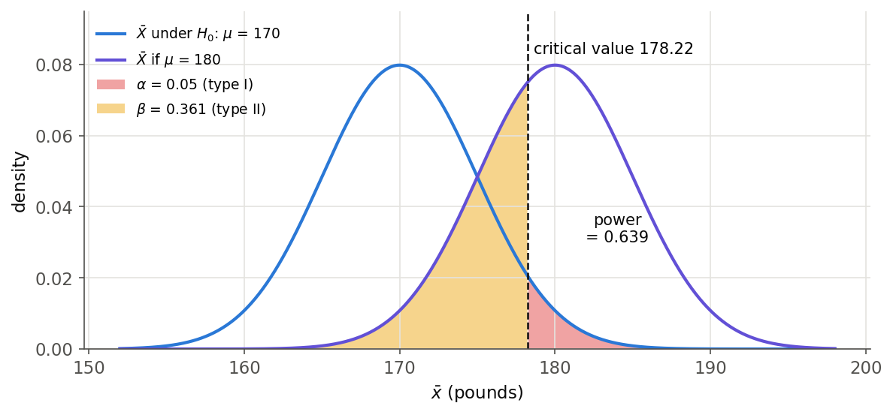

*Figure 4. Distributions of the sample mean under H0 and H1, the critical value 178.22, and the type I and type II error probabilities*

The following relationships can be read from Figure 4.

- Decreasing $\alpha$ moves the critical value to the right and increases $\beta$. With the same data, both errors cannot be reduced at once.
- Increasing the sample size narrows both distributions, so $\beta$ can be reduced while $\alpha$ is kept. In the same problem with $n = 100$, $SE = 4$ and the critical value becomes $176.58$, raising the power to about $0.804$.
- The larger the actual effect (the farther the true mean is from 170), the farther apart the two distributions are and the higher the power.

When designing a study, one therefore first fixes $\alpha$ (usually 0.05) and then chooses a sample size large enough to detect the effect size of interest with the desired power (often 0.8).

---

<br>

## 6. The One-Sample Z-Test

### 6.1 Example: A Body Weight Study

In the 1970s, the body weight of 20-29-year-old men in the U.S. had mean $\mu = 170$ pounds and standard deviation $\sigma = 40$ pounds. We test whether the mean body weight of the population now differs.

- The null hypothesis is $H_0: \mu = 170$ ("no difference").
- The alternative hypothesis is either $H_a: \mu > 170$ (a **one-sided test**) or $H_a: \mu \neq 170$ (a **two-sided test**).

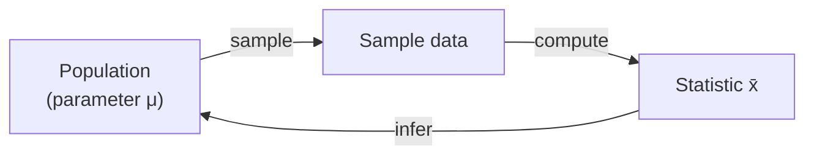

*Figure 5. Drawing a sample from a population and inferring the parameter through a statistic*

One-sided and two-sided tests differ in the direction of the alternative hypothesis. A one-sided test is used when only one direction is meaningful, as in "has it increased?", and a two-sided test when changes in either direction are sought, as in "has it changed?". The direction must be fixed by the research question **before** seeing the data. Choosing a one-sided test in the observed direction after seeing the data doubles the actual type I error probability relative to the chosen $\alpha$.

### 6.2 Test Statistic

This example is a **one-sample test of a mean when $\sigma$ is known**. The following statistic is used.

```math
z_{\text{stat}} = \frac{\bar{x} - \mu_0}{SE_{\bar{x}}}, \qquad SE_{\bar{x}} = \frac{\sigma}{\sqrt{n}}
```

Here $\mu_0$ is the population mean when $H_0$ is true. If $H_0$ is true and the population is normal or $n$ is large, Section 2 gives $Z = (\bar{X} - \mu_0)/(\sigma/\sqrt{n}) \sim N(0, 1)$ (exactly or approximately). Thus $z_{\text{stat}}$ tells how many standard errors the observed sample mean lies from $\mu_0$. It is called the **Z statistic**, and a statistic used for a test is called a **test statistic** in general.

The magnitude $|z_{\text{stat}}|$ of the test statistic grows in the following cases.

- It grows as the difference $|\bar{x} - \mu_0|$ between the sample mean and $\mu_0$ grows.
- It grows as the population standard deviation $\sigma$ shrinks, that is, as the noise in the data decreases.
- It grows as the sample size $n$ grows. For the same difference of 3 pounds, $n = 64$ gives $z = 0.6$, but $n = 1600$ gives $SE = 1$ and $z = 3$.

In the body weight example, $\mu_0 = 170$, $\sigma = 40$, and $n = 64$, so the standard error is as follows.

```math
SE_{\bar{x}} = \frac{\sigma}{\sqrt{n}} = \frac{40}{\sqrt{64}} = 5
```

If the sample mean is 173, $z_{\text{stat}} = (173 - 170)/5 = 0.60$; if it is 185, $z_{\text{stat}} = (185 - 170)/5 = 3.00$.

### 6.3 The p-Value

> **Definition:** The **p-value** is the probability, under the assumption that $H_0$ is true, of obtaining a test statistic at least as extreme as the observed one in the direction of $H_1$.

The question a p-value answers is "if $H_0$ were true, what is the probability of a result as extreme as, or more extreme than, the one observed?". The Z statistic is converted to a p-value according to the direction of the alternative hypothesis, as in Table 6.

| Alternative hypothesis | p-value | Meaning |
|:-----|:-----|:-----|
| $H_a: \mu > \mu_0$ | $P = P(Z \geq z_{\text{stat}})$ | Right-tail area beyond $z_{\text{stat}}$ |
| $H_a: \mu < \mu_0$ | $P = P(Z \leq z_{\text{stat}})$ | Left-tail area beyond $z_{\text{stat}}$ |
| $H_a: \mu \neq \mu_0$ | $P = 2 \times P(Z \geq \vert z_{\text{stat}} \vert)$ | Twice the one-tailed p-value |

*Table 6. p-value of the Z statistic by direction of the alternative hypothesis*

In "twice the one-tailed p-value" for a two-sided test, the one-tailed value is the tail area on the side of the observed $z_{\text{stat}}$. If $z_{\text{stat}}$ is negative, the left tail is used; using the absolute value covers both cases in one formula.

The one-sided p-values of the body weight example are as follows (Lecture 5, Table 4).

- For $z_{\text{stat}} = 0.6$, $P = 1 - \Phi(0.6) = 0.2743$. Even if $H_0$ is true, a sample mean at least this large occurs with probability 27%.
- For $z_{\text{stat}} = 3.0$, $P = 1 - \Phi(3.0) = 0.0013$. If $H_0$ were true, such a result would occur only about once in 1,000 times.

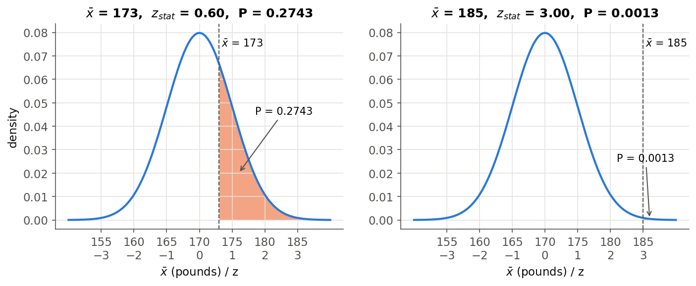

*Figure 6. One-sided p-values for sample means 173 and 185 as right-tail areas of the distribution of the sample mean under H0*

For two-sided tests they are $2 \times 0.2743 = 0.5485$ and $2 \times 0.0013 = 0.0027$, respectively.

### 6.4 Interpreting p-Values

The smaller the p-value, the stronger the evidence in the data against $H_0$. A common convention is shown in Table 7.

| p-value | Interpretation |
|:-----|:-----|
| $P > 0.10$ | Non-significant evidence against $H_0$ |
| $0.05 < P \leq 0.10$ | Marginally significant evidence |
| $0.01 < P \leq 0.05$ | Significant evidence against $H_0$ |
| $P \leq 0.01$ | Highly significant evidence against $H_0$ |

*Table 7. Conventional interpretation of p-values*

For example, $P = 0.27$ means non-significant evidence against $H_0$, and $P = 0.01$ means highly significant evidence. However, it is unwise to draw firm borders for significance. $P = 0.049$ and $P = 0.051$ carry almost the same strength of evidence, so calling one "significant" and the other "not significant" as if they were opposite conclusions is a mistake.

> **Caution:** p-values are often misinterpreted. The statement of the American Statistical Association (ASA) stresses the following [2]. A p-value is not the probability that $H_0$ is true, nor the probability that the result arose by chance alone; it only indicates how incompatible the data are with $H_0$ and the model's assumptions. A small p-value does not mean that an effect is large or important; with a very large sample, even a practically meaningless small difference yields a small p-value. A large p-value is not evidence that $H_0$ is true either. Therefore, do not report the p-value alone; report the size of the effect (for example $`\bar{x} - \mu_0`$) and a confidence interval as well.

### 6.5 Significance Level and Rejection Region

> **Definition:** The **significance level** $\alpha$ is the probability of erroneously rejecting $H_0$, that is, the upper bound on the type I error probability that the test allows.

Before the test, set the threshold $\alpha$ (for example $\alpha = 0.10$, $0.05$, and so on) and conclude by the following rule.

- Reject $H_0$ when $P \leq \alpha$.
- Retain $H_0$ when $P > \alpha$.

For example, with $\alpha = 0.10$ and $P = 0.27$, retain $H_0$; with $\alpha = 0.01$ and $P = 0.001$, reject $H_0$. Under this rule, the probability of rejecting a true $H_0$ is exactly $\alpha$ when the null distribution of a continuous test statistic is known exactly, because the p-value then follows the uniform distribution on 0 to 1 under $H_0$. When the null distribution is only approximate (for example, through the central limit theorem), the probability is approximately $\alpha$.

The same conclusion can be reached from the value of the test statistic. The range of test statistic values that leads to rejecting $H_0$ is the **rejection region**, and its boundary is the **critical value**. $P \leq \alpha$ is the same condition as "the test statistic lies in the rejection region".

| Alternative hypothesis | Rejection region | For $\alpha = 0.05$ |
|:-----|:-----|:-----|
| $H_a: \mu \neq \mu_0$ | $\vert z_{\text{stat}} \vert \geq z_{\alpha/2}$ | $\vert z_{\text{stat}} \vert \geq 1.96$ |
| $H_a: \mu > \mu_0$ | $z_{\text{stat}} \geq z_{\alpha}$ | $z_{\text{stat}} \geq 1.645$ |
| $H_a: \mu < \mu_0$ | $z_{\text{stat}} \leq -z_{\alpha}$ | $z_{\text{stat}} \leq -1.645$ |

*Table 8. Rejection regions of the Z-test by direction of the alternative hypothesis*

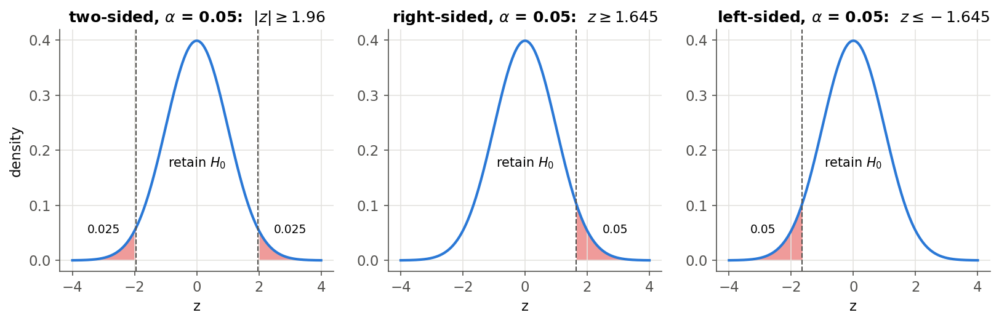

*Figure 7. Rejection regions of two-sided, right-sided, and left-sided Z-tests at significance level 0.05*

A two-sided test splits the significance level $\alpha$ into $\alpha/2$ in each tail, so at the same $\alpha$ its critical value on each side is farther out than that of a one-sided test (1.96 > 1.645).

A two-sided test and a confidence interval give the same information. A two-sided test at level $\alpha$ rejects $H_0: \mu = \mu_0$ exactly when $\mu_0$ lies outside the $`100(1-\alpha)\%`$ confidence interval. In the body weight example, the 95% confidence interval for $\bar{x} = 185$ is $185 \pm 9.8 = (175.2, 194.8)$, which excludes 170, in agreement with the two-sided p-value $0.0027 < 0.05$.

### 6.6 Summary of the Test Procedure

A one-sample Z-test is carried out in the following four steps.

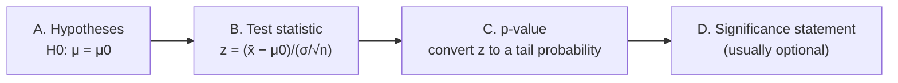

*Figure 8. The four steps of a one-sample Z-test*

- **A. Hypothesis statements:** Choose, according to the research question, $H_0: \mu = \mu_0$ versus $H_a: \mu \neq \mu_0$ (two-sided), $H_a: \mu < \mu_0$ (left-sided), or $H_a: \mu > \mu_0$ (right-sided).
- **B. Test statistic:** Compute $z_{\text{stat}} = (\bar{x} - \mu_0)/(\sigma/\sqrt{n})$.
- **C. p-value:** Convert $z_{\text{stat}}$ to a p-value with Table 6.
- **D. Significance statement:** State whether $H_0$ is rejected by comparing with $\alpha$. The p-value itself carries more information, so this step is usually not necessary.

> **Caution:** The Z-test requires the following conditions. The population standard deviation $\sigma$ must be known, the observations must be an independent random sample, and the population must be normal or the sample large enough for the central limit theorem to apply. If $\sigma$ is unknown, use the t-test of Section 6.8.

### 6.7 Application: Intelligence Scores in Lake Wobegon

Let $X$ be a score on the Wechsler Adult Intelligence Scale (WAIS). In the general population, $X \sim N(100, 15^2)$ (mean 100, standard deviation 15). A sample of $n = 9$ people from the population of a town called Lake Wobegon gave the following scores.

```math
\lbrace116,\ 128,\ 125,\ 119,\ 89,\ 99,\ 105,\ 116,\ 118\rbrace
```

The scores sum to 1015, so $\bar{x} = 1015/9 = 112.78 \approx 112.8$. Does this sample mean provide strong evidence that the town's population mean $\mu$ is greater than 100?

**A. Hypotheses:** $H_0: \mu = 100$ versus $H_a: \mu > 100$ (one-sided) or $H_a: \mu \neq 100$ (two-sided).

**B. Test statistic:** The population standard deviation $\sigma = 15$ is known.

```math
SE_{\bar{x}} = \frac{\sigma}{\sqrt{n}} = \frac{15}{\sqrt{9}} = 5, \qquad z_{\text{stat}} = \frac{\bar{x} - \mu_0}{SE_{\bar{x}}} = \frac{112.8 - 100}{5} = 2.56
```

**C. p-value:** For the one-sided test, $P = P(Z \geq 2.56) = 1 - 0.9948 = 0.0052$. It is unlikely that this sample came from the distribution under $H_0$, so this is strong evidence against $H_0$. The two-sided test considers random deviations both up and down from $\mu_0$, so it adds the two tails beyond $\pm z_{\text{stat}}$. The two-sided $P$ is therefore $2 \times 0.0052 = 0.0104$.

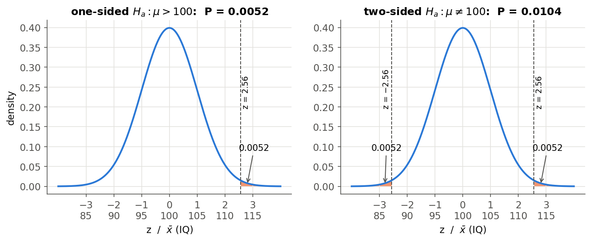

*Figure 9. One-sided and two-sided p-values of the Lake Wobegon example*

**D. Conclusion:** The one-sided test rejects $H_0$ at both $\alpha = 0.05$ and $\alpha = 0.01$. The two-sided test rejects at $\alpha = 0.05$ but not at $\alpha = 0.01$, since $0.0104 > 0.01$. The same data can lead to different conclusions depending on the direction of the alternative and the significance level, so both must be fixed before seeing the data. With the unrounded $\bar{x} = 112.78$, $z_{\text{stat}} = 2.556$, the one-sided $P = 0.0053$, and the two-sided $P = 0.0106$, with the same conclusions.

For this test to be valid, the 9 people must be a random sample from the town's population, and the town's scores must also be assumed normal with standard deviation 15. Because the population is normal, the Z statistic follows $N(0, 1)$ exactly even with $n = 9$.

### 6.8 Unknown Population Standard Deviation: The One-Sample t-Test

In real data analysis, $\sigma$ is usually unknown. The following statistic then replaces $\sigma$ with the sample standard deviation $s$, and if the population is normal, by Lecture 5, Section 7.3, it follows the t distribution with $n - 1$ degrees of freedom under $H_0$.

```math
t_{\text{stat}} = \frac{\bar{x} - \mu_0}{s/\sqrt{n}} \sim t(n-1) \quad \text{under } H_0
```

This is the **one-sample t-test**. Its p-value is obtained from Table 6 with tail probabilities of $t(n-1)$ in place of $Z$. For large samples, the central limit theorem lets it be used approximately even if the population is not normal.

If, for the 9 Lake Wobegon scores, $\sigma = 15$ is not used and is estimated from the data instead, $s = 12.67$, so $t_{\text{stat}} = (112.78 - 100)/(12.67/3) = 3.026$ with 8 degrees of freedom. Computing with R's `t.test()` gives the following.

```r
wais <- c(116, 128, 125, 119, 89, 99, 105, 116, 118)
t.test(wais, mu = 100, alternative = "greater")
```

```text
        One Sample t-test

data:  wais
t = 3.0263, df = 8, p-value = 0.008201
alternative hypothesis: true mean is greater than 100
95 percent confidence interval:
 104.9264      Inf
sample estimates:
mean of x
 112.7778
```

- `mu = 100` is the null mean $\mu_0$, and `alternative = "greater"` means the alternative hypothesis $H_a: \mu > 100$.
- In the output, `t` is the test statistic, `df` the degrees of freedom, and `p-value` is $P(T \geq 3.0263)$. The one-sided $P = 0.0082$, so $H_0$ is rejected even at $\alpha = 0.01$.
- The confidence interval corresponding to a one-sided test is the one-sided interval $(104.93, \infty)$, which excludes 100.

For these data, $s = 12.67$ is smaller than $\sigma = 15$, so the t statistic is larger than the Z statistic; for the same statistic value, however, the t-test gives a larger p-value because the t distribution has heavier tails.

---

<br>

## 7. Comparing Two Groups

### 7.1 Purpose of the Comparison

The goal of a two-group comparison is to compare differences in population mean and variability between two specific groups. For example, when people are divided into two crowds, one asks whether the two crowds differ in mean height or mean weight. The characteristics of each population are described by the population means $\mu_1$ and $\mu_2$, and the mean $`\bar{x}_1`$ or $`\bar{x}_2`$ of each sample tells us about the corresponding population mean.

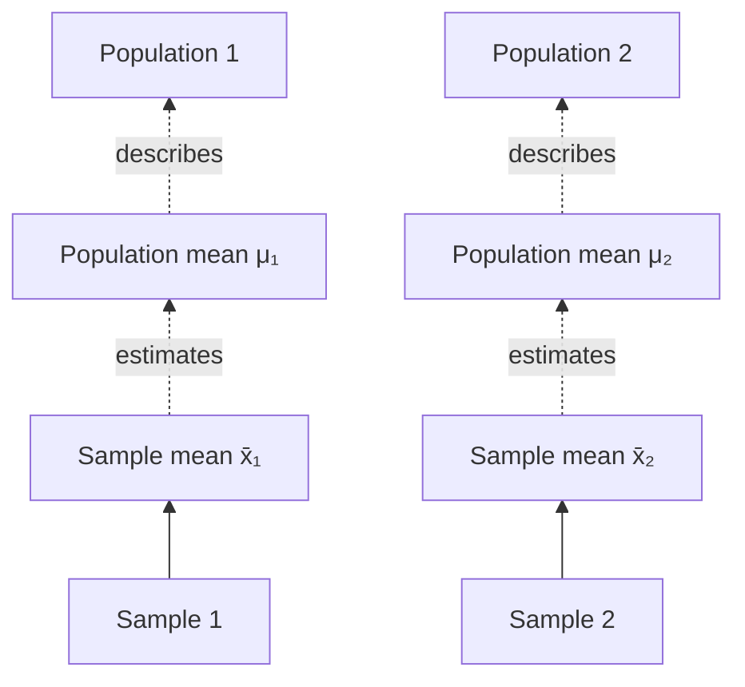

*Figure 10. Relationship between the population means of two populations and the sample means of their samples*

### 7.2 Data Collection Designs

Data for two groups are collected in one of two ways, and the appropriate test depends on the design.

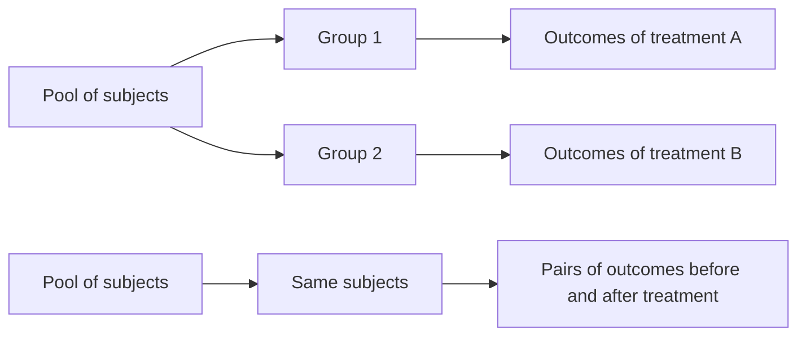

*Figure 11. Data drawn independently from two treatment groups and paired data from the same subjects*

- **(1) Independent samples:** Data are drawn independently from the two treatment groups. For example, patients in a study are divided into two groups, different treatments are applied, and the results are compared. Observations in one group are unrelated to those in the other.
- **(2) Paired samples:** Data for the two treatments are obtained in pairs from the same subjects. For example, chemotherapy is given to the same cancer patients, and their conditions before and after treatment are compared. The two values of the same person are related.

### 7.3 Choosing a Test

A test for comparing two groups is chosen by the data collection design (independent or paired), the normality condition, and the sample size. Under normality, a t-test is used. Even for data that do not follow a normal distribution, a t-test can be used if the samples are large, thanks to the central limit theorem; if the samples are small, a nonparametric test is used.

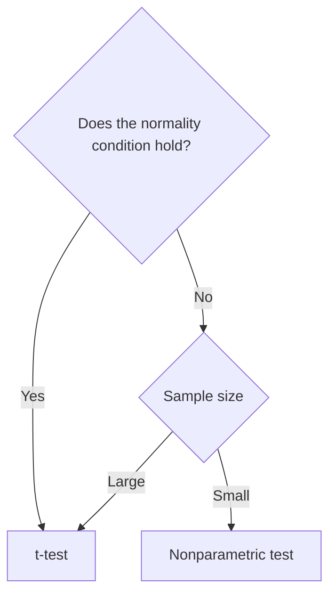

*Figure 12. Choosing between a t-test and a nonparametric test for comparing two groups*

| Design | t-test | Nonparametric test |
|:-----|:-----|:-----|
| Independent | Independent two-sample t-test | Wilcoxon rank-sum test, Mann-Whitney test, permutation test |
| Paired | Paired t-test | Wilcoxon signed-rank test, permutation test |

*Table 9. Tests for comparing two groups by data collection design and distributional condition*

The Wilcoxon rank-sum test and the Mann-Whitney test are two formulations of the same test. Nonparametric tests are covered in Lecture 8.

---

<br>

## 8. The Independent Two-Sample t-Test

### 8.1 Assumptions

The **independent two-sample t-test** compares two population means under the following assumptions.

- **Sufficient sample size:** The sample in each group should be large enough. A common criterion is $n_1 \geq 30$ and $n_2 \geq 30$.
- **Normality:** Within each group, the continuous variable being compared should follow a normal distribution. This condition is not necessary if the samples are large, because the central limit theorem makes the difference of the sample means approximately normal.
- **Independence:** The two groups must be independent of each other, and the observations within each group must be independent as well. That is, $x_i \sim N(\mu_1, \sigma^2)$ and $y_j \sim N(\mu_2, \sigma^2)$ are mutually independent.
- **Equal variances:** The variable of interest must have the same variance in both groups ($`\sigma_1^2 = \sigma_2^2 = \sigma^2`$). Under unequal variances (heteroscedasticity), the different test statistic of Section 8.3 is used.

> **Note:** Only one of the first two assumptions is needed. If both populations are normal with equal variances, the t statistic of the next section follows the t distribution **exactly** regardless of sample size, so $n \geq 30$ is not required. Conversely, if normality is doubtful, the samples must be large for the approximation by the central limit theorem to be justified, and how large depends on the skewness of the distribution (Lecture 5, Section 8.2). $n \geq 30$ is a rough criterion for this approximation.

### 8.2 Test Statistic and Pooled Variance

The null hypothesis is that the two population means are equal.

```math
H_0: \mu_1 = \mu_2
```

The test statistic is as follows and follows the t distribution with $n_1 + n_2 - 2$ degrees of freedom under $H_0$.

```math
t = \frac{\bar{X} - \bar{Y}}{s_p\sqrt{\dfrac{1}{n_1} + \dfrac{1}{n_2}}} \sim t_{n_1 + n_2 - 2} \quad \text{under } H_0
```

Here $\bar{X}$ and $\bar{Y}$ are the sample means of the two groups, and $s_p$ is the **pooled standard deviation**, which estimates the common variance $\sigma^2$ from the data of both groups. Its square, the **pooled variance**, is as follows.

```math
s_p^2 = \frac{\sum_{i=1}^{n_1}(x_i - \bar{x})^2 + \sum_{j=1}^{n_2}(y_j - \bar{y})^2}{n_1 + n_2 - 2} = \frac{(n_1 - 1)s_1^2 + (n_2 - 1)s_2^2}{n_1 + n_2 - 2}
```

The pooled variance is the average of the two sample variances weighted by their degrees of freedom. The denominator is $n_1 + n_2 - 2$ because one degree of freedom is lost for each group mean that is estimated.

Why this statistic follows the t distribution is explained by the results of Lecture 5, Section 7.

1. The two sample means are independent normal random variables, so their difference is also normal, and the variances add: $`\bar{X} - \bar{Y} \sim N(\mu_1 - \mu_2,\ \sigma^2(1/n_1 + 1/n_2))`$.
2. Under $H_0$, $\mu_1 - \mu_2 = 0$, so $Z = (\bar{X} - \bar{Y})/(\sigma\sqrt{1/n_1 + 1/n_2}) \sim N(0, 1)$.
3. $(n_1 - 1)S_1^2/\sigma^2 \sim \chi^2(n_1 - 1)$ and $(n_2 - 1)S_2^2/\sigma^2 \sim \chi^2(n_2 - 1)$ are independent, so by additivity their sum $(n_1 + n_2 - 2)S_p^2/\sigma^2 \sim \chi^2(n_1 + n_2 - 2)$. This quantity is also independent of $Z$.
4. Substituting into the definition of the t distribution, $T = Z/\sqrt{Y/\nu}$, the unknown $\sigma$ cancels and the $t$ above results, with $\nu = n_1 + n_2 - 2$ degrees of freedom.

**Decision rule:** Compute the p-value from the t statistic and the t distribution; if the p-value is lower than the chosen significance level, reject the null hypothesis and select the alternative hypothesis. For a two-sided test this is the same as rejecting when $`|t| \geq t_{\alpha/2,\, n_1 + n_2 - 2}`$. The alternative hypothesis can be $\mu_1 \neq \mu_2$ (two-sided) or $\mu_1 > \mu_2$ or $\mu_1 < \mu_2$ (one-sided).

### 8.3 Without Equal Variances: Welch's t-Test

If the two population variances may differ, **Welch's t-test**, which uses the variance of each group separately instead of the pooled variance, is used [3].

```math
t_{W} = \frac{\bar{X} - \bar{Y}}{\sqrt{\dfrac{S_1^2}{n_1} + \dfrac{S_2^2}{n_2}}}, \qquad \nu = \frac{\left(\dfrac{s_1^2}{n_1} + \dfrac{s_2^2}{n_2}\right)^2}{\dfrac{(s_1^2/n_1)^2}{n_1 - 1} + \dfrac{(s_2^2/n_2)^2}{n_2 - 1}}
```

Under $H_0$, $t_W$ approximately follows the t distribution with $\nu$ degrees of freedom. The degrees of freedom $\nu$ need not be an integer, and this is called the Welch-Satterthwaite approximation. When the two sample sizes are equal ($`n_1 = n_2`$), $t_W$ has the same value as the pooled $t$, and only the degrees of freedom differ.

R's `t.test()` defaults to `var.equal = FALSE`, so without options it performs Welch's t-test. Using Welch's test when the variances are equal costs little power, but using the pooled test when the variances differ (especially with different sample sizes) can make the actual type I error probability deviate substantially from $\alpha$. Welch's test is therefore the safer choice unless equal variances can be assumed with confidence.

> **Caution:** Testing equality of variances first with an F test (`var.test()`, Lecture 5, Section 7.4) and choosing the type of t-test by its result is also practiced, but the F test is very sensitive to even small departures from normality. Splitting the analysis into two tests also makes the overall error probability hard to control.

### 8.4 R Practice: p24 Level Data

We compare the p24 levels of two treatment groups (300mg and 600mg), with 10 people in each group.

| Dose | p24 level |
|:-----|:-----|
| 300mg | 284, 279, 289, 292, 287, 295, 285, 279, 306, 298 |
| 600mg | 298, 307, 297, 279, 291, 335, 299, 300, 306, 291 |

*Table 10. p24 levels of the two treatment groups*

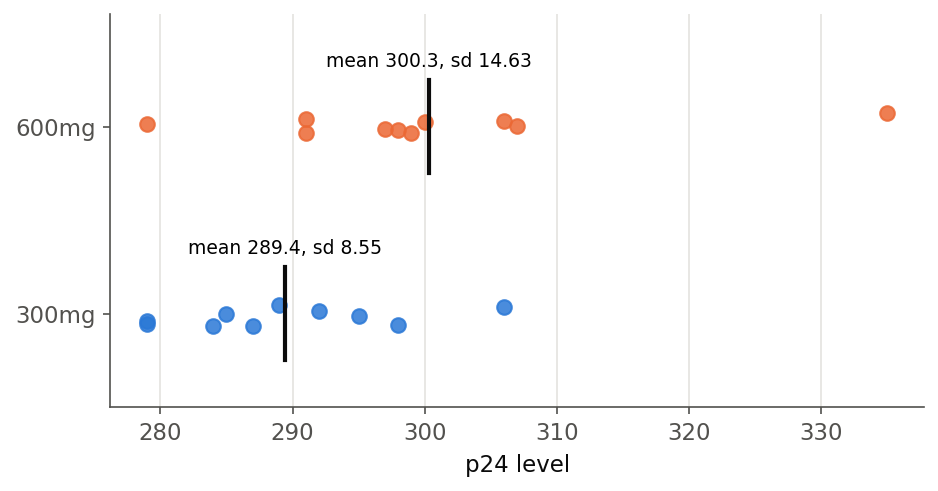

*Figure 13. p24 levels of the two treatment groups and the group means*

By hand, the computation is as follows.

- The sample means are $\bar{x} = 289.4$ and $\bar{y} = 300.3$, and the sums of squared deviations are $\sum (x_i - \bar{x})^2 = 658.4$ and $\sum (y_j - \bar{y})^2 = 1926.1$. The sample variances are $s_1^2 = 73.16$ and $s_2^2 = 214.01$.
- The pooled variance is $s_p^2 = (658.4 + 1926.1)/(10 + 10 - 2) = 2584.5/18 = 143.58$, and $s_p = 11.98$.
- The standard error is $s_p\sqrt{1/10 + 1/10} = 11.98 \times 0.4472 = 5.359$, and $t = (289.4 - 300.3)/5.359 = -10.9/5.359 = -2.034$.
- The upper 2.5% point of the t distribution with 18 degrees of freedom is $t_{0.025, 18} = 2.101$. Since $|t| = 2.034 < 2.101$, the two-sided test at significance level 0.05 does not reject $H_0$.

The same test in R:

```r
x <- c(284, 279, 289, 292, 287, 295, 285, 279, 306, 298)
y <- c(298, 307, 297, 279, 291, 335, 299, 300, 306, 291)
t.test(x, y, var.equal = TRUE)
```

```text
        Two Sample t-test

data:  x and y
t = -2.034, df = 18, p-value = 0.05696
alternative hypothesis: true difference in means is not equal to 0
95 percent confidence interval:
 -22.1584072   0.3584072
sample estimates:
mean of x mean of y
    289.4     300.3
```

- `var.equal = TRUE` requests the pooled-variance t-test that assumes equal variances.
- `t = -2.034, df = 18` matches the hand computation, and the two-sided `p-value = 0.05696`.
- `alternative hypothesis` states that the alternative is $\mu_1 - \mu_2 \neq 0$.
- The 95% confidence interval $(-22.16, 0.36)$ is for $\mu_1 - \mu_2$ and contains 0, in agreement with failing to reject $H_0$ in the two-sided test at level 0.05.

Welch's t-test on the same data with `t.test(x, y)` gives the following.

```text
        Welch Two Sample t-test

data:  x and y
t = -2.034, df = 14.509, p-value = 0.06065
alternative hypothesis: true difference in means is not equal to 0
95 percent confidence interval:
 -22.3557409   0.5557409
sample estimates:
mean of x mean of y
    289.4     300.3
```

The two groups have the same size, so the t value is the same; the 600mg group has a larger variance, so the Welch degrees of freedom drop to 14.509 and the p-value grows slightly. Both p-values lie between 0.05 and 0.10, which is marginally significant evidence by the convention of Table 7. This result is not evidence that the two doses have the same effect. With only 10 people per group the power is low, and a single large value such as 335 in the 600mg group inflates the variance. With such small samples the analysis depends heavily on the normality assumption, and if that assumption is doubtful, the nonparametric tests of Lecture 8 should also be considered.

---

<br>

## 9. The Paired t-Test

### 9.1 Data Structure and Assumptions

When two values $x$ and $y$ are observed in pairs from the same individual, the **paired t-test** is used. The data consist of the pairs and their differences.

```text
Pair 1:  (x1, y1)    d1 = x1 - y1
Pair 2:  (x2, y2)    d2 = x2 - y2
  ...
Pair n:  (xn, yn)    dn = xn - yn
```

*Figure 14. Paired data: each pair of observations and its difference*

$x_i$ and $y_i$ of the same individual are not independent, but values from different individuals ($x_i$ and $x_k$, for example) must be independent. Hence the differences $d_1, \ldots, d_n$ are independent. The assumptions are as follows.

- The differences follow a normal distribution, that is, $d_i \overset{iid}{\sim} N(\mu_d, \sigma_d^2)$ (iid means independent and identically distributed).
- For a large sample ($n > 30$ or so), the central limit theorem lets the test be used approximately even if the differences are not normal.

### 9.2 Test Statistic

The null hypothesis is that the mean difference is 0, which is the same as the two conditions having equal population means.

```math
H_0: \mu_d = 0 \quad (\Leftrightarrow\ \mu_1 = \mu_2)
```

```math
t = \frac{\bar{d}}{s_d/\sqrt{n}} \sim t_{n-1} \quad \text{under } H_0
```

Here $\bar{d}$ is the mean of the differences and $s_d$ is the standard deviation of the differences. In other words, the paired t-test is the one-sample t-test of Section 6.8 applied to the differences $d_i$.

Pairing increases power because of the variance. If the two values of the same individual are positively correlated, $`Var(X - Y) = \sigma_1^2 + \sigma_2^2 - 2\,Cov(X, Y)`$ is smaller than the sum of the two variances. Variation between individuals, such as differences in constitution, cancels out when the differences are taken.

### 9.3 R Practice: Sleep Data

R's built-in `sleep` data record the increase in hours of sleep for 10 patients, each given two sleeping drugs [4]. These are also the data Student analyzed when introducing the t distribution [5]. The same patients took both drugs, so the data are paired.

| Patient | 1 | 2 | 3 | 4 | 5 | 6 | 7 | 8 | 9 | 10 |
|:-----|:-----|:-----|:-----|:-----|:-----|:-----|:-----|:-----|:-----|:-----|
| Drug 1 | 0.7 | -1.6 | -0.2 | -1.2 | -0.1 | 3.4 | 3.7 | 0.8 | 0.0 | 2.0 |
| Drug 2 | 1.9 | 0.8 | 1.1 | 0.1 | -0.1 | 4.4 | 5.5 | 1.6 | 4.6 | 3.4 |
| Difference $d$ | 1.2 | 2.4 | 1.3 | 1.3 | 0.0 | 1.0 | 1.8 | 0.8 | 4.6 | 1.4 |

*Table 11. Increase in sleep of 10 patients given two sleeping drugs, and the differences*

The mean difference is $\bar{d} = 1.58$ and the standard deviation is $s_d = 1.230$, so $t = 1.58/(1.230/\sqrt{10}) = 1.58/0.389 = 4.062$ with 9 degrees of freedom.

```r
drug1 <- sleep$extra[sleep$group == 1]
drug2 <- sleep$extra[sleep$group == 2]
t.test(drug2, drug1, paired = TRUE)
```

```text
        Paired t-test

data:  drug2 and drug1
t = 4.0621, df = 9, p-value = 0.002833
alternative hypothesis: true mean difference is not equal to 0
95 percent confidence interval:
 0.7001142 2.4598858
sample estimates:
mean difference
           1.58
```

- `sleep$extra[sleep$group == 1]` selects the `extra` column of the rows with `group` equal to 1. The data are stored in patient order, so the same position in `drug1` and `drug2` is the same patient.
- `paired = TRUE` treats equal positions of the two vectors as pairs and runs a one-sample t-test on the differences `drug2 - drug1`.
- $p = 0.0028$, so $H_0$ is rejected even at significance level 0.01. Drug 2 increases sleep by 1.58 hours more than drug 1 on average, with a 95% confidence interval of $(0.70, 2.46)$ hours.

Analyzing the same data with an independent two-sample t-test that ignores the pairing (`t.test(drug2, drug1)`) gives $t = 1.861$, $df = 17.776$, and $p = 0.0794$, which does not reject at significance level 0.05. The responses to the two drugs are strongly correlated within patients (correlation 0.795), and ignoring the pairing leaves the large variation between patients in the error. A test must be chosen by the design under which the data were collected, not by the p-value, and the paired t-test is the right one for these data.

> **Caution:** Since R 4.4.0, the formula interface `t.test(extra ~ group, data = sleep, paired = TRUE)` fails with the error "cannot use 'paired' in formula method". For paired data, pass two vectors as above, write `t.test(Pair(drug2, drug1) ~ 1)`, or compute the differences and test them with `t.test(drug2 - drug1, mu = 0)`.

---

<br>

## 10. Z-Tests and t-Tests in R

Base R has no Z-test function, so the formula of Section 6.2 is computed directly. For the Lake Wobegon example:

```r
wais <- c(116, 128, 125, 119, 89, 99, 105, 116, 118)
z <- (mean(wais) - 100) / (15 / sqrt(length(wais)))
z
1 - pnorm(z)          # H1: mu > 100
pnorm(z)              # H1: mu < 100
2 * pnorm(-abs(z))    # H1: mu != 100
```

```text
[1] 2.555556
[1] 0.005300922
[1] 0.9946991
[1] 0.01060184
```

- The second line computes $z_{\text{stat}} = (\bar{x} - \mu_0)/(\sigma/\sqrt{n})$. `length(wais)` is the sample size $n = 9$.
- The right-sided p-value is `1 - pnorm(z)` and the left-sided p-value is `pnorm(z)`. The left-sided p-value 0.9947 means that the data lean in the direction opposite to $H_a: \mu < 100$.
- The two-sided p-value is `2 * pnorm(-abs(z))`. `-abs(z)` points to the left tail regardless of the sign of $z$, so the formula is correct even when $z$ is negative.

t-tests are all performed with `t.test()`, whose main arguments are listed in Table 12.

| Argument | Meaning | Default |
|:-----|:-----|:-----|
| `x`, `y` | First sample, second sample (a one-sample test if `y` is absent) | None |
| `mu` | Value under the null hypothesis ($\mu_0$, or $\mu_1 - \mu_2$, $`\mu_d`$) | 0 |
| `alternative` | Direction of the alternative: `"two.sided"`, `"less"`, `"greater"` | `"two.sided"` |
| `paired` | Whether to perform a paired t-test | `FALSE` |
| `var.equal` | Whether to assume equal variances (`FALSE` gives Welch's t-test) | `FALSE` |
| `conf.level` | Confidence level of the confidence interval | 0.95 |

*Table 12. Main arguments of R's `t.test()`*

`"less"` and `"greater"` always refer to **the first sample minus the second**, $\mu_1 - \mu_2$. For example, the alternative of `t.test(x, y, alternative = "less")` is $\mu_1 - \mu_2 < 0$.

> **Caution:** In the formula interface `t.test(Height ~ Gender, data = Data)`, the first and second groups are determined by the order of the levels of the factor `Gender`. The levels of a factor created from strings are in alphabetical order, so `"Female"` is first and `"Male"` second, and `alternative = "greater"` means "female mean − male mean > 0". When testing a directional hypothesis, check the order with `levels()` first.

> **Key Point:** Given data and hypotheses, one should be able to do the following: understand the principles of the Z-test and t-test, choose the appropriate test according to the structure of the data (one sample, two independent samples, or paired samples) and whether $\sigma$ is known, compute the p-value that matches the direction of the alternative hypothesis, and perform the test in R. The [Exercises](Exercises.md) practice these skills.

---

<br>

## Summary

| Concept | Key Summary |
|:-----|:-----|
| Statistics and estimators | A statistic is a function of a random sample that involves no unknown parameter, and an estimator is a statistic that estimates a parameter. It is a random variable whose value varies from sample to sample. |
| Unbiasedness | $\hat{\theta}$ is unbiased if $E(\hat{\theta}) = \theta$. $E(\bar{X}) = \mu$ and $E(S^2) = \sigma^2$, and $S^2$ divides by $n - 1$ for this reason. |
| Sampling distribution of the sample mean | $Var(\bar{X}) = \sigma^2/n$. $\bar{X} \sim N(\mu, \sigma^2/n)$ exactly for a normal population and approximately for large $n$ otherwise. |
| Standard error | The standard deviation of an estimator. For the sample mean $SE = \sigma/\sqrt{n}$, which halves only when the sample is quadrupled. |
| Confidence interval | With known $\sigma$, $`\bar{x} \pm z_{\alpha/2}\,\sigma/\sqrt{n}`$. The confidence level is the proportion of repeated intervals containing the true value, not the probability that $\mu$ lies in a computed interval. |
| Null and alternative hypotheses | $H_0$ is the default "no difference" position and $H_1$ the claim the researcher wants to show. One assumes $H_0$ and looks for a contradiction with the data. |
| Two types of errors | A type I error rejects a true $H_0$ (probability $`\alpha`$), and a type II error retains a false $H_0$ (probability $`\beta`$). Power is $1 - \beta$. |
| Confusion matrix | TP, FP, FN, and TN define sensitivity (recall), specificity, precision, FDR, accuracy, and others. Measures that divide by the true state differ from those that divide by the declaration. |
| One-sample Z-test | With known $\sigma$, compare $z = (\bar{x} - \mu_0)/(\sigma/\sqrt{n})$ with $N(0, 1)$. It requires independence and normality (or large $`n`$). |
| p-value | The probability under $H_0$ of a result at least as extreme as the observed one in the direction of $H_1$. One-sided uses one tail and two-sided doubles it; it is not the probability that $H_0$ is true. |
| Significance level and rejection region | Reject when $P \leq \alpha$. At the same $\alpha$ the two-sided critical value (1.96) is farther than the one-sided one (1.645), and a two-sided test agrees with the confidence interval. |
| One-sample t-test | With unknown $\sigma$, use $t = (\bar{x} - \mu_0)/(s/\sqrt{n})$, which follows $t(n-1)$ under $H_0$ for a normal population and approximately so for large $n$. |
| Independent two-sample t-test | With equal variances, use the pooled variance $s_p^2$ and $t \sim t_{n_1 + n_2 - 2}$; with unequal variances, use Welch's t-test. R's default is Welch. |
| Paired t-test | Apply a one-sample t-test to the within-individual differences $d_i$, $t = \bar{d}/(s_d/\sqrt{n}) \sim t_{n-1}$. Between-individual variation cancels, which increases power. |
| Choosing a test | Choose by the data collection design (independent or paired), normality, and sample size. Use nonparametric tests for small non-normal samples. |

---

<br>

## Self-Check Questions

1. **Statistics:** When the population mean $\mu$ and variance $\sigma^2$ are unknown, which of $\bar{X}$, $\max(X_1, \ldots, X_n)$, $(\bar{X} - \mu)/(S/\sqrt{n})$, and $S^2$ is not a statistic?

   <details>
   <summary>Answer</summary>

   $(\bar{X} - \mu)/(S/\sqrt{n})$. It involves the unknown parameter $\mu$, so it cannot be computed from the sample alone. The other three are statistics computed from the sample alone. However, under $H_0: \mu = \mu_0$, the quantity $(\bar{X} - \mu_0)/(S/\sqrt{n})$ with $\mu_0$ in place of $\mu$ can be computed and serves as a test statistic.

   </details>

2. **Unbiasedness:** Find the expected value of $\hat{\sigma}^2 = \frac{1}{n}\sum (X_i - \bar{X})^2$, which divides the sum of squared deviations by $n$, and give the bias of this estimator.

   <details>
   <summary>Answer</summary>

   From Section 1.4, $E[\sum (X_i - \bar{X})^2] = (n-1)\sigma^2$, so $E(\hat{\sigma}^2) = (n-1)\sigma^2/n$. The bias is $(n-1)\sigma^2/n - \sigma^2 = -\sigma^2/n$, a systematic underestimate of the population variance. As $n$ grows, the bias approaches 0.

   </details>

3. **Standard error:** For a population with $\sigma = 12$ and $n = 36$, what is the standard error of the sample mean? How many observations are needed to reduce the standard error to 1?

   <details>
   <summary>Answer</summary>

   $SE = 12/\sqrt{36} = 2$. From $12/\sqrt{n} = 1$, $\sqrt{n} = 12$, so $n = 144$; the sample must be quadrupled.

   </details>

4. **Interpreting a confidence interval:** After obtaining the 95% confidence interval $(163.2, 182.8)$, someone says "the probability that $\mu$ is between 163.2 and 182.8 is 0.95". What is wrong with this statement?

   <details>
   <summary>Answer</summary>

   $\mu$ is a fixed value and the computed interval is also fixed, so the interval either contains $\mu$ or does not. 0.95 is the probability, before the sample is drawn, that the interval-making procedure contains $\mu$, that is, the proportion of intervals containing the true value when the procedure is repeated.

   </details>

5. **Errors and power:** A new drug is tested for an effect ($H_0$: no effect). State what the type I and type II errors are, and explain how increasing the sample size changes each error.

   <details>
   <summary>Answer</summary>

   A type I error judges an ineffective drug to be effective, and a type II error judges an effective drug to be ineffective (misses the effect). Increasing the sample size while keeping the significance level $\alpha$ fixed reduces the standard error, so the type II error probability $\beta$ decreases and the power $1 - \beta$ increases. The type I error probability stays at the chosen $\alpha$.

   </details>

6. **Confusion matrix:** A classifier produced TP = 40, FP = 10, FN = 20, and TN = 130. Find its recall, precision, specificity, and accuracy.

   <details>
   <summary>Answer</summary>

   Recall (TPR) $= 40/(40 + 20) = 0.667$, precision (PPV) $= 40/(40 + 10) = 0.8$, specificity (TNR) $= 130/(130 + 10) = 0.929$, and accuracy $= (40 + 130)/200 = 0.85$.

   </details>

7. **Z-test:** From a normal population with $\sigma = 10$, a sample of $n = 25$ gave $\bar{x} = 104$. Test $H_0: \mu = 100$ against $H_a: \mu > 100$ and against $H_a: \mu \neq 100$, and state the conclusions at $\alpha = 0.05$ and $\alpha = 0.01$.

   <details>
   <summary>Answer</summary>

   $SE = 10/5 = 2$ and $z = (104 - 100)/2 = 2.0$. The one-sided $P = 1 - \Phi(2) = 0.0228$ and the two-sided $P = 2 \times 0.0228 = 0.0455$. At $\alpha = 0.05$ both tests reject, and at $\alpha = 0.01$ neither test rejects.

   </details>

8. **One-sided and two-sided:** What is wrong with choosing a right-sided test after seeing that the sample mean came out above $\mu_0$?

   <details>
   <summary>Answer</summary>

   Whichever direction the data lean, the one-sided test in that direction would be chosen, so the probability of rejecting a true $H_0$ becomes the area of both tails, $2\alpha$. The actual type I error probability is twice the chosen significance level. The direction of a test must be fixed by the research question before seeing the data.

   </details>

9. **Interpreting a p-value:** Is the interpretation "$`p = 0.03`$, so the probability that the null hypothesis is true is 3%" correct?

   <details>
   <summary>Answer</summary>

   No. A p-value is the conditional probability of a result at least as extreme as the observed one **assuming** $H_0$ is true; it is not the probability that $H_0$ itself is true. $p = 0.03$ only means that such data would be unlikely under $H_0$.

   </details>

10. **Pooled versus Welch:** Two groups have sample sizes $n_1 = 10$ and $n_2 = 40$, and the smaller group has a much larger variance. Should the pooled-variance t-test or Welch's t-test be used?

    <details>
    <summary>Answer</summary>

    Welch's t-test. The pooled variance puts most of its weight on the small variance of the larger group, underestimating the large variation of the smaller group; the standard error is then computed too small, and the actual type I error probability exceeds $\alpha$. The problem is worst when both the sample sizes and the variances differ.

    </details>

11. **Choosing a test:** Choose an appropriate test for each case. (a) The differences in blood pressure before and after treatment for 12 patients contain many outliers and do not appear to follow a normal distribution. (b) The math scores of 200 students each from two different schools are compared. (c) For a normal population with known $\sigma$, one tests whether the mean differs from a reference value.

    <details>
    <summary>Answer</summary>

    (a) The data are paired, the sample is small, and normality is doubtful, so use the Wilcoxon signed-rank test (or a permutation test). (b) The two groups are independent and the samples are large, so use the independent two-sample t-test (Welch's t-test if equal variances cannot be assumed with confidence). (c) Use the one-sample Z-test.

    </details>

12. **Paired design:** How do the results change if data with two conditions measured on the same people are analyzed with an independent two-sample t-test?

    <details>
    <summary>Answer</summary>

    If the two values of the same person are positively correlated, the variance of the difference, $`\sigma_1^2 + \sigma_2^2 - 2\,Cov`$, is smaller than the sum of the two variances. The independent two-sample test ignores this covariance and computes a larger standard error, so the t value shrinks, the p-value grows, and power is lost. In the sleep data, the paired test's $p = 0.0028$ became $0.0794$ under the independent test.

    </details>

---

<br>

## References

1. G. Casella and R. L. Berger, *Statistical Inference*, 2nd ed. Pacific Grove, CA, USA: Duxbury, 2002.
2. R. L. Wasserstein and N. A. Lazar, "The ASA statement on p-values: Context, process, and purpose," *The American Statistician*, vol. 70, no. 2, pp. 129-133, 2016.
3. B. L. Welch, "The generalization of 'Student's' problem when several different population variances are involved," *Biometrika*, vol. 34, no. 1/2, pp. 28-35, 1947.
4. A. R. Cushny and A. R. Peebles, "The action of optical isomers: II. Hyoscines," *The Journal of Physiology*, vol. 32, pp. 501-510, 1905.
5. Student, "The probable error of a mean," *Biometrika*, vol. 6, no. 1, pp. 1-25, 1908.
