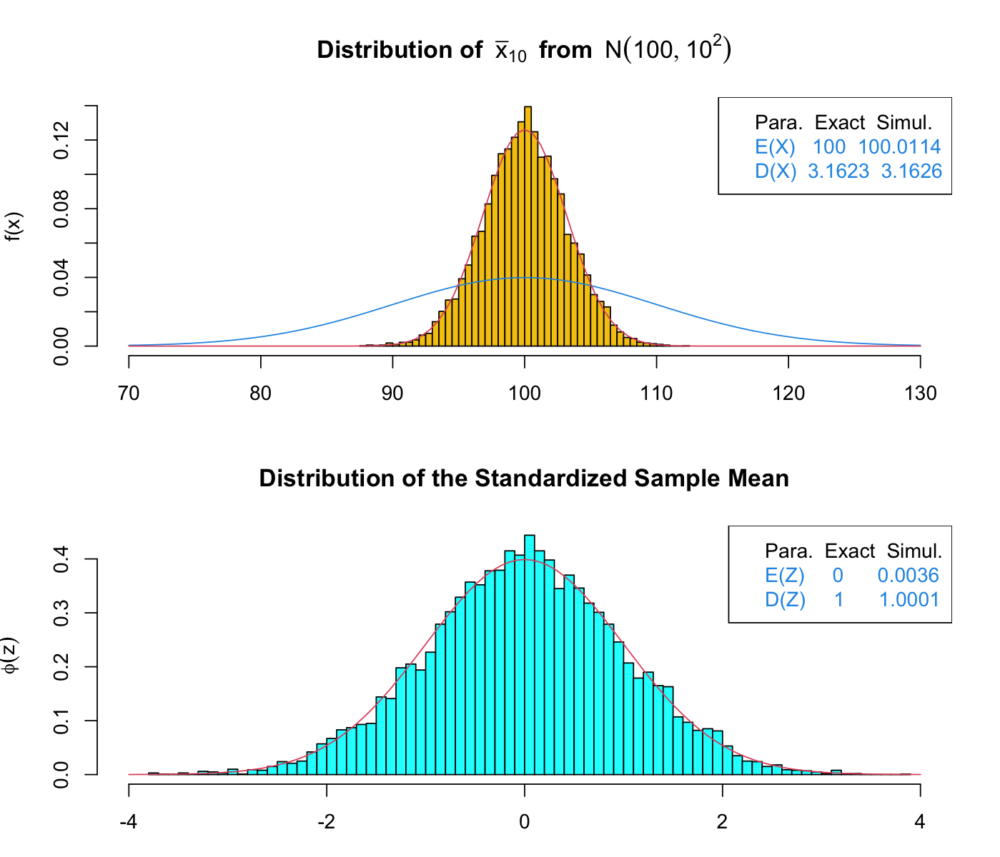

# 6강 연습 문제 풀이 — 가설검정

[레포지토리 안내](../../README.ko.md) | [English](Solutions.md) | [한국어](Solutions.ko.md)

> **최종 수정일:** 2026-11-04

---

<br>

## 목차

- [연습 문제 1: 표본평균의 분포 시뮬레이션](#연습-문제-1-표본평균의-분포-시뮬레이션)
- [연습 문제 2: 남성 키의 단일 표본 Z 검정](#연습-문제-2-남성-키의-단일-표본-z-검정)
- [연습 문제 3: 남녀 키의 독립 2표본 t 검정](#연습-문제-3-남녀-키의-독립-2표본-t-검정)

---

<br>

## 연습 문제 1: 표본평균의 분포 시뮬레이션

**문제:** $N(100, 100)$에서 크기 10인 표본의 평균을 10,000번 구하여 그 분포를 이론과 비교한다. 문제는 [연습 문제 1](Exercises.ko.md#연습-문제-1-표본평균의-분포-시뮬레이션)에 있다.

### 풀이

**정답:** 시뮬레이션한 표본평균의 평균은 100.0114, 표준편차는 3.1626으로 이론값 $100$, $\sqrt{10} = 3.1623$과 거의 같다. 표준화한 표본평균의 평균은 0.0036, 표준편차는 1.0001로 $N(0, 1)$과 맞는다.

**해설:** 모분산이 100이므로 모표준편차는 $\sigma = 10$이다. 모집단이 정규분포이므로 [6강 2.1절](Concepts_Lecture.ko.md#21-정규-모집단에서-표본평균의-분포)에 의해 $\bar{X} \sim N(100, 100/10)$이고, 표준오차는 $10/\sqrt{10} = \sqrt{10} \approx 3.1623$이다.

```r
testSampleMeanDist <- function(ns, mu = 0, sig = 1, N = 10000, ng = 50,
                               seed = 9857, dig = 4) {
  set.seed(seed)
  xb <- NULL
  for (k in 1:N) xb <- c(xb, mean(rnorm(ns, mu, sig)))
  zb <- (xb - mu) / sig * sqrt(ns)
  popd <- function(x) dnorm(x, mu, sig)
  smd <- function(x) dnorm(x, mu, sig / sqrt(ns))
  Ex1 <- round(mean(xb), dig)
  Dx1 <- round(sd(xb), dig)
  Ex2 <- mu
  Dx2 <- round(sig / sqrt(ns), dig)
  Ez <- round(mean(zb), dig)
  Dz <- round(sd(zb), dig)
  xp <- seq(floor(mu - 3 * sig / sqrt(ns)), ceiling(mu + 3 * sig / sqrt(ns)),
            by = 0.5 * sig)
  Theory <- pnorm(xp, mu, sig / sqrt(ns))
  Simula <- sapply(xp, function(x) sum(xb < x)) / N
  cdf <- rbind(Theory, Simula)
  colnames(cdf) <- paste0("F(", xp, ")")
  print(round(cdf, dig))
  par(mfrow = c(2, 1))
  par(mar = c(3, 4, 4, 2))
  x1 <- mu - 3 * sig
  x2 <- mu + 3 * sig
  hist(xb, breaks = ng, prob = TRUE, col = 7, xlim = c(x1, x2),
       ylab = "f(x)", xlab = "",
       main = bquote(bold("Distribution of ") ~ bar(x)[.(ns)] ~ ~bold(from) ~ ~N(.(mu), .(sig)^2)))
  curve(popd, x1, x2, col = 4, add = TRUE)
  curve(smd, x1, x2, col = 2, add = TRUE)
  legend("topright", c("Para.  Exact  Simul.",
                       paste("E(X) ", Ex2, Ex1, sep = "  "),
                       paste("D(X)", Dx2, Dx1, sep = "  ")),
         text.col = c(1, 4, 4))
  hist(zb, breaks = 2 * ng, prob = TRUE, col = "cyan", xlim = c(-4, 4),
       ylab = bquote(phi(z)), xlab = "", main = "Distribution of the Standardized Sample Mean")
  curve(dnorm, -4, 4, col = 2, add = TRUE)
  legend("topright", c("Para.  Exact  Simul.",
                       paste("E(Z)    ", 0, "    ", Ez),
                       paste("D(Z)    ", 1, "    ", Dz)),
         text.col = c(1, 4, 4))
  par(mfrow = c(1, 1))
}

testSampleMeanDist(ns = 10, mu = 100, sig = 10, N = 10000)
```

- **인수:** `ns`는 표본 크기, `mu`와 `sig`는 모평균과 모표준편차, `N`은 반복 횟수, `ng`는 히스토그램 막대 수, `seed`는 난수 시드, `dig`는 출력 자릿수이다. `mu = 0`처럼 등호로 준 값은 인수를 생략했을 때 쓰는 기본값이다.
- **표본평균 생성:** `set.seed(seed)`로 난수의 시작점을 정한다. `xb <- NULL`로 빈 벡터를 만들고, 반복문에서 `rnorm(ns, mu, sig)`로 크기 `ns`인 표본을 만들어 그 평균을 `c(xb, ...)`로 뒤에 붙인다. 같은 일을 `replicate(N, mean(rnorm(ns, mu, sig)))`로 더 빠르게 할 수도 있다.
- **표준화:** `zb <- (xb - mu) / sig * sqrt(ns)`는 $(\bar{x} - \mu)/(\sigma/\sqrt{n})$이다.
- **두 확률밀도함수:** `popd`는 모집단 $N(\mu, \sigma^2)$의 확률밀도함수이고, `smd`는 표본평균의 이론적 분포 $N(\mu, \sigma^2/n)$의 확률밀도함수이다. `dnorm()`의 세 번째 인수가 표준편차이므로 `sig / sqrt(ns)`를 준다.
- **요약값:** `Ex1`, `Dx1`은 시뮬레이션한 표본평균의 평균과 표준편차, `Ex2`, `Dx2`는 이론값 $\mu$, $\sigma/\sqrt{n}$, `Ez`, `Dz`는 표준화 값의 평균과 표준편차이다.
- **누적 확률 표:** `xp`는 $\mu \pm 3\sigma/\sqrt{n}$을 정수로 내림, 올림한 범위를 $0.5\sigma$ 간격으로 나눈 점으로, 이 문제에서는 90, 95, 100, 105, 110이다. `Theory`는 정규분포의 누적 확률 `pnorm(xp, mu, sig / sqrt(ns))`이고, `Simula`는 각 점보다 작은 표본평균의 비율이다. `sapply(xp, function(x) sum(xb < x))`는 `xp`의 각 원소에 대해 조건을 만족하는 개수를 센다. `rbind()`로 두 행을 쌓고 열 이름을 `"F(90)"`처럼 붙여 출력한다.
- **그래프:** `par(mfrow = c(2, 1))`로 위아래 두 칸을 만든다. 위 칸은 표본평균의 히스토그램(노란색, `col = 7`)에 모집단의 확률밀도함수(파란색, `col = 4`)와 표본평균의 확률밀도함수(빨간색, `col = 2`)를 겹치고, 범례에 이론값과 시뮬레이션 값을 적는다. 아래 칸은 표준화한 값의 히스토그램에 `curve(dnorm, -4, 4)`로 $N(0, 1)$을 겹친다.

```text
        F(90)  F(95) F(100) F(105) F(110)
Theory 0.0008 0.0569 0.5000 0.9431 0.9992
Simula 0.0018 0.0575 0.4967 0.9421 0.9991
```



*그림 1. N(100, 10²)에서 크기 10인 표본의 평균 10,000개의 히스토그램과 표준화한 값의 히스토그램*

결과를 해석하면 다음과 같다.

- 누적 확률 표에서 시뮬레이션 비율이 이론값과 소수 둘째 자리까지 일치한다. 예를 들어 표본평균이 95보다 작을 이론적 확률은 $\Phi((95 - 100)/3.1623) = \Phi(-1.58) = 0.0569$이고, 시뮬레이션 비율은 0.0575이다. 양 끝(90, 110)은 확률이 매우 작아 10,000번 가운데 수십 번 이하로만 일어나므로 상대 오차가 크다.
- 그림 1의 위 칸에서 표본평균의 히스토그램은 빨간 곡선 $N(100, 10)$을 따르며, 파란 모집단 곡선보다 폭이 $1/\sqrt{10}$로 좁다. 범례의 시뮬레이션 값 100.0114와 3.1626은 이론값 100과 3.1623에 가깝다.
- 아래 칸에서 표준화한 표본평균은 평균 0.0036, 표준편차 1.0001로 $N(0, 1)$의 곡선과 맞는다.

> **참고:** 이 문제의 원래 실습 코드는 인수 `seed`를 받지만 함수 안에서 `set.seed(seed)`를 호출하지 않으므로, 실행할 때마다 결과가 달라진다. 또 그림 창을 여는 `win.graph(7, 6)`은 Windows에서만 동작한다. 위 코드는 `set.seed(seed)`를 추가하고 `win.graph()` 줄을 뺀 것이며, 나머지 계산은 원래 코드와 같다.

---

<br>

## 연습 문제 2: 남성 키의 단일 표본 Z 검정

**문제:** 2020년 남성 30명의 키로 $H_0: \mu_{2020} = 169.3$을 세 대립가설에 대해 Z 검정한다($`\sigma = 5.4`$). 문제는 [연습 문제 2](Exercises.ko.md#연습-문제-2-남성-키의-단일-표본-z-검정)에 있다.

### 풀이

**정답:** $z_{\text{stat}} = 2.103$이다. 유의확률은 양측 0.0355, 오른쪽 단측($`>`$) 0.0177, 왼쪽 단측($`<`$) 0.9823이므로, 유의수준 0.05에서 양측과 오른쪽 단측 검정은 $H_0$를 기각하고 왼쪽 단측 검정은 기각하지 못한다.

**1. 함수 작성.** [6강 6.2절](Concepts_Lecture.ko.md#62-검정통계량)의 Z 통계량 $z_{\text{stat}} = (\bar{x} - \mu_0)/(\sigma/\sqrt{n})$을 그대로 옮긴다.

```r
z.test <- function(input, mu, var) {
  z <- (mean(input) - mu) / (sqrt(var / length(input)))
  return(z)
}
```

- `mean(input)`은 표본평균 $\bar{x}$, `length(input)`은 표본 크기 $n$이다.
- 세 번째 인수는 표준편차가 아니라 **분산** $\sigma^2$이다. 따라서 `sqrt(var / length(input))`이 표준오차 $\sqrt{\sigma^2/n} = \sigma/\sqrt{n}$이다.

**2. Z 통계량.** 자료를 넣고 함수를 호출한다. 분산은 $5.4^2$이므로 `var = 5.4^2`로 준다.

```r
Height_2020yr <- c(178.4, 168.0, 173.0, 174.4, 173.2, 170.4, 179.2, 170.5, 181.9, 170.7,
                   178.0, 183.3, 163.5, 169.5, 170.3, 174.4, 169.5, 156.7, 157.8, 178.1,
                   169.3, 161.4, 170.1, 177.6, 181.2, 168.7, 169.6, 161.5, 173.5, 167.5)
Zstat <- z.test(Height_2020yr, mu = 169.3, var = 5.4^2)
Zstat
mean(Height_2020yr)
```

```text
[1] 2.102984
[1] 171.3733
```

손으로 계산하면 $\bar{x} = 171.373$, $SE = 5.4/\sqrt{30} = 0.9859$이므로

```math
z_{\text{stat}} = \frac{171.373 - 169.3}{0.9859} = \frac{2.073}{0.9859} = 2.103
```

이다. 이 값은 2020년 표본의 평균 키가 1998년 평균보다 표준오차의 약 2.1배만큼 크다는 뜻이다. $H_0$가 참이면 $Z \sim N(0, 1)$이므로, 평균에서 표준오차 2배 이상 떨어진 값은 드물게만 나온다.

**3. 유의확률과 결론.** 대립가설의 방향에 따라 꼬리 확률을 다르게 구한다([6강 6.3절](Concepts_Lecture.ko.md#63-유의확률p-value)).

```r
2 * pnorm(-abs(Zstat))   # H1: mu != 169.3
1 - pnorm(Zstat)         # H1: mu > 169.3
pnorm(Zstat)             # H1: mu < 169.3
```

```text
[1] 0.03546716
[1] 0.01773358
[1] 0.9822664
```

| 대립가설 | 유의확률 | $\alpha = 0.05$에서의 결론 |
|:-----|:-----|:-----|
| $\mu_{2020} \neq 169.3$ (양측) | $2\lbrace1 - \Phi(2.103)\rbrace = 0.0355$ | $H_0$ 기각: 2020년의 평균 키는 169.3cm와 다르다 |
| $\mu_{2020} > 169.3$ (오른쪽 단측) | $1 - \Phi(2.103) = 0.0177$ | $H_0$ 기각: 2020년의 평균 키는 169.3cm보다 크다 |
| $\mu_{2020} < 169.3$ (왼쪽 단측) | $\Phi(2.103) = 0.9823$ | $H_0$ 기각 못 함: 작다는 증거가 없다 |

*표 1. 세 대립가설에 대한 유의확률과 유의수준 0.05에서의 결론*

- 양측 검정은 $Z$ 분포의 양쪽 꼬리 넓이의 합이 유의확률이다. `-abs(Zstat)`는 왼쪽 꼬리를 가리키므로 `pnorm(-abs(Zstat))`이 한쪽 꼬리이고 2를 곱한다.
- 오른쪽 단측 검정의 유의확률은 양측의 절반이다. 관측한 방향과 대립가설의 방향이 같기 때문이다.
- 왼쪽 단측 검정의 유의확률 0.9823은 자료가 대립가설과 반대 방향으로 치우쳐 있음을 뜻한다. 실제 검정에서는 세 대립가설 가운데 연구 질문에 맞는 하나를 자료를 보기 전에 정한다. 이 문제의 질문은 "과거와 다른가"이므로 양측 검정이 맞다.

**4. 자료가 많아질 때.** $z_{\text{stat}} = (\bar{x} - \mu_0)\sqrt{n}/\sigma$이므로 평균의 차이가 같으면 Z 통계량은 $\sqrt{n}$에 비례하여 커진다. 예를 들어 같은 30개 값을 네 번 관측한 것처럼 표본 크기가 120이 되면 $z_{\text{stat}}$는 두 배가 된다.

```r
z.test(rep(Height_2020yr, 4), mu = 169.3, var = 5.4^2)
```

```text
[1] 4.205968
```

$z = 4.21$이면 양측 유의확률은 약 0.00003으로, 유의수준 0.01에서도 기각한다. 같은 2.07cm의 차이라도 자료가 많을수록 표준오차가 작아져 우연으로 설명하기 어려워진다. 반대로 매우 큰 표본에서는 실질적으로 의미 없는 작은 차이도 유의하게 나오므로, 유의확률과 함께 차이의 크기를 보아야 한다([6강 6.4절](Concepts_Lecture.ko.md#64-유의확률의-해석)).

> **참고:** Z 검정은 2020년 모집단의 표준편차가 1998년과 같이 5.4라는 가정에 기댄다. 이 표본의 표준편차는 6.77로 5.4보다 크다. 모표준편차를 모른다고 보고 단일 표본 t 검정 `t.test(Height_2020yr, mu = 169.3)`을 하면 $t = 1.678$, $df = 29$, 양측 $p = 0.104$로 유의수준 0.05에서 기각하지 못한다. 이처럼 결론이 $\sigma$에 관한 가정에 따라 달라질 수 있으므로, $\sigma$를 "안다"고 가정하는 근거를 확인해야 한다.

---

<br>

## 연습 문제 3: 남녀 키의 독립 2표본 t 검정

**문제:** 모의로 생성한 남성 100명과 여성 100명의 키로 두 모평균이 같은지 검정한다. 문제는 [연습 문제 3](Exercises.ko.md#연습-문제-3-남녀-키의-독립-2표본-t-검정)에 있다.

### 풀이

**정답:** Welch t 검정의 결과는 $t = -37.997$, $df = 197.39$, $p < 2.2 \times 10^{-16}$이므로 두 집단의 평균 키는 다르다. `t.test(Height ~ Gender, ...)`가 비교하는 차이는 "여성 평균 − 남성 평균"이다.

**1. 자료 생성과 양측 검정.**

```r
set.seed(2025)
Gender <- factor(c(rep("Male", 100), rep("Female", 100)))
Height <- c(rnorm(100, 173, 2), rnorm(100, 162.3, 2))

Data <- data.frame(Height, Gender)
dim(Data)
levels(Data$Gender)
tapply(Data$Height, Data$Gender, mean)
tapply(Data$Height, Data$Gender, sd)

t.test(Height ~ Gender, Data, alternative = "two.sided")
```

```text
[1] 200   2
[1] "Female" "Male"
  Female     Male
162.3181 172.9894
  Female     Male
1.929852 2.040375

        Welch Two Sample t-test

data:  Height by Gender
t = -37.997, df = 197.39, p-value < 2.2e-16
alternative hypothesis: true difference in means between group Female and group Male is not equal to 0
95 percent confidence interval:
 -11.22522 -10.11753
sample estimates:
mean in group Female   mean in group Male
            162.3181             172.9894
```

- `rep("Male", 100)`은 문자열 `"Male"`을 100번 반복한다. `factor()`는 문자형 벡터를 범주형 변수(팩터)로 바꾼다. `c(rnorm(100, 173, 2), rnorm(100, 162.3, 2))`의 앞 100개는 남성, 뒤 100개는 여성의 키로, `Gender`의 순서와 맞는다.
- `data.frame(Height, Gender)`는 두 벡터를 열로 하는 표를 만들며, `dim(Data)`의 `200 2`는 200행 2열이다.
- `levels(Data$Gender)`가 `"Female" "Male"`인 것은 팩터의 수준이 알파벳 순서로 정해지기 때문이다. 따라서 수식 `Height ~ Gender`에서 첫째 집단은 여성, 둘째 집단은 남성이다.
- `tapply(Data$Height, Data$Gender, mean)`은 `Gender`의 수준별로 `Height`의 평균을 구한다. 여성 162.32, 남성 172.99로 생성에 쓴 162.3, 173에 가깝다.
- `t.test(Height ~ Gender, Data, ...)`의 수식은 "`Height`를 `Gender`의 두 집단으로 나누어 비교한다"는 뜻이고, 두 번째 위치 인수 `Data`는 변수를 찾을 데이터 프레임이다.

출력에서 $t = -37.997$의 음수 부호는 첫째 집단(여성)의 평균이 둘째 집단(남성)보다 작다는 뜻이다. `p-value < 2.2e-16`은 유의확률이 R이 표시하는 하한(배정밀도 실수의 기계 엡실론 약 $`2.2 \times 10^{-16}`$)보다 작다는 뜻이며, 정확히 0이라는 뜻은 아니다. 평균 차이(여성 − 남성)의 95% 신뢰구간 $(-11.23, -10.12)$는 0에서 멀리 떨어져 있다. 따라서 $H_0: \mu_{\text{Male}} = \mu_{\text{Female}}$를 기각하며, 남성의 평균 키가 여성보다 약 10.7cm 크다고 결론짓는다. 두 모평균의 차이 10.7cm가 표준편차 2에 비해 매우 크게 설정된 모의 자료이므로 검정통계량도 매우 크다.

**2. 단측 검정과 대립가설의 방향.**

```r
t.test(Height ~ Gender, Data, alternative = "less")
t.test(Height ~ Gender, Data, alternative = "greater")
```

```text
        Welch Two Sample t-test

data:  Height by Gender
t = -37.997, df = 197.39, p-value < 2.2e-16
alternative hypothesis: true difference in means between group Female and group Male is less than 0
95 percent confidence interval:
      -Inf -10.20725
sample estimates:
mean in group Female   mean in group Male
            162.3181             172.9894

        Welch Two Sample t-test

data:  Height by Gender
t = -37.997, df = 197.39, p-value = 1
alternative hypothesis: true difference in means between group Female and group Male is greater than 0
95 percent confidence interval:
 -11.13551       Inf
sample estimates:
mean in group Female   mean in group Male
            162.3181             172.9894
```

| `alternative` | 대립가설 | 유의확률 | 결론 |
|:-----|:-----|:-----|:-----|
| `"two.sided"` | $\mu_{\text{Female}} - \mu_{\text{Male}} \neq 0$ | $< 2.2 \times 10^{-16}$ | 두 평균이 다르다 |
| `"less"` | $\mu_{\text{Female}} - \mu_{\text{Male}} < 0$ (여성이 작다) | $< 2.2 \times 10^{-16}$ | 여성의 평균 키가 작다 |
| `"greater"` | $\mu_{\text{Female}} - \mu_{\text{Male}} > 0$ (여성이 크다) | 1 | 여성이 크다는 증거가 없다 |

*표 2. 세 가지 alternative 설정의 대립가설과 결과*

`"less"`와 `"greater"`는 남성과 여성이 아니라 **첫째 수준에서 둘째 수준을 뺀 값**을 기준으로 한다. 출력의 `alternative hypothesis` 줄이 "true difference in means between group Female and group Male is less than 0"처럼 방향을 밝히므로 반드시 확인한다. "남성이 더 크다"를 대립가설로 하려면 `"less"`를 쓰거나, 수준의 순서를 바꾼 뒤 `"greater"`를 쓴다.

```r
Data2 <- Data
Data2$Gender <- factor(Data2$Gender, levels = c("Male", "Female"))
t.test(Height ~ Gender, Data2, alternative = "greater")
```

원래 자료를 그대로 두기 위해 복사본 `Data2`를 만들고 수준을 `"Male"`, `"Female"` 순서로 바꾸면 대립가설은 "true difference in means between group Male and group Female is greater than 0"이 되고, $t = 37.997$, $p < 2.2 \times 10^{-16}$으로 같은 결론을 얻는다.

**3. Welch t 검정과 합동 분산 t 검정.** 출력 첫 줄의 "Welch Two Sample t-test"에서 보듯, `t.test()`는 기본값 `var.equal = FALSE`로 등분산을 가정하지 않는 Welch t 검정을 한다([6강 8.3절](Concepts_Lecture.ko.md#83-등분산을-가정하지-않을-때-welch-t-검정)). 합동 분산 t 검정은 `var.equal = TRUE`로 지정한다.

```r
t.test(Height ~ Gender, Data, var.equal = TRUE)
```

```text
        Two Sample t-test

data:  Height by Gender
t = -37.997, df = 198, p-value < 2.2e-16
alternative hypothesis: true difference in means between group Female and group Male is not equal to 0
95 percent confidence interval:
 -11.22521 -10.11754
sample estimates:
mean in group Female   mean in group Male
            162.3181             172.9894
```

두 집단의 크기가 100으로 같으므로 t 값은 두 검정에서 같고, 자유도만 Welch 197.39와 합동 분산 $n_1 + n_2 - 2 = 198$로 다르다. 두 집단의 표본표준편차(1.93, 2.04)가 비슷하므로 자유도와 신뢰구간도 거의 같다. 이 자료처럼 표본이 크고 분산과 크기가 비슷하면 두 검정은 사실상 같은 결과를 주지만, 표본 크기와 분산이 함께 다를 때는 Welch t 검정이 더 안전하다.
