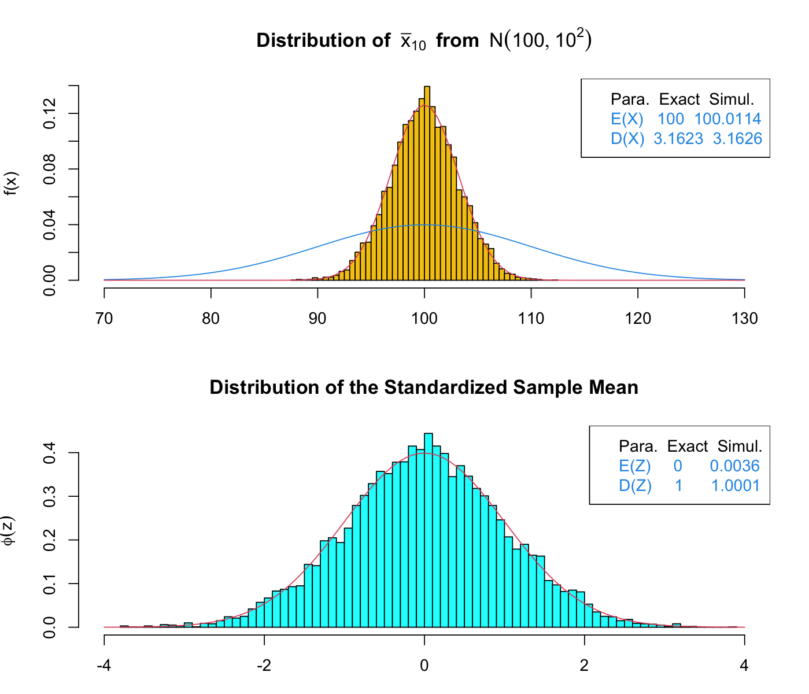

# Lecture 6 Solutions — Hypothesis Testing

[Repository Guide](../../README.md) | [English](Solutions.md) | [한국어](Solutions.ko.md)

> **Last Updated:** 2026-11-04

---

<br>

## Table of Contents

- [Exercise 1: Simulating the Distribution of the Sample Mean](#exercise-1-simulating-the-distribution-of-the-sample-mean)
- [Exercise 2: A One-Sample Z-Test of Men's Heights](#exercise-2-a-one-sample-z-test-of-mens-heights)
- [Exercise 3: An Independent Two-Sample t-Test of Heights by Gender](#exercise-3-an-independent-two-sample-t-test-of-heights-by-gender)

---

<br>

## Exercise 1: Simulating the Distribution of the Sample Mean

**Problem:** Compute the mean of samples of size 10 from $N(100, 100)$ 10,000 times and compare its distribution with theory. The problem is in [Exercise 1](Exercises.md#exercise-1-simulating-the-distribution-of-the-sample-mean).

### Solution

**Answer:** The simulated sample means have mean 100.0114 and standard deviation 3.1626, almost equal to the theoretical values $100$ and $\sqrt{10} = 3.1623$. The standardized sample means have mean 0.0036 and standard deviation 1.0001, matching $N(0, 1)$.

**Explanation:** The population variance is 100, so the population standard deviation is $\sigma = 10$. The population is normal, so by [Lecture 6, Section 2.1](Concepts_Lecture.md#21-the-sample-mean-of-a-normal-population), $\bar{X} \sim N(100, 100/10)$, and the standard error is $10/\sqrt{10} = \sqrt{10} \approx 3.1623$.

```r
testSampleMeanDist <- function(ns, mu = 0, sig = 1, N = 10000, ng = 50,
                               seed = 9857, dig = 4) {
  set.seed(seed)
  xb <- NULL
  for (k in 1:N) xb <- c(xb, mean(rnorm(ns, mu, sig)))
  zb <- (xb - mu) / sig * sqrt(ns)
  popd <- function(x) dnorm(x, mu, sig)
  smd <- function(x) dnorm(x, mu, sig / sqrt(ns))
  Ex1 <- round(mean(xb), dig)
  Dx1 <- round(sd(xb), dig)
  Ex2 <- mu
  Dx2 <- round(sig / sqrt(ns), dig)
  Ez <- round(mean(zb), dig)
  Dz <- round(sd(zb), dig)
  xp <- seq(floor(mu - 3 * sig / sqrt(ns)), ceiling(mu + 3 * sig / sqrt(ns)),
            by = 0.5 * sig)
  Theory <- pnorm(xp, mu, sig / sqrt(ns))
  Simula <- sapply(xp, function(x) sum(xb < x)) / N
  cdf <- rbind(Theory, Simula)
  colnames(cdf) <- paste0("F(", xp, ")")
  print(round(cdf, dig))
  par(mfrow = c(2, 1))
  par(mar = c(3, 4, 4, 2))
  x1 <- mu - 3 * sig
  x2 <- mu + 3 * sig
  hist(xb, breaks = ng, prob = TRUE, col = 7, xlim = c(x1, x2),
       ylab = "f(x)", xlab = "",
       main = bquote(bold("Distribution of ") ~ bar(x)[.(ns)] ~ ~bold(from) ~ ~N(.(mu), .(sig)^2)))
  curve(popd, x1, x2, col = 4, add = TRUE)
  curve(smd, x1, x2, col = 2, add = TRUE)
  legend("topright", c("Para.  Exact  Simul.",
                       paste("E(X) ", Ex2, Ex1, sep = "  "),
                       paste("D(X)", Dx2, Dx1, sep = "  ")),
         text.col = c(1, 4, 4))
  hist(zb, breaks = 2 * ng, prob = TRUE, col = "cyan", xlim = c(-4, 4),
       ylab = bquote(phi(z)), xlab = "", main = "Distribution of the Standardized Sample Mean")
  curve(dnorm, -4, 4, col = 2, add = TRUE)
  legend("topright", c("Para.  Exact  Simul.",
                       paste("E(Z)    ", 0, "    ", Ez),
                       paste("D(Z)    ", 1, "    ", Dz)),
         text.col = c(1, 4, 4))
  par(mfrow = c(1, 1))
}

testSampleMeanDist(ns = 10, mu = 100, sig = 10, N = 10000)
```

- **Arguments:** `ns` is the sample size, `mu` and `sig` the population mean and standard deviation, `N` the number of repetitions, `ng` the number of histogram bars, `seed` the random seed, and `dig` the number of printed digits. Values given with an equals sign, such as `mu = 0`, are defaults used when the argument is omitted.
- **Generating sample means:** `set.seed(seed)` fixes the starting point of the random numbers. `xb <- NULL` creates an empty vector, and the loop creates a sample of size `ns` with `rnorm(ns, mu, sig)` and appends its mean with `c(xb, ...)`. The same can be done faster with `replicate(N, mean(rnorm(ns, mu, sig)))`.
- **Standardization:** `zb <- (xb - mu) / sig * sqrt(ns)` is $(\bar{x} - \mu)/(\sigma/\sqrt{n})$.
- **Two PDFs:** `popd` is the PDF of the population $N(\mu, \sigma^2)$, and `smd` is the PDF of the theoretical distribution of the sample mean, $N(\mu, \sigma^2/n)$. The third argument of `dnorm()` is a standard deviation, so `sig / sqrt(ns)` is supplied.
- **Summary values:** `Ex1` and `Dx1` are the mean and standard deviation of the simulated sample means, `Ex2` and `Dx2` the theoretical values $\mu$ and $\sigma/\sqrt{n}$, and `Ez` and `Dz` the mean and standard deviation of the standardized values.
- **Cumulative probability table:** `xp` divides the range $\mu \pm 3\sigma/\sqrt{n}$, rounded down and up to integers, into steps of $0.5\sigma$; here the points are 90, 95, 100, 105, and 110. `Theory` is the normal cumulative probability `pnorm(xp, mu, sig / sqrt(ns))`, and `Simula` is the proportion of sample means below each point. `sapply(xp, function(x) sum(xb < x))` counts, for each element of `xp`, how many sample means satisfy the condition. `rbind()` stacks the two rows, and the column names such as `"F(90)"` are attached before printing.
- **Plots:** `par(mfrow = c(2, 1))` creates two panels, one above the other. The upper panel overlays the population PDF (blue, `col = 4`) and the PDF of the sample mean (red, `col = 2`) on the histogram of the sample means (yellow, `col = 7`), with a legend listing the theoretical and simulated values. The lower panel overlays $N(0, 1)$ with `curve(dnorm, -4, 4)` on the histogram of the standardized values.

```text
        F(90)  F(95) F(100) F(105) F(110)
Theory 0.0008 0.0569 0.5000 0.9431 0.9992
Simula 0.0018 0.0575 0.4967 0.9421 0.9991
```



*Figure 1. Histogram of 10,000 means of samples of size 10 from N(100, 10²) and histogram of their standardized values*

The results are interpreted as follows.

- In the cumulative probability table, the simulated proportions agree with the theoretical values to two decimal places. For example, the theoretical probability that the sample mean is below 95 is $\Phi((95 - 100)/3.1623) = \Phi(-1.58) = 0.0569$, and the simulated proportion is 0.0575. At the two ends (90 and 110) the probabilities are so small that the events occur only a few dozen times or fewer out of 10,000, so the relative error is large.
- In the upper panel of Figure 1, the histogram of sample means follows the red curve $N(100, 10)$ and is narrower than the blue population curve by a factor of $1/\sqrt{10}$. The simulated values 100.0114 and 3.1626 in the legend are close to the theoretical values 100 and 3.1623.
- In the lower panel, the standardized sample means have mean 0.0036 and standard deviation 1.0001 and match the $N(0, 1)$ curve.

> **Note:** The original practice code for this problem takes a `seed` argument but never calls `set.seed(seed)` inside the function, so the results change on every run. Also, `win.graph(7, 6)`, which opens the plot window, works only on Windows. The code above adds `set.seed(seed)` and drops the `win.graph()` line; the rest of the computation is the same as the original code.

---

<br>

## Exercise 2: A One-Sample Z-Test of Men's Heights

**Problem:** Using the heights of 30 men in 2020, Z-test $H_0: \mu_{2020} = 169.3$ against three alternatives ($\sigma = 5.4$). The problem is in [Exercise 2](Exercises.md#exercise-2-a-one-sample-z-test-of-mens-heights).

### Solution

**Answer:** $z_{\text{stat}} = 2.103$. The p-values are 0.0355 (two-sided), 0.0177 (right-sided, $>$), and 0.9823 (left-sided, $<$), so at significance level 0.05 the two-sided and right-sided tests reject $H_0$ and the left-sided test does not.

**1. Writing the function.** Translate the Z statistic $z_{\text{stat}} = (\bar{x} - \mu_0)/(\sigma/\sqrt{n})$ of [Lecture 6, Section 6.2](Concepts_Lecture.md#62-test-statistic) directly.

```r
z.test <- function(input, mu, var) {
  z <- (mean(input) - mu) / (sqrt(var / length(input)))
  return(z)
}
```

- `mean(input)` is the sample mean $\bar{x}$ and `length(input)` is the sample size $n$.
- The third argument is the **variance** $\sigma^2$, not the standard deviation. Hence `sqrt(var / length(input))` is the standard error $\sqrt{\sigma^2/n} = \sigma/\sqrt{n}$.

**2. The Z statistic.** Enter the data and call the function. The variance is $5.4^2$, so pass `var = 5.4^2`.

```r
Height_2020yr <- c(178.4, 168.0, 173.0, 174.4, 173.2, 170.4, 179.2, 170.5, 181.9, 170.7,
                   178.0, 183.3, 163.5, 169.5, 170.3, 174.4, 169.5, 156.7, 157.8, 178.1,
                   169.3, 161.4, 170.1, 177.6, 181.2, 168.7, 169.6, 161.5, 173.5, 167.5)
Zstat <- z.test(Height_2020yr, mu = 169.3, var = 5.4^2)
Zstat
mean(Height_2020yr)
```

```text
[1] 2.102984
[1] 171.3733
```

By hand, $\bar{x} = 171.373$ and $SE = 5.4/\sqrt{30} = 0.9859$, so

$$
z_{\text{stat}} = \frac{171.373 - 169.3}{0.9859} = \frac{2.073}{0.9859} = 2.103
$$

This value means that the mean height of the 2020 sample exceeds the 1998 mean by about 2.1 standard errors. If $H_0$ is true, $Z \sim N(0, 1)$, so values more than 2 standard errors from the mean occur only rarely.

**3. p-values and conclusions.** The tail probability depends on the direction of the alternative hypothesis ([Lecture 6, Section 6.3](Concepts_Lecture.md#63-the-p-value)).

```r
2 * pnorm(-abs(Zstat))   # H1: mu != 169.3
1 - pnorm(Zstat)         # H1: mu > 169.3
pnorm(Zstat)             # H1: mu < 169.3
```

```text
[1] 0.03546716
[1] 0.01773358
[1] 0.9822664
```

| Alternative hypothesis | p-value | Conclusion at $\alpha = 0.05$ |
|:-----|:-----|:-----|
| $\mu_{2020} \neq 169.3$ (two-sided) | $2\lbrace1 - \Phi(2.103)\rbrace = 0.0355$ | Reject $H_0$: the 2020 mean height differs from 169.3 cm |
| $\mu_{2020} > 169.3$ (right-sided) | $1 - \Phi(2.103) = 0.0177$ | Reject $H_0$: the 2020 mean height is greater than 169.3 cm |
| $\mu_{2020} < 169.3$ (left-sided) | $\Phi(2.103) = 0.9823$ | Fail to reject $H_0$: no evidence that it is smaller |

*Table 1. p-values for the three alternative hypotheses and conclusions at significance level 0.05*

- For the two-sided test, the p-value is the total area of both tails of the $Z$ distribution. `-abs(Zstat)` points to the left tail, so `pnorm(-abs(Zstat))` is one tail, which is multiplied by 2.
- The right-sided p-value is half the two-sided one, because the observed direction matches the direction of the alternative.
- The left-sided p-value 0.9823 means that the data lean in the direction opposite to the alternative. In a real test, the one alternative that fits the research question is chosen before seeing the data. The question here is "does it differ from the past?", so the two-sided test is the right one.

**4. When there are more data.** Since $z_{\text{stat}} = (\bar{x} - \mu_0)\sqrt{n}/\sigma$, the Z statistic grows in proportion to $\sqrt{n}$ for the same mean difference. For example, if the sample size became 120, as if the same 30 values had been observed four times, $z_{\text{stat}}$ would double.

```r
z.test(rep(Height_2020yr, 4), mu = 169.3, var = 5.4^2)
```

```text
[1] 4.205968
```

With $z = 4.21$, the two-sided p-value is about 0.00003, which rejects even at significance level 0.01. The same 2.07 cm difference becomes harder to explain by chance as the data grow, because the standard error shrinks. Conversely, with a very large sample even a practically meaningless small difference becomes significant, so the size of the difference must be examined along with the p-value ([Lecture 6, Section 6.4](Concepts_Lecture.md#64-interpreting-p-values)).

> **Note:** The Z-test relies on the assumption that the standard deviation of the 2020 population is still 5.4, as in 1998. The standard deviation of this sample is 6.77, larger than 5.4. Treating the population standard deviation as unknown and running the one-sample t-test `t.test(Height_2020yr, mu = 169.3)` gives $t = 1.678$, $df = 29$, and a two-sided $p = 0.104$, which does not reject at significance level 0.05. Since the conclusion can depend on the assumption about $\sigma$ in this way, the grounds for treating $\sigma$ as "known" must be checked.

---

<br>

## Exercise 3: An Independent Two-Sample t-Test of Heights by Gender

**Problem:** Test whether two population means are equal using simulated heights of 100 men and 100 women. The problem is in [Exercise 3](Exercises.md#exercise-3-an-independent-two-sample-t-test-of-heights-by-gender).

### Solution

**Answer:** Welch's t-test gives $t = -37.997$, $df = 197.39$, and $p < 2.2 \times 10^{-16}$, so the mean heights of the two groups differ. The difference compared by `t.test(Height ~ Gender, ...)` is "female mean − male mean".

**1. Generating the data and the two-sided test.**

```r
set.seed(2025)
Gender <- factor(c(rep("Male", 100), rep("Female", 100)))
Height <- c(rnorm(100, 173, 2), rnorm(100, 162.3, 2))

Data <- data.frame(Height, Gender)
dim(Data)
levels(Data$Gender)
tapply(Data$Height, Data$Gender, mean)
tapply(Data$Height, Data$Gender, sd)

t.test(Height ~ Gender, Data, alternative = "two.sided")
```

```text
[1] 200   2
[1] "Female" "Male"
  Female     Male
162.3181 172.9894
  Female     Male
1.929852 2.040375

        Welch Two Sample t-test

data:  Height by Gender
t = -37.997, df = 197.39, p-value < 2.2e-16
alternative hypothesis: true difference in means between group Female and group Male is not equal to 0
95 percent confidence interval:
 -11.22522 -10.11753
sample estimates:
mean in group Female   mean in group Male
            162.3181             172.9894
```

- `rep("Male", 100)` repeats the string `"Male"` 100 times. `factor()` converts a character vector into a categorical variable (a factor). In `c(rnorm(100, 173, 2), rnorm(100, 162.3, 2))`, the first 100 values are men's heights and the last 100 women's, matching the order of `Gender`.
- `data.frame(Height, Gender)` builds a table with the two vectors as columns, and `200 2` from `dim(Data)` means 200 rows and 2 columns.
- `levels(Data$Gender)` is `"Female" "Male"` because factor levels are set in alphabetical order. Hence, in the formula `Height ~ Gender`, the first group is women and the second is men.
- `tapply(Data$Height, Data$Gender, mean)` computes the mean of `Height` for each level of `Gender`. The values, 162.32 for women and 172.99 for men, are close to the generating values 162.3 and 173.
- The formula in `t.test(Height ~ Gender, Data, ...)` means "compare `Height` split into the two groups of `Gender`", and the second positional argument `Data` is the data frame in which to find the variables.

In the output, the negative sign of $t = -37.997$ means that the mean of the first group (women) is smaller than that of the second group (men). `p-value < 2.2e-16` means that the p-value is below the lower limit R prints (the machine epsilon of double-precision numbers, about $2.2 \times 10^{-16}$); it does not mean that the p-value is exactly 0. The 95% confidence interval for the mean difference (female − male), $(-11.23, -10.12)$, lies far from 0. Therefore $H_0: \mu_{\text{Male}} = \mu_{\text{Female}}$ is rejected, and we conclude that the mean height of men exceeds that of women by about 10.7 cm. The simulated data were set up with a difference of 10.7 cm between the population means, very large relative to the standard deviation of 2, so the test statistic is also very large.

**2. One-sided tests and the direction of the alternative.**

```r
t.test(Height ~ Gender, Data, alternative = "less")
t.test(Height ~ Gender, Data, alternative = "greater")
```

```text
        Welch Two Sample t-test

data:  Height by Gender
t = -37.997, df = 197.39, p-value < 2.2e-16
alternative hypothesis: true difference in means between group Female and group Male is less than 0
95 percent confidence interval:
      -Inf -10.20725
sample estimates:
mean in group Female   mean in group Male
            162.3181             172.9894

        Welch Two Sample t-test

data:  Height by Gender
t = -37.997, df = 197.39, p-value = 1
alternative hypothesis: true difference in means between group Female and group Male is greater than 0
95 percent confidence interval:
 -11.13551       Inf
sample estimates:
mean in group Female   mean in group Male
            162.3181             172.9894
```

| `alternative` | Alternative hypothesis | p-value | Conclusion |
|:-----|:-----|:-----|:-----|
| `"two.sided"` | $\mu_{\text{Female}} - \mu_{\text{Male}} \neq 0$ | $< 2.2 \times 10^{-16}$ | The two means differ |
| `"less"` | $\mu_{\text{Female}} - \mu_{\text{Male}} < 0$ (women are shorter) | $< 2.2 \times 10^{-16}$ | Women's mean height is smaller |
| `"greater"` | $\mu_{\text{Female}} - \mu_{\text{Male}} > 0$ (women are taller) | 1 | No evidence that women are taller |

*Table 2. Alternative hypotheses and results of the three alternative settings*

`"less"` and `"greater"` refer not to men and women but to **the first level minus the second level**. The `alternative hypothesis` line of the output states the direction, as in "true difference in means between group Female and group Male is less than 0", so it must always be checked. To make "men are taller" the alternative, use `"less"`, or change the level order and use `"greater"`.

```r
Data2 <- Data
Data2$Gender <- factor(Data2$Gender, levels = c("Male", "Female"))
t.test(Height ~ Gender, Data2, alternative = "greater")
```

Making a copy `Data2` to leave the original data unchanged and reordering its levels as `"Male"`, `"Female"` turns the alternative into "true difference in means between group Male and group Female is greater than 0", and gives $t = 37.997$ and $p < 2.2 \times 10^{-16}$, the same conclusion.

**3. Welch's t-test and the pooled-variance t-test.** As the first output line "Welch Two Sample t-test" shows, `t.test()` uses the default `var.equal = FALSE` and performs Welch's t-test, which does not assume equal variances ([Lecture 6, Section 8.3](Concepts_Lecture.md#83-without-equal-variances-welchs-t-test)). The pooled-variance t-test is requested with `var.equal = TRUE`.

```r
t.test(Height ~ Gender, Data, var.equal = TRUE)
```

```text
        Two Sample t-test

data:  Height by Gender
t = -37.997, df = 198, p-value < 2.2e-16
alternative hypothesis: true difference in means between group Female and group Male is not equal to 0
95 percent confidence interval:
 -11.22521 -10.11754
sample estimates:
mean in group Female   mean in group Male
            162.3181             172.9894
```

Both groups have size 100, so the t value is the same in the two tests and only the degrees of freedom differ: 197.39 for Welch and $n_1 + n_2 - 2 = 198$ for the pooled test. The sample standard deviations of the two groups (1.93 and 2.04) are similar, so the degrees of freedom and confidence intervals are also nearly identical. When the samples are large and the variances and sizes are similar, as here, the two tests give practically the same result, but when the sample sizes and variances both differ, Welch's t-test is the safer choice.
