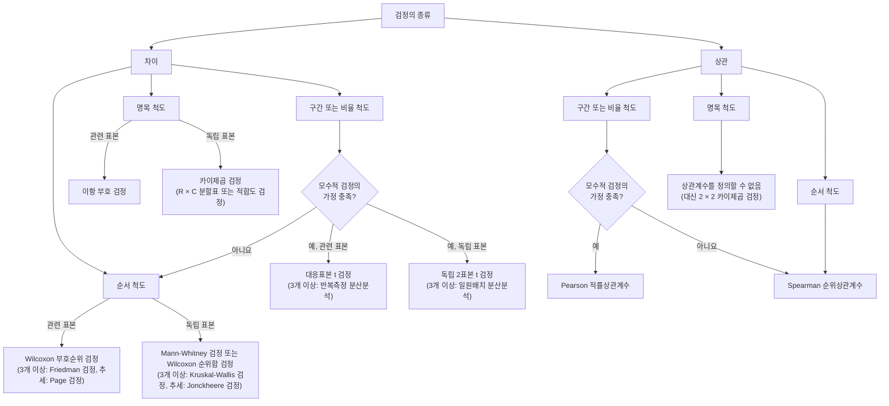
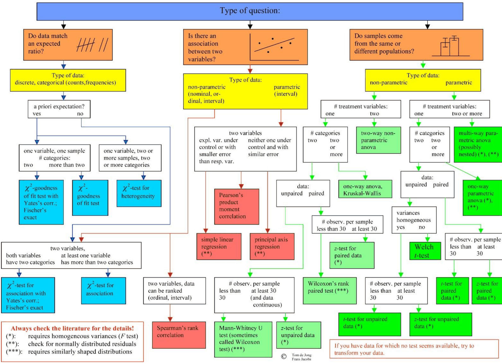
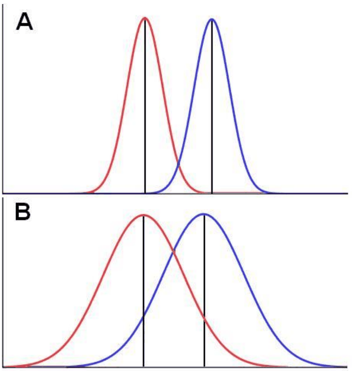
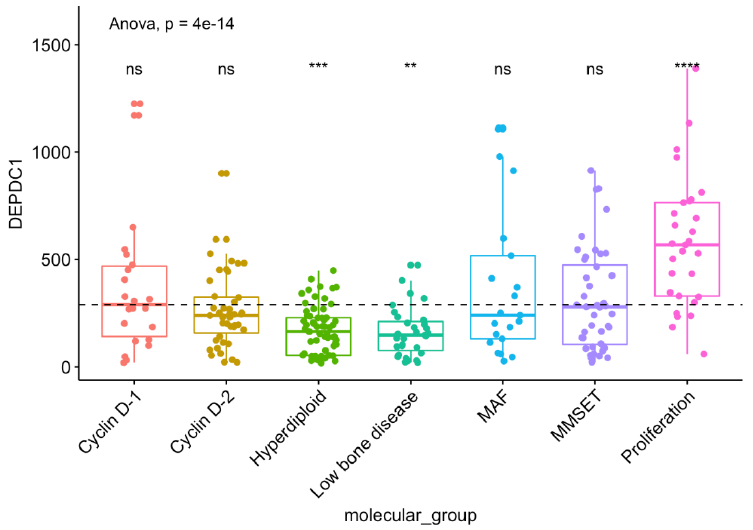
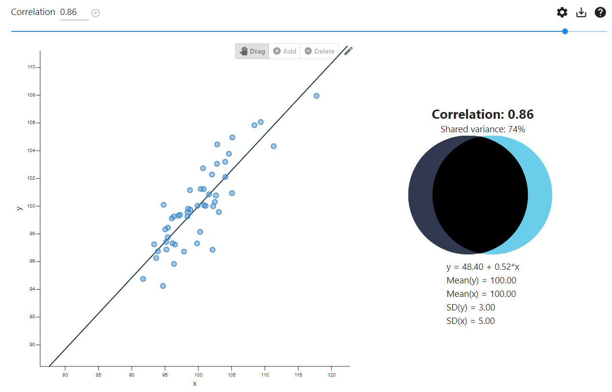
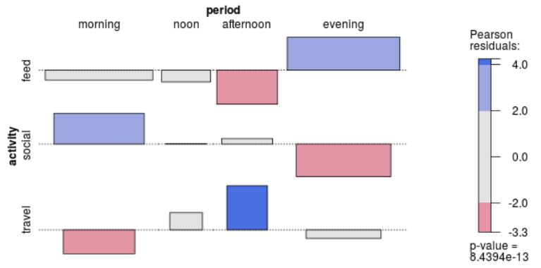

# 7강 — 통계 분석

[레포지토리 안내](../../README.ko.md) | [English](Concepts_Lecture.md) | [한국어](Concepts_Lecture.ko.md)

> **최종 수정일:** 2026-11-04

> **학습 목표:**
> 1. 변수의 측정 수준, 종속변수와 독립변수의 유형, 관측의 독립성, 모형의 가정을 따져 자료에 알맞은 통계 분석 방법을 고를 수 있다
> 2. 회귀 모형의 종속변수와 독립변수를 구분하고, 반응변수의 유형에 따라 선형 회귀, 포아송 회귀, Cox 모형, 로지스틱 회귀를 선택할 수 있다
> 3. 두 집단과 여러 집단의 비교에 쓰는 t 검정, Wilcoxon 검정, 순열 검정, 분산분석, Kruskal-Wallis 검정, 이탈도 분석을 R로 수행하고 결과를 해석할 수 있다
> 4. Pearson 상관계수, Spearman 순위상관계수, 단순 선형 회귀로 두 연속형 변수의 연관성을 분석할 수 있다
> 5. 카이제곱 검정, Fisher의 정확 검정, Cochran-Armitage 추세 검정으로 두 범주형 변수의 연관성을 검정하고 Pearson 잔차를 해석할 수 있다

---

## 목차

- [1. 통계 분석 방법의 선택](#1-통계-분석-방법의-선택)
  - [1.1 변수의 측정 수준](#11-변수의-측정-수준)
  - [1.2 종속변수와 독립변수의 유형에 따른 선택](#12-종속변수와-독립변수의-유형에-따른-선택)
  - [1.3 차이 검정과 상관 분석의 3단계 선택](#13-차이-검정과-상관-분석의-3단계-선택)
  - [1.4 질문의 유형에서 출발하는 선택](#14-질문의-유형에서-출발하는-선택)
  - [1.5 세 가지 질문으로 정리한 선택표](#15-세-가지-질문으로-정리한-선택표)
  - [1.6 방법이 많은 이유와 학습 전략](#16-방법이-많은-이유와-학습-전략)
- [2. 통계 모형과 회귀 모형](#2-통계-모형과-회귀-모형)
  - [2.1 회귀 모형의 정의](#21-회귀-모형의-정의)
  - [2.2 회귀 모형의 변수](#22-회귀-모형의-변수)
  - [2.3 반응변수의 유형에 따른 회귀 모형](#23-반응변수의-유형에-따른-회귀-모형)
  - [2.4 R의 모형 식과 네 가지 분석 유형](#24-r의-모형-식과-네-가지-분석-유형)
- [3. 분석 유형 I: 두 집단의 비교](#3-분석-유형-i-두-집단의-비교)
  - [3.1 두 집단 비교의 의미](#31-두-집단-비교의-의미)
  - [3.2 t 검정과 대응표본 t 검정](#32-t-검정과-대응표본-t-검정)
  - [3.3 Wilcoxon 검정](#33-wilcoxon-검정)
  - [3.4 순열 검정](#34-순열-검정)
- [4. 분석 유형 II: 여러 집단의 비교](#4-분석-유형-ii-여러-집단의-비교)
  - [4.1 분산분석(ANOVA)](#41-분산분석anova)
  - [4.2 사후 검정](#42-사후-검정)
  - [4.3 Kruskal-Wallis 검정](#43-kruskal-wallis-검정)
  - [4.4 이탈도 분석(ANODEV)](#44-이탈도-분석anodev)
  - [4.5 여러 집단 비교 결과의 시각화](#45-여러-집단-비교-결과의-시각화)
- [5. 분석 유형 III: 두 연속형 변수의 연관성](#5-분석-유형-iii-두-연속형-변수의-연관성)
  - [5.1 Pearson 상관계수](#51-pearson-상관계수)
  - [5.2 Spearman 순위상관계수](#52-spearman-순위상관계수)
  - [5.3 단순 선형 회귀](#53-단순-선형-회귀)
- [6. 분석 유형 IV: 두 범주형 변수의 연관성](#6-분석-유형-iv-두-범주형-변수의-연관성)
  - [6.1 분할표와 카이제곱 독립성 검정](#61-분할표와-카이제곱-독립성-검정)
  - [6.2 Pearson 잔차와 연관성 그림](#62-pearson-잔차와-연관성-그림)
  - [6.3 Fisher의 정확 검정](#63-fisher의-정확-검정)
  - [6.4 Cochran-Armitage 추세 검정](#64-cochran-armitage-추세-검정)
- [개념 적용](#개념-적용)
- [요약](#요약)
- [점검 문제](#점검-문제)
- [참고 문헌](#참고-문헌)

---

<br>

## 1. 통계 분석 방법의 선택

통계 분석에서 가장 먼저 내리는 결정은 주어진 자료와 연구 질문에 맞는 방법을 고르는 일이다. 같은 자료라도 무엇을 묻는지(집단 사이의 차이인지, 변수 사이의 연관성인지), 변수가 어떤 종류인지, 관측끼리 독립인지, 방법이 요구하는 가정이 성립하는지에 따라 알맞은 방법이 달라진다. 아래에서는 1\~6강에서 다룬 확률분포와 가설검정을 바탕으로, 실제 자료 분석에서 자주 쓰는 방법을 선택 기준과 분석 유형별로 정리한다. 각 방법은 무엇을 검정하는지, 어떤 가정을 두는지, R에서 어떻게 수행하는지를 함께 설명하며, 두 집단 비교의 t 검정과 Wilcoxon 순위합 검정은 8강에서 더 자세히 다룬다.

### 1.1 변수의 측정 수준

방법을 고르려면 먼저 변수가 어떤 종류의 값을 갖는지 알아야 한다. 변수의 값이 담는 정보의 양에 따라 **측정 수준(level of measurement)** 을 다음 네 가지로 나눈다 [1].

| 측정 수준 | 값의 성질 | 예 | 의미 있는 연산 |
|:-----|:-----|:-----|:-----|
| 명목 척도 (nominal) | 이름표일 뿐 순서가 없다 | 혈액형, 성별, 살충제 종류 | 같음과 다름, 빈도 |
| 순서 척도 (ordinal) | 순서는 있으나 간격이 일정하지 않다 | 만족도(낮음, 보통, 높음), 암의 병기 | 크기 비교, 순위, 중앙값 |
| 구간 척도 (interval) | 간격이 일정하지만 0이 임의로 정해진다 | 섭씨 온도, 연도 | 덧셈과 뺄셈, 평균 |
| 비율 척도 (ratio) | 간격이 일정하고 0이 절대적인 원점이다 | 키, 몸무게, 수확량, 시간 | 곱셈과 나눗셈, 비율 |

*표 1. 변수의 네 가지 측정 수준*

명목 척도와 순서 척도의 변수를 **범주형 변수(categorical variable)** 라 하고, 구간 척도와 비율 척도의 변수를 **연속형 변수(continuous variable)** 또는 수치형 변수라 한다. 범주가 두 개뿐인 범주형 변수(생존과 사망, 처리군과 대조군)는 **이진 변수(binary variable)** 라 한다.

> **용어 정의:** **모수적 방법(parametric method)** 은 자료가 특정한 분포족(주로 정규분포)을 따른다고 가정하고, 그 분포의 모수(평균, 분산 등)에 관해 추론하는 방법이다. t 검정과 분산분석이 대표적이다. **비모수적 방법(nonparametric method)** 은 분포의 형태를 특정하지 않고 순위, 부호, 자료의 재배열처럼 분포에 덜 의존하는 성질만으로 추론하는 방법이다. Wilcoxon 검정과 Kruskal-Wallis 검정이 대표적이다. 비모수적 방법은 가정이 약한 대신, 모수적 방법의 가정이 성립할 때는 검정력이 조금 낮을 수 있다(8강 5절).

### 1.2 종속변수와 독립변수의 유형에 따른 선택

분석 방법은 결과에 해당하는 **종속변수(dependent variable)** 와 결과를 설명하는 **독립변수(independent variable)** 의 유형으로 크게 정해진다(두 용어는 2.2절에서 정의한다). 다음 표는 독립변수의 유형(행)과 종속변수의 유형(열)을 조합해 대표적인 방법을 정리한 것이다. 괄호 안의 "비모수"는 정규성 가정이 성립하지 않을 때 쓰는 비모수적 대안이다.

| 독립변수 | 종속변수: 범주형 | 종속변수: 연속형 하나 | 종속변수: 연속형 여러 개 |
|:-----|:-----|:-----|:-----|
| 이진 (두 집단) | 카이제곱 검정 | 같은 실험 단위: 대응표본 t 검정 (비모수: Wilcoxon 부호순위 검정)<br>독립인 실험 단위: 독립 2표본 t 검정 (비모수: Mann-Whitney U 검정)<br>내부 정규화한 값: 일표본 t 검정 | |
| 범주형 1요인 | 카이제곱 검정 | 같은 실험 단위: 반복측정 분산분석 (비모수: Friedman 검정)<br>독립인 실험 단위: 일원배치 분산분석 (비모수: Kruskal-Wallis 검정) | 다변량 분산분석(MANOVA) |
| 범주형 2요인 | 로그선형 분석 | 이원배치 분산분석(요인 분산분석) | 요인 다변량 분산분석 |
| 연속형 | 로지스틱 회귀 (종속변수가 이진일 때) | Pearson 상관 분석과 회귀 (비모수: Spearman 순위상관) | |

*표 2. 독립변수와 종속변수의 유형에 따른 대표적인 분석 방법*

표의 용어는 다음과 같다.

- **같은 실험 단위(same experimental unit):** 같은 사람이나 같은 개체를 두 조건에서 측정한 경우이다. 처리 전과 처리 후의 혈압처럼 두 값이 짝을 이루므로 짝 사이의 차이를 분석한다.
- **독립인 실험 단위(independent):** 서로 다른 사람들을 두 집단에 나누어 측정한 경우이다.
- **내부 정규화(internally normalized):** 각 실험 단위 안에서 두 조건의 값을 하나의 값(대조 조건 대비 비율이나 차이)으로 바꾼 경우이다. 이때는 그 값이 기준값(비율이면 1, 차이면 0)과 다른지를 일표본 t 검정으로 검정한다.
- **요인(factor):** 집단을 나누는 범주형 독립변수이다. 요인이 하나이면 일원배치, 둘이면 이원배치 분산분석을 쓰며, 종속변수가 여러 개인 연속형 변수이면 다변량 분산분석(MANOVA)을 쓴다.
- **로그선형 분석(loglinear analysis):** 세 개 이상의 범주형 변수가 이루는 분할표에서 칸의 빈도를 로그선형 모형으로 설명하여 변수 사이의 연관 구조를 분석하는 방법이다.

### 1.3 차이 검정과 상관 분석의 3단계 선택

같은 선택을 연구 질문의 종류에서 시작하여 세 단계로 정리할 수도 있다. 먼저 집단 사이의 **차이(difference)** 를 묻는지 두 변수의 **상관(correlation)** 을 묻는지 정하고(시작), 변수의 측정 수준을 확인하며(1단계), 구간 척도나 비율 척도이면 모수적 검정의 가정(정규성, 등분산 등)이 성립하는지 확인하고(2단계), 마지막으로 표본이 서로 **관련된(related)** 것인지 **독립인(unrelated)** 것인지에 따라 검정을 고른다(3단계). 관련 표본은 같은 대상을 반복 측정했거나 짝지은 표본이고, 독립 표본은 서로 다른 대상에서 얻은 표본이다.



*그림 1. 차이 검정과 상관 분석을 측정 수준, 가정, 표본의 관련성으로 고르는 3단계 흐름*

이 흐름에서 눈여겨볼 점은 다음과 같다.

- 구간 척도나 비율 척도의 자료라도 모수적 검정의 가정이 성립하지 않으면 순서 척도처럼 순위로 바꾸어 비모수 검정을 쓴다. 순위만 쓰면 정규성 가정이 필요 없기 때문이다.
- 비교할 표본이 세 개 이상이면 t 검정 대신 분산분석(관련 표본은 반복측정 분산분석, 독립 표본은 일원배치 분산분석)을 쓰고, 그 비모수 대안은 Friedman 검정과 Kruskal-Wallis 검정이다. 집단에 자연스러운 순서(용량 등)가 있고 그 순서를 따라 증가하거나 감소하는 추세를 검정하려면 Page 검정(관련 표본)과 Jonckheere 검정(독립 표본)을 쓴다.
- 명목 척도의 두 변수 사이에는 크기의 순서가 없으므로 상관계수를 정의할 수 없다. 이때는 두 변수가 독립인지를 카이제곱 검정으로 검정한다.

### 1.4 질문의 유형에서 출발하는 선택

다음 흐름도는 같은 선택을 더 세밀하게 정리한 것이다. 맨 위에서 질문의 유형을 세 가지로 나눈다.



*그림 2. 질문의 유형, 자료의 유형, 처리 변수와 범주의 수, 짝지음, 표본 크기에 따라 검정을 고르는 흐름도*

1. **자료가 기대한 비율과 맞는가(Do data match an expected ratio?):** 자료는 이산형의 범주별 빈도이다. 미리 정한 기대 비율이 있으면, 변수 하나와 표본 하나에서 범주가 두 개일 때 Yates 수정을 적용한 카이제곱 적합도 검정이나 Fisher의 정확 검정을, 범주가 셋 이상일 때 카이제곱 적합도 검정을 쓴다. 변수 하나를 여러 표본에서 관측했으면 카이제곱 이질성 검정(heterogeneity test)을 쓴다. 기대 비율이 없고 두 변수의 연관성을 묻는다면, 두 변수가 모두 두 범주이면 Yates 수정을 적용한 카이제곱 연관성 검정이나 Fisher의 정확 검정을, 적어도 한 변수가 세 범주 이상이면 카이제곱 연관성 검정을 쓴다.
2. **두 변수 사이에 연관성이 있는가(Is there an association between two variables?):** 비모수적 자료(명목, 순서, 순위로 바꿀 수 있는 구간 척도)이면, 순위를 매길 수 있는 경우 Spearman 순위상관계수를 쓰고 명목 척도이면 1번 경로의 카이제곱 연관성 검정으로 간다. 모수적 자료(구간 척도)이면 Pearson 적률상관계수를 계산하고, 관계식을 추정할 때는 설명변수가 통제되어 있거나 반응변수보다 오차가 작으면 단순 선형 회귀를, 두 변수 모두 통제되지 않고 오차가 비슷하면 주축 회귀(principal axis regression)를 쓴다.
3. **표본들이 같은 모집단에서 왔는가(Do samples come from the same or different populations?):** 비모수적 자료에서 처리 변수가 하나이고 범주가 둘이면, 독립 표본은 표본당 관측이 30개 미만일 때 Mann-Whitney U 검정(Wilcoxon 검정이라고도 한다)을, 30개 이상이고 연속형이면 독립 표본 z 검정을 쓴다. 짝지은 표본은 30개 미만일 때 Wilcoxon 부호순위 검정을, 30개 이상일 때 대응 표본 z 검정을 쓴다. 범주가 둘 이상이면 일원배치 분산분석이나 Kruskal-Wallis 검정을, 처리 변수가 둘이면 이원 비모수 분산분석을 쓴다. 모수적 자료에서 처리 변수가 하나이고 범주가 둘이면, 독립 표본은 분산이 같을 때 표본당 30개 미만이면 독립 표본 t 검정, 30개 이상이면 독립 표본 z 검정을 쓰고, 분산이 다르면 Welch t 검정을 쓴다. 짝지은 표본은 30개 미만이면 대응 표본 t 검정, 30개 이상이면 대응 표본 z 검정을 쓴다. 범주가 둘 이상이면 일원배치 분산분석을, 처리 변수가 둘 이상이면 다원 분산분석(내포 설계 포함)을 쓴다.

흐름도의 기호는 각 검정의 추가 조건을 뜻한다. (\*)는 분산이 같아야 함(F 검정으로 확인), (\*\*)는 잔차가 정규분포를 따르는지 확인해야 함, (\*\*\*)는 두 분포의 모양이 비슷해야 함을 뜻한다. 또한 흐름도는 세부 사항을 항상 문헌에서 확인하라는 점과, 알맞은 검정이 없어 보이는 자료는 변환을 시도하라는 점(8강 3.3절)을 덧붙인다.

> **주의:** 표본 크기 30을 기준으로 t 검정과 z 검정을 나누는 규칙은 경험 법칙이다. 표본이 크면 중심극한정리(5강)에 따라 표본평균의 분포가 정규분포에 가까워지고 t 분포도 표준정규분포에 가까워지므로 두 검정의 결과가 거의 같아진다. 실제 분석에서는 표본 크기와 관계없이 t 검정을 쓰는 경우가 많다.

### 1.5 세 가지 질문으로 정리한 선택표

지금까지의 기준은 세 가지 질문으로 압축된다. (1) 종속변수는 무엇인가? (2) 관측이 서로 독립인가, 상관되어 있는가? (3) 모형의 핵심 가정이 성립하는가?

| 결과 변수 | 독립인 관측 | 상관된 관측 | 가정 |
|:-----|:-----|:-----|:-----|
| 연속형 (예: 통증 척도, 인지 기능) | t 검정<br>분산분석(ANOVA)<br>선형 상관<br>선형 회귀 | 대응표본 t 검정<br>반복측정 분산분석<br>혼합 모형, GEE | 결과 변수가 정규분포를 따른다(소표본에서 중요). 결과 변수와 예측변수가 선형 관계이다 |
| 사건까지의 시간 (예: 골절까지의 시간) | Kaplan-Meier 통계량<br>Cox 회귀 | 해당 없음 | Cox 회귀는 집단 사이의 위험이 비례한다고 가정한다 |
| 지수족 (예: 정규, 지수, 감마, 베타, 포아송분포) | 일반화 선형 모형<br>ANODEV | 일반화 선형 혼합 모형 | 상황에 따라 다르다 |

*표 3. 결과 변수의 유형, 관측의 상관 여부, 가정에 따른 분석 방법*

- **상관된 관측(correlated observations):** 같은 환자를 여러 번 측정하거나, 같은 가족이나 같은 병원에 속한 사람들을 측정하면 관측끼리 비슷해지는 경향이 생긴다. 이런 자료에 독립을 가정하는 방법을 쓰면 표준오차를 잘못 추정하므로, 상관을 모형에 반영하는 **혼합 모형(mixed model)** 이나 **일반화 추정 방정식(GEE, generalized estimating equations)** 을 쓴다.
- **사건까지의 시간(time-to-event):** 사망, 재발, 골절처럼 사건이 일어날 때까지 걸린 시간이다. 관찰이 끝날 때까지 사건이 일어나지 않은 대상은 사건까지의 시간이 적어도 관찰 기간만큼이라는 정보만 남는데, 이를 **중도절단(censoring)** 이라 한다. **Kaplan-Meier 추정량**은 중도절단을 고려하여 시간에 따른 생존 확률 곡선을 추정하고, **Cox 회귀**는 공변량이 위험에 미치는 영향을 추정한다(2.3절). Cox 회귀의 **비례위험 가정(proportional hazards assumption)** 은 두 집단의 위험의 비가 시간에 따라 변하지 않는다는 가정이다.
- **지수족(exponential family):** 정규, 지수, 감마, 베타, 포아송, 이항분포처럼 확률밀도함수나 확률질량함수를 $f(y;\theta) = h(y)\exp\lbrace\eta(\theta)T(y) - A(\theta)\rbrace$ 꼴로 쓸 수 있는 분포의 모임이다. 반응변수가 지수족의 분포를 따르면 **일반화 선형 모형(GLM, generalized linear model)** 으로 회귀 분석을 하고, 분산분석에 해당하는 검정은 **이탈도 분석(ANODEV, analysis of deviance)** 으로 한다(4.4절) [2].

### 1.6 방법이 많은 이유와 학습 전략

통계 분석 방법은 앞의 표와 흐름도에 다 담을 수 없을 만큼 많다. 범주형 자료만 해도 분석 방법을 모은 목록이 수십 개의 항목에 이르며 [3], 범주형 자료 분석, 비모수 통계, 시계열 분석은 각각 독립된 교재와 교과목이 있을 만큼 넓은 분야이다. 따라서 모든 방법을 한 번에 익히는 대신, 자료의 유형별로 대표적인 분석을 직접 수행하며 경험으로 익히고, 특정한 분석이 필요해지면 그 방법의 이론을 확률분포와 가설검정을 공부했을 때처럼 깊이 공부하는 것이 바람직하다. 여기서는 대표적인 분석을 다음 네 가지 유형으로 나누어 정리한다.

| 분석 유형 | 모형 형태 | 대표적인 방법 |
|:-----|:-----|:-----|
| I. 두 집단의 비교 | `Continuous ~ two_group` | t 검정, 대응표본 t 검정, Wilcoxon 검정, 순열 t 검정 |
| II. 여러 집단의 비교 | `Continuous ~ Multiple_group` | 분산분석(정규성 조건), Kruskal-Wallis 검정(비모수), ANODEV(지수족) |
| III. 두 연속형 확률변수의 연관성 | `Continuous ~ Continuous` | Pearson 상관계수, Spearman 상관계수, 회귀 |
| IV. 두 범주형 확률변수의 연관성 | `Category ~ Category` | 카이제곱 검정, Fisher의 정확 검정(초기하 검정), Cochran-Armitage 추세 검정 |

*표 4. 네 가지 분석 유형과 대표적인 방법*

---

<br>

## 2. 통계 모형과 회귀 모형

### 2.1 회귀 모형의 정의

**회귀 모형(regression model)** 은 하나의 종속변수와 하나 이상의 설명변수 사이의 관계를 식으로 세운 통계 모형이다. 고전적인 회귀 모형에서 종속변수(반응변수)는 수치형이고, 독립변수(설명변수)는 하나 이상의 수치형이나 범주형 변수이다. 가장 기본적인 **선형 회귀 모형**은 다음과 같다.

$$
Y = \beta_0 + \beta_1 X_1 + \beta_2 X_2 + \cdots + \beta_k X_k + \varepsilon, \qquad \varepsilon \sim N(0, \sigma^2)
$$

여기서 $\beta_0$은 절편, $\beta_j$는 다른 설명변수를 고정했을 때 $X_j$가 1만큼 늘면 $Y$의 평균이 얼마나 변하는지를 나타내는 회귀계수이며, $\varepsilon$은 설명변수로 설명되지 않는 무작위 오차이다. 범주형 설명변수는 범주마다 0과 1의 값을 갖는 지시변수(가변수)로 바꾸어 식에 넣는다.

회귀 모형은 주로 두 가지 목적에 쓴다.

- **예측(prediction):** 새로운 설명변수의 값이 주어졌을 때 반응변수의 값을 예측한다. 예를 들어 자동차의 속도로 제동 거리를 예측한다(5.3절).
- **추정(estimation):** 회귀계수를 추정하여 설명변수가 반응변수에 미치는 영향의 크기와 방향, 그 불확실성(신뢰구간, 검정)을 파악한다.

### 2.2 회귀 모형의 변수

| 구분 | 의미 | 같은 뜻의 용어 | 표기 |
|:-----|:-----|:-----|:-----|
| 종속변수 | 관심 있는 특정 현상을 나타내는 변수 | 반응변수(response variable), 결과변수(outcome variable) | 보통 $Y$ |
| 독립변수 | 종속변수에 영향을 줄 수 있는 변수 | 설명변수(explanatory variable), 예측변수(predictor) | 보통 $X_1, \ldots, X_k$ |

*표 5. 회귀 모형에서 쓰는 두 종류의 변수*

> **주의:** "독립변수"라는 이름은 설명변수들이 서로 통계적으로 독립이라는 뜻이 아니며, 회귀 모형이 인과관계를 증명한다는 뜻도 아니다. 관측 자료에서 얻은 회귀계수는 연관성의 크기를 나타낼 뿐이며, 인과적 해석에는 무작위 배정 실험 같은 설계가 필요하다.

### 2.3 반응변수의 유형에 따른 회귀 모형

반응변수가 연속형이 아니면 선형 회귀의 정규 오차 가정이 맞지 않으므로, 반응변수의 유형에 맞는 회귀 모형을 쓴다.

| 반응변수 | 모형 | 반응변수의 예 | R 함수 |
|:-----|:-----|:-----|:-----|
| 연속형 | 선형 회귀 | 제동 거리, 혈압 | `lm(y ~ x)` |
| 개수 | 포아송 회귀 | 곤충의 수, 하루 방문자 수 | `glm(y ~ x, family = poisson)` |
| 생존 시간 | Cox 모형 | 진단 후 사망까지의 시간 | `survival::coxph(Surv(time, status) ~ x)` |
| 이항(이진) | 로지스틱 회귀 | 합격과 불합격, 질병 유무 | `glm(y ~ x, family = binomial)` |

*표 6. 반응변수의 유형에 따른 회귀 모형 계열*

포아송 회귀와 로지스틱 회귀는 일반화 선형 모형의 한 종류이다. 일반화 선형 모형은 반응변수의 평균 $\mu$를 직접 선형식으로 놓지 않고, **연결 함수(link function)** $g$를 거쳐 $g(\mu) = \beta_0 + \beta_1 X_1 + \cdots + \beta_k X_k$로 놓는다 [2]. 포아송 회귀는 개수의 평균이 양수이므로 로그 연결 $\log \mu$를 쓰고, 로지스틱 회귀는 확률 $p$가 0과 1 사이이므로 로짓 연결 $\log\lbrace p/(1-p)\rbrace$를 쓴다. $p/(1-p)$를 **오즈(odds)** 라 한다. Cox 모형은 시점 $t$의 **위험 함수(hazard function)** 를 $h(t \mid x) = h_0(t)\exp(\beta x)$로 놓는 모형이며, $h_0(t)$의 형태를 정하지 않고 $\beta$만 추정한다 [4].

다음 코드는 R의 내장 자료로 로지스틱 회귀와 Cox 모형을 적합한다. `mtcars`의 `am`은 변속기 종류(0: 자동, 1: 수동), `wt`는 차의 무게(1,000파운드 단위)이고, `survival` 패키지의 `lung`은 진행성 폐암 환자의 생존 시간(`time`, 일), 사망 여부(`status`), 성별(`sex`, 1: 남성, 2: 여성)을 담은 자료이다.

```r
logit_fit <- glm(am ~ wt, family = binomial, data = mtcars)  # 로지스틱 회귀
round(coef(summary(logit_fit)), 4)                            # 계수표를 소수 넷째 자리로
exp(coef(logit_fit)["wt"])                                    # 오즈비

library(survival)                                             # Surv, coxph, lung을 제공한다
coxph(Surv(time, status) ~ sex, data = lung)                  # Cox 비례위험 모형
```

실행 결과는 다음과 같다.

```text
            Estimate Std. Error z value Pr(>|z|)
(Intercept)  12.0404     4.5097  2.6699   0.0076
wt           -4.0240     1.4364 -2.8014   0.0051
        wt 
0.01788183 
Call:
coxph(formula = Surv(time, status) ~ sex, data = lung)

       coef exp(coef) se(coef)      z       p
sex -0.5310    0.5880   0.1672 -3.176 0.00149

Likelihood ratio test=10.63  on 1 df, p=0.001111
n= 228, number of events= 165 
```

- 로지스틱 회귀에서 `wt`의 계수 -4.024는 무게가 1,000파운드 늘 때 수동 변속기일 로그 오즈가 4.024 줄어든다는 뜻이다. 오즈로 바꾸면 $e^{-4.024} \approx 0.0179$배이므로, 무거운 차일수록 수동 변속기일 가능성이 크게 낮다. 계수의 유의확률(p-value)은 0.0051이다.
- Cox 모형에서 `sex`의 계수 -0.531에 대한 $e^{-0.531} \approx 0.588$은 **위험비(hazard ratio)** 이다. `sex`가 1 늘면(남성에서 여성으로) 어느 시점에서든 사망 위험이 약 0.588배, 즉 약 41% 낮다는 뜻이며 유의확률은 0.00149이다.

포아송 회귀의 예는 4.4절에서 다룬다.

> **[기계학습]** 로지스틱 회귀는 기계학습에서 대표적인 분류 모형으로도 쓰인다. 통계학에서는 계수의 추정과 검정(어떤 변수가 결과와 관련 있는지)에 초점을 두고, 기계학습에서는 새 데이터의 범주를 맞히는 예측 성능에 초점을 둔다. 모형은 같지만 평가하는 기준이 다르다.

### 2.4 R의 모형 식과 네 가지 분석 유형

R은 `y ~ x` 꼴의 **모형 식(formula)** 으로 y를 x로 설명하는 관계를 나타낸다 [5]. `~`의 왼쪽은 종속변수, 오른쪽은 독립변수이며, 여러 독립변수는 `y ~ x1 + x2`처럼 `+`로 잇는다. 표 4의 모형 형태는 이 표기로 네 분석 유형을 나타낸 것이다.

- **유형 I** `Continuous ~ two_group`: 연속형 종속변수를 두 수준의 범주형 변수로 설명한다. 예: `t.test(mpg ~ am_f, data = mtcars)`.
- **유형 II** `Continuous ~ Multiple_group`: 연속형 종속변수를 세 수준 이상의 범주형 변수로 설명한다. 예: `aov(weight ~ group, data = PlantGrowth)`.
- **유형 III** `Continuous ~ Continuous`: 연속형 종속변수를 연속형 독립변수로 설명한다. 예: `lm(dist ~ speed, data = cars)`.
- **유형 IV** `Category ~ Category`: 두 범주형 변수의 연관성을 본다. 예: `chisq.test(table(x, y))`.

---

<br>

## 3. 분석 유형 I: 두 집단의 비교

### 3.1 두 집단 비교의 의미

두 집단 비교는 연속형 종속변수의 분포가 두 집단에서 다른지, 특히 평균(위치)이 다른지를 검정한다. 대표적인 방법은 t 검정, 대응표본 t 검정, Wilcoxon 검정, 순열 t 검정이다.



*그림 3. 평균의 차이가 같고 퍼짐이 다른 두 쌍의 분포*

그림 3의 A와 B에서 빨간 분포와 파란 분포의 평균(세로선) 사이의 거리는 같다. 그러나 A는 두 분포의 퍼짐이 작아 거의 겹치지 않고, B는 퍼짐이 커서 많이 겹친다. A에서는 두 집단에서 뽑은 값만 보아도 어느 집단인지 쉽게 구별되지만, B에서는 구별하기 어렵다. 그래서 두 집단의 비교는 평균의 차이 자체가 아니라 **평균의 차이를 그 변동의 크기(표준오차)에 견주어** 판단한다. t 통계량은 다음과 같이 이 비를 계산한다.

$$
t = \frac{\text{두 표본평균의 차이}}{\text{그 차이의 표준오차}} = \frac{\text{신호}}{\text{잡음}}
$$

같은 평균의 차이라도 B처럼 퍼짐이 크면 t 통계량이 작아져 차이를 검출하기 어렵다. 표본 크기를 늘리면 표준오차가 줄어 같은 차이를 더 쉽게 검출한다.

### 3.2 t 검정과 대응표본 t 검정

**독립 2표본 t 검정(two-sample t-test)** 은 서로 독립인 두 집단의 모평균이 같다는 귀무가설 $H_0: \mu_1 = \mu_2$를 검정한다. 두 집단 각각이 정규분포를 따르거나 표본이 충분히 커야 하며, 두 집단의 분산이 같다고 가정하는 Student t 검정과 분산이 다를 수 있는 **Welch t 검정**이 있다 [6]. **대응표본 t 검정(paired t-test)** 은 같은 대상에서 짝지어 얻은 두 값의 차이 $d_i$의 평균이 0이라는 귀무가설을 검정한다. 검정통계량과 가정, 계산 과정은 6강과 8강 2절에서 자세히 다룬다.

다음은 `mtcars`에서 자동 변속기 차(19대)와 수동 변속기 차(13대)의 연비(`mpg`, 갤런당 마일)를 비교하는 예이다. `factor()`는 0과 1로 된 `am`을 이름 있는 범주로 바꾸고, `tapply()`는 집단별 평균을 구한다.

```r
mtcars$am_f <- factor(mtcars$am, labels = c("automatic", "manual"))  # 0, 1을 범주 이름으로
tapply(mtcars$mpg, mtcars$am_f, mean)                                # 집단별 평균 연비
t.test(mpg ~ am_f, data = mtcars)                                    # 기본값은 Welch t 검정
```

```text
automatic    manual 
 17.14737  24.39231 

	Welch Two Sample t-test

data:  mpg by am_f
t = -3.7671, df = 18.332, p-value = 0.001374
alternative hypothesis: true difference in means between group automatic and group manual is not equal to 0
95 percent confidence interval:
 -11.280194  -3.209684
sample estimates:
mean in group automatic    mean in group manual 
               17.14737                24.39231 
```

R의 `t.test()`는 `var.equal = TRUE`를 지정하지 않으면 Welch t 검정을 수행한다. 자유도가 정수가 아닌 18.332인 것은 Welch 방법이 두 표본분산으로 자유도를 근사하기 때문이다. 유의확률 0.001374가 유의수준 0.05보다 작으므로 두 변속기의 평균 연비가 같다는 귀무가설을 기각한다. 평균 차이(자동 빼기 수동)의 95% 신뢰구간은 -11.28 ~ -3.21로 0을 포함하지 않으며, 수동 변속기 차의 평균 연비가 약 7.2 높다.

### 3.3 Wilcoxon 검정

**Wilcoxon 순위합 검정(Wilcoxon rank-sum test)** 은 두 독립 표본을 합쳐 순위를 매긴 뒤, 한 집단의 순위합이 우연으로 기대되는 값보다 크거나 작은지를 검정한다. 정규성 가정이 필요 없어 표본이 작거나 이상값이 있거나 분포가 치우친 자료에 쓰며, **Mann-Whitney U 검정**과 같은 검정이다. 짝지은 자료에는 **Wilcoxon 부호순위 검정(Wilcoxon signed-rank test)** 을 쓴다. 통계량의 계산과 한계는 8강 4절에서 다룬다.

```r
wilcox.test(mpg ~ am_f, data = mtcars)   # 같은 자료에 Wilcoxon 순위합 검정
```

```text
	Wilcoxon rank sum test with continuity correction

data:  mpg by am_f
W = 42, p-value = 0.001871
alternative hypothesis: true location shift is not equal to 0

Warning message:
In wilcox.test.default(x = DATA[[1L]], y = DATA[[2L]], ...) :
  cannot compute exact p-value with ties
```

유의확률 0.001871로 t 검정과 같은 결론을 얻는다. R이 보고하는 `W = 42`는 순위합 자체가 아니라 첫 번째 집단의 순위합에서 그 최솟값 $n_1(n_1+1)/2$를 뺀 Mann-Whitney 통계량이다. 경고는 연비 값에 같은 값(동점)이 있어 정확한 유의확률 대신 정규 근사를 썼다는 뜻이다(8강 4.5절).

### 3.4 순열 검정

**순열 검정(permutation test)** 은 귀무가설 아래에서 집단의 이름표가 결과와 무관하다는 점을 이용한다. 두 집단의 분포가 같다면, 관측값은 그대로 두고 집단 이름표만 무작위로 섞어도 통계량의 분포가 달라지지 않아야 한다. 그래서 다음 절차로 귀무가설 아래의 분포를 직접 만든다 [7].

1. 관측 자료로 검정통계량(평균의 차이나 t 통계량)을 계산한다. 이 값을 $T_{\text{obs}}$라 한다.
2. 집단 이름표를 무작위로 섞어(순열) 다시 나눈 뒤 같은 통계량을 계산한다.
3. 2단계를 많이(예: 10,000번) 반복하여 귀무가설 아래 통계량의 분포를 얻는다.
4. 섞어서 얻은 통계량 가운데 절댓값이 $\vert T_{\text{obs}} \vert$ 이상인 비율을 양측 유의확률로 삼는다.

통계량으로 t 통계량을 쓰면 **순열 t 검정(permutation t-test)** 이라 한다. 분포에 대한 가정이 거의 없으면서도 t 검정과 같은 통계량을 쓸 수 있다는 장점이 있다. 다음 코드는 평균의 차이를 통계량으로 쓴다.

```r
obs <- diff(tapply(mtcars$mpg, mtcars$am_f, mean))     # 관측된 평균 차이 (수동 빼기 자동)
set.seed(1)                                            # 재현을 위해 난수 시드를 고정한다
perm <- replicate(10000, {                             # 10,000번 반복한다
  shuffled <- sample(mtcars$am_f)                      # 이름표를 무작위로 섞는다
  diff(tapply(mtcars$mpg, shuffled, mean))             # 섞인 이름표로 평균 차이를 계산한다
})
obs
mean(abs(perm) >= abs(obs))                            # 양측 순열 p-value
```

```text
  manual 
7.244939 
[1] 3e-04
```

관측된 평균 차이 7.245보다 절댓값이 크거나 같은 경우가 10,000번 가운데 3번뿐이어서 유의확률은 0.0003이다. 이 역시 귀무가설을 기각한다. 반복 횟수가 유한하므로 유의확률은 무작위 오차를 가지며, 반복을 늘릴수록 정확해진다.

> **참고:** 순열 유의확률을 $(B+1)/(R+1)$로 계산하기도 한다. 여기서 $R$은 반복 횟수, $B$는 그중 관측값 이상으로 극단적인 경우의 수이다. 관측 자료 자체도 가능한 순열의 하나로 세는 방식이며, 유의확률이 정확히 0이 되는 것을 막는다. 이 방식으로는 $(3+1)/(10000+1) \approx 0.0004$이다.

---

<br>

## 4. 분석 유형 II: 여러 집단의 비교

세 개 이상의 집단을 비교할 때 대표적인 방법은 정규성 조건 아래의 **분산분석(ANOVA)**, 그 비모수 대안인 **Kruskal-Wallis 검정**, 반응변수가 지수족의 분포를 따를 때의 **ANODEV**이다.

### 4.1 분산분석(ANOVA)

세 집단을 비교하려고 t 검정을 쌍마다 세 번 하면, 각 검정의 유의수준이 0.05여도 적어도 한 번 잘못 기각할 확률은 (세 검정이 독립이라고 할 때) $1 - 0.95^3 \approx 0.143$으로 커진다. **일원배치 분산분석(one-way ANOVA)** 은 모든 집단의 평균이 같다는 귀무가설을 한 번의 검정으로 검정하여 이 문제를 피한다.

$k$개 집단에서 $i$번째 집단의 $j$번째 관측값을 $y_{ij}$라 하면 모형은 다음과 같다.

$$
y_{ij} = \mu_i + \varepsilon_{ij}, \qquad \varepsilon_{ij} \stackrel{\text{iid}}{\sim} N(0, \sigma^2), \qquad H_0: \mu_1 = \mu_2 = \cdots = \mu_k
$$

분산분석은 전체 변동을 집단 사이의 변동과 집단 안의 변동으로 나눈다. $n_i$는 $i$번째 집단의 크기, $N$은 전체 관측 수, $\bar{y}_i$는 집단 평균, $\bar{y}$는 전체 평균이다.

$$
\underbrace{\sum_{i}\sum_{j}(y_{ij}-\bar{y})^2}_{SST} = \underbrace{\sum_{i} n_i(\bar{y}_i-\bar{y})^2}_{SSB} + \underbrace{\sum_{i}\sum_{j}(y_{ij}-\bar{y}_i)^2}_{SSW}
$$

각 제곱합을 자유도로 나눈 평균제곱의 비가 검정통계량이다.

$$
F = \frac{MSB}{MSW} = \frac{SSB/(k-1)}{SSW/(N-k)} \sim F_{k-1,\, N-k} \quad \text{under } H_0
$$

귀무가설이 참이면 집단 평균이 전체 평균 근처에 모여 $MSB$와 $MSW$가 비슷하므로 $F$가 1 근처이고, 집단 평균이 다르면 $MSB$가 커져 $F$가 커진다. 가정은 관측의 독립성, 각 집단 안에서의 정규성(잔차의 정규성), 집단 사이의 등분산이다.

R의 `PlantGrowth` 자료는 대조군(`ctrl`)과 두 처리군(`trt1`, `trt2`)에서 각 10개 식물의 건조 무게(`weight`)를 기록한 것이다.

```r
tapply(PlantGrowth$weight, PlantGrowth$group, mean)   # 집단별 평균
fit <- aov(weight ~ group, data = PlantGrowth)        # 일원배치 분산분석
summary(fit)                                          # 분산분석표
```

```text
 ctrl  trt1  trt2 
5.032 4.661 5.526 
            Df Sum Sq Mean Sq F value Pr(>F)  
group        2  3.766  1.8832   4.846 0.0159 *
Residuals   27 10.492  0.3886                 
---
Signif. codes:  0 '***' 0.001 '**' 0.01 '*' 0.05 '.' 0.1 ' ' 1
```

분산분석표를 손으로 확인하면 다음과 같다. 전체 평균은 5.073이므로 $SSB = 10\lbrace(5.032-5.073)^2 + (4.661-5.073)^2 + (5.526-5.073)^2\rbrace = 10(0.00168 + 0.16974 + 0.20521) \approx 3.766$이다. 자유도는 집단 사이가 $k-1 = 2$, 집단 안이 $N-k = 30-3 = 27$이므로 $MSB = 3.766/2 = 1.8832$, $MSW = 10.492/27 = 0.3886$이고, $F = 1.8832/0.3886 \approx 4.846$이다. 유의확률 0.0159가 0.05보다 작으므로 세 집단의 평균이 모두 같다는 귀무가설을 기각한다. 표 끝의 `Signif. codes`는 유의확률의 범위를 별표로 나타내는 R의 표기이다.

### 4.2 사후 검정

분산분석이 귀무가설을 기각해도 알 수 있는 것은 적어도 한 쌍의 평균이 다르다는 사실뿐이다. 어느 쌍이 다른지는 여러 쌍을 비교하면서 전체 유의수준을 통제하는 **사후 검정(post hoc test)** 으로 확인한다. 대표적인 방법은 **Tukey의 HSD(honestly significant difference)** 이다 [8]. 다음 코드는 먼저 분산분석의 가정을 확인하고 Tukey HSD를 수행한다.

```r
fit <- aov(weight ~ group, data = PlantGrowth)
shapiro.test(residuals(fit))$p.value                     # 잔차의 정규성 검정
bartlett.test(weight ~ group, data = PlantGrowth)$p.value  # 등분산 검정
TukeyHSD(fit)                                            # 모든 쌍의 비교
```

```text
[1] 0.4378986
[1] 0.2370968
  Tukey multiple comparisons of means
    95% family-wise confidence level

Fit: aov(formula = weight ~ group, data = PlantGrowth)

$group
            diff        lwr       upr     p adj
trt1-ctrl -0.371 -1.0622161 0.3202161 0.3908711
trt2-ctrl  0.494 -0.1972161 1.1852161 0.1979960
trt2-trt1  0.865  0.1737839 1.5562161 0.0120064
```

Shapiro-Wilk 검정(잔차가 정규분포를 따른다는 귀무가설, 8강 3.2절)의 유의확률 0.438과 Bartlett 검정(분산이 같다는 귀무가설)의 유의확률 0.237이 모두 0.05보다 커서 두 가정을 기각할 근거가 없다. Tukey HSD에서 `p adj`는 다중 비교를 보정한 유의확률이며, 0.05보다 작은 쌍은 `trt2-trt1`(차이 0.865, p = 0.012)뿐이다. 따라서 분산분석의 유의한 결과는 주로 두 처리군 사이의 차이에서 나온다.

### 4.3 Kruskal-Wallis 검정

**Kruskal-Wallis 검정**은 분산분석의 비모수 버전이며, Wilcoxon 순위합 검정을 세 집단 이상으로 넓힌 것이다 [9]. 전체 $N$개의 관측값을 합쳐 순위를 매기고, $i$번째 집단의 순위합을 $R_i$라 하면 검정통계량은 다음과 같다.

$$
H = \frac{12}{N(N+1)}\sum_{i=1}^{k}\frac{R_i^2}{n_i} - 3(N+1) \;\approx\; \chi^2_{k-1} \quad \text{under } H_0
$$

귀무가설은 $k$개 집단의 분포가 모두 같다는 것이다. 집단마다 순위가 고르게 섞이면 각 집단의 평균 순위가 전체 평균 순위 $(N+1)/2$에 가까워 $H$가 작고, 한 집단에 큰 순위가 몰리면 $H$가 커진다. 정규성 가정이 필요 없지만, 집단들의 분포 모양이 비슷하다고 가정해야 결과를 위치(중앙값)의 차이로 해석할 수 있다.

```r
kruskal.test(weight ~ group, data = PlantGrowth)
```

```text
	Kruskal-Wallis rank sum test

data:  weight by group
Kruskal-Wallis chi-squared = 7.9882, df = 2, p-value = 0.01842
```

$H = 7.988$을 자유도 2인 카이제곱 분포에 견준 유의확률이 0.01842이므로, 분산분석과 같이 세 집단의 분포가 같다는 귀무가설을 기각한다.

### 4.4 이탈도 분석(ANODEV)

반응변수가 개수나 이진값처럼 정규분포를 따르지 않으면 일반화 선형 모형을 적합하고, 분산분석의 제곱합 대신 **이탈도(deviance)** 로 모형을 비교한다. 이탈도는 관측값을 완벽하게 맞히는 포화 모형(saturated model)과 적합한 모형의 로그가능도 차이의 두 배이며, 정규분포 모형에서는 잔차제곱합과 같은 역할을 한다 [2].

$$
D = 2\lbrace\ell(\text{포화 모형}) - \ell(\text{적합 모형})\rbrace
$$

설명변수를 넣어 줄어든 이탈도는 귀무가설(그 설명변수의 효과가 없음) 아래에서 근사적으로 카이제곱 분포를 따르며, 자유도는 추가한 모수의 수이다. 이 원리로 효과를 검정하는 것이 **이탈도 분석(ANODEV, analysis of deviance)** 이다.

R의 `InsectSprays` 자료는 여섯 종류의 살충제(`spray`, A\~F)를 각각 12개 구획에 뿌린 뒤 남은 곤충의 수(`count`)를 센 것이다. 개수 자료이므로 포아송 회귀를 적합한다.

```r
tapply(InsectSprays$count, InsectSprays$spray, mean)            # 살충제별 평균 곤충 수
gfit <- glm(count ~ spray, family = poisson, data = InsectSprays) # 포아송 회귀
anova(gfit, test = "Chisq")                                     # 이탈도 분석표
```

```text
        A         B         C         D         E         F 
14.500000 15.333333  2.083333  4.916667  3.500000 16.666667 
Analysis of Deviance Table

Model: poisson, link: log

Response: count

Terms added sequentially (first to last)


      Df Deviance Resid. Df Resid. Dev  Pr(>Chi)    
NULL                     71     409.04              
spray  5   310.71        66      98.33 < 2.2e-16 ***
---
Signif. codes:  0 '***' 0.001 '**' 0.01 '*' 0.05 '.' 0.1 ' ' 1
```

절편만 있는 모형(`NULL`)의 이탈도는 409.04(자유도 71)이고, `spray`를 넣으면 98.33(자유도 66)으로 줄어든다. 줄어든 이탈도 $409.04 - 98.33 = 310.71$을 자유도 5인 카이제곱 분포에 견준 유의확률이 $2.2 \times 10^{-16}$보다 작으므로 살충제 종류에 따라 곤충 수의 평균이 다르다고 결론짓는다. C, D, E의 평균이 2.1\~4.9로 A, B, F의 14.5\~16.7보다 훨씬 작다.

> **주의:** 포아송 모형은 평균과 분산이 같다고 가정한다. 잔차 이탈도를 자유도로 나눈 값($98.33/66 \approx 1.49$)이 1보다 크게 벗어나면 분산이 평균보다 큰 **과대산포(overdispersion)** 를 의심하며, 이때는 `family = quasipoisson`이나 음이항 회귀를 써서 표준오차를 보정한다.

### 4.5 여러 집단 비교 결과의 시각화



*그림 4. 일곱 분자 아형별 DEPDC1 발현량의 상자 그림과 분산분석 결과*

그림 4는 다발골수종(multiple myeloma) 환자를 일곱 개의 분자 아형(`molecular_group`: Cyclin D-1, Cyclin D-2, Hyperdiploid, Low bone disease, MAF, MMSET, Proliferation)으로 나누고, 유전자 DEPDC1의 발현량을 비교한 그림이다. 상자 그림 위에 각 환자의 값을 점으로 겹쳐 그렸다.

- 왼쪽 위의 "Anova, p = 4e-14"는 일곱 집단의 평균이 모두 같다는 귀무가설에 대한 분산분석의 유의확률이 $4 \times 10^{-14}$임을 뜻한다.
- 가로 점선은 전체 환자의 평균 발현량이다.
- 각 상자 위의 기호는 그 집단을 전체 환자와 비교한 검정의 유의확률을 나타낸다. 이 표기에서 `ns`는 $p > 0.05$, `*`는 $p \le 0.05$, `**`는 $p \le 0.01$, `***`는 $p \le 0.001$, `****`는 $p \le 0.0001$이다 [10].

Proliferation 아형은 발현량이 전체 평균보다 뚜렷이 높고(`****`), Hyperdiploid(`***`)와 Low bone disease(`**`) 아형은 낮으며, 나머지 아형은 전체와 유의한 차이가 없다(`ns`). 분산분석의 작은 유의확률은 이런 집단 사이의 차이에서 나온다.

---

<br>

## 5. 분석 유형 III: 두 연속형 변수의 연관성

두 연속형 확률변수가 함께 변하는 정도를 분석하는 대표적인 방법은 **Pearson 상관계수**, **Spearman 상관계수**, **회귀**이다.



*그림 5. 상관계수 0.86인 산점도와 회귀직선, 두 변수가 공유하는 분산*

그림 5는 상관계수를 시각적으로 보여 주는 대화형 도구의 화면이다 [11]. 왼쪽은 $x$와 $y$의 산점도와 회귀직선이고, 오른쪽의 겹친 두 원은 두 변수가 **공유하는 분산(shared variance)** 의 비율을 나타낸다. 표시된 값은 상관계수 0.86, 공유 분산 74%, 회귀직선 $y = 48.40 + 0.52x$, $x$와 $y$의 평균 100, $y$의 표준편차 3, $x$의 표준편차 5이다. 이 값들 사이의 관계는 5.1절과 5.3절에서 설명한다.

### 5.1 Pearson 상관계수

**Pearson 상관계수(Pearson correlation coefficient)** 는 두 변수의 **선형** 관계의 강도와 방향을 나타낸다. 3강의 공분산을 두 표준편차로 나누어 단위의 영향을 없앤 값이다.

$$
r = \frac{\sum_{i=1}^{n}(x_i-\bar{x})(y_i-\bar{y})}{\sqrt{\sum_{i=1}^{n}(x_i-\bar{x})^2}\sqrt{\sum_{i=1}^{n}(y_i-\bar{y})^2}} = \frac{s_{xy}}{s_x s_y}
$$

$r$은 -1과 1 사이의 값을 갖는다. $r = 1$이면 모든 점이 기울기가 양수인 직선 위에 있고, $r = -1$이면 기울기가 음수인 직선 위에 있으며, $r = 0$이면 선형 관계가 없다. $r^2$은 한 변수의 분산 가운데 다른 변수와의 선형 관계로 설명되는 비율이며, 그림 5의 공유 분산 74%는 $0.86^2 = 0.7396$이다.

모상관계수 $\rho$가 0이라는 귀무가설은 다음 통계량으로 검정한다. 두 변수가 이변량 정규분포를 따른다고 가정한다.

$$
t = \frac{r\sqrt{n-2}}{\sqrt{1-r^2}} \sim t_{n-2} \quad \text{under } H_0: \rho = 0
$$

R의 `cars` 자료는 1920년대 자동차 50대의 속도(`speed`, mph)와 제동 거리(`dist`, ft)이다.

```r
cor.test(cars$speed, cars$dist)                                       # Pearson
cor.test(cars$speed, cars$dist, method = "spearman", exact = FALSE)   # Spearman
```

```text
	Pearson's product-moment correlation

data:  cars$speed and cars$dist
t = 9.464, df = 48, p-value = 1.49e-12
alternative hypothesis: true correlation is not equal to 0
95 percent confidence interval:
 0.6816422 0.8862036
sample estimates:
      cor 
0.8068949 


	Spearman's rank correlation rho

data:  cars$speed and cars$dist
S = 3532.8, p-value = 8.825e-14
alternative hypothesis: true rho is not equal to 0
sample estimates:
      rho 
0.8303568 
```

$r = 0.8069$, $n = 50$이므로 $t = 0.8069\sqrt{48}/\sqrt{1 - 0.8069^2} = 0.8069 \times 6.928 / 0.5907 \approx 9.464$이다. 유의확률이 매우 작아 속도와 제동 거리 사이에 양의 선형 상관이 있다고 결론짓는다.

> **주의:** 상관계수는 선형 관계만 측정한다. $y = x^2$처럼 강한 곡선 관계도 $r$이 0에 가까울 수 있으며, 이상값 하나가 $r$을 크게 바꿀 수 있다. 따라서 상관계수를 해석하기 전에 반드시 산점도를 그린다. 또한 상관은 인과를 뜻하지 않는다.

### 5.2 Spearman 순위상관계수

**Spearman 순위상관계수(Spearman's rank correlation coefficient)** $\rho_s$는 두 변수를 각각 순위로 바꾼 뒤 그 순위들 사이의 Pearson 상관계수를 계산한 것이다. 순위만 쓰므로 정규성 가정이 필요 없고, 이상값에 덜 민감하며, 직선이 아니더라도 한 변수가 커질 때 다른 변수가 일관되게 커지거나 작아지는 **단조(monotone)** 관계를 측정한다. 위 결과에서 $\rho_s = 0.830$이다. `exact = FALSE`는 자료에 동점이 있어 정확한 유의확률 대신 근사 유의확률을 쓰도록 지정한 것이고, 출력의 `S`는 $(n^3-n)(1-\rho_s)/6$으로 계산한 통계량이며, 동점이 없으면 두 변수의 순위 차이의 제곱합과 같다.

### 5.3 단순 선형 회귀

상관계수는 관계의 강도만 알려 주지만, 회귀는 한 변수로 다른 변수를 예측하는 식을 준다. **단순 선형 회귀(simple linear regression)** 는 $Y = \beta_0 + \beta_1 X + \varepsilon$에서 잔차제곱합 $\sum (y_i - b_0 - b_1 x_i)^2$을 최소로 하는 $b_0, b_1$을 구한다(최소제곱법). 해는 다음과 같다.

$$
b_1 = r\,\frac{s_y}{s_x}, \qquad b_0 = \bar{y} - b_1\bar{x}
$$

그림 5에 이 식을 적용하면 $b_1 = 0.86 \times 3/5 = 0.516 \approx 0.52$, $b_0 = 100 - 0.516 \times 100 = 48.4$로 화면의 $y = 48.40 + 0.52x$와 같다. 단순 선형 회귀의 **결정계수(coefficient of determination)** $R^2$은 $r^2$과 같다.

```r
fit <- lm(dist ~ speed, data = cars)            # 제동 거리를 속도로 설명한다
summary(fit)                                    # 계수, 검정, 결정계수
predict(fit, newdata = data.frame(speed = 20))  # 속도 20 mph에서의 예측
```

```text
Call:
lm(formula = dist ~ speed, data = cars)

Residuals:
    Min      1Q  Median      3Q     Max 
-29.069  -9.525  -2.272   9.215  43.201 

Coefficients:
            Estimate Std. Error t value Pr(>|t|)    
(Intercept) -17.5791     6.7584  -2.601   0.0123 *  
speed         3.9324     0.4155   9.464 1.49e-12 ***
---
Signif. codes:  0 '***' 0.001 '**' 0.01 '*' 0.05 '.' 0.1 ' ' 1

Residual standard error: 15.38 on 48 degrees of freedom
Multiple R-squared:  0.6511,    Adjusted R-squared:  0.6438 
F-statistic: 89.57 on 1 and 48 DF,  p-value: 1.49e-12

       1 
61.06908 
```

- 적합한 식은 $\widehat{\text{dist}} = -17.58 + 3.932 \times \text{speed}$이다. 속도가 1 mph 늘면 평균 제동 거리가 약 3.93 ft 늘어난다. 기울기의 t 값 9.464와 유의확률 $1.49 \times 10^{-12}$는 5.1절의 상관계수 검정과 정확히 같다. 단순 선형 회귀에서 $\beta_1 = 0$ 검정과 $\rho = 0$ 검정은 같은 검정이기 때문이다.
- `Multiple R-squared` 0.6511은 $0.8069^2$이며, 제동 거리 변동의 약 65%가 속도로 설명된다는 뜻이다.
- 속도 20 mph에서의 예측값은 $-17.58 + 3.932 \times 20 \approx 61.07$ ft이다. 절편 -17.58은 속도 0에서 제동 거리가 음수라는 뜻이 되는데, 자료의 속도 범위(4\~25 mph) 밖으로 외삽했기 때문이며 물리적인 의미는 없다.

회귀 분석의 추론은 선형성, 오차의 독립성, 등분산성, 오차의 정규성을 가정한다. `plot(fit)`이 그리는 잔차 그림으로 이 가정들을 점검한다 [5].

---

<br>

## 6. 분석 유형 IV: 두 범주형 변수의 연관성

두 범주형 확률변수의 연관성을 분석하는 대표적인 방법은 **카이제곱 검정**, **Fisher의 정확 검정(초기하 검정)**, **Cochran-Armitage 추세 검정**이다. 이 밖에도 짝지은 이진 자료의 McNemar 검정, 세 변수 이상의 로그선형 모형 등 많은 방법이 있다 [3].

### 6.1 분할표와 카이제곱 독립성 검정

두 범주형 변수의 관측값을 범주의 조합별로 센 표를 **분할표(contingency table)** 라 한다. 행 변수가 $r$개, 열 변수가 $c$개 범주를 가지면 $r \times c$ 분할표이다. **카이제곱 독립성 검정**의 귀무가설은 두 변수가 독립이라는 것이다. 독립이면 $i$행 $j$열 칸에 기대되는 도수는 행 합계와 열 합계로 정해진다.

$$
E_{ij} = \frac{(\text{i행 합계}) \times (\text{j열 합계})}{N}, \qquad X^2 = \sum_{i=1}^{r}\sum_{j=1}^{c}\frac{(O_{ij}-E_{ij})^2}{E_{ij}} \;\approx\; \chi^2_{(r-1)(c-1)} \quad \text{under } H_0
$$

$O_{ij}$는 관측도수, $E_{ij}$는 기대도수이다. 관측도수가 기대도수에서 멀수록 $X^2$이 커진다. 카이제곱 근사가 정확하려면 기대도수가 충분히 커야 하며, 흔히 쓰는 기준은 기대도수가 1 미만인 칸이 없고 5 미만인 칸이 전체의 20% 이하인 것이다 [12], [13].

R의 `Titanic` 자료에서 객실 등급(`Class`: 1등석, 2등석, 3등석, 승무원)과 생존 여부(`Survived`)의 4 × 2 분할표를 만들고 독립성을 검정한다. `margin.table()`은 4차원 표에서 지정한 두 변수(1번째와 4번째 차원)만 남기고 나머지를 합한다.

```r
tab <- margin.table(Titanic, c(1, 4))   # 객실 등급 × 생존 여부
tab
test <- chisq.test(tab)                 # 카이제곱 독립성 검정
test
round(test$expected, 1)                 # 기대도수
round(test$residuals, 2)                # Pearson 잔차
```

```text
      Survived
Class   No Yes
  1st  122 203
  2nd  167 118
  3rd  528 178
  Crew 673 212

	Pearson's Chi-squared test

data:  tab
X-squared = 190.4, df = 3, p-value < 2.2e-16

      Survived
Class     No   Yes
  1st  220.0 105.0
  2nd  192.9  92.1
  3rd  477.9 228.1
  Crew 599.1 285.9
      Survived
Class     No   Yes
  1st  -6.61  9.57
  2nd  -1.87  2.70
  3rd   2.29 -3.32
  Crew  3.02 -4.37
```

1등석의 사망(`No`) 칸의 기대도수는 1등석 합계 325와 사망 합계 1,490으로 $325 \times 1490 / 2201 \approx 220.0$이다. 실제로는 122명이 사망하여 기대보다 훨씬 적다. 자유도는 $(4-1)(2-1) = 3$이고 $X^2 = 190.4$의 유의확률이 매우 작으므로, 객실 등급과 생존 여부가 독립이라는 귀무가설을 기각한다.

### 6.2 Pearson 잔차와 연관성 그림

카이제곱 검정은 연관성이 있는지만 알려 주므로, 어느 칸이 연관성을 만드는지는 **Pearson 잔차(Pearson residual)** 로 본다.

$$
r_{ij} = \frac{O_{ij}-E_{ij}}{\sqrt{E_{ij}}}, \qquad X^2 = \sum_{i}\sum_{j} r_{ij}^2
$$

잔차가 양수이면 그 칸의 관측도수가 독립일 때의 기대보다 많고, 음수이면 적다. 흔히 절댓값이 2를 넘는 잔차(표준정규분포에서 약 5%의 확률에 해당)를 눈에 띄게 큰 편차로 본다. 엄밀히는 Pearson 잔차의 분산이 1보다 작으므로, 정밀한 판단에는 분산이 1이 되도록 보정한 표준화 잔차(`test$stdres`)를 쓴다. 위의 결과에서 1등석 생존 칸의 잔차 9.57이 가장 크고, 승무원 생존(-4.37)과 3등석 생존(-3.32)은 크게 음수이다. 1등석 승객은 독립일 때보다 훨씬 많이 살아남았고, 3등석 승객과 승무원은 훨씬 적게 살아남았다는 뜻이다.



*그림 6. 활동과 시간대 분할표의 Pearson 잔차를 막대로 나타낸 연관성 그림*

그림 6은 활동(`activity`: feed, social, travel)과 시간대(`period`: morning, noon, afternoon, evening)의 분할표를 그린 **연관성 그림(association plot)** 이다. 각 칸의 막대는 점선 기준선에서 위(양의 잔차)나 아래(음의 잔차)로 뻗으며, 높이는 Pearson 잔차에 비례하고 너비는 $\sqrt{E_{ij}}$에 비례하므로 막대의 넓이가 $O_{ij}-E_{ij}$에 비례한다. 색은 잔차의 크기를 나타내어, 잔차가 2보다 크면 파란색(4보다 크면 진한 파란색), -2보다 작으면 빨간색, 그 사이면 회색이다 [14]. 오른쪽 아래의 유의확률 $8.4394 \times 10^{-13}$은 두 변수의 독립성에 대한 카이제곱 검정의 결과이다.

그림에서 저녁(evening)의 먹이 활동(feed), 아침(morning)의 사회 활동(social), 오후(afternoon)의 이동(travel)은 독립일 때의 기대보다 많고, 오후의 먹이 활동, 저녁의 사회 활동, 아침의 이동은 기대보다 적다. 즉, 활동의 종류가 시간대에 따라 체계적으로 바뀐다.

### 6.3 Fisher의 정확 검정

표본이 작아 기대도수가 5 미만인 칸이 많으면 카이제곱 근사가 부정확하다. **Fisher의 정확 검정(Fisher's exact test)** 은 근사를 쓰지 않고 정확한 확률로 유의확률을 계산한다. 2 × 2 분할표에서 행 합계와 열 합계를 고정하면 한 칸의 도수가 정해지는 순간 나머지 세 칸이 정해지며, 귀무가설(독립) 아래에서 그 칸의 도수는 **초기하분포(hypergeometric distribution)** 를 따른다(4강). 그래서 이 검정을 **초기하 검정(hypergeometric test)** 이라고도 한다.

고전적인 예는 홍차 맛보기 실험이다 [15]. 우유를 먼저 넣은 잔 4개와 홍차를 먼저 넣은 잔 4개, 모두 8잔을 무작위 순서로 주고, 맛을 보는 사람에게 우유를 먼저 넣은 잔 4개를 고르게 한다. 다음 표는 맛을 보는 사람이 4잔 가운데 3잔을 맞힌 경우이다 [13].

| 추측 \ 실제 | 우유 먼저 | 홍차 먼저 | 합계 |
|:-----|:-----:|:-----:|:-----:|
| 우유 먼저 | 3 | 1 | 4 |
| 홍차 먼저 | 1 | 3 | 4 |
| 합계 | 4 | 4 | 8 |

*표 7. 홍차 맛보기 실험의 2 × 2 분할표*

맛을 구별하는 능력이 없다면(귀무가설), 고른 4잔 가운데 실제로 우유를 먼저 넣은 잔의 수 $X$는 8잔 중 우유 먼저인 4잔이 있는 상황에서 4잔을 비복원 추출할 때의 초기하분포를 따른다.

$$
P(X = 3) = \frac{\binom{4}{3}\binom{4}{1}}{\binom{8}{4}} = \frac{16}{70}, \qquad P(X = 4) = \frac{\binom{4}{4}\binom{4}{0}}{\binom{8}{4}} = \frac{1}{70}
$$

맛을 구별한다는 대립가설(단측) 아래의 유의확률은 3개 이상 맞힐 확률 $P(X \ge 3) = 17/70 \approx 0.2429$이다.

```r
TeaTasting <- matrix(c(3, 1, 1, 3), nrow = 2,                 # 열 방향으로 채운다
                     dimnames = list(Guess = c("Milk", "Tea"),
                                     Truth = c("Milk", "Tea")))
fisher.test(TeaTasting, alternative = "greater")               # 단측 Fisher 검정
```

```text
	Fisher's Exact Test for Count Data

data:  TeaTasting
p-value = 0.2429
alternative hypothesis: true odds ratio is greater than 1
95 percent confidence interval:
 0.3135693       Inf
sample estimates:
odds ratio 
  6.408309 
```

유의확률 0.2429는 손으로 계산한 값과 같다. 8잔 가운데 3잔을 맞힌 정도로는 우연으로 설명할 수 있으므로 귀무가설을 기각하지 못한다. 4잔을 모두 맞혔다면 유의확률은 $1/70 \approx 0.014$로 유의수준 0.05에서 기각된다. 출력의 오즈비 6.41은 조건부 최대가능도로 추정한 값이다.

### 6.4 Cochran-Armitage 추세 검정

한 변수가 용량이나 연령대처럼 **순서가 있는 범주**이고 다른 변수가 이진(반응, 무반응)일 때, 일반적인 카이제곱 검정은 범주의 순서를 무시한다. **Cochran-Armitage 추세 검정(Cochran-Armitage test for trend)** 은 각 범주에 점수 $x_i$(예: 1, 2, 3, 4)를 주고, 반응 비율이 점수에 따라 선형으로 증가하거나 감소하는지를 자유도 1인 검정으로 검정한다 [16], [13]. 범주 $i$의 표본 수를 $n_i$, 반응 수를 $y_i$, 전체 반응 비율을 $\bar{p}$라 하면 통계량은 다음과 같다.

$$
X^2_{\text{trend}} = \frac{\left\lbrace\sum_i x_i (y_i - n_i \bar{p})\right\rbrace^2}{\bar{p}(1-\bar{p})\left\lbrace\sum_i n_i x_i^2 - \left(\sum_i n_i x_i\right)^2 / N\right\rbrace} \;\approx\; \chi^2_1 \quad \text{under } H_0
$$

다음은 네 용량 단계에 각 20명을 배정하고 반응한 사람 수를 센 가상의 예이다.

```r
responders <- c(2, 5, 9, 14)    # 용량 단계별 반응자 수
patients   <- c(20, 20, 20, 20) # 용량 단계별 대상자 수
prop.trend.test(responders, patients)
```

```text
	Chi-squared Test for Trend in Proportions

data:  responders out of patients ,
 using scores: 1 2 3 4
X-squared = 17.067, df = 1, p-value = 3.609e-05
```

손으로 계산하면 $\bar{p} = 30/80 = 0.375$이다. 분자는 $\sum x_i y_i - \bar{p}\sum n_i x_i = 95 - 0.375 \times 200 = 20$의 제곱인 400이고, 분모는 $0.375 \times 0.625 \times (600 - 200^2/80) = 0.234375 \times 100 = 23.4375$이므로 $X^2_{\text{trend}} = 400/23.4375 \approx 17.067$이다. 반응 비율(0.10, 0.25, 0.45, 0.70)이 용량에 따라 뚜렷하게 증가하는 추세가 있다고 결론짓는다. 같은 자료에 순서를 무시한 비율 동일성 검정(`prop.test`)을 하면 $X^2 = 17.28$(자유도 3, p = 0.00062)인데, 추세 검정은 거의 같은 통계량을 자유도 1에 모으므로 추세가 있을 때 검정력이 더 높다.

---

<br>

## 개념 적용

다음 표는 연구 질문을 네 가지 분석 유형과 방법에 대응시킨 것이다.

| 연구 질문 | 자료의 형태 | 분석 유형과 방법 |
|:-----|:-----|:-----|
| 새 진통제를 받은 환자 30명과 위약을 받은 환자 30명의 통증 점수가 다른가? | 연속형 ~ 독립인 두 집단 | 유형 I: 독립 2표본 t 검정 (정규성이 의심되면 Wilcoxon 순위합 검정) |
| 같은 환자 12명의 치료 전후 혈압이 다른가? | 연속형 ~ 짝지은 두 조건 | 유형 I: 대응표본 t 검정 (비모수: Wilcoxon 부호순위 검정) |
| 비료 네 종류에 따라 수확량의 평균이 다른가? | 연속형 ~ 네 집단 | 유형 II: 일원배치 분산분석과 Tukey HSD (비모수: Kruskal-Wallis 검정) |
| 교차로 다섯 곳의 하루 사고 건수가 다른가? | 개수 ~ 다섯 집단 | 유형 II: 포아송 회귀와 ANODEV |
| 공부 시간이 길수록 시험 점수가 높은가? | 연속형 ~ 연속형 | 유형 III: Pearson 상관계수와 단순 선형 회귀 (단조 관계면 Spearman) |
| 흡연 여부와 폐질환 유무가 연관되어 있는가? | 범주형 ~ 범주형 (2 × 2, 큰 표본) | 유형 IV: 카이제곱 독립성 검정 |
| 희귀 질환 환자 9명에서 유전자 변이 유무와 치료 반응이 연관되어 있는가? | 범주형 ~ 범주형 (기대도수가 작음) | 유형 IV: Fisher의 정확 검정 |
| 흡연량 단계(없음, 적음, 보통, 많음)에 따라 질병 비율이 증가하는가? | 이진 ~ 순서 범주 | 유형 IV: Cochran-Armitage 추세 검정 |

*표 8. 연구 질문에 따른 분석 유형과 방법의 선택 예*

**T/F 점검:**

| 문장 | 판단과 근거 |
|:-----|:------------|
| 세 집단을 비교할 때 t 검정을 쌍마다 반복하면 전체 제1종 오류 확률이 유지된다. | **F.** 각 검정의 유의수준이 0.05여도 세 번 반복하면 적어도 한 번 잘못 기각할 확률이 약 0.143까지 커진다. 그래서 분산분석이나 다중 비교 보정을 쓴다. |
| 분산분석이 귀무가설을 기각하면 모든 집단의 평균이 서로 다르다. | **F.** 기각은 적어도 한 쌍의 평균이 다르다는 뜻이다. `PlantGrowth`에서는 Tukey HSD로 `trt2-trt1`만 유의하게 달랐다. |
| Pearson 상관계수가 0이면 두 변수 사이에 아무 관계가 없다. | **F.** Pearson 상관계수는 선형 관계만 측정하므로 곡선 관계가 있어도 0에 가까울 수 있다. |
| 단순 선형 회귀의 결정계수는 두 변수의 Pearson 상관계수의 제곱과 같다. | **T.** `cars` 자료에서 $R^2 = 0.6511 = 0.8069^2$이다. |
| 기대도수가 매우 작은 2 × 2 분할표에서는 카이제곱 검정보다 Fisher의 정확 검정이 알맞다. | **T.** 카이제곱 분포 근사는 기대도수가 클 때 정확하며, Fisher의 정확 검정은 초기하분포로 정확한 유의확률을 계산한다. |
| R의 `t.test()`는 기본으로 두 집단의 분산이 같다고 가정한다. | **F.** 기본값은 `var.equal = FALSE`인 Welch t 검정이다. |

---

<br>

## 요약

| 개념 | 핵심 요약 |
|:-----|:----------|
| 방법의 선택 | 종속변수와 독립변수의 유형, 관측의 독립성, 모형 가정의 충족 여부로 방법을 고른다. |
| 측정 수준 | 명목, 순서 척도는 범주형, 구간, 비율 척도는 연속형이며, 측정 수준에 따라 쓸 수 있는 연산과 방법이 다르다. |
| 모수적 방법과 비모수적 방법 | 모수적 방법은 특정 분포(주로 정규분포)를 가정하고, 비모수적 방법은 순위나 재배열처럼 분포에 덜 의존하는 성질을 쓴다. |
| 회귀 모형 | 종속변수(반응변수) $Y$와 독립변수(설명변수) $X_1, \ldots, X_k$의 관계를 식으로 세우며, 예측과 추정에 쓴다. |
| 회귀 모형 계열 | 반응변수가 연속형이면 선형 회귀, 개수면 포아송 회귀, 생존 시간이면 Cox 모형, 이항이면 로지스틱 회귀를 쓴다. |
| 유형 I: 두 집단 | `Continuous ~ two_group`이며 t 검정, 대응표본 t 검정, Wilcoxon 검정, 순열 t 검정을 쓴다. |
| 순열 검정 | 집단 이름표를 무작위로 섞어 귀무가설 아래 통계량의 분포를 만들고 유의확률을 구한다. |
| 유형 II: 여러 집단 | `Continuous ~ Multiple_group`이며 분산분석($F = MSB/MSW$), Kruskal-Wallis 검정, ANODEV를 쓰고, 어느 쌍이 다른지는 사후 검정으로 확인한다. |
| ANODEV | 일반화 선형 모형에서 설명변수를 넣어 줄어든 이탈도를 카이제곱 분포로 검정한다. |
| 유형 III: 두 연속형 변수 | `Continuous ~ Continuous`이며 Pearson 상관계수(선형), Spearman 상관계수(단조), 회귀($b_1 = r s_y/s_x$, $R^2 = r^2$)를 쓴다. |
| 유형 IV: 두 범주형 변수 | `Category ~ Category`이며 카이제곱 검정, Fisher의 정확 검정, Cochran-Armitage 추세 검정을 쓴다. |
| Pearson 잔차 | $(O-E)/\sqrt{E}$로 어느 칸이 연관성을 만드는지 보여 주며, 절댓값이 2를 넘으면 눈에 띄는 편차로 본다. |

---

<br>

## 점검 문제

1. **측정 수준:** 만족도(매우 불만, 불만, 보통, 만족, 매우 만족)를 1\~5로 코딩한 변수는 어떤 측정 수준이며, 두 집단의 만족도를 비교할 때 어떤 방법이 더 안전한가?

   <details>
   <summary>정답</summary>

   순서 척도이다. 숫자 1\~5는 순서를 나타낼 뿐 간격이 같다는 보장이 없으므로 평균의 차이를 검정하는 t 검정보다 순위를 쓰는 Wilcoxon 순위합 검정(Mann-Whitney 검정)이 더 안전하다.

   </details>

2. **방법 선택:** 같은 학생 20명이 강의 전과 강의 후에 시험을 보았고, 점수 차이가 정규분포를 따르지 않는 것으로 보인다. 어떤 검정을 써야 하는가?

   <details>
   <summary>정답</summary>

   같은 실험 단위에서 짝지어 얻은 관련 표본이고 정규성 가정이 성립하지 않으므로 Wilcoxon 부호순위 검정을 쓴다. 정규성이 성립한다면 대응표본 t 검정을 쓴다.

   </details>

3. **회귀 모형 계열:** 다음 반응변수에 알맞은 회귀 모형을 고르라. (a) 하루 응급실 방문자 수, (b) 대출 상환 여부, (c) 수술 후 재발까지의 시간, (d) 혈중 콜레스테롤 수치

   <details>
   <summary>정답</summary>

   (a) 개수이므로 포아송 회귀, (b) 이진이므로 로지스틱 회귀, (c) 중도절단이 있을 수 있는 생존 시간이므로 Cox 모형, (d) 연속형이므로 선형 회귀이다.

   </details>

4. **분산분석:** 네 집단(각 8개 관측)의 분산분석에서 $SSB = 24$, $SSW = 84$이다. $F$ 통계량과 자유도를 구하라.

   <details>
   <summary>정답</summary>

   $k = 4$, $N = 32$이므로 자유도는 $k-1 = 3$과 $N-k = 28$이다. $MSB = 24/3 = 8$, $MSW = 84/28 = 3$이므로 $F = 8/3 \approx 2.67$이고, 귀무가설 아래에서 $F_{3, 28}$ 분포를 따른다.

   </details>

5. **사후 검정:** 분산분석이 귀무가설을 기각한 뒤 Tukey HSD를 하는 이유는 무엇인가?

   <details>
   <summary>정답</summary>

   분산분석의 기각은 적어도 한 쌍의 평균이 다르다는 것만 알려 준다. Tukey HSD는 모든 쌍을 비교하면서 전체 유의수준을 통제하여 어느 쌍이 다른지 알려 준다.

   </details>

6. **상관과 회귀:** $r = 0.6$, $s_x = 2$, $s_y = 10$, $\bar{x} = 5$, $\bar{y} = 40$일 때 회귀직선과 결정계수를 구하라.

   <details>
   <summary>정답</summary>

   $b_1 = 0.6 \times 10/2 = 3$, $b_0 = 40 - 3 \times 5 = 25$이므로 $\hat{y} = 25 + 3x$이다. 결정계수는 $r^2 = 0.36$이다.

   </details>

7. **기대도수:** 2 × 2 분할표에서 행 합계가 60, 40이고 열 합계가 30, 70이다(전체 100). 독립일 때 1행 1열 칸의 기대도수를 구하라. 관측도수가 30이면 Pearson 잔차는 얼마인가?

   <details>
   <summary>정답</summary>

   $E_{11} = 60 \times 30/100 = 18$이다. Pearson 잔차는 $(30-18)/\sqrt{18} = 12/4.243 \approx 2.83$으로 2보다 크므로 기대보다 눈에 띄게 많다.

   </details>

8. **Fisher의 정확 검정:** 홍차 맛보기 실험에서 4잔을 모두 맞혔을 때의 단측 유의확률을 구하고, 유의수준 0.05에서 결론을 내려라.

   <details>
   <summary>정답</summary>

   $P(X = 4) = \binom{4}{4}\binom{4}{0}/\binom{8}{4} = 1/70 \approx 0.0143$이다. 0.05보다 작으므로 맛을 구별하는 능력이 없다는 귀무가설을 기각한다.

   </details>

9. **순열 검정:** 순열 검정이 t 검정과 달리 정규성 가정을 필요로 하지 않는 이유를 설명하라.

   <details>
   <summary>정답</summary>

   순열 검정은 귀무가설 아래에서 집단 이름표가 결과와 무관하다는 점을 이용해, 관측 자료의 이름표를 섞어 통계량의 분포를 직접 만든다. 귀무가설 아래의 분포를 t 분포 같은 이론 분포에서 가져오지 않으므로 정규성 가정이 필요 없다.

   </details>

---

<br>

## 참고 문헌

1. S. S. Stevens, "On the theory of scales of measurement," *Science*, vol. 103, no. 2684, pp. 677-680, 1946.
2. P. McCullagh and J. A. Nelder, *Generalized Linear Models*, 2nd ed. London, U.K.: Chapman and Hall, 1989.
3. Wikipedia contributors, "List of analyses of categorical data," *Wikipedia*, accessed Nov. 4, 2026. https://en.wikipedia.org/wiki/List_of_analyses_of_categorical_data
4. D. R. Cox, "Regression models and life-tables," *Journal of the Royal Statistical Society: Series B*, vol. 34, no. 2, pp. 187-220, 1972.
5. D. Dalpiaz, *Applied Statistics with R*, online book, accessed Nov. 4, 2026. https://daviddalpiaz.github.io/appliedstats/
6. B. L. Welch, "The generalization of 'Student's' problem when several different population variances are involved," *Biometrika*, vol. 34, no. 1/2, pp. 28-35, 1947.
7. P. Good, *Permutation, Parametric, and Bootstrap Tests of Hypotheses*, 3rd ed. New York, NY, USA: Springer, 2005.
8. J. W. Tukey, "Comparing individual means in the analysis of variance," *Biometrics*, vol. 5, no. 2, pp. 99-114, 1949.
9. W. H. Kruskal and W. A. Wallis, "Use of ranks in one-criterion variance analysis," *Journal of the American Statistical Association*, vol. 47, no. 260, pp. 583-621, 1952.
10. A. Kassambara, "ggpubr: 'ggplot2' based publication ready plots," R package documentation, accessed Nov. 4, 2026. https://rpkgs.datanovia.com/ggpubr/
11. K. Magnusson, "Interpreting correlations: An interactive visualization," *R Psychologist*, accessed Nov. 4, 2026. https://rpsychologist.com/correlation/
12. W. G. Cochran, "Some methods for strengthening the common χ² tests," *Biometrics*, vol. 10, no. 4, pp. 417-451, 1954.
13. A. Agresti, *Categorical Data Analysis*, 3rd ed. Hoboken, NJ, USA: Wiley, 2013.
14. A. Zeileis, D. Meyer, and K. Hornik, "Residual-based shadings for visualizing (conditional) independence," *Journal of Computational and Graphical Statistics*, vol. 16, no. 3, pp. 507-525, 2007.
15. R. A. Fisher, *The Design of Experiments*. Edinburgh, U.K.: Oliver and Boyd, 1935.
16. P. Armitage, "Tests for linear trends in proportions and frequencies," *Biometrics*, vol. 11, no. 3, pp. 375-386, 1955.
