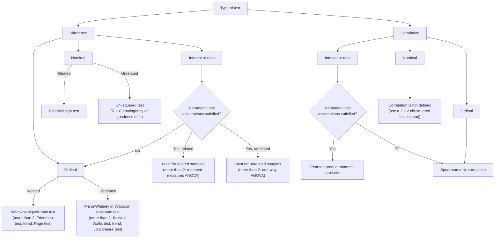
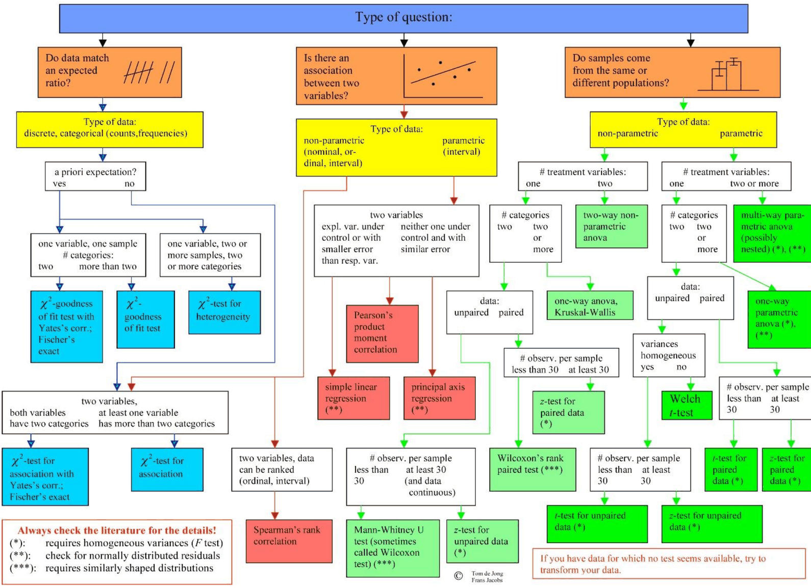
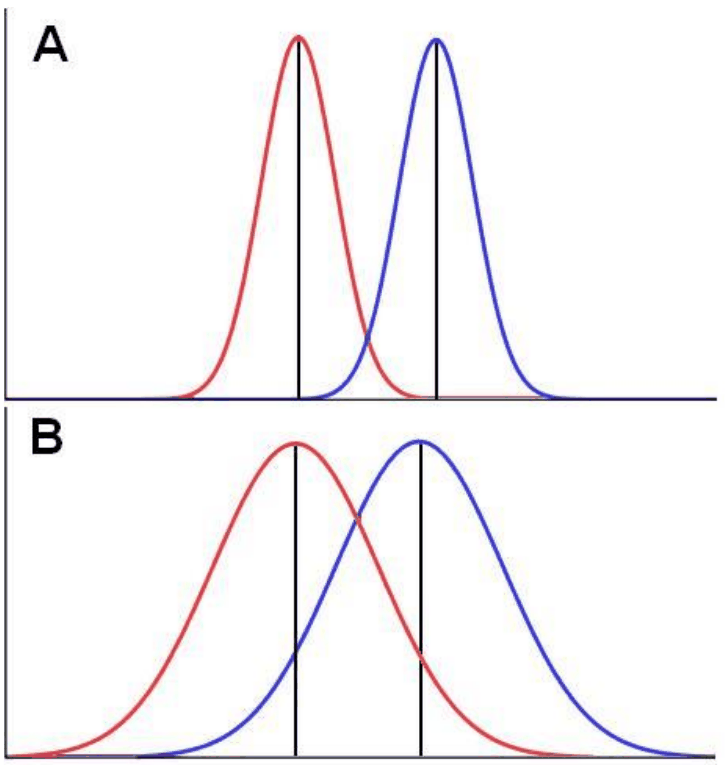
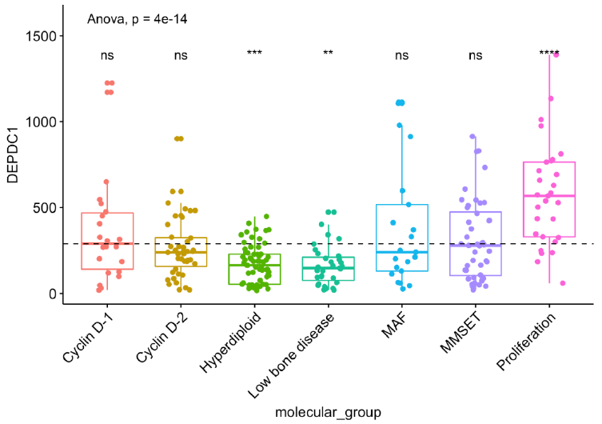
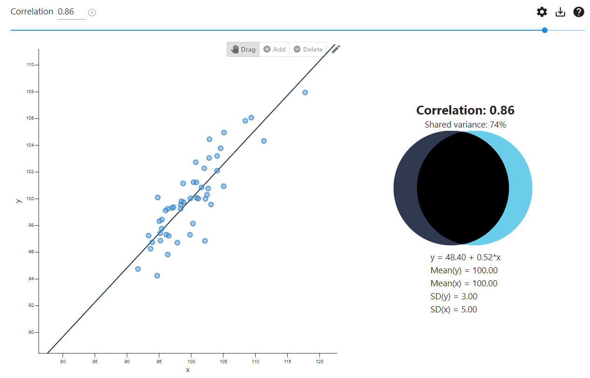
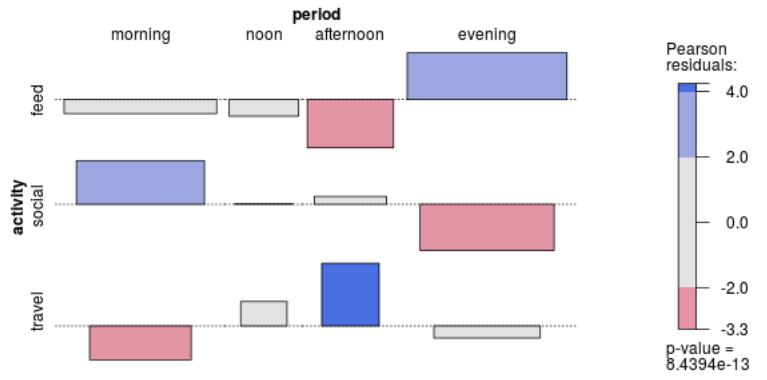

# Lecture 7 — Statistical Analysis

[Repository Guide](../../README.md) | [English](Concepts_Lecture.md) | [한국어](Concepts_Lecture.ko.md)

> **Last Updated:** 2026-11-04

> **Learning Objectives:**
> 1. Choose a statistical method suited to the data by examining the level of measurement, the types of the dependent and independent variables, the independence of observations, and the assumptions of the model
> 2. Distinguish the dependent and independent variables of a regression model, and choose among linear regression, Poisson regression, the Cox model, and logistic regression according to the type of response variable
> 3. Perform the t-test, Wilcoxon test, permutation test, analysis of variance, Kruskal-Wallis test, and analysis of deviance for comparing two or more groups in R, and interpret the results
> 4. Analyze the association between two continuous variables with the Pearson correlation coefficient, the Spearman rank correlation coefficient, and simple linear regression
> 5. Test the association between two categorical variables with the chi-squared test, Fisher's exact test, and the Cochran-Armitage trend test, and interpret Pearson residuals

---

## Table of Contents

- [1. Choosing a Statistical Method](#1-choosing-a-statistical-method)
  - [1.1 Levels of Measurement](#11-levels-of-measurement)
  - [1.2 Choosing by the Types of the Dependent and Independent Variables](#12-choosing-by-the-types-of-the-dependent-and-independent-variables)
  - [1.3 Three Steps for Difference Tests and Correlation Analysis](#13-three-steps-for-difference-tests-and-correlation-analysis)
  - [1.4 Choosing from the Type of Question](#14-choosing-from-the-type-of-question)
  - [1.5 A Selection Table Built on Three Questions](#15-a-selection-table-built-on-three-questions)
  - [1.6 Why There Are So Many Methods, and How to Learn Them](#16-why-there-are-so-many-methods-and-how-to-learn-them)
- [2. Statistical Models and Regression Models](#2-statistical-models-and-regression-models)
  - [2.1 Definition of the Regression Model](#21-definition-of-the-regression-model)
  - [2.2 Variables in a Regression Model](#22-variables-in-a-regression-model)
  - [2.3 Regression Models by Type of Response Variable](#23-regression-models-by-type-of-response-variable)
  - [2.4 Model Formulas in R and the Four Analysis Types](#24-model-formulas-in-r-and-the-four-analysis-types)
- [3. Analysis Type I: Comparing Two Groups](#3-analysis-type-i-comparing-two-groups)
  - [3.1 What a Two-Group Comparison Means](#31-what-a-two-group-comparison-means)
  - [3.2 The t-Test and the Paired t-Test](#32-the-t-test-and-the-paired-t-test)
  - [3.3 The Wilcoxon Test](#33-the-wilcoxon-test)
  - [3.4 The Permutation Test](#34-the-permutation-test)
- [4. Analysis Type II: Comparing Several Groups](#4-analysis-type-ii-comparing-several-groups)
  - [4.1 Analysis of Variance (ANOVA)](#41-analysis-of-variance-anova)
  - [4.2 Post Hoc Tests](#42-post-hoc-tests)
  - [4.3 The Kruskal-Wallis Test](#43-the-kruskal-wallis-test)
  - [4.4 Analysis of Deviance (ANODEV)](#44-analysis-of-deviance-anodev)
  - [4.5 Visualizing a Several-Group Comparison](#45-visualizing-a-several-group-comparison)
- [5. Analysis Type III: Association Between Two Continuous Variables](#5-analysis-type-iii-association-between-two-continuous-variables)
  - [5.1 The Pearson Correlation Coefficient](#51-the-pearson-correlation-coefficient)
  - [5.2 The Spearman Rank Correlation Coefficient](#52-the-spearman-rank-correlation-coefficient)
  - [5.3 Simple Linear Regression](#53-simple-linear-regression)
- [6. Analysis Type IV: Association Between Two Categorical Variables](#6-analysis-type-iv-association-between-two-categorical-variables)
  - [6.1 Contingency Tables and the Chi-Squared Test of Independence](#61-contingency-tables-and-the-chi-squared-test-of-independence)
  - [6.2 Pearson Residuals and the Association Plot](#62-pearson-residuals-and-the-association-plot)
  - [6.3 Fisher's Exact Test](#63-fishers-exact-test)
  - [6.4 The Cochran-Armitage Trend Test](#64-the-cochran-armitage-trend-test)
- [Concept Applications](#concept-applications)
- [Summary](#summary)
- [Self-Check Questions](#self-check-questions)
- [References](#references)

---

<br>

## 1. Choosing a Statistical Method

The first decision in a statistical analysis is to choose a method that fits the data and the research question. Even for the same data, the appropriate method depends on what is being asked (a difference between groups, or an association between variables), what kind of variables are involved, whether the observations are independent, and whether the assumptions the method requires hold. Building on the probability distributions and hypothesis tests of Lectures 1-6, the sections below organize the methods most often used in real data analysis by selection criterion and by analysis type. For each method they explain what the method tests, what it assumes, and how to run it in R; the t-test and the Wilcoxon rank-sum test for two-group comparisons are treated in more depth in Lecture 8.

### 1.1 Levels of Measurement

To choose a method, one first needs to know what kind of values a variable takes. By the amount of information the values carry, the **level of measurement** is divided into the following four kinds [1].

| Level of measurement | Property of the values | Examples | Meaningful operations |
|:-----|:-----|:-----|:-----|
| Nominal | Labels only, with no order | Blood type, sex, type of insecticide | Equal or not, frequencies |
| Ordinal | Ordered, but the gaps are not equal | Satisfaction (low, medium, high), cancer stage | Comparison of size, ranks, median |
| Interval | Equal gaps, but zero is arbitrary | Temperature in Celsius, calendar year | Addition and subtraction, mean |
| Ratio | Equal gaps, and zero is an absolute origin | Height, weight, yield, time | Multiplication and division, ratios |

*Table 1. The four levels of measurement of a variable*

Variables measured on the nominal or ordinal scale are called **categorical variables**, and variables on the interval or ratio scale are called **continuous variables** or numerical variables. A categorical variable with only two categories (alive and dead, treatment and control) is called a **binary variable**.

> **Definition:** A **parametric method** assumes that the data follow a particular family of distributions (most often the normal distribution) and makes inferences about the parameters of that distribution (mean, variance, and so on). The t-test and analysis of variance are typical examples. A **nonparametric method** does not specify the form of the distribution and makes inferences only from properties that depend less on it, such as ranks, signs, and rearrangements of the data. The Wilcoxon test and the Kruskal-Wallis test are typical examples. Nonparametric methods make weaker assumptions, but when the assumptions of a parametric method do hold they can have slightly lower power (Lecture 8, Section 5).

### 1.2 Choosing by the Types of the Dependent and Independent Variables

The method is largely determined by the type of the **dependent variable**, which plays the role of the outcome, and of the **independent variable**, which explains the outcome (both terms are defined in Section 2.2). The following table combines the type of the independent variable (rows) with the type of the dependent variable (columns) and lists the typical method for each. "NP" in parentheses is the nonparametric alternative used when the normality assumption does not hold.

| Independent variable | Dependent: categorical | Dependent: one continuous | Dependent: several continuous |
|:-----|:-----|:-----|:-----|
| Binary (two groups) | Chi-squared test | Same experimental unit: paired t-test (NP: Wilcoxon signed-rank test)<br>Independent units: independent two-sample t-test (NP: Mann-Whitney U test)<br>Internally normalized values: one-sample t-test | |
| Categorical, one factor | Chi-squared test | Same experimental unit: repeated-measures ANOVA (NP: Friedman test)<br>Independent units: one-way ANOVA (NP: Kruskal-Wallis test) | Multivariate analysis of variance (MANOVA) |
| Categorical, two factors | Loglinear analysis | Two-way ANOVA (factorial ANOVA) | Factorial MANOVA |
| Continuous | Logistic regression (when the dependent variable is binary) | Pearson correlation and regression (NP: Spearman rank correlation) | |

*Table 2. Typical analysis methods by the types of the independent and dependent variables*

The terms in the table are as follows.

- **Same experimental unit:** the same person or individual is measured under two conditions. The two values form a pair, as with blood pressure before and after treatment, so the difference within each pair is analyzed.
- **Independent:** different people are divided into two groups and measured.
- **Internally normalized:** within each experimental unit, the values under the two conditions are turned into a single value (a ratio or difference relative to the control condition). The one-sample t-test then tests whether that value differs from its reference value (1 for a ratio, 0 for a difference).
- **Factor:** a categorical independent variable that divides the observations into groups. One factor calls for one-way ANOVA and two factors for two-way ANOVA; when the dependent variable consists of several continuous variables, multivariate analysis of variance (MANOVA) is used.
- **Loglinear analysis:** a method that explains the cell counts of a contingency table formed by three or more categorical variables with a loglinear model, in order to analyze the association structure among the variables.

### 1.3 Three Steps for Difference Tests and Correlation Analysis

The same choice can also be organized in three steps, starting from the kind of research question. First decide whether the question concerns a **difference** between groups or a **correlation** between two variables (start), check the level of measurement of the variables (Step 1), check whether the assumptions of a parametric test (normality, equal variances, and so on) hold when the scale is interval or ratio (Step 2), and finally choose a test according to whether the samples are **related** or **unrelated** (Step 3). Related samples are samples measured repeatedly on the same subjects or matched in pairs, and unrelated samples come from different subjects.



*Figure 1. Three-step flow that chooses a difference test or correlation analysis by level of measurement, assumptions, and relatedness of samples*

Points worth noting in this flow are as follows.

- Even interval or ratio data are converted to ranks, as for ordinal data, and analyzed with a nonparametric test when the assumptions of the parametric test do not hold. Using only the ranks removes the need for the normality assumption.
- With three or more samples, analysis of variance (repeated-measures ANOVA for related samples, one-way ANOVA for unrelated samples) replaces the t-test, and the nonparametric alternatives are the Friedman test and the Kruskal-Wallis test. When the groups have a natural order (such as dose) and the question is whether the response increases or decreases along that order, the Page test (related samples) and the Jonckheere test (unrelated samples) are used.
- Two nominal variables have no order of magnitude, so a correlation coefficient cannot be defined. In that case the chi-squared test checks whether the two variables are independent.

### 1.4 Choosing from the Type of Question

The following flowchart organizes the same choice in finer detail. At the top it divides the type of question into three.



*Figure 2. Flowchart that chooses a test by type of question, type of data, numbers of treatment variables and categories, pairing, and sample size*

1. **Do data match an expected ratio?** The data are discrete counts per category. With an a priori expected ratio, one variable in one sample calls for the chi-squared goodness-of-fit test with Yates's correction or Fisher's exact test when there are two categories, and the chi-squared goodness-of-fit test when there are more than two. One variable observed in two or more samples calls for the chi-squared test for heterogeneity. Without an expected ratio, when the question is the association of two variables, the chi-squared test for association with Yates's correction or Fisher's exact test is used if both variables have two categories, and the chi-squared test for association is used if at least one variable has more than two categories.
2. **Is there an association between two variables?** For nonparametric data (nominal, ordinal, or interval data converted to ranks), Spearman's rank correlation is used when the data can be ranked, and nominal data go to the chi-squared test for association of path 1. For parametric data (interval), the Pearson product-moment correlation is computed; to estimate the relation itself, simple linear regression is used when the explanatory variable is under control or has a smaller error than the response, and principal axis regression is used when neither variable is under control and their errors are similar.
3. **Do samples come from the same or different populations?** For nonparametric data with one treatment variable and two categories, unpaired data call for the Mann-Whitney U test (sometimes called the Wilcoxon test) when there are fewer than 30 observations per sample, and the z-test for unpaired data when there are at least 30 and the data are continuous. Paired data call for Wilcoxon's rank paired test (the signed-rank test) with fewer than 30 observations and the z-test for paired data with at least 30. Two or more categories call for one-way ANOVA or the Kruskal-Wallis test, and two treatment variables call for two-way nonparametric ANOVA. For parametric data with one treatment variable and two categories, unpaired data with homogeneous variances call for the t-test for unpaired data with fewer than 30 observations per sample and the z-test for unpaired data with at least 30, while heterogeneous variances call for the Welch t-test. Paired data call for the t-test for paired data with fewer than 30 observations and the z-test for paired data with at least 30. Two or more categories call for one-way parametric ANOVA, and two or more treatment variables call for multi-way parametric ANOVA (possibly nested).

The symbols in the flowchart mark extra conditions for each test. (\*) requires homogeneous variances (checked with the F test), (\*\*) requires checking that the residuals are normally distributed, and (\*\*\*) requires similarly shaped distributions. The flowchart also adds that the details should always be checked in the literature, and that data for which no test seems available should be transformed (Lecture 8, Section 3.3).

> **Caution:** The rule that splits the t-test and the z-test at a sample size of 30 is a rule of thumb. With large samples, the central limit theorem (Lecture 5) makes the distribution of the sample mean close to normal and the t distribution close to the standard normal, so the two tests give almost the same result. In practice the t-test is often used regardless of the sample size.

### 1.5 A Selection Table Built on Three Questions

The criteria so far reduce to three questions. (1) What is the dependent variable? (2) Are the observations independent or correlated? (3) Are the key model assumptions met?

| Outcome variable | Independent observations | Correlated observations | Assumptions |
|:-----|:-----|:-----|:-----|
| Continuous (e.g., pain scale, cognitive function) | t-test<br>Analysis of variance (ANOVA)<br>Linear correlation<br>Linear regression | Paired t-test<br>Repeated-measures ANOVA<br>Mixed models, GEE | The outcome is normally distributed (important for small samples). The outcome and predictor have a linear relationship |
| Time to event (e.g., time to fracture) | Kaplan-Meier statistics<br>Cox regression | Not applicable | Cox regression assumes proportional hazards between groups |
| Exponential family (e.g., normal, exponential, gamma, beta, Poisson) | Generalized linear model<br>ANODEV | Generalized linear mixed model | It depends on the situation |

*Table 3. Analysis methods by type of outcome variable, correlation of observations, and assumptions*

- **Correlated observations:** measuring the same patient several times, or measuring people who belong to the same family or the same hospital, makes the observations tend to resemble one another. Applying a method that assumes independence to such data misestimates the standard errors, so a **mixed model** or **generalized estimating equations (GEE)**, which build the correlation into the model, are used instead.
- **Time to event:** the time until an event such as death, relapse, or fracture occurs. For a subject in whom the event has not occurred by the end of follow-up, the only information left is that the time to the event is at least the follow-up time; this is called **censoring**. The **Kaplan-Meier estimator** takes censoring into account to estimate the survival probability curve over time, and **Cox regression** estimates the effect of covariates on the hazard (Section 2.3). The **proportional hazards assumption** of Cox regression is the assumption that the ratio of the hazards of two groups does not change over time.
- **Exponential family:** the collection of distributions, such as the normal, exponential, gamma, beta, Poisson, and binomial distributions, whose density or mass function can be written as $f(y;\theta) = h(y)\exp\lbrace\eta(\theta)T(y) - A(\theta)\rbrace$. When the response follows a distribution in the exponential family, regression is carried out with a **generalized linear model (GLM)**, and the test corresponding to analysis of variance is carried out with the **analysis of deviance (ANODEV)** (Section 4.4) [2].

### 1.6 Why There Are So Many Methods, and How to Learn Them

There are far more statistical methods than the tables and flowcharts above can hold. A list of methods for categorical data alone runs to dozens of entries [3], and categorical data analysis, nonparametric statistics, and time series analysis are each broad enough to have their own textbooks and courses. Rather than trying to learn every method at once, it is therefore advisable to learn the typical analyses for each data type through hands-on experience, and, when a particular analysis becomes necessary, to study its theory as deeply as probability distributions and hypothesis testing were studied. The typical analyses are organized here into the following four types.

| Analysis type | Model form | Typical methods |
|:-----|:-----|:-----|
| I. Comparing two groups | `Continuous ~ two_group` | t-test, paired t-test, Wilcoxon test, permutation t-test |
| II. Comparing several groups | `Continuous ~ Multiple_group` | ANOVA (normal condition), Kruskal-Wallis test (nonparametric), ANODEV (exponential family) |
| III. Association of two continuous random variables | `Continuous ~ Continuous` | Pearson correlation, Spearman correlation, regression |
| IV. Association of two categorical random variables | `Category ~ Category` | Chi-squared test, Fisher's exact test (hypergeometric test), Cochran-Armitage test for trend |

*Table 4. The four analysis types and their typical methods*

---

<br>

## 2. Statistical Models and Regression Models

### 2.1 Definition of the Regression Model

A **regression model** is a statistical model that sets up the relationship between one dependent variable and one or more explanatory variables as an equation. In the classical regression model the dependent (response) variable is numerical, and the independent (explanatory) variables are one or more numerical or categorical variables. The most basic **linear regression model** is as follows.

$$
Y = \beta_0 + \beta_1 X_1 + \beta_2 X_2 + \cdots + \beta_k X_k + \varepsilon, \qquad \varepsilon \sim N(0, \sigma^2)
$$

Here $\beta_0$ is the intercept, $\beta_j$ is the regression coefficient that gives how much the mean of $Y$ changes when $X_j$ increases by 1 with the other explanatory variables held fixed, and $\varepsilon$ is the random error not explained by the explanatory variables. A categorical explanatory variable enters the equation through indicator (dummy) variables that take the value 0 or 1 for each category.

Regression models are used mainly for two purposes.

- **Prediction:** predicting the value of the response for new values of the explanatory variables, for example predicting the stopping distance of a car from its speed (Section 5.3).
- **Estimation:** estimating the regression coefficients to learn the size and direction of the effect of an explanatory variable on the response, together with its uncertainty (confidence intervals and tests).

### 2.2 Variables in a Regression Model

| Kind | Meaning | Synonyms | Notation |
|:-----|:-----|:-----|:-----|
| Dependent variable | Variable that represents a particular phenomenon of interest | Response variable, outcome variable | Usually $Y$ |
| Independent variable | Variable that can affect the dependent variable | Explanatory variable, predictor | Usually $X_1, \ldots, X_k$ |

*Table 5. The two kinds of variables in a regression model*

> **Caution:** The name "independent variable" does not mean that the explanatory variables are statistically independent of one another, nor that a regression model proves causation. Regression coefficients from observational data only measure the strength of an association; a causal interpretation requires a design such as a randomized experiment.

### 2.3 Regression Models by Type of Response Variable

When the response is not continuous, the normal-error assumption of linear regression does not fit, so a regression model matched to the type of response is used.

| Response | Model | Example of response | R function |
|:-----|:-----|:-----|:-----|
| Continuous | Linear regression | Stopping distance, blood pressure | `lm(y ~ x)` |
| Counts | Poisson regression | Number of insects, daily visitors | `glm(y ~ x, family = poisson)` |
| Survival times | Cox model | Time from diagnosis to death | `survival::coxph(Surv(time, status) ~ x)` |
| Binomial (binary) | Logistic regression | Pass or fail, presence of a disease | `glm(y ~ x, family = binomial)` |

*Table 6. Family of regression models by type of response variable*

Poisson regression and logistic regression are kinds of generalized linear model. A generalized linear model does not set the mean $\mu$ of the response equal to the linear predictor directly but passes it through a **link function** $g$, so that $g(\mu) = \beta_0 + \beta_1 X_1 + \cdots + \beta_k X_k$ [2]. Poisson regression uses the log link $\log \mu$ because the mean of a count is positive, and logistic regression uses the logit link $\log\lbrace p/(1-p)\rbrace$ because a probability $p$ lies between 0 and 1. The quantity $p/(1-p)$ is called the **odds**. The Cox model sets the **hazard function** at time $t$ to $h(t \mid x) = h_0(t)\exp(\beta x)$ and estimates only $\beta$ without specifying the form of $h_0(t)$ [4].

The following code fits a logistic regression and a Cox model to built-in R data. In `mtcars`, `am` is the transmission type (0: automatic, 1: manual) and `wt` is the weight of the car (in units of 1,000 pounds); `lung` in the `survival` package records the survival time (`time`, in days), death status (`status`), and sex (`sex`, 1: male, 2: female) of patients with advanced lung cancer.

```r
logit_fit <- glm(am ~ wt, family = binomial, data = mtcars)  # logistic regression
round(coef(summary(logit_fit)), 4)                            # coefficient table to 4 decimals
exp(coef(logit_fit)["wt"])                                    # odds ratio

library(survival)                                             # provides Surv, coxph, lung
coxph(Surv(time, status) ~ sex, data = lung)                  # Cox proportional hazards model
```

The output is as follows.

```text
            Estimate Std. Error z value Pr(>|z|)
(Intercept)  12.0404     4.5097  2.6699   0.0076
wt           -4.0240     1.4364 -2.8014   0.0051
        wt 
0.01788183 
Call:
coxph(formula = Surv(time, status) ~ sex, data = lung)

       coef exp(coef) se(coef)      z       p
sex -0.5310    0.5880   0.1672 -3.176 0.00149

Likelihood ratio test=10.63  on 1 df, p=0.001111
n= 228, number of events= 165 
```

- In the logistic regression, the coefficient -4.024 of `wt` means that the log odds of a manual transmission decrease by 4.024 when the weight increases by 1,000 pounds. On the odds scale this is a factor of $e^{-4.024} \approx 0.0179$, so heavier cars are much less likely to have a manual transmission. The p-value of the coefficient is 0.0051.
- In the Cox model, $e^{-0.531} \approx 0.588$ for the coefficient -0.531 of `sex` is the **hazard ratio**. When `sex` increases by 1 (from male to female), the hazard of death at any time is about 0.588 times as large, that is, about 41% lower, with a p-value of 0.00149.

An example of Poisson regression appears in Section 4.4.

> **[Machine Learning]** Logistic regression is also a standard classification model in machine learning. Statistics focuses on estimating and testing the coefficients (which variables are related to the outcome), while machine learning focuses on predictive performance in assigning new data to categories. The model is the same, but the criteria for evaluating it differ.

### 2.4 Model Formulas in R and the Four Analysis Types

R expresses the relation of explaining y by x with a **model formula** of the form `y ~ x` [5]. The left side of `~` is the dependent variable and the right side is the independent variable; several independent variables are joined with `+`, as in `y ~ x1 + x2`. The model forms in Table 4 express the four analysis types in this notation.

- **Type I** `Continuous ~ two_group`: a continuous dependent variable explained by a categorical variable with two levels. Example: `t.test(mpg ~ am_f, data = mtcars)`.
- **Type II** `Continuous ~ Multiple_group`: a continuous dependent variable explained by a categorical variable with three or more levels. Example: `aov(weight ~ group, data = PlantGrowth)`.
- **Type III** `Continuous ~ Continuous`: a continuous dependent variable explained by a continuous independent variable. Example: `lm(dist ~ speed, data = cars)`.
- **Type IV** `Category ~ Category`: the association of two categorical variables. Example: `chisq.test(table(x, y))`.

---

<br>

## 3. Analysis Type I: Comparing Two Groups

### 3.1 What a Two-Group Comparison Means

A two-group comparison tests whether the distribution of a continuous dependent variable differs between two groups, in particular whether the means (locations) differ. The typical methods are the t-test, the paired t-test, the Wilcoxon test, and the permutation t-test.



*Figure 3. Two pairs of distributions with the same difference in means and different spreads*

In panels A and B of Figure 3, the distance between the means (vertical lines) of the red and blue distributions is the same. In A, however, both distributions have a small spread and barely overlap, whereas in B the spreads are large and the distributions overlap a great deal. In A a single value is enough to tell which group it came from, but in B this is hard. A two-group comparison therefore judges the difference in means not by itself but **relative to the size of its variability (the standard error)**. The t statistic computes this ratio as follows.

$$
t = \frac{\text{difference between the two sample means}}{\text{standard error of that difference}} = \frac{\text{signal}}{\text{noise}}
$$

For the same difference in means, a large spread as in B makes the t statistic small and the difference hard to detect. Increasing the sample size shrinks the standard error and makes the same difference easier to detect.

### 3.2 The t-Test and the Paired t-Test

The **two-sample t-test** tests the null hypothesis $H_0: \mu_1 = \mu_2$ that two mutually independent groups have the same population mean. Each group must be normally distributed or the samples must be large enough; Student's t-test assumes equal variances in the two groups, and the **Welch t-test** allows them to differ [6]. The **paired t-test** tests the null hypothesis that the mean of the differences $d_i$ between two values paired on the same subject is 0. The test statistics, assumptions, and computations are covered in detail in Lecture 6 and Lecture 8, Section 2.

The following example compares the fuel efficiency (`mpg`, miles per gallon) of automatic cars (19 cars) and manual cars (13 cars) in `mtcars`. `factor()` turns the 0/1 variable `am` into named categories, and `tapply()` computes the mean of each group.

```r
mtcars$am_f <- factor(mtcars$am, labels = c("automatic", "manual"))  # 0, 1 to category names
tapply(mtcars$mpg, mtcars$am_f, mean)                                # mean mpg by group
t.test(mpg ~ am_f, data = mtcars)                                    # Welch t-test by default
```

```text
automatic    manual 
 17.14737  24.39231 

	Welch Two Sample t-test

data:  mpg by am_f
t = -3.7671, df = 18.332, p-value = 0.001374
alternative hypothesis: true difference in means between group automatic and group manual is not equal to 0
95 percent confidence interval:
 -11.280194  -3.209684
sample estimates:
mean in group automatic    mean in group manual 
               17.14737                24.39231 
```

R's `t.test()` performs the Welch t-test unless `var.equal = TRUE` is specified. The degrees of freedom are the non-integer 18.332 because the Welch method approximates them from the two sample variances. Since the p-value 0.001374 is below the significance level 0.05, the null hypothesis that the two transmissions have the same mean fuel efficiency is rejected. The 95% confidence interval for the difference in means (automatic minus manual) is -11.28 to -3.21, which does not contain 0, and manual cars have a mean fuel efficiency about 7.2 higher.

### 3.3 The Wilcoxon Test

The **Wilcoxon rank-sum test** pools the two independent samples, ranks them, and tests whether the rank sum of one group is larger or smaller than chance would lead one to expect. It needs no normality assumption, so it is used for small samples, data with outliers, or skewed data; it is the same test as the **Mann-Whitney U test**. For paired data the **Wilcoxon signed-rank test** is used. The computation of the statistic and its limitations are covered in Lecture 8, Section 4.

```r
wilcox.test(mpg ~ am_f, data = mtcars)   # Wilcoxon rank-sum test on the same data
```

```text
	Wilcoxon rank sum test with continuity correction

data:  mpg by am_f
W = 42, p-value = 0.001871
alternative hypothesis: true location shift is not equal to 0

Warning message:
In wilcox.test.default(x = DATA[[1L]], y = DATA[[2L]], ...) :
  cannot compute exact p-value with ties
```

The p-value 0.001871 leads to the same conclusion as the t-test. The `W = 42` reported by R is not the rank sum itself but the Mann-Whitney statistic, the rank sum of the first group minus its minimum possible value $n_1(n_1+1)/2$. The warning means that the mileage values contain equal values (ties), so a normal approximation was used instead of the exact p-value (Lecture 8, Section 4.5).

### 3.4 The Permutation Test

The **permutation test** uses the fact that, under the null hypothesis, the group labels are unrelated to the outcome. If the two groups have the same distribution, shuffling only the group labels while keeping the observed values should not change the distribution of the statistic. The null distribution is therefore built directly by the following procedure [7].

1. Compute the test statistic (a difference in means or a t statistic) from the observed data. Call this value $T_{\text{obs}}$.
2. Shuffle the group labels at random (a permutation), split the data again, and compute the same statistic.
3. Repeat Step 2 many times (for example, 10,000 times) to obtain the distribution of the statistic under the null hypothesis.
4. Take the proportion of shuffled statistics whose absolute value is at least $\vert T_{\text{obs}} \vert$ as the two-sided p-value.

When the t statistic is used as the statistic, the procedure is called a **permutation t-test**. Its advantage is that it uses the same statistic as the t-test while making almost no distributional assumption. The following code uses the difference in means as the statistic.

```r
obs <- diff(tapply(mtcars$mpg, mtcars$am_f, mean))     # observed difference (manual minus automatic)
set.seed(1)                                            # fix the random seed for reproducibility
perm <- replicate(10000, {                             # repeat 10,000 times
  shuffled <- sample(mtcars$am_f)                      # shuffle the labels at random
  diff(tapply(mtcars$mpg, shuffled, mean))             # difference in means with shuffled labels
})
obs
mean(abs(perm) >= abs(obs))                            # two-sided permutation p-value
```

```text
  manual 
7.244939 
[1] 3e-04
```

Only 3 of the 10,000 shuffles gave a difference whose absolute value was at least the observed 7.245, so the p-value is 0.0003. This also rejects the null hypothesis. Because the number of repetitions is finite, the p-value carries random error, which shrinks as the repetitions increase.

> **Note:** The permutation p-value is sometimes computed as $(B+1)/(R+1)$, where $R$ is the number of repetitions and $B$ is the number of them at least as extreme as the observed value. This counts the observed data as one of the possible permutations and keeps the p-value from being exactly 0. With this formula the result is $(3+1)/(10000+1) \approx 0.0004$.

---

<br>

## 4. Analysis Type II: Comparing Several Groups

The typical methods for comparing three or more groups are **analysis of variance (ANOVA)** under the normal condition, its nonparametric alternative the **Kruskal-Wallis test**, and **ANODEV** when the response follows a distribution in the exponential family.

### 4.1 Analysis of Variance (ANOVA)

If three groups are compared by running a t-test on each pair, three tests in all, then even with a significance level of 0.05 for each test, the probability of at least one false rejection grows to $1 - 0.95^3 \approx 0.143$ (assuming the three tests are independent). **One-way ANOVA** avoids this problem by testing the null hypothesis that all group means are equal in a single test.

Let $y_{ij}$ be the $j$th observation in the $i$th of $k$ groups. The model is as follows.

$$
y_{ij} = \mu_i + \varepsilon_{ij}, \qquad \varepsilon_{ij} \stackrel{\text{iid}}{\sim} N(0, \sigma^2), \qquad H_0: \mu_1 = \mu_2 = \cdots = \mu_k
$$

ANOVA splits the total variation into variation between groups and variation within groups. Here $n_i$ is the size of the $i$th group, $N$ is the total number of observations, $\bar{y}_i$ is the group mean, and $\bar{y}$ is the overall mean.

$$
\underbrace{\sum_{i}\sum_{j}(y_{ij}-\bar{y})^2}_{SST} = \underbrace{\sum_{i} n_i(\bar{y}_i-\bar{y})^2}_{SSB} + \underbrace{\sum_{i}\sum_{j}(y_{ij}-\bar{y}_i)^2}_{SSW}
$$

The test statistic is the ratio of the mean squares, each sum of squares divided by its degrees of freedom.

$$
F = \frac{MSB}{MSW} = \frac{SSB/(k-1)}{SSW/(N-k)} \sim F_{k-1,\, N-k} \quad \text{under } H_0
$$

If the null hypothesis is true, the group means cluster around the overall mean, $MSB$ and $MSW$ are similar, and $F$ is near 1; if the group means differ, $MSB$ grows and so does $F$. The assumptions are independence of the observations, normality within each group (normality of the residuals), and equal variances across groups.

R's `PlantGrowth` data record the dried weight (`weight`) of 10 plants in each of a control group (`ctrl`) and two treatment groups (`trt1`, `trt2`).

```r
tapply(PlantGrowth$weight, PlantGrowth$group, mean)   # mean of each group
fit <- aov(weight ~ group, data = PlantGrowth)        # one-way ANOVA
summary(fit)                                          # ANOVA table
```

```text
 ctrl  trt1  trt2 
5.032 4.661 5.526 
            Df Sum Sq Mean Sq F value Pr(>F)  
group        2  3.766  1.8832   4.846 0.0159 *
Residuals   27 10.492  0.3886                 
---
Signif. codes:  0 '***' 0.001 '**' 0.01 '*' 0.05 '.' 0.1 ' ' 1
```

The ANOVA table can be checked by hand as follows. The overall mean is 5.073, so $SSB = 10\lbrace(5.032-5.073)^2 + (4.661-5.073)^2 + (5.526-5.073)^2\rbrace = 10(0.00168 + 0.16974 + 0.20521) \approx 3.766$. The degrees of freedom are $k-1 = 2$ between groups and $N-k = 30-3 = 27$ within groups, so $MSB = 3.766/2 = 1.8832$, $MSW = 10.492/27 = 0.3886$, and $F = 1.8832/0.3886 \approx 4.846$. Since the p-value 0.0159 is below 0.05, the null hypothesis that the three group means are all equal is rejected. The `Signif. codes` line at the end of the table is R's notation that marks the range of a p-value with asterisks.

### 4.2 Post Hoc Tests

Rejecting the null hypothesis in ANOVA only reveals the fact that at least one pair of means differs. Which pairs differ is determined by a **post hoc test**, which compares several pairs while controlling the overall significance level. The standard method is **Tukey's HSD (honestly significant difference)** [8]. The following code first checks the assumptions of ANOVA and then performs Tukey's HSD.

```r
fit <- aov(weight ~ group, data = PlantGrowth)
shapiro.test(residuals(fit))$p.value                     # normality test of the residuals
bartlett.test(weight ~ group, data = PlantGrowth)$p.value  # test of equal variances
TukeyHSD(fit)                                            # comparison of all pairs
```

```text
[1] 0.4378986
[1] 0.2370968
  Tukey multiple comparisons of means
    95% family-wise confidence level

Fit: aov(formula = weight ~ group, data = PlantGrowth)

$group
            diff        lwr       upr     p adj
trt1-ctrl -0.371 -1.0622161 0.3202161 0.3908711
trt2-ctrl  0.494 -0.1972161 1.1852161 0.1979960
trt2-trt1  0.865  0.1737839 1.5562161 0.0120064
```

The p-value 0.438 of the Shapiro-Wilk test (null hypothesis: the residuals are normally distributed; Lecture 8, Section 3.2) and the p-value 0.237 of Bartlett's test (null hypothesis: the variances are equal) are both above 0.05, so neither assumption is rejected. In Tukey's HSD, `p adj` is the p-value adjusted for multiple comparisons, and the only pair below 0.05 is `trt2-trt1` (difference 0.865, p = 0.012). The significant ANOVA result therefore comes mainly from the difference between the two treatment groups.

### 4.3 The Kruskal-Wallis Test

The **Kruskal-Wallis test** is the nonparametric version of ANOVA and extends the Wilcoxon rank-sum test to three or more groups [9]. All $N$ observations are pooled and ranked; with $R_i$ the rank sum of the $i$th group, the test statistic is as follows.

$$
H = \frac{12}{N(N+1)}\sum_{i=1}^{k}\frac{R_i^2}{n_i} - 3(N+1) \;\approx\; \chi^2_{k-1} \quad \text{under } H_0
$$

The null hypothesis is that the $k$ groups all have the same distribution. If the ranks are evenly mixed across groups, the mean rank of each group is close to the overall mean rank $(N+1)/2$ and $H$ is small; if large ranks concentrate in one group, $H$ becomes large. No normality assumption is needed, but the groups must have similarly shaped distributions for the result to be interpreted as a difference in location (median).

```r
kruskal.test(weight ~ group, data = PlantGrowth)
```

```text
	Kruskal-Wallis rank sum test

data:  weight by group
Kruskal-Wallis chi-squared = 7.9882, df = 2, p-value = 0.01842
```

Comparing $H = 7.988$ with the chi-squared distribution with 2 degrees of freedom gives a p-value of 0.01842, so, as with ANOVA, the null hypothesis that the three groups have the same distribution is rejected.

### 4.4 Analysis of Deviance (ANODEV)

When the response is not normally distributed, as with counts or binary values, a generalized linear model is fitted and models are compared by their **deviance** instead of the sums of squares of ANOVA. The deviance is twice the difference in log-likelihood between the saturated model, which fits the observations perfectly, and the fitted model; in a normal model it plays the same role as the residual sum of squares [2].

$$
D = 2\lbrace\ell(\text{saturated model}) - \ell(\text{fitted model})\rbrace
$$

The decrease in deviance from adding an explanatory variable approximately follows a chi-squared distribution under the null hypothesis (no effect of that variable), with degrees of freedom equal to the number of added parameters. Testing effects on this principle is the **analysis of deviance (ANODEV)**.

R's `InsectSprays` data count the insects (`count`) left after each of six insecticides (`spray`, A-F) was applied to 12 plots. Since the data are counts, a Poisson regression is fitted.

```r
tapply(InsectSprays$count, InsectSprays$spray, mean)            # mean insect count by spray
gfit <- glm(count ~ spray, family = poisson, data = InsectSprays) # Poisson regression
anova(gfit, test = "Chisq")                                     # analysis of deviance table
```

```text
        A         B         C         D         E         F 
14.500000 15.333333  2.083333  4.916667  3.500000 16.666667 
Analysis of Deviance Table

Model: poisson, link: log

Response: count

Terms added sequentially (first to last)


      Df Deviance Resid. Df Resid. Dev  Pr(>Chi)    
NULL                     71     409.04              
spray  5   310.71        66      98.33 < 2.2e-16 ***
---
Signif. codes:  0 '***' 0.001 '**' 0.01 '*' 0.05 '.' 0.1 ' ' 1
```

The intercept-only model (`NULL`) has deviance 409.04 (71 degrees of freedom), which drops to 98.33 (66 degrees of freedom) when `spray` is added. Comparing the decrease $409.04 - 98.33 = 310.71$ with the chi-squared distribution with 5 degrees of freedom gives a p-value below $2.2 \times 10^{-16}$, so the mean insect count is concluded to differ by insecticide. The means of C, D, and E (2.1-4.9) are much smaller than those of A, B, and F (14.5-16.7).

> **Caution:** The Poisson model assumes that the mean equals the variance. When the residual deviance divided by its degrees of freedom ($98.33/66 \approx 1.49$) departs well above 1, **overdispersion**, a variance larger than the mean, is suspected; then `family = quasipoisson` or negative binomial regression is used to correct the standard errors.

### 4.5 Visualizing a Several-Group Comparison



*Figure 4. Box plots of DEPDC1 expression by seven molecular subtypes with the ANOVA result*

Figure 4 divides patients with multiple myeloma into seven molecular subtypes (`molecular_group`: Cyclin D-1, Cyclin D-2, Hyperdiploid, Low bone disease, MAF, MMSET, Proliferation) and compares the expression of the gene DEPDC1. Each patient's value is drawn as a point on top of the box plot.

- "Anova, p = 4e-14" at the top left means that the ANOVA p-value for the null hypothesis that the seven group means are all equal is $4 \times 10^{-14}$.
- The horizontal dashed line is the mean expression over all patients.
- The symbol above each box gives the p-value of the test that compares that group with all patients. In this notation `ns` means $p > 0.05$, `*` means $p \le 0.05$, `**` means $p \le 0.01$, `***` means $p \le 0.001$, and `****` means $p \le 0.0001$ [10].

The Proliferation subtype has clearly higher expression than the overall mean (`****`), the Hyperdiploid (`***`) and Low bone disease (`**`) subtypes have lower expression, and the remaining subtypes do not differ significantly from all patients (`ns`). The small ANOVA p-value comes from these differences between groups.

---

<br>

## 5. Analysis Type III: Association Between Two Continuous Variables

The typical methods for analyzing how two continuous random variables vary together are the **Pearson correlation coefficient**, the **Spearman correlation coefficient**, and **regression**.



*Figure 5. Scatter plot with correlation 0.86, its regression line, and the variance shared by the two variables*

Figure 5 is a screen of an interactive tool that visualizes the correlation coefficient [11]. On the left are the scatter plot of $x$ and $y$ and the regression line; the two overlapping circles on the right show the proportion of **shared variance** between the two variables. The displayed values are a correlation of 0.86, a shared variance of 74%, the regression line $y = 48.40 + 0.52x$, means of 100 for both $x$ and $y$, a standard deviation of 3 for $y$, and a standard deviation of 5 for $x$. Sections 5.1 and 5.3 explain how these values are related.

### 5.1 The Pearson Correlation Coefficient

The **Pearson correlation coefficient** measures the strength and direction of the **linear** relationship between two variables. It is the covariance of Lecture 3 divided by the two standard deviations, which removes the effect of the units.

$$
r = \frac{\sum_{i=1}^{n}(x_i-\bar{x})(y_i-\bar{y})}{\sqrt{\sum_{i=1}^{n}(x_i-\bar{x})^2}\sqrt{\sum_{i=1}^{n}(y_i-\bar{y})^2}} = \frac{s_{xy}}{s_x s_y}
$$

$r$ takes values between -1 and 1. If $r = 1$, all points lie on a line with positive slope; if $r = -1$, on a line with negative slope; and if $r = 0$, there is no linear relationship. $r^2$ is the proportion of the variance of one variable explained by its linear relationship with the other, and the shared variance of 74% in Figure 5 is $0.86^2 = 0.7396$.

The null hypothesis that the population correlation $\rho$ is 0 is tested with the following statistic, assuming that the two variables are bivariate normal.

$$
t = \frac{r\sqrt{n-2}}{\sqrt{1-r^2}} \sim t_{n-2} \quad \text{under } H_0: \rho = 0
$$

R's `cars` data give the speed (`speed`, mph) and stopping distance (`dist`, ft) of 50 cars from the 1920s.

```r
cor.test(cars$speed, cars$dist)                                       # Pearson
cor.test(cars$speed, cars$dist, method = "spearman", exact = FALSE)   # Spearman
```

```text
	Pearson's product-moment correlation

data:  cars$speed and cars$dist
t = 9.464, df = 48, p-value = 1.49e-12
alternative hypothesis: true correlation is not equal to 0
95 percent confidence interval:
 0.6816422 0.8862036
sample estimates:
      cor 
0.8068949 


	Spearman's rank correlation rho

data:  cars$speed and cars$dist
S = 3532.8, p-value = 8.825e-14
alternative hypothesis: true rho is not equal to 0
sample estimates:
      rho 
0.8303568 
```

With $r = 0.8069$ and $n = 50$, $t = 0.8069\sqrt{48}/\sqrt{1 - 0.8069^2} = 0.8069 \times 6.928 / 0.5907 \approx 9.464$. The p-value is very small, so speed and stopping distance are concluded to have a positive linear correlation.

> **Caution:** The correlation coefficient measures only linear relationships. A strong curved relationship such as $y = x^2$ can have $r$ close to 0, and a single outlier can change $r$ substantially. A scatter plot should therefore always be drawn before interpreting a correlation coefficient. Correlation also does not imply causation.

### 5.2 The Spearman Rank Correlation Coefficient

**Spearman's rank correlation coefficient** $\rho_s$ is the Pearson correlation coefficient computed between the ranks of the two variables, each variable having been converted to ranks. Because only ranks are used, it needs no normality assumption, is less sensitive to outliers, and measures a **monotone** relationship, in which one variable consistently increases or decreases as the other increases, even if the relationship is not a straight line. In the output above, $\rho_s = 0.830$. `exact = FALSE` requests an approximate p-value instead of the exact one because the data contain ties, and `S` in the output is the statistic computed as $(n^3-n)(1-\rho_s)/6$, which equals the sum of squared differences between the ranks of the two variables when there are no ties.

### 5.3 Simple Linear Regression

A correlation coefficient gives only the strength of a relationship, while regression gives an equation that predicts one variable from the other. **Simple linear regression** finds $b_0$ and $b_1$ that minimize the residual sum of squares $\sum (y_i - b_0 - b_1 x_i)^2$ in $Y = \beta_0 + \beta_1 X + \varepsilon$ (the method of least squares). The solution is as follows.

$$
b_1 = r\,\frac{s_y}{s_x}, \qquad b_0 = \bar{y} - b_1\bar{x}
$$

Applying these formulas to Figure 5 gives $b_1 = 0.86 \times 3/5 = 0.516 \approx 0.52$ and $b_0 = 100 - 0.516 \times 100 = 48.4$, matching the displayed $y = 48.40 + 0.52x$. The **coefficient of determination** $R^2$ of simple linear regression equals $r^2$.

```r
fit <- lm(dist ~ speed, data = cars)            # explain stopping distance by speed
summary(fit)                                    # coefficients, tests, R-squared
predict(fit, newdata = data.frame(speed = 20))  # prediction at 20 mph
```

```text
Call:
lm(formula = dist ~ speed, data = cars)

Residuals:
    Min      1Q  Median      3Q     Max 
-29.069  -9.525  -2.272   9.215  43.201 

Coefficients:
            Estimate Std. Error t value Pr(>|t|)    
(Intercept) -17.5791     6.7584  -2.601   0.0123 *  
speed         3.9324     0.4155   9.464 1.49e-12 ***
---
Signif. codes:  0 '***' 0.001 '**' 0.01 '*' 0.05 '.' 0.1 ' ' 1

Residual standard error: 15.38 on 48 degrees of freedom
Multiple R-squared:  0.6511,    Adjusted R-squared:  0.6438 
F-statistic: 89.57 on 1 and 48 DF,  p-value: 1.49e-12

       1 
61.06908 
```

- The fitted equation is $\widehat{\text{dist}} = -17.58 + 3.932 \times \text{speed}$. Each additional 1 mph of speed increases the mean stopping distance by about 3.93 ft. The slope's t value 9.464 and p-value $1.49 \times 10^{-12}$ are exactly those of the correlation test in Section 5.1, because in simple linear regression the test of $\beta_1 = 0$ and the test of $\rho = 0$ are the same test.
- `Multiple R-squared` 0.6511 is $0.8069^2$, meaning that about 65% of the variation in stopping distance is explained by speed.
- The prediction at 20 mph is $-17.58 + 3.932 \times 20 \approx 61.07$ ft. The intercept -17.58 would mean a negative stopping distance at speed 0, which comes from extrapolating outside the range of speeds in the data (4-25 mph) and has no physical meaning.

Inference in regression assumes linearity, independent errors, equal error variance, and normally distributed errors. These assumptions are checked with the residual plots drawn by `plot(fit)` [5].

---

<br>

## 6. Analysis Type IV: Association Between Two Categorical Variables

The typical methods for analyzing the association of two categorical random variables are the **chi-squared test**, **Fisher's exact test (the hypergeometric test)**, and the **Cochran-Armitage trend test**. Many other methods exist, such as McNemar's test for paired binary data and loglinear models for three or more variables [3].

### 6.1 Contingency Tables and the Chi-Squared Test of Independence

A table that counts the observations of two categorical variables by each combination of categories is called a **contingency table**. If the row variable has $r$ categories and the column variable has $c$, it is an $r \times c$ contingency table. The null hypothesis of the **chi-squared test of independence** is that the two variables are independent. Under independence, the count expected in the cell of row $i$ and column $j$ is determined by the row and column totals.

$$
E_{ij} = \frac{(\text{row } i \text{ total}) \times (\text{column } j \text{ total})}{N}, \qquad X^2 = \sum_{i=1}^{r}\sum_{j=1}^{c}\frac{(O_{ij}-E_{ij})^2}{E_{ij}} \;\approx\; \chi^2_{(r-1)(c-1)} \quad \text{under } H_0
$$

$O_{ij}$ is the observed count and $E_{ij}$ the expected count. The farther the observed counts are from the expected counts, the larger $X^2$. The chi-squared approximation is accurate only when the expected counts are large enough; a common rule is that no cell has an expected count below 1 and no more than 20% of the cells have expected counts below 5 [12], [13].

The following code forms the 4 × 2 contingency table of class (`Class`: 1st, 2nd, 3rd, crew) and survival (`Survived`) from R's `Titanic` data and tests independence. `margin.table()` keeps only the two specified variables (dimensions 1 and 4) of the four-dimensional table and sums over the rest.

```r
tab <- margin.table(Titanic, c(1, 4))   # class × survival
tab
test <- chisq.test(tab)                 # chi-squared test of independence
test
round(test$expected, 1)                 # expected counts
round(test$residuals, 2)                # Pearson residuals
```

```text
      Survived
Class   No Yes
  1st  122 203
  2nd  167 118
  3rd  528 178
  Crew 673 212

	Pearson's Chi-squared test

data:  tab
X-squared = 190.4, df = 3, p-value < 2.2e-16

      Survived
Class     No   Yes
  1st  220.0 105.0
  2nd  192.9  92.1
  3rd  477.9 228.1
  Crew 599.1 285.9
      Survived
Class     No   Yes
  1st  -6.61  9.57
  2nd  -1.87  2.70
  3rd   2.29 -3.32
  Crew  3.02 -4.37
```

The expected count of the first-class death (`No`) cell follows from the first-class total 325 and the death total 1,490: $325 \times 1490 / 2201 \approx 220.0$. In fact 122 died, far fewer than expected. The degrees of freedom are $(4-1)(2-1) = 3$, and the p-value of $X^2 = 190.4$ is very small, so the null hypothesis that class and survival are independent is rejected.

### 6.2 Pearson Residuals and the Association Plot

The chi-squared test only tells whether an association exists, so the cells that create the association are found with **Pearson residuals**.

$$
r_{ij} = \frac{O_{ij}-E_{ij}}{\sqrt{E_{ij}}}, \qquad X^2 = \sum_{i}\sum_{j} r_{ij}^2
$$

A positive residual means the cell has more observations than expected under independence, and a negative one means fewer. A residual whose absolute value exceeds 2 (about a 5% probability under the standard normal distribution) is commonly regarded as a notable deviation. Strictly speaking, the variance of a Pearson residual is less than 1, so a precise judgment uses the standardized residuals (`test$stdres`), which are adjusted to have variance 1. In the result above, the residual 9.57 of the first-class survival cell is the largest, while crew survival (-4.37) and third-class survival (-3.32) are strongly negative. This means that first-class passengers survived far more often than under independence, and third-class passengers and crew far less often.



*Figure 6. Association plot showing the Pearson residuals of an activity by time-of-day table as bars*

Figure 6 is an **association plot** of the contingency table of activity (`activity`: feed, social, travel) and time of day (`period`: morning, noon, afternoon, evening). Each cell's bar extends up (positive residual) or down (negative residual) from a dotted baseline; its height is proportional to the Pearson residual and its width to $\sqrt{E_{ij}}$, so its area is proportional to $O_{ij}-E_{ij}$. The color shows the size of the residual: blue above 2 (darker blue above 4), red below -2, and gray in between [14]. The p-value $8.4394 \times 10^{-13}$ at the bottom right is the result of the chi-squared test of independence of the two variables.

In the plot, feeding in the evening, social activity in the morning, and travel in the afternoon occur more often than expected under independence, while feeding in the afternoon, social activity in the evening, and travel in the morning occur less often. In other words, the kind of activity changes systematically with the time of day.

### 6.3 Fisher's Exact Test

When the sample is small and many cells have expected counts below 5, the chi-squared approximation is inaccurate. **Fisher's exact test** computes the p-value from exact probabilities without any approximation. In a 2 × 2 table with fixed row and column totals, fixing the count of one cell determines the other three, and under the null hypothesis (independence) that count follows the **hypergeometric distribution** (Lecture 4). For this reason the test is also called the **hypergeometric test**.

The classic example is the tea-tasting experiment [15]. Eight cups, four with the milk poured first and four with the tea poured first, are presented in random order, and the taster is asked to pick the four cups with milk first. The following table shows the case in which the taster identifies 3 of the 4 cups correctly [13].

| Guess \ Truth | Milk first | Tea first | Total |
|:-----|:-----:|:-----:|:-----:|
| Milk first | 3 | 1 | 4 |
| Tea first | 1 | 3 | 4 |
| Total | 4 | 4 | 8 |

*Table 7. The 2 × 2 contingency table of the tea-tasting experiment*

If the taster cannot tell the difference (null hypothesis), the number $X$ of milk-first cups among the four chosen follows the hypergeometric distribution of drawing four cups without replacement from eight cups of which four are milk-first.

$$
P(X = 3) = \frac{\binom{4}{3}\binom{4}{1}}{\binom{8}{4}} = \frac{16}{70}, \qquad P(X = 4) = \frac{\binom{4}{4}\binom{4}{0}}{\binom{8}{4}} = \frac{1}{70}
$$

Under the (one-sided) alternative that the taster can tell the difference, the p-value is the probability of 3 or more correct, $P(X \ge 3) = 17/70 \approx 0.2429$.

```r
TeaTasting <- matrix(c(3, 1, 1, 3), nrow = 2,                 # filled column by column
                     dimnames = list(Guess = c("Milk", "Tea"),
                                     Truth = c("Milk", "Tea")))
fisher.test(TeaTasting, alternative = "greater")               # one-sided Fisher test
```

```text
	Fisher's Exact Test for Count Data

data:  TeaTasting
p-value = 0.2429
alternative hypothesis: true odds ratio is greater than 1
95 percent confidence interval:
 0.3135693       Inf
sample estimates:
odds ratio 
  6.408309 
```

The p-value 0.2429 matches the hand calculation. Getting 3 of the 4 right can be explained by chance, so the null hypothesis is not rejected. Had all 4 been right, the p-value would be $1/70 \approx 0.014$, which is rejected at the significance level 0.05. The odds ratio 6.41 in the output is the conditional maximum likelihood estimate.

### 6.4 The Cochran-Armitage Trend Test

When one variable consists of **ordered categories**, such as dose or age group, and the other is binary (response or no response), the general chi-squared test ignores the order of the categories. The **Cochran-Armitage test for trend** gives each category a score $x_i$ (for example 1, 2, 3, 4) and tests, with a test on 1 degree of freedom, whether the response proportion increases or decreases linearly with the score [16], [13]. With $n_i$ the sample size and $y_i$ the number of responses in category $i$, and $\bar{p}$ the overall response proportion, the statistic is as follows.

$$
X^2_{\text{trend}} = \frac{\left\lbrace\sum_i x_i (y_i - n_i \bar{p})\right\rbrace^2}{\bar{p}(1-\bar{p})\left\lbrace\sum_i n_i x_i^2 - \left(\sum_i n_i x_i\right)^2 / N\right\rbrace} \;\approx\; \chi^2_1 \quad \text{under } H_0
$$

The following is a hypothetical example in which 20 people are assigned to each of four dose levels and the responders are counted.

```r
responders <- c(2, 5, 9, 14)    # responders at each dose level
patients   <- c(20, 20, 20, 20) # subjects at each dose level
prop.trend.test(responders, patients)
```

```text
	Chi-squared Test for Trend in Proportions

data:  responders out of patients ,
 using scores: 1 2 3 4
X-squared = 17.067, df = 1, p-value = 3.609e-05
```

By hand, $\bar{p} = 30/80 = 0.375$. The numerator is 400, the square of $\sum x_i y_i - \bar{p}\sum n_i x_i = 95 - 0.375 \times 200 = 20$, and the denominator is $0.375 \times 0.625 \times (600 - 200^2/80) = 0.234375 \times 100 = 23.4375$, so $X^2_{\text{trend}} = 400/23.4375 \approx 17.067$. The response proportions (0.10, 0.25, 0.45, 0.70) are concluded to show a clear increasing trend with dose. A test of equal proportions that ignores the order (`prop.test`) on the same data gives $X^2 = 17.28$ (3 degrees of freedom, p = 0.00062); the trend test concentrates almost the same statistic on 1 degree of freedom, so it has higher power when a trend exists.

---

<br>

## Concept Applications

The following table matches research questions to the four analysis types and their methods.

| Research question | Form of the data | Analysis type and method |
|:-----|:-----|:-----|
| Do pain scores differ between 30 patients given a new painkiller and 30 patients given a placebo? | Continuous ~ two independent groups | Type I: independent two-sample t-test (Wilcoxon rank-sum test if normality is doubtful) |
| Does blood pressure differ before and after treatment in the same 12 patients? | Continuous ~ two paired conditions | Type I: paired t-test (NP: Wilcoxon signed-rank test) |
| Does mean yield differ among four fertilizers? | Continuous ~ four groups | Type II: one-way ANOVA and Tukey's HSD (NP: Kruskal-Wallis test) |
| Do daily accident counts differ among five intersections? | Counts ~ five groups | Type II: Poisson regression and ANODEV |
| Do longer study hours go with higher exam scores? | Continuous ~ continuous | Type III: Pearson correlation and simple linear regression (Spearman for a monotone relationship) |
| Is smoking associated with lung disease? | Categorical ~ categorical (2 × 2, large sample) | Type IV: chi-squared test of independence |
| In 9 patients with a rare disease, is a gene variant associated with treatment response? | Categorical ~ categorical (small expected counts) | Type IV: Fisher's exact test |
| Does the disease rate increase across smoking levels (none, light, moderate, heavy)? | Binary ~ ordered categories | Type IV: Cochran-Armitage trend test |

*Table 8. Examples of choosing an analysis type and method for a research question*

**True/False Check:**

| Statement | Judgment and Reason |
|:-----|:------------|
| When comparing three groups, repeating the t-test on each pair keeps the overall type I error probability unchanged. | **F.** Even with a significance level of 0.05 for each test, three tests raise the probability of at least one false rejection to about 0.143. This is why ANOVA or a multiple-comparison adjustment is used. |
| If ANOVA rejects the null hypothesis, all the group means differ from one another. | **F.** Rejection means that at least one pair of means differs. In `PlantGrowth`, Tukey's HSD found only `trt2-trt1` significantly different. |
| A Pearson correlation coefficient of 0 means that the two variables have no relationship at all. | **F.** The Pearson correlation coefficient measures only linear relationships, so it can be close to 0 even when a curved relationship exists. |
| The coefficient of determination of simple linear regression equals the square of the Pearson correlation coefficient of the two variables. | **T.** In the `cars` data, $R^2 = 0.6511 = 0.8069^2$. |
| For a 2 × 2 table with very small expected counts, Fisher's exact test is more appropriate than the chi-squared test. | **T.** The chi-squared approximation is accurate when the expected counts are large, while Fisher's exact test computes an exact p-value from the hypergeometric distribution. |
| R's `t.test()` assumes equal variances in the two groups by default. | **F.** The default is `var.equal = FALSE`, the Welch t-test. |

---

<br>

## Summary

| Concept | Key Summary |
|:-----|:----------|
| Choosing a method | A method is chosen by the types of the dependent and independent variables, the independence of the observations, and whether the model assumptions hold. |
| Levels of measurement | Nominal and ordinal scales are categorical, interval and ratio scales are continuous, and the level of measurement determines which operations and methods apply. |
| Parametric and nonparametric methods | Parametric methods assume a particular distribution (most often normal), while nonparametric methods use properties that depend less on the distribution, such as ranks or rearrangements. |
| Regression model | Sets up the relationship between the dependent (response) variable $Y$ and the independent (explanatory) variables $X_1, \ldots, X_k$ as an equation, used for prediction and estimation. |
| Family of regression models | A continuous response calls for linear regression, counts for Poisson regression, survival times for the Cox model, and a binomial response for logistic regression. |
| Type I: two groups | `Continuous ~ two_group`, analyzed with the t-test, paired t-test, Wilcoxon test, and permutation t-test. |
| Permutation test | Shuffles the group labels at random to build the null distribution of the statistic and obtain the p-value. |
| Type II: several groups | `Continuous ~ Multiple_group`, analyzed with ANOVA ($F = MSB/MSW$), the Kruskal-Wallis test, and ANODEV, with post hoc tests to find which pairs differ. |
| ANODEV | Tests the decrease in deviance from adding an explanatory variable to a generalized linear model against a chi-squared distribution. |
| Type III: two continuous variables | `Continuous ~ Continuous`, analyzed with the Pearson correlation (linear), Spearman correlation (monotone), and regression ($b_1 = r s_y/s_x$, $R^2 = r^2$). |
| Type IV: two categorical variables | `Category ~ Category`, analyzed with the chi-squared test, Fisher's exact test, and the Cochran-Armitage trend test. |
| Pearson residual | $(O-E)/\sqrt{E}$ shows which cells create the association, and an absolute value above 2 is regarded as a notable deviation. |

---

<br>

## Self-Check Questions

1. **Level of measurement:** A satisfaction variable (very dissatisfied, dissatisfied, neutral, satisfied, very satisfied) is coded 1-5. What level of measurement is it, and which method is safer for comparing the satisfaction of two groups?

   <details>
   <summary>Answer</summary>

   It is ordinal. The numbers 1-5 only express an order, with no guarantee of equal gaps, so the Wilcoxon rank-sum test (Mann-Whitney test), which uses ranks, is safer than the t-test, which tests a difference in means.

   </details>

2. **Choosing a method:** The same 20 students took a test before and after a lecture, and the score differences do not appear to be normally distributed. Which test should be used?

   <details>
   <summary>Answer</summary>

   The samples are related, being paired on the same experimental units, and the normality assumption does not hold, so the Wilcoxon signed-rank test is used. If normality held, the paired t-test would be used.

   </details>

3. **Family of regression models:** Choose a suitable regression model for each response: (a) the daily number of emergency room visits, (b) whether a loan is repaid, (c) the time from surgery to relapse, (d) the blood cholesterol level.

   <details>
   <summary>Answer</summary>

   (a) Counts, so Poisson regression; (b) binary, so logistic regression; (c) a survival time that may be censored, so the Cox model; (d) continuous, so linear regression.

   </details>

4. **ANOVA:** In an ANOVA of four groups (8 observations each), $SSB = 24$ and $SSW = 84$. Find the $F$ statistic and its degrees of freedom.

   <details>
   <summary>Answer</summary>

   With $k = 4$ and $N = 32$, the degrees of freedom are $k-1 = 3$ and $N-k = 28$. $MSB = 24/3 = 8$ and $MSW = 84/28 = 3$, so $F = 8/3 \approx 2.67$, which follows the $F_{3, 28}$ distribution under the null hypothesis.

   </details>

5. **Post hoc tests:** Why is Tukey's HSD performed after ANOVA rejects the null hypothesis?

   <details>
   <summary>Answer</summary>

   Rejection in ANOVA only says that at least one pair of means differs. Tukey's HSD compares all pairs while controlling the overall significance level, and so shows which pairs differ.

   </details>

6. **Correlation and regression:** Given $r = 0.6$, $s_x = 2$, $s_y = 10$, $\bar{x} = 5$, and $\bar{y} = 40$, find the regression line and the coefficient of determination.

   <details>
   <summary>Answer</summary>

   $b_1 = 0.6 \times 10/2 = 3$ and $b_0 = 40 - 3 \times 5 = 25$, so $\hat{y} = 25 + 3x$. The coefficient of determination is $r^2 = 0.36$.

   </details>

7. **Expected counts:** A 2 × 2 table has row totals 60 and 40 and column totals 30 and 70 (100 in all). Find the expected count of the cell in row 1, column 1 under independence. If its observed count is 30, what is the Pearson residual?

   <details>
   <summary>Answer</summary>

   $E_{11} = 60 \times 30/100 = 18$. The Pearson residual is $(30-18)/\sqrt{18} = 12/4.243 \approx 2.83$, above 2, so the cell has notably more observations than expected.

   </details>

8. **Fisher's exact test:** In the tea-tasting experiment, find the one-sided p-value when all 4 cups are identified correctly, and draw a conclusion at the significance level 0.05.

   <details>
   <summary>Answer</summary>

   $P(X = 4) = \binom{4}{4}\binom{4}{0}/\binom{8}{4} = 1/70 \approx 0.0143$. This is below 0.05, so the null hypothesis that the taster cannot tell the difference is rejected.

   </details>

9. **Permutation test:** Explain why the permutation test, unlike the t-test, does not need the normality assumption.

   <details>
   <summary>Answer</summary>

   The permutation test uses the fact that the group labels are unrelated to the outcome under the null hypothesis, and builds the distribution of the statistic directly by shuffling the labels of the observed data. Since the null distribution is not taken from a theoretical distribution such as the t distribution, no normality assumption is needed.

   </details>

---

<br>

## References

1. S. S. Stevens, "On the theory of scales of measurement," *Science*, vol. 103, no. 2684, pp. 677-680, 1946.
2. P. McCullagh and J. A. Nelder, *Generalized Linear Models*, 2nd ed. London, U.K.: Chapman and Hall, 1989.
3. Wikipedia contributors, "List of analyses of categorical data," *Wikipedia*, accessed Nov. 4, 2026. https://en.wikipedia.org/wiki/List_of_analyses_of_categorical_data
4. D. R. Cox, "Regression models and life-tables," *Journal of the Royal Statistical Society: Series B*, vol. 34, no. 2, pp. 187-220, 1972.
5. D. Dalpiaz, *Applied Statistics with R*, online book, accessed Nov. 4, 2026. https://daviddalpiaz.github.io/appliedstats/
6. B. L. Welch, "The generalization of 'Student's' problem when several different population variances are involved," *Biometrika*, vol. 34, no. 1/2, pp. 28-35, 1947.
7. P. Good, *Permutation, Parametric, and Bootstrap Tests of Hypotheses*, 3rd ed. New York, NY, USA: Springer, 2005.
8. J. W. Tukey, "Comparing individual means in the analysis of variance," *Biometrics*, vol. 5, no. 2, pp. 99-114, 1949.
9. W. H. Kruskal and W. A. Wallis, "Use of ranks in one-criterion variance analysis," *Journal of the American Statistical Association*, vol. 47, no. 260, pp. 583-621, 1952.
10. A. Kassambara, "ggpubr: 'ggplot2' based publication ready plots," R package documentation, accessed Nov. 4, 2026. https://rpkgs.datanovia.com/ggpubr/
11. K. Magnusson, "Interpreting correlations: An interactive visualization," *R Psychologist*, accessed Nov. 4, 2026. https://rpsychologist.com/correlation/
12. W. G. Cochran, "Some methods for strengthening the common χ² tests," *Biometrics*, vol. 10, no. 4, pp. 417-451, 1954.
13. A. Agresti, *Categorical Data Analysis*, 3rd ed. Hoboken, NJ, USA: Wiley, 2013.
14. A. Zeileis, D. Meyer, and K. Hornik, "Residual-based shadings for visualizing (conditional) independence," *Journal of Computational and Graphical Statistics*, vol. 16, no. 3, pp. 507-525, 2007.
15. R. A. Fisher, *The Design of Experiments*. Edinburgh, U.K.: Oliver and Boyd, 1935.
16. P. Armitage, "Tests for linear trends in proportions and frequencies," *Biometrics*, vol. 11, no. 3, pp. 375-386, 1955.
