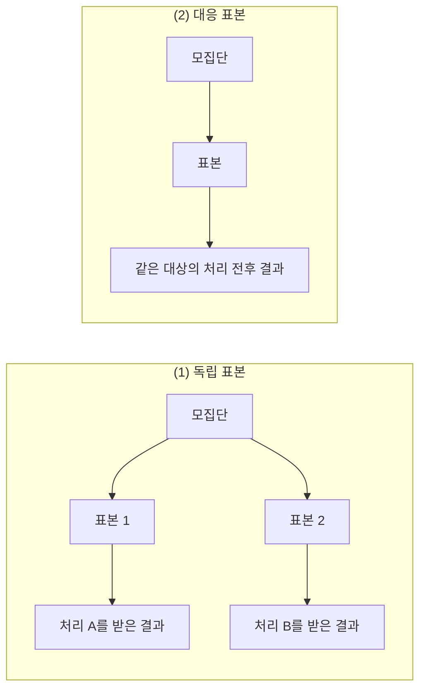
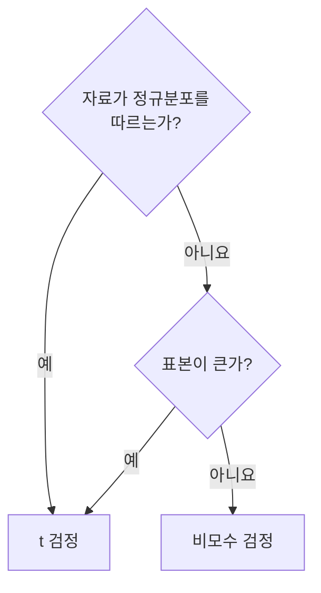
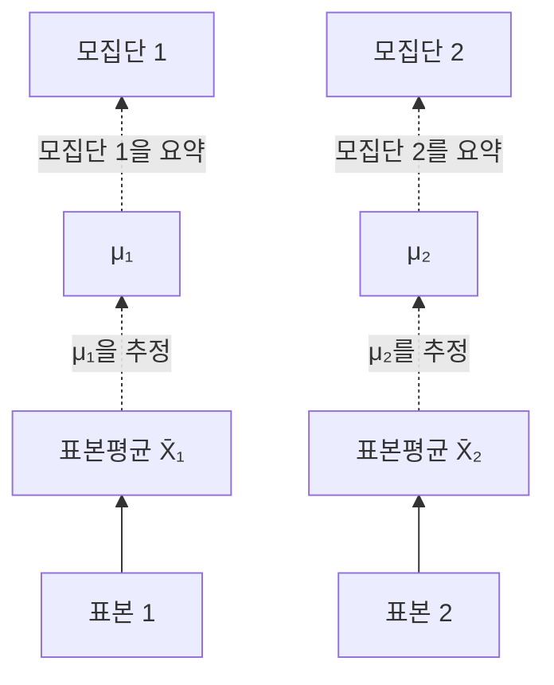
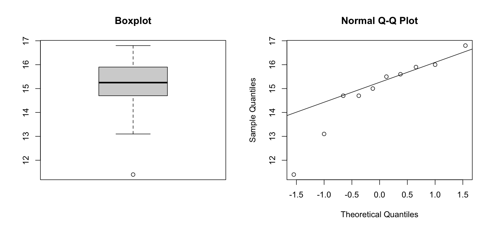
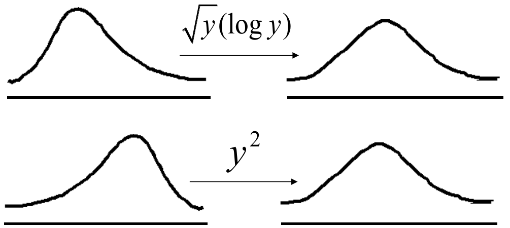
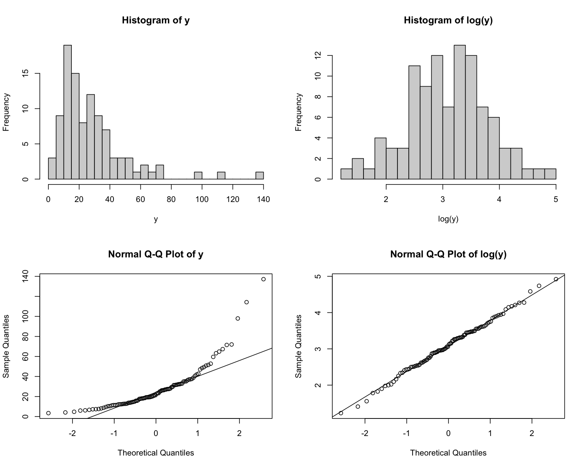
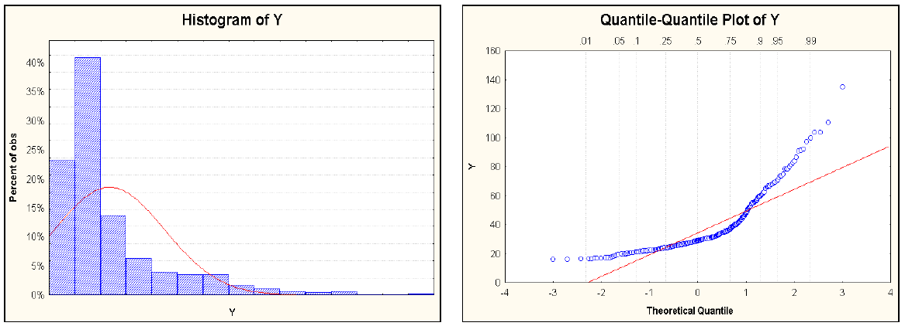
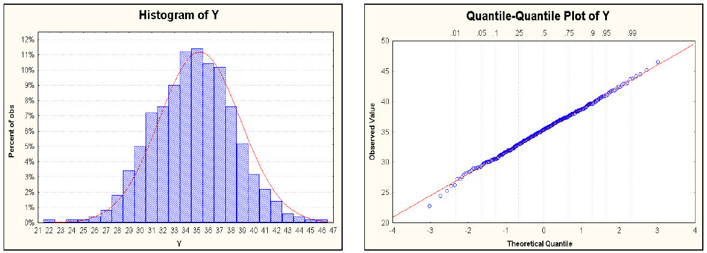

# 8강 — 비모수적 방법

[레포지토리 안내](../../README.ko.md) | [English](Concepts_Lecture.md) | [한국어](Concepts_Lecture.ko.md)

> **최종 수정일:** 2026-11-04

> **학습 목표:**
> 1. 독립 표본과 대응 표본의 자료 수집 방식을 구분하고, 정규성과 표본 크기에 따라 두 집단 비교의 검정 방법을 고를 수 있다
> 2. 2표본 t 검정과 대응표본 t 검정의 가정, 검정통계량, 판정 과정을 설명하고 R로 수행할 수 있다
> 3. 줄기잎 그림, 상자 그림, Q-Q 그림과 적합도 검정으로 정규성을 점검하고, 치우친 자료를 변환하여 정규분포에 가깝게 만들 수 있다
> 4. Wilcoxon 순위합 검정의 통계량 W를 계산하고, 정규 근사, 연속성 수정, 동점 처리를 적용하여 유의확률을 구할 수 있다
> 5. 정규 자료와 치우친 자료에서 t 검정과 Wilcoxon 검정의 성능(검정력)이 어떻게 다른지 설명할 수 있다

---

## 목차

- [1. 두 집단 비교의 개념](#1-두-집단-비교의-개념)
  - [1.1 가설검정의 기본 개념](#11-가설검정의-기본-개념)
  - [1.2 두 집단 비교의 목표](#12-두-집단-비교의-목표)
  - [1.3 자료 수집 방식: 독립 표본과 대응 표본](#13-자료-수집-방식-독립-표본과-대응-표본)
  - [1.4 검정 방법의 선택](#14-검정-방법의-선택)
- [2. 2표본 t 검정](#2-2표본-t-검정)
  - [2.1 기본 가정](#21-기본-가정)
  - [2.2 귀무가설과 검정통계량](#22-귀무가설과-검정통계량)
  - [2.3 모집단과 표본의 관계](#23-모집단과-표본의-관계)
  - [2.4 R 예제: 두 투여량 집단의 p24 수치](#24-r-예제-두-투여량-집단의-p24-수치)
  - [2.5 등분산 가정과 Welch t 검정](#25-등분산-가정과-welch-t-검정)
  - [2.6 대응표본 t 검정](#26-대응표본-t-검정)
- [3. 정규성 점검](#3-정규성-점검)
  - [3.1 그래프로 점검하기](#31-그래프로-점검하기)
  - [3.2 적합도 검정](#32-적합도-검정)
  - [3.3 정규분포를 따르지 않는 자료: 변환과 비모수 검정](#33-정규분포를-따르지-않는-자료-변환과-비모수-검정)
- [4. Wilcoxon 순위합 검정](#4-wilcoxon-순위합-검정)
  - [4.1 순위를 쓰는 이유와 가설](#41-순위를-쓰는-이유와-가설)
  - [4.2 검정통계량 W](#42-검정통계량-w)
  - [4.3 계산 예: 잡초와 옥수수 수확량](#43-계산-예-잡초와-옥수수-수확량)
  - [4.4 정확 분포와 R의 출력](#44-정확-분포와-r의-출력)
  - [4.5 한계: 연속성 수정과 동점](#45-한계-연속성-수정과-동점)
  - [4.6 대응 표본: Wilcoxon 부호순위 검정](#46-대응-표본-wilcoxon-부호순위-검정)
- [5. 성능 비교: Wilcoxon 검정과 t 검정](#5-성능-비교-wilcoxon-검정과-t-검정)
  - [5.1 치우친 자료에서의 비교](#51-치우친-자료에서의-비교)
  - [5.2 정규 자료에서의 비교](#52-정규-자료에서의-비교)
  - [5.3 모의실험으로 본 검정력](#53-모의실험으로-본-검정력)
- [개념 적용](#개념-적용)
- [요약](#요약)
- [점검 문제](#점검-문제)
- [참고 문헌](#참고-문헌)

---

<br>

## 1. 두 집단 비교의 개념

이 강의는 두 집단을 통계적으로 비교하는 방법을 다룬다. 모수적 방법인 t 검정의 가정을 정리하고, 그 가정 가운데 정규성을 점검하는 방법과 정규성이 성립하지 않을 때의 대안(변환, 비모수 검정)을 살펴본 뒤, 대표적인 비모수 검정인 Wilcoxon 순위합 검정을 계산하고 t 검정과 성능을 비교한다. 모수적 방법과 비모수적 방법의 구분은 7강 1.1절에서 정의하였다.

### 1.1 가설검정의 기본 개념

두 집단 비교는 6강의 가설검정 위에서 이루어진다. 이 강의에서 계속 쓰는 개념을 다시 정리하면 다음과 같다.

| 개념 | 뜻 |
|:-----|:-----|
| 귀무가설 $H_0$ | 차이가 없다는 기준 가설이다. 검정통계량의 분포(귀무분포)는 $H_0$가 참이라는 가정 아래에서 정해지므로, $H_0$는 관측 결과가 얼마나 드문지를 판단하는 기준이 된다 |
| 대립가설 $H_1$ | 연구자가 보이고 싶은 가설로, 차이가 있다는 내용이다 |
| 가설검정 | 표본 자료로 $H_0$를 기각할지 판단하는 절차이다 |
| 검정통계량 | 표본으로 계산하며, $H_0$ 아래에서의 분포를 알고 있어 관측값이 얼마나 극단적인지 판단할 수 있는 값이다 |
| 유의확률(p-value) | $H_0$가 참일 때 관측된 값만큼 또는 그보다 극단적인 검정통계량을 얻을 확률이다 |
| 유의수준 $\alpha$ | $H_0$가 참인데 기각하는 제1종 오류를 허용하는 최대 확률이며, 보통 0.05를 쓴다. 유의확률이 $\alpha$보다 작으면 $H_0$를 기각한다 |
| 검정력(power) | $H_1$이 참일 때 $H_0$를 올바르게 기각할 확률이다. 제2종 오류 확률을 $\beta$라 하면 검정력은 $1-\beta$이다 |

*표 1. 가설검정의 기본 개념*

**중심극한정리(central limit theorem)** 는 모집단의 분산이 유한하기만 하면 분포의 모양과 관계없이, 표본 크기 $n$이 클 때 독립인 관측값의 표본평균의 분포가 정규분포에 가까워진다는 정리이다(5강). 이 정리 덕분에 자료 자체가 정규분포를 따르지 않아도 표본이 크면 표본평균에 기초한 t 검정을 쓸 수 있다. 반대로 표본이 작고 자료가 정규분포에서 크게 벗어나면 t 검정의 유의확률을 믿기 어렵고, 이때 비모수 검정이 필요하다.

### 1.2 두 집단 비교의 목표

두 집단 비교의 목표는 특정한 두 집단 사이에서 모집단 평균과 변동성의 차이를 비교하는 것이다. 예를 들어 두 무리로 나누어 선 사람들의 키를 비교한다면, 두 무리의 평균 키가 다른지, 키의 퍼진 정도가 다른지를 묻는다. 관측할 수 있는 것은 각 집단에서 뽑은 표본뿐이므로, 표본에서 보인 차이가 우연히 생긴 것인지 모집단의 차이를 반영하는지를 가설검정으로 판단한다.

### 1.3 자료 수집 방식: 독립 표본과 대응 표본

두 집단의 자료는 다음 두 방식으로 모은다.



*그림 1. 독립 표본과 대응 표본의 자료 수집 방식*

1. **독립 표본(independent samples):** 두 처리 집단에서 서로 독립적으로 자료를 얻는다. 예를 들어 연구에 참여한 환자를 무작위로 두 집단으로 나누고, 집단마다 다른 치료법을 적용하여 결과를 비교한다. 한 집단의 측정값은 다른 집단의 측정값과 아무 관련이 없다.
2. **대응 표본(paired samples):** 같은 대상에서 두 처리의 자료를 짝지어 얻는다. 예를 들어 같은 암 환자에게 항암 치료를 하고 치료 전과 치료 후의 상태를 비교한다. 한 사람의 두 측정값은 같은 사람의 체질과 습관을 공유하므로 서로 관련되어 있다.

대응 표본에서는 사람마다 다른 기본 수준(체질, 나이 등)이 짝 안에서 상쇄되므로, 같은 수의 대상으로도 처리 효과를 더 정밀하게 추정할 수 있다. 그 대신 분석에서 짝지음을 반드시 반영해야 한다(2.6절).

### 1.4 검정 방법의 선택

두 집단 비교의 검정은 자료 수집 방식(독립인가 대응인가)과 정규성, 표본 크기로 고른다.



*그림 2. 정규성과 표본 크기에 따른 t 검정과 비모수 검정의 선택*

| 자료 수집 방식 | t 검정 (정규성 조건 또는 큰 표본) | 비모수 검정 (정규분포가 아니고 작은 표본) |
|:-----|:-----|:-----|
| 독립 | 2표본 t 검정 | Wilcoxon 순위합 검정<br>Mann-Whitney 검정<br>순열 검정 |
| 대응 | 대응표본 t 검정 | Wilcoxon 부호순위 검정<br>순열 검정 |

*표 2. 자료 수집 방식과 정규성에 따른 두 집단 비교의 검정*

자료가 정규분포를 따르면 t 검정을 쓴다. 정규분포를 따르지 않더라도 표본이 크면 중심극한정리에 따라 t 검정을 쓸 수 있다. 정규분포를 따르지 않고 표본도 작으면 비모수 검정을 쓴다. Wilcoxon 순위합 검정과 Mann-Whitney 검정은 통계량의 표현만 다르고 같은 결론을 주는 검정이며(4.4절), 순열 검정은 7강 3.4절에서 다루었다.

---

<br>

## 2. 2표본 t 검정

### 2.1 기본 가정

**2표본 t 검정(two-sample t-test)** 은 다음 네 가지를 가정한다.

1. **각 집단의 표본 크기가 충분히 크다.** 흔히 쓰는 기준은 $n_1 \ge 30$, $n_2 \ge 30$이다. 이 기준은 경험 법칙이며, 자료가 정규분포에 가까울수록 더 작은 표본으로도 충분하다.
2. **각 집단 안에서 비교하려는 연속형 변수가 정규분포를 따른다.** 다만 표본이 크면 중심극한정리에 따라 표본평균이 정규분포에 가까워지므로 이 가정이 반드시 필요하지는 않다.
3. **두 집단이 서로 독립이다.** 한 집단의 관측값은 다른 집단의 관측값과 관련이 없어야 하며, 각 집단 안의 관측값끼리도 독립이어야 한다.
4. **두 집단의 관심 변수가 같은 분산을 갖는다(등분산).** 분산이 다르다고 가정할 때(이분산, heteroscedasticity)는 다른 검정통계량을 쓴다(2.5절).

이 가정을 식으로 쓰면, 첫 번째 집단의 관측값 $x_i$와 두 번째 집단의 관측값 $y_i$가 다음 분포를 따르고 서로 독립이라는 것이다.

$$
x_i \sim N(\mu_1, \sigma^2), \qquad y_i \sim N(\mu_2, \sigma^2), \qquad \text{두 표본은 독립}
$$

두 분포는 평균 $\mu_1$, $\mu_2$만 다를 수 있고 분산 $\sigma^2$은 같다.

### 2.2 귀무가설과 검정통계량

귀무가설은 두 모평균이 같다는 것이다.

$$
H_0: \mu_1 = \mu_2 \qquad \text{vs} \qquad H_1: \mu_1 \ne \mu_2
$$

검정통계량은 두 표본평균의 차이를 그 표준오차로 나눈 값이다.

$$
t = \frac{\bar{X} - \bar{Y}}{s_p\sqrt{\dfrac{1}{n_1} + \dfrac{1}{n_2}}} \sim t_{n_1+n_2-2} \quad \text{under } H_0
$$

여기서 $\bar{X}$와 $\bar{Y}$는 두 집단의 표본평균이고, $s_p$는 **합동 표준편차(pooled standard deviation)** 이다. 두 집단의 분산이 같다고 가정하므로, 두 표본의 정보를 합쳐 공통 분산 $\sigma^2$을 추정한 **합동 분산(pooled variance)** 을 쓴다.

$$
s_p^2 = \frac{\sum_{i=1}^{n_1}(x_i-\bar{x})^2 + \sum_{j=1}^{n_2}(y_j-\bar{y})^2}{n_1+n_2-2} = \frac{(n_1-1)s_1^2 + (n_2-1)s_2^2}{n_1+n_2-2}
$$

분모가 $n_1+n_2-2$인 이유는 두 평균 $\bar{x}$, $\bar{y}$를 추정하느라 자유도를 2만큼 잃었기 때문이며, 이 값이 t 분포의 자유도가 된다. $s_1^2$, $s_2^2$은 두 표본의 표본분산이다.

**판정:** 계산한 t 통계량과 자유도 $n_1+n_2-2$인 t 분포로 유의확률을 구한다. 유의확률이 미리 정한 유의수준보다 작으면 귀무가설을 기각하고 대립가설을 택한다. 같은 판정을 기각역으로 하면, 양측 검정에서 $\vert t \vert > t_{\alpha/2,\, n_1+n_2-2}$일 때 기각한다.

### 2.3 모집단과 표본의 관계



*그림 3. 표본평균이 모평균을 추정하고 모평균이 모집단을 요약하는 관계*

검정이 알고 싶은 것은 모집단의 성질이다. 모평균 $\mu_1$, $\mu_2$는 각 모집단을 요약하지만 알 수 없는 값이고, 관측할 수 있는 것은 표본에서 계산한 표본평균 $\bar{X}_1$, $\bar{X}_2$뿐이다. 표본평균은 모평균에 관한 정보를 주지만 표본마다 달라지므로, 2표본 t 검정은 두 표본평균의 차이가 표본추출의 우연만으로 생기기 어려울 만큼 큰지를 따져 $\mu_1 \ne \mu_2$를 판단한다.

### 2.4 R 예제: 두 투여량 집단의 p24 수치

다음 자료는 두 투여량(300 mg, 600 mg) 집단에서 각 10명의 p24 수치를 측정한 것이다. p24는 HIV(인간 면역결핍 바이러스)를 이루는 단백질의 하나로, 혈액 속 p24 항원의 양은 HIV 감염의 지표로 쓰인다.

| 투여량 | p24 수치 |
|:-----|:-----|
| 300 mg | 284, 279, 289, 292, 287, 295, 285, 279, 306, 298 |
| 600 mg | 298, 307, 297, 279, 291, 335, 299, 300, 306, 291 |

*표 3. 두 투여량 집단의 p24 수치*

```r
x <- c(284, 279, 289, 292, 287, 295, 285, 279, 306, 298)   # 300 mg 집단
y <- c(298, 307, 297, 279, 291, 335, 299, 300, 306, 291)   # 600 mg 집단
t.test(x, y, var.equal = T)                                # 등분산을 가정한 2표본 t 검정
```

```text
	Two Sample t-test

data:  x and y
t = -2.034, df = 18, p-value = 0.05696
alternative hypothesis: true difference in means is not equal to 0
95 percent confidence interval:
 -22.1584072   0.3584072
sample estimates:
mean of x mean of y 
    289.4     300.3 
```

`c()`는 값들을 묶어 벡터를 만들고, `t.test()`의 `var.equal = T`는 두 집단의 분산이 같다고 가정하라는 지시이다(`T`는 `TRUE`의 약자이다). 출력의 각 값을 손으로 계산하면 다음과 같다.

| 단계 | 계산 | 값 |
|:-----|:-----|:-----|
| 표본평균 | $\bar{x} = 2894/10$, $\bar{y} = 3003/10$ | 289.4, 300.3 |
| 편차제곱합 | $\sum(x_i-\bar{x})^2$, $\sum(y_j-\bar{y})^2$ | 658.4, 1926.1 |
| 합동 분산 | $s_p^2 = (658.4 + 1926.1)/18$ | 143.583 |
| 합동 표준편차 | $s_p = \sqrt{143.583}$ | 11.983 |
| 표준오차 | $s_p\sqrt{1/10 + 1/10} = 11.983 \times 0.4472$ | 5.359 |
| 검정통계량 | $t = (289.4 - 300.3)/5.359$ | -2.034 |
| 자유도 | $n_1 + n_2 - 2$ | 18 |
| 양측 유의확률 | $2P(T_{18} \le -2.034)$ | 0.05696 |

*표 4. p24 자료에 대한 2표본 t 검정의 단계별 계산*

같은 계산을 R로 직접 하면 다음과 같다. `pt(q, df)`는 자유도 `df`인 t 분포의 누적분포함수 값 $P(T \le q)$이다.

```r
n1 <- length(x); n2 <- length(y)                                    # 표본 크기
sp <- sqrt(((n1 - 1) * var(x) + (n2 - 1) * var(y)) / (n1 + n2 - 2)) # 합동 표준편차
t_stat <- (mean(x) - mean(y)) / (sp * sqrt(1 / n1 + 1 / n2))        # t 통계량
p_value <- 2 * pt(-abs(t_stat), df = n1 + n2 - 2)                   # 양측 p-value
c(sp = sp, t = t_stat, p = p_value)
```

```text
        sp          t          p 
11.9826263 -2.0340400  0.0569558 
```

유의확률 0.05696이 유의수준 0.05보다 조금 크므로 유의수준 0.05에서 귀무가설을 기각하지 못한다. 자유도 18인 t 분포의 양측 5% 기각값이 $t_{0.025, 18} = 2.101$이고 $\vert -2.034 \vert < 2.101$이라는 것과 같은 판정이다. 평균 차이 $\mu_1 - \mu_2$의 95% 신뢰구간 $-10.9 \pm 2.101 \times 5.359 = (-22.16, 0.36)$이 0을 포함하는 것도 같은 결론을 가리킨다. 600 mg 집단의 평균이 10.9 높지만, 이 표본 크기와 변동에서는 우연으로 설명할 수 있는 차이이다.

### 2.5 등분산 가정과 Welch t 검정

두 집단의 분산이 같지 않으면 합동 분산이 의미를 잃으므로, 두 표본분산을 따로 쓰는 **Welch t 검정**을 쓴다 [1].

$$
t = \frac{\bar{X} - \bar{Y}}{\sqrt{\dfrac{s_1^2}{n_1} + \dfrac{s_2^2}{n_2}}}, \qquad \nu = \frac{\left(\dfrac{s_1^2}{n_1} + \dfrac{s_2^2}{n_2}\right)^2}{\dfrac{(s_1^2/n_1)^2}{n_1-1} + \dfrac{(s_2^2/n_2)^2}{n_2-1}}
$$

귀무가설 아래에서 이 통계량은 근사적으로 자유도 $\nu$인 t 분포를 따르며, $\nu$는 보통 정수가 아니다. 다음 코드는 분산이 같은지를 F 검정으로 확인하고 Welch t 검정을 수행한다. `t.test()`에서 `var.equal`을 지정하지 않으면 Welch t 검정이 기본이다.

```r
var.test(x, y)   # 두 분산의 비가 1이라는 귀무가설의 F 검정
t.test(x, y)     # Welch t 검정
```

```text
	F test to compare two variances

data:  x and y
F = 0.34183, num df = 9, denom df = 9, p-value = 0.1256
alternative hypothesis: true ratio of variances is not equal to 1
95 percent confidence interval:
 0.0849059 1.3762082
sample estimates:
ratio of variances 
         0.3418306 


	Welch Two Sample t-test

data:  x and y
t = -2.034, df = 14.509, p-value = 0.06065
alternative hypothesis: true difference in means is not equal to 0
95 percent confidence interval:
 -22.3557409   0.5557409
sample estimates:
mean of x mean of y 
    289.4     300.3 
```

- F 검정의 통계량은 두 표본분산의 비 $s_1^2/s_2^2 = 73.156/214.011 = 0.342$이고 유의확률이 0.1256이므로 등분산 가정을 기각할 근거가 없다.
- Welch t 검정의 t 값은 -2.034로 Student t 검정과 같다. 두 표본 크기가 같으면($n_1 = n_2 = n$) $s_p^2(2/n) = (s_1^2 + s_2^2)/n$이 되어 두 표준오차가 일치하기 때문이다. 자유도만 $\nu = 14.509$로 줄어 유의확률이 0.06065로 조금 커진다.

> **주의:** F 검정으로 등분산을 먼저 확인하고 그 결과에 따라 t 검정을 고르는 2단계 절차는 전체 제1종 오류를 정확히 통제하지 못한다. 또한 F 검정 자체가 정규성에 매우 민감하다. 그래서 등분산이 확실하지 않으면 처음부터 Welch t 검정을 쓰는 것이 일반적인 권고이다.

### 2.6 대응표본 t 검정

한 대상에서 두 값 $x$와 $y$를 짝지어 관측하면 **대응표본 t 검정(paired t-test)** 을 쓴다. 자료는 다음과 같은 쌍의 모임이며, 분석은 각 쌍의 차이 $d_i$로 한다.

| 쌍 | 관측값 | 차이 |
|:-----|:-----|:-----|
| 1 | $(x_1, y_1)$ | $d_1 = x_1 - y_1$ |
| 2 | $(x_2, y_2)$ | $d_2 = x_2 - y_2$ |
| $\vdots$ | $\vdots$ | $\vdots$ |
| $n$ | $(x_n, y_n)$ | $d_n = x_n - y_n$ |

*표 5. 대응 표본의 자료 구조*

같은 대상의 $x_i$와 $y_i$는 독립이 아니지만, 서로 다른 대상의 관측값($x_i$와 $x_k$)은 독립이어야 한다. 가정과 검정은 다음과 같다.

- 차이가 서로 독립이고 같은 정규분포를 따른다: $d_i \stackrel{\text{iid}}{\sim} N(\mu_d, \sigma^2)$. iid는 **독립 동일 분포(independent and identically distributed)** 의 약자이다. 쌍의 수가 크면($n > 30$) 중심극한정리에 따라 차이의 정규성이 덜 중요해진다.
- 귀무가설은 $H_0: \mu_d = 0$이며, 이는 $\mu_1 = \mu_2$와 같다.
- 검정통계량은 차이의 평균 $\bar{d}$를 차이의 표준편차 $s_d$로 만든 표준오차로 나눈 것이다.

$$
t = \frac{\bar{d}}{s_d/\sqrt{n}} \sim t_{n-1} \quad \text{under } H_0
$$

대응표본 t 검정은 차이 $d_i$에 대한 일표본 t 검정과 같다. R의 `sleep` 자료는 환자 10명에게 두 수면제를 각각 투여하고 늘어난 수면 시간(`extra`, 시간)을 측정한 것으로, Student가 t 분포를 소개한 논문에서 쓴 자료이다 [2]. 같은 환자가 두 약을 모두 복용했으므로 대응 표본이다.

```r
drug1 <- sleep$extra[sleep$group == 1]       # 약 1에서 늘어난 수면 시간
drug2 <- sleep$extra[sleep$group == 2]       # 같은 환자의 약 2 결과
d <- drug1 - drug2                           # 환자별 차이
d
t.test(drug1, drug2, paired = TRUE)          # 대응표본 t 검정
t.test(drug1, drug2, var.equal = TRUE)$p.value  # 짝을 무시했을 때의 p-value
```

```text
 [1] -1.2 -2.4 -1.3 -1.3  0.0 -1.0 -1.8 -0.8 -4.6 -1.4

	Paired t-test

data:  drug1 and drug2
t = -4.0621, df = 9, p-value = 0.002833
alternative hypothesis: true mean difference is not equal to 0
95 percent confidence interval:
 -2.4598858 -0.7001142
sample estimates:
mean difference 
          -1.58 

[1] 0.07918671
```

차이의 평균은 $\bar{d} = -1.58$, 표준편차는 $s_d = 1.230$이므로 $t = -1.58/(1.230/\sqrt{10}) = -1.58/0.389 \approx -4.062$이고, 자유도 9인 t 분포에서 유의확률은 0.0028이다. 약 2가 약 1보다 수면 시간을 평균 1.58시간 더 늘린다고 결론짓는다.

같은 자료를 짝을 무시하고 독립 2표본 t 검정으로 분석하면 유의확률이 0.079로 커져 유의하지 않다. 환자마다 다른 기본 수면 습관이 두 집단의 분산에 섞여 표준오차를 키우기 때문이다. 대응표본 t 검정은 환자 안의 차이만 보므로 이 변동이 사라진다. 따라서 대응 자료에는 반드시 대응 분석을 써야 한다. 이 자료의 차이가 정규분포를 따르는지는 4.6절에서 다시 점검한다.

---

<br>

## 3. 정규성 점검

t 검정은 정규성을 가정하므로, 특히 표본이 작을 때는 자료가 정규분포를 따르는지 먼저 점검한다. 대표적인 방법은 그래프와 적합도 검정이다.

### 3.1 그래프로 점검하기

정규성을 점검하는 대표적인 그래프는 세 가지이다.

- **줄기잎 그림(stem-and-leaf plot):** 각 값을 줄기(앞자리)와 잎(다음 자리)으로 나누어 늘어놓은 그림으로, 분포가 대칭인지 확인한다.
- **상자 그림(box plot):** 사분위수와 이상값을 보여 주는 그림으로, 중앙값이 상자의 가운데에 있는지, 수염의 길이가 비슷한지, 이상값이 있는지로 대칭성을 확인한다.
- **Q-Q 그림(quantile-quantile plot):** 표본의 분위수와 정규분포의 이론 분위수를 짝지어 찍은 그림이다. 자료가 정규분포를 따르면 점들이 직선 위에 놓인다.

다음 코드는 10개의 관측값 `ex4`에 세 그래프를 그린다.

```r
ex4 <- c(11.4, 13.1, 14.7, 14.7, 15.0, 15.5, 15.6, 15.9, 16.0, 16.8)
stem(ex4)                          # 줄기잎 그림
boxplot(ex4, main = "Boxplot")     # 상자 그림
qqnorm(ex4); qqline(ex4)           # 정규 Q-Q 그림과 기준선
```

```text
  The decimal point is at the |

  10 | 4
  12 | 1
  14 | 770569
  16 | 08
```



*그림 4. ex4 자료의 상자 그림과 정규 Q-Q 그림*

**줄기잎 그림 읽기.** "The decimal point is at the |"는 줄기와 잎 사이에 소수점이 있다는 뜻이다. 이 그림에서 줄기는 2씩 증가하므로, 줄기 14에는 14.0 이상 16.0 미만의 값이 놓이고 잎은 소수 첫째 자리이다. 줄기 14의 잎 7, 7, 0, 5, 6, 9는 14.7, 14.7, 15.0, 15.5, 15.6, 15.9이다. 같은 이유로 줄기 10의 잎 4는 11.4, 줄기 12의 잎 1은 13.1이다. 값들이 큰 쪽(14\~16)에 몰려 있고 작은 쪽으로 꼬리가 길게 늘어져 있어 대칭이 아니다.

**상자 그림 읽기.** R의 상자 그림에서 상자의 아래와 위는 하위 절반과 상위 절반의 중앙값인 14.7과 15.9이고, 상자 안의 굵은 선은 중앙값 $(15.0 + 15.5)/2 = 15.25$이다. 상자의 길이(사분위범위)는 $15.9 - 14.7 = 1.2$이며, 상자에서 $1.5 \times 1.2 = 1.8$ 넘게 떨어진 값(12.9 미만이나 17.7 초과)을 이상값으로 표시한다. 그래서 11.4는 점으로 따로 표시되고 아래 수염은 그 범위 안의 최솟값 13.1까지 뻗는다. 아래 수염이 위 수염보다 길고 아래쪽에 이상값이 있어 왼쪽으로 치우친 분포이다.

**Q-Q 그림 읽기.** $n$개의 값을 크기순으로 정렬한 $i$번째 값을, 표준정규분포에서 비슷한 위치에 있는 분위수와 짝짓는다. R의 `qqnorm()`은 $n \le 10$일 때 $\Phi^{-1}\{(i - 3/8)/(n + 1/4)\}$를 이론 분위수로 쓰며, 이 자료에서는 -1.547, -1.000, -0.655, -0.375, -0.123, 0.123, 0.375, 0.655, 1.000, 1.547이다. `qqline()`은 표본과 이론 분포의 제1사분위수와 제3사분위수를 잇는 기준선이다. 가운데 점들은 직선 근처에 있지만, 가장 작은 두 값(11.4, 13.1)이 직선보다 한참 아래에 있다. 정규분포에서 기대되는 것보다 작은 값이 더 작다는 뜻이며, 왼쪽 꼬리가 긴 분포임을 보여 준다.

> **참고:** Q-Q 그림에서 점들이 직선에서 벗어나는 모양으로 분포의 특징을 읽을 수 있다. 양 끝이 모두 직선보다 바깥으로(왼쪽 끝은 아래로, 오른쪽 끝은 위로) 벗어나면 정규분포보다 꼬리가 두껍고, 점들이 아래로 볼록한 곡선을 이루면 오른쪽으로 치우친 분포, 위로 볼록한 곡선을 이루면 왼쪽으로 치우친 분포이다.

### 3.2 적합도 검정

**적합도 검정(goodness-of-fit test)** 은 자료가 특정한 분포를 따르는지 검정한다. 정규성 검정의 귀무가설 $H_0$는 자료가 정규분포를 따른다는 것이고, 유의확률이 작으면 정규성을 기각한다. 대표적인 검정은 다음과 같다.

| 검정 | 원리 |
|:-----|:-----|
| Kolmogorov-Smirnov 검정 | 표본의 경험적 누적분포함수와 정규분포의 누적분포함수 사이의 최대 거리 $D$를 통계량으로 쓴다 |
| Shapiro-Wilk 검정 | 정렬한 표본이 정규분포의 기대 순서통계량과 얼마나 직선 관계에 있는지를 통계량 $W$(1에 가까울수록 정규)로 측정한다. 정규성 검정 가운데 검정력이 높은 편이다 [3] |
| Pearson 카이제곱 검정 | 자료를 구간으로 나누어 각 구간의 관측도수와 정규분포에서의 기대도수를 비교한다 |
| Anderson-Darling 검정 | 누적분포함수의 차이를 분포의 꼬리에 더 큰 가중치를 두어 합한다 [4] |

*표 6. 대표적인 정규성 적합도 검정*

```r
shapiro.test(ex4)                                         # Shapiro-Wilk 검정
ks.test(ex4, "pnorm", mean = mean(ex4), sd = sd(ex4))     # Kolmogorov-Smirnov 검정
```

```text
	Shapiro-Wilk normality test

data:  ex4
W = 0.8863, p-value = 0.154


	Asymptotic one-sample Kolmogorov-Smirnov test

data:  ex4
D = 0.25694, p-value = 0.5239
alternative hypothesis: two-sided

Warning message:
In ks.test.default(ex4, "pnorm", mean = mean(ex4), sd = sd(ex4)) :
  ties should not be present for the one-sample Kolmogorov-Smirnov test
```

두 검정 모두 유의확률이 0.05보다 커서 정규성을 기각하지 못한다. 그러나 3.1절의 그래프는 왼쪽으로 치우친 모양을 보였다. 관측값이 10개뿐이어서 적합도 검정의 검정력이 낮기 때문이다. Kolmogorov-Smirnov 검정의 경고는 14.7이 두 번 나와, 연속 분포에서는 일어날 확률이 0인 동점이 있다는 뜻이다.

> **주의:** 적합도 검정의 결과는 다음 세 가지에 유의하여 해석한다.
> - 정규성을 기각하지 못한 것은 자료가 정규분포를 따른다는 증명이 아니다. 표본이 작으면 정규분포에서 꽤 벗어나도 기각하지 못한다.
> - 반대로 표본이 매우 크면 실제로는 문제가 되지 않을 만큼 작은 이탈도 기각한다. 큰 표본에서는 중심극한정리 덕분에 t 검정이 이런 이탈에 영향을 거의 받지 않는다.
> - 위 코드처럼 평균과 표준편차를 자료에서 추정하여 Kolmogorov-Smirnov 검정에 넣으면 유의확률이 지나치게 커진다. 이 경우에는 보정한 Lilliefors 검정을 쓴다 [5]. R에서는 `nortest` 패키지의 `lillie.test()`가 Lilliefors 검정을, `ad.test()`가 Anderson-Darling 검정을 제공한다.
>
> 따라서 정규성 점검은 그래프와 검정을 함께 보고, 표본 크기를 고려하여 판단한다.

### 3.3 정규분포를 따르지 않는 자료: 변환과 비모수 검정

정규분포를 따르지 않는 자료에는 두 가지 대안이 있다. 하나는 자료를 **변환(transformation)** 하여 정규분포에 가깝게 만든 뒤 모수적 방법을 쓰는 것이고, 다른 하나는 정규성을 가정하지 않는 **비모수 검정**을 쓰는 것이다(4절).



*그림 5. 오른쪽으로 치우친 분포는 제곱근이나 로그 변환으로, 왼쪽으로 치우친 분포는 제곱 변환으로 대칭에 가깝게 만드는 모습*

- **오른쪽으로 치우친 분포**(오른쪽 꼬리가 긴 분포, 소득이나 농도처럼 0보다 큰 값에 흔하다)에는 $\sqrt{y}$나 $\log y$를 쓴다. 두 함수는 큰 값을 작은 값보다 더 많이 줄이므로 긴 오른쪽 꼬리를 끌어당긴다. 로그가 제곱근보다 더 강하게 줄인다.
- **왼쪽으로 치우친 분포**(왼쪽 꼬리가 긴 분포)에는 $y^2$을 쓴다. 제곱은 큰 값을 더 많이 늘리므로 몰려 있던 큰 값들을 펼쳐 대칭에 가깝게 만든다.

이런 거듭제곱 변환을 한 가족으로 묶어 자료에서 가장 알맞은 지수를 추정하는 방법이 Box-Cox 변환이다 [6]. 다음 코드는 오른쪽으로 치우친 로그정규분포 난수 100개를 만들고 변환 전후의 정규성을 Shapiro-Wilk 검정으로 비교한다. `rlnorm()`은 로그를 취하면 정규분포가 되는 로그정규분포의 난수를 만들고, `$p.value`는 검정 결과에서 유의확률만 꺼낸다.

```r
set.seed(1)                                   # 재현을 위해 난수 시드를 고정한다
y <- rlnorm(100, meanlog = 3, sdlog = 0.8)    # 오른쪽으로 치우친 자료
summary(y)
shapiro.test(y)$p.value                       # 원자료
shapiro.test(sqrt(y))$p.value                 # 제곱근 변환
shapiro.test(log(y))$p.value                  # 로그 변환
```

```text
   Min. 1st Qu.  Median    Mean 3rd Qu.    Max. 
  3.415  13.529  22.013  28.178  34.926 137.180 
[1] 1.384291e-10
[1] 0.0002422931
[1] 0.9876221
```



*그림 6. 로그정규 자료의 변환 전후 히스토그램과 정규 Q-Q 그림*

원자료는 평균(28.2)이 중앙값(22.0)보다 크고 최댓값이 137로 오른쪽 꼬리가 길며, Shapiro-Wilk 검정의 유의확률이 $1.4 \times 10^{-10}$으로 정규성이 강하게 기각된다. 그림 6의 왼쪽 Q-Q 그림에서도 점들이 아래로 볼록한 곡선을 이룬다. 제곱근 변환은 치우침을 줄이지만 유의확률이 0.00024로 아직 부족하고, 로그 변환 후에는 유의확률이 0.988이며 히스토그램이 종 모양, Q-Q 그림이 직선이 된다.

> **주의:** 변환을 쓸 때는 다음을 확인한다. 로그와 제곱근은 0 이하의 값에 정의되지 않으므로 0이 있는 자료에는 $\log(y + 1)$처럼 상수를 더한다. 또한 변환한 척도에서 한 검정은 원래 척도의 평균에 관한 검정이 아니다. 예를 들어 $\log y$의 평균을 비교하는 것은 원래 척도에서 기하평균(또는 비율)을 비교하는 것이다. 결과는 어느 척도에서 비교했는지 밝혀 보고한다.

---

<br>

## 4. Wilcoxon 순위합 검정

### 4.1 순위를 쓰는 이유와 가설

**Wilcoxon 순위합 검정(Wilcoxon rank-sum test)** 은 표본이 작거나 정규성이 의심되는 두 독립 표본을 비교하는 비모수 검정이다 [7]. 핵심 아이디어는 관측값 대신 **순위(rank)** 를 쓰는 것이다. 두 표본을 합쳐 가장 작은 값에 1, 그다음에 2, ..., 가장 큰 값에 $N$을 준다. 두 집단의 분포가 같다면 어느 집단의 관측값이든 어떤 순위를 받을 가능성이 같으므로, 한 집단이 받은 순위들은 1부터 $N$까지에서 무작위로 고른 것처럼 보여야 한다. 한 집단이 큰 순위를 몰아서 받으면 그 집단의 값이 체계적으로 크다는 증거가 된다.

순위는 값의 크기 순서만 남기므로, 아무리 큰 이상값도 순위 $N$보다 큰 영향을 주지 못한다. 그래서 이상값과 치우친 분포의 영향을 적게 받으며(robust), 검정이 분포의 정규성에 의존하지 않는다.

- **귀무가설 $H_0$:** 두 모집단의 분포가 같다.
- **대립가설 $H_1$:** 한 모집단의 값이 다른 모집단의 값보다 체계적으로 크다(또는 작다, 양측이면 다르다).
- **가정:** 두 표본은 서로 독립이고 각 표본 안의 관측도 독립이며, 분포는 연속형이다. 두 분포의 모양이 같고 위치만 다르다고 가정하면 결과를 중앙값의 차이로 해석할 수 있다.

같은 검정을 Mann과 Whitney가 다른 통계량으로 정리하여 **Mann-Whitney U 검정**이라고도 한다 [8].

### 4.2 검정통계량 W

두 표본의 크기를 $n_1$, $n_2$, 전체 크기를 $N = n_1 + n_2$라 하자. 첫 번째 표본(크기 $n_1$)의 관측값들이 합친 표본에서 받은 순위를 $R_1, \ldots, R_{n_1}$이라 하면 검정통계량은 그 순위의 합이다.

$$
W = \sum_{j=1}^{n_1} R_j
$$

귀무가설 아래에서 $W$의 평균과 표준편차는 다음과 같다.

$$
\mu_W = \frac{n_1(N+1)}{2}, \qquad \sigma_W = \sqrt{\frac{n_1 n_2 (N+1)}{12}}
$$

평균은 다음과 같이 이해할 수 있다. 순위 1부터 $N$까지의 평균은 $(N+1)/2$이고, 귀무가설 아래에서 첫 번째 표본의 각 관측값은 평균적으로 이 순위를 받으므로 $n_1$개의 순위합의 기댓값은 $n_1(N+1)/2$이다. 표준편차는 1부터 $N$까지의 순위에서 $n_1$개를 비복원으로 뽑을 때의 합의 표준편차이다.

표본이 커지면 $W$의 분포는 정규분포에 가까워지므로, 다음과 같이 표준화한 $z$를 표준정규분포로 판정한다.

$$
z = \frac{W - \mu_W}{\sigma_W} = \frac{W - n_1(N+1)/2}{\sqrt{n_1 n_2 (N+1)/12}}
$$

식은 복잡해 보이지만 계산은 순위 매기기, 한 집단의 순위 더하기, 표준화하기의 세 단계뿐이다.

### 4.3 계산 예: 잡초와 옥수수 수확량

잡초가 조금만 있어도 옥수수 수확량이 줄어드는지 알아보려고, 옥수수를 같은 밀도로 심은 작은 밭 8개 가운데 무작위로 고른 4개는 잡초를 모두 뽑고, 나머지 4개는 1미터당 명아주(lamb's-quarter) 3포기를 남겼다 [9].

| 처리 | 수확량 |
|:-----|:-----|
| 1미터당 잡초 0포기 | 166.7, 172.2, 165.0, 176.9 |
| 1미터당 잡초 3포기 | 158.6, 176.4, 153.1, 156.0 |

*표 7. 잡초 처리에 따른 옥수수 수확량*

두 집단 각 4개, 모두 8개의 관측값을 합쳐 작은 값부터 순위를 매긴다.

| 수확량 | 153.1 | 156.0 | 158.6 | 165.0 | 166.7 | 172.2 | 176.4 | 176.9 |
|:-----|:-----:|:-----:|:-----:|:-----:|:-----:|:-----:|:-----:|:-----:|
| 집단 | 잡초 | 잡초 | 잡초 | 무잡초 | 무잡초 | 무잡초 | 잡초 | 무잡초 |
| 순위 | 1 | 2 | 3 | 4 | 5 | 6 | 7 | 8 |

*표 8. 합친 표본의 수확량과 순위*

두 처리의 순위합은 다음과 같다.

| 처리 | 순위합 |
|:-----|:-----:|
| 잡초 없음 | $4 + 5 + 6 + 8 = 23$ |
| 잡초 있음 | $1 + 2 + 3 + 7 = 13$ |

*표 9. 처리별 순위합*

두 순위합의 합은 $23 + 13 = 36 = 8 \times 9 / 2$로 1부터 8까지의 합과 같다. 이제 다음 가설을 검정한다.

- $H_0$: 두 처리의 수확량 분포에 차이가 없다.
- $H_1$: 잡초가 없는 밭의 수확량이 체계적으로 높다(단측).

$N = 8$, $n_1 = 4$(잡초 없음), $n_2 = 4$(잡초 있음)이고, 검정통계량은 잡초 없는 밭의 순위합 $W = 23$이다.

$$
\mu_W = \frac{n_1(N+1)}{2} = \frac{4 \times 9}{2} = 18, \qquad \sigma_W = \sqrt{\frac{n_1 n_2 (N+1)}{12}} = \sqrt{\frac{4 \times 4 \times 9}{12}} = \sqrt{12} = 3.464
$$

$$
z = \frac{W - \mu_W}{\sigma_W} = \frac{23 - 18}{3.464} = 1.44, \qquad \text{p-value} = P(Z \ge 1.44) = 0.0749
$$

대립가설이 단측(잡초 없는 쪽이 더 큼)이므로 표준정규분포의 오른쪽 꼬리 확률이 유의확률이다. 유의확률 0.0749가 0.05보다 크므로 유의수준 0.05에서 귀무가설을 기각하지 못한다. 잡초 없는 밭의 수확량이 더 높은 경향은 보이지만, 밭 8개로는 우연과 구별하기에 증거가 부족하다.

같은 계산을 R로 하면 다음과 같다. `rank()`는 각 값의 순위를 돌려준다.

```r
no_weeds    <- c(166.7, 172.2, 165.0, 176.9)
three_weeds <- c(158.6, 176.4, 153.1, 156.0)
r <- rank(c(no_weeds, three_weeds))           # 합친 표본에서의 순위
r
W <- sum(r[1:4])                              # 잡초 없는 밭의 순위합
n1 <- 4; n2 <- 4; N <- n1 + n2
mu_W <- n1 * (N + 1) / 2
sigma_W <- sqrt(n1 * n2 * (N + 1) / 12)
z <- (W - mu_W) / sigma_W
c(W = W, mu_W = mu_W, sigma_W = sigma_W, z = z, p = 1 - pnorm(z))
```

```text
[1] 5 6 4 8 3 7 1 2
          W        mu_W     sigma_W           z           p 
23.00000000 18.00000000  3.46410162  1.44337567  0.07445734 
```

$z$를 반올림하지 않으면 1.4434이고 유의확률은 0.0745이다. 손 계산의 0.0749는 $z$를 1.44로 반올림하여 생긴 차이이다.

### 4.4 정확 분포와 R의 출력

표본이 작으면 정규 근사 대신 $W$의 **정확 분포(exact distribution)** 를 쓸 수 있다. 귀무가설 아래에서는 순위 1\~8 가운데 어느 4개가 잡초 없는 밭에 돌아갈지가 모두 같은 확률이므로, 가능한 $\binom{8}{4} = 70$가지 순위 조합의 합을 모두 세어 정확한 유의확률을 구한다.

```r
rank_sums <- colSums(combn(8, 4))   # 1~8에서 4개를 고르는 70가지 조합의 순위합
length(rank_sums)
sum(rank_sums >= 23)                # 순위합이 23 이상인 조합의 수
mean(rank_sums >= 23)               # 정확한 단측 p-value
```

```text
[1] 70
[1] 7
[1] 0.1
```

70가지 가운데 순위합이 23 이상인 조합이 7가지이므로 정확한 유의확률은 $7/70 = 0.1$이다. `combn(8, 4)`는 1부터 8까지에서 4개를 고르는 모든 조합을 열로 나열한 행렬이고, `colSums()`는 각 열의 합이다. R의 `wilcox.test()`는 표본이 작고 동점이 없으면 이 정확 분포를 쓴다.

```r
wilcox.test(no_weeds, three_weeds, alternative = "greater")      # 정확 검정
wilcox.test(no_weeds, three_weeds, alternative = "greater",
            exact = FALSE, correct = FALSE)$p.value              # 정규 근사
wilcox.test(no_weeds, three_weeds, alternative = "greater",
            exact = FALSE, correct = TRUE)$p.value               # 정규 근사와 연속성 수정
```

```text
	Wilcoxon rank sum exact test

data:  no_weeds and three_weeds
W = 13, p-value = 0.1
alternative hypothesis: true location shift is greater than 0

[1] 0.07445734
[1] 0.09696543
```

R이 보고하는 `W = 13`은 순위합 23이 아니라 **Mann-Whitney 통계량** $U$이다. $U$는 순위합에서 첫 번째 표본이 가질 수 있는 최소 순위합 $n_1(n_1+1)/2 = 10$을 뺀 값 $23 - 10 = 13$이며, 두 집단에서 하나씩 뽑은 $4 \times 4 = 16$개의 쌍 가운데 잡초 없는 밭의 수확량이 더 큰 쌍의 수와 같다. 예를 들어 176.9는 잡초 있는 밭 4개보다 모두 크므로 4쌍, 166.7, 172.2, 165.0은 176.4를 제외한 3개보다 크므로 각각 3쌍이어서 $4 + 3 + 3 + 3 = 13$이다. $W$와 $U$는 상수만큼 차이 나므로 같은 유의확률을 준다. 출력의 세 유의확률은 정확 검정 0.1, 정규 근사 0.0745, 연속성 수정을 한 정규 근사 0.0970이다.

### 4.5 한계: 연속성 수정과 동점

Wilcoxon 순위합 검정에는 다음 두 가지 문제가 있다.

**연속성 수정(continuity correction).** $W$는 정수 값만 갖는 이산형 통계량인데 연속형인 정규분포로 근사하므로 오차가 생긴다. 연속성 수정은 정수 23이 22.5부터 23.5까지의 구간을 차지한다고 보고, $P(W \ge 23)$을 $P(W \ge 22.5)$로 계산한다 [9].

$$
z = \frac{22.5 - 18}{3.464} = 1.30, \qquad P(Z \ge 1.30) = 0.0968
$$

연속성 수정을 한 0.0968은 수정하지 않은 0.0749보다 정확한 값 0.1에 훨씬 가깝다. 따라서 정규 근사를 쓸 때는 연속성 수정을 하거나, 표본이 작으면 정확 분포를 쓴다. R의 `wilcox.test()`는 정규 근사를 쓸 때 연속성 수정을 기본으로 한다(`correct = TRUE`).

**순위의 동점(ties).** 같은 값이 여러 개 있으면 순위를 하나로 정할 수 없다. 이때는 그 값들이 차지하는 순위의 평균(**평균 순위**, midrank)을 모두에게 준다. 예를 들어 153, 155, 158, 158, 161, 164에서 두 158은 3위와 4위를 차지하므로 둘 다 3.5위를 받는다. 동점이 있으면 정확 분포를 그대로 쓸 수 없고, 동점 때문에 순위의 변동이 줄어드므로 $\sigma_W$를 보정해야 한다 [10].

$$
\sigma_W^2 = \frac{n_1 n_2}{12}\left\{(N+1) - \frac{\sum_k (t_k^3 - t_k)}{N(N-1)}\right\}
$$

여기서 $t_k$는 $k$번째 동점 묶음에 속한 관측값의 수이다. 다음 코드는 첫 번째 집단이 153, 155, 158이고 두 번째 집단이 158, 161, 164인 경우를 검정한다.

```r
a <- c(153, 155, 158)
b <- c(158, 161, 164)
rank(c(a, b))          # 동점에는 평균 순위를 준다
wilcox.test(a, b)
```

```text
[1] 1.0 2.0 3.5 3.5 5.0 6.0

	Wilcoxon rank sum test with continuity correction

data:  a and b
W = 0.5, p-value = 0.1212
alternative hypothesis: true location shift is not equal to 0

Warning message:
In wilcox.test.default(a, b) : cannot compute exact p-value with ties
```

경고는 동점 때문에 정확 유의확률을 계산할 수 없어 정규 근사로 바꾸었다는 뜻이다. 손으로 확인하면 첫 번째 집단의 순위합은 $W = 1 + 2 + 3.5 = 6.5$, $\mu_W = 3 \times 7/2 = 10.5$이다. 동점 묶음은 크기 2인 것 하나이므로 $\sigma_W^2 = (9/12)\{7 - 6/30\} = 0.75 \times 6.8 = 5.1$, $\sigma_W = 2.258$이다. 연속성 수정을 하여 $z = (6.5 - 10.5 + 0.5)/2.258 = -1.55$이고 양측 유의확률은 $2 \times P(Z \le -1.55) = 0.1212$로 R의 결과와 같다. R의 `W = 0.5`는 $6.5 - 3 \times 4/2 = 0.5$인 Mann-Whitney 통계량이다.

> **주의:** Wilcoxon 순위합 검정의 귀무가설은 두 분포가 같다는 것이다. 두 분포의 모양이나 퍼짐이 다르면 중앙값이 같아도 귀무가설이 기각될 수 있으므로, 결과를 중앙값의 차이로 해석하려면 두 분포의 모양이 비슷하다는 가정이 필요하다.

### 4.6 대응 표본: Wilcoxon 부호순위 검정

대응 표본에서 차이 $d_i$가 정규분포를 따르지 않고 쌍의 수가 작으면, 대응표본 t 검정 대신 **Wilcoxon 부호순위 검정(Wilcoxon signed-rank test)** 을 쓴다 [7]. 절차는 다음과 같다.

1. 각 쌍의 차이 $d_i$를 구하고, $d_i = 0$인 쌍은 버린다. 남은 쌍의 수를 $n$이라 한다.
2. 차이의 절댓값 $\vert d_i \vert$에 순위를 매긴다(동점에는 평균 순위).
3. 차이가 양수인 쌍들의 순위를 더해 $T^+$를 구한다. R은 이 값을 `V`로 보고한다.
4. 귀무가설(차이의 분포가 0을 중심으로 대칭) 아래에서 $E(T^+) = n(n+1)/4$, $\text{Var}(T^+) = n(n+1)(2n+1)/24$이므로, 이를 이용해 표준화하거나 정확 분포로 유의확률을 구한다.

2.6절의 `sleep` 자료에서 차이의 정규성을 점검하고 부호순위 검정을 수행한다.

```r
shapiro.test(drug1 - drug2)$p.value           # 차이의 정규성 검정
wilcox.test(drug1, drug2, paired = TRUE)      # Wilcoxon 부호순위 검정
```

```text
[1] 0.03334161

	Wilcoxon signed rank test with continuity correction

data:  drug1 and drug2
V = 0, p-value = 0.009091
alternative hypothesis: true location shift is not equal to 0

Warning messages:
1: In wilcox.test.default(drug1, drug2, paired = TRUE) :
  cannot compute exact p-value with ties
2: In wilcox.test.default(drug1, drug2, paired = TRUE) :
  cannot compute exact p-value with zeroes
```

차이의 Shapiro-Wilk 유의확률이 0.033으로 정규성이 의심되고 쌍이 10개뿐이므로, 부호순위 검정이 더 안전한 선택이다. 차이 가운데 0인 하나를 버리면 $n = 9$이고, 남은 차이가 모두 음수이므로 $T^+ = V = 0$이다. $E(T^+) = 9 \times 10/4 = 22.5$이고, $\vert d_i \vert$에 1.3이 두 번 나오는 동점을 보정한 분산은 $9 \times 10 \times 19/24 - (2^3 - 2)/48 = 71.125$이다. 연속성 수정을 하여 $z = (0 - 22.5 + 0.5)/\sqrt{71.125} = -2.61$이고 양측 유의확률은 0.0091이다. 대응표본 t 검정과 같이 두 약의 효과가 다르다고 결론짓는다. 두 경고는 동점과 0인 차이 때문에 정확 분포 대신 정규 근사를 썼다는 뜻이다.

---

<br>

## 5. 성능 비교: Wilcoxon 검정과 t 검정

두 검정을 정규분포를 따르지 않는 자료와 정규분포를 따르는 자료에 각각 적용하여 성능을 비교한다. 두 경우 모두 가설은 $H_0: \mu = 35$ 대 $H_1: \mu \ne 35$이다.

### 5.1 치우친 자료에서의 비교



*그림 7. 오른쪽으로 치우친 자료 Y의 히스토그램과 Q-Q 그림*

그림 7의 히스토그램은 왼쪽에서 두 번째 구간에 값의 약 40%가 몰리고 오른쪽으로 긴 꼬리가 이어지는 분포를 보여 준다. 겹쳐 그린 빨간 정규분포 곡선과 모양이 크게 다르다. Q-Q 그림에서도 점들이 직선을 따르지 않고, 왼쪽 끝은 직선보다 위에, 오른쪽 끝은 직선보다 한참 위(최대 약 135)에 있는 아래로 볼록한 곡선을 이룬다. 두 검정의 결과는 다음과 같다.

| 검정 | 검정통계량 | 유의확률 |
|:-----|:-----:|:-----:|
| t 검정 | $T = -0.74$ | 0.4596 |
| Wilcoxon 검정 | $W = -16845.5$ | 0.0001 |

*표 10. 치우친 자료에서 두 검정의 결과*

t 검정은 귀무가설을 기각하지 못하지만 Wilcoxon 검정은 강하게 기각한다. 긴 오른쪽 꼬리의 큰 값들이 표본평균을 끌어올리고 표준편차도 키우므로 t 통계량이 0에 가까워지는 반면, 순위는 큰 값의 크기에 영향을 받지 않아 대부분의 값이 35보다 작다는 사실을 잘 잡아낸다.

> **참고:** 이 비교의 가설 $H_0: \mu = 35$는 한 모집단에 관한 가설이므로, 실제로 쓰인 방법은 일표본 t 검정과 Wilcoxon 부호순위 검정(4.6절의 절차를 $d_i = y_i - 35$에 적용한 것)이다. 순위합은 음수가 될 수 없으므로, 음수인 $W = -16845.5$는 부호순위 통계량 $T^+$에서 귀무가설 아래의 기댓값 $n(n+1)/4$를 뺀 중심화된 값이다. 두 독립 표본을 비교하는 순위합 검정과 2표본 t 검정은 5.3절에서 모의실험으로 비교한다.

### 5.2 정규 자료에서의 비교



*그림 8. 정규분포를 따르는 자료 Y의 히스토그램과 Q-Q 그림*

그림 8의 히스토그램은 35 근처를 중심으로 좌우가 대칭인 종 모양이고, 겹쳐 그린 정규분포 곡선과 잘 맞는다. Q-Q 그림의 점들도 거의 직선 위에 놓인다.

| 검정 | 검정통계량 | 유의확률 |
|:-----|:-----:|:-----:|
| t 검정 | $T = -1.473$ | 0.1413 |
| Wilcoxon 검정 | $W = 5050$ | 0.1183 |

*표 11. 정규 자료에서 두 검정의 결과*

두 검정의 유의확률이 비슷하고 결론(기각하지 못함)도 같다. 자료가 정규분포를 따르면 Wilcoxon 검정은 t 검정과 거의 같은 결과를 준다.

### 5.3 모의실험으로 본 검정력

같은 현상을 R의 모의실험으로 확인한다. 먼저 5.1절과 5.2절처럼 크기 500인 표본으로 일표본 비교를 재현한다. 치우친 자료는 $15 + \text{Exp}(\text{평균 } 20)$으로 만들어 모평균이 정확히 35이고 모중앙값은 $15 + 20\ln 2 \approx 28.9$이다. `rexp(n, rate)`는 평균이 `1/rate`인 지수분포의 난수를 만든다.

```r
set.seed(2025)
y_skew <- 15 + rexp(500, rate = 1 / 20)        # 모평균 35, 오른쪽으로 치우친 자료
c(mean = mean(y_skew), median = median(y_skew))
t.test(y_skew, mu = 35)$p.value                # 일표본 t 검정
wilcox.test(y_skew, mu = 35)$p.value           # Wilcoxon 부호순위 검정

set.seed(2025)
y_norm <- rnorm(500, mean = 34.7, sd = 4)      # 정규분포 자료
c(mean = mean(y_norm), median = median(y_norm))
t.test(y_norm, mu = 35)$p.value
wilcox.test(y_norm, mu = 35)$p.value
```

```text
    mean   median 
34.29238 28.64945 
[1] 0.4141493
[1] 3.073682e-06
    mean   median 
34.68438 34.63201 
[1] 0.07526166
[1] 0.09661377
```

치우친 자료에서는 t 검정의 유의확률이 0.414로 기각하지 못하고 부호순위 검정의 유의확률은 $3.1 \times 10^{-6}$으로 강하게 기각하여, 5.1절과 같은 양상이 나타난다. 정규 자료에서는 두 유의확률이 0.075와 0.097로 비슷하여 5.2절과 같다.

> **주의:** 치우친 자료에서 두 검정의 결론이 갈린 데에는 검정력의 차이뿐 아니라 두 검정이 묻는 질문의 차이도 있다. 이 자료의 모평균은 정확히 35이므로 t 검정의 귀무가설은 참이고, 기각하지 못한 것이 옳은 결론이다. 반면 부호순위 검정은 차이 $y_i - 35$의 분포가 0을 중심으로 대칭인지를 묻는다. 이 자료는 35를 중심으로 대칭이 아니고 대부분의 값이 35보다 작으므로(표본 중앙값 28.6) 기각한다. 치우친 분포에서는 평균과 중앙값이 다르므로, 평균과 전형적인 값 가운데 무엇에 관심이 있는지에 따라 검정을 고른다.

두 검정의 검정력 자체를 공정하게 비교하려면 두 집단의 분포가 모양은 같고 위치만 다른 상황에서 기각 비율을 비교한다. 다음 모의실험은 집단마다 20개씩 뽑고 두 번째 집단을 0.8만큼 이동시킨 자료를 2,000번 만들어, 유의수준 0.05에서 두 검정이 기각한 비율을 센다. 이동이 0이면 기각 비율은 제1종 오류율이고, 이동이 0.8이면 검정력이다. 정규분포(표준편차 1)와 오른쪽으로 치우친 로그정규분포를 비교한다.

```r
set.seed(42)
power_sim <- function(gen, shift, n = 20, reps = 2000, alpha = 0.05) {
  p_t <- p_w <- numeric(reps)                  # 두 검정의 p-value를 담을 벡터
  for (i in 1:reps) {
    x <- gen(n)                                # 첫 번째 집단
    y <- gen(n) + shift                        # 위치만 이동한 두 번째 집단
    p_t[i] <- t.test(x, y, var.equal = TRUE)$p.value
    p_w[i] <- wilcox.test(x, y)$p.value
  }
  c(t_test = mean(p_t < alpha), wilcoxon = mean(p_w < alpha))  # 기각 비율
}
normal_gen <- function(n) rnorm(n)                             # 정규분포
skewed_gen <- function(n) rlnorm(n, meanlog = 0, sdlog = 1)    # 로그정규분포
rbind(
  normal_null  = power_sim(normal_gen, shift = 0),
  normal_shift = power_sim(normal_gen, shift = 0.8),
  skewed_null  = power_sim(skewed_gen, shift = 0),
  skewed_shift = power_sim(skewed_gen, shift = 0.8)
)
```

```text
             t_test wilcoxon
normal_null  0.0425   0.0390
normal_shift 0.7080   0.6785
skewed_null  0.0395   0.0495
skewed_shift 0.3305   0.7255
```

- 이동이 없을 때(`_null`) 두 검정의 기각 비율은 모두 0.04\~0.05로 유의수준 0.05 근처이다. 두 검정 모두 제1종 오류를 잘 통제한다.
- 정규 자료에서 이동이 있을 때 검정력은 t 검정 0.708, Wilcoxon 검정 0.679로 t 검정이 조금 높다. 정규분포에서 Wilcoxon 검정의 점근 상대 효율(같은 검정력을 얻는 데 필요한 표본 크기의 비)은 $3/\pi \approx 0.955$이므로, Wilcoxon 검정은 t 검정보다 표본이 약 5% 더 필요할 뿐이다 [11].
- 치우친 자료에서 이동이 있을 때 검정력은 t 검정 0.331, Wilcoxon 검정 0.726으로 Wilcoxon 검정이 두 배 이상 높다. 긴 꼬리의 큰 값들이 t 검정의 표준오차를 키우기 때문이다. 연속형 분포 전체에서 Wilcoxon 검정의 t 검정 대비 점근 상대 효율은 0.864보다 작아지지 않으며, 꼬리가 두꺼운 분포에서는 1보다 훨씬 커질 수 있다 [11].

> **핵심:** 자료가 정규분포를 따르면 Wilcoxon 검정은 t 검정보다 검정력을 조금만 잃고, 자료가 치우치거나 이상값이 있으면 t 검정보다 훨씬 높은 검정력을 가질 수 있다. 그래서 정규성이 의심되는 작은 표본에서는 Wilcoxon 검정이 안전한 선택이다.

---

<br>

## 개념 적용

다음 표는 두 집단 비교의 상황별로 알맞은 검정을 정리한 것이다.

| 상황 | 알맞은 검정 | 이유 |
|:-----|:-----|:-----|
| 두 반의 학생 각 40명의 시험 점수, 분포가 대략 종 모양 | 2표본 t 검정(Welch) | 독립 표본이고 표본이 크며 정규성에 가깝다 |
| 두 공장 제품 각 8개의 불량 시간, 한 값이 다른 값들의 10배 | Wilcoxon 순위합 검정 | 독립 표본이고 표본이 작으며 이상값이 있다 |
| 같은 환자 15명의 치료 전후 혈압, 차이가 대략 정규분포 | 대응표본 t 검정 | 대응 표본이고 차이가 정규분포에 가깝다 |
| 같은 학생 9명의 강의 전후 점수, 차이의 분포가 크게 치우침 | Wilcoxon 부호순위 검정 | 대응 표본이고 쌍이 적으며 차이가 정규분포가 아니다 |
| 두 지역 가구 각 300곳의 소득(오른쪽으로 치우침), 평균 소득 비교 | 2표본 t 검정(Welch) 또는 로그 변환 후 t 검정 | 표본이 커서 중심극한정리가 적용되며, 로그 변환을 하면 기하평균을 비교한다 |

*표 12. 두 집단 비교의 상황별 검정 선택*

**T/F 점검:**

| 문장 | 판단과 근거 |
|:-----|:------------|
| 정규성 검정에서 유의확률이 0.05보다 크면 자료가 정규분포를 따른다는 것이 증명된다. | **F.** 기각하지 못한 것일 뿐이다. `ex4`처럼 표본이 작으면 그래프에서 치우침이 보여도 검정이 기각하지 못한다. |
| 대응 자료를 독립 2표본 t 검정으로 분석하면 대응 분석보다 유의확률이 작아지는 경향이 있다. | **F.** 개체 사이의 변동이 표준오차에 섞여 유의확률이 커지는 경향이 있다. `sleep` 자료에서 0.0028이 0.079로 커졌다. |
| 두 표본 크기가 같으면 Student t 검정과 Welch t 검정의 t 통계량은 같다. | **T.** $n_1 = n_2$이면 두 표준오차가 일치하고 자유도만 다르다. p24 자료에서 두 t 값은 모두 -2.034이다. |
| R의 `wilcox.test()`가 보고하는 `W`는 첫 번째 집단의 순위합이다. | **F.** 순위합에서 $n_1(n_1+1)/2$를 뺀 Mann-Whitney 통계량이다. 옥수수 자료에서 순위합 23에 대해 `W = 13`이다. |
| 동점이 있으면 동점인 값들에 그 값들이 차지하는 순위의 평균을 준다. | **T.** 두 158이 3위와 4위를 차지하면 둘 다 3.5위를 받으며, $\sigma_W$도 보정한다. |
| 자료가 정규분포를 따르면 Wilcoxon 검정의 검정력은 t 검정보다 크게 낮다. | **F.** 점근 상대 효율이 $3/\pi \approx 0.955$로 검정력 손실이 작다. 모의실험에서도 0.708과 0.679로 비슷했다. |

---

<br>

## 요약

| 개념 | 핵심 요약 |
|:-----|:----------|
| 자료 수집 방식 | 독립 표본은 서로 다른 대상을 두 처리 집단에 나누고, 대응 표본은 같은 대상에서 두 처리의 값을 짝지어 얻는다. |
| 검정 선택 | 정규성이 성립하거나 표본이 크면 t 검정, 정규분포가 아니고 표본이 작으면 비모수 검정(독립: Wilcoxon 순위합, 대응: Wilcoxon 부호순위)을 쓴다. |
| 2표본 t 검정 | 표본 크기, 정규성, 독립성, 등분산을 가정하며 $t = (\bar{X} - \bar{Y})/(s_p\sqrt{1/n_1 + 1/n_2}) \sim t_{n_1+n_2-2}$이다. |
| Welch t 검정 | 분산이 다를 때 두 표본분산을 따로 쓰고 자유도를 근사하며, R의 `t.test()` 기본값이다. |
| 대응표본 t 검정 | 차이 $d_i$에 대한 일표본 t 검정으로, $t = \bar{d}/(s_d/\sqrt{n}) \sim t_{n-1}$이며 개체 사이의 변동을 제거한다. |
| 정규성 점검 | 줄기잎 그림, 상자 그림, Q-Q 그림과 Kolmogorov-Smirnov, Shapiro-Wilk, Pearson 카이제곱, Anderson-Darling 검정($H_0$: 정규분포)을 함께 본다. |
| 변환 | 오른쪽으로 치우친 자료는 $\sqrt{y}$나 $\log y$, 왼쪽으로 치우친 자료는 $y^2$으로 대칭에 가깝게 만든다. |
| Wilcoxon 순위합 검정 | 합친 표본의 순위로 $W = \sum R_j$를 구하고 $\mu_W = n_1(N+1)/2$, $\sigma_W = \sqrt{n_1 n_2 (N+1)/12}$로 표준화한다. 옥수수 자료에서 $z = 1.44$, 유의확률은 0.0749이다. |
| 정확 분포와 U | 작은 표본은 $\binom{N}{n_1}$가지 순위 조합으로 정확한 유의확률을 구하며(옥수수 자료 0.1), R의 `W`는 $U = W - n_1(n_1+1)/2$이다. |
| 연속성 수정과 동점 | 정규 근사에서 0.5를 보정하고(0.0968), 동점에는 평균 순위를 주고 분산을 보정한다. |
| 성능 비교 | 정규 자료에서는 두 검정이 비슷하고(점근 상대 효율 0.955), 치우친 자료에서는 Wilcoxon 검정의 검정력이 훨씬 높다. |

---

<br>

## 점검 문제

1. **검정 선택:** 같은 대상 25명에게서 운동 전후의 심박수를 측정했다. 차이의 Q-Q 그림이 직선에서 크게 벗어난다. 어떤 검정을 써야 하며, 그 이유는 무엇인가?

   <details>
   <summary>정답</summary>

   같은 대상에서 짝지어 얻은 대응 표본이고, 쌍의 수가 30보다 작으며 차이가 정규분포를 따르지 않으므로 Wilcoxon 부호순위 검정을 쓴다.

   </details>

2. **합동 분산:** $n_1 = 8$, $s_1^2 = 20$, $n_2 = 12$, $s_2^2 = 30$일 때 합동 분산 $s_p^2$과 2표본 t 검정의 자유도를 구하라.

   <details>
   <summary>정답</summary>

   $s_p^2 = (7 \times 20 + 11 \times 30)/(8 + 12 - 2) = (140 + 330)/18 = 470/18 \approx 26.11$이고, 자유도는 $8 + 12 - 2 = 18$이다.

   </details>

3. **대응표본 t 검정:** 쌍 16개의 차이에서 $\bar{d} = 2.4$, $s_d = 4.0$이다. 검정통계량과 자유도를 구하고, $t_{0.025, 15} = 2.131$을 이용해 유의수준 0.05의 양측 검정 결론을 내려라.

   <details>
   <summary>정답</summary>

   $t = 2.4/(4.0/\sqrt{16}) = 2.4/1.0 = 2.4$, 자유도는 15이다. $2.4 > 2.131$이므로 $H_0: \mu_d = 0$을 기각한다.

   </details>

4. **Q-Q 그림:** 정규 Q-Q 그림에서 점들이 아래로 볼록한 곡선(가운데가 직선 아래, 오른쪽 끝이 직선 위)을 이룬다. 자료의 분포는 어떤 모양이며 어떤 변환을 시도할 수 있는가?

   <details>
   <summary>정답</summary>

   오른쪽 꼬리가 긴, 오른쪽으로 치우친 분포이다. 값이 모두 양수이면 $\log y$나 $\sqrt{y}$ 변환을 시도한다.

   </details>

5. **순위합 계산:** 집단 A가 12, 18, 25이고 집단 B가 15, 20, 30, 35이다. 집단 A의 순위합 $W$, $\mu_W$, $\sigma_W$, $z$를 구하라.

   <details>
   <summary>정답</summary>

   합친 순서는 12(1), 15(2), 18(3), 20(4), 25(5), 30(6), 35(7)이므로 A의 순위합은 $W = 1 + 3 + 5 = 9$이다. $n_1 = 3$, $n_2 = 4$, $N = 7$이므로 $\mu_W = 3 \times 8/2 = 12$, $\sigma_W = \sqrt{3 \times 4 \times 8/12} = \sqrt{8} = 2.828$, $z = (9 - 12)/2.828 = -1.06$이다.

   </details>

6. **Mann-Whitney 통계량:** 5번 문제에서 R의 `wilcox.test(A, B)`가 보고할 `W` 값은 얼마인가?

   <details>
   <summary>정답</summary>

   $U = W - n_1(n_1+1)/2 = 9 - 6 = 3$이다. A의 값이 B의 값보다 큰 쌍의 수를 세어도 18 > 15, 25 > 15, 25 > 20의 3쌍이다.

   </details>

7. **연속성 수정:** 옥수수 자료에서 연속성 수정을 하면 단측 유의확률이 0.0749에서 0.0968로 바뀐다. 연속성 수정이 필요한 이유를 설명하라.

   <details>
   <summary>정답</summary>

   순위합 $W$는 정수 값만 갖는 이산형 통계량인데 연속형인 정규분포로 근사하기 때문이다. 정수 23이 22.5\~23.5 구간을 차지한다고 보고 $P(W \ge 22.5)$로 계산하면 정확한 유의확률 0.1에 더 가까워진다.

   </details>

8. **성능 비교:** 오른쪽으로 크게 치우친 자료에서 t 검정은 유의하지 않고 Wilcoxon 검정은 유의했다. 두 가지 이유를 들어 설명하라.

   <details>
   <summary>정답</summary>

   첫째, 긴 꼬리의 큰 값들이 표준편차를 키워 t 통계량을 작게 만들지만, 순위는 큰 값의 크기에 영향을 받지 않으므로 Wilcoxon 검정의 검정력이 높다. 둘째, 두 검정은 같은 질문을 하지 않는다. t 검정은 평균을 보고 순위 검정은 순위로 나타낸 분포의 위치를 보므로, 평균과 중앙값이 크게 다른 치우친 분포에서는 결론이 갈릴 수 있다.

   </details>

---

<br>

## 참고 문헌

1. B. L. Welch, "The generalization of 'Student's' problem when several different population variances are involved," *Biometrika*, vol. 34, no. 1/2, pp. 28-35, 1947.
2. Student, "The probable error of a mean," *Biometrika*, vol. 6, no. 1, pp. 1-25, 1908.
3. S. S. Shapiro and M. B. Wilk, "An analysis of variance test for normality (complete samples)," *Biometrika*, vol. 52, no. 3/4, pp. 591-611, 1965.
4. T. W. Anderson and D. A. Darling, "Asymptotic theory of certain 'goodness of fit' criteria based on stochastic processes," *The Annals of Mathematical Statistics*, vol. 23, no. 2, pp. 193-212, 1952.
5. H. W. Lilliefors, "On the Kolmogorov-Smirnov test for normality with mean and variance unknown," *Journal of the American Statistical Association*, vol. 62, no. 318, pp. 399-402, 1967.
6. G. E. P. Box and D. R. Cox, "An analysis of transformations," *Journal of the Royal Statistical Society: Series B*, vol. 26, no. 2, pp. 211-252, 1964.
7. F. Wilcoxon, "Individual comparisons by ranking methods," *Biometrics Bulletin*, vol. 1, no. 6, pp. 80-83, 1945.
8. H. B. Mann and D. R. Whitney, "On a test of whether one of two random variables is stochastically larger than the other," *The Annals of Mathematical Statistics*, vol. 18, no. 1, pp. 50-60, 1947.
9. D. S. Moore and G. P. McCabe, *Introduction to the Practice of Statistics*, 3rd ed. New York, NY, USA: W. H. Freeman, 1999, ch. 14.
10. M. Hollander, D. A. Wolfe, and E. Chicken, *Nonparametric Statistical Methods*, 3rd ed. Hoboken, NJ, USA: Wiley, 2014.
11. J. L. Hodges and E. L. Lehmann, "The efficiency of some nonparametric competitors of the t-test," *The Annals of Mathematical Statistics*, vol. 27, no. 2, pp. 324-335, 1956.
