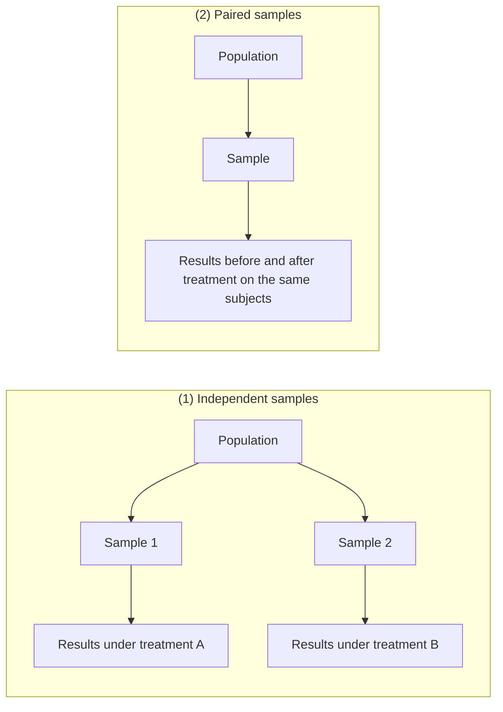
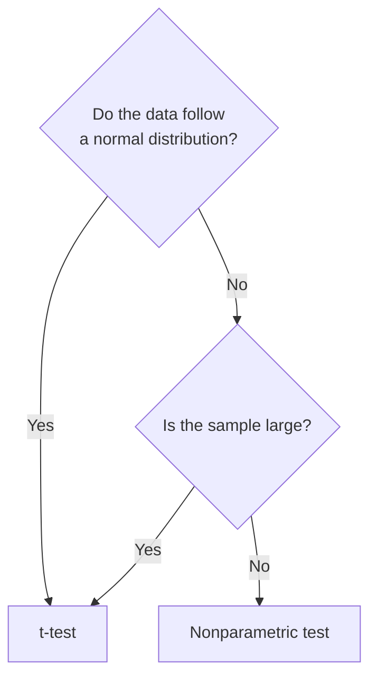
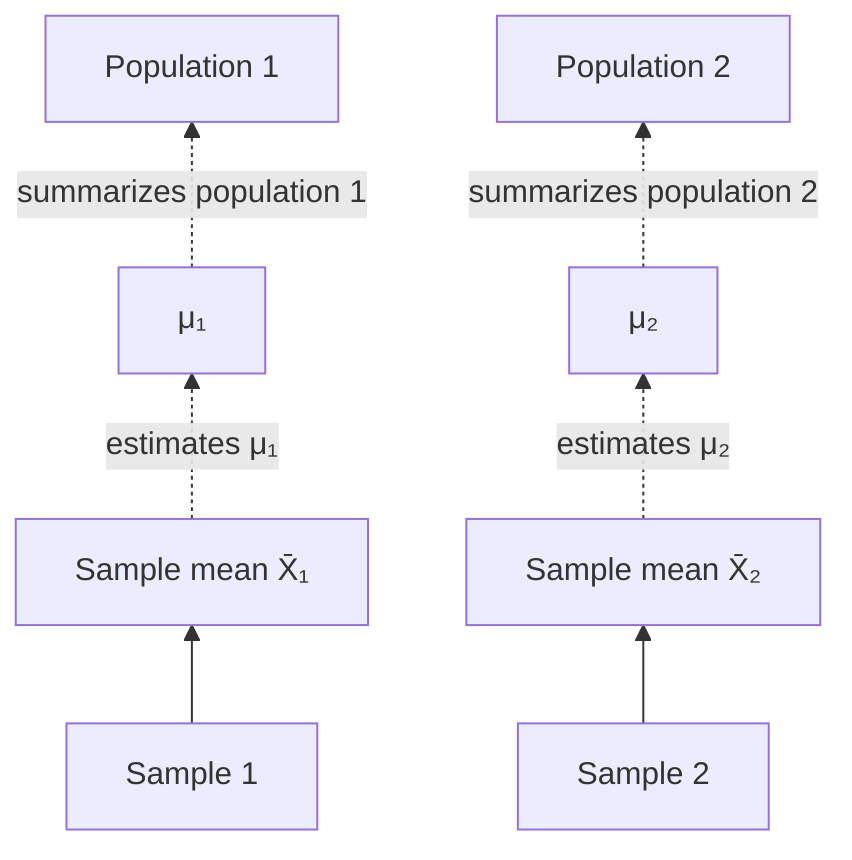
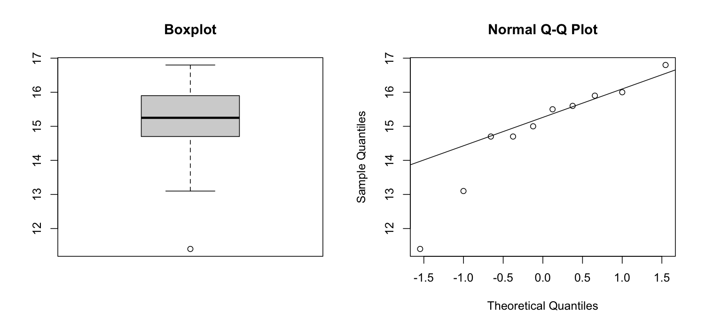
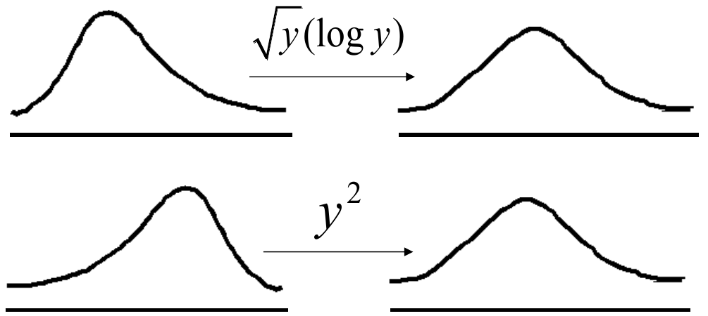
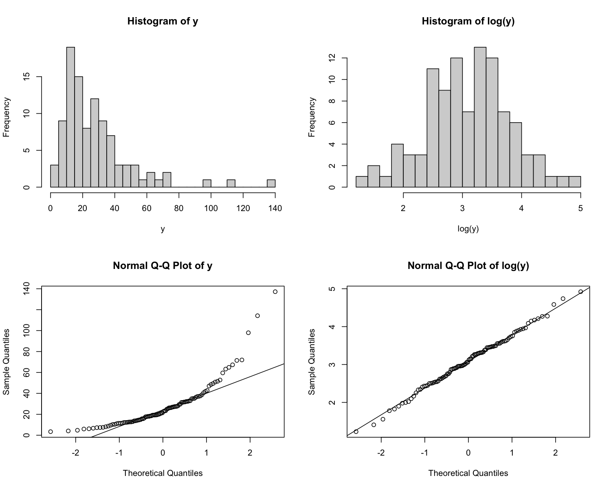
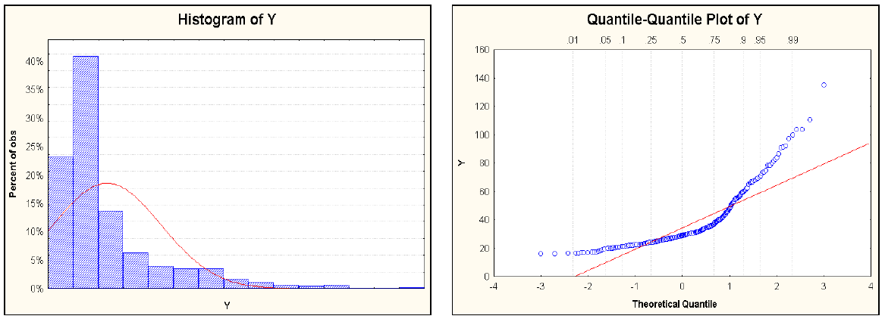
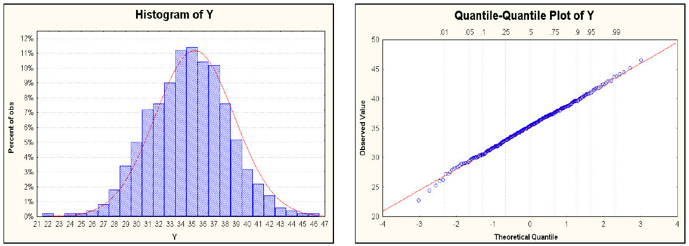

# Lecture 8 — Nonparametric Approaches

[Repository Guide](../../README.md) | [English](Concepts_Lecture.md) | [한국어](Concepts_Lecture.ko.md)

> **Last Updated:** 2026-11-04

> **Learning Objectives:**
> 1. Distinguish the independent-sample and paired-sample ways of collecting data, and choose a test for a two-group comparison according to normality and sample size
> 2. Explain the assumptions, test statistics, and decision procedures of the two-sample t-test and the paired t-test, and perform them in R
> 3. Check normality with stem-and-leaf plots, box plots, Q-Q plots, and goodness-of-fit tests, and transform skewed data to bring them closer to a normal distribution
> 4. Compute the statistic W of the Wilcoxon rank-sum test and obtain its p-value with the normal approximation, the continuity correction, and the treatment of ties
> 5. Explain how the performance (power) of the t-test and the Wilcoxon test differs between normal data and skewed data

---

## Table of Contents

- [1. Concepts of Two-Group Comparison](#1-concepts-of-two-group-comparison)
  - [1.1 Basic Concepts of Hypothesis Testing](#11-basic-concepts-of-hypothesis-testing)
  - [1.2 The Goal of a Two-Group Comparison](#12-the-goal-of-a-two-group-comparison)
  - [1.3 Data Collection: Independent and Paired Samples](#13-data-collection-independent-and-paired-samples)
  - [1.4 Choosing a Test](#14-choosing-a-test)
- [2. The Two-Sample t-Test](#2-the-two-sample-t-test)
  - [2.1 Basic Assumptions](#21-basic-assumptions)
  - [2.2 The Null Hypothesis and the Test Statistic](#22-the-null-hypothesis-and-the-test-statistic)
  - [2.3 Populations and Samples](#23-populations-and-samples)
  - [2.4 R Example: p24 Levels in Two Dose Groups](#24-r-example-p24-levels-in-two-dose-groups)
  - [2.5 The Equal-Variance Assumption and the Welch t-Test](#25-the-equal-variance-assumption-and-the-welch-t-test)
  - [2.6 The Paired t-Test](#26-the-paired-t-test)
- [3. Checking Normality](#3-checking-normality)
  - [3.1 Checking with Graphs](#31-checking-with-graphs)
  - [3.2 Goodness-of-Fit Tests](#32-goodness-of-fit-tests)
  - [3.3 Non-Normal Data: Transformation and Nonparametric Tests](#33-non-normal-data-transformation-and-nonparametric-tests)
- [4. The Wilcoxon Rank-Sum Test](#4-the-wilcoxon-rank-sum-test)
  - [4.1 Why Ranks, and the Hypotheses](#41-why-ranks-and-the-hypotheses)
  - [4.2 The Test Statistic W](#42-the-test-statistic-w)
  - [4.3 Worked Example: Weeds and Corn Yield](#43-worked-example-weeds-and-corn-yield)
  - [4.4 The Exact Distribution and R's Output](#44-the-exact-distribution-and-rs-output)
  - [4.5 Limitations: Continuity Correction and Ties](#45-limitations-continuity-correction-and-ties)
  - [4.6 Paired Samples: The Wilcoxon Signed-Rank Test](#46-paired-samples-the-wilcoxon-signed-rank-test)
- [5. Performance Comparison: The Wilcoxon Test and the t-Test](#5-performance-comparison-the-wilcoxon-test-and-the-t-test)
  - [5.1 Comparison on Skewed Data](#51-comparison-on-skewed-data)
  - [5.2 Comparison on Normal Data](#52-comparison-on-normal-data)
  - [5.3 Power Seen Through Simulation](#53-power-seen-through-simulation)
- [Concept Applications](#concept-applications)
- [Summary](#summary)
- [Self-Check Questions](#self-check-questions)
- [References](#references)

---

<br>

## 1. Concepts of Two-Group Comparison

The sections below cover methods for comparing two groups statistically. It summarizes the assumptions of the t-test, a parametric method, examines how to check one of those assumptions, normality, and the alternatives when normality fails (transformation and nonparametric tests), and then computes the Wilcoxon rank-sum test, the typical nonparametric test, and compares its performance with the t-test. The distinction between parametric and nonparametric methods was defined in Lecture 7, Section 1.1.

### 1.1 Basic Concepts of Hypothesis Testing

A two-group comparison is built on the hypothesis testing of Lecture 6. The concepts used throughout the sections below are summarized again as follows.

| Concept | Meaning |
|:-----|:-----|
| Null hypothesis $H_0$ | The reference hypothesis of no difference. The distribution of the test statistic (the null distribution) is fixed under the assumption that $H_0$ is true, so $H_0$ is the standard against which the rarity of the observed result is judged |
| Alternative hypothesis $H_1$ | The hypothesis the researcher wants to show, stating that a difference exists |
| Hypothesis test | A procedure that decides from sample data whether to reject $H_0$ |
| Test statistic | A value computed from the sample whose distribution under $H_0$ is known, so that the extremeness of the observed value can be judged |
| p-value | The probability, when $H_0$ is true, of obtaining a test statistic as extreme as or more extreme than the observed one |
| Significance level $\alpha$ | The maximum allowed probability of a type I error, rejecting $H_0$ when it is true; 0.05 is usual. $H_0$ is rejected when the p-value is smaller than $\alpha$ |
| Power | The probability of correctly rejecting $H_0$ when $H_1$ is true. With $\beta$ the probability of a type II error, the power is $1-\beta$ |

*Table 1. Basic concepts of hypothesis testing*

The **central limit theorem** states that, whatever the distribution of the population, as long as its variance is finite, the distribution of the sample mean of independent observations approaches the normal distribution when the sample size $n$ is large (Lecture 5). Thanks to this theorem, the t-test, which is based on the sample mean, can be used with large samples even when the data themselves are not normal. Conversely, when the sample is small and the data depart strongly from normality, the p-value of the t-test is hard to trust, and a nonparametric test is needed.

### 1.2 The Goal of a Two-Group Comparison

The goal of a two-group comparison is to compare the differences in population mean and variability between two specific groups. For example, comparing the heights of people standing in two separate crowds asks whether the mean heights of the two crowds differ and whether the spreads of the heights differ. Only samples drawn from each group can be observed, so hypothesis testing decides whether a difference seen in the samples arose by chance or reflects a difference between the populations.

### 1.3 Data Collection: Independent and Paired Samples

Data for two groups are collected in one of the following two ways.



*Figure 1. Independent-sample and paired-sample ways of collecting data*

1. **Independent samples:** data are obtained independently from both treatment groups. For example, the patients in a study are divided at random into two groups, a different treatment is applied to each group, and the results are compared. A measurement in one group has nothing to do with the measurements in the other.
2. **Paired samples:** data for the two treatments are obtained in pairs from the same subjects. For example, chemotherapy is given to the same cancer patients and their condition before and after treatment is compared. The two measurements of one person share that person's constitution and habits, so they are related.

In paired samples, the baseline level that differs from person to person (constitution, age, and so on) cancels within each pair, so the treatment effect can be estimated more precisely with the same number of subjects. In exchange, the analysis must take the pairing into account (Section 2.6).

### 1.4 Choosing a Test

The test for a two-group comparison is chosen by the way the data were collected (independent or paired), by normality, and by sample size.



*Figure 2. Choosing between the t-test and a nonparametric test by normality and sample size*

| Data collection | t-test (normality condition or large sample) | Nonparametric test (non-normal data and small sample) |
|:-----|:-----|:-----|
| Independent | Two-sample t-test | Wilcoxon rank-sum test<br>Mann-Whitney test<br>Permutation test |
| Paired | Paired t-test | Wilcoxon signed-rank test<br>Permutation test |

*Table 2. Tests for a two-group comparison by data collection and normality*

If the data are normal, the t-test is used. Even when the data are not normal, the t-test can be used with a large sample because of the central limit theorem. If the data are not normal and the sample is also small, a nonparametric test is used. The Wilcoxon rank-sum test and the Mann-Whitney test differ only in how the statistic is expressed and lead to the same conclusion (Section 4.4); the permutation test was covered in Lecture 7, Section 3.4.

---

<br>

## 2. The Two-Sample t-Test

### 2.1 Basic Assumptions

The **two-sample t-test** makes the following four assumptions.

1. **The sample size of each group is large enough.** A common criterion is $n_1 \ge 30$, $n_2 \ge 30$. This criterion is a rule of thumb, and the closer the data are to normal, the smaller the samples that suffice.
2. **Within each group, the continuous variable to be compared follows a normal distribution.** When the sample is large, however, this assumption is not strictly needed, because the central limit theorem makes the sample mean nearly normal.
3. **The two groups are independent.** An observation in one group must be unrelated to the observations in the other, and the observations within each group must also be independent.
4. **The variable of interest has the same variance in both groups (equal variances).** When the variances are assumed to differ (heteroscedasticity), a different test statistic is used (Section 2.5).

In symbols, the assumptions say that the observations $x_i$ of the first group and $y_i$ of the second group follow the distributions below and are independent of each other.

```math
x_i \sim N(\mu_1, \sigma^2), \qquad y_i \sim N(\mu_2, \sigma^2), \qquad \text{the two samples are independent}
```

The two distributions may differ only in their means $\mu_1$ and $\mu_2$; the variance $\sigma^2$ is the same.

### 2.2 The Null Hypothesis and the Test Statistic

The null hypothesis is that the two population means are equal.

```math
H_0: \mu_1 = \mu_2 \qquad \text{vs} \qquad H_1: \mu_1 \ne \mu_2
```

The test statistic is the difference between the two sample means divided by its standard error.

```math
t = \frac{\bar{X} - \bar{Y}}{s_p\sqrt{\dfrac{1}{n_1} + \dfrac{1}{n_2}}} \sim t_{n_1+n_2-2} \quad \text{under } H_0
```

Here $\bar{X}$ and $\bar{Y}$ are the sample means of the two groups, and $s_p$ is the **pooled standard deviation**. Because the two groups are assumed to have the same variance, the **pooled variance**, which combines the information of both samples to estimate the common variance $\sigma^2$, is used.

```math
s_p^2 = \frac{\sum_{i=1}^{n_1}(x_i-\bar{x})^2 + \sum_{j=1}^{n_2}(y_j-\bar{y})^2}{n_1+n_2-2} = \frac{(n_1-1)s_1^2 + (n_2-1)s_2^2}{n_1+n_2-2}
```

The denominator is $n_1+n_2-2$ because estimating the two means $\bar{x}$ and $\bar{y}$ costs 2 degrees of freedom, and this value becomes the degrees of freedom of the t distribution. $s_1^2$ and $s_2^2$ are the sample variances of the two samples.

**Decision making:** the p-value is computed from the t statistic and the t distribution with $n_1+n_2-2$ degrees of freedom. If the p-value is lower than the chosen significance level, the null hypothesis is rejected and the alternative hypothesis is selected. The same decision with a rejection region rejects in a two-sided test when $`\vert t \vert > t_{\alpha/2,\, n_1+n_2-2}`$.

### 2.3 Populations and Samples



*Figure 3. The sample mean estimates the population mean, and the population mean summarizes the population*

What the test wants to know is a property of the populations. The population means $\mu_1$ and $\mu_2$ summarize each population but are unknown, and all that can be observed are the sample means $`\bar{X}_1`$ and $`\bar{X}_2`$ computed from the samples. A sample mean carries information about the population mean but varies from sample to sample, so the two-sample t-test judges $\mu_1 \ne \mu_2$ by asking whether the difference between the two sample means is too large to arise from sampling chance alone.

### 2.4 R Example: p24 Levels in Two Dose Groups

The following data are p24 levels measured in 10 people in each of two dose groups (300 mg and 600 mg). p24 is one of the proteins that make up HIV (human immunodeficiency virus), and the amount of p24 antigen in the blood is used as an indicator of HIV infection.

| Dose | p24 level |
|:-----|:-----|
| 300 mg | 284, 279, 289, 292, 287, 295, 285, 279, 306, 298 |
| 600 mg | 298, 307, 297, 279, 291, 335, 299, 300, 306, 291 |

*Table 3. p24 levels of the two dose groups*

```r
x <- c(284, 279, 289, 292, 287, 295, 285, 279, 306, 298)   # 300 mg group
y <- c(298, 307, 297, 279, 291, 335, 299, 300, 306, 291)   # 600 mg group
t.test(x, y, var.equal = T)                                # two-sample t-test with equal variances
```

```text
	Two Sample t-test

data:  x and y
t = -2.034, df = 18, p-value = 0.05696
alternative hypothesis: true difference in means is not equal to 0
95 percent confidence interval:
 -22.1584072   0.3584072
sample estimates:
mean of x mean of y 
    289.4     300.3 
```

`c()` combines values into a vector, and `var.equal = T` in `t.test()` tells it to assume that the two groups have the same variance (`T` is short for `TRUE`). Each value in the output can be computed by hand as follows.

| Step | Computation | Value |
|:-----|:-----|:-----|
| Sample means | $\bar{x} = 2894/10$, $\bar{y} = 3003/10$ | 289.4, 300.3 |
| Sums of squared deviations | $\sum(x_i-\bar{x})^2$, $\sum(y_j-\bar{y})^2$ | 658.4, 1926.1 |
| Pooled variance | $s_p^2 = (658.4 + 1926.1)/18$ | 143.583 |
| Pooled standard deviation | $s_p = \sqrt{143.583}$ | 11.983 |
| Standard error | $s_p\sqrt{1/10 + 1/10} = 11.983 \times 0.4472$ | 5.359 |
| Test statistic | $t = (289.4 - 300.3)/5.359$ | -2.034 |
| Degrees of freedom | $n_1 + n_2 - 2$ | 18 |
| Two-sided p-value | $2P(T_{18} \le -2.034)$ | 0.05696 |

*Table 4. Step-by-step computation of the two-sample t-test for the p24 data*

The same computation done directly in R is as follows. `pt(q, df)` is the cumulative distribution function $P(T \le q)$ of the t distribution with `df` degrees of freedom.

```r
n1 <- length(x); n2 <- length(y)                                    # sample sizes
sp <- sqrt(((n1 - 1) * var(x) + (n2 - 1) * var(y)) / (n1 + n2 - 2)) # pooled standard deviation
t_stat <- (mean(x) - mean(y)) / (sp * sqrt(1 / n1 + 1 / n2))        # t statistic
p_value <- 2 * pt(-abs(t_stat), df = n1 + n2 - 2)                   # two-sided p-value
c(sp = sp, t = t_stat, p = p_value)
```

```text
        sp          t          p 
11.9826263 -2.0340400  0.0569558 
```

The p-value 0.05696 is slightly above the significance level 0.05, so the null hypothesis is not rejected at the 0.05 level. This is the same decision as noting that the two-sided 5% critical value of the t distribution with 18 degrees of freedom is $t_{0.025, 18} = 2.101$ and that $\vert -2.034 \vert < 2.101$. The 95% confidence interval for the difference in means $\mu_1 - \mu_2$, $-10.9 \pm 2.101 \times 5.359 = (-22.16, 0.36)$, contains 0 and points to the same conclusion. The mean of the 600 mg group is 10.9 higher, but with this sample size and variability the difference can be explained by chance.

### 2.5 The Equal-Variance Assumption and the Welch t-Test

When the two groups do not have the same variance, the pooled variance loses its meaning, so the **Welch t-test**, which uses the two sample variances separately, is used [1].

```math
t = \frac{\bar{X} - \bar{Y}}{\sqrt{\dfrac{s_1^2}{n_1} + \dfrac{s_2^2}{n_2}}}, \qquad \nu = \frac{\left(\dfrac{s_1^2}{n_1} + \dfrac{s_2^2}{n_2}\right)^2}{\dfrac{(s_1^2/n_1)^2}{n_1-1} + \dfrac{(s_2^2/n_2)^2}{n_2-1}}
```

Under the null hypothesis this statistic approximately follows the t distribution with $\nu$ degrees of freedom, and $\nu$ is usually not an integer. The following code checks whether the variances are equal with the F test and performs the Welch t-test. When `var.equal` is not specified in `t.test()`, the Welch t-test is the default.

```r
var.test(x, y)   # F test of the null hypothesis that the ratio of variances is 1
t.test(x, y)     # Welch t-test
```

```text
	F test to compare two variances

data:  x and y
F = 0.34183, num df = 9, denom df = 9, p-value = 0.1256
alternative hypothesis: true ratio of variances is not equal to 1
95 percent confidence interval:
 0.0849059 1.3762082
sample estimates:
ratio of variances 
         0.3418306 


	Welch Two Sample t-test

data:  x and y
t = -2.034, df = 14.509, p-value = 0.06065
alternative hypothesis: true difference in means is not equal to 0
95 percent confidence interval:
 -22.3557409   0.5557409
sample estimates:
mean of x mean of y 
    289.4     300.3 
```

- The statistic of the F test is the ratio of the two sample variances, $s_1^2/s_2^2 = 73.156/214.011 = 0.342$, and its p-value is 0.1256, so there is no ground to reject the equal-variance assumption.
- The t value of the Welch t-test is -2.034, the same as that of Student's t-test. With equal sample sizes ($`n_1 = n_2 = n`$), $s_p^2(2/n) = (s_1^2 + s_2^2)/n$, so the two standard errors coincide. Only the degrees of freedom shrink to $\nu = 14.509$, which raises the p-value slightly to 0.06065.

> **Caution:** The two-stage procedure that first checks equal variances with the F test and then picks a t-test by the result does not control the overall type I error exactly. The F test itself is also very sensitive to non-normality. The common recommendation is therefore to use the Welch t-test from the start unless the variances are known to be equal.

### 2.6 The Paired t-Test

When two values $x$ and $y$ are observed in pairs on the same subject, the **paired t-test** is used. The data are a collection of pairs as below, and the analysis uses the difference $d_i$ of each pair.

| Pair | Observations | Difference |
|:-----|:-----|:-----|
| 1 | $(x_1, y_1)$ | $d_1 = x_1 - y_1$ |
| 2 | $(x_2, y_2)$ | $d_2 = x_2 - y_2$ |
| $\vdots$ | $\vdots$ | $\vdots$ |
| $n$ | $(x_n, y_n)$ | $d_n = x_n - y_n$ |

*Table 5. Data structure of paired samples*

The values $x_i$ and $y_i$ of the same subject are not independent, but observations of different subjects ($x_i$ and $`x_k`$) must be independent. The assumptions and the test are as follows.

- The differences are independent and follow the same normal distribution: $d_i \stackrel{\text{iid}}{\sim} N(\mu_d, \sigma^2)$. iid stands for **independent and identically distributed**. When the number of pairs is large ($`n > 30`$), the normality of the differences matters less because of the central limit theorem.
- The null hypothesis is $H_0: \mu_d = 0$, which is the same as $\mu_1 = \mu_2$.
- The test statistic is the mean of the differences $\bar{d}$ divided by the standard error formed from the standard deviation of the differences $s_d$.

```math
t = \frac{\bar{d}}{s_d/\sqrt{n}} \sim t_{n-1} \quad \text{under } H_0
```

The paired t-test is the same as a one-sample t-test on the differences $d_i$. R's `sleep` data record the extra hours of sleep (`extra`, in hours) of 10 patients, each given two sleeping drugs; they are the data Student used in the paper that introduced the t distribution [2]. Each patient took both drugs, so the samples are paired.

```r
drug1 <- sleep$extra[sleep$group == 1]       # extra sleep under drug 1
drug2 <- sleep$extra[sleep$group == 2]       # the same patients under drug 2
d <- drug1 - drug2                           # difference for each patient
d
t.test(drug1, drug2, paired = TRUE)          # paired t-test
t.test(drug1, drug2, var.equal = TRUE)$p.value  # p-value when the pairing is ignored
```

```text
 [1] -1.2 -2.4 -1.3 -1.3  0.0 -1.0 -1.8 -0.8 -4.6 -1.4

	Paired t-test

data:  drug1 and drug2
t = -4.0621, df = 9, p-value = 0.002833
alternative hypothesis: true mean difference is not equal to 0
95 percent confidence interval:
 -2.4598858 -0.7001142
sample estimates:
mean difference 
          -1.58 

[1] 0.07918671
```

The mean of the differences is $\bar{d} = -1.58$ and their standard deviation is $s_d = 1.230$, so $t = -1.58/(1.230/\sqrt{10}) = -1.58/0.389 \approx -4.062$, and the p-value from the t distribution with 9 degrees of freedom is 0.0028. Drug 2 is concluded to add on average 1.58 hours more sleep than drug 1.

If the same data are analyzed with the independent two-sample t-test, ignoring the pairs, the p-value grows to 0.079 and is not significant. The baseline sleep habits that differ from patient to patient mix into the variances of the two groups and inflate the standard error. The paired t-test looks only at the differences within each patient, so this variation disappears. Paired data must therefore always be analyzed with a paired analysis. Whether the differences in these data are normally distributed is checked again in Section 4.6.

---

<br>

## 3. Checking Normality

The t-test assumes normality, so, especially with small samples, whether the data follow a normal distribution is checked first. The typical methods are graphs and goodness-of-fit tests.

### 3.1 Checking with Graphs

There are three typical graphs for checking normality.

- **Stem-and-leaf plot:** a plot that splits each value into a stem (leading digits) and a leaf (the next digit) and lines them up, used to check whether the distribution is symmetric.
- **Box plot:** a plot of the quartiles and outliers, used to check symmetry by whether the median sits in the middle of the box, whether the whiskers have similar lengths, and whether there are outliers.
- **Q-Q plot (quantile-quantile plot):** a plot that pairs the quantiles of the sample with the theoretical quantiles of the normal distribution. If the data are normal, the points lie on a straight line.

The following code draws the three graphs for 10 observations `ex4`.

```r
ex4 <- c(11.4, 13.1, 14.7, 14.7, 15.0, 15.5, 15.6, 15.9, 16.0, 16.8)
stem(ex4)                          # stem-and-leaf plot
boxplot(ex4, main = "Boxplot")     # box plot
qqnorm(ex4); qqline(ex4)           # normal Q-Q plot and reference line
```

```text
  The decimal point is at the |

  10 | 4
  12 | 1
  14 | 770569
  16 | 08
```



*Figure 4. Box plot and normal Q-Q plot of the ex4 data*

**Reading the stem-and-leaf plot.** "The decimal point is at the |" means that the decimal point lies between the stem and the leaf. In this plot the stems increase by 2, so stem 14 holds values from 14.0 up to but not including 16.0, and the leaf is the first decimal digit. The leaves 7, 7, 0, 5, 6, 9 on stem 14 are 14.7, 14.7, 15.0, 15.5, 15.6, and 15.9. For the same reason, leaf 4 on stem 10 is 11.4 and leaf 1 on stem 12 is 13.1. The values crowd at the high end (14-16) with a long tail toward the low end, so the distribution is not symmetric.

**Reading the box plot.** In R's box plot, the bottom and top of the box are 14.7 and 15.9, the medians of the lower and upper halves, and the thick line inside the box is the median $(15.0 + 15.5)/2 = 15.25$. The length of the box (the interquartile range) is $15.9 - 14.7 = 1.2$, and values more than $1.5 \times 1.2 = 1.8$ beyond the box (below 12.9 or above 17.7) are marked as outliers. So 11.4 is drawn separately as a point, and the lower whisker extends to 13.1, the smallest value within that range. The lower whisker is longer than the upper one and there is an outlier at the bottom, so the distribution is skewed to the left.

**Reading the Q-Q plot.** The $`i`$th of the $n$ values sorted by size is paired with the quantile at a similar position in the standard normal distribution. For $n \le 10$, R's `qqnorm()` uses $\Phi^{-1}\lbrace(i - 3/8)/(n + 1/4)\rbrace$ as the theoretical quantile, which for these data gives -1.547, -1.000, -0.655, -0.375, -0.123, 0.123, 0.375, 0.655, 1.000, 1.547. `qqline()` is the reference line through the first and third quartiles of the sample and of the theoretical distribution. The points in the middle lie near the line, but the two smallest values (11.4, 13.1) are far below it. This means that the small values are smaller than a normal distribution would lead one to expect, which shows a distribution with a long left tail.

> **Note:** The shape in which the points depart from the line reveals features of the distribution. If both ends depart outward from the line (the left end downward, the right end upward), the tails are heavier than those of the normal distribution; if the points form a convex curve (bending upward), the distribution is skewed to the right; and if they form a concave curve (bending downward), it is skewed to the left.

### 3.2 Goodness-of-Fit Tests

A **goodness-of-fit test** tests whether the data follow a particular distribution. The null hypothesis $H_0$ of a normality test is that the data follow a normal distribution, and a small p-value rejects normality. The typical tests are as follows.

| Test | Principle |
|:-----|:-----|
| Kolmogorov-Smirnov test | Uses as its statistic the maximum distance $D$ between the empirical cumulative distribution function of the sample and the normal cumulative distribution function |
| Shapiro-Wilk test | Measures with the statistic $W$ (closer to 1 means more normal) how close to a straight-line relation the sorted sample is with the expected order statistics of the normal distribution. It is among the more powerful normality tests [3] |
| Pearson chi-squared test | Divides the data into intervals and compares the observed count in each interval with the count expected under the normal distribution |
| Anderson-Darling test | Sums the differences between cumulative distribution functions with greater weight on the tails of the distribution [4] |

*Table 6. Typical goodness-of-fit tests for normality*

```r
shapiro.test(ex4)                                         # Shapiro-Wilk test
ks.test(ex4, "pnorm", mean = mean(ex4), sd = sd(ex4))     # Kolmogorov-Smirnov test
```

```text
	Shapiro-Wilk normality test

data:  ex4
W = 0.8863, p-value = 0.154


	Asymptotic one-sample Kolmogorov-Smirnov test

data:  ex4
D = 0.25694, p-value = 0.5239
alternative hypothesis: two-sided

Warning message:
In ks.test.default(ex4, "pnorm", mean = mean(ex4), sd = sd(ex4)) :
  ties should not be present for the one-sample Kolmogorov-Smirnov test
```

Both tests have p-values above 0.05 and do not reject normality. The graphs of Section 3.1, however, showed a left-skewed shape. With only 10 observations, the goodness-of-fit tests have low power. The warning of the Kolmogorov-Smirnov test means that 14.7 appears twice, a tie that occurs with probability 0 under a continuous distribution.

> **Caution:** Interpret the result of a goodness-of-fit test with the following three points in mind.
> - Failing to reject normality is not a proof that the data are normal. With a small sample, even a sizable departure from normality is not rejected.
> - Conversely, with a very large sample even departures too small to matter in practice are rejected. With large samples the t-test is hardly affected by such departures, thanks to the central limit theorem.
> - Feeding a mean and standard deviation estimated from the data into the Kolmogorov-Smirnov test, as in the code above, makes the p-value too large. In that case the corrected Lilliefors test is used [5]. In R, `lillie.test()` in the `nortest` package provides the Lilliefors test and `ad.test()` the Anderson-Darling test.
>
> Normality should therefore be judged by looking at graphs and tests together and taking the sample size into account.

### 3.3 Non-Normal Data: Transformation and Nonparametric Tests

There are two alternatives for data that are not normal. One is to **transform** the data to bring them closer to normal and then use a parametric method; the other is to use a **nonparametric test**, which does not assume normality (Section 4).



*Figure 5. A right-skewed distribution made nearly symmetric by a square-root or log transformation, and a left-skewed distribution by a square transformation*

- For a **right-skewed distribution** (a long right tail, common for positive values such as income or concentration), $\sqrt{y}$ or $\log y$ is used. Both functions shrink large values more than small ones, pulling in the long right tail. The logarithm shrinks more strongly than the square root.
- For a **left-skewed distribution** (a long left tail), $y^2$ is used. Squaring stretches large values more, spreading out the crowded large values and bringing the distribution closer to symmetric.

The Box-Cox transformation groups such power transformations into one family and estimates the most suitable power from the data [6]. The following code generates 100 right-skewed lognormal random numbers and compares their normality before and after transformation with the Shapiro-Wilk test. `rlnorm()` generates random numbers from the lognormal distribution, whose logarithm is normal, and `$p.value` extracts only the p-value from a test result.

```r
set.seed(1)                                   # fix the random seed for reproducibility
y <- rlnorm(100, meanlog = 3, sdlog = 0.8)    # right-skewed data
summary(y)
shapiro.test(y)$p.value                       # original data
shapiro.test(sqrt(y))$p.value                 # square-root transformation
shapiro.test(log(y))$p.value                  # log transformation
```

```text
   Min. 1st Qu.  Median    Mean 3rd Qu.    Max. 
  3.415  13.529  22.013  28.178  34.926 137.180 
[1] 1.384291e-10
[1] 0.0002422931
[1] 0.9876221
```



*Figure 6. Histograms and normal Q-Q plots of lognormal data before and after transformation*

In the original data the mean (28.2) exceeds the median (22.0) and the maximum is 137, a long right tail, and the Shapiro-Wilk p-value of $1.4 \times 10^{-10}$ strongly rejects normality. In the left Q-Q plot of Figure 6 the points also form a convex curve. The square-root transformation reduces the skewness but its p-value of 0.00024 is still not enough, while after the log transformation the p-value is 0.988, the histogram is bell-shaped, and the Q-Q plot is a straight line.

> **Caution:** When using a transformation, check the following. The logarithm is undefined for values of 0 or below and the square root for negative values, so before log-transforming data that contain 0 a constant is added, as in $\log(y + 1)$. Also, a test done on the transformed scale is not a test about means on the original scale. For example, comparing the means of $\log y$ amounts to comparing geometric means (or ratios) on the original scale. Report the result stating on which scale the comparison was made.

---

<br>

## 4. The Wilcoxon Rank-Sum Test

### 4.1 Why Ranks, and the Hypotheses

The **Wilcoxon rank-sum test** is a nonparametric test that compares two independent samples when the samples are small or normality is doubtful [7]. The key idea is to use **ranks** instead of the observed values. The two samples are pooled, and the smallest value gets rank 1, the next 2, ..., and the largest $N$. If the two groups have the same distribution, an observation from either group is equally likely to receive any rank, so the ranks received by one group should look like ranks chosen at random from 1 to $N$. If one group collects the large ranks, that is evidence that its values are systematically larger.

Ranks keep only the order of the values, so even a huge outlier cannot have more influence than rank $N$. The test is therefore little affected by outliers and skewed distributions (robust), and it does not depend on the normality of the distribution.

- **Null hypothesis $H_0$:** the two populations have the same distribution.
- **Alternative hypothesis $H_1$:** the values of one population are systematically larger (or smaller; different, if two-sided) than those of the other.
- **Assumptions:** the two samples are independent of each other, the observations within each sample are independent, and the distributions are continuous. If the two distributions are assumed to have the same shape and differ only in location, the result can be interpreted as a difference in medians.

Because Mann and Whitney formulated the same test with a different statistic, it is also called the **Mann-Whitney U test** [8].

### 4.2 The Test Statistic W

Let the sizes of the two samples be $n_1$ and $n_2$, and the total size $N = n_1 + n_2$. If $R_1, \ldots, R_{n_1}$ are the ranks that the observations of the first sample (size $`n_1`$) receive in the pooled sample, the test statistic is their sum.

```math
W = \sum_{j=1}^{n_1} R_j
```

Under the null hypothesis, the mean and standard deviation of $W$ are as follows.

```math
\mu_W = \frac{n_1(N+1)}{2}, \qquad \sigma_W = \sqrt{\frac{n_1 n_2 (N+1)}{12}}
```

The mean can be understood as follows. The average of the ranks 1 to $N$ is $(N+1)/2$, and under the null hypothesis each observation of the first sample receives this rank on average, so the expected sum of $n_1$ ranks is $n_1(N+1)/2$. The standard deviation is that of the sum of $n_1$ ranks drawn without replacement from the ranks 1 to $N$.

As the samples grow, the distribution of $W$ approaches the normal distribution, so the standardized $z$ below is judged against the standard normal distribution.

```math
z = \frac{W - \mu_W}{\sigma_W} = \frac{W - n_1(N+1)/2}{\sqrt{n_1 n_2 (N+1)/12}}
```

The formulas look complicated, but the computation has only three steps: rank the values, add up the ranks of one group, and standardize.

### 4.3 Worked Example: Weeds and Corn Yield

To find out whether even a few weeds reduce corn yield, corn was planted at the same rate in 8 small plots; in 4 plots chosen at random all weeds were removed, and in the other 4, three lamb's-quarter plants per meter of row were left [9].

| Treatment | Yield (bushels per acre) |
|:-----|:-----|
| 0 weeds per meter | 166.7, 172.2, 165.0, 176.9 |
| 3 weeds per meter | 158.6, 176.4, 153.1, 156.0 |

*Table 7. Corn yield by weed treatment*

The 8 observations, 4 from each group, are pooled and ranked from the smallest.

| Yield | 153.1 | 156.0 | 158.6 | 165.0 | 166.7 | 172.2 | 176.4 | 176.9 |
|:-----|:-----:|:-----:|:-----:|:-----:|:-----:|:-----:|:-----:|:-----:|
| Group | Weeds | Weeds | Weeds | No weeds | No weeds | No weeds | Weeds | No weeds |
| Rank | 1 | 2 | 3 | 4 | 5 | 6 | 7 | 8 |

*Table 8. Yields and ranks in the pooled sample*

The rank sums of the two treatments are as follows.

| Treatment | Sum of ranks |
|:-----|:-----:|
| No weeds | $4 + 5 + 6 + 8 = 23$ |
| Weeds | $1 + 2 + 3 + 7 = 13$ |

*Table 9. Rank sum of each treatment*

The two rank sums add up to $23 + 13 = 36 = 8 \times 9 / 2$, the sum of 1 to 8. The following hypotheses are now tested.

- $H_0$: there is no difference in the distribution of yields between the two treatments.
- $H_1$: yields are systematically higher in weed-free plots (one-sided).

$N = 8$, $n_1 = 4$ (no weeds), $n_2 = 4$ (weeds), and the test statistic is the rank sum of the weed-free plots, $W = 23$.

```math
\mu_W = \frac{n_1(N+1)}{2} = \frac{4 \times 9}{2} = 18, \qquad \sigma_W = \sqrt{\frac{n_1 n_2 (N+1)}{12}} = \sqrt{\frac{4 \times 4 \times 9}{12}} = \sqrt{12} = 3.464
```

```math
z = \frac{W - \mu_W}{\sigma_W} = \frac{23 - 18}{3.464} = 1.44, \qquad \text{p-value} = P(Z \ge 1.44) = 0.0749
```

Because the alternative is one-sided (larger for the weed-free side), the p-value is the right-tail probability of the standard normal distribution. The p-value 0.0749 is above 0.05, so the null hypothesis is not rejected at the 0.05 level. The weed-free plots tend to yield more, but 8 plots give too little evidence to distinguish this from chance.

The same computation in R is as follows. `rank()` returns the rank of each value.

```r
no_weeds    <- c(166.7, 172.2, 165.0, 176.9)
three_weeds <- c(158.6, 176.4, 153.1, 156.0)
r <- rank(c(no_weeds, three_weeds))           # ranks in the pooled sample
r
W <- sum(r[1:4])                              # rank sum of the weed-free plots
n1 <- 4; n2 <- 4; N <- n1 + n2
mu_W <- n1 * (N + 1) / 2
sigma_W <- sqrt(n1 * n2 * (N + 1) / 12)
z <- (W - mu_W) / sigma_W
c(W = W, mu_W = mu_W, sigma_W = sigma_W, z = z, p = 1 - pnorm(z))
```

```text
[1] 5 6 4 8 3 7 1 2
          W        mu_W     sigma_W           z           p 
23.00000000 18.00000000  3.46410162  1.44337567  0.07445734 
```

Without rounding, $z$ is 1.4434 and the p-value is 0.0745. The hand result 0.0749 differs only because $z$ was rounded to 1.44.

### 4.4 The Exact Distribution and R's Output

For small samples the **exact distribution** of $W$ can be used instead of the normal approximation. Under the null hypothesis, every choice of which 4 of the ranks 1-8 go to the weed-free plots is equally likely, so the exact p-value is found by counting the sums of all $\binom{8}{4} = 70$ possible rank combinations.

```r
rank_sums <- colSums(combn(8, 4))   # rank sums of the 70 ways to choose 4 of 1-8
length(rank_sums)
sum(rank_sums >= 23)                # number of combinations with rank sum 23 or more
mean(rank_sums >= 23)               # exact one-sided p-value
```

```text
[1] 70
[1] 7
[1] 0.1
```

Of the 70 combinations, 7 have a rank sum of 23 or more, so the exact p-value is $7/70 = 0.1$. `combn(8, 4)` is a matrix whose columns list all combinations of 4 numbers chosen from 1 to 8, and `colSums()` adds up each column. R's `wilcox.test()` uses this exact distribution when the samples are small and there are no ties.

```r
wilcox.test(no_weeds, three_weeds, alternative = "greater")      # exact test
wilcox.test(no_weeds, three_weeds, alternative = "greater",
            exact = FALSE, correct = FALSE)$p.value              # normal approximation
wilcox.test(no_weeds, three_weeds, alternative = "greater",
            exact = FALSE, correct = TRUE)$p.value               # normal approximation with continuity correction
```

```text
	Wilcoxon rank sum exact test

data:  no_weeds and three_weeds
W = 13, p-value = 0.1
alternative hypothesis: true location shift is greater than 0

[1] 0.07445734
[1] 0.09696543
```

The `W = 13` reported by R is not the rank sum 23 but the **Mann-Whitney statistic** $U$. $U$ is the rank sum minus the smallest rank sum the first sample can have, $n_1(n_1+1)/2 = 10$, giving $23 - 10 = 13$, and it equals the number of the $4 \times 4 = 16$ pairs (one from each group) in which the weed-free plot has the larger yield. For example, 176.9 exceeds all 4 weedy plots, giving 4 pairs, and 166.7, 172.2, and 165.0 each exceed the 3 weedy plots other than 176.4, giving 3 pairs each, for $4 + 3 + 3 + 3 = 13$. $W$ and $U$ differ by a constant, so they give the same p-value. The three p-values in the output are 0.1 for the exact test, 0.0745 for the normal approximation, and 0.0970 for the normal approximation with continuity correction.

### 4.5 Limitations: Continuity Correction and Ties

The Wilcoxon rank-sum test has the following two issues.

**Continuity correction.** $W$ is a discrete statistic that takes only integer values, yet it is approximated by the continuous normal distribution, which introduces error. The continuity correction treats the integer 23 as occupying the interval from 22.5 to 23.5 and computes $P(W \ge 23)$ as $P(W \ge 22.5)$ [9].

```math
z = \frac{22.5 - 18}{3.464} = 1.30, \qquad P(Z \ge 1.30) = 0.0968
```

The corrected 0.0968 is much closer to the exact value 0.1 than the uncorrected 0.0749. When the normal approximation is used, the continuity correction should therefore be applied, or the exact distribution should be used for small samples. R's `wilcox.test()` applies the continuity correction by default when it uses the normal approximation (`correct = TRUE`).

**Ties in rank.** When several observations have the same value, a single rank cannot be assigned. In that case all of them receive the average of the ranks they occupy (the **average rank**, or midrank). For example, in 153, 155, 158, 158, 161, 164 the two 158s occupy the 3rd and 4th places, so both receive rank 3.5. With ties the exact distribution can no longer be used as is, and since ties reduce the variability of the ranks, $\sigma_W$ must be adjusted [10].

```math
\sigma_W^2 = \frac{n_1 n_2}{12}\left\lbrace(N+1) - \frac{\sum_k (t_k^3 - t_k)}{N(N-1)}\right\rbrace
```

Here $t_k$ is the number of observations in the $`k`$th group of ties. The following code tests the case in which the first group is 153, 155, 158 and the second group is 158, 161, 164.

```r
a <- c(153, 155, 158)
b <- c(158, 161, 164)
rank(c(a, b))          # tied values receive the average rank
wilcox.test(a, b)
```

```text
[1] 1.0 2.0 3.5 3.5 5.0 6.0

	Wilcoxon rank sum test with continuity correction

data:  a and b
W = 0.5, p-value = 0.1212
alternative hypothesis: true location shift is not equal to 0

Warning message:
In wilcox.test.default(a, b) : cannot compute exact p-value with ties
```

The warning means that the exact p-value cannot be computed because of the ties, so the normal approximation was used instead. Checking by hand, the rank sum of the first group is $W = 1 + 2 + 3.5 = 6.5$ and $\mu_W = 3 \times 7/2 = 10.5$. There is one group of ties of size 2, so $\sigma_W^2 = (9/12)\lbrace7 - 6/30\rbrace = 0.75 \times 6.8 = 5.1$ and $\sigma_W = 2.258$. With the continuity correction, $z = (6.5 - 10.5 + 0.5)/2.258 = -1.55$, and the two-sided p-value is $2 \times P(Z \le -1.55) = 0.1212$, matching R. R's `W = 0.5` is the Mann-Whitney statistic $6.5 - 3 \times 4/2 = 0.5$.

> **Caution:** The null hypothesis of the Wilcoxon rank-sum test is that the two distributions are the same. If the two distributions differ in shape or spread, the null hypothesis can be rejected even when the medians are equal, so interpreting the result as a difference in medians requires the assumption that the two distributions have similar shapes.

### 4.6 Paired Samples: The Wilcoxon Signed-Rank Test

When the differences $d_i$ of paired samples are not normal and the number of pairs is small, the **Wilcoxon signed-rank test** is used instead of the paired t-test [7]. The procedure is as follows.

1. Compute the difference $d_i$ of each pair and discard pairs with $d_i = 0$. Let $n$ be the number of pairs left.
2. Rank the absolute differences $\vert d_i \vert$ (average ranks for ties).
3. Add the ranks of the pairs with positive differences to obtain $T^+$. R reports this value as `V`.
4. Under the null hypothesis (the distribution of the differences is symmetric about 0), $E(T^+) = n(n+1)/4$ and $\text{Var}(T^+) = n(n+1)(2n+1)/24$; these are used to standardize, or the exact distribution is used, to obtain the p-value.

The following code checks the normality of the differences in the `sleep` data of Section 2.6 and performs the signed-rank test.

```r
shapiro.test(drug1 - drug2)$p.value           # normality test of the differences
wilcox.test(drug1, drug2, paired = TRUE)      # Wilcoxon signed-rank test
```

```text
[1] 0.03334161

	Wilcoxon signed rank test with continuity correction

data:  drug1 and drug2
V = 0, p-value = 0.009091
alternative hypothesis: true location shift is not equal to 0

Warning messages:
1: In wilcox.test.default(drug1, drug2, paired = TRUE) :
  cannot compute exact p-value with ties
2: In wilcox.test.default(drug1, drug2, paired = TRUE) :
  cannot compute exact p-value with zeroes
```

The Shapiro-Wilk p-value of the differences is 0.033, so normality is doubtful, and with only 10 pairs the signed-rank test is the safer choice. Discarding the one zero difference leaves $n = 9$, and since all remaining differences are negative, $T^+ = V = 0$. $E(T^+) = 9 \times 10/4 = 22.5$, and the variance adjusted for the tie (1.3 appears twice among the $`\vert d_i \vert`$) is $9 \times 10 \times 19/24 - (2^3 - 2)/48 = 71.125$. With the continuity correction, $z = (0 - 22.5 + 0.5)/\sqrt{71.125} = -2.61$, and the two-sided p-value is 0.0091. As with the paired t-test, the two drugs are concluded to have different effects. The two warnings mean that the normal approximation was used instead of the exact distribution because of the ties and the zero difference.

---

<br>

## 5. Performance Comparison: The Wilcoxon Test and the t-Test

The two tests are applied to non-normal data and to normal data, and their performance is compared. In both cases the hypotheses are $H_0: \mu = 35$ versus $H_1: \mu \ne 35$.

### 5.1 Comparison on Skewed Data



*Figure 7. Histogram and Q-Q plot of the right-skewed data Y*

The histogram in Figure 7 shows a distribution in which about 40% of the values pile up in the second interval from the left, followed by a long right tail. Its shape differs greatly from the overlaid red normal curve. In the Q-Q plot, too, the points do not follow the line but form a convex curve, with the left end above the line and the right end far above it (up to about 135). The results of the two tests are as follows.

| Test | Test statistic | p-value |
|:-----|:-----:|:-----:|
| t-test | $T = -0.74$ | 0.4596 |
| Wilcoxon test | $W = -16845.5$ | 0.0001 |

*Table 10. Results of the two tests on skewed data*

The t-test does not reject the null hypothesis, but the Wilcoxon test rejects it strongly. The large values of the long right tail pull up the sample mean and also inflate the standard deviation, so the t statistic ends up near 0, whereas ranks are not affected by the size of large values and pick up well the fact that most values are below 35.

> **Note:** The hypothesis $H_0: \mu = 35$ of this comparison concerns a single population, so the methods actually used are the one-sample t-test and the Wilcoxon signed-rank test (the procedure of Section 4.6 applied to $`d_i = y_i - 35`$). A rank sum cannot be negative, so the negative $W = -16845.5$ is interpreted as a centered value: the signed-rank statistic $T^+$ minus its expected value $n(n+1)/4$ under the null hypothesis. The UNIVARIATE procedure of SAS also reports the signed-rank statistic centered in this way, as $S$ [11]. The rank-sum test for two independent samples is compared with the two-sample t-test by simulation in Section 5.3.

### 5.2 Comparison on Normal Data



*Figure 8. Histogram and Q-Q plot of the normally distributed data Y*

The histogram in Figure 8 is a bell shape, symmetric about a center near 35, and it matches the overlaid normal curve well. The points of the Q-Q plot also lie almost on a straight line.

| Test | Test statistic | p-value |
|:-----|:-----:|:-----:|
| t-test | $T = -1.473$ | 0.1413 |
| Wilcoxon test | $W = 5050$ | 0.1183 |

*Table 11. Results of the two tests on normal data*

The p-values of the two tests are similar, and so are the conclusions (no rejection). When the data are normal, the Wilcoxon test gives almost the same result as the t-test.

### 5.3 Power Seen Through Simulation

The same phenomena can be confirmed with simulations in R. First, the one-sample comparisons of Sections 5.1 and 5.2 are reproduced with samples of size 500. The skewed data are generated as $15 + \text{Exp}(\text{mean } 20)$, so the population mean is exactly 35 and the population median is $15 + 20\ln 2 \approx 28.9$. `rexp(n, rate)` generates random numbers from the exponential distribution with mean `1/rate`.

```r
set.seed(2025)
y_skew <- 15 + rexp(500, rate = 1 / 20)        # population mean 35, right-skewed data
c(mean = mean(y_skew), median = median(y_skew))
t.test(y_skew, mu = 35)$p.value                # one-sample t-test
wilcox.test(y_skew, mu = 35)$p.value           # Wilcoxon signed-rank test

set.seed(2025)
y_norm <- rnorm(500, mean = 34.7, sd = 4)      # normal data
c(mean = mean(y_norm), median = median(y_norm))
t.test(y_norm, mu = 35)$p.value
wilcox.test(y_norm, mu = 35)$p.value
```

```text
    mean   median 
34.29238 28.64945 
[1] 0.4141493
[1] 3.073682e-06
    mean   median 
34.68438 34.63201 
[1] 0.07526166
[1] 0.09661377
```

On the skewed data, the t-test's p-value of 0.414 does not reject while the signed-rank test's p-value of $3.1 \times 10^{-6}$ rejects strongly, the same pattern as in Section 5.1. On the normal data the two p-values, 0.075 and 0.097, are similar, as in Section 5.2.

> **Caution:** The two tests disagree on the skewed data not only because of a difference in power but also because they ask different questions. The population mean of these data is exactly 35, so the null hypothesis of the t-test is true and not rejecting it is the correct conclusion. The signed-rank test, on the other hand, asks whether the distribution of the differences $y_i - 35$ is symmetric about 0. These data are not symmetric about 35 and most values are below 35 (sample median 28.6), so it rejects. In a skewed distribution the mean and the median differ, so the test should be chosen according to whether the interest lies in the mean or in a typical value.

To compare the power of the two tests fairly, the rejection rates are compared in a setting where the two groups have distributions of the same shape that differ only in location. The following simulation draws 20 values per group, shifts the second group by 0.8, repeats this 2,000 times, and counts how often each test rejects at the significance level 0.05. With a shift of 0 the rejection rate is the type I error rate, and with a shift of 0.8 it is the power. A normal distribution (standard deviation 1) is compared with a right-skewed lognormal distribution.

```r
set.seed(42)
power_sim <- function(gen, shift, n = 20, reps = 2000, alpha = 0.05) {
  p_t <- p_w <- numeric(reps)                  # vectors for the p-values of both tests
  for (i in 1:reps) {
    x <- gen(n)                                # first group
    y <- gen(n) + shift                        # second group, shifted in location only
    p_t[i] <- t.test(x, y, var.equal = TRUE)$p.value
    p_w[i] <- wilcox.test(x, y)$p.value
  }
  c(t_test = mean(p_t < alpha), wilcoxon = mean(p_w < alpha))  # rejection rates
}
normal_gen <- function(n) rnorm(n)                             # normal distribution
skewed_gen <- function(n) rlnorm(n, meanlog = 0, sdlog = 1)    # lognormal distribution
rbind(
  normal_null  = power_sim(normal_gen, shift = 0),
  normal_shift = power_sim(normal_gen, shift = 0.8),
  skewed_null  = power_sim(skewed_gen, shift = 0),
  skewed_shift = power_sim(skewed_gen, shift = 0.8)
)
```

```text
             t_test wilcoxon
normal_null  0.0425   0.0390
normal_shift 0.7080   0.6785
skewed_null  0.0395   0.0495
skewed_shift 0.3305   0.7255
```

- With no shift (`_null`), the rejection rates of both tests are 0.04-0.05, near the significance level 0.05. Both tests control the type I error well.
- With a shift on normal data, the power is 0.708 for the t-test and 0.679 for the Wilcoxon test, slightly higher for the t-test. Under the normal distribution the asymptotic relative efficiency of the Wilcoxon test (the ratio of the sample sizes needed for the same power) is $3/\pi \approx 0.955$, so the Wilcoxon test needs only about 5% more observations than the t-test [12].
- With a shift on skewed data, the power is 0.331 for the t-test and 0.726 for the Wilcoxon test, more than twice as high for the Wilcoxon test. The large values of the long tail inflate the standard error of the t-test. Over all continuous distributions, the asymptotic relative efficiency of the Wilcoxon test relative to the t-test never falls below 0.864, and for heavy-tailed distributions it can be much larger than 1 [12].

> **Key Point:** When the data are normal, the Wilcoxon test loses only a little power relative to the t-test, and when the data are skewed or contain outliers, it can have much higher power than the t-test. This makes the Wilcoxon test a safe choice for small samples whose normality is doubtful.

---

<br>

## Concept Applications

The following table lists suitable tests for situations in two-group comparisons.

| Situation | Suitable test | Reason |
|:-----|:-----|:-----|
| Exam scores of 40 students in each of two classes, roughly bell-shaped | Two-sample t-test (Welch) | Independent samples, large samples, close to normal |
| Times to failure of 8 products from each of two factories, one value ten times the others | Wilcoxon rank-sum test | Independent samples, small samples, an outlier |
| Blood pressure of the same 15 patients before and after treatment, differences roughly normal | Paired t-test | Paired samples with differences close to normal |
| Scores of the same 9 students before and after a lecture, differences strongly skewed | Wilcoxon signed-rank test | Paired samples, few pairs, non-normal differences |
| Incomes (right-skewed) of 300 households in each of two regions, comparing mean income | Two-sample t-test (Welch), or t-test after a log transformation | Large samples, so the central limit theorem applies; after a log transformation, geometric means are compared |

*Table 12. Choosing a test for situations in two-group comparisons*

**True/False Check:**

| Statement | Judgment and Reason |
|:-----|:------------|
| A p-value above 0.05 in a normality test proves that the data are normal. | **F.** It only means that normality was not rejected. With a small sample such as `ex4`, the test does not reject even when the graphs show skewness. |
| Analyzing paired data with the independent two-sample t-test tends to give a smaller p-value than the paired analysis. | **F.** The variation between subjects mixes into the standard error, so the p-value tends to grow. In the `sleep` data it grew from 0.0028 to 0.079. |
| With equal sample sizes, the t statistics of Student's t-test and the Welch t-test are the same. | **T.** When $n_1 = n_2$ the two standard errors coincide and only the degrees of freedom differ. In the p24 data both t values are -2.034. |
| The `W` reported by R's `wilcox.test()` is the rank sum of the first group. | **F.** It is the Mann-Whitney statistic, the rank sum minus $n_1(n_1+1)/2$. In the corn data, the rank sum 23 gives `W = 13`. |
| With ties, the tied values receive the average of the ranks they occupy. | **T.** If two 158s occupy the 3rd and 4th places, both receive rank 3.5, and $\sigma_W$ is adjusted as well. |
| When the data are normal, the power of the Wilcoxon test is much lower than that of the t-test. | **F.** The asymptotic relative efficiency is $3/\pi \approx 0.955$, so the loss of power is small. In the simulation, too, the powers were similar at 0.708 and 0.679. |

---

<br>

## Summary

| Concept | Key Summary |
|:-----|:----------|
| Data collection | Independent samples divide different subjects into two treatment groups, while paired samples obtain the values under both treatments in pairs from the same subjects. |
| Choosing a test | Use the t-test if normality holds or the sample is large, and a nonparametric test (independent: Wilcoxon rank-sum; paired: Wilcoxon signed-rank) if the data are non-normal and the sample is small. |
| Two-sample t-test | Assumes adequate sample size, normality, independence, and equal variances, with $t = (\bar{X} - \bar{Y})/(s_p\sqrt{1/n_1 + 1/n_2}) \sim t_{n_1+n_2-2}$. |
| Welch t-test | Uses the two sample variances separately and approximates the degrees of freedom when the variances differ; it is the default of R's `t.test()`. |
| Paired t-test | A one-sample t-test on the differences $d_i$, with $t = \bar{d}/(s_d/\sqrt{n}) \sim t_{n-1}$, which removes the variation between subjects. |
| Checking normality | Combine stem-and-leaf plots, box plots, and Q-Q plots with the Kolmogorov-Smirnov, Shapiro-Wilk, Pearson chi-squared, and Anderson-Darling tests ($H_0$: normal distribution). |
| Transformation | Right-skewed data are made nearly symmetric with $\sqrt{y}$ or $\log y$, and left-skewed data with $y^2$. |
| Wilcoxon rank-sum test | Computes $W = \sum R_j$ from ranks in the pooled sample and standardizes it with $\mu_W = n_1(N+1)/2$ and $\sigma_W = \sqrt{n_1 n_2 (N+1)/12}$. For the corn data, $z = 1.44$ and the p-value is 0.0749. |
| Exact distribution and U | Small samples get an exact p-value from the $\binom{N}{n_1}$ rank combinations (0.1 for the corn data), and R's `W` is $U = W - n_1(n_1+1)/2$. |
| Continuity correction and ties | The normal approximation is corrected by 0.5 (0.0968), and ties receive average ranks with an adjusted variance. |
| Performance comparison | On normal data the two tests are similar (asymptotic relative efficiency 0.955), and on skewed data the Wilcoxon test has much higher power. |

---

<br>

## Self-Check Questions

1. **Choosing a test:** Heart rates of the same 25 subjects were measured before and after exercise. The Q-Q plot of the differences departs strongly from a straight line. Which test should be used, and why?

   <details>
   <summary>Answer</summary>

   The samples are paired, obtained from the same subjects, the number of pairs is below 30, and the differences are not normal, so the Wilcoxon signed-rank test is used.

   </details>

2. **Pooled variance:** With $n_1 = 8$, $s_1^2 = 20$, $n_2 = 12$, and $s_2^2 = 30$, find the pooled variance $s_p^2$ and the degrees of freedom of the two-sample t-test.

   <details>
   <summary>Answer</summary>

   $s_p^2 = (7 \times 20 + 11 \times 30)/(8 + 12 - 2) = (140 + 330)/18 = 470/18 \approx 26.11$, and the degrees of freedom are $8 + 12 - 2 = 18$.

   </details>

3. **Paired t-test:** The differences of 16 pairs have $\bar{d} = 2.4$ and $s_d = 4.0$. Find the test statistic and its degrees of freedom, and use $t_{0.025, 15} = 2.131$ to draw the conclusion of a two-sided test at the 0.05 level.

   <details>
   <summary>Answer</summary>

   $t = 2.4/(4.0/\sqrt{16}) = 2.4/1.0 = 2.4$ with 15 degrees of freedom. Since $2.4 > 2.131$, $H_0: \mu_d = 0$ is rejected.

   </details>

4. **Q-Q plot:** In a normal Q-Q plot, the points form a convex curve (the middle below the line, the right end above it). What is the shape of the distribution, and which transformation can be tried?

   <details>
   <summary>Answer</summary>

   It is a right-skewed distribution with a long right tail. If all values are positive, a $\log y$ or $\sqrt{y}$ transformation can be tried.

   </details>

5. **Computing a rank sum:** Group A is 12, 18, 25 and group B is 15, 20, 30, 35. Find the rank sum $W$ of group A, $\mu_W$, $\sigma_W$, and $z$.

   <details>
   <summary>Answer</summary>

   The pooled order is 12(1), 15(2), 18(3), 20(4), 25(5), 30(6), 35(7), so the rank sum of A is $W = 1 + 3 + 5 = 9$. With $n_1 = 3$, $n_2 = 4$, and $N = 7$, $\mu_W = 3 \times 8/2 = 12$, $\sigma_W = \sqrt{3 \times 4 \times 8/12} = \sqrt{8} = 2.828$, and $z = (9 - 12)/2.828 = -1.06$.

   </details>

6. **Mann-Whitney statistic:** For Question 5, what value of `W` will R's `wilcox.test(A, B)` report?

   <details>
   <summary>Answer</summary>

   $U = W - n_1(n_1+1)/2 = 9 - 6 = 3$. Counting the pairs in which a value of A exceeds a value of B gives the same 3 pairs: 18 > 15, 25 > 15, 25 > 20.

   </details>

7. **Continuity correction:** In the corn data, the continuity correction changes the one-sided p-value from 0.0749 to 0.0968. Explain why the continuity correction is needed.

   <details>
   <summary>Answer</summary>

   The rank sum $W$ is a discrete statistic that takes only integer values, yet it is approximated by the continuous normal distribution. Treating the integer 23 as occupying the interval 22.5-23.5 and computing $P(W \ge 22.5)$ brings the result closer to the exact p-value 0.1.

   </details>

8. **Performance comparison:** On strongly right-skewed data, the t-test was not significant but the Wilcoxon test was. Explain this with two reasons.

   <details>
   <summary>Answer</summary>

   First, the large values of the long tail inflate the standard deviation and shrink the t statistic, whereas ranks are not affected by the size of large values, so the Wilcoxon test has higher power. Second, the two tests do not ask the same question. The t-test looks at the mean and the rank test looks at the location of the distribution expressed through ranks, so in a skewed distribution whose mean and median differ greatly the conclusions can diverge.

   </details>

---

<br>

## References

1. B. L. Welch, "The generalization of 'Student's' problem when several different population variances are involved," *Biometrika*, vol. 34, no. 1/2, pp. 28-35, 1947.
2. Student, "The probable error of a mean," *Biometrika*, vol. 6, no. 1, pp. 1-25, 1908.
3. S. S. Shapiro and M. B. Wilk, "An analysis of variance test for normality (complete samples)," *Biometrika*, vol. 52, no. 3/4, pp. 591-611, 1965.
4. T. W. Anderson and D. A. Darling, "Asymptotic theory of certain 'goodness of fit' criteria based on stochastic processes," *The Annals of Mathematical Statistics*, vol. 23, no. 2, pp. 193-212, 1952.
5. H. W. Lilliefors, "On the Kolmogorov-Smirnov test for normality with mean and variance unknown," *Journal of the American Statistical Association*, vol. 62, no. 318, pp. 399-402, 1967.
6. G. E. P. Box and D. R. Cox, "An analysis of transformations," *Journal of the Royal Statistical Society: Series B*, vol. 26, no. 2, pp. 211-252, 1964.
7. F. Wilcoxon, "Individual comparisons by ranking methods," *Biometrics Bulletin*, vol. 1, no. 6, pp. 80-83, 1945.
8. H. B. Mann and D. R. Whitney, "On a test of whether one of two random variables is stochastically larger than the other," *The Annals of Mathematical Statistics*, vol. 18, no. 1, pp. 50-60, 1947.
9. D. S. Moore and G. P. McCabe, *Introduction to the Practice of Statistics*, 3rd ed. New York, NY, USA: W. H. Freeman, 1999, ch. 14.
10. M. Hollander, D. A. Wolfe, and E. Chicken, *Nonparametric Statistical Methods*, 3rd ed. Hoboken, NJ, USA: Wiley, 2014.
11. SAS Institute Inc., "Tests for location," in *Base SAS 9.4 Procedures Guide: Statistical Procedures*, 5th ed. Cary, NC, USA: SAS Institute Inc., accessed Nov. 4, 2026. https://support.sas.com/documentation/cdl/en/procstat/70116/HTML/default/procstat_univariate_details17.htm
12. J. L. Hodges and E. L. Lehmann, "The efficiency of some nonparametric competitors of the t-test," *The Annals of Mathematical Statistics*, vol. 27, no. 2, pp. 324-335, 1956.
