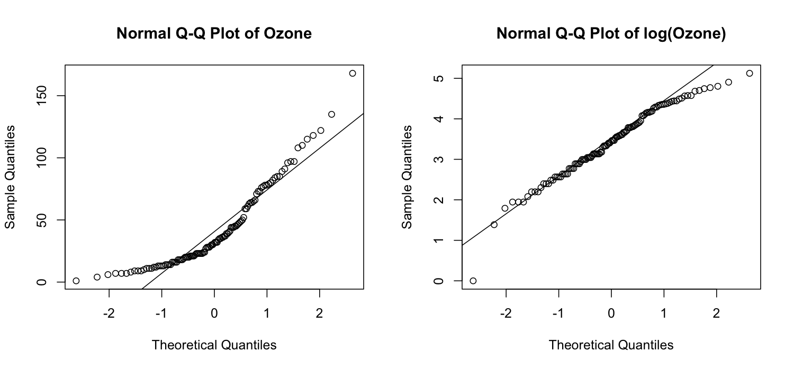

# 8강 연습 문제 풀이 — 비모수적 방법

[레포지토리 안내](../../README.ko.md) | [English](Solutions.md) | [한국어](Solutions.ko.md)

> **최종 수정일:** 2026-11-04

---

<br>

## 목차

- [연습 문제 1: 손으로 계산하는 2표본 t 검정](#연습-문제-1-손으로-계산하는-2표본-t-검정)
- [연습 문제 2: 분산이 다른 두 살충제](#연습-문제-2-분산이-다른-두-살충제)
- [연습 문제 3: 혈압의 대응표본 t 검정](#연습-문제-3-혈압의-대응표본-t-검정)
- [연습 문제 4: 오존 농도의 정규성과 변환](#연습-문제-4-오존-농도의-정규성과-변환)
- [연습 문제 5: 손으로 계산하는 Wilcoxon 순위합 검정](#연습-문제-5-손으로-계산하는-wilcoxon-순위합-검정)
- [연습 문제 6: 동점이 있는 순위합 검정](#연습-문제-6-동점이-있는-순위합-검정)
- [연습 문제 7: 혈압 자료의 부호순위 검정](#연습-문제-7-혈압-자료의-부호순위-검정)
- [연습 문제 8: 꼬리가 두꺼운 분포에서의 검정력](#연습-문제-8-꼬리가-두꺼운-분포에서의-검정력)

---

<br>

## 연습 문제 1: 손으로 계산하는 2표본 t 검정

**문제:** 두 집단 A(5개)와 B(6개)에 등분산을 가정한 2표본 t 검정을 손으로 계산한다. 문제는 [연습 문제 1](Exercises.ko.md#연습-문제-1-손으로-계산하는-2표본-t-검정)에 있다.

### 풀이

**정답:** $t = -4.431$, 자유도 9이다. $\vert t \vert = 4.431 > 2.262$이므로 유의수준 0.05에서 두 모평균이 같다는 귀무가설을 기각한다(유의확률 0.0016).

**해설:** 2표본 t 검정은 두 표본평균의 차이를 합동 표준편차로 만든 표준오차로 나눈다([8강 2.2절](Concepts_Lecture.ko.md#22-귀무가설과-검정통계량)).

| 단계 | 계산 | 값 |
|:-----|:-----|:-----|
| 표본평균 | $\bar{x}_A = 65/5$, $\bar{x}_B = 102/6$ | 13, 17 |
| 편차제곱합 | A: $1 + 4 + 4 + 1 + 0$, B: $1 + 1 + 4 + 0 + 4 + 0$ | 10, 10 |
| 합동 분산 | $s_p^2 = (10 + 10)/(5 + 6 - 2)$ | 2.222 |
| 합동 표준편차 | $s_p = \sqrt{2.222}$ | 1.491 |
| 표준오차 | $s_p\sqrt{1/5 + 1/6} = 1.491 \times 0.6055$ | 0.9027 |
| t 통계량 | $(13 - 17)/0.9027$ | -4.431 |
| 자유도 | $5 + 6 - 2$ | 9 |

*표 1. 두 집단의 2표본 t 검정의 단계별 계산*

A의 편차는 $-1, 2, -2, 1, 0$이고 B의 편차는 $-1, 1, -2, 0, 2, 0$이다. 평균 차이의 95% 신뢰구간은 $-4 \pm 2.262 \times 0.9027 = -4 \pm 2.042$, 즉 $(-6.04, -1.96)$이다.

```r
a <- c(12, 15, 11, 14, 13)
b <- c(16, 18, 15, 17, 19, 17)
t.test(a, b, var.equal = TRUE)   # 등분산을 가정한 2표본 t 검정
qt(0.975, df = 9)                # 양측 5% 기각값
```

```text
	Two Sample t-test

data:  a and b
t = -4.4313, df = 9, p-value = 0.001644
alternative hypothesis: true difference in means is not equal to 0
95 percent confidence interval:
 -6.041984 -1.958016
sample estimates:
mean of x mean of y 
       13        17 

[1] 2.262157
```

R의 t 통계량, 자유도, 신뢰구간이 손 계산과 같다. `qt(0.975, df = 9)`는 자유도 9인 t 분포의 97.5% 분위수로, 양측 검정의 기각값이다.

---

<br>

## 연습 문제 2: 분산이 다른 두 살충제

**문제:** `InsectSprays`의 살충제 A와 C의 곤충 수를 등분산 여부를 확인하고 비교한다. 문제는 [연습 문제 2](Exercises.ko.md#연습-문제-2-분산이-다른-두-살충제)에 있다.

### 풀이

**정답:** A의 평균과 표준편차는 14.5와 4.72, C는 2.08과 1.98이다. F 검정의 유의확률이 0.0075로 등분산을 기각하므로 Welch t 검정이 알맞다. 두 검정의 t 통계량은 8.407로 같고, 자유도는 22와 14.74, 유의확률은 $2.6 \times 10^{-8}$과 $5.3 \times 10^{-7}$이다. 어느 검정으로도 두 살충제의 평균 곤충 수가 다르다고 결론짓는다.

**해설:**

```r
sA <- InsectSprays$count[InsectSprays$spray == "A"]   # 살충제 A의 곤충 수
sC <- InsectSprays$count[InsectSprays$spray == "C"]   # 살충제 C의 곤충 수
c(mean_A = mean(sA), sd_A = sd(sA), mean_C = mean(sC), sd_C = sd(sC))
var.test(sA, sC)$p.value                              # 등분산의 F 검정
student <- t.test(sA, sC, var.equal = TRUE)           # Student t 검정
welch   <- t.test(sA, sC)                             # Welch t 검정
rbind(student = c(student$statistic, student$parameter, p = student$p.value),
      welch   = c(welch$statistic, welch$parameter, p = welch$p.value))
```

```text
   mean_A      sd_A    mean_C      sd_C 
14.500000  4.719399  2.083333  1.975225 
[1] 0.007489869
               t       df            p
student 8.407339 22.00000 2.563261e-08
welch   8.407339 14.73901 5.278477e-07
```

- **F 검정:** 통계량은 $s_A^2/s_C^2 = 4.719^2/1.975^2 = 22.27/3.90 = 5.71$이다. 유의확률 0.0075가 0.05보다 작으므로 두 분산이 같다는 가정을 기각한다.
- **t 통계량:** 두 집단의 크기가 12로 같으므로 Student와 Welch의 표준오차가 같고 t 통계량도 $(14.5 - 2.083)/\sqrt{22.27/12 + 3.90/12} = 12.417/1.477 \approx 8.407$로 같다([8강 2.5절](Concepts_Lecture.ko.md#25-등분산-가정과-welch-t-검정)).
- **자유도:** Welch 자유도는 $\nu = (1.856 + 0.325)^2/(1.856^2/11 + 0.325^2/11) = 4.758/0.3228 \approx 14.74$이다. 분산이 큰 A의 항이 식을 지배하여 $\nu$가 A 한 집단의 자유도 11 쪽으로 가까워지므로 22보다 크게 줄어든다.
- **결론:** 이 자료에서는 두 검정의 결론이 같지만, 등분산 가정이 깨졌으므로 보고할 결과는 Welch t 검정이다. 표본 크기가 다르고 분산이 다르면 Student t 검정의 제1종 오류율이 유의수준에서 크게 벗어날 수 있다.

> **참고:** 개수 자료는 평균이 클수록 분산도 커지는 경향이 있다(포아송분포에서는 평균과 분산이 같다). 곤충이 많은 A의 분산(22.3)이 적은 C의 분산(3.9)보다 큰 것도 그 때문이며, 이런 자료는 7강 4.4절처럼 포아송 회귀로 분석하거나 제곱근 변환으로 분산을 안정시킬 수 있다.

---

<br>

## 연습 문제 3: 혈압의 대응표본 t 검정

**문제:** 환자 8명의 복용 전후 혈압에 대응표본 t 검정을 적용한다. 문제는 [연습 문제 3](Exercises.ko.md#연습-문제-3-혈압의-대응표본-t-검정)에 있다.

### 풀이

**정답:** $\bar{d} = 5.125$, $s_d = 3.182$, $t = 4.556$, 자유도 7이다. $4.556 > 2.365$이므로 유의수준 0.05에서 혈압의 평균 변화가 0이라는 귀무가설을 기각한다(유의확률 0.0026). 짝을 무시한 독립 2표본 t 검정의 유의확률은 0.169로 유의하지 않다.

**해설:** 대응표본 t 검정은 차이 $d_i$에 대한 일표본 t 검정이다([8강 2.6절](Concepts_Lecture.ko.md#26-대응표본-t-검정)).

1. **차이:** $d = (8, 5, -1, 6, 9, 3, 7, 4)$이고 합은 41이므로 $\bar{d} = 41/8 = 5.125$이다.
2. **표준편차:** 편차 $d_i - \bar{d}$는 $2.875, -0.125, -6.125, 0.875, 3.875, -2.125, 1.875, -1.125$이고, 그 제곱합은 $8.266 + 0.016 + 37.516 + 0.766 + 15.016 + 4.516 + 3.516 + 1.266 = 70.875$이다. $s_d^2 = 70.875/7 = 10.125$, $s_d = 3.182$이다.
3. **검정통계량:** $t = \bar{d}/(s_d/\sqrt{n}) = 5.125/(3.182/\sqrt{8}) = 5.125/1.125 = 4.556$, 자유도는 $n - 1 = 7$이다.

```r
before <- c(140, 152, 138, 145, 160, 148, 155, 142)
after  <- c(132, 147, 139, 139, 151, 145, 148, 138)
d <- before - after                                  # 환자별 혈압 감소량
d
c(mean = mean(d), sd = sd(d))
t.test(before, after, paired = TRUE)                 # 대응표본 t 검정
t.test(before, after, var.equal = TRUE)$p.value      # 짝을 무시한 경우
```

```text
[1]  8  5 -1  6  9  3  7  4
    mean       sd 
5.125000 3.181981 

	Paired t-test

data:  before and after
t = 4.5556, df = 7, p-value = 0.002619
alternative hypothesis: true mean difference is not equal to 0
95 percent confidence interval:
 2.464798 7.785202
sample estimates:
mean difference 
          5.125 

[1] 0.1691734
```

약을 복용한 뒤 혈압이 평균 5.1 mmHg 낮아졌으며, 95% 신뢰구간은 $(2.46, 7.79)$이다. 같은 자료를 독립 2표본 t 검정으로 분석하면 환자 사이의 혈압 차이(복용 전 138\~160 mmHg)가 표준오차에 섞여 유의확률이 0.169로 커진다. 환자 안의 변화만 보는 대응 분석은 이 변동을 제거하므로 같은 자료에서 훨씬 큰 검정력을 갖는다.

---

<br>

## 연습 문제 4: 오존 농도의 정규성과 변환

**문제:** `airquality`의 `Ozone`에서 결측값을 빼고 원자료, 제곱근 변환, 로그 변환의 정규성을 비교한다. 문제는 [연습 문제 4](Exercises.ko.md#연습-문제-4-오존-농도의-정규성과-변환)에 있다.

### 풀이

**정답:** 결측값 37개를 빼면 관측은 116개이다. Shapiro-Wilk 유의확률은 원자료 $2.8 \times 10^{-8}$, 제곱근 0.0044, 로그 0.0147로 로그 변환이 가장 정규분포에 가깝다. 다만 로그 변환 후에도 양 끝이 직선에서 조금 벗어나 정규성을 완전히 회복하지는 못한다.

**해설:**

```r
oz <- airquality$Ozone
oz <- oz[!is.na(oz)]                                  # 결측값 제거
length(oz)
summary(oz)
c(original = shapiro.test(oz)$p.value,                # 원자료
  sqrt     = shapiro.test(sqrt(oz))$p.value,          # 제곱근 변환
  log      = shapiro.test(log(oz))$p.value)           # 로그 변환
par(mfrow = c(1, 2))
qqnorm(oz, main = "Normal Q-Q Plot of Ozone"); qqline(oz)
qqnorm(log(oz), main = "Normal Q-Q Plot of log(Ozone)"); qqline(log(oz))
```

```text
[1] 116
   Min. 1st Qu.  Median    Mean 3rd Qu.    Max. 
   1.00   18.00   31.50   42.13   63.25  168.00 
    original         sqrt          log 
2.789602e-08 4.408066e-03 1.470894e-02 
```



*그림 1. 오존 농도 원자료와 로그 변환한 자료의 정규 Q-Q 그림*

- `is.na(oz)`는 결측값이면 `TRUE`인 논리 벡터이고, `!`로 뒤집어 결측이 아닌 값만 남긴다. 153일 가운데 37일이 결측이다.
- 평균(42.1)이 중앙값(31.5)보다 크고 최댓값이 168로 오른쪽 꼬리가 길다. 왼쪽 Q-Q 그림에서 점들이 아래로 볼록한 곡선을 이루는 것도 오른쪽으로 치우친 분포의 특징이다([8강 3.1절](Concepts_Lecture.ko.md#31-그래프로-점검하기)).
- 로그 변환 후에는 가운데 점들이 직선 위에 놓이지만, 가장 작은 값(오존 1, 로그 0)이 직선보다 한참 아래에 있고 위쪽 끝은 직선 아래로 휜다. 로그가 큰 값을 지나치게 줄여 이번에는 약간 왼쪽으로 치우쳤다는 뜻이다. 제곱근은 로그보다 약하게 줄이지만 이 자료에서는 오른쪽 치우침이 남아 유의확률이 더 작다([8강 3.3절](Concepts_Lecture.ko.md#33-정규분포를-따르지-않는-자료-변환과-비모수-검정)).
- 관측이 116개로 많으면 Shapiro-Wilk 검정은 작은 이탈에도 민감하다. 로그 척도에서는 분포가 대체로 대칭이므로 평균에 기초한 방법을 로그 척도에서 쓰는 것이 원자료보다 훨씬 낫고, 정규성이 계속 걱정되면 비모수 검정을 쓴다.

---

<br>

## 연습 문제 5: 손으로 계산하는 Wilcoxon 순위합 검정

**문제:** 집단 1(4개)과 집단 2(5개)에 Wilcoxon 순위합 검정을 손으로 적용한다. 문제는 [연습 문제 5](Exercises.ko.md#연습-문제-5-손으로-계산하는-wilcoxon-순위합-검정)에 있다.

### 풀이

**정답:** $W = 11$, $\mu_W = 20$, $\sigma_W = 4.082$이다. 양측 유의확률은 연속성 수정 없이 0.0275($z = -2.205$), 연속성 수정을 하면 0.0373($z = -2.082$), 정확 분포로 0.0317이다. 어느 방법으로도 유의수준 0.05에서 귀무가설을 기각한다.

**해설:**

**(1) 순위와 순위합.** 9개의 값을 작은 것부터 늘어놓는다.

| 값 | 2.8 | 3.1 | 4.5 | 4.9 | 5.0 | 5.8 | 6.2 | 6.6 | 7.1 |
|:-----|:-----:|:-----:|:-----:|:-----:|:-----:|:-----:|:-----:|:-----:|:-----:|
| 집단 | 1 | 1 | 1 | 2 | 1 | 2 | 2 | 2 | 2 |
| 순위 | 1 | 2 | 3 | 4 | 5 | 6 | 7 | 8 | 9 |

*표 2. 합친 표본의 값과 순위*

집단 1의 순위합은 $W = 1 + 2 + 3 + 5 = 11$이다.

**(2) 정규 근사.** $n_1 = 4$, $n_2 = 5$, $N = 9$이므로 $\mu_W = 4 \times 10/2 = 20$, $\sigma_W = \sqrt{4 \times 5 \times 10/12} = \sqrt{16.667} = 4.082$이다([8강 4.2절](Concepts_Lecture.ko.md#42-검정통계량-w)). 연속성 수정 없이 $z = (11 - 20)/4.082 = -2.205$이고 양측 유의확률은 $2 \times P(Z \le -2.205) = 0.0275$이다. $W$가 평균보다 작은 쪽에 있으므로 연속성 수정은 $W$에 0.5를 더하여 $z = (11 + 0.5 - 20)/4.082 = -2.082$, 양측 유의확률은 0.0373이다([8강 4.5절](Concepts_Lecture.ko.md#45-한계-연속성-수정과-동점)).

**(3) 정확 분포.** 9개의 순위에서 4개를 고르는 방법은 $\binom{9}{4} = 126$가지이고 귀무가설 아래에서 모두 같은 확률이다. 순위합이 11 이하인 조합은 $\lbrace1, 2, 3, 4\rbrace$(합 10)와 $\lbrace1, 2, 3, 5\rbrace$(합 11)의 2가지이므로 $P(W \le 11) = 2/126 = 0.0159$이다. $W$의 분포는 $\mu_W$를 중심으로 대칭이므로 양측 유의확률은 $2 \times 0.0159 = 0.0317$이다([8강 4.4절](Concepts_Lecture.ko.md#44-정확-분포와-r의-출력)).

```r
x1 <- c(3.1, 4.5, 2.8, 5.0)
x2 <- c(6.2, 4.9, 7.1, 5.8, 6.6)
rank(c(x1, x2))                                                # 합친 표본의 순위
wilcox.test(x1, x2)                                            # 정확 검정
wilcox.test(x1, x2, exact = FALSE, correct = FALSE)$p.value    # 정규 근사
wilcox.test(x1, x2, exact = FALSE, correct = TRUE)$p.value     # 연속성 수정
```

```text
[1] 2 3 1 5 7 4 9 6 8

	Wilcoxon rank sum exact test

data:  x1 and x2
W = 1, p-value = 0.03175
alternative hypothesis: true location shift is not equal to 0

[1] 0.02748634
[1] 0.03733642
```

`rank()`의 결과는 입력 순서(3.1, 4.5, 2.8, 5.0, 6.2, ...)대로의 순위이다. R의 `W = 1`은 Mann-Whitney 통계량 $U = W - n_1(n_1+1)/2 = 11 - 10 = 1$이며, 집단 1의 값이 집단 2의 값보다 큰 쌍이 5.0 > 4.9 하나뿐이라는 뜻이다. 세 유의확률이 손 계산과 모두 같다.

---

<br>

## 연습 문제 6: 동점이 있는 순위합 검정

**문제:** 동점이 있는 두 집단에 평균 순위와 분산 보정을 적용한다. 문제는 [연습 문제 6](Exercises.ko.md#연습-문제-6-동점이-있는-순위합-검정)에 있다.

### 풀이

**정답:** $W = 13.5$, 동점을 보정한 $\sigma_W = 3.997$, 연속성 수정을 한 $z = -1.501$이고 양측 유의확률은 0.133이다. 유의수준 0.05에서 귀무가설을 기각하지 못한다.

**해설:**

**(1) 평균 순위.** 9개의 값을 정렬하면 10, 12, 12, 12, 14, 15, 15, 18, 20이다. 세 12는 2, 3, 4위를 차지하므로 모두 $(2 + 3 + 4)/3 = 3$위를, 두 15는 6, 7위를 차지하므로 모두 6.5위를 받는다. 집단 1(10, 12, 12, 15)의 순위합은 $W = 1 + 3 + 3 + 6.5 = 13.5$이다.

**(2) 동점 보정.** 동점 묶음은 크기 3(12)과 크기 2(15)이므로 $\sum(t_k^3 - t_k) = (27 - 3) + (8 - 2) = 30$이다. $n_1 = 4$, $n_2 = 5$, $N = 9$이므로 다음과 같다([8강 4.5절](Concepts_Lecture.ko.md#45-한계-연속성-수정과-동점)).

$$
\sigma_W^2 = \frac{4 \times 5}{12}\left\lbrace10 - \frac{30}{9 \times 8}\right\rbrace = 1.667 \times 9.583 = 15.97, \qquad \sigma_W = 3.997
$$

**(3) 검정.** $\mu_W = 4 \times 10/2 = 20$이고, $W$가 평균보다 작으므로 연속성 수정은 0.5를 더한다. $z = (13.5 + 0.5 - 20)/3.997 = -1.501$이고 양측 유의확률은 $2 \times P(Z \le -1.501) = 0.133$이다.

```r
p1 <- c(10, 12, 12, 15)
p2 <- c(12, 14, 15, 18, 20)
rank(c(p1, p2))          # 동점에는 평균 순위
wilcox.test(p1, p2)
```

```text
[1] 1.0 3.0 3.0 6.5 3.0 5.0 6.5 8.0 9.0

	Wilcoxon rank sum test with continuity correction

data:  p1 and p2
W = 3.5, p-value = 0.1333
alternative hypothesis: true location shift is not equal to 0

Warning message:
In wilcox.test.default(p1, p2) : cannot compute exact p-value with ties
```

R의 `W = 3.5`는 $13.5 - 4 \times 5/2 = 3.5$인 Mann-Whitney 통계량이다. 동점 때문에 정확 분포를 쓸 수 없다는 경고와 함께, 동점을 보정하고 연속성 수정을 한 정규 근사의 유의확률 0.1333을 보고하며, 이는 손 계산과 같다.

---

<br>

## 연습 문제 7: 혈압 자료의 부호순위 검정

**문제:** 연습 문제 3의 혈압 자료에 Wilcoxon 부호순위 검정을 적용한다. 문제는 [연습 문제 7](Exercises.ko.md#연습-문제-7-혈압-자료의-부호순위-검정)에 있다.

### 풀이

**정답:** $T^+ = 35$이고 정확한 양측 유의확률은 $4/256 = 0.0156$이다. 유의수준 0.05에서 귀무가설을 기각한다.

**해설:** 부호순위 검정은 차이의 절댓값에 순위를 매기고, 양수인 차이의 순위를 더한다([8강 4.6절](Concepts_Lecture.ko.md#46-대응-표본-wilcoxon-부호순위-검정)).

| 환자 | 1 | 2 | 3 | 4 | 5 | 6 | 7 | 8 |
|:-----|:-----:|:-----:|:-----:|:-----:|:-----:|:-----:|:-----:|:-----:|
| 차이 $d_i$ | 8 | 5 | -1 | 6 | 9 | 3 | 7 | 4 |
| $\vert d_i \vert$의 순위 | 7 | 4 | 1 | 5 | 8 | 2 | 6 | 3 |

*표 3. 혈압 감소량과 그 절댓값의 순위*

0인 차이가 없으므로 $n = 8$이다. 음수인 차이는 환자 3의 $-1$(순위 1)뿐이므로 $T^+ = (1 + 2 + \cdots + 8) - 1 = 36 - 1 = 35$, $T^- = 1$이다.

귀무가설 아래에서는 각 순위에 양과 음의 부호가 붙을 확률이 1/2씩이고 서로 독립이므로, $2^8 = 256$가지의 부호 배치가 모두 같은 확률이다. $T^+ \ge 35$는 $T^- \le 1$과 같으며, 이는 모든 차이가 양수이거나($T^- = 0$) 순위 1인 차이만 음수인($T^- = 1$) 2가지뿐이다. 따라서 $P(T^+ \ge 35) = 2/256$이고, 분포가 대칭이므로 양측 유의확률은 $4/256 = 0.0156$이다.

```r
before <- c(140, 152, 138, 145, 160, 148, 155, 142)
after  <- c(132, 147, 139, 139, 151, 145, 148, 138)
wilcox.test(before, after, paired = TRUE)   # 부호순위 검정 (동점과 0이 없어 정확 검정)
2 * psignrank(1, n = 8)                     # 2 * P(V <= 1)
```

```text
	Wilcoxon signed rank exact test

data:  before and after
V = 35, p-value = 0.01563
alternative hypothesis: true location shift is not equal to 0

[1] 0.015625
```

`psignrank(q, n)`은 쌍이 `n`개일 때 부호순위 통계량이 `q` 이하일 확률이다. 부호순위 검정의 유의확률 0.0156은 대응표본 t 검정의 0.0026보다 크다. 차이가 대체로 정규분포에 가까운 이 자료에서는 차이의 크기를 모두 쓰는 t 검정이 더 강한 증거를 준다. 또한 쌍이 8개뿐이면 부호순위 검정의 가장 작은 양측 유의확률이 $2/256 = 0.0078$로 정해져 있어, 매우 작은 유의확률을 얻을 수 없다는 점도 알아 둔다.

---

<br>

## 연습 문제 8: 꼬리가 두꺼운 분포에서의 검정력

**문제:** 자유도 3인 t 분포에서 뽑은 두 집단으로 t 검정과 Wilcoxon 순위합 검정의 기각 비율을 모의실험한다. 문제는 [연습 문제 8](Exercises.ko.md#연습-문제-8-꼬리가-두꺼운-분포에서의-검정력)에 있다.

### 풀이

**정답:** 이동이 0일 때 기각 비율은 t 검정 0.0385, Wilcoxon 검정 0.042로 둘 다 유의수준 근처이다. 이동이 0.8일 때 검정력은 t 검정 0.3725, Wilcoxon 검정 0.488로 Wilcoxon 검정이 더 높다.

**해설:**

```r
set.seed(42)
power_sim <- function(gen, shift, n = 20, reps = 2000, alpha = 0.05) {
  p_t <- p_w <- numeric(reps)
  for (i in 1:reps) {
    x <- gen(n)
    y <- gen(n) + shift
    p_t[i] <- t.test(x, y, var.equal = TRUE)$p.value
    p_w[i] <- wilcox.test(x, y)$p.value
  }
  c(t_test = mean(p_t < alpha), wilcoxon = mean(p_w < alpha))
}
heavy_gen <- function(n) rt(n, df = 3)        # 자유도 3인 t 분포
rbind(heavy_null  = power_sim(heavy_gen, shift = 0),
      heavy_shift = power_sim(heavy_gen, shift = 0.8))
```

```text
            t_test wilcoxon
heavy_null  0.0385    0.042
heavy_shift 0.3725    0.488
```

- 자유도 3인 t 분포는 0을 중심으로 대칭이지만 정규분포보다 꼬리가 훨씬 두꺼워, 가끔 절댓값이 매우 큰 값이 나온다(분산은 3이다).
- 이동이 없을 때(`heavy_null`) 두 검정 모두 기각 비율이 0.05 근처이므로 제1종 오류를 잘 통제한다.
- 이동이 있을 때 Wilcoxon 검정의 검정력이 t 검정보다 0.12 정도 높다. 극단값이 표본분산을 키워 t 통계량을 작게 만들지만, 순위는 극단값의 크기에 영향을 받지 않기 때문이다.
- 8강 5.3절의 결과와 비교하면, 정규분포에서는 t 검정이 조금 앞섰고(0.708 대 0.679), 로그정규분포에서는 Wilcoxon 검정이 크게 앞섰다(0.331 대 0.726). 대칭이지만 꼬리가 두꺼운 이 분포는 그 중간에 있다. 분포가 정규분포에서 멀어질수록 Wilcoxon 검정의 상대적인 이점이 커진다([8강 5.3절](Concepts_Lecture.ko.md#53-모의실험으로-본-검정력)).
