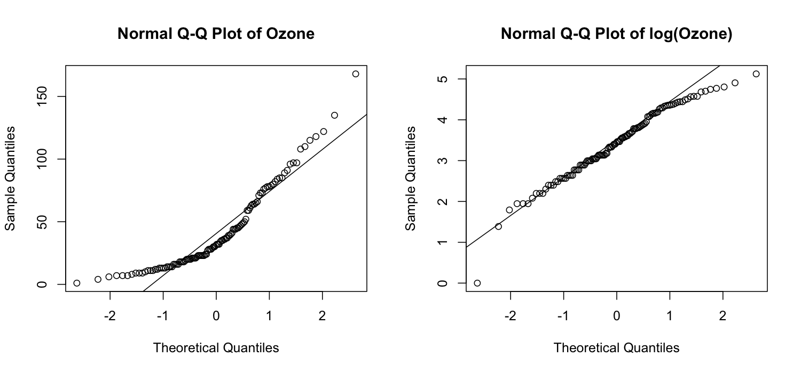

# Lecture 8 Solutions — Nonparametric Approaches

[Repository Guide](../../README.md) | [English](Solutions.md) | [한국어](Solutions.ko.md)

> **Last Updated:** 2026-11-04

---

<br>

## Table of Contents

- [Exercise 1: A Two-Sample t-Test by Hand](#exercise-1-a-two-sample-t-test-by-hand)
- [Exercise 2: Two Insecticides with Different Variances](#exercise-2-two-insecticides-with-different-variances)
- [Exercise 3: A Paired t-Test on Blood Pressure](#exercise-3-a-paired-t-test-on-blood-pressure)
- [Exercise 4: Normality and Transformation of Ozone Levels](#exercise-4-normality-and-transformation-of-ozone-levels)
- [Exercise 5: A Wilcoxon Rank-Sum Test by Hand](#exercise-5-a-wilcoxon-rank-sum-test-by-hand)
- [Exercise 6: A Rank-Sum Test with Ties](#exercise-6-a-rank-sum-test-with-ties)
- [Exercise 7: A Signed-Rank Test on the Blood Pressure Data](#exercise-7-a-signed-rank-test-on-the-blood-pressure-data)
- [Exercise 8: Power Under a Heavy-Tailed Distribution](#exercise-8-power-under-a-heavy-tailed-distribution)

---

<br>

## Exercise 1: A Two-Sample t-Test by Hand

**Problem:** Compute by hand a two-sample t-test with equal variances for groups A (5 values) and B (6 values). The problem is in [Exercise 1](Exercises.md#exercise-1-a-two-sample-t-test-by-hand).

### Solution

**Answer:** $t = -4.431$ with 9 degrees of freedom. Since $\vert t \vert = 4.431 > 2.262$, the null hypothesis that the two population means are equal is rejected at the significance level 0.05 (p-value 0.0016).

**Explanation:** The two-sample t-test divides the difference between the two sample means by the standard error formed from the pooled standard deviation ([Lecture 8, Section 2.2](Concepts_Lecture.md#22-the-null-hypothesis-and-the-test-statistic)).

| Step | Computation | Value |
|:-----|:-----|:-----|
| Sample means | $`\bar{x}_A = 65/5`$, $`\bar{x}_B = 102/6`$ | 13, 17 |
| Sums of squared deviations | A: $1 + 4 + 4 + 1 + 0$, B: $1 + 1 + 4 + 0 + 4 + 0$ | 10, 10 |
| Pooled variance | $s_p^2 = (10 + 10)/(5 + 6 - 2)$ | 2.222 |
| Pooled standard deviation | $s_p = \sqrt{2.222}$ | 1.491 |
| Standard error | $s_p\sqrt{1/5 + 1/6} = 1.491 \times 0.6055$ | 0.9027 |
| t statistic | $(13 - 17)/0.9027$ | -4.431 |
| Degrees of freedom | $5 + 6 - 2$ | 9 |

*Table 1. Step-by-step computation of the two-sample t-test for the two groups*

The deviations are $-1, 2, -2, 1, 0$ in A and $-1, 1, -2, 0, 2, 0$ in B. The 95% confidence interval for the difference in means is $-4 \pm 2.262 \times 0.9027 = -4 \pm 2.042$, that is, $(-6.04, -1.96)$.

```r
a <- c(12, 15, 11, 14, 13)
b <- c(16, 18, 15, 17, 19, 17)
t.test(a, b, var.equal = TRUE)   # two-sample t-test with equal variances
qt(0.975, df = 9)                # two-sided 5% critical value
```

```text
	Two Sample t-test

data:  a and b
t = -4.4313, df = 9, p-value = 0.001644
alternative hypothesis: true difference in means is not equal to 0
95 percent confidence interval:
 -6.041984 -1.958016
sample estimates:
mean of x mean of y 
       13        17 

[1] 2.262157
```

R's t statistic, degrees of freedom, and confidence interval match the hand calculation. `qt(0.975, df = 9)` is the 97.5% quantile of the t distribution with 9 degrees of freedom, the critical value of the two-sided test.

---

<br>

## Exercise 2: Two Insecticides with Different Variances

**Problem:** Compare the insect counts for insecticides A and C in `InsectSprays` after checking whether the variances are equal. The problem is in [Exercise 2](Exercises.md#exercise-2-two-insecticides-with-different-variances).

### Solution

**Answer:** The mean and standard deviation are 14.5 and 4.72 for A and 2.08 and 1.98 for C. The F test rejects equal variances with a p-value of 0.0075, so the Welch t-test is appropriate. Both tests give the same t statistic, 8.407, with 22 and 14.74 degrees of freedom and p-values of $2.6 \times 10^{-8}$ and $5.3 \times 10^{-7}$. Either test leads to the conclusion that the mean insect counts of the two insecticides differ.

**Explanation:**

```r
sA <- InsectSprays$count[InsectSprays$spray == "A"]   # insect counts for spray A
sC <- InsectSprays$count[InsectSprays$spray == "C"]   # insect counts for spray C
c(mean_A = mean(sA), sd_A = sd(sA), mean_C = mean(sC), sd_C = sd(sC))
var.test(sA, sC)$p.value                              # F test of equal variances
student <- t.test(sA, sC, var.equal = TRUE)           # Student's t-test
welch   <- t.test(sA, sC)                             # Welch t-test
rbind(student = c(student$statistic, student$parameter, p = student$p.value),
      welch   = c(welch$statistic, welch$parameter, p = welch$p.value))
```

```text
   mean_A      sd_A    mean_C      sd_C 
14.500000  4.719399  2.083333  1.975225 
[1] 0.007489869
               t       df            p
student 8.407339 22.00000 2.563261e-08
welch   8.407339 14.73901 5.278477e-07
```

- **F test:** the statistic is $s_A^2/s_C^2 = 4.719^2/1.975^2 = 22.27/3.90 = 5.71$. The p-value 0.0075 is below 0.05, so the assumption of equal variances is rejected.
- **t statistic:** both groups have size 12, so Student's and Welch's standard errors coincide and the t statistic is the same, $(14.5 - 2.083)/\sqrt{22.27/12 + 3.90/12} = 12.417/1.477 \approx 8.407$ ([Lecture 8, Section 2.5](Concepts_Lecture.md#25-the-equal-variance-assumption-and-the-welch-t-test)).
- **Degrees of freedom:** the Welch degrees of freedom are $\nu = (1.856 + 0.325)^2/(1.856^2/11 + 0.325^2/11) = 4.758/0.3228 \approx 14.74$. The term of A, the group with the larger variance, dominates the formula and pulls $\nu$ toward 11, the degrees of freedom of group A alone, so they drop well below 22.
- **Conclusion:** for these data the two tests reach the same conclusion, but since the equal-variance assumption fails, the result to report is that of the Welch t-test. With unequal sample sizes and unequal variances, the type I error rate of Student's t-test can stray far from the significance level.

> **Note:** Count data tend to have a larger variance when the mean is larger (in a Poisson distribution the mean and variance are equal). This is why the variance of A, with many insects (22.3), exceeds that of C, with few (3.9); such data can be analyzed with Poisson regression as in Lecture 7, Section 4.4, or have their variance stabilized with a square-root transformation.

---

<br>

## Exercise 3: A Paired t-Test on Blood Pressure

**Problem:** Apply the paired t-test to the blood pressure of 8 patients before and after the drug. The problem is in [Exercise 3](Exercises.md#exercise-3-a-paired-t-test-on-blood-pressure).

### Solution

**Answer:** $\bar{d} = 5.125$, $s_d = 3.182$, $t = 4.556$, with 7 degrees of freedom. Since $4.556 > 2.365$, the null hypothesis that the mean change in blood pressure is 0 is rejected at the significance level 0.05 (p-value 0.0026). The independent two-sample t-test that ignores the pairing gives a p-value of 0.169, which is not significant.

**Explanation:** The paired t-test is a one-sample t-test on the differences $d_i$ ([Lecture 8, Section 2.6](Concepts_Lecture.md#26-the-paired-t-test)).

1. **Differences:** $d = (8, 5, -1, 6, 9, 3, 7, 4)$ with sum 41, so $\bar{d} = 41/8 = 5.125$.
2. **Standard deviation:** the deviations $d_i - \bar{d}$ are $2.875, -0.125, -6.125, 0.875, 3.875, -2.125, 1.875, -1.125$, and their sum of squares is $8.266 + 0.016 + 37.516 + 0.766 + 15.016 + 4.516 + 3.516 + 1.266 = 70.875$. $s_d^2 = 70.875/7 = 10.125$ and $s_d = 3.182$.
3. **Test statistic:** $t = \bar{d}/(s_d/\sqrt{n}) = 5.125/(3.182/\sqrt{8}) = 5.125/1.125 = 4.556$, with $n - 1 = 7$ degrees of freedom.

```r
before <- c(140, 152, 138, 145, 160, 148, 155, 142)
after  <- c(132, 147, 139, 139, 151, 145, 148, 138)
d <- before - after                                  # decrease in blood pressure per patient
d
c(mean = mean(d), sd = sd(d))
t.test(before, after, paired = TRUE)                 # paired t-test
t.test(before, after, var.equal = TRUE)$p.value      # when the pairing is ignored
```

```text
[1]  8  5 -1  6  9  3  7  4
    mean       sd 
5.125000 3.181981 

	Paired t-test

data:  before and after
t = 4.5556, df = 7, p-value = 0.002619
alternative hypothesis: true mean difference is not equal to 0
95 percent confidence interval:
 2.464798 7.785202
sample estimates:
mean difference 
          5.125 

[1] 0.1691734
```

Blood pressure fell by an average of 5.1 mmHg after the drug, with a 95% confidence interval of $(2.46, 7.79)$. Analyzing the same data with the independent two-sample t-test mixes the differences in blood pressure between patients (138-160 mmHg before the drug) into the standard error and raises the p-value to 0.169. The paired analysis, which looks only at the change within each patient, removes this variation and so has much greater power on the same data.

---

<br>

## Exercise 4: Normality and Transformation of Ozone Levels

**Problem:** Remove the missing values from `Ozone` in `airquality` and compare the normality of the original data, the square-root transformation, and the log transformation. The problem is in [Exercise 4](Exercises.md#exercise-4-normality-and-transformation-of-ozone-levels).

### Solution

**Answer:** Removing the 37 missing values leaves 116 observations. The Shapiro-Wilk p-values are $2.8 \times 10^{-8}$ for the original data, 0.0044 for the square root, and 0.0147 for the log, so the log transformation comes closest to normal. Even after the log transformation, however, both ends depart slightly from the line, and normality is not fully restored.

**Explanation:**

```r
oz <- airquality$Ozone
oz <- oz[!is.na(oz)]                                  # remove missing values
length(oz)
summary(oz)
c(original = shapiro.test(oz)$p.value,                # original data
  sqrt     = shapiro.test(sqrt(oz))$p.value,          # square-root transformation
  log      = shapiro.test(log(oz))$p.value)           # log transformation
par(mfrow = c(1, 2))
qqnorm(oz, main = "Normal Q-Q Plot of Ozone"); qqline(oz)
qqnorm(log(oz), main = "Normal Q-Q Plot of log(Ozone)"); qqline(log(oz))
```

```text
[1] 116
   Min. 1st Qu.  Median    Mean 3rd Qu.    Max. 
   1.00   18.00   31.50   42.13   63.25  168.00 
    original         sqrt          log 
2.789602e-08 4.408066e-03 1.470894e-02 
```



*Figure 1. Normal Q-Q plots of the original and log-transformed ozone levels*

- `is.na(oz)` is a logical vector that is `TRUE` for missing values, and `!` negates it so that only non-missing values remain. Of the 153 days, 37 are missing.
- The mean (42.1) exceeds the median (31.5) and the maximum is 168, a long right tail. The convex curve of points in the left Q-Q plot is also characteristic of a right-skewed distribution ([Lecture 8, Section 3.1](Concepts_Lecture.md#31-checking-with-graphs)).
- After the log transformation the middle points lie on the line, but the smallest value (ozone 1, log 0) is far below the line and the upper end bends below it. This means the log shrinks large values too much and now leaves a slight left skew. The square root shrinks less strongly than the log, but for these data the right skew remains, so its p-value is smaller ([Lecture 8, Section 3.3](Concepts_Lecture.md#33-non-normal-data-transformation-and-nonparametric-tests)).
- With as many as 116 observations, the Shapiro-Wilk test is sensitive even to small departures. On the log scale the distribution is roughly symmetric, so using mean-based methods on the log scale is much better than on the original data, and if normality is still a concern a nonparametric test is used.

---

<br>

## Exercise 5: A Wilcoxon Rank-Sum Test by Hand

**Problem:** Apply the Wilcoxon rank-sum test by hand to group 1 (4 values) and group 2 (5 values). The problem is in [Exercise 5](Exercises.md#exercise-5-a-wilcoxon-rank-sum-test-by-hand).

### Solution

**Answer:** $W = 11$, $\mu_W = 20$, $\sigma_W = 4.082$. The two-sided p-value is 0.0275 without the continuity correction ($`z = -2.205`$), 0.0373 with it ($`z = -2.082`$), and 0.0317 from the exact distribution. Every method rejects the null hypothesis at the significance level 0.05.

**Explanation:**

**(1) Ranks and rank sum.** The 9 values are arranged from the smallest.

| Value | 2.8 | 3.1 | 4.5 | 4.9 | 5.0 | 5.8 | 6.2 | 6.6 | 7.1 |
|:-----|:-----:|:-----:|:-----:|:-----:|:-----:|:-----:|:-----:|:-----:|:-----:|
| Group | 1 | 1 | 1 | 2 | 1 | 2 | 2 | 2 | 2 |
| Rank | 1 | 2 | 3 | 4 | 5 | 6 | 7 | 8 | 9 |

*Table 2. Values and ranks in the pooled sample*

The rank sum of group 1 is $W = 1 + 2 + 3 + 5 = 11$.

**(2) Normal approximation.** With $n_1 = 4$, $n_2 = 5$, and $N = 9$, $\mu_W = 4 \times 10/2 = 20$ and $\sigma_W = \sqrt{4 \times 5 \times 10/12} = \sqrt{16.667} = 4.082$ ([Lecture 8, Section 4.2](Concepts_Lecture.md#42-the-test-statistic-w)). Without the continuity correction, $z = (11 - 20)/4.082 = -2.205$ and the two-sided p-value is $2 \times P(Z \le -2.205) = 0.0275$. Since $W$ lies below its mean, the continuity correction adds 0.5 to $W$, giving $z = (11 + 0.5 - 20)/4.082 = -2.082$ and a two-sided p-value of 0.0373 ([Lecture 8, Section 4.5](Concepts_Lecture.md#45-limitations-continuity-correction-and-ties)).

**(3) Exact distribution.** There are $\binom{9}{4} = 126$ ways to choose 4 of the 9 ranks, all equally likely under the null hypothesis. Only 2 combinations have a rank sum of 11 or less, $\lbrace1, 2, 3, 4\rbrace$ (sum 10) and $\lbrace1, 2, 3, 5\rbrace$ (sum 11), so $P(W \le 11) = 2/126 = 0.0159$. The distribution of $W$ is symmetric about $\mu_W$, so the two-sided p-value is $2 \times 0.0159 = 0.0317$ ([Lecture 8, Section 4.4](Concepts_Lecture.md#44-the-exact-distribution-and-rs-output)).

```r
x1 <- c(3.1, 4.5, 2.8, 5.0)
x2 <- c(6.2, 4.9, 7.1, 5.8, 6.6)
rank(c(x1, x2))                                                # ranks in the pooled sample
wilcox.test(x1, x2)                                            # exact test
wilcox.test(x1, x2, exact = FALSE, correct = FALSE)$p.value    # normal approximation
wilcox.test(x1, x2, exact = FALSE, correct = TRUE)$p.value     # continuity correction
```

```text
[1] 2 3 1 5 7 4 9 6 8

	Wilcoxon rank sum exact test

data:  x1 and x2
W = 1, p-value = 0.03175
alternative hypothesis: true location shift is not equal to 0

[1] 0.02748634
[1] 0.03733642
```

The result of `rank()` gives the ranks in input order (3.1, 4.5, 2.8, 5.0, 6.2, ...). R's `W = 1` is the Mann-Whitney statistic $U = W - n_1(n_1+1)/2 = 11 - 10 = 1$, meaning that only one pair, 5.0 > 4.9, has a group 1 value larger than a group 2 value. All three p-values match the hand calculations.

---

<br>

## Exercise 6: A Rank-Sum Test with Ties

**Problem:** Apply average ranks and the variance adjustment to two groups with ties. The problem is in [Exercise 6](Exercises.md#exercise-6-a-rank-sum-test-with-ties).

### Solution

**Answer:** $W = 13.5$, the tie-corrected $\sigma_W = 3.997$, the continuity-corrected $z = -1.501$, and the two-sided p-value is 0.133. The null hypothesis is not rejected at the significance level 0.05.

**Explanation:**

**(1) Average ranks.** Sorted, the 9 values are 10, 12, 12, 12, 14, 15, 15, 18, 20. The three 12s occupy places 2, 3, and 4, so all receive rank $(2 + 3 + 4)/3 = 3$, and the two 15s occupy places 6 and 7, so both receive rank 6.5. The rank sum of group 1 (10, 12, 12, 15) is $W = 1 + 3 + 3 + 6.5 = 13.5$.

**(2) Tie correction.** The tie groups have sizes 3 (the 12s) and 2 (the 15s), so $\sum(t_k^3 - t_k) = (27 - 3) + (8 - 2) = 30$. With $n_1 = 4$, $n_2 = 5$, and $N = 9$, the result is as follows ([Lecture 8, Section 4.5](Concepts_Lecture.md#45-limitations-continuity-correction-and-ties)).

```math
\sigma_W^2 = \frac{4 \times 5}{12}\left\lbrace10 - \frac{30}{9 \times 8}\right\rbrace = 1.667 \times 9.583 = 15.97, \qquad \sigma_W = 3.997
```

**(3) Test.** $\mu_W = 4 \times 10/2 = 20$, and since $W$ lies below its mean, the continuity correction adds 0.5. $z = (13.5 + 0.5 - 20)/3.997 = -1.501$, and the two-sided p-value is $2 \times P(Z \le -1.501) = 0.133$.

```r
p1 <- c(10, 12, 12, 15)
p2 <- c(12, 14, 15, 18, 20)
rank(c(p1, p2))          # average ranks for ties
wilcox.test(p1, p2)
```

```text
[1] 1.0 3.0 3.0 6.5 3.0 5.0 6.5 8.0 9.0

	Wilcoxon rank sum test with continuity correction

data:  p1 and p2
W = 3.5, p-value = 0.1333
alternative hypothesis: true location shift is not equal to 0

Warning message:
In wilcox.test.default(p1, p2) : cannot compute exact p-value with ties
```

R's `W = 3.5` is the Mann-Whitney statistic $13.5 - 4 \times 5/2 = 3.5$. Together with the warning that the exact distribution cannot be used because of ties, R reports 0.1333, the p-value of the normal approximation with the tie correction and the continuity correction, which matches the hand calculation.

---

<br>

## Exercise 7: A Signed-Rank Test on the Blood Pressure Data

**Problem:** Apply the Wilcoxon signed-rank test to the blood pressure data of Exercise 3. The problem is in [Exercise 7](Exercises.md#exercise-7-a-signed-rank-test-on-the-blood-pressure-data).

### Solution

**Answer:** $T^+ = 35$, and the exact two-sided p-value is $4/256 = 0.0156$. The null hypothesis is rejected at the significance level 0.05.

**Explanation:** The signed-rank test ranks the absolute differences and adds the ranks of the positive differences ([Lecture 8, Section 4.6](Concepts_Lecture.md#46-paired-samples-the-wilcoxon-signed-rank-test)).

| Patient | 1 | 2 | 3 | 4 | 5 | 6 | 7 | 8 |
|:-----|:-----:|:-----:|:-----:|:-----:|:-----:|:-----:|:-----:|:-----:|
| Difference $d_i$ | 8 | 5 | -1 | 6 | 9 | 3 | 7 | 4 |
| Rank of $\vert d_i \vert$ | 7 | 4 | 1 | 5 | 8 | 2 | 6 | 3 |

*Table 3. Decreases in blood pressure and the ranks of their absolute values*

There are no zero differences, so $n = 8$. The only negative difference is patient 3's $-1$ (rank 1), so $T^+ = (1 + 2 + \cdots + 8) - 1 = 36 - 1 = 35$ and $T^- = 1$.

Under the null hypothesis each rank independently carries a positive or negative sign with probability 1/2 each, so all $2^8 = 256$ sign patterns are equally likely. $T^+ \ge 35$ is the same as $T^- \le 1$, which happens in only 2 patterns: all differences positive ($`T^- = 0`$), or only the difference of rank 1 negative ($`T^- = 1`$). Therefore $P(T^+ \ge 35) = 2/256$, and since the distribution is symmetric, the two-sided p-value is $4/256 = 0.0156$.

```r
before <- c(140, 152, 138, 145, 160, 148, 155, 142)
after  <- c(132, 147, 139, 139, 151, 145, 148, 138)
wilcox.test(before, after, paired = TRUE)   # signed-rank test (exact: no ties or zeros)
2 * psignrank(1, n = 8)                     # 2 * P(V <= 1)
```

```text
	Wilcoxon signed rank exact test

data:  before and after
V = 35, p-value = 0.01563
alternative hypothesis: true location shift is not equal to 0

[1] 0.015625
```

`psignrank(q, n)` is the probability that the signed-rank statistic is at most `q` when there are `n` pairs. The signed-rank p-value 0.0156 is larger than the paired t-test's 0.0026. For these data, whose differences are roughly normal, the t-test, which uses the full size of the differences, gives stronger evidence. Note also that with only 8 pairs the smallest possible two-sided p-value of the signed-rank test is fixed at $2/256 = 0.0078$, so very small p-values cannot be obtained.

---

<br>

## Exercise 8: Power Under a Heavy-Tailed Distribution

**Problem:** Simulate the rejection rates of the t-test and the Wilcoxon rank-sum test for two groups drawn from the t distribution with 3 degrees of freedom. The problem is in [Exercise 8](Exercises.md#exercise-8-power-under-a-heavy-tailed-distribution).

### Solution

**Answer:** With a shift of 0 the rejection rates are 0.0385 for the t-test and 0.042 for the Wilcoxon test, both near the significance level. With a shift of 0.8 the power is 0.3725 for the t-test and 0.488 for the Wilcoxon test, higher for the Wilcoxon test.

**Explanation:**

```r
set.seed(42)
power_sim <- function(gen, shift, n = 20, reps = 2000, alpha = 0.05) {
  p_t <- p_w <- numeric(reps)
  for (i in 1:reps) {
    x <- gen(n)
    y <- gen(n) + shift
    p_t[i] <- t.test(x, y, var.equal = TRUE)$p.value
    p_w[i] <- wilcox.test(x, y)$p.value
  }
  c(t_test = mean(p_t < alpha), wilcoxon = mean(p_w < alpha))
}
heavy_gen <- function(n) rt(n, df = 3)        # t distribution with 3 degrees of freedom
rbind(heavy_null  = power_sim(heavy_gen, shift = 0),
      heavy_shift = power_sim(heavy_gen, shift = 0.8))
```

```text
            t_test wilcoxon
heavy_null  0.0385    0.042
heavy_shift 0.3725    0.488
```

- The t distribution with 3 degrees of freedom is symmetric about 0 but has much heavier tails than the normal distribution, so values with very large absolute size occasionally appear (its variance is 3).
- With no shift (`heavy_null`), both tests have rejection rates near 0.05, so both control the type I error well.
- With a shift, the power of the Wilcoxon test is about 0.12 higher than that of the t-test. Extreme values inflate the sample variance and shrink the t statistic, while ranks are not affected by the size of extreme values.
- Compared with the results of Lecture 8, Section 5.3, the t-test was slightly ahead under the normal distribution (0.708 versus 0.679) and the Wilcoxon test was far ahead under the lognormal distribution (0.331 versus 0.726). This symmetric but heavy-tailed distribution lies in between. The farther the distribution is from normal, the larger the relative advantage of the Wilcoxon test ([Lecture 8, Section 5.3](Concepts_Lecture.md#53-power-seen-through-simulation)).
